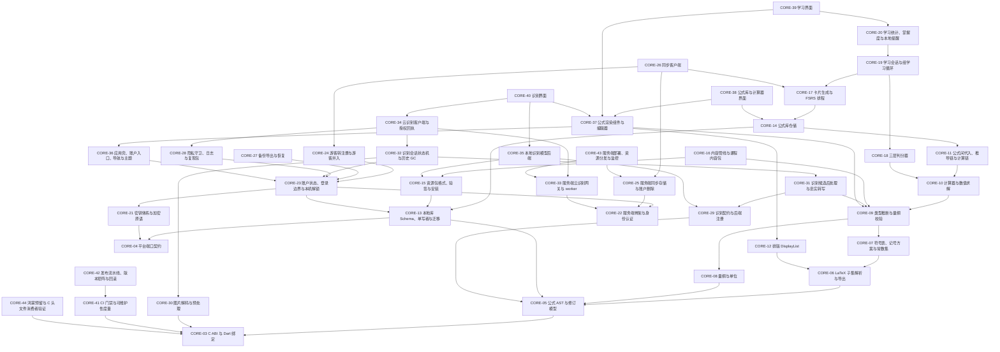

# 01 公共核心 v5

> 版本：v5 ｜ 修订日期：2026-10-18 ｜ 适用范围：Android 与 Windows 两端共用的 Rust 核心、契约、服务端与共享 Flutter UI；HarmonyOS 只做接口预留。
> 关联文档：[README](README.md)（需求基线与追踪总表）、[02 Android 端](02-Android端-v5.md)、[03 Windows 端](03-Windows端-v5.md)、[附录 A 架构决策与评审记录](附录A-架构决策与评审记录.md)、[附录 C 资源包内容与开源资源调查](附录C-资源包内容与开源资源调查.md)。
> 契约归属：本文是全部公共契约（函数签名、DTO、错误码、表结构、文件格式、服务端 API）的唯一定义处。平台文档只引用“CORE-xx §接口契约”，不得重新定义。

## 0. 使用方法

每个模块一张卡，字段固定为：目标、范围、依赖、接口契约、实现约束、验收标准、规模。一次 vibe coding 会话交给编码助手的材料是：

1. 目标卡全文；
2. 依赖卡（含间接依赖）的“接口契约”段；
3. CORE-01 与 CORE-02 的“接口契约”段（全部卡片都依赖这两张卡）。

验收标准中的 [Rxx] 指向 [README](README.md) §5 需求追踪总表。卡片编号全局唯一，此后不重排；新增模块取下一个空号，废弃模块保留编号并标“已废弃”。

## 1. 模块依赖图

依赖只指向编号更小的卡片，因此依赖图无环。图中箭头从模块指向它的前置模块；为便于阅读，省略每张卡都有的 CORE-01、CORE-02 依赖，并省略可由其他路径推出的间接依赖边（完整直接依赖见 §3 与各卡“依赖”字段）。



## 2. 建议实施顺序

原则：先搭最小可运行骨架，再逐个增加功能模块；每个阶段结束时两端都能编译运行，并且阶段内每张卡的前置卡都已在本阶段或更早阶段完成。同一阶段内互不依赖的卡可并行。

| 阶段 | 模块 | 出口（可运行的最小形态） |
| --- | --- | --- |
| S0 骨架 | CORE-01、02、03、04、41，AND-01，WIN-01 | 两端空壳应用启动，经 C ABI 调用 `fml_abi_version` 并显示版本号；CI 跑通格式、静态检查与 ABI 头文件比对 |
| S1 公式引擎 | CORE-05、06、07、08、09、10、11、12 | 核心 crate 测试全绿；经 `fml_call` 完成“LaTeX → 解析 → 量纲校验 → 计算 → DisplayList”往返 |
| S2 本地库、账户入口与编辑器 | CORE-13、21、22、23、36、37，AND-02、05、06，WIN-06、07 | 首次启动只能选游客或注册/登录；游客可输入公式、看到排版与错误高亮；数据加密落盘；进程被杀后可恢复 |
| S3 公式库与计算 | CORE-14、38 | 公式保存、修订历史、搜索、计算器与公式间代入可用 |
| S4 内容与学习 | CORE-15、16、17、18、19、20、39，AND-08，WIN-09 | bootstrap 包与至少一个课程包可安装；选书 → 组学习 → 默写 → 复习的闭环可日常自用；每日提醒 |
| S5 识别与云识别 | CORE-28、29、30、31、32、33、34、35、40，AND-03、04、07、09、10，WIN-04、05、08、10、11 | 手写与照片导入、预处理、候选校正、历史 GC；注册用户逐次授权云识别；游客只有本地/手动路径 |
| S6 同步与备份 | CORE-24、25、26、27 | 游客转注册、端到端加密同步、导出与恢复 |
| S7 发布 | CORE-42、43、44，AND-11、12，WIN-02、03、12、13 | 门禁全绿、签名发布、安装与更新演练、监控演练、鸿蒙头文件冒烟通过 |

CORE-41 在 S0 建立，之后每个阶段为新模块启用对应门禁。

## 3. 模块索引

| 编号 | 名称 | 代码位置 | 直接依赖 | 预估规模 |
| --- | --- | --- | --- | --- |
| CORE-01 | 仓库骨架与工程约定 | 仓库根 | — | 约 300 行 |
| CORE-02 | 错误码注册表与诊断模型 | `contracts/errors/`、`crates/fml-error/`、`tools/ci/gen_errors.py` | 01 | 约 350 行 |
| CORE-03 | C ABI 与 Dart 绑定 | `crates/fml-ffi/`、`app/lib/binding/` | 01、02 | 约 480 行 |
| CORE-04 | 平台端口契约 | `app/lib/ports/`、`app/test/fakes/` | 01、02 | 约 300 行 |
| CORE-05 | 公式 AST 与修订模型 | `crates/fml-ast/` | 01、02、03 | 约 450 行 |
| CORE-06 | LaTeX 子集解析与导出 | `crates/fml-latex/` | 01、02、05 | 约 500 行 |
| CORE-07 | 符号表、记号方案与常数集 | `crates/fml-notation/` | 01、02、05、06 | 约 400 行 |
| CORE-08 | 量纲与单位 | `crates/fml-units/` | 01、02、05 | 约 450 行 |
| CORE-09 | 类型推断与量纲校验 | `crates/fml-type/` | 01、02、05、06、07、08 | 约 500 行 |
| CORE-10 | 计算器与数值求解 | `crates/fml-eval/` | 01、02、05、07、08、09 | 约 500 行 |
| CORE-11 | 公式间代入、推导链与计算链 | `crates/fml-derive/` | 01、02、05、09、10 | 约 480 行 |
| CORE-12 | 排版 DisplayList | `crates/fml-typeset/` | 01、02、05、06 | 约 500 行 |
| CORE-13 | 本地库 Schema、单写者与迁移 | `crates/fml-store/` | 01、02、03、04、05 | 约 450 行 |
| CORE-14 | 公式库仓储 | `crates/fml-store/src/library/` | 01、02、05、09、11、13 | 约 500 行 |
| CORE-15 | 资源包格式、验签与安装 | `crates/fml-pack/` | 01、02、03、13 | 约 500 行 |
| CORE-16 | 内容管线与课程内容包 | `tools/content/` | 01、02、05、06、07、08、09、15 | 约 500 行 |
| CORE-17 | 卡片生成与 FSRS 排程 | `crates/fml-srs/`、`crates/fml-store/src/study/cards.rs` | 01、02、05、09、13、14 | 约 500 行 |
| CORE-18 | 三层判分器 | `crates/fml-grade/` | 01、02、05、06、07、09、10 | 约 500 行 |
| CORE-19 | 学习会话与组学习循环 | `crates/fml-study/`、`crates/fml-store/src/study/sessions.rs` | 01、02、13、14、17、18 | 约 500 行 |
| CORE-20 | 学习统计、掌握度与本地提醒 | `crates/fml-study/src/stats/`、`app/lib/study/reminder_service.dart` | 01、02、04、13、17、19 | 约 450 行 |
| CORE-21 | 密钥体系与加密原语 | `crates/fml-crypto/` | 01、02、04 | 约 400 行 |
| CORE-22 | 服务端骨架与身份认证 | `server/src/{main.rs, auth/, devices/, meta/}`、`app/lib/net/` | 01、02 | 约 500 行 |
| CORE-23 | 账户状态、登录边界与本机解锁 | `crates/fml-store/src/account/`、`app/lib/account/` | 01、02、04、13、21、22 | 约 500 行 |
| CORE-24 | 游客转注册与游客并入 | `crates/fml-sync/src/upgrade.rs` | 01、02、13、21、22、23 | 约 450 行 |
| CORE-25 | 服务端同步存储与账户删除 | `server/src/sync/`、`server/src/account/` | 01、02、22 | 约 500 行 |
| CORE-26 | 同步客户端 | `crates/fml-sync/src/{outbox.rs, merge.rs, client.rs}` | 01、02、13、14、17、21、24、25 | 约 500 行 |
| CORE-27 | 备份导出与恢复 | `crates/fml-store/src/backup/` | 01、02、04、13、21、23 | 约 400 行 |
| CORE-28 | 隐私守卫、日志与复现包 | `app/lib/privacy/`、`crates/fml-error/src/repro.rs` | 01、02、04、23 | 约 400 行 |
| CORE-29 | 识别契约与后端注册 | `crates/fml-recognize/src/{lib.rs, registry.rs, ink.rs}` | 01、02、03、05 | 约 300 行 |
| CORE-30 | 图片解码与预处理 | `crates/fml-imgproc/` | 01、02、03 | 约 500 行 |
| CORE-31 | 识别候选后处理与忠实转写 | `crates/fml-recognize/src/post.rs` | 01、02、05、06、07、09、29 | 约 350 行 |
| CORE-32 | 识别会话状态机与历史 GC | `crates/fml-recognize/src/session.rs`、`crates/fml-store/src/recognition/` | 01、02、13、21、23、29、30、31 | 约 500 行 |
| CORE-33 | 服务端云识别网关与 worker | `server/src/recognition/` | 01、02、22 | 约 500 行 |
| CORE-34 | 云识别客户端与授权回执 | `app/lib/recognition/cloud/` | 01、02、04、22、23、28、30、32、33 | 约 450 行 |
| CORE-35 | 本地识别模型后端 | `crates/fml-recognize-local/` | 01、02、15、29 | 约 350 行 |
| CORE-36 | 应用壳、账户入口、导航与主题 | `app/lib/ui/shell/`、`app/lib/main_common.dart` | 01、02、03、04、23 | 约 500 行 |
| CORE-37 | 公式渲染组件与编辑器 | `app/lib/ui/editor/` | 01、02、03、09、12、36 | 约 500 行 |
| CORE-38 | 公式库与计算器界面 | `app/lib/ui/library/`、`app/lib/ui/calc/` | 01、02、03、10、11、14、37 | 约 500 行 |
| CORE-39 | 学习界面 | `app/lib/ui/study/` | 01、02、03、19、20、37 | 约 500 行 |
| CORE-40 | 识别界面 | `app/lib/ui/recognition/` | 01、02、03、04、32、34、35、37 | 约 500 行 |
| CORE-41 | CI 门禁与可维护性度量 | `.github/workflows/`、`tools/ci/` | 01、02、03 | 约 450 行 |
| CORE-42 | 发布流水线、版本矩阵与回滚 | `tools/release/` | 01、02、41 | 约 350 行 |
| CORE-43 | 服务端部署、资源分发与监控 | `server/deploy/` | 01、02、22、25、33 | 约 300 行 |
| CORE-44 | 鸿蒙预留与 C 头文件消费者验证 | `tools/ohos-smoke/` | 01、02、03 | 约 150 行 |

“直接依赖”列只写编号尾数，如“05”即 CORE-05。

## 4. 骨架与基础契约

### CORE-01 仓库骨架与工程约定

**目标**：建立单仓库目录、Cargo 与 Flutter 工作区和全局工程约定，使后续每张卡都能在固定位置落代码。

**范围**
- 包含：目录布局、Cargo workspace、Flutter 工程 `app/`、依赖方向规则、命名与注释约定、全局资源预算表、版本号种类。
- 不包含：具体业务代码；CI 工作流（CORE-41）；平台工程细节（AND-01、WIN-01）。

**依赖**：无

**接口契约**

目录布局（全部卡片按此落位）：

```text
crates/                 Rust 核心，禁止 Flutter/Dart/JNI/HTTP 客户端依赖
  fml-error  fml-ast  fml-latex  fml-notation  fml-units  fml-type
  fml-eval   fml-derive  fml-typeset  fml-store  fml-pack  fml-srs
  fml-grade  fml-study  fml-crypto  fml-sync  fml-recognize
  fml-recognize-local  fml-imgproc  fml-ffi
contracts/              唯一事实源：错误码注册表、DTO schema、C 头文件、测试向量
  errors/registry.yaml  dto/*.schema.json  include/fmlcore.h  vectors/
app/                    Flutter 工程（Android 与 Windows 共用）
  lib/binding/          生成的 dart:ffi 绑定与类型化包装（CORE-03）
  lib/ports/            平台端口抽象（CORE-04）
  lib/platform/android/ lib/platform/windows/   端口的平台实现（AND/WIN 卡）
  lib/composition/      按平台组装端口与用例
  lib/<feature>/        用例编排：account sync recognition study library privacy
  lib/ui/<feature>/     Widget：shell editor library study recognition
  android/  windows/    平台原生工程
server/                 服务端模块化单体（CORE-22、25、33、43）
packs/                  资源包源数据（CORE-16）
tools/                  content/ ci/ release/ ohos-smoke/
```

依赖方向规则：
1. `fml-ast` 不依赖解析器、存储与 UI；`fml-type` 只依赖 `fml-ast`、`fml-units`、`fml-notation`；`fml-eval` 只依赖 `fml-ast`、`fml-type`、`fml-units`；`fml-typeset` 不直接读字体文件，字体数据由 `fml-pack` 加载后注入。
2. 领域 crate（ast、latex、notation、units、type、eval、derive、typeset、srs、grade、study、crypto，以及 sync 的合并逻辑）无 I/O：不访问网络、文件、时钟与平台 API；时间、随机数和文件内容由调用方以参数传入（sans-I/O：输入事件与状态，输出新状态与待执行的 I/O 命令）。
3. `fml-store` 可依赖领域 crate，领域 crate 不得依赖 `fml-store`。
4. `fml-ffi` 是唯一允许出现 `extern "C"` 的 crate。
5. Dart 的 `ui/` 不得直接 import `binding/`、`platform/` 或发起 HTTP，只调用 `lib/<feature>/` 用例。
6. 平台层不得实现公式解析、量纲与单位换算、排版布局、FSRS 调度、同步合并、资源包验签。

全局资源预算（各卡验收引用此表）。测量口径：release 构建，P95，真机，冷启动 ≥30 次、核心操作 ≥1000 次、图片 ≥100 张；基准设备在 M0 登记型号、系统版本与环境温度，不用模拟器替代。

| 指标 | Android 中端（4 GB arm64） | Windows（4 核 / 8 GB / SSD） |
| --- | --- | --- |
| 冷启动到首页 | < 2 s | < 1.5 s |
| 公式解析（≤256 节点） | < 20 ms | < 10 ms |
| 量纲校验 | < 10 ms | < 5 ms |
| 单式排版 | < 30 ms | < 20 ms |
| 单题判分 | ≤ 50 ms | ≤ 25 ms |
| 排程取下一题（10000 条公式 / 50000 张卡） | ≤ 20 ms | ≤ 10 ms |
| 公式库搜索首屏（10000 条） | < 100 ms | < 60 ms |
| 列表滚动 | 60 FPS，掉帧 < 1% | 60 FPS（100%–200% DPI） |
| 手写墨迹上屏 | ≤ 50 ms | ≤ 40 ms |
| 图片预处理 | < 500 ms | < 300 ms |
| 常驻内存 | < 150 MB | < 250 MB |
| 连续 20 张 12 MP 图片 | 无 OOM，60 s 内回落到空闲值 +20 MiB | 无 OOM，+30 MiB |
| 安装包（不含可选模型与内容包） | < 45 MB | 安装器 ≤ 70 MB |
| bootstrap 资源包（计入安装包） | 压缩后 ≤ 8 MiB | 压缩后 ≤ 8 MiB |

预算调整只能经附录 A 的 ADR，由需求负责人接受，且不得改变测量口径。能耗：不设常驻服务，不做周期性网络轮询；空闲时除每日一次本地提醒外没有定时唤醒。

版本号种类：App（SemVer）、ABI（`FML_ABI_MAJOR/MINOR`）、DTO schema、AST schema、DB schema（`PRAGMA user_version`）、服务端 API 主版本（`/v1`）、资源包格式与安全序号、模型与词表版本、FSRS 参数与评分映射版本、AAD 版本。兼容矩阵由 CORE-42 维护。

注释约定：每个 crate 与 Dart 特性目录有 `README.md`，说明边界、线程模型与错误语义；Rust 公共项启用 `#![deny(missing_docs)]`，Dart 启用 `public_member_api_docs`；公共 API 文档注释含示例与错误条件；复杂算法注明输入假设、单位、精度与失败条件；不要求逐行注释，禁止无信息量的注释。

**实现约束**
- Rust 工具链与 Flutter 版本由 `rust-toolchain.toml` 与 `app/.flutter-version` 固定；依赖全部锁定（`Cargo.lock`、`pubspec.lock`）。
- 领域 crate 加 `#![forbid(unsafe_code)]`；`fml-ffi`、`fml-imgproc`、`fml-recognize-local` 的每个 unsafe 块须带 `// SAFETY:` 注释。
- 不可逆决策（技术栈替换、契约主版本变化、预算调整）写入附录 A 的 ADR。
- 提交使用 Conventional Commits；main 始终可构建；特性分支生命周期不超过 3 天。

**验收标准**
- [R18] 干净检出后 `cargo build --workspace`、`flutter build windows --debug`、`flutter build apk --debug` 成功；`tools/ci/check_deps.py`（CORE-41）对本卡依赖规则零违例。
- [R20] `cargo doc --workspace` 无 missing_docs 告警；`dart analyze` 无 `public_member_api_docs` 告警。
- [R22] `tools/ci/yolo_guard.sh` 通过：main 的 `Cargo.toml`、`pubspec.yaml`、`crates/` 与安装产物中无 YOLO 实现、权重或依赖。

**规模**：约 300 行（配置与 README）；仓库根。

### CORE-02 错误码注册表与诊断模型

**目标**：用一份注册表生成 Rust 与 Dart 的错误码和诊断类型，使所有模块的错误可定位、可本地化、可追踪。

**范围**
- 包含：`contracts/errors/registry.yaml` 格式、生成器、`fml-error` crate（`FmlError`、`Diagnostic`、`TraceId`）、Dart 侧 `FmlException` 与消息键。
- 不包含：复现包导出（CORE-28）；各模块具体错误码（各卡在注册表中追加条目）。

**依赖**：CORE-01

**接口契约**

注册表条目：

```yaml
- code: TYPE_DIM_CONFLICT      # 大写蛇形，前缀为命名空间
  namespace: TYPE
  severity: error             # error | warning | info
  message_key: err.type.dim_conflict
  retryable: false
  since: 1
```

命名空间：`PARSE_ NOTATION_ TYPE_ UNIT_ EVAL_ DERIVE_ TYPESET_ STORE_ LIB_ PACK_ STUDY_ GRADE_ CRYPTO_ AUTH_ SYNC_ BACKUP_ PRIVACY_ RECOG_ IMG_ CLOUD_ FFI_ PLATFORM_ NET_ SERVER_`。错误码一经发布不得改义，只能废弃。

```rust
// crates/fml-error/src/lib.rs
pub struct TraceId(pub [u8; 16]);
pub enum Severity { Error, Warning, Info }
pub struct Diagnostic {
    pub code: ErrorCode,                 // 由 registry.yaml 生成的枚举
    pub severity: Severity,
    pub node_path: Option<String>,       // NodePath 的文本形式 "0.2.1"（CORE-05）
    pub input_range: Option<(u32, u32)>, // 源码 UTF-8 字节区间
    pub args: Vec<(String, String)>,     // 本地化参数
    pub recovery: Option<String>,        // 修复建议的消息键
    pub needs_confirm: bool,             // Warning 需用户确认时为 true
}
pub struct FmlError {
    pub code: ErrorCode, pub domain: &'static str,
    pub diagnostics: Vec<Diagnostic>, pub trace_id: TraceId, pub retryable: bool,
}
```

Dart：`class FmlException implements Exception { final String code; final List<DiagnosticDto> diagnostics; final String traceId; final bool retryable; }`；消息在 `app/lib/l10n/errors_zh.arb`。

生成命令：`tools/ci/gen_errors.py` 输出 `crates/fml-error/src/codes.rs`、`app/lib/binding/error_codes.g.dart` 与 `contracts/errors/README.md`（错误码表）。

**实现约束**
- UI 显示本地化消息；日志只记 `code`、`trace_id`、模块与版本、耗时与预算，不记公式正文、图片、路径、令牌、密钥或恢复码。
- 每次用例调用生成 `trace_id`，跨 FFI 与 HTTP 透传。
- V1 只提供简体中文消息；缺失消息键时 CI 失败。

**验收标准**
- [R19] 单元测试：生成器对样例注册表输出确定（两次生成逐字节一致）；重复 code、未知命名空间、缺 message_key 时生成失败。
- [R19] 漂移检查：修改 `registry.yaml` 而未重新生成时 `tools/ci/gen_errors.py --check` 失败。
- [R20] `contracts/errors/README.md` 由生成器产出，含全部错误码、级别与是否可重试。

**规模**：约 350 行；`contracts/errors/`、`crates/fml-error/`、`tools/ci/gen_errors.py`。

### CORE-03 C ABI 与 Dart 绑定

**目标**：提供唯一的跨语言边界——稳定 C ABI（`fmlcore` 动态库）和由头文件生成的 dart:ffi 绑定，全部核心能力以“op + DTO”形式调用。

**范围**
- 包含：`fml-ffi` crate、`contracts/include/fmlcore.h`、DTO 序列化、同步快速调用与长任务提交/取消/完成回调、句柄与缓冲区管理、panic 隔离、Dart `CoreBinding`。
- 不包含：业务 op 的实现（各功能卡在 `crates/fml-ffi/src/ops/<域>.rs` 中登记）；鸿蒙 NAPI 封装（CORE-44 只验证头文件可被 C 消费）。

**依赖**：CORE-01、CORE-02

**接口契约**

```c
/* contracts/include/fmlcore.h —— 唯一导出面 */
#define FML_ABI_MAJOR 1
typedef struct { uint8_t *ptr; size_t len; } FmlBuf;   /* 核心分配；只能用 fml_free_buffer 释放一次 */
typedef uint64_t FmlHandle;                           /* 高 16 位为代数（generation），拒绝过期句柄 */
typedef void (*FmlCompletion)(uint64_t job_id, FmlBuf result, void *user_data);

uint32_t fml_abi_version(void);                       /* (MAJOR<<16)|MINOR */
FmlBuf   fml_capabilities(void);                      /* JSON：op 列表、DTO 版本、构建信息 */
int32_t  fml_call(const char *op, const uint8_t *req, size_t req_len, FmlBuf *out);  /* 同步快速路径 */
int32_t  fml_submit(const char *op, const uint8_t *req, size_t req_len, uint64_t *job_id);
int32_t  fml_cancel(uint64_t job_id);                 /* 返回后保证该任务资源已释放 */
int32_t  fml_register_completion(FmlCompletion cb, void *user_data);
void     fml_free_buffer(FmlBuf buf);
int32_t  fml_close_handle(FmlHandle h);
```

- 返回码：`0` 成功；`1` 业务错误（`out` 中为 `{"error": FmlError}`）；`<0` 为 FFI 层错误 `FFI_BAD_ARG`、`FFI_UNKNOWN_OP`、`FFI_VERSION_MISMATCH`、`FFI_STALE_HANDLE`、`FFI_PANIC`、`FFI_BUSY`。
- DTO：UTF-8 JSON，顶层 `{"v": <dto_major>, "trace_id": "...", "budget_ms": <u32 可选>, "body": {...}}`；schema 在 `contracts/dto/<op>.schema.json`；未知主版本拒绝。
- op 命名 `<域>.<动作>`，如 `engine.parse`、`engine.check`、`typeset.layout`、`calc.evaluate`。每张功能卡在“接口契约”中列出它登记的 op。
- 长任务（图片解码、本地推理、导出、迁移）走 `fml_submit`，由核心通过 `FmlCompletion` 通知；不提供轮询接口。回调线程不得持锁，不得重入 UI。

Dart 包装（`app/lib/binding/core_binding.dart`）：

```dart
abstract interface class CoreBinding {
  int abiVersion();
  Map<String, Object?> call(String op, Map<String, Object?> body, {Duration? budget});
  Future<Map<String, Object?>> submit(String op, Map<String, Object?> body, {CancelToken? cancel});
}
// 业务错误抛 FmlException（CORE-02）；FFI 层错误抛 FfiException(code)。
// 启动时 abiVersion() 的 MAJOR 与 Dart 侧常量不一致即拒绝启动并提示重装。
```

动态库名：Android `libfmlcore.so`，Windows `fmlcore.dll`；加载方式由 AND-01、WIN-01 规定。

**实现约束**
- 不暴露 Rust 泛型、trait 对象与生命周期；所有句柄由核心分配和释放；传入缓冲区必须带长度；字符串消息一次性拷贝。
- 每个导出函数用 `catch_unwind` 包裹，panic 转 `FFI_PANIC` 并记录 trace_id，不得跨边界展开。
- `fml_call` 只用于 P95 ≤30 ms 的操作，超出的 op 必须走 `fml_submit`。
- 头文件与 `ffigen` 生成的 Dart 绑定纳入版本控制，CI 做 ABI 漂移检查（CORE-41）。
- 选型：C ABI + dart:ffi 单一导出面，不另引入第二套绑定导出，使未来鸿蒙 NAPI 复用同一头文件（附录 A ADR-V5-02）。

**验收标准**
- [R01] 契约测试（`crates/fml-ffi/tests/abi.rs` 与 `app/test/binding_test.dart`）：同一组 fixtures 在 Android 与 Windows 上得到逐字节相同的输出。
- [R19] 故障注入：过期句柄、重复释放、空指针、超限 DTO、未知 op、未知 DTO 主版本、op 内 panic 均返回约定错误码，进程不崩溃。
- [R01] 取消测试：提交长任务后立即 `fml_cancel`，回调至多触发一次，`fml_cancel` 返回后存活句柄数归零。
- [R02] `contracts/include/fmlcore.h` 能被纯 C 程序编译链接（由 CORE-44 执行）。

**规模**：约 480 行；`crates/fml-ffi/`、`app/lib/binding/`。

### CORE-04 平台端口契约

**目标**：用 Dart 抽象接口定义全部平台能力，用例与 UI 只依赖接口，Android 与 Windows 各自提供实现。

**范围**
- 包含：端口接口、端口 DTO、平台错误码、测试替身（`FakeXxx`）与端口契约测试套件。
- 不包含：任何平台实现（AND-xx、WIN-xx 卡）。

**依赖**：CORE-01、CORE-02

**接口契约**（`app/lib/ports/`，每个端口一个文件）

```dart
/// 平台密钥保护：只包装/解包核心生成的密钥，不向 UI 暴露原始密钥。
abstract interface class SecureKeyValueStore {
  Future<Uint8List> wrap(String alias, Uint8List secret);     // 返回包装后的密文
  Future<Uint8List> unwrap(String alias, Uint8List wrapped);  // 失败抛 PLATFORM_KEY_UNAVAILABLE
  Future<void> delete(String alias);
  Future<KeySecurityLevel> securityLevel(String alias);       // strongBox | tee | software | dpapi | dpapiWithHello
}
/// 应用私有目录；返回的目录都位于应用私有根目录之内。
abstract interface class LocalFileStore {
  Future<Directory> root(StoreArea area); // database | packs | recognition | staging | drafts | exports | logs
  Future<int> freeBytes();
  Future<void> excludeFromSystemBackup(Directory dir);
}
/// 图片来源：系统选择器、文件管理器、拖拽、剪贴板、扫描。
abstract interface class ImagePicker {
  Future<List<ImportedImage>> pick({required int maxCount});  // maxCount ≤ 10
}
class ImportedImage {
  final String displayName; final int byteLength;
  final Future<Uint8List> Function() readBytes;   // 只读；导入会话结束后失效
  final DateTime expiresAt;
}
abstract interface class CameraController {       // Windows 返回 PLATFORM_UNSUPPORTED
  Future<ImportedImage?> capture();               // 只写应用私有目录
}
abstract interface class NotificationScheduler {
  Future<bool> requestPermission();
  Future<void> scheduleDailyReminder(LocalTime time, String body); // body 只含待复习数量
  Future<void> cancelAll();
}
abstract interface class BiometricPrompt {
  Future<bool> isAvailable();
  Future<bool> authenticate(String reasonKey);
}
abstract interface class ClipboardAdapter {
  Future<String?> readText();
  Future<void> writeText(String text);
  Future<ImportedImage?> readImage();             // 不支持时返回 null
}
abstract interface class RuntimeInfo {
  Future<RuntimeSnapshot> snapshot(); // os, osVersion, locale, availMemBytes, dpiScale, abi
}
abstract interface class AppLifecycle {
  Stream<LifecycleEvent> events();    // resumed | paused | detached | lowMemory
}
abstract interface class HttpTransport {
  /// 只允许编译期白名单主机；游客态由 CORE-28 的 NetworkGuard 在调用前拦截。
  Future<HttpResult> send(HttpRequestDto req, {CancelToken? cancel});
}
abstract interface class FileExporter {
  Future<bool> saveAs(String suggestedName, Stream<List<int>> bytes); // 由用户选择保存位置
}
```

- 平台错误码：`PLATFORM_UNSUPPORTED`、`PLATFORM_PERMISSION_DENIED`、`PLATFORM_KEY_UNAVAILABLE`、`PLATFORM_IO`、`PLATFORM_CANCELLED`、`PLATFORM_UPDATE_SIG_INVALID`、`PLATFORM_UPDATE_HASH_MISMATCH`、`PLATFORM_UPDATE_DISK_FULL`、`PLATFORM_UPDATE_ROLLED_BACK`（后四个只由 Windows 自更新使用）、`NET_OFFLINE`、`NET_TLS`、`NET_TIMEOUT`、`NET_HOST_NOT_ALLOWED`。
- 组装：`app/lib/composition/ports_android.dart` 与 `ports_windows.dart` 各返回一个 `PlatformPorts` 记录，`main.dart` 按平台选择。

**实现约束**
- 端口不得把用户内容写入日志；`ImportedImage.readBytes` 只在当前导入会话内有效，过期抛 `PLATFORM_IO`。
- 每个端口在 `app/test/fakes/` 提供内存实现，供用例单元测试使用。

**验收标准**
- [R01] `app/test/ports_contract_test.dart`：每个端口的契约套件对 Fake 实现通过；AND、WIN 卡用同一套件在真机上跑通各自实现。
- [R41] 两端实现分别位于 `app/lib/platform/android/` 与 `app/lib/platform/windows/`；`tools/ci/check_deps.py` 验证用例与 UI 不 import 平台目录。

**规模**：约 300 行；`app/lib/ports/`、`app/test/fakes/`。

---


## 5. 公式引擎

### CORE-05 公式 AST 与修订模型

**目标**：定义公式的唯一权威数据结构——不可变 AST、公式条目与修订、推导与来源记录，以及规范序列化和哈希。

**范围**
- 包含：`fml-ast` crate 的类型、NodePath、规范 JSON 序列化与 BLAKE3 规范哈希、全局复杂度上限常量、AST JSON schema。
- 不包含：解析（CORE-06）、符号绑定（CORE-07）、类型推断（CORE-09）、持久化（CORE-13/14）。渲染树不作为权威数据保存。

**依赖**：CORE-01、CORE-02、CORE-03

**接口契约**

```rust
// crates/fml-ast/src/lib.rs
pub struct FormulaItemId(pub Uuid);   // 用户条目随机 UUIDv7；资源包条目 UUIDv5(pack_id, entry_key)，跨设备确定
pub struct RevisionId(pub Uuid);
pub struct SymbolId(pub u32);          // 在修订的符号环境内唯一
pub struct NodePath(pub Vec<u16>);     // 自根起的子节点下标；文本形式 "0.2.1"

pub enum FormulaNode {
    Symbol(SymbolId),
    Number(NumberLiteral),              // 十进制文本原样保留 + 有效数字位数
    Unit(UnitRef),                     // 单位符号，不得当作普通变量
    Binary { op: BinaryOp, left: Box<FormulaNode>, right: Box<FormulaNode> },
    Unary { op: UnaryOp, operand: Box<FormulaNode> },
    Function { id: FunctionId, args: Vec<FormulaNode> },   // 函数符号与普通符号区分
    Derivative { kind: DerivKind /* Ordinary|Partial|Dot */, target: Box<FormulaNode>, var: SymbolId, order: u8 },
    Integral { kind: IntegralKind /* Indefinite|Definite|Multiple(n)|Line|Surface|Closed */,
               integrand: Box<FormulaNode>, differentials: Vec<SymbolId>,
               lower: Option<Box<FormulaNode>>, upper: Option<Box<FormulaNode>> },
    SumOrLimit { kind: LimitKind /* Sum|Product|Limit */, index: Option<SymbolId>,
                 lower: Option<Box<FormulaNode>>, upper: Option<Box<FormulaNode>>, body: Box<FormulaNode> },
    Vector { items: Vec<FormulaNode> },
    Matrix { rows: Vec<Vec<FormulaNode>> },
    Relation { op: RelOp /* Eq|Ne|Lt|Le|Gt|Ge|Approx|Equiv */, left: Box<FormulaNode>, right: Box<FormulaNode> },
    Piecewise { branches: Vec<(FormulaNode, FormulaNode)> },  // (值, 条件)
}

pub enum Provenance { UserInput, Handwriting { session: Uuid }, Photo { session: Uuid },
                      Pack { pack_id: String, pack_version: String, entry_key: String }, Import { batch: Uuid } }

pub struct FormulaRevision {
    pub id: RevisionId, pub item: FormulaItemId, pub parents: Vec<RevisionId>,
    pub ast_schema: u16, pub source_latex: String,      // 原文按字节保留
    pub ast: FormulaNode, pub symbols: SymbolEnv,        // SymbolEnv 由 CORE-07 填充
    pub notation_profile_id: String, pub conditions: Vec<FormulaNode>,
    pub validation: Validation,                          // CORE-09 写入
    pub derived_from: Option<Derivation>, pub detached: bool,
    pub provenance: Provenance, pub created_at_ms: i64,
}
pub struct FormulaItem {
    pub id: FormulaItemId, pub title: String, pub subject: String, pub tags: Vec<String>,
    pub head: RevisionId, pub read_only: bool /* 预置条目为 true */, pub trashed_at_ms: Option<i64>,
}
pub struct Derivation {
    pub source_revisions: Vec<RevisionId>, pub target_slot: NodePath,
    pub var_map: Vec<(SymbolId, SymbolId)>, pub conditions: Vec<FormulaNode>, pub branch: Option<u8>,
    pub cross_kind_confirmation: Option<ConfirmRecord>, pub depth: u8,
}

pub mod limits {   // 全部模块共用的硬上限
    pub const MAX_SOURCE_BYTES: usize = 64 * 1024;
    pub const MAX_NODES: usize = 4096;
    pub const MAX_DEPTH: usize = 64;
    pub const MAX_MATRIX_DIM: usize = 64;         // 且元素总数 ≤ MAX_MATRIX_ELEMS
    pub const MAX_MATRIX_ELEMS: usize = 1024;
    pub const MAX_NORMALIZE_STEPS: u32 = 100_000;
    pub const CHECKPOINT_MS: u32 = 100;           // 长计算每 100 ms 检查一次取消
    pub const MAX_DERIVATION_DEPTH: u8 = 8;
}

pub fn canonical_json(node: &FormulaNode) -> String;     // 键序固定、无多余空白
pub fn canonical_hash(node: &FormulaNode) -> [u8; 32];   // BLAKE3(canonical_json)
pub fn node_at(node: &FormulaNode, path: &NodePath) -> Option<&FormulaNode>;
pub fn walk(node: &FormulaNode, f: &mut dyn FnMut(&NodePath, &FormulaNode));
```

- schema：`contracts/dto/ast.schema.json`（AST JSON），版本号 `ast_schema`；读到更高主版本时返回 `STORE_SCHEMA_TOO_NEW`（由 CORE-13 使用）。
- 错误码：`PARSE_LIMIT_EXCEEDED`（构造超限时由调用方返回）。

**实现约束**
- 修订不可变：任何内容变化生成新 `FormulaRevision`，旧修订保留；条目只移动 `head`。
- 规范哈希只依赖语义（AST 与符号绑定），不依赖源码空白与 LaTeX 写法，用于“语义往返不变”的判定。
- 纯数据 crate：无 I/O、无时钟（时间戳由调用方传入）。

**验收标准**
- [R10] 属性测试（proptest）：随机 AST 经 `canonical_json` → 反序列化 → 再序列化逐字节一致；规范哈希稳定。
- [R19] 属性测试：每个节点的 NodePath 唯一，`node_at` 能取回该节点；超深、超节点、超矩阵上限的构造被拒绝且不 panic。
- [R11] 单元测试：修改一条修订生成新 RevisionId，父修订字段指向旧修订，旧修订内容不变。

**规模**：约 450 行；`crates/fml-ast/`。

### CORE-06 LaTeX 子集解析与导出

**目标**：把 LaTeX 子集与 Unicode/ISO 数学符号输入安全地解析为 AST，并能从 AST 导出 LaTeX 与 Unicode 文本。

**范围**
- 包含：词法与语法分析、命令白名单、Unicode 词法别名表、源码映射（AST 节点 → 字符区间）、错误定位与修复建议、LaTeX/Unicode 导出、ISO 80000-2 符号能力清单。
- 不包含：符号含义绑定与记号方案（CORE-07）；量纲（CORE-09）；排版（CORE-12）。

**依赖**：CORE-01、CORE-02、CORE-05

**接口契约**

```rust
// crates/fml-latex/src/lib.rs
pub struct ParseOptions { pub budget_ms: u32 /* 默认 100 */, pub allow_unicode: bool /* 默认 true */ }
pub struct SourceMap { pub spans: Vec<(NodePath, (u32, u32))> }   // UTF-8 字节区间
pub struct ParseResult {
    pub ast: Option<FormulaNode>,       // 有 Error 级诊断时可为 None，草稿原文仍保留
    pub source_map: SourceMap,
    pub raw_symbols: Vec<RawSymbol>,    // 未绑定的字形与位置，交给 CORE-07
    pub diagnostics: Vec<Diagnostic>,
}
pub fn parse(source: &str, opts: &ParseOptions, cancel: &CancelFlag) -> ParseResult;
pub fn export_latex(ast: &FormulaNode, symbols: &SymbolEnv) -> String;
pub fn export_unicode(ast: &FormulaNode, symbols: &SymbolEnv) -> Result<String, Vec<Diagnostic>>; // 无法无损导出的节点列出诊断
```

- FFI op：`engine.parse`（请求 `{source, budget_ms}`，响应 ParseResult 的 DTO）、`engine.export`（`{revision_ast, symbols, format: "latex"|"unicode"}`）。
- 语法白名单（冻结，扩展需走附录 A ADR）：分数 `\frac\dfrac\tfrac`；上下标；根式 `\sqrt[n]{}`；三角/反三角/指数/对数（含国内写法 tg、arctg、lg）；关系符；向量 `\vec\boldsymbol`、矩阵环境 pmatrix/bmatrix/vmatrix/matrix；导数 `\mathrm{d}`、`\partial`、`\dot`、`\ddot`、撇号；积分 `\int\iint\iiint\oint` 与上下限；`\sum\prod\lim`；`\nabla`、`\cdot`、`\times`；分段 cases 环境；概率统计 P(·)、E、D/Var、组合数；括号 `\left\right`。
- 禁止命令：宏定义（def、newcommand 等）、文件引入（input、include）、写文件（write）、网址与超链接、宏包加载、任意 shell 转义。遇到时返回 `PARSE_FORBIDDEN_COMMAND`，不执行、不展开。
- 错误码：`PARSE_SYNTAX`、`PARSE_UNSUPPORTED_COMMAND`、`PARSE_FORBIDDEN_COMMAND`、`PARSE_LIMIT_EXCEEDED`、`PARSE_TIMEOUT`、`PARSE_UNICODE_NOT_EXPORTABLE`。每条诊断带 `input_range`、片段与修复建议键。
- 符号能力清单：`contracts/vectors/iso80000-2.yaml`，每个符号标注 `input / render / compute` 三项能力，与实际能力一致。

**实现约束**
- 原文按字节保留；Unicode 只经显式别名表映射，不做全局兼容规范化（NFKC）。中文输入法组合期间（composition）不触发解析。
- 往返要求是“语义往返”：parse(export(ast)) 的规范哈希与原 AST 相同；不承诺 LaTeX 与 Unicode 文本逐字双射，无法无损导出的符号在编辑器显式提示。
- 不支持的结构保留为草稿并定位，不得静默丢弃。
- 手写递归下降或 PEG 解析器；禁止正则拼接解析、动态代码执行；输入长度、深度、节点数、时间四重预算（CORE-05 `limits`），每 100 ms 检查取消。

**验收标准**
- [R10] 语料测试 `tests/fixtures/formulas/`：每条含 LaTeX、Unicode、AST JSON、期望诊断与来源，覆盖高中数学、高中物理、高等数学、大学物理；≥100 条冻结语法代表式（分数、矩阵、重积分、曲线积分、∇、级数、分段）全部通过。
- [R09] ISO 80000-2 清单逐项做 Unicode↔LaTeX 语义往返，规范哈希不变；清单能力标注与实际行为一致。
- [R19] 错误定位：语法错误、未支持命令的诊断区间精确到字符；禁用命令不执行；64 KiB、4096 节点、深度 64、矩阵 64×64/1024 元素的边界值通过、越界返回 `PARSE_LIMIT_EXCEEDED`，100 ms 内可取消。
- [R19] 模糊测试（cargo-fuzz）24 小时无 panic、无越界、无无限递归。
- [R03] 性能：≤256 节点的公式解析满足 CORE-01 预算（Android < 20 ms，Windows < 10 ms）。

**规模**：约 500 行（不含语料）；`crates/fml-latex/`。语料文件随卡提交但不计行数。

### CORE-07 符号表、记号方案与常数集

**目标**：把解析出的字形绑定为有含义的符号（变量、常数、函数、单位），支持国内默认与 ISO 两套记号方案互切，并提供分来源的物理常数集。

**范围**
- 包含：`SymbolEnv`、`NotationProfile`（`cn-default`、`iso`）、`SymbolAlias`、`ConstantSet`（exact / textbook / given）、绑定与歧义诊断、显示切换。
- 不包含：量纲推导（CORE-09）；单位定义（CORE-08）。

**依赖**：CORE-01、CORE-02、CORE-05、CORE-06

**接口契约**

```rust
// crates/fml-notation/src/lib.rs
pub enum SymbolRole { Variable, Constant, Function, Unit, BoundVar /* 积分/求和变量 */, Parameter }
pub struct SymbolDecl {
    pub id: SymbolId, pub glyph: String,             // 显示字形，如 "ν"
    pub role: SymbolRole, pub meaning_key: String,   // 如 "phys.amount_of_substance"
    pub declared_type: Option<TypeDecl>,              // 量纲/QuantityKind/MathKind 声明，交给 CORE-09
    pub domain: Option<String>,
}
pub struct SymbolEnv { pub decls: Vec<SymbolDecl> }
pub struct NotationProfile { pub id: String, pub aliases: Vec<SymbolAlias>, pub defaults: Vec<(String, String)> }
pub struct SymbolAlias { pub glyph: String, pub meaning_key: String, pub context: Option<String> }

pub fn bind(raw: &[RawSymbol], ast: &FormulaNode, profile: &NotationProfile,
            user_decls: &[SymbolDecl]) -> (SymbolEnv, Vec<Diagnostic>);
pub fn display_glyph(decl: &SymbolDecl, profile: &NotationProfile) -> String; // 只改显示，不改 SymbolId 与 AST

pub enum ConstantSource { Exact /* 2019 SI 定义值 + CODATA 2022 */, Textbook /* 教材取值，如 g = 9.8 */, Given /* 题目给定 */ }
pub struct ConstantValue { pub key: String, pub value: String, pub unit: String,
                           pub source: ConstantSource, pub source_ref: String, pub set_version: String }
pub struct ConstantSet { pub id: String, pub values: Vec<ConstantValue> }
pub fn resolve_constant(key: &str, given: &[ConstantValue], textbook: &ConstantSet, exact: &ConstantSet)
    -> Option<ConstantValue>;   // 优先级 given → textbook → exact
```

- FFI op：`notation.profiles`、`notation.bind`、`notation.display`、`constants.resolve`。
- 国内默认方案要点：ν 为物质的量、n 为分子数密度、k 为玻尔兹曼常数、V 为体积；tg/arctg 与 tan/arctan 等价；lg 为常用对数；A* 在线性代数语境为伴随矩阵、在 ISO 方案为共轭转置；D(X) 与 Var(X) 等价；组合数 C_n^k。方案数据在 `packs/bootstrap/notation/`（CORE-16），常数在 `packs/bootstrap/constants/`。
- 错误码：`NOTATION_AMBIGUOUS`（同一方案内同字形多义）、`NOTATION_LOG_BASE`（未写底数的 log，保持 Unresolved）、`NOTATION_UNBOUND`、`NOTATION_CONSTANT_CONFLICT`（给定值与教材值不一致时为 Info，显示所用值）。

**实现约束**
- 一个字形在一个方案内最多映射到一个 SymbolId；记号能力分三级（可输入、可渲染、可计算），不宣称字形与含义一一对应。
- 绑定不改 AST 结构；切换方案只改显示，规范 AST 哈希与 SymbolId 不变。
- 常数集带版本；界面显示所用值、来源与版本；中间计算不修约。

**验收标准**
- [R09] 方案切换测试：tan/tg、arctan/arctg、ln/lg/log_a、A*、D(X)/Var(X)、C_n^k、EX²、ν 与 n 在两方案间切换，显示随方案变化，规范哈希与 SymbolId 不变。
- [R13] 歧义测试：同一方案内同字形多义报 `NOTATION_AMBIGUOUS`；`y = log x` 报 `NOTATION_LOG_BASE` 且状态为 Unresolved（DX-16）。
- [R12] 常数测试：同一常数同时存在 given、textbook、exact 时取 given；切换常数集后结果记录所用来源与版本。

**规模**：约 400 行（不含方案数据）；`crates/fml-notation/`。

### CORE-08 量纲与单位

**目标**：提供七个 SI 基本量纲的有理指数代数、单位注册表、精确换算、仿射温度与角度语义，以及用户自定义单位。

**范围**
- 包含：`Dimension`、`Unit`、`UnitRegistry`、`QuantityKind` 注册表、精确有理换算、仿射单位、伪量纲 Angle/Count、自定义单位的定义与环检测。
- 不包含：表达式类型推断（CORE-09）。

**依赖**：CORE-01、CORE-02、CORE-05

**接口契约**

```rust
// crates/fml-units/src/lib.rs
pub struct Rational { pub num: i64, pub den: i64 }        // 已约分，den > 0；溢出返回 UNIT_OVERFLOW
pub struct Dimension { pub exps: [Rational; 7] }           // 顺序 [L, M, T, I, Θ, N, J]
pub enum PseudoDim { Angle, Count }                         // 库级固定策略，不做用户开关
pub struct DimensionFull { pub base: Dimension, pub pseudo: Vec<(PseudoDim, Rational)> }
impl DimensionFull { pub fn mul(&self, o: &Self) -> Self; pub fn pow(&self, q: Rational) -> Result<Self, FmlError>;
                     pub fn is_dimensionless(&self) -> bool; }

pub enum UnitKind { Absolute, AffinePoint /* ℃ 温度点 */, Difference /* 温差 */ }
pub struct Unit { pub id: String, pub namespace: String /* "si" | "common" | "user" | 扩展名 */,
                  pub dimension: DimensionFull, pub scale: Rational, pub offset: Option<Rational>,
                  pub kind: UnitKind, pub version: u32 }
pub struct QuantityKind { pub id: String /* "Energy" */, pub dimension: DimensionFull,
                          pub compatible_with: Vec<String> /* Energy ↔ Heat */ }

pub trait UnitRegistry {
    fn lookup(&self, id: &str) -> Option<&Unit>;
    fn compatible_units(&self, dim: &DimensionFull) -> Vec<&Unit>;
    fn convert(&self, value: &Rational, from: &str, to: &str) -> Result<Rational, FmlError>;
    fn quantity_kind(&self, id: &str) -> Option<&QuantityKind>;
}
pub fn define_user_unit(reg: &mut dyn UnitRegistryMut, def: UnitDefinition) -> Result<(), FmlError>;
```

- FFI op：`units.compatible`（给量纲返回可选单位，供计算器下拉）、`units.convert`、`units.define_user`。
- 内置 QuantityKind（最少）：Energy/Heat（可显式兼容）、Torque、Frequency、AngularFrequency（与 Frequency 换算含 2π）、Temperature、TemperatureDifference、SpecificHeat、SpecificEntropy、Probability、Correlation、Count、Angle。
- 错误码：`UNIT_UNKNOWN`、`UNIT_INCOMPATIBLE`、`UNIT_AFFINE_MISUSE`、`UNIT_CYCLE`、`UNIT_INVALID_OFFSET`、`UNIT_OVERFLOW`。

**实现约束**
- 换算用精确有理系数，只在输出阶段转浮点；π 相关换算给出精度说明。
- 温度：20 ℃ 存储为 293.15 K 的温度点；Δ20 ℃ 存储为 20 K 温差；点 − 点 = 差，点 + 差 = 点，点 + 点拒绝；温度点不得参与乘除、指数与约分，热力学公式（如 pV = νRT）中的绝对温度以开尔文参与。
- 角度在三角函数内按库策略转弧度，外部显示保留用户单位。
- `pow(q)` 的失败条件只有数值溢出或超出策略限制，不因“不能整除”失败。
- 自定义单位位于 `user` 命名空间，定义集合闭合、无环；非 SI 量纲只能经带版本的扩展命名空间引入。

**验收标准**
- [R13] T-UNIT：20 ℃ → 293.15 K、Δ20 ℃ → 20 K、温度点相加被拒；rad 与 deg 换算；ω = 2πf 显式；ω = f 报 QuantityKind 不一致（由 CORE-09 使用本卡数据）。
- [R15] 自定义单位：等价换算成功；循环定义与非法 offset 被拒（`UNIT_CYCLE`、`UNIT_INVALID_OFFSET`）。
- [R13] 属性测试：换算满足结合性与往返一致（a→b→a 精确相等）。
- [R14] 单元测试：`compatible_units` 对力的量纲只返回 N、kN、dyn 等相容单位。

**规模**：约 450 行（不含单位数据表）；`crates/fml-units/`。

### CORE-09 类型推断与量纲校验

**目标**：对绑定后的 AST 推导量纲、QuantityKind 与数学结构，给出带定位的诊断和修订的校验状态，支持数学公式的量纲多态。

**范围**
- 包含：`TypeExpr`、带量纲变量的 `DimExpr`、合一（unification）、运算规则表、`Validation` 判定、经验公式处理、`engine.check` 完整管线（parse → bind → infer → unify → 诊断）。
- 不包含：数值计算（CORE-10）；代入（CORE-11）。

**依赖**：CORE-01、CORE-02、CORE-05、CORE-06、CORE-07、CORE-08

**接口契约**

```rust
// crates/fml-type/src/lib.rs
pub struct DimVar(pub u32);                      // 量纲变量 D_f、D_x ……
pub struct DimExpr { pub base: DimensionFull, pub vars: Vec<(DimVar, Rational)> }  // Π base^q · Π D_j^r
pub enum MathKind { Scalar, Complex, Vector(Option<u16>), Matrix(Option<u16>, Option<u16>), ScalarField,
                    VectorField, Function(u8), Sequence, Series, Operator, Distribution, Density, Unknown }
pub struct TypeExpr { pub dimension: Option<DimExpr> /* None = Unknown */, pub quantity_kind: Option<String>,
                      pub math_kind: MathKind, pub assumptions: Vec<String> }
pub enum Validation { Draft, Unresolved, Invalid, Verified, VerifiedPolymorphic { vars: Vec<DimVar>, constraints: Vec<String> } }
pub struct TypedAst { pub types: Vec<(NodePath, TypeExpr)> }
pub struct CheckResult { pub typed: Option<TypedAst>, pub validation: Validation, pub diagnostics: Vec<Diagnostic> }

pub fn check(ast: &FormulaNode, env: &SymbolEnv, units: &dyn UnitRegistry, empirical: bool,
             cancel: &CancelFlag) -> CheckResult;
pub fn infer_slot(ast: &FormulaNode, typed: &TypedAst, slot: &NodePath) -> Option<TypeExpr>; // 供 CORE-11
```

- FFI op：`engine.check`（请求 `{source, notation_profile_id, user_decls, empirical}`，一次完成解析、绑定与校验，响应 `{ast, source_map, symbols, check_result}`）。
- 校验状态规则：存在 Error → Invalid；有未绑定符号、Unknown 量纲或未确认的 Warning → Unresolved；全部通过 → Verified 或 VerifiedPolymorphic。只有 Verified 与 VerifiedPolymorphic 的修订可计算、可代入、可出卡。Unknown 不等于多态。
- 诊断分级与 UI 行为：Error（量纲不匹配、向量结构错误、温度点乘除）阻止保存并高亮节点；Warning（同量纲不同 QuantityKind、经验公式未设系数）允许保存但须确认（`needs_confirm`）；Info（建议单位、有效数字、可简化）只提示。
- 运算规则（规则表在 `crates/fml-type/src/rules.rs`）：加减与关系两侧合一；乘除相乘/相除；幂与根有理指数；导数 D_f·D_x^-k；积分 D_f·D_x；det(A) 为 D_Aⁿ、伴随元素 D_Aⁿ⁻¹；极限、∇/散度/旋度按场类型；sin/cos 参数须为 Angle 或无量纲；exp/log 参数须无量纲；概率无量纲，密度为 D_X⁻¹；点积输出标量，叉积要求三维。
- 经验公式：标记 `empirical = true` 时系统推导使等式配平所需的系数量纲作为建议，用户接受或手工指定前状态为 Unresolved；未标记的经验公式不得跳过校验。
- 错误码：`TYPE_DIM_CONFLICT`、`TYPE_LOG_DIMENSIONED`、`TYPE_FUNC_ARG_DIMENSIONED`、`TYPE_MATHKIND_MISMATCH`、`TYPE_CROSS_DIM`、`TYPE_QK_MISMATCH`（Warning）、`TYPE_UNKNOWN_DIM`（Warning → Unresolved）、`TYPE_EMPIRICAL_COEFF`（Warning）、`TYPE_AFFINE_MISUSE`。

**实现约束**
- 量纲冲突以 `TYPE_DIM_CONFLICT` 定位到首个不可合一的子式；数学量不一律当作无量纲，未指定物理量的函数与变量引入量纲变量。
- 录入时可调整符号的量纲声明；入库后修改量纲声明生成新修订，依赖它的派生修订与卡片标记“待重校”（由 CORE-14 执行），旧修订保留。
- 解析 + 量纲校验总耗时计入 CORE-01 预算。

**验收标准**
- [R13] 正反例集 `tests/fixtures/dimension/dx.yaml` 全部通过：DX-01 F = ma Verified；DX-02 F = m + a Invalid（定位 m + a）；DX-03 ∫dx/x = ln|x| + C 且 x 为长度 → `TYPE_LOG_DIMENSIONED`；DX-04 x 无量纲 → Verified；DX-05 ∫f(x)dx = F(x) + C → VerifiedPolymorphic，F 为 D_f·D_x；DX-06 泰勒公式、DX-07 拉格朗日中值、DX-08 det(AB) = det A·det B、DX-09 AA* = |A|E、DX-10 正态密度、DX-11 切比雪夫不等式 → VerifiedPolymorphic；DX-12 eˣ（x 为长度）Invalid；DX-13 sin(ωt) Verified、sin t（t 为秒）Invalid；DX-14 国内方案 pV = νRT 与 p = nkT Verified；DX-15 v = s/t 且 s 未声明 → Unresolved；DX-16 无底 log → Unresolved。此集冻结后只追加编号、不改既有期望。
- [R13] 规则表测试：积分变量未绑定、点积输出向量、二维叉积、能量与力矩、频率与角频率混用、温度点乘除、经验公式无标记均给出约定诊断。
- [R14] 单元测试：录入时修改符号量纲声明后重新校验，诊断随之变化；修改已入库修订的声明产生新 RevisionId。
- [R13] 属性测试：等价表达式（交换律、结合律变形）推出相同量纲；错误路径不 panic。
- [R03] 性能：解析 + 量纲校验（≤256 节点）满足 CORE-01 预算。

**规模**：约 500 行（规则表另计约 150 行）；`crates/fml-type/`。

### CORE-10 计算器与数值求解

**目标**：对已校验的公式做带单位的直接求值、受限符号反解与区间数值求根，输出值、单位、有效数字与来源说明。

**范围**
- 包含：直接求值、可逆运算链的符号反解、Brent 法求根、有效数字修约、不确定度区间传播、常数自动填入、相容单位列表、计算限额。
- 不包含：公式间代入与计算链（CORE-11）；计算器界面（CORE-38）。积分、极限等 V1 不计算的结构只返回“不可计算”原因。

**依赖**：CORE-01、CORE-02、CORE-05、CORE-07、CORE-08、CORE-09

**接口契约**

```rust
// crates/fml-eval/src/lib.rs
pub struct Assignment { pub symbol: SymbolId, pub value: String /* 十进制文本 */, pub unit: String,
                        pub uncertainty: Option<String> /* 同单位的绝对不确定度 */ }
pub enum SolveMethod { Direct, Symbolic, Numeric { lower: String, upper: String } }
pub struct CalcRequest { pub revision_ast: FormulaNode, pub symbols: SymbolEnv, pub typed: TypedAst,
                         pub assignments: Vec<Assignment>, pub target: SymbolId, pub output_unit: Option<String>,
                         pub interval: Option<(String, String)>, pub given_constants: Vec<ConstantValue>,
                         pub display: DisplayPrecision /* LeastSigFigs | Full | Fixed(3..=10) */ }
pub struct CalcResult { pub value: String, pub unit: String, pub sig_figs: u8,
                        pub uncertainty_interval: Option<(String, String)>,
                        pub method: SolveMethod, pub residual: Option<String>,
                        pub branches: Vec<FormulaNode> /* 多值反解时的各支 */,
                        pub constants_used: Vec<ConstantValue>, pub diagnostics: Vec<Diagnostic> }
pub fn evaluate(req: &CalcRequest, units: &dyn UnitRegistry, cancel: &CancelFlag) -> Result<CalcResult, FmlError>;
pub fn solvable_targets(ast: &FormulaNode, typed: &TypedAst) -> Vec<(SymbolId, SolveCapability)>;
```

- FFI op：`calc.evaluate`、`calc.solvable_targets`。
- 错误码：`EVAL_DIV_ZERO`、`EVAL_DOMAIN`、`EVAL_NAN_OR_INF`、`EVAL_OVERFLOW`、`EVAL_NO_CONVERGE`、`EVAL_NEEDS_INTERVAL`、`EVAL_NOT_COMPUTABLE`（附原因：含积分/极限、未 Verified 等）、`EVAL_LIMIT_EXCEEDED`、`EVAL_MULTI_BRANCH`（Info，返回各支）。

**实现约束**
- 只计算 Verified/VerifiedPolymorphic（实例化后）的修订；V1 可计算 MathKind 为 Scalar、基础 Complex、Vector、Matrix。
- 不使用 eval、动态语言、反射；函数白名单固定；节点数、递归深度、步数受 CORE-05 `limits` 约束，每 100 ms 检查取消。
- 求根流程：先尝试符号反解；失败时要求物理合理区间；未给区间时自动 bracket；仍失败返回明确错误，不静默给可疑数值；结果标注“数值解”并给出区间与残差。
- 输出默认按最少有效数字修约，可切换全精度或固定 3–10 位；中间计算不修约。带不确定度的输入按一阶误差传播显示区间；不做统计推断。
- 常数按 CORE-07 `resolve_constant` 自动填入并返回来源。

**验收标准**
- [R12] 用例测试（`tests/fixtures/calc/`）：全变量赋值输出值、单位与有效数字；可逆链反解输出表达式；x² = a 反解给出 ±√a 两支，a < 0 报 `EVAL_DOMAIN`（SX-06）；区间求根标注数值解、区间与残差；除零、NaN、Inf、巨大指数、深度超限返回结构化错误不崩溃。
- [R12] 单位：输出单位只允许与目标量纲相容的单位；换算精确或给出误差说明。
- [R12] 常数：given → textbook → exact 优先级；结果列出所用常数值、来源与版本。
- [R19] 属性测试：随机赋值不 panic；超时 100 ms 内可取消。

**规模**：约 500 行；`crates/fml-eval/`。

### CORE-11 公式间代入、推导链与计算链

**目标**：在两条已校验公式之间做类型安全的符号代入，生成带溯源的派生修订；并支持不生成修订的数值计算链。

**范围**
- 包含：代入候选排序、符号代入（变量换名防捕获、条件与分支）、推导链记录、脱离溯源、循环与深度检测、`CalculationPlan` 计算链与重放。
- 不包含：候选的全文检索与持久化（CORE-14 提供候选集合）；界面（CORE-38）。

**依赖**：CORE-01、CORE-02、CORE-05、CORE-09、CORE-10

**接口契约**

```rust
// crates/fml-derive/src/lib.rs
pub struct SlotRef { pub revision: RevisionId, pub path: NodePath, pub slot_type: TypeExpr }
pub struct Candidate { pub revision: RevisionId, pub output: SymbolId, pub output_type: TypeExpr, pub subject: String }
pub fn rank_candidates(slot: &SlotRef, pool: &[Candidate]) -> Vec<(Candidate, MatchLevel)>;
// 排序：QuantityKind 匹配 > 量纲合一 > 学科 > 符号名；跨 QuantityKind 的候选默认不列出，仅在 include_cross_kind = true 时列出并标记

pub struct SubstituteRequest { pub target: RevisionSnapshot, pub slot: NodePath, pub source: RevisionSnapshot,
                               pub source_output: SymbolId, pub var_map: Vec<(SymbolId, SymbolId)>,
                               pub branch: Option<u8>, pub confirm_cross_kind: Option<ConfirmRecord> }
pub struct SubstituteResult { pub new_ast: FormulaNode, pub symbols: SymbolEnv, pub derivation: Derivation,
                              pub check: CheckResult }   // 新修订必须重新完整校验
pub fn substitute(req: &SubstituteRequest, ancestry: &dyn AncestryLookup) -> Result<SubstituteResult, FmlError>;

pub struct CalculationPlan { pub steps: Vec<PlanStep> }   // 上一步输出 → 下一步输入
pub struct PlanStep { pub revision: RevisionId, pub inputs: Vec<Assignment>, pub output: SymbolId, pub feeds: Option<SymbolId> }
pub fn run_plan(plan: &CalculationPlan, revs: &dyn RevisionLookup, units: &dyn UnitRegistry) -> Result<Vec<CalcResult>, FmlError>;
```

- FFI op：`derive.rank`、`derive.substitute`、`derive.run_plan`。
- 错误码：`DERIVE_NOT_VERIFIED`、`DERIVE_TYPE_MISMATCH`、`DERIVE_CROSS_KIND_UNCONFIRMED`、`DERIVE_DEPTH_EXCEEDED`（> 8）、`DERIVE_CYCLE`、`DERIVE_NODE_LIMIT`（> 4096）、`DERIVE_READ_ONLY`（编辑未脱离的派生修订）。

**实现约束**
- 代入同时检查量纲、MathKind 与 QuantityKind，不能只看量纲；约束变量（积分变量、求和指标）自动换名，不发生变量捕获；多值反解的分支显式选择。
- 跨 QuantityKind 代入只有用户显式确认后才允许，确认记录写入 `Derivation.cross_kind_confirmation`。
- 派生修订默认只读；编辑前须“脱离溯源”，脱离后生成独立修订并标“已脱离”。被引用的母修订删除时，派生修订转为独立修订并记录提示（由 CORE-14 执行）。
- 计算链要求相邻步量纲合一且 QuantityKind 匹配，单位自动换算，不生成修订；计划可保存与重放。

**验收标准**
- [R16] 代入集 `tests/fixtures/dimension/sx.yaml`：SX-01 a = dv/dt 代入 F = ma 生成 F = m·dv/dt；SX-03 约束变量自动换名；SX-04 方差代入切比雪夫不等式仍为 VerifiedPolymorphic；SX-06 多值反解两支。
- [R17] 防误代：SX-02 力矩代入能量变量默认不列为候选，确认后可代入并留记录；SX-05 在 10000 条公式池中为 Count 槽位列候选时不出现 Probability、Correlation 量。
- [R16] SX-07 编辑派生修订返回 `DERIVE_READ_ONLY`，脱离后生成独立修订；SX-08 深度 9、节点超 4096、互相依赖均被拒绝。
- [R12] 计算链：两步计划重放结果与逐步手算一致，单位自动换算，修订数不变。

**规模**：约 480 行；`crates/fml-derive/`。

### CORE-12 排版 DisplayList

**目标**：在 Rust 中完成公式布局，输出平台无关的 DisplayList，使两端渲染、点击定位与快照测试一致。

**范围**
- 包含：数学排版（分式、上下标、根式、大型运算符、矩阵、括号伸缩、换行）、DisplayList 结构、hit-test 区域、无障碍中文朗读串、布局缓存、字体度量注入接口。
- 不包含：光栅化与交互（CORE-37 的 Flutter 组件）；字体文件的加载与验签（CORE-15，字体由调用方注入）。

**依赖**：CORE-01、CORE-02、CORE-05、CORE-06

**接口契约**

```rust
// crates/fml-typeset/src/lib.rs
pub struct FontData { pub id: String, pub bytes: Arc<[u8]> }       // OpenType MATH 表字体，由 CORE-15 注入
pub struct LayoutOptions { pub font_size_px: f32, pub max_width_px: Option<f32>, pub wrap: WrapMode /* Wrap | Scroll */,
                           pub display_style: bool, pub highlight: Vec<NodePath> }
pub struct DisplayList {
    pub layout_version: u16,
    pub nodes: Vec<DrawCmd>,            // Glyph{font, glyph_id, x, y, size} | Rule{x, y, w, h} | Path{...}
    pub bounds: Rect, pub baseline: f32,
    pub node_bounds: Vec<(NodePath, Rect)>,
    pub hit_regions: Vec<(NodePath, Rect)>,   // 点击、选区与错误高亮
    pub semantic_text: String,                 // 由 AST 生成的中文数学朗读串
}
pub fn layout(ast: &FormulaNode, symbols: &SymbolEnv, fonts: &[FontData], opts: &LayoutOptions) -> Result<DisplayList, FmlError>;
pub fn hit_test(dl: &DisplayList, x: f32, y: f32) -> Option<NodePath>;
```

- FFI op：`typeset.layout`（请求 `{ast, symbols, options}`；字体在启动时经 `typeset.load_fonts` 从已安装资源包登记一次）、`typeset.hit_test`。
- 错误码：`TYPESET_MISSING_GLYPH`（缺字形显式报错，不显示方框）、`TYPESET_DEPTH_EXCEEDED`、`TYPESET_NO_FONT`。

**实现约束**
- Flutter 只按 DisplayList 光栅化与处理交互，不做公式布局；DisplayList 中坐标与字形 ID 只依赖注入的字体，不依赖平台字体。
- 字体：bootstrap 包内置一套开源数学字体（候选与许可见附录 C），扩展字体走 `font-extension` 包。
- 布局结果按 `(规范哈希, 选项)` 进行按字节计量的 LRU 缓存；最大布局深度与 CORE-05 `MAX_DEPTH` 一致。
- 超长公式按 `WrapMode` 换行或横向滚动，不越界。
- 选型：保留自研 Rust 布局与 DisplayList，不改为 Flutter 侧公式渲染库（附录 A ADR-V5-04，对 v4 ADR-002 的不采纳决定）。

**验收标准**
- [R01] 快照测试（insta）：语料中全部公式的 DisplayList JSON 在 Android 与 Windows 构建上逐字节一致；光栅化允许像素差异，但布局尺寸与 NodePath 一致。
- [R08] hit-test：点击错误节点区域返回对应 NodePath；属性测试保证 DisplayList 中的 NodePath 与 AST 节点一一对应。
- [R10] 缺字形返回 `TYPESET_MISSING_GLYPH`；超深嵌套返回 `TYPESET_DEPTH_EXCEEDED`；超长公式在 `max_width` 内换行。
- [R08] 无障碍：`semantic_text` 对语料抽样 50 条与人工期望一致。
- [R03] 性能：单式排版满足 CORE-01 预算（Android < 30 ms，Windows < 20 ms）。

**规模**：约 500 行（排版规则为主，字体解析使用开源 OpenType 解析库）；`crates/fml-typeset/`。

---


## 6. 本地数据、公式库与资源包

### CORE-13 本地库 Schema、单写者与迁移

**目标**：为每个本地账户提供一个加密 SQLite 库，统一表结构、单写者事务模型、迁移链与完整性检查。

**范围**
- 包含：`fml-store` crate 的打开/关闭、SQLCipher 加密、单写者 actor、只读连接池、迁移链与迁移前备份、全部表的 DDL、`sync_outbox` 写入钩子（与业务同事务）。
- 不包含：各业务表的仓储逻辑（CORE-14、17、19、23、26、27、32 各自实现）；数据库密钥的生成与平台包装（CORE-21、CORE-23）。

**依赖**：CORE-01、CORE-02、CORE-03、CORE-04、CORE-05

**接口契约**

```rust
// crates/fml-store/src/lib.rs
pub struct DbKey(pub Zeroizing<[u8; 32]>);              // 随机生成，由 CORE-23 经平台密钥解包后传入
pub struct StoreConfig { pub db_path: PathBuf, pub backup_dir: PathBuf, pub read_pool: usize /* 默认 2 */ }
pub struct Store { /* 单写者 actor + 只读池 */ }
impl Store {
    pub fn open(cfg: &StoreConfig, key: DbKey) -> Result<Store, FmlError>;   // 校验 user_version 与密钥
    pub fn write<T>(&self, cmd: impl FnOnce(&mut WriteTx) -> Result<T, FmlError>) -> Result<T, FmlError>; // 一个用例命令 = 一个事务
    pub fn read<T>(&self, q: impl FnOnce(&ReadTx) -> Result<T, FmlError>) -> Result<T, FmlError>;          // WAL 快照读
    pub fn integrity_check(&self) -> Result<IntegrityReport, FmlError>;
    pub fn close(self) -> Result<(), FmlError>;
}
impl WriteTx { pub fn enqueue_outbox(&mut self, op: OutboxOp) -> Result<(), FmlError>; } // 业务写与 outbox 同事务
pub const SCHEMA_VERSION: u32 = 1;
```

- 表（DDL 在 `crates/fml-store/migrations/0001_init.sql`）：`account_state`、`device_registry`、`local_setting`、`formula_item`、`formula_revision`、`symbol_binding`、`user_unit`、`notation_profile`、`constant_set`、`derivation`、`calculation_plan`、`book`、`study_plan`、`study_card`、`study_session`、`attempt`、`review_event`、`confusable_group`、`mastery_cache`、`stats_cache`、`recognition_session`、`recognition_asset`、`cleanup_job`、`sync_outbox`、`sync_cursor`、`tombstone`、`installed_pack`、`schema_migration`。
- 不进 outbox 的数据：识别历史、各类 cache、诊断、本机密钥、本地路径。
- 资源包内容在库中只存 `(pack_id, content_hash, entry_key)` 引用；用户需长期保留的文本复制进用户修订。
- FFI op：`store.open`、`store.close`、`store.integrity_check`（长任务走 `fml_submit`）。
- 错误码：`STORE_KEY_INVALID`、`STORE_SCHEMA_TOO_NEW`、`STORE_MIGRATION_FAILED`、`STORE_CORRUPT`、`STORE_DISK_FULL`、`STORE_BUSY`。

**实现约束**
- 单用户单库：每个本地账户一个库文件与一个私有资产目录（`LocalFileStore.root(StoreArea.database)` 下按 account_id 分目录）。
- SQLCipher（rusqlite 的 bundled-sqlcipher 特性）使用 32 字节原始密钥；数据库文件、WAL 与临时文件均加密；`temp_store = MEMORY`。密钥材料不得写入任何普通表。
- WAL 模式；写入只经单写者 actor；长任务分批提交并让出写锁。
- 迁移：先检查剩余空间，再做受平台密钥保护的本地备份，迁移在单个事务中完成；失败时保留并打开旧库，或以只读模式打开；禁止破坏性迁移与不受控的降级迁移。
- 完整性检查在迁移后、异常关闭后与用户主动诊断时执行，不做周期性 VACUUM。

**验收标准**
- [R27] 离线读取测试：用 sqlite3 或任意未带密钥的工具打开库文件、WAL 与临时文件均失败；对库目录做明文关键字扫描（样例公式与笔记文本）零命中。
- [R18] 迁移链测试：`tests/fixtures/db/` 中每个历史版本的样例库逐级迁移到最新版本，数据与校验和一致；注入迁移中途失败后旧库可打开。
- [R19] 故障注入：写事务中途杀进程，重启后库可打开且无半条记录；磁盘满时返回 `STORE_DISK_FULL`，原数据不变。
- [R28] 单元测试：业务写与 `enqueue_outbox` 同事务，回滚时两者都不落库。

**规模**：约 450 行（不含 DDL）；`crates/fml-store/`。

### CORE-14 公式库仓储

**目标**：提供公式条目、修订、推导与计算计划的持久化与检索，支持修订历史、差异、恢复、回收站和 LaTeX/CSV 批量导入。

**范围**
- 包含：`LibraryRepo`、搜索与筛选、修订历史与差异、恢复为新修订、回收站（30 天）、量纲声明变更后的“待重校”标记、母修订删除后的派生转独立、批量导入与校验报告。
- 不包含：界面（CORE-38）；卡片重建（CORE-17 读取本卡标记）。

**依赖**：CORE-01、CORE-02、CORE-05、CORE-09、CORE-11、CORE-13

**接口契约**

```rust
// crates/fml-store/src/library/mod.rs
pub struct SearchQuery { pub text: Option<String>, pub subject: Option<String>, pub course: Option<String>,
                         pub tags: Vec<String>, pub source: Option<SourceFilter>, pub dimension: Option<DimensionFull>,
                         pub role: Option<SymbolRole>, pub mastery: Option<MasteryState>, pub validation: Option<ValidationFilter>,
                         pub page: u32, pub page_size: u32 /* ≤ 100 */ }
pub trait LibraryRepo {
    fn create_item(&self, title: &str, subject: &str, rev: NewRevision) -> Result<(FormulaItemId, RevisionId), FmlError>;
    fn add_revision(&self, item: FormulaItemId, rev: NewRevision) -> Result<RevisionId, FmlError>; // 预置条目生成用户修订
    fn get(&self, item: FormulaItemId) -> Result<ItemView, FmlError>;
    fn search(&self, q: &SearchQuery) -> Result<Page<ItemSummary>, FmlError>;
    fn history(&self, item: FormulaItemId) -> Result<Vec<RevisionSummary>, FmlError>;
    fn diff(&self, a: RevisionId, b: RevisionId) -> Result<RevisionDiff, FmlError>;   // 源码差异 + AST 节点差异
    fn restore(&self, item: FormulaItemId, from: RevisionId) -> Result<RevisionId, FmlError>; // 生成新修订，不改历史
    fn trash(&self, item: FormulaItemId) -> Result<(), FmlError>;
    fn untrash(&self, item: FormulaItemId) -> Result<(), FmlError>;
    fn purge_expired(&self, now_ms: i64) -> Result<u32, FmlError>;    // 30 天后物理删除并写 tombstone
    fn mark_recheck_dependents(&self, rev: RevisionId) -> Result<Vec<RevisionId>, FmlError>;
    fn candidates_for(&self, slot: &SlotRef, limit: u32) -> Result<Vec<Candidate>, FmlError>; // 交给 CORE-11 排序
    fn import_batch(&self, rows: ImportSource /* Latex(String) | Csv(String) */) -> Result<ImportReport, FmlError>;
}
pub struct ImportReport { pub accepted: u32, pub rejected: Vec<(u32 /* 行号 */, Vec<Diagnostic>)> }
```

- FFI op：`library.create`、`library.revise`、`library.get`、`library.search`、`library.history`、`library.diff`、`library.restore`、`library.trash`、`library.untrash`、`library.import`（长任务）。
- CSV 列：`title,subject,latex,tags,symbol_decls_json`，UTF-8，首行为表头。
- 错误码：`LIB_NOT_FOUND`、`LIB_READ_ONLY`、`LIB_NOT_VERIFIED`（未通过校验的修订只能存为草稿）、`LIB_IMPORT_ROW_INVALID`、`LIB_TRASHED`。

**实现约束**
- 每次写入都是 CORE-13 的单个写事务，并同时 `enqueue_outbox`（修订、条目元数据、tombstone）。
- 保存前调用 CORE-09 校验：Error 阻止保存为正式修订（可保存草稿）；Warning 需带用户确认记录。
- 预置条目只读；编辑生成用户修订并保留卡片来源。单位定义变更后受影响修订标记待重校。
- 列表使用虚拟列表分页与按字节计量的 LRU 缓存；不同账户之间不共享明文缓存。
- 搜索使用 SQLite FTS5 与必要索引。

**验收标准**
- [R11] T-LIB：建 10000 条公式、50000 张卡的测试库，搜索首屏满足 CORE-01 预算（Android < 100 ms，Windows < 60 ms）。
- [R11] 修订：编辑预置条目生成用户修订；历史列表与两版差异（源码与 AST）正确；恢复旧版生成新修订而历史不变。
- [R14] 修改符号量纲声明后，依赖它的派生修订被标记待重校，旧修订保留。
- [R16] 母修订删除后，派生修订转为独立修订并带提示。
- [R04] 回收站条目 30 天后被 `purge_expired` 物理删除并写入 tombstone；30 天内可恢复。
- [R04] LaTeX/CSV 导入逐行给出校验报告，失败行不入库（R04.j）。

**规模**：约 500 行；`crates/fml-store/src/library/`。

### CORE-15 资源包格式、验签与安装

**目标**：定义与程序剥离的通用资源包格式，并在两端以同一实现完成验签、安全解包、原子激活与防回滚。

**范围**
- 包含：包格式与 manifest、Ed25519 签名与条目哈希、安装 7 步、解包安全检查、激活指针与崩溃恢复、防降级、在线更新元数据校验、离线导入、包内资源读取 API。
- 不包含：包内容的制作与签名流水线（CORE-16）；包下载的 HTTP 调用（平台卡与 CORE-43 提供地址）；模型推理（CORE-35）。

**依赖**：CORE-01、CORE-02、CORE-03、CORE-13

**接口契约**

包文件 `<pack_id>-<pack_version>.fmlpack`：受限 ZIP，内含 `manifest.json`、`manifest.sig`、`entries/…`。

```json
{
  "format_version": 1,
  "pack_id": "content-university-physics",
  "pack_version": "1.0.0",
  "security_epoch": 1,
  "key_id": "fml-pack-2026-a",
  "min_app_version": "1.0.0",
  "min_core_version": 1,
  "engine_abi_major": 1,
  "ast_schema": 1,
  "subject": "physics",
  "education_level": "university",
  "dependencies": [{"pack_id": "bootstrap-pack", "min_version": "1.0.0"}],
  "entries": [{"path": "items/mechanics.json", "type": "formula_items", "size": 12345,
               "blake3": "…", "logical_id": "phys.mech"}],
  "source_licenses": [{"source": "self-authored", "license": "CC-BY-4.0", "scope": "all"}],
  "provenance": [{"tool": "fml-content", "version": "1.0.0", "reviewed_by": "…"}]
}
```

```rust
// crates/fml-pack/src/lib.rs
pub struct TrustRoot { pub keys: Vec<(String /* key_id */, [u8; 32] /* Ed25519 公钥 */)> } // 编译进程序，不随包下发
pub struct InstalledPack { pub pack_id: String, pub pack_version: String, pub security_epoch: u32, pub dir: PathBuf, pub content_hash: [u8; 32] }
pub fn verify_manifest(manifest: &[u8], sig: &[u8], root: &TrustRoot) -> Result<Manifest, FmlError>;
pub fn install(file: &Path, packs_root: &Path, root: &TrustRoot, store: &Store, cancel: &CancelFlag) -> Result<InstalledPack, FmlError>;
pub fn recover(packs_root: &Path, store: &Store) -> Result<Vec<InstalledPack>, FmlError>;  // 启动时清理 staging 与半成品
pub fn open_entry(pack: &InstalledPack, logical_id: &str) -> Result<EntryReader, FmlError>; // 读取时再校验哈希
pub fn verify_update_metadata(meta: &UpdateMetadata, root: &TrustRoot, now_ms: i64, last_seen: &SecurityState) -> Result<Vec<PackOffer>, FmlError>;
```

- 安装步骤：① 写入 staging 并校验长度与整包哈希；② 先读 ≤ 1 MiB 的 manifest 并以内置公钥验签；③ 校验 format/app/core/ABI/AST 版本、依赖无环、`security_epoch` 不低于已记录值、`pack_version` 不低于已安装版本；④ 检查限额：条目 ≤ 10000、压缩后 ≤ 256 MiB、解压后 ≤ 512 MiB、单条目 ≤ 128 MiB（模型包例外须经 ADR）、压缩比 ≤ 100；⑤ 流式解压并逐条校验 BLAKE3；⑥ 写入按内容哈希命名的只读版本目录与完成标记并 fsync；⑦ 原子替换 `active.json` 指针并写 `installed_pack`。任一步失败保留旧包。
- 路径拒绝规则：绝对路径、`..`、盘符与 UNC、混用分隔符、重复路径、大小写冲突、NTFS 备用数据流、Windows 保留设备名、符号链接与重解析点。包内禁止 `.so`、`.dll`、`.exe`、脚本与模型自定义算子库。
- 在线更新元数据：服务端发布带 root/targets/snapshot/timestamp 角色的 TUF 风格元数据，timestamp 有效期 ≤ 7 天；使用成熟 TUF 客户端实现，不自研协议；过期或时钟异常时暂停在线更新，已安装内容照常可用。
- 回滚：内容回滚只允许回到本机已验证、未吊销、同 `security_epoch` 的上一可用版本；拒绝远端旧包。
- FFI op：`pack.install`（长任务）、`pack.list`、`pack.uninstall`、`pack.check_updates`、`pack.recover`。
- 错误码：`PACK_SIG_INVALID`、`PACK_KEY_UNKNOWN`、`PACK_HASH_MISMATCH`、`PACK_DOWNGRADE`、`PACK_EPOCH_ROLLBACK`、`PACK_INCOMPATIBLE`、`PACK_DEP_MISSING`、`PACK_LIMIT_EXCEEDED`、`PACK_UNSAFE_PATH`、`PACK_FORBIDDEN_ENTRY`、`PACK_METADATA_EXPIRED`。

**实现约束**
- 验签在解包之前完成；bootstrap 包虽随安装包内置，也经同一加载器验签。
- 开发构建可加载未签名包，发布构建编译期移除该路径。
- 激活后旧版本目录在无读者句柄时才删除；Windows 上重命名失败时保留旧指针，延迟到下次启动激活。

**验收标准**
- [R29] bootstrap 包在断网首次启动时可用，应用可完成公式输入、校验与排版。
- [R30] 安全用例（`crates/fml-pack/tests/`）：签名错误、公钥被替换、条目哈希错误、版本降级、安全序号回滚、依赖缺失、超限、每条危险路径、包内可执行文件均被拒绝并给出约定错误码。
- [R30] 中断用例：下载或解压中途终止后旧包可用、无半截目录；崩溃恢复只保留完整已验证目录。
- [R01] 同一包在 Android 与 Windows 安装后条目数、逻辑 ID 与内容哈希一致。
- [R19] 对 manifest 解析与 ZIP 读取做模糊测试 24 小时无 panic。

**规模**：约 500 行；`crates/fml-pack/`。

### CORE-16 内容管线与课程内容包

**目标**：提供把公式内容源数据校验、审校记录、去重、打包并签名的工具链，并规定四类课程内容包与 bootstrap 包的内容结构和发布门槛。

**范围**
- 包含：`packs/` 源数据目录规范、条目 schema、`tools/content/fmlcontent` 命令行工具（校验、覆盖率报告、去重、抽检抽样、构建、签名）、包 ID 清单、内容发布门槛。
- 不包含：内容本身的编写（按批次作为数据任务执行，不计入代码规模）；开源资源调查（附录 C）。

**依赖**：CORE-01、CORE-02、CORE-05、CORE-06、CORE-07、CORE-08、CORE-09、CORE-15

**接口契约**

包 ID：

| 包 | 内置 | 内容 |
| --- | --- | --- |
| `bootstrap-pack` | 必须内置 | 最小数学字体、符号表（ISO 80000-2 与国内记号）、SI 单位与常用单位、常数集（exact 与 textbook）、国内默认与 ISO 记号方案、简体中文消息与朗读资源、少量示例 |
| `content-high-school-math` | 下载 | 高中数学：函数、三角、数列、立体几何、解析几何、概率统计、导数及其应用；积分按课程范围标记 |
| `content-high-school-physics` | 下载 | 高中物理：力学、电磁学、热学、光学、近代物理基础 |
| `content-university-math` | 下载 | 高等数学（同济版教材范围）+ 考研数学数一、数二、数三并集（含线性代数、概率论与数理统计），以 `exam_scope` 区分，不物理删除 |
| `content-university-physics` | 下载 | 大学物理公共课主流板块 |
| `font-extension` | 下载 | 扩展字形 |
| `model-recognition-*` | 下载 | 本地识别模型（格式见 CORE-35） |

源数据目录：`packs/<pack_id>/{manifest.base.yaml, scope.yaml, items/*.yaml, questions/*.yaml, books/*.yaml, notation/, constants/, symbols/, LICENSES.yaml}`。

条目（`items/*.yaml`）必填字段：`key`、`title`、`latex`、`symbol_decls`、`unit_hints`、`education_level`（high_school / university）、`textbook_refs[]`（教材 ID、版次、章、节、页）、`syllabus_id` 与 `syllabus_year`（考研条目）、`kp_ids[]`、`exam_scope` ⊆ {数一, 数二, 数三}、`scope_note`、`scope_origin`（both / textbook_only / syllabus_only）、`requirement_level`（了解 / 理解 / 掌握 / 会用）、`conditions[]`、`notation_profile_ids[]`、`constant_refs[]`、`wording_source` 与 `wording_license`、`provenance`、`review`（author、reviewer、reviewed_at、revision、disagreements；author ≠ reviewer）。选填教学字段：`explanation`、`symbol_notes[]`、`equivalent_forms[]`、`derivation_ref`（派生树）、`confusable_group_id`、`prerequisites[]`、`pitfalls[]`、`example_refs[]`（只存出处索引）、`exam_frequency`（含统计方法与年份，否则留空）。未审字段不显示；“不适用”写 `not_applicable`，与空值区分。

题目（`questions/*.yaml`）：`type`、`stem`、`answer_latex`、`distractors[]`（每个带错误类型：漏系数、正负号、指数、分子分母颠倒、量纲不一致）、`given_constants`、`sig_figs`、`required_form`（可选）。

命令：

```text
fmlcontent validate packs/<id>          # 解析、绑定、量纲校验、字段完整性、许可、去重；非 Verified 条目不得出卡
fmlcontent coverage packs/<id>          # 按 scope.yaml 的知识点清单输出覆盖率与缺项
fmlcontent sample   packs/<id> --batch <n>  # 按 max(50, 10%) 随机抽检样本，供第三人审核
fmlcontent build    packs/<id> -o dist/ # 生成 manifest 与 entries
fmlcontent sign     dist/<file> --key-id <id>   # 只在离线签名机执行
```

**实现约束**
- 工具复用核心 crate（直接链接 `fml-latex`、`fml-type` 等），不得另写一套解析或量纲逻辑。
- 去重键：规范 AST 哈希 + 条件 + 符号映射。
- 版权：公式本身不受著作权保护，但教材与真题的表述受保护，只存出处与自编改写；CC BY-SA、GFDL 与任何 NC 许可的内容不得入包；字体逐个登记许可。LLM 起草的内容与人工内容同等审校，并记录工具与版本。来源与许可调查见附录 C。
- 范围清单：每个课程包的 `scope.yaml` 列出知识点（`kp_id`，最小可判定子句）、适用科目、要求层级与依据页码；高中依据现行普通高中课程标准的必修与选择性必修；高等数学依据同济版《高等数学》（版次见 README 待确认事项）与当年考研数学考试大纲；大学物理依据《理工科类大学物理课程教学基本要求》（版本以附录 C 核实记录为准）。
- 签名私钥只存在于离线签名机；CI 只做未签名构建与校验。

**验收标准**
- [R05] 四类内容包均非空：`fmlcontent validate` 全部通过，`coverage` 报告随包发布；不得以空包或大学内容替代高中内容（R39）。
- [R05] 考研覆盖：数一、数二、数三分别计算“已覆盖知识点 ÷ 知识点总数”，三科各 100%（审核中与未审条目不计）。
- [R05] 抽检：每批按 max(50, 10%) 由作者与审校者以外的第三人抽检，严重错误（系数、正负号、指数、上下限、成立条件、适用范围、量纲）为 0，一般错误 ≤ 2%；不达标的批次不得签名。
- [R21] 每个包的 `LICENSES.yaml` 列出全部来源与许可；`validate` 对缺许可、缺来源或含禁用许可的条目报错。
- [R30] 教育阶段、教材版本与考试范围标签在应用内可检索（由 CORE-38 搜索验证），同一包在两端加载结果一致（CORE-15）。
- [R19] 工具单元测试：故意错误的样例条目（量纲错误、重复、缺审校人、author = reviewer）全部被拒。
- [R04] 条目的 `exam_scope`、`requirement_level`、`derivation_ref` 与 `confusable_group_id` 经 `validate` 校验；按数一、数二、数三筛选出卡的条目集合与覆盖率报告一致（R04.f、R04.g）。

**规模**：约 500 行（工具代码，不含内容数据）；`tools/content/`。

## 7. 学习

### CORE-17 卡片生成与 FSRS 排程

**目标**：从已校验的公式修订生成学习卡片，用成熟的 FSRS 实现排程，卡片状态始终由追加式复习事件重算。

**范围**
- 包含：卡片与题型生成、`study_card`/`review_event` 仓储、FSRS 调度封装、确定性重放、参数与评分映射版本、个性化参数优化规则、同胞卡隐藏、积压平滑、公式修订后卡片的“保持/重建”选择、学习日切换。
- 不包含：组学习循环（CORE-19）；判分（CORE-18）；统计（CORE-20）。

**依赖**：CORE-01、CORE-02、CORE-05、CORE-09、CORE-13、CORE-14

**接口契约**

```rust
// crates/fml-srs/src/lib.rs
pub enum CardType { NameToFormula, FormulaToName, SymbolCloze, VariableMeaning, UnitDimension, SimpleNumeric,
                    ConditionRecall, ConfusableChoice, DerivationOrder, ContextChoice }
pub enum CardState { New, Learning, Review, Relearning, Suspended, Buried }
pub struct Card { pub id: Uuid, pub item: FormulaItemId, pub revision: RevisionId, pub card_type: CardType,
                  pub siblings_key: FormulaItemId, pub state: CardState, pub due_ms: Option<i64> }
pub enum Rating { Again, Hard, Good, Easy }
pub struct ReviewEvent { pub id: Uuid, pub card: Uuid, pub rating: Rating, pub source_attempt: Uuid,
                         pub algo_version: String, pub params_version: u32, pub rating_map_version: u32,
                         pub reset_epoch: u32, pub device_id: Uuid, pub device_seq: u64, pub at_ms: i64,
                         pub flags: EventFlags /* self_rated | cram | skipped | duplicate | correction_of */ }
pub fn generate_cards(rev: &FormulaRevision, enabled: &[CardType], requirement_level: RequirementLevel) -> Vec<Card>;
// 要求层级“掌握/会用”生成回忆与应用题型；“了解/理解”只生成辨识题型；未 Verified 的修订不出卡
pub fn replay(card: &Card, events: &[ReviewEvent], params: &FsrsParams) -> CardSchedule; // 纯函数，确定性
pub fn due_queue(cards: &[CardSchedule], day: StudyDay, caps: &DailyCaps) -> DueQueue;     // 复习优先，同胞卡同日最多一张
pub struct StudyDay { pub switch_hour: u8 /* 默认 4 */, pub tz: String }
pub fn optimize_params(events: &[ReviewEvent], current: &FsrsParams, last_opt_ms: Option<i64>, now_ms: i64) -> OptimizeOutcome;
```

- FFI op：`srs.generate`、`srs.due_queue`、`srs.record_event`、`srs.reset_card`、`srs.suspend`、`srs.optimize`、`srs.rollback_params`、`srs.resolve_revision_change`（保持进度 / 重建）。
- 错误码：`STUDY_CARD_NOT_FOUND`、`STUDY_REVISION_NOT_VERIFIED`、`STUDY_RETENTION_OUT_OF_RANGE`、`STUDY_OPTIMIZE_TOO_SOON`、`STUDY_INSUFFICIENT_REVIEWS`、`STUDY_CARD_PENDING_CHOICE`。

**实现约束**
- 使用 crates.io 的 `fsrs` crate 并锁定版本（选定时为 6.6.2，BSD-3-Clause，以 `Cargo.lock` 与 `cargo deny` 记录为准），不自研算法。
- 复习事件追加不可变；卡片状态只由事件重算，不直接合并状态；重置生成新 `reset_epoch`。
- 同卡同学习日多条事件只取先完成的一次，其余标 `duplicate` 并保留审计。
- 新学量不超过当日复习量；积压时逐级降低新学直至暂停，并按逾期程度分摊到后续几天。
- 个性化：有效复习少于 400 次使用默认参数；只有留出集 log-loss 优于默认时启用，每月最多一次，可一键回退；突击、跳过与自评兜底事件不进优化集；目标保留率限定 0.80–0.95，默认 0.90。
- 学习日按计划的切换时刻（默认 04:00）与时区计算；时钟异常只标记，不改写事件。
- 公式修订变化时，卡片暂停到用户选择“保持进度”或“重建”。

**验收标准**
- [R04] 重放测试：同一事件序列在两端、乱序到达后重放得到相同排程；重复事件只计一次（R04.h）。
- [R04] 个性化边界：有效复习 399 与 400 次、log-loss 劣于默认、同月第二次优化、回退、目标保留率 0.79/0.80/0.95/0.96 均按规则处理。
- [R04] 排程：复习优先于新学；每日新学上限 10 生效；积压降低新学；同胞卡同学习日最多一张；切换时刻与时区变更后学习日计算正确。
- [R28] 卡片状态不进同步，只同步事件；从合并后的完整事件重算状态一致（由 CORE-26 集成测试复用）。
- [R03] 性能：10000 条公式 / 50000 张卡下 `due_queue` 满足 CORE-01 预算（Android ≤ 20 ms）。

**规模**：约 500 行；`crates/fml-srs/`、`crates/fml-store/src/study/cards.rs`。

### CORE-18 三层判分器

**目标**：判定用户作答与标准式是否数学等价，结果只有正确、错误、无法判定三种，绝不猜测。

**范围**
- 包含：第一层规范 AST 比较、第二层数值抽样、第三层 Undetermined、必须形式检查、选择题与顺序题判定、单位按量纲等价判定。
- 不包含：识别转写（CORE-31，判分只接收用户确认后的文本）；评分映射（CORE-19）。

**依赖**：CORE-01、CORE-02、CORE-05、CORE-06、CORE-07、CORE-09、CORE-10

**接口契约**

```rust
// crates/fml-grade/src/lib.rs
pub enum Verdict { Correct, Incorrect { reason: IncorrectReason }, Undetermined { reason: String } }
pub enum IncorrectReason { NotEquivalent { witness: Option<SamplePoint> }, RequiredFormMissing, WrongChoice, WrongOrder, SigFigs }
pub struct GradeRequest { pub question_type: CardType, pub expected: GradeTarget, pub answer: GradeAnswer,
                          pub notation_profile_id: String, pub required_form: Option<RequiredForm>,
                          pub seed: u64, pub budget_ms: u32 /* 默认 50 */ }
pub struct GradeResult { pub verdict: Verdict, pub layer: u8 /* 1|2|3 */, pub diagnostics: Vec<Diagnostic> }
pub fn grade(req: &GradeRequest, units: &dyn UnitRegistry, cancel: &CancelFlag) -> GradeResult;
```

- FFI op：`grade.answer`。
- 层次：① 规范化后比较 AST（交换律/结合律排序只用于满足交换律的类型、常数折叠、移项、按记号方案的别名）；② 数值抽样（固定种子、在定义域内取点、避开奇点、相对容差；方程比较残差 lhs − rhs，常数倍视为等价；任一点不符即 Incorrect；无法抽样转第三层）；③ Undetermined：显示答案由用户自评，事件标记自评兜底，不计客观正确率。
- 必须形式（如不定积分须带 +C、指定用 sin x 表示）在等价判定之后检查。
- 错误码：`GRADE_PARSE_FAILED`、`GRADE_TIMEOUT`（转 Undetermined）、`GRADE_UNSUPPORTED`。

**实现约束**
- 判分不得读取识别置信度、量纲检查结果或识别成功与否；“识别成功”与“量纲通过”都不等于答对。
- 矩阵等不满足交换律的 MathKind 不得使用交换律规范化。
- 数值作答按题目要求的有效数字与标准值修约一致即正确，有效数字不足判错并提示。

**验收标准**
- [R04] 正反例集 `tests/fixtures/grade/gx.yaml` 全部通过：GX-01 ½mv² 与 mv²/2 Correct；GX-02 移项 Correct；GX-03 tg 与 1/cos² Correct；GX-04 国内方案 Var(X) = EX² − (EX)² Correct、ISO 方案报 `NOTATION_AMBIGUOUS`；GX-05 漏系数、GX-06 正负号、GX-07 分母错位、GX-08 分子分母颠倒 Incorrect；GX-09 不定积分缺 +C 与 GX-10 不符合要求形式 Incorrect 并说明原因；GX-11 ln x² = 2ln x、GX-12 √(x²) = x Incorrect（抽样发现反例）；GX-13 (AB)ᵀ = AᵀBᵀ Incorrect；GX-14 Γ(1/2)/2 Undetermined（R04.c、R04.e）。
- [R04] 扩充集：等价集与错误集各 ≥ 600 条（高等数学、线性代数、概率统计、大学物理各 ≥ 120 条，注明来源与变体类型）；等价集 Correct ≥ 99% 且误判 Incorrect ≤ 0.5%，错误集 Incorrect ≥ 99% 且误判 Correct ≤ 0.5%，Undetermined 比例单列。期望值由人工判例给出，不用待测实现生成。
- [R03] 性能：单题判分满足 CORE-01 预算（Android ≤ 50 ms）。

**规模**：约 500 行；`crates/fml-grade/`。

### CORE-19 学习会话与组学习循环

**目标**：实现“以不背单词为原型、功能近似”的背诵闭环：选书定计划、分组多轮、错题重现、组后默写、客观结果映射评分、跳过暂停与改判。

**范围**
- 包含：`Book`、`StudyPlan`、`StudySession`、`Attempt` 实体与仓储；组循环状态机（sans-I/O）；出题（含干扰项与易混组）；评分映射；续学；多设备同组；“记错了”申诉。
- 不包含：卡片排程（CORE-17）；判分（CORE-18）；统计（CORE-20）；界面（CORE-39）。不做组队打卡与社交功能。

**依赖**：CORE-01、CORE-02、CORE-13、CORE-14、CORE-17、CORE-18

**接口契约**

```rust
// crates/fml-study/src/lib.rs
pub struct Book { pub id: Uuid, pub title: String, pub source: BookSource /* Pack{pack_id, book_key} | User */,
                  pub chapters: Vec<Chapter> /* 章节树，条目带 requirement_level */ }
pub struct StudyPlan { pub book: Uuid, pub daily_new: u16 /* 默认 10 */, pub daily_review_cap: u16,
                       pub group_size: u8 /* 默认 10 */, pub k_new: u8 /* 默认 3，1..=5 */, pub k_review: u8 /* 默认 1 */,
                       pub target_retention: f32, pub enabled_types: Vec<CardType>, pub day: StudyDay,
                       pub exam_date: Option<String>, pub exam_subject: Option<String> /* 数一|数二|数三 */ }
pub enum SessionKind { New, Review, Dictation, Mistakes, Cram }
pub struct Attempt { pub id: Uuid, pub card: Uuid, pub card_revision: RevisionId, pub answer_mode: AnswerMode /* Choice|Input|Handwriting|SelfRate */,
                     pub raw_answer: String, pub canonical_answer: Option<String>, pub verdict: Verdict,
                     pub hint_used: bool, pub duration_ms: u32, pub device_id: Uuid, pub device_seq: u64, pub at_ms: i64 }

pub enum GroupEvent { Start { cards: Vec<Uuid> }, Answered(Attempt), Skip(Uuid), Pause, Resume { now_ms: i64 }, DictationDone(Vec<Attempt>), Appeal { attempt: Uuid } }
pub enum GroupCommand { Ask(QuestionDto), PersistAttempt(Attempt), EmitReview(ReviewEvent), StartDictation(Vec<Uuid>), Finished(GroupSummary) }
pub struct GroupState { /* 游标、每卡连续答对次数、重现队列 */ }
pub fn step(state: GroupState, ev: GroupEvent, plan: &StudyPlan, rating_map: &RatingMap) -> (GroupState, Vec<GroupCommand>);
pub fn build_question(card: &Card, content: &QuestionSource, seed: u64) -> QuestionDto; // 干扰项取自内容包的错误变体与易混组
```

- 组循环：出题 → 作答 → 判定；错误或 Undetermined 插回本组靠后并清零连续计数；正确则计数 +1，达到 K 次即该卡完成；全组完成后进入组后默写（可选只默写错题）；默写错误使该卡本组判失败，次日进入错题复习。
- 评分映射（`RatingMap`，带版本，初值）：判错或放弃 → Again；用提示或经组内重现后判对 → Hard；首次判对且无提示 → Good；首次判对、无提示且用时 ≤ 本人该题型最近 30 次判对用时中位数的 50%（判对少于 10 次时不判 Easy）→ Easy；Undetermined → 用户自评并标记。
- 申诉“记错了”：生成引用原 Attempt 的纠正事件并重算排程，原事件保留。
- FFI op：`study.books.list`、`study.books.create`、`study.plan.set`、`study.session.start`、`study.session.step`、`study.session.resume`、`study.appeal`。
- 错误码：`STUDY_SESSION_EXPIRED`（超过 24 h 未续学）、`STUDY_K_OUT_OF_RANGE`、`STUDY_PLAN_INVALID`、`STUDY_NO_CARDS`。

**实现约束**
- 状态机是纯函数，组内顺序与重现位置由事件确定性重放；每次作答与评分只落库一次。
- 跳过当次不计；暂停挂起到手动恢复；关闭的题型不再出卡；会话游标持久化，24 h 内可续学。
- 两台设备同学一组时保留全部 Attempt，按 `(device_id, device_seq)` 与时间重放。
- 用户可自建公式书（R04.j），书中只引用公式条目 ID。

**验收标准**
- [R04] T-SESSION：默认组 10 条、K = 3 与 K = 1、5、0、6 边界；复习卡 K = 1；答错插回本组靠后；组后默写全部或只默写错题；默写错误进入次日错题复习；跳过、暂停、关闭题型；24 h 内续学与超时；同一组在两台设备完成后结果一致（R04.a、R04.b、R04.d、R04.e）。
- [R04] 评分映射单元测试覆盖表中每一行，含“判对少于 10 次不判 Easy”。
- [R04] 申诉生成纠正事件、原事件保留，排程按纠正后重算（R04.h）。
- [R04] 端到端（集成测试，Fake 端口）：选书 → 定计划 → 组学习 → 组后默写 → 次日复习全流程离线可完成。

**规模**：约 500 行；`crates/fml-study/`、`crates/fml-store/src/study/sessions.rs`。

### CORE-20 学习统计、掌握度与本地提醒

**目标**：从作答与复习事件派生学习统计与掌握度，并按到期数量安排每日本地提醒。

**范围**
- 包含：日/周/月学习量与时长、连续天数、客观正确率、平均用时、题型与章节掌握分布、章节完成率、复习积压、到期预测、易错公式榜；掌握度判据；统计缓存与全量重算；每日提醒用例。
- 不包含：统计界面（CORE-39）；通知的平台实现（AND-08、WIN-09）。

**依赖**：CORE-01、CORE-02、CORE-04、CORE-13、CORE-17、CORE-19

**接口契约**

```rust
// crates/fml-study/src/stats/mod.rs
pub enum MasteryState { NotLearned, Learning, Mastered, NeedsReinforce }
pub struct StatsQuery { pub from_day: String, pub to_day: String, pub book: Option<Uuid>, pub granularity: Granularity /* Day|Week|Month */ }
pub struct StatsReport { pub series: Vec<DayStat>, pub streak_days: u32, pub objective_accuracy: f32,
                         pub avg_duration_ms: u32, pub mastery_by_chapter: Vec<(String, MasteryDistribution)>,
                         pub chapter_completion: Vec<(String, f32)>, pub backlog: u32,
                         pub due_forecast: Vec<(String, u32)>, pub error_prone: Vec<FormulaItemId> }
pub fn mastery(attempts: &[Attempt], events: &[ReviewEvent], n_required: u8 /* 默认 3 */) -> MasteryState;
pub fn compute(q: &StatsQuery, attempts: &[Attempt], events: &[ReviewEvent]) -> StatsReport;  // 全量
pub fn apply_incremental(cache: &mut StatsCache, new_attempts: &[Attempt], new_events: &[ReviewEvent]);
```

```dart
// app/lib/study/reminder_service.dart
class ReminderService {
  ReminderService(this._scheduler, this._core);   // NotificationScheduler 见 CORE-04
  Future<void> reschedule({required LocalTime at}); // 正文只含待复习数量，不含公式内容
}
```

- 掌握判据：跨 ≥ 2 个学习日、间隔 ≥ 1 天、连续 N 次（默认 3）客观判对且最近一次默写正确 → Mastered；之后任一次判错 → NeedsReinforce；自评结果不能单独使公式进入 Mastered。
- FFI op：`stats.report`、`stats.mastery`、`stats.rebuild_cache`。

**实现约束**
- 正确率只计客观判定，自评与 Undetermined 不计。掌握度与统计缓存不同步，各端从同步后的事件重算。
- 提醒：每日一次，本地调度，不依赖网络；不做组队打卡。
- 最近 30 天有效复习 ≥ 200 次时，若预测回忆率与实际回忆率之差超过 5 个百分点，提示用户回退个性化参数（调用 CORE-17 `srs.rollback_params`）。

**验收标准**
- [R04] T-STATS：全量重算与增量缓存结果 100% 一致；同步合并、卡片重置、学习日边界与时区变更后统计正确；自评不计入正确率。
- [R04] 掌握判据单元测试：仅自评达标不进入 Mastered；跨日与间隔不足不进入 Mastered；判错转 NeedsReinforce（R04.d、R04.i）。
- [R04] 提醒：`reschedule()` 调用 Fake `NotificationScheduler` 时正文只含数量；游客与注册用户行为一致且不发网络请求。
- [R04] 学习效果试点（手动，M3 前）：≥ 30 名目标用户连续 ≥ 30 天，记录 7 天与 30 天保留率（目标 ≥ 80% 与 ≥ 70%）、Undetermined 比例（≤ 5%）与申诉改判比例（≤ 1%）；未达标须调整组大小、K 或评分映射后复测，结果写入附录 A 评审记录。

**规模**：约 450 行；`crates/fml-study/src/stats/`、`app/lib/study/reminder_service.dart`。

---


## 8. 账户、加密与同步

### CORE-21 密钥体系与加密原语

**目标**：集中实现全部密钥的生成、派生、包装与 AEAD 加解密，其他模块只调用本 crate，不直接使用密码学库。

**范围**
- 包含：密钥层次与类型、随机数、AEAD、Argon2id、HKDF、恢复码编解码、包装记录格式、AAD 的确定性 CBOR 编码、零化、测试向量。
- 不包含：平台密钥的保存（经 CORE-04 `SecureKeyValueStore`，由 AND-06、WIN-07 实现）；账户状态机（CORE-23）；同步协议（CORE-26）。

**依赖**：CORE-01、CORE-02、CORE-04

**接口契约**

密钥层次：

```text
平台密钥（Android Keystore / Windows DPAPI，经 SecureKeyValueStore）
  ├─ 包装 DbKey（每个本地账户一把，CORE-13）
  ├─ 包装 RecognitionHistoryKey（每个本地账户一把）→ 包装每个识别会话的 SessionKey
  └─ 包装 ResourcePackCacheKey
AccountDataKey（仅注册账户；256 位随机数，不由口令派生）
  ├─ 由 RecoveryKey 包装（恢复码 → HKDF）
  ├─ 由 SyncPassphraseKey 包装（同步密语 → Argon2id；可选）
  └─ 派生 UserFormulaKey / StudyDataKey / UserSettingsKey / BackupKey（HKDF，info 区分用途）
```

```rust
// crates/fml-crypto/src/lib.rs
pub struct SecretKey(Zeroizing<[u8; 32]>);
pub fn random_key() -> SecretKey;                                         // OS CSPRNG
pub fn derive_subkey(root: &SecretKey, purpose: KeyPurpose, key_version: u32) -> SecretKey; // HKDF-SHA256
pub fn seal(key: &SecretKey, plaintext: &[u8], aad: &[u8]) -> Sealed;     // XChaCha20-Poly1305，192 位随机 nonce
pub fn open(key: &SecretKey, sealed: &Sealed, aad: &[u8]) -> Result<Zeroizing<Vec<u8>>, FmlError>;
pub struct WrapRecord { pub wrap_kind: WrapKind /* Platform|RecoveryCode|SyncPassphrase|ExportPassword */,
                        pub key_version: u32, pub kdf: Option<KdfParams>, pub salt: Option<[u8; 16]>,
                        pub sealed: Sealed, pub created_at_ms: i64 }
pub fn wrap(kek: &SecretKey, key: &SecretKey, kind: WrapKind, key_version: u32) -> WrapRecord;
pub fn unwrap(kek: &SecretKey, rec: &WrapRecord) -> Result<SecretKey, FmlError>;
pub struct RecoveryCode(String);                     // 128 位随机，26 个 Crockford Base32 字符，分组显示，含校验位
pub fn new_recovery_code() -> (RecoveryCode, SecretKey);
pub fn recovery_key(code: &str) -> Result<SecretKey, FmlError>;          // 校验位错误 → CRYPTO_RECOVERY_CODE_FORMAT
pub struct KdfParams { pub m_kib: u32 /* ≥ 65536 */, pub t: u32 /* ≥ 3 */, pub p: u32 /* 4 */ }
pub fn passphrase_key(pass: &str, salt: &[u8; 16], params: &KdfParams) -> Result<SecretKey, FmlError>; // Argon2id
pub fn check_passphrase_policy(pass: &str) -> Result<(), FmlError>;     // ≥ 12 字符，弱口令表
pub fn aad_cbor(fields: &AadFields) -> Vec<u8>;                          // RFC 8949 确定性 CBOR
```

- 错误码：`CRYPTO_DECRYPT_FAILED`、`CRYPTO_KEY_VERSION_UNKNOWN`、`CRYPTO_RECOVERY_CODE_FORMAT`、`CRYPTO_PASSPHRASE_WEAK`、`CRYPTO_KDF_MEMORY`、`CRYPTO_RNG_FAILED`。

**实现约束**
- 只使用经审计的库（RustCrypto 的 chacha20poly1305、argon2、hkdf、sha2 与 blake3）；禁止自研密码算法与自研 PAKE。
- 服务端可见的登录凭据永远不作为端到端加密密钥或其派生来源；同步密语只在客户端使用，从不上传。
- 恢复码使用 HKDF（其熵已足够，不再做慢 KDF）；只显示一次，服务端不保存恢复码或其可离线验证的哈希，只保存它包装的密钥记录。
- Argon2id 参数下限 m = 64 MiB、t = 3、p = 4，盐 128 位；内存占用上限 128 MiB；低内存设备不得降到下限以下，改为提示“改用恢复码”。
- 每类数据使用独立子密钥，可单独删除识别历史；密钥材料不得写入普通 SQLite 表、日志与复现包；内存中用 `Zeroizing` 尽力清零。
- 密钥轮换：更换同步密语或重新生成恢复码只重新包装；设备吊销或怀疑泄露时生成新 AccountDataKey，`key_version` + 1，重新加密快照（由 CORE-26 执行）。所有包装记录带 `key_version` 与创建时间，旧包装在用户确认后过期。
- 云识别供应商 API Key 与本 crate 无关，只在服务端（CORE-33）。

**验收标准**
- [R28] 测试向量：AEAD、HKDF、Argon2id 与 AAD CBOR 的已知答案测试（`crates/fml-crypto/tests/vectors/`），篡改密文、AAD 或 nonce 均解密失败。
- [R28] 恢复码：生成 10 万个均为 26 字符且校验通过；单字符替换与相邻交换被校验位发现。
- [R28] T-UNLOCK：同步密语解锁在基线 Android 设备上 P95 ≤ 2 s，内存峰值 ≤ 128 MiB。
- [R19] 静态检查：工作区内除本 crate 外无代码直接依赖密码学库（`cargo deny` 规则或依赖图检查）。
- [R27] 日志与崩溃报告扫描测试：注入已知密钥字节后，日志、复现包中零命中。

**规模**：约 400 行；`crates/fml-crypto/`。

### CORE-22 服务端骨架与身份认证

**目标**：搭建最小服务端（模块化单体），提供注册、登录、令牌刷新、设备登记与版本门禁，作为同步与云识别网关的共同基础。

**范围**
- 包含：`server/` 工程骨架、HTTP 框架、数据库迁移、OIDC 授权码 + PKCE 登录（自建身份服务或托管身份服务二选一，在 M0 定案）、访问令牌与轮换刷新令牌、账户与设备表、`/v1` 路由约定、最低客户端版本检查（HTTP 426）、速率限制中间件、审计日志、健康检查。
- 不包含：同步存储（CORE-25）、云识别网关（CORE-33）、部署与监控（CORE-43）。服务端不提供公式内容搜索、推荐与社交功能。

**依赖**：CORE-01、CORE-02

**接口契约**

```text
POST /v1/auth/register            { email_or_phone, oidc 参数 }        → 201 { account_id }
GET  /v1/auth/authorize           OIDC 授权码 + PKCE（code_challenge S256）
POST /v1/auth/token               grant_type=authorization_code|refresh_token → { access_token(≤15 min), refresh_token(轮换), expires_in }
POST /v1/auth/logout              吊销当前设备的刷新令牌
POST /v1/devices                  { device_id, platform, app_version }  → 201
DELETE /v1/devices/{device_id}    吊销设备（触发 CORE-26 密钥轮换提示）
GET  /v1/meta/client-policy       → { min_app_version, api_major: 1 }
所有请求头：Authorization: Bearer <token>；X-Fml-App-Version；X-Fml-Request-Id
版本过低：HTTP 426 { code: "SERVER_CLIENT_TOO_OLD", min_app_version }
错误体：{ code, message_key, retryable, request_id }
```

```dart
// app/lib/net/api_client.dart（客户端侧最小封装，经 CORE-04 HttpTransport）
class ApiClient {
  Future<ApiResponse> call(String method, String path, {Object? json, required String requestId, String? idempotencyKey});
  // 统一附加令牌、处理 401 刷新一次、426 → 停止同步写入并提示升级
}
```

- 错误码：`AUTH_INVALID_CREDENTIALS`、`AUTH_TOKEN_EXPIRED`、`AUTH_REFRESH_REVOKED`、`AUTH_REAUTH_REQUIRED`、`AUTH_RATE_LIMITED`、`SERVER_CLIENT_TOO_OLD`、`SERVER_UNAVAILABLE`、`NET_*`（客户端）。

**实现约束**
- 技术选型：Rust（axum）+ PostgreSQL + 对象存储；与客户端核心共享 `contracts/` 中的错误码与 DTO 定义（ADR-V5-03，见附录 A）。
- 资源所有者只取自令牌，忽略客户端提交的 account_id；参数化查询；TLS ≥ 1.2（优先 1.3）；签名与令牌密钥轮换周期 ≤ 90 天。
- API 只做向后兼容的加法变更；破坏性变更升 `/v2`。
- 日志只记账户 ID、请求 ID、路由、状态码与耗时，不记请求体。

**验收标准**
- [R28] 集成测试（`server/tests/auth.rs`）：注册 → 授权码 + PKCE 登录 → 刷新令牌轮换（旧刷新令牌再次使用被拒并吊销会话族）→ 登出。
- [R24] 令牌过期或被吊销时，受保护接口返回 401，客户端刷新失败后回到账户入口而本地数据不受影响。
- [R23] 客户端版本低于 `min_app_version` 时返回 426，客户端停止同步写入、本地功能照常（集成测试 + Fake 服务端）。
- [R18] 越权测试：用 A 的令牌访问 B 的设备或数据返回 404/403。

**规模**：约 500 行；`server/src/{main.rs, auth/, devices/, meta/}`、`app/lib/net/`。

### CORE-23 账户状态、登录边界与本机解锁

**目标**：实现“未登录不可使用、可选游客、注册可同步”的账户状态机，管理本机多账户档案、本机解锁层级与登出行为。

**范围**
- 包含：账户状态机、`device_registry` 与 `local_setting` 小库、注册/登录/游客创建用例、本机解锁层级（系统级默认、可选应用锁）、登出锁库、游客档案约束、注册后“是否开启同步”的独立询问。
- 不包含：游客转注册的数据迁移（CORE-24）；同步（CORE-26）；账户界面（CORE-36）。

**依赖**：CORE-01、CORE-02、CORE-04、CORE-13、CORE-21、CORE-22

**接口契约**

```text
状态：Uninitialized → GuestUnlocked | RegisteredUnlocked
      RegisteredUnlocked ⇄ RegisteredLocked（登出或应用锁）
      GuestUnlocked → UpgradingGuest → RegisteredUnlocked（CORE-24）
Uninitialized：只能看到账户入口（游客 / 注册 / 登录），不能进入任何核心功能
GuestUnlocked：全部本地功能；网络只允许用户显式触发的公开资源包下载与更新检查
RegisteredUnlocked：全部本地功能 + 云识别（逐次授权）+ 已开启时的同步
RegisteredLocked：数据库已关闭、内存中的密钥已释放；不做任何上传
```

```rust
// crates/fml-store/src/account/mod.rs
pub enum AccountState { Uninitialized, GuestUnlocked, RegisteredUnlocked, RegisteredLocked, UpgradingGuest }
pub enum UnlockTier { System, AppLock }   // 默认 System
pub struct Profile { pub profile_id: Uuid, pub account_id: Option<Uuid> /* 游客为 None */, pub db_path: PathBuf,
                     pub platform_wrap_ref: String, pub unlock_tier: UnlockTier, pub last_used_ms: i64 }
pub trait DeviceRegistry {               // 设备级小库 device_registry.db，平台密钥加密，不含学习内容
    fn profiles(&self) -> Result<Vec<Profile>, FmlError>;
    fn create_guest(&self) -> Result<Profile, FmlError>;            // 每个系统用户每台设备至多一个游客档案
    fn create_registered(&self, account_id: Uuid) -> Result<Profile, FmlError>;
    fn local_setting(&self, profile: Uuid) -> Result<LocalSetting, FmlError>;
    fn set_local_setting(&self, profile: Uuid, s: &LocalSetting) -> Result<(), FmlError>;
}
pub struct LocalSetting { pub keep_last: u8 /* 0..=100，默认 5 */, pub save_original: bool /* 默认 false */,
                          pub history_disk_cap_mb: u32 /* 默认 200 */, pub reminder_time: Option<String> }
```

```dart
// app/lib/account/account_controller.dart
abstract class AccountController {
  Stream<AccountState> get state;
  Future<void> continueAsGuest();
  Future<void> register({required String identifier});     // 经 OIDC，成功后询问是否开启同步（默认不开启）
  Future<void> login();
  Future<void> logout({bool deleteLocalData = false});     // 默认只锁库，删除需二次确认
  Future<void> unlock({String? pin});                      // 应用锁时经 BiometricPrompt 或 PIN
}
```

- FFI op：`account.profiles`、`account.open_profile`、`account.close_profile`、`account.set_local_setting`。
- 错误码：`AUTH_NO_PROFILE`、`AUTH_GUEST_EXISTS`、`AUTH_LOCKED`、`AUTH_APP_LOCK_FAILED`、`AUTH_APP_LOCK_BACKOFF`、`PLATFORM_KEY_UNAVAILABLE`。

**实现约束**
- 游客是本地一等账户，不是“未登录匿名状态”；游客不向云端提交公式、图片、笔记、复习日志、识别结果、内容偏好或诊断数据。
- 注册用户可离线编辑、查阅、计算和复习；云识别与同步需要网络。
- 登出不清空本地数据；选择游客时打开独立的游客库，绝不打开之前注册账户的库。
- 应用锁：Android 使用需用户认证的 Keystore 密钥（BIOMETRIC_STRONG 或设备凭据），Windows 使用 Windows Hello；PIN 不作为唯一低熵密钥，失败次数限制并指数退避；生物识别变更导致密钥失效时，经重新登录 + 恢复码恢复。系统级解锁时 RegisteredLocked 只防误操作与后台上传，界面须如实说明。
- 安全等级降级（如 Android 无硬件 Keystore）必须显式提示，不得静默宣称强隔离。

**验收标准**
- [R24] 状态机单元测试：Uninitialized 下调用任何核心 op 返回 `AUTH_NO_PROFILE`；首次启动只显示账户入口（与 CORE-36 集成测试）。
- [R25] 游客创建后全部本地功能可用；同一系统用户第二次创建游客返回 `AUTH_GUEST_EXISTS`。
- [R26] 游客状态网络白名单测试：Fake `HttpTransport` 记录全部请求，只有用户显式触发的资源包下载与更新检查，且请求不含用户内容（与 CORE-28 守卫联测）。
- [R28] 注册后默认不开启同步，用户确认开启后才产生上传请求。
- [R27] 登出后数据库已关闭、密钥已释放；重新登录可打开；删除本地数据需二次确认后才执行。
- [R27] 应用锁：连续失败触发退避；Fake `BiometricPrompt` 返回失效时引导恢复流程。

**规模**：约 500 行；`crates/fml-store/src/account/`、`app/lib/account/`。

### CORE-24 游客转注册与游客并入

**目标**：把游客本地数据可靠地转为注册账户，或并入已有注册账户，过程可中断恢复且失败时游客数据始终可用。

**范围**
- 包含：升级日志状态机、各步幂等实现、并入已有账户时的去重与 ID 重映射、升级后的首次全量上传触发。
- 不包含：同步传输本身（CORE-26）；账户界面（CORE-36）。

**依赖**：CORE-01、CORE-02、CORE-13、CORE-21、CORE-22、CORE-23

**接口契约**

```rust
// crates/fml-sync/src/upgrade.rs
pub enum UpgradeStep { Prepared, IdentityReady, KeyReady, LocalCommitted, Done }
pub struct UpgradeJournal { pub id: Uuid, pub step: UpgradeStep, pub target_account: Uuid, pub mode: UpgradeMode /* NewAccount | MergeInto */,
                            pub started_ms: i64, pub last_error: Option<String> }
pub fn begin(store: &Store, mode: UpgradeMode) -> Result<UpgradeJournal, FmlError>;   // 暂停业务写入
pub fn advance(store: &Store, j: &mut UpgradeJournal, io: &dyn UpgradeIo) -> Result<UpgradeStep, FmlError>; // 每步幂等，可重入
pub fn resume_on_start(store: &Store, io: &dyn UpgradeIo) -> Result<Option<UpgradeJournal>, FmlError>;
pub trait UpgradeIo {                       // 由 app 层实现，调用 CORE-22 接口与 CORE-04 端口
    fn ensure_identity(&self) -> Result<Uuid, FmlError>;                  // IdentityReady
    fn ensure_account_key(&self, account: Uuid) -> Result<SecretKey, FmlError>; // 新账户：生成 AccountDataKey 与恢复码；并入：解锁已有密钥
}
pub fn deterministic_pack_id(pack_id: &str, item_key: &str, template_id: &str) -> Uuid;  // UUIDv5
```

- 步骤语义：Prepared（记录日志、暂停写入）→ IdentityReady（服务端账户已存在）→ KeyReady（AccountDataKey 与恢复码包装记录已上传；恢复码已向用户显示并确认保存）→ LocalCommitted（本机事务把档案标为注册账户，游客 DbKey 保持不变）→ Done（询问是否开启同步；开启则首次全量加密上传）。
- 并入已有账户：先解锁目标账户密钥；游客数据作为新的不可变修订与事件并入；预置内容派生的 ID 用 UUIDv5 确定性生成，事件按 event_id 去重，用户公式按规范 AST 哈希提示重复，随机 ID 冲突时重映射。
- 错误码：`SYNC_UPGRADE_IN_PROGRESS`、`SYNC_UPGRADE_IDENTITY_FAILED`、`SYNC_UPGRADE_KEY_FAILED`、`SYNC_MERGE_CONFLICT`。

**实现约束**
- 本机数据库密钥与识别历史密钥从不上传；只上传被恢复码或同步密语包装的 AccountDataKey。新设备生成自己的 DbKey；不得跨设备复制 SQLCipher 库文件。
- 升级成功前不得删除游客原库与原密钥包装；LocalCommitted 之后不自动回退为游客。首次同步失败时保留 outbox 待重试。
- 识别历史不随升级上传。

**验收标准**
- [R25] 故障注入：在每两个步骤之间杀进程，重启后 `resume_on_start` 从日志继续，最终状态一致；任一步失败时游客数据完整可用。
- [R28] 升级完成并开启同步后，第二台设备登录同一账户可恢复全部公式与复习事件；服务端存储中只有包装后的密钥与密文。
- [R26] 升级前游客期间无任何上传（日志审计）；升级后识别历史未出现在上传对象中。
- [R28] T-GUESTMERGE：游客并入已有账户，预置内容派生条目去重、事件不重复、用户公式重复时提示、ID 冲突重映射。

**规模**：约 450 行；`crates/fml-sync/src/upgrade.rs`。

### CORE-25 服务端同步存储与账户删除

**目标**：在服务端提供只按对象 ID 存取的密文同步服务、快照与账户删除流程，服务端无法解密任何学习内容。

**范围**
- 包含：`/v1/sync` 推送、拉取、快照接口；`(account_epoch, op_id)` 唯一约束与幂等 ACK；大小与数量限制；包装密钥记录存取；账户删除与保留例外；容量配额。
- 不包含：客户端加密与合并（CORE-26）；部署与备份运维（CORE-43）。

**依赖**：CORE-01、CORE-02、CORE-22

**接口契约**

```text
POST /v1/sync/push      { envelopes: Envelope[] (≤ 200 条且 ≤ 1 MiB) }
                        → { results: [ { op_id, status: "ACK", server_seq } | { op_id, status: "CONFLICT" } ] }
GET  /v1/sync/pull?after=<cursor>&limit=200&max_bytes=1048576
                        → { envelopes: Envelope[], next_cursor, has_more }
PUT  /v1/sync/snapshots/{snapshot_id}/chunks/{n}   上传快照分片
POST /v1/sync/snapshots/{snapshot_id}/commit       { covers_through, chunk_hashes[] }
GET  /v1/sync/snapshots/latest                     → { snapshot_id, covers_through, chunks[] }
GET  /v1/keys            → 包装记录列表（恢复码 / 同步密语包装的 AccountDataKey）
PUT  /v1/keys/{key_version}/{wrap_kind}
POST /v1/account/delete  （需 300 s 内重新认证 + 二次确认）→ 202 { deletion_id }

Envelope v2：
{ envelope_version: 2, kind: "event"|"snapshot_chunk", account_epoch, op_id, device_id, device_seq,
  key_version, entity_type, entity_id, revision_id, schema_version, purpose, aad_version,
  nonce, ciphertext, ciphertext_hash (SHA-256) }
```

- 幂等：服务端以 `(account_epoch, op_id)` 唯一；先持久化再 ACK；同 op_id 同哈希返回原 `server_seq`，不同哈希返回 CONFLICT。
- 拒绝：单个 envelope > 256 KiB、`key_version` 低于账户当前最低接受版本、`account_epoch` 过期。
- 错误码：`SYNC_PAYLOAD_TOO_LARGE`、`SYNC_KEY_VERSION_REJECTED`、`SYNC_EPOCH_STALE`、`SYNC_QUOTA_EXCEEDED`、`SYNC_CURSOR_INVALID`、`AUTH_REAUTH_REQUIRED`。

**实现约束**
- 服务端只能看到账户 ID、account_epoch、设备 ID 与序号、op_id、key_version、entity_type、随机 entity_id、密文大小与时间；不提供内容搜索；隐私政策须披露 entity_type 频次与大小等元数据。
- `server_seq` 只用于传输游标，不参与合并语义。
- 账户删除：吊销全部会话、拒绝之后的上传、删除生产数据与包装记录；目标 24 h 内完成生产数据删除，备份 30 天内过期，从备份恢复时重放删除清单；保留例外仅限：费用墓碑（job_id 哈希、计费状态、时间，30 天）、网络与安全日志（按法规不少于 6 个月）、删除清单（至最后一份备份过期）。
- 同步不是备份：服务端数据库每日加密备份由 CORE-43 负责。

**验收标准**
- [R28] 集成测试：推送 → 拉取往返；重复推送同 op_id 返回原 server_seq；同 op_id 不同哈希返回 CONFLICT；超限请求被拒。
- [R28] 服务端存储检查：数据库与对象存储中无可解析的公式文本（注入已知明文后扫描零命中）。
- [R28] 账户删除：重新认证超过 300 s 被拒；删除后令牌失效、数据查询为空，费用墓碑与安全日志按例外保留。
- [R26] 未注册（无令牌）请求一律 401。

**规模**：约 500 行；`server/src/sync/`、`server/src/account/`。

### CORE-26 同步客户端

**目标**：在客户端把本地变更加密成 envelope 推送、拉取并解密合并远端变更，保证幂等、可中断、无“最后写入胜出”。

**范围**
- 包含：outbox 处理、加密与 AAD、推拉循环、隔离区、按实体的合并规则、快照下载（M3）与生成（M5）、三类纪元处理、设备吊销后的密钥轮换执行、同步触发时机与状态展示数据。
- 不包含：服务端（CORE-25）；同步界面（CORE-36 设置页展示本卡提供的状态）。

**依赖**：CORE-01、CORE-02、CORE-13、CORE-14、CORE-17、CORE-21、CORE-24、CORE-25

**接口契约**

```rust
// crates/fml-sync/src/lib.rs
pub struct SyncReport { pub pushed: u32, pub pulled: u32, pub quarantined: u32, pub pending_choices: u32, pub cursor: String }
pub fn sync_once(store: &Store, keys: &AccountKeys, net: &dyn SyncTransport, cancel: &CancelFlag) -> Result<SyncReport, FmlError>;
pub fn rotate_account_key(store: &Store, keys: &AccountKeys, net: &dyn SyncTransport) -> Result<u32 /* 新 key_version */, FmlError>;
pub fn bootstrap_from_snapshot(store: &Store, keys: &AccountKeys, net: &dyn SyncTransport) -> Result<(), FmlError>;
pub trait SyncTransport { fn push(&self, batch: &[Envelope]) -> Result<Vec<PushResult>, FmlError>;
                          fn pull(&self, after: &str, limit: u32, max_bytes: u32) -> Result<PullPage, FmlError>; /* … 快照接口 */ }
```

合并规则：

| 实体 | 策略 |
| --- | --- |
| 公式修订 | 不可变修订 DAG；出现并发头时生成可同步的“待选择”记录（确定性 ID），用户选择一次，选择结果也同步；卡片在选择前保持原绑定 |
| 公式条目元数据 | 按字段合并；标签为增删集合；标量字段按逻辑时钟 + device_id |
| 自定义单位 | 带版本；命名冲突提示改名，不静默覆盖 |
| 复习事件与作答 | 追加合并，按 event_id 去重；排序键 (card_reset_epoch, UTC 时间, device_id, device_seq, event_id)；只调度最新 reset_epoch；状态由事件重算（CORE-17） |
| 学习计划 | 按字段合并 |
| 设置 | 可同步的标量按逻辑时钟；`keep_last`、缓存上限等设备设置不同步 |
| 识别历史 | 不参与同步 |
| 删除 | 加密墓碑（只含对象 ID、版本与删除时间），保留 180 天，防止复活 |

- 流程：① 打开本地库并校验 schema；② 读取 outbox（与业务同事务写入，见 CORE-13）；③ 拉取增量，逐条验证哈希、解密、校验内层头与 AAD 一致，在一个事务中写入业务表与游标；④ 推送 outbox，只有收到 ACK 才标记已发送；⑤ 未知 schema、恶意或无法解析的对象进入隔离区；⑥ 遇到无法解密的 key_version 暂停该批并引导恢复。
- 修订事件携带源码与规范化元数据而非 AST，接收端在预算内重新解析。
- 错误码：`SYNC_DECRYPT_FAILED`、`SYNC_AAD_MISMATCH`、`SYNC_QUARANTINED`、`SYNC_KEY_MISSING`、`SYNC_OFFLINE`、`SYNC_DISABLED`。

**实现约束**
- 只在应用前台、启动/恢复时或用户手动触发时同步；不做常驻后台同步与周期轮询。
- 禁止对任何数据使用“最后写入胜出”。
- 网络失败可重试且幂等；每次同步限制对象数与字节数（同 CORE-25）。
- 游客与未开启同步的注册账户调用 `sync_once` 返回 `SYNC_DISABLED`，不发请求。

**验收标准**
- [R28] T-SYNC：两台设备离线编辑同一公式产生并发头，联网后出现一次“待选择”，选择结果同步到另一端；复习事件不丢失、不重复；墓碑防复活。
- [R28] 中断测试：推送中断、拉取中断、ACK 丢失后重试，最终两端数据一致且无重复事件。
- [R28] T-AAD：替换 envelope 的 entity_id 或 key_version 后解密被拒并进入隔离区。
- [R28] T-SNAPSHOT（M3 读路径）：新设备先下载快照再追事件，结果与全量重放一致。
- [R26] 游客调用同步不产生任何网络请求。

**规模**：约 500 行；`crates/fml-sync/src/{outbox.rs, merge.rs, client.rs}`。

### CORE-27 备份导出与恢复

**目标**：提供用户可控的加密导出包与恢复流程，导入失败时原库保持不变。

**范围**
- 包含：导出范围选择、单文件加密容器、完整性自检、离线导入、合并或替换两种恢复方式、本机自动快照（迁移前）。
- 不包含：服务端备份（CORE-43）；文件保存对话框（经 CORE-04 `FileExporter`，由平台实现）。

**依赖**：CORE-01、CORE-02、CORE-04、CORE-13、CORE-21、CORE-23

**接口契约**

```rust
// crates/fml-store/src/backup/mod.rs
pub struct ExportScope { pub formulas: bool, pub study: bool, pub units: bool, pub plans: bool, pub recognition_history: bool /* 默认 false */ }
pub enum ExportProtection { Password(String) /* Argon2id，同 CORE-21 参数 */, RecoveryCode(String) }
pub fn export(store: &Store, scope: &ExportScope, prot: &ExportProtection, out: &mut dyn Write, cancel: &CancelFlag) -> Result<ExportManifest, FmlError>;
pub fn verify(file: &Path, prot: &ExportProtection) -> Result<ExportManifest, FmlError>;
pub enum RestoreMode { Merge, Replace }
pub fn restore(store: &Store, file: &Path, prot: &ExportProtection, mode: RestoreMode, cancel: &CancelFlag) -> Result<RestoreReport, FmlError>;
```

- 容器 `.fmlbackup`：明文头（magic、format_version）+ 加密 manifest（schema 版本、应用版本、创建时间、范围、条目数）+ 加密内容块；整体 AEAD 认证 + 校验和。
- 恢复 7 步：校验头与完整性 → 解密 manifest → 校验 schema 兼容 → 恢复到临时库 → 运行迁移与完整性检查 → 用户确认 → 原子替换（Replace）或按 CORE-24 的去重规则并入（Merge）；任一步失败保留原库。
- 替换模式只在未开启同步或云端数据已处理时允许。
- 错误码：`BACKUP_CORRUPT`、`BACKUP_WRONG_SECRET`、`BACKUP_SCHEMA_TOO_NEW`、`BACKUP_REPLACE_BLOCKED_BY_SYNC`、`BACKUP_DISK_FULL`。

**实现约束**
- 默认只导出公式、学习记录、自定义单位与计划，不含识别历史；导出前用户确认范围。
- 导出完成后立即自检（读取并验证），失败删除不完整文件。
- 本机自动快照（迁移前）由平台密钥保护，最多保留 2 份。

**验收标准**
- [R27] 往返测试：导出 → 在新库导入，公式、修订、事件、单位、计划逐项一致。
- [R19] 篡改检测：修改导出包任意一个字节导入失败并报 `BACKUP_CORRUPT`；错误口令报 `BACKUP_WRONG_SECRET`；两种失败下原库不变。
- [R28] 密钥轮换后，旧导出包仍可用其恢复码或导出口令恢复。
- [R25] 游客可导出到本地文件，过程无网络请求。

**规模**：约 400 行；`crates/fml-store/src/backup/`。

### CORE-28 隐私守卫、日志与复现包

**目标**：在代码层面强制隐私红线：网络白名单、上传前授权检查、日志脱敏、诊断默认关闭，以及用户手动生成的脱敏复现包。

**范围**
- 包含：`NetworkGuard`（包裹 `HttpTransport`）、按账户状态的主机与路径白名单、上传类请求的授权凭证检查、结构化日志与脱敏规则、本地日志轮转、复现包生成与预览、诊断上报开关（注册用户、默认关闭）、开发调试面板数据源。
- 不包含：云识别授权的界面与回执（CORE-34 调用本卡的检查接口）；崩溃收集 SDK（V1 不接入第三方崩溃 SDK）。

**依赖**：CORE-01、CORE-02、CORE-04、CORE-23

**接口契约**

```dart
// app/lib/privacy/network_guard.dart
class NetworkGuard implements HttpTransport {
  NetworkGuard(this._inner, this._account, this._policy);
  @override
  Future<HttpResult> send(HttpRequestSpec req);   // 不在白名单或缺授权 → 抛 FmlException('PRIVACY_REQUEST_BLOCKED')
}
class NetworkPolicy {   // 由构建时配置生成，主机列表随发布公开
  final Set<String> guestAllowed;        // 资源包下载、更新检查（不带用户内容与账户标识）
  final Set<String> registeredAllowed;   // + 认证、同步、云识别
  bool requiresConsent(HttpRequestSpec r); // 云识别上传必须带 CORE-34 的 ConsentToken
}
```

```rust
// crates/fml-error/src/repro.rs
pub struct ReproBundle { pub input_source: String, pub ast_json: Option<String>, pub display_list: Option<String>,
                         pub versions: VersionInfo, pub error_tree: Vec<Diagnostic>, pub platform: String }
pub fn build_repro(input: &ReproInput, redact: &RedactOptions) -> ReproBundle;  // 可选用合成公式替换用户公式
pub fn log_event(level: Level, code: &str, fields: &[(&str, LogValue)]);      // LogValue 不接受任意字符串正文
```

- 日志字段只允许：错误码、request_id/trace_id、模块与版本、耗时、预算、计数；禁止：公式正文、图片、文件路径、令牌、密钥、恢复码、同步密语。
- 错误码：`PRIVACY_REQUEST_BLOCKED`、`PRIVACY_CONSENT_MISSING`、`PRIVACY_DIAGNOSTICS_DISABLED`。

**实现约束**
- 所有出网请求只经 `NetworkGuard`；CI 检查禁止在 `app/lib/privacy/` 与 `app/lib/composition/` 以外直接构造 HTTP 客户端。
- 游客红线：禁止云同步、云识别、云内容推荐、用户内容诊断上报、崩溃报告自动上传、把本地 ID 发给第三方；允许用户触发的更新检查、显式资源包下载与本地导出。界面措辞为“无内容上传”，不写“绝不联网”。
- 复现包由用户手动生成，生成前预览脱敏结果，用户确认后才写文件；不自动上传。
- 本地日志按大小轮转（默认 5 MiB × 3），存放在 `StoreArea.logs`。

**验收标准**
- [R26] 游客网络审计：自动化脚本完成首次启动、录入、学习、拍照识别（本地/手动）、导出全流程，Fake 传输层记录的请求只有白名单内的资源包与更新检查，且请求体不含用户内容。
- [R40] 缺少授权凭证的云识别上传被 `NetworkGuard` 拦截并返回 `PRIVACY_CONSENT_MISSING`。
- [R19] 复现包包含输入、AST、DisplayList、版本、错误树与平台信息，且通过脱敏扫描（无路径、令牌、密钥）。
- [R20] 日志扫描：注入已知公式文本、路径与令牌后，日志文件零命中。
- [R27] 注册用户诊断上报默认关闭；关闭时调用上报接口返回 `PRIVACY_DIAGNOSTICS_DISABLED`。

**规模**：约 400 行；`app/lib/privacy/`、`crates/fml-error/src/repro.rs`。

---


## 9. 识别管线与云端 LLM 网关

### CORE-29 识别契约与后端注册

**目标**：定义与具体模型无关的识别输入、输出与后端能力契约，使本地模型、云端 LLM 与实验后端可插拔替换。

**范围**
- 包含：`Recognizer` trait、输入/上下文/输出类型、后端能力声明、后端注册表与选择规则、两种识别模式（查找、作答）、墨迹的规范化表示与渲染为规范图。
- 不包含：任何具体后端实现（CORE-34 云端、CORE-35 本地、附录 B 的 YOLO 实验分支）；后处理（CORE-31）。

**依赖**：CORE-01、CORE-02、CORE-03、CORE-05

**接口契约**

```rust
// crates/fml-recognize/src/lib.rs
pub enum RecognizerInput { Ink(InkStrokes), Image(PreparedImage /* CORE-30 产物 */) }
pub struct InkStrokes { pub strokes: Vec<Vec<InkPoint>>, pub width: f32, pub height: f32 }
pub struct InkPoint { pub x: f32, pub y: f32, pub t_ms: u32, pub pressure: Option<f32> }
pub enum RecognitionMode { Lookup /* 查找：可按上下文重排、给出提示 */, Answer /* 作答：忠实转写 */ }
pub struct RecognitionContext { pub mode: RecognitionMode, pub symbol_hints: Vec<String>, pub subject: Option<String>,
                                pub expected_type: Option<TypeExprDto>, pub user_corrections: Vec<CorrectionHint> }
pub struct RawCandidate { pub latex: String, pub confidence: Option<f32> /* 无可靠置信度时为 None */, pub align: Vec<AlignSpan> }
pub struct RawOutput { pub candidates: Vec<RawCandidate>, pub backend_id: String, pub model_version: String, pub diagnostics: Vec<Diagnostic> }
pub struct BackendCaps { pub id: String, pub input_kinds: Vec<InputKind>, pub networked: bool, pub faithful_transcription: bool,
                         pub recommended_pixels: u32, pub memory_budget_mb: u32, pub model_version: String }
pub trait Recognizer: Send + Sync {
    fn caps(&self) -> &BackendCaps;
    fn recognize(&self, input: &RecognizerInput, ctx: &RecognitionContext, cancel: &CancelFlag) -> Result<RawOutput, FmlError>;
}
pub struct Registry { /* 后端表 */ }
impl Registry {
    pub fn register(&mut self, r: Box<dyn Recognizer>);
    pub fn available(&self, account: AccountKind /* Guest | Registered */) -> Vec<&BackendCaps>; // 游客永远不含 networked 后端
}
pub fn render_ink(ink: &InkStrokes, long_edge_px: u32) -> PreparedImage;  // 只支持图片的后端使用墨迹的规范渲染图
```

- 后端（V1）：`local-light-model`（可选模型包，CORE-35）、`remote-llm`（V1 必交付，CORE-34，仅注册用户）。`yolo-experiment` 只存在于实验分支，主线代码中不得出现其注册调用（附录 B）。
- 云端后端在 Rust 侧只有契约占位：实际网络调用在 app 层（CORE-34），以避免核心持有令牌。
- 错误码：`RECOG_BACKEND_UNAVAILABLE`、`RECOG_BACKEND_NOT_ALLOWED`（游客选了联网后端）、`RECOG_CANCELLED`、`RECOG_NO_CANDIDATE`。

**实现约束**
- 作答模式下后端只做逐字转写：不重排、不自动纠错、不补全、不选“最可能的标准式”；查找模式下才允许上下文重排与建议，且建议须用户确认。
- 本地识别低置信度、失败或内存不足时，不得自动切换到云端；本地模式不初始化任何远程 SDK 或遥测。
- 没有安装本地模型时，游客的识别入口显示“不可用”，只提供编辑器与手工输入，不给假结果。

**验收标准**
- [R07] 契约测试：用 Fake 后端注册后可替换，两种后端返回的 `RawOutput` 都经同一后处理（CORE-31）。
- [R26] `available(Guest)` 不含任何 `networked = true` 的后端；游客传入云端后端 ID 返回 `RECOG_BACKEND_NOT_ALLOWED`。
- [R22] CI 检查：主线源码与依赖树中不存在 `yolo-experiment` 与 YOLO 相关依赖。
- [R06] 墨迹规范渲染：同一笔迹在两端渲染图像素哈希一致（固定渲染参数）。

**规模**：约 300 行；`crates/fml-recognize/src/{lib.rs, registry.rs, ink.rs}`。

### CORE-30 图片解码与预处理

**目标**：在 Rust 侧以内存安全的解码器和固定预算处理导入图片，输出供识别与上传使用的规范图，以及非阻断的质量提示。

**范围**
- 包含：格式识别（魔数）、头部预算检查、流式解码、EXIF 方向修正与元数据剥离、裁剪、长边规范化、灰度与光照归一、去噪、可选自适应二值化与透视/倾斜校正、质量评分、上传图尺寸规整与哈希。
- 不包含：选图与拍照（平台卡：AND-03、AND-04、WIN-04、WIN-05）；HEIC 解码（只由平台系统解码器转成 PNG 后传入）。

**依赖**：CORE-01、CORE-02、CORE-03

**接口契约**

```rust
// crates/fml-imgproc/src/lib.rs
pub struct DecodeLimits { pub max_bytes: u64 /* 20 MiB */, pub max_pixels: u64 /* 40 MP，按头部判断，解码前拒绝 */ }
pub struct Crop { pub x: u32, pub y: u32, pub w: u32, pub h: u32, pub rotation_deg: f32 }
pub struct EnhanceOptions { pub denoise: bool, pub illumination: bool, pub local_contrast: bool, pub deskew: bool, pub binarize: bool /* 默认 false */ }
pub struct QualityReport { pub sharpness: f32 /* 拉普拉斯方差 */, pub too_dark: bool, pub overexposed: bool, pub shadow: f32,
                           pub tilt_deg: f32, pub region_ratio: f32, pub hints: Vec<String> /* 消息键 */ }
pub struct PreparedImage { pub png: Vec<u8>, pub width: u32, pub height: u32, pub sha256: [u8; 32] }
pub fn probe(bytes: &[u8], limits: &DecodeLimits) -> Result<ImageInfo, FmlError>;
pub fn decode_oriented(bytes: &[u8], limits: &DecodeLimits) -> Result<WorkingImage, FmlError>; // 修正方向、剥离全部元数据
pub fn prepare(img: &WorkingImage, crop: &Crop, opts: &EnhanceOptions, long_edge: u32 /* 1600..=2200 */) -> Result<(PreparedImage, QualityReport), FmlError>;
pub fn fit_for_upload(img: &PreparedImage) -> Result<PreparedImage, FmlError>;
// s = min(1, √(4×10⁶ ÷ (w·h)))，重新编码后 ≤ 4 MiB；之后才计算 sha256 并展示预览
```

- FFI op：`img.probe`、`img.prepare`（长任务）、`img.fit_for_upload`。
- 支持格式：PNG（image crate）、JPEG（zune-jpeg）、静态单帧 WebP（image-webp，不链接 libwebp）；不支持 SVG、PDF 与网页。
- 错误码：`IMG_FORMAT_UNSUPPORTED`、`IMG_TOO_LARGE`、`IMG_TOO_MANY_PIXELS`、`IMG_CORRUPT`、`IMG_CROP_INVALID`、`IMG_UPLOAD_TOO_LARGE`。

**实现约束**
- 不在 Dart、Java/Kotlin 或 C# 侧解码全尺寸位图；平台层只传字节流或系统解码后的 PNG。
- 质量提示不阻断流程，低质量时提示重拍或调整；阈值在 M0 用样本标定后写入 `crates/fml-imgproc/thresholds.yaml`。
- 不强制锐化与二值化；保留灰度图与增强图供用户对照；切换增强选项会重新生成图片与哈希，原有上传授权作废。
- 只有基准测试证明必要时才引入 OpenCV（须经 ADR）。
- 中间结果只在内存或 `StoreArea.staging` 中，会话结束立即清理；不写系统相册或公共目录。
- 单个活动解码/推理任务，排队有上限；一次导入最多 10 张图片。

**验收标准**
- [R32] 样本集（`tests/fixtures/images/`：暗光、阴影、倾斜、模糊、纸张纹理各 ≥ 20 张）经 `prepare` 后，质量提示命中率与人工标注一致性 ≥ 90%；增强前后对照图可在界面展示（CORE-40）。
- [R31] 解码预算：20 MiB 以上、40 MP 以上、魔数与扩展名不符、截断文件均被拒绝并给出约定错误码；对解码入口做 cargo-fuzz 24 小时无崩溃。
- [R40] `fit_for_upload` 输出 ≤ 4 MiB 且 ≤ 4 MP；输出不含 EXIF 等元数据（逐字节检查）。
- [R03] 性能：12 MP 照片预处理满足 CORE-01 预算（Android < 500 ms，Windows < 300 ms）；连续导入 20 张 12 MP 图片内存增量 Android ≤ 20 MiB、Windows ≤ 30 MiB。

**规模**：约 500 行；`crates/fml-imgproc/`。

### CORE-31 识别候选后处理与忠实转写

**目标**：把任何后端返回的不可信候选统一转成经过解析、绑定、量纲校验并按上下文排序的候选，供用户逐符号校正后保存或判分。

**范围**
- 包含：8 步统一后处理、Top-3 选择、逐符号校正数据结构、作答模式的忠实转写保护、对识别输出的预算与过滤。
- 不包含：识别会话持久化（CORE-32）；界面（CORE-40）；判分（CORE-18）。

**依赖**：CORE-01、CORE-02、CORE-05、CORE-06、CORE-07、CORE-09、CORE-29

**接口契约**

```rust
// crates/fml-recognize/src/post.rs
pub struct Candidate { pub latex: String, pub ast: Option<FormulaNode>, pub validation: Option<Validation>,
                       pub score: f32, pub diagnostics: Vec<Diagnostic>, pub symbol_spans: Vec<SymbolSpan> }
pub struct SymbolSpan { pub node_path: NodePath, pub source_range: (u32, u32), pub alternatives: Vec<String> }
pub fn postprocess(raw: &RawOutput, ctx: &RecognitionContext, env: &SymbolEnv, units: &dyn UnitRegistry) -> Vec<Candidate>; // 至多 3 个
pub fn apply_correction(c: &Candidate, span: &SymbolSpan, replacement: &str, env: &SymbolEnv) -> Candidate;
pub fn final_check(latex: &str, env: &SymbolEnv, units: &dyn UnitRegistry) -> Result<Validation, Vec<Diagnostic>>; // 保存前完整校验
```

- 8 步：① 候选 LaTeX 解析（CORE-06 预算）；② 构造 AST；③ 符号表绑定（CORE-07）；④ 类型与量纲推导（CORE-09）；⑤ 按 `RecognitionContext` 重排（仅查找模式）；⑥ 取 Top-3；⑦ 逐符号校正；⑧ 保存前完整校验。
- 作答模式：跳过第 ⑤ 步；候选顺序保持后端原序；不做任何自动替换；量纲诊断只显示，不用于排序或判分。
- 错误码：`RECOG_OUTPUT_TOO_LARGE`（> 256 KiB）、`RECOG_OUTPUT_REJECTED`（含脚本、工具调用或外链等非公式内容）、`RECOG_ALL_CANDIDATES_INVALID`。

**实现约束**
- 识别输出永远是不可信输入：先做长度检查与白名单过滤，再交给解析器。
- 无可靠置信度时 `confidence` 为 None，界面提示用户确认，不编造分数。
- 不能解析的候选仍显示原文，供用户手工修改。

**验收标准**
- [R06] 后处理单元测试：Fake 后端返回 5 个候选（含非法 LaTeX、量纲错误、正确式），输出 ≤ 3 个，且查找模式下正确式排第一。
- [R13] 量纲错误候选带诊断且保存时被 `final_check` 阻止。
- [R04] 作答模式：返回 `m v^2`（漏 ½）时候选不被纠正为 ½mv²，交给判分后判错（与 CORE-18 GX-05 联测）。
- [R07] 含脚本标签、超长输出与外链的返回被拒绝。

**规模**：约 350 行；`crates/fml-recognize/src/post.rs`。

### CORE-32 识别会话状态机与历史 GC

**目标**：持久化识别会话、按“保留最近 N 次识别”规则可靠地清理历史，并保证中断、崩溃与云端未知状态下不丢结果、不残留数据、不重复付费。

**范围**
- 包含：识别会话状态机、`recognition_counter` 与序号、`recognition_session/recognition_asset/cleanup_job/pending_cloud_job` 仓储、加密暂存区、两阶段 GC、配额、Pin、采纳入库与“识别图片已清理”提示、一键清空、启动恢复。
- 不包含：云端调用（CORE-34）；界面（CORE-40）；平台目录（AND-10、WIN-11 提供 `StoreArea.recognition` 与 `StoreArea.staging` 的实际位置）。

**依赖**：CORE-01、CORE-02、CORE-13、CORE-21、CORE-23、CORE-29、CORE-30、CORE-31

**接口契约**

```text
IMPORTED → PREVIEW → [AUTHORIZED（仅云端）] → RUNNING → SUCCEEDED | FAILED | CANCELLED | UNKNOWN_REMOTE
UNKNOWN_REMOTE → SUCCEEDED | FAILED | CANCELLED | EXPIRED_UNKNOWN（“可能已计费”）
终态 → RETAINED（保留）| DELETING → PURGED
```

```rust
// crates/fml-recognize/src/session.rs
pub struct RecognitionSession { pub id: Uuid, pub seq: u64 /* 每 (设备, 账户) 单调递增，开始时分配 */, pub state: SessionState,
                                pub source: InputSource /* Ink | Camera | Gallery | File | Clipboard | DragDrop */,
                                pub backend_id: String, pub model_version: String, pub mode: RecognitionMode,
                                pub pinned: bool, pub adopted_revision: Option<RevisionId>, pub quality: Option<QualityReport>, pub created_ms: i64 }
pub trait HistoryRepo {
    fn start(&self, source: InputSource, mode: RecognitionMode) -> Result<RecognitionSession, FmlError>;
    fn transition(&self, id: Uuid, to: SessionState, payload: TransitionPayload) -> Result<(), FmlError>;
    fn record_pending_cloud(&self, id: Uuid, job_id: &str, image_hash: [u8; 32]) -> Result<(), FmlError>;
    fn pending_cloud_jobs(&self) -> Result<Vec<PendingCloudJob>, FmlError>;   // 启动时由 CORE-34 查询状态，不重新提交
    fn pin(&self, id: Uuid, on: bool) -> Result<(), FmlError>;
    fn adopt(&self, id: Uuid, rev: RevisionId) -> Result<(), FmlError>;      // 公式库中保存文本 + 来源会话 ID
    fn list(&self, page: u32) -> Result<Page<SessionSummary>, FmlError>;
    fn clear_all(&self) -> Result<(), FmlError>;                             // 轮换 RecognitionHistoryKey
}
pub fn gc_plan(store: &Store, setting: &LocalSetting) -> Result<GcPlan, FmlError>;  // 阶段一：单写者事务内标记 DELETING、删会话密钥包装、写 cleanup_job
pub fn gc_execute(plan: &GcPlan, fs: &dyn HistoryFs) -> Result<GcReport, FmlError>; // 阶段二：幂等删除密文、缩略图、推理缓存、临时副本，置 PURGED
pub fn recover_on_start(store: &Store, fs: &dyn HistoryFs) -> Result<RecoveryReport, FmlError>;
```

- 计数单位：一次识别会话 = 一张图片或一块墨迹画布（含其中所有公式区域）；一次导入 10 张图片 = 10 个会话；重试复用原会话，“再次识别”新建会话；作答模式同样计数；空导入与导入前取消不计。终态 SUCCEEDED、FAILED、CANCELLED、EXPIRED_UNKNOWN 都计入。按开始序号排序，不按完成时间。
- 保留规则：在终态会话中保留序号最大的 `keep_last` 个普通会话（默认 5，范围 0–100）；Pinned 与 Adopted 会话不受次数 GC；超出 `history_disk_cap_mb`（默认 200 MB，可调）时先清缓存与暂存，再按序号从旧到新清普通会话。`keep_last = 0` 表示识别完成后立即清空未采纳历史（结果只在内存中的确认页），已入库公式不受影响。
- 保留内容：用户确认的实际输入图（降采样图；开启“保存原图”时另存原图，默认关闭）、实际上传图（按哈希去重）、候选与校正、诊断、识别来源、质量分、时间、后端与模型版本、与已入库公式的溯源关联。导入的全尺寸原始副本在会话结束后删除。
- 触发 GC：会话进入终态、调小 `keep_last`、启动恢复、存储紧张、账户清理。
- FFI op：`recog.session.start`、`recog.session.transition`、`recog.pin`、`recog.adopt`、`recog.history.list`、`recog.clear_all`、`recog.gc`（执行 `gc_plan` + `gc_execute`，长任务）、`recog.recover`。
- 错误码：`RECOG_SESSION_NOT_FOUND`、`RECOG_ACTIVE_TASK_EXISTS`、`RECOG_KEEP_LAST_OUT_OF_RANGE`、`RECOG_QUOTA_EXCEEDED`、`RECOG_IMAGE_LOST`、`STORE_DISK_FULL`。

**实现约束**
- 每个会话使用独立随机会话密钥，由 `RecognitionHistoryKey` 包装；元数据与密文分开存储；删除会话时删除密文、缩略图、缓存、记录与被包装的会话密钥。
- 阶段二失败保留 `cleanup_job`，指数退避，启动时重试；只按受控目录与文件 ID 对账孤儿文件，不扫描用户源目录，不跟随符号链接或重解析点。
- 暂存区：未提交云端的暂存在崩溃后启动时清理；已提交的保留到终态或 24 h；暂存运行期 TTL ≤ 1 h。
- 同一账户最多一个活动识别任务；`pending_cloud_job` 不受 N 限制，24 h 后过期为 EXPIRED_UNKNOWN。
- 被引用的会话被清理后，公式来源显示“识别图片已清理”；用户可在清理前选择“另存为公式附件”，附件有独立密钥，不随历史删除，默认不同步。
- 历史不同步；GC 保证逻辑不可访问并尽力物理删除，界面披露闪存擦除的局限。

**验收标准**
- [R33] GC 用例：`keep_last` = 0、1、5、100 时连续完成 N + 3 次识别，保留集合等于序号最大的 N 个普通会话 + 全部 Pinned/Adopted 会话。
- [R34] 设置 −1 与 101 被界面、FFI 与 `local_setting` 约束三处拒绝；0 与 100 可设置。
- [R35] 新建账户的默认 `keep_last` 为 5。
- [R36] 保留的会话可查看确认图、上传图、候选与校正结果；被清理的会话所有文件与密钥均不存在（磁盘扫描与数据库检查）。
- [R33] 故障注入：GC 各步骤之间杀进程、文件被占用、磁盘满，重启后最终一致且无孤儿文件；调小 N 与识别完成并发时结果正确。
- [R40] 已提交云端的会话在进程重启后保持 RUNNING/UNKNOWN_REMOTE，经状态查询收敛，不重新提交（与 CORE-34 联测）。
- [R27] 一键清空后历史目录为空、历史密钥已轮换、WAL 中无残留记录。

**规模**：约 500 行；`crates/fml-recognize/src/session.rs`、`crates/fml-store/src/recognition/`。

### CORE-33 服务端云识别网关与 worker

**目标**：提供唯一的云端识别入口，统一鉴权、配额、幂等、供应商调用与临时数据清理，供应商 API Key 只存在于服务端。

**范围**
- 包含：`/v1/recognition/jobs` 接口、任务表与状态机、配额预留与结算、幂等、供应商适配器（统一图片输入、请求上限、模型版本、返回结构与错误分类）、超时与取消、输出过滤、临时图片加密存储与清理、费用墓碑、全局预算熔断。
- 不包含：客户端（CORE-34）；部署、密钥管理与监控（CORE-43）。

**依赖**：CORE-01、CORE-02、CORE-22

**接口契约**

```text
POST /v1/recognition/jobs
  Headers: Authorization: Bearer <access_token>; Idempotency-Key: <uuid>
  Body: { image_base64 (≤ 4 MiB，≤ 4 MP), image_hash (SHA-256), consent_receipt_id, backend_id, mode: "lookup"|"answer",
          context: { subject?, symbol_hints[≤ 32] } }
  → 202 { job_id, state: "QUEUED", quota_reservation }
  → 401 未认证 | 403 账户无云识别资格 | 409 同一 Idempotency-Key 但 image_hash 不同 | 413 超尺寸 | 429 配额不足 | 426 客户端过旧
GET  /v1/recognition/jobs/{job_id}        → { state, candidates?: [{ latex, confidence? }], model_version, error_code?, billed: "none"|"reserved"|"charged"|"unknown" }
POST /v1/recognition/jobs/{job_id}/cancel → { state }
服务端状态：QUEUED → SUBMITTING → RUNNING → SUCCEEDED | FAILED；CANCEL_REQUESTED → CANCELLED；崩溃于提交后 → UNKNOWN；过期 → EXPIRED_UNKNOWN
```

```rust
// server/src/recognition/provider.rs
pub trait VisionProvider: Send + Sync {
    fn id(&self) -> &str;                          // 固定端点，配置白名单
    fn model_version(&self) -> &str;
    async fn recognize(&self, png: &[u8], prompt: &ProviderPrompt, deadline: Duration) -> Result<ProviderOutput, ProviderError>;
}
```

- 错误码：`CLOUD_QUOTA_EXCEEDED`、`CLOUD_IDEMPOTENCY_CONFLICT`、`CLOUD_IMAGE_TOO_LARGE`、`CLOUD_CONSENT_INVALID`、`CLOUD_PROVIDER_ERROR`、`CLOUD_PROVIDER_TIMEOUT`、`CLOUD_UNKNOWN_OUTCOME`、`CLOUD_BUDGET_BREAKER`、`CLOUD_OUTPUT_REJECTED`。

**实现约束**
- 只接受内联图片，不接受 URL；供应商端点固定白名单，不按请求内容转发任意地址，不执行工具、不访问外链、不运行返回代码。
- 只允许注册账户；无匿名端点。按账户、设备、IP 的每日配额，超出返回 429；全局每日预算熔断；异常时只冻结云识别。
- 幂等：持久化 (account_id, idempotency_key) 唯一、输入哈希与配额预留后才交给 worker；同键同图返回已有任务；提交给供应商后崩溃标记 UNKNOWN，不自动重新付费调用。
- 超时：连接 5 s、供应商 30 s、排队等待 30 s。供应商输出 ≤ 256 KiB，按不可信输入过滤。
- 临时图片加密暂存，终态后 ≤ 60 s 清理；崩溃残留 TTL ≤ 1 h；任务结果与幂等记录 ≤ 24 h，之后只保留费用与状态墓碑 30 天。日志、APM 与备份不含图片和识别文本。
- 供应商 API Key 由服务端密钥管理保存，可轮换；不进入客户端发布产物、资源包、日志或复现包。
- 只接入已核实保留、训练与删除政策的供应商；默认不跨境；政策变化时提升 `policy_version`（客户端须重新征得同意，CORE-34）。

**验收标准**
- [R40] 集成测试（Fake 供应商）：提交 → 查询 → 成功；取消；供应商超时；供应商返回非法内容被过滤。
- [R40] 幂等：同键同图重复提交只产生一次供应商调用；同键不同图返回 409；worker 在提交后崩溃 → UNKNOWN 且不重调。
- [R26] 无令牌、游客或配额耗尽时不向供应商发起任何请求（Fake 供应商调用计数为 0）。
- [R40] 清理：终态后 60 s 内临时图片不存在；日志中无图片字节与识别文本（扫描）。
- [R07] 更换供应商只需新增 `VisionProvider` 实现与配置，客户端无改动。

**规模**：约 500 行；`server/src/recognition/`。

### CORE-34 云识别客户端与授权回执

**目标**：在客户端完成注册用户的云识别：功能级知情同意、逐次上传预览与确认、提交、状态查询、取消与重启恢复，且绝不重复付费调用。

**范围**
- 包含：功能级同意（按供应商与 `policy_version` 各一次）、逐次预览与确认、`ConsentToken` 与本地 `consent_receipt`、调用 CORE-33 接口、状态映射、取消、重启后查询 `pending_cloud_job`、失败回退到手工或本地。
- 不包含：Android/Windows 的平台差异（AND-09、WIN-10：网络状态、后台与生命周期处理）；界面（CORE-40）。

**依赖**：CORE-01、CORE-02、CORE-04、CORE-22、CORE-23、CORE-28、CORE-30、CORE-32、CORE-33

**接口契约**

```dart
// app/lib/recognition/cloud/cloud_recognition_service.dart
class ProviderPolicy { final String providerId, model, policyVersion, purpose, retention, training, crossBorder, deletion, fees; }
class ConsentToken { final String receiptId; final Uint8List imageHash; final DateTime expiresAt; } // 短 TTL，仅绑定一张图
abstract class CloudRecognitionService {
  Future<ProviderPolicy> currentPolicy();
  Future<bool> hasFeatureConsent(ProviderPolicy p);
  Future<void> grantFeatureConsent(ProviderPolicy p);            // 游客调用抛 RECOG_BACKEND_NOT_ALLOWED
  Future<UploadPreview> preparePreview(String sessionId);        // 实际将上传的图（CORE-30 fit_for_upload）+ 预计额度
  Future<ConsentToken> confirmUpload(UploadPreview preview);     // 用户在预览页点“上传识别”后生成
  Future<String> submit(String sessionId, ConsentToken token);   // 返回 job_id；同一会话重试复用 Idempotency-Key
  Stream<CloudJobState> watch(String jobId);                     // 轮询 GET /jobs/{id}，指数退避，前台时进行
  Future<void> cancel(String jobId);
  Future<void> resumePending();                                  // 启动时只查询，不重新提交
}
```

- 状态映射：服务端 QUEUED/SUBMITTING/RUNNING/CANCEL_REQUESTED → RUNNING；SUCCEEDED → SUCCEEDED；FAILED → FAILED（保留错误码）；CANCELLED → CANCELLED（界面不保证未计费）；UNKNOWN → UNKNOWN_REMOTE（不自动重新提交）；查询不到且已过 TTL → EXPIRED_UNKNOWN（显示“可能已计费”）；网络失败 → 保持原状态。
- `consent_receipt`（本地审计表）：account_id、session_id、image_hash、provider/model、policy_version、时间；不含图片。
- 错误码：复用 `CLOUD_*`、`PRIVACY_CONSENT_MISSING`、`NET_*`、`AUTH_TOKEN_EXPIRED`。

**实现约束**
- 每次上传都需用户在预览页确认：预览显示实际上传的裁剪增强图（已剥离 EXIF）、处理目的、网关与模型供应商、已核实的保留与训练政策、删除方式。只上传裁剪图或墨迹规范渲染图与最小上下文；不上传原图、相册、源路径、位置、完整笔记或设备标识。
- 功能级同意展示供应商、模型、用途、数据范围、保留、训练、是否跨境、费用；政策版本变化后重新同意。未满 14 周岁须监护人同意，否则云识别不可用。
- 上传请求必须经 CORE-28 `NetworkGuard` 并携带有效 `ConsentToken`；图片在确认后被修改（重新裁剪或切换增强）则令牌作废。
- 云识别失败时保留校正页面，允许手工输入或用户主动选择本地模型；本地识别失败时不得自动上传。
- 超时只表示客户端停止等待；只在确认未提交或同幂等键时重试。

**验收标准**
- [R40] 端到端（Fake 网关）：注册用户首次使用出现功能级同意；每次识别出现预览确认；确认后提交 → 查询 → 候选进入后处理（CORE-31）→ 校正 → 保存。
- [R26] 游客在任何入口都看不到云识别；直接调用 `submit` 抛错且 Fake 传输层无请求。
- [R40] 重复点击“上传识别”、提交后杀进程、取消后重启、令牌过期、配额不足（429）均不产生第二次供应商调用；费用状态可解释（显示 `billed` 字段）。
- [R31] 上传的字节与预览图哈希一致，且无元数据。
- [R40] `policy_version` 变化后需重新同意；未满 14 周岁未获监护人同意时云识别入口禁用。

**规模**：约 450 行；`app/lib/recognition/cloud/`。

### CORE-35 本地识别模型后端

**目标**：以可选模型包的形式提供离线手写与照片公式识别，主安装包不含模型权重。

**范围**
- 包含：模型包格式（在 CORE-15 包格式上的扩展字段）、推理运行时封装、`local-light-model` 后端实现、懒加载与内存释放、模型包下载/离线导入后的注册。
- 不包含：模型训练与数据集（附录 C 的数据集登记与附录 B 的实验）；YOLO 检测器（只在实验分支）。

**依赖**：CORE-01、CORE-02、CORE-15、CORE-29

**接口契约**

模型包 manifest 扩展字段：`model_family`（编码器-解码器 HMER）、`runtime`（`onnxruntime-mobile` 或 `mnn`，M0 二选一）、`opset`、`input_spec`（灰度、长边像素）、`vocab_version`、`model_license`、`weights_license`、`training_data_refs[]`（数据集与许可，见附录 C）、`memory_budget_mb`、`benchmark`（时延、内存、ExpRate）。

```rust
// crates/fml-recognize-local/src/lib.rs
pub struct LocalModel { /* 懒加载的会话 */ }
impl LocalModel {
    pub fn load(pack: &InstalledPack) -> Result<LocalModel, FmlError>;     // 校验 runtime/opset/vocab 兼容
    pub fn unload(&mut self);                                                // 后台或低内存时释放
}
impl Recognizer for LocalModel { /* caps().networked = false; faithful_transcription = true */ }
```

- 错误码：`RECOG_MODEL_NOT_INSTALLED`、`RECOG_MODEL_INCOMPATIBLE`、`RECOG_MODEL_OOM`、`RECOG_MODEL_TIMEOUT`。

**实现约束**
- 模型包只含权重与配置，禁止自定义算子库与可执行文件（CORE-15 规则）；推理运行时随应用发布。
- 首次识别时懒加载；应用进入后台或收到低内存事件时卸载。
- 模型与训练数据许可逐项登记，未登记许可的模型不得打包。
- 本地后端不联网、不初始化遥测。

**验收标准**
- [R06] 离线识别：断网状态下导入模型包后，标准手写样本集（`tests/fixtures/ink/`，≥ 200 条）可识别并给出候选；ExpRate 等指标与模型包 `benchmark` 字段一致（±2 个百分点）。
- [R29] 主安装包中不含模型权重（构建产物文件清单检查）；未安装模型时识别入口显示“不可用”。
- [R03] 识别时内存峰值不超过模型包声明的 `memory_budget_mb`；后台后释放。
- [R07] 本地后端与云端后端经同一 `Registry` 注册与替换。

**规模**：约 350 行；`crates/fml-recognize-local/`。

---


## 10. 共享 Flutter UI

> 本章各卡只依赖 Dart 侧的 `CoreBinding`（CORE-03）与平台端口（CORE-04），两端共用同一份代码；平台差异只通过端口和 `RuntimeInfo` 表达，不写 `Platform.isAndroid` 分支（CI 检查 `app/lib/ui/` 下禁止出现该调用）。

### CORE-36 应用壳、账户入口、导航与主题

**目标**：提供两端共用的应用骨架：启动流程、账户入口（游客 / 注册 / 登录）、主导航、设置页、主题与无障碍基线。

**范围**
- 包含：`app/lib/main_common.dart` 启动流程（加载 bootstrap 包、恢复账户状态、执行各模块的启动恢复钩子）、账户入口页、隐私政策首启展示、主导航（公式库、学习、识别、设置）、设置页（账户、同步开关与状态、识别历史设置、提醒、导出/导入、诊断、关于与许可）、主题（浅色/深色）、字体缩放、简体中文文案资源。
- 不包含：各功能页面（CORE-37～40）；平台窗口与系统栏（AND-05、WIN-06）。

**依赖**：CORE-01、CORE-02、CORE-03、CORE-04、CORE-23

**接口契约**

```dart
// app/lib/ui/shell/app_shell.dart
class AppShell extends StatelessWidget { const AppShell({required this.deps}); final AppDeps deps; }
class AppDeps {                    // 由 composition/ports_android.dart 或 ports_windows.dart 组装
  final CoreBinding core; final AccountController account; final PlatformPorts ports;
  final CloudRecognitionService? cloud; /* 游客为 null */
}
// 路由表（go_router）
/ (账户入口；无档案时唯一可达页面)  /library  /library/:itemId  /calc  /study  /study/session/:id
/recognize  /recognize/history  /settings  /settings/privacy  /settings/history  /settings/about
```

- 启动钩子顺序：`pack.recover`（CORE-15）→ `account.profiles`（CORE-23）→ 打开档案 → 升级日志恢复（CORE-24）→ 识别历史恢复（CORE-32）→ 云任务查询（CORE-34，仅注册）→ 前台同步（CORE-26，已开启时）。
- 文案键集中在 `app/lib/l10n/zh_CN.arb`；错误码到文案的映射由 CORE-02 生成。

**实现约束**
- Uninitialized 状态下路由守卫只放行 `/` 与隐私政策页。
- 冷启动只加载 bootstrap 包与当前档案，其余资源按需加载；冷启动满足 CORE-01 预算（Android < 2 s，Windows < 1.5 s）。
- 设置页的 `keep_last` 控件限制在 0–100，并说明“0 表示识别完成后不保留历史”。
- 无障碍：所有可点击控件有语义标签；公式控件提供 CORE-12 的 `semantic_text` 朗读。

**验收标准**
- [R24] Widget 测试：无档案时访问任一业务路由都被重定向到账户入口。
- [R25] 选择“游客模式”后可进入全部本地功能；设置页显示“游客：无内容上传”，同步与云识别入口隐藏。
- [R28] 注册用户设置页可开启/关闭同步并显示最近同步时间与错误（数据来自 CORE-26 `SyncReport`）。
- [R34] 设置 `keep_last` 时输入 101 被拒绝并提示范围。
- [R03] 集成测试测量冷启动时间，满足 CORE-01 预算（两端真机测量由 AND-12、WIN-13 执行）。

**规模**：约 500 行；`app/lib/ui/shell/`、`app/lib/main_common.dart`。

### CORE-37 公式渲染组件与编辑器

**目标**：提供两端共用的公式显示组件与结构化/LaTeX 双模式编辑器，所有排版来自 Rust DisplayList，校验错误在编辑器内即时标注。

**范围**
- 包含：`FormulaView`（光栅化 DisplayList、命中测试、选择高亮）、`FormulaEditor`（结构化模式、LaTeX 源码模式、互相切换）、光标与选区、撤销/重做、复制粘贴（LaTeX 与纯文本）、错误下划线与诊断气泡、按学科分组的符号面板、模板（分式、根式、上下标、积分、求和、极限、矩阵、向量）、草稿自动保存、符号量纲声明面板（量纲、单位、量的种类、数学类型）。
- 不包含：手写画布（AND-07 与 WIN-08 提供笔迹采集，交给 CORE-40）；快捷键的平台映射（WIN-08）；软键盘适配（AND-07）。

**依赖**：CORE-01、CORE-02、CORE-03、CORE-09、CORE-12、CORE-36

**接口契约**

```dart
// app/lib/ui/editor/formula_view.dart
class FormulaView extends StatelessWidget {
  const FormulaView({required this.displayList, this.selection, this.onHit, this.fontScale = 1.0});
  final DisplayListDto displayList; final NodePathDto? selection; final void Function(NodePathDto)? onHit;
}
// app/lib/ui/editor/formula_editor.dart
enum EditorMode { structured, latex }
class FormulaEditorController extends ChangeNotifier {
  FormulaEditorController({required CoreBinding core, EditorMode initialMode = EditorMode.structured});
  String get latex; EditorMode get mode; List<DiagnosticDto> get diagnostics; ValidationDto? get validation;
  void insertTemplate(TemplateId id); void insertSymbol(String latex);
  void moveCursor(CursorMove m); void select(NodePathDto from, NodePathDto to);
  void undo(); void redo(); Future<void> paste(String text);
  void setMode(EditorMode m);                   // 切换前做语义往返检查，失败保留源码并提示
  void declareSymbol(String symbol, SymbolDeclDto decl);
  Stream<String> get draftChanges;               // 去抖 500 ms 后写草稿
}
class EditorActions { static const undo = 'undo', redo = 'redo', fraction = 'fraction', /* … */ toggleMode = 'toggle_mode'; }
// 平台卡把按键、笔、软键盘映射到 EditorActions
```

- 每次编辑后调用 `engine.check`（CORE-09）与 `typeset.layout`（CORE-12）；结果按修订哈希缓存（LRU）。
- 默认模式由 `RuntimeInfo` 决定：触屏为主时结构化模式为主、LaTeX 为辅；有物理键盘时 LaTeX 为主、结构化为辅（用户可改）。

**实现约束**
- Flutter 只按 DisplayList 光栅化，不自行计算公式布局；不依赖平台字体渲染公式字形（字体来自资源包）。
- 排版与校验在后台 isolate 调用，主线程只做绘制，保持 60 FPS。
- Error 级诊断阻止保存为正式修订；Warning 需用户确认并记录；Info 只提示。
- 编辑器支持 ISO 80000-2 记号与国内常用记号（由记号方案决定），输入别名时显示规范写法。

**验收标准**
- [R08] Widget 测试：模板插入、光标移动、选区、撤销/重做 50 步、复制粘贴 LaTeX、结构化与 LaTeX 模式往返后 AST 不变。
- [R10] 粘贴白名单外命令（如 `\input`）显示 `PARSE_COMMAND_FORBIDDEN` 错误下划线并定位到片段。
- [R09] 符号面板中 ISO 80000-2 符号可插入；国内方案下 tg 显示为规范写法提示。
- [R14] 在声明面板修改符号量纲后，诊断即时更新；冲突时 Error 下划线定位到 NodePath。
- [R01] 黄金图测试：同一 DisplayList 在两端渲染像素差 ≤ 1%（固定字体包与缩放）。
- [R03] 输入响应：连续输入 100 字符的公式，每次排版 + 绘制满足 CORE-01 预算（Android < 30 ms 排版）且无掉帧。

**规模**：约 500 行；`app/lib/ui/editor/`。

### CORE-38 公式库与计算器界面

**目标**：提供公式库浏览、检索、详情、修订历史、导入，以及计算器、数值求解、公式间代入与计算链的界面。

**范围**
- 包含：公式库列表（虚拟列表、筛选器）、详情页（显示、符号说明、量纲、来源与许可、修订历史与差异、关联与派生树、易混组）、新建/编辑（调用 CORE-37）、回收站、LaTeX/CSV 导入向导与报告；计算器页（代入数值与单位、求值、反解、数值求根 6 步界面、有效数字与区间显示）；代入向导（候选排序、量纲与量的种类提示、跨种类确认）、计算链编辑与运行。
- 不包含：学习相关页面（CORE-39）。

**依赖**：CORE-01、CORE-02、CORE-03、CORE-10、CORE-11、CORE-14、CORE-37

**接口契约**

```dart
// app/lib/ui/library/library_page.dart
class LibraryPage extends StatefulWidget { const LibraryPage({required this.core}); }
class FormulaDetailPage extends StatelessWidget { const FormulaDetailPage({required this.core, required this.itemId}); }
// app/lib/ui/calc/calculator_page.dart
class CalculatorPage extends StatefulWidget { const CalculatorPage({required this.core, this.revisionId}); }
class SubstitutionWizard extends StatefulWidget { const SubstitutionWizard({required this.core, required this.target, required this.slot}); }
```

- 使用的 op：`library.*`（CORE-14）、`calc.evaluate`、`calc.solve`、`calc.root`（CORE-10）、`derive.candidates`、`derive.substitute`、`derive.plan.run`（CORE-11）。

**实现约束**
- 数值求根界面按 6 步展示：选择未知量 → 给出区间或初值 → 求解 → 显示残差 → 标注“数值解” → 用户确认是否保存。
- 代入向导：量纲冲突的候选不可选；量的种类不一致时需二次确认，确认记录写入推导；派生公式只读，可“脱离”为独立公式。
- 结果显示按最少有效数字，并显示单位；带不确定度输入时显示区间。
- 搜索输入去抖 200 ms；列表满足 CORE-14 的检索预算。

**验收标准**
- [R11] Widget/集成测试：搜索、按学科/教育阶段/考试范围/量纲筛选、打开详情、查看历史与差异、恢复旧版、回收站恢复。
- [R12] 计算器：输入 `F = m a`，代入 m = 2 kg、a = 3 m/s²，得到 6 N；反解 a；对 `x^3 - 2 = 0` 数值求根显示残差与“数值解”标注。
- [R16] 代入向导：把 `v = a t` 代入 `E_k = ½ m v²` 生成派生公式，量纲校验通过；派生公式只读并可脱离。
- [R17] 防误代：把能量量纲的式子代入力矩槽位时要求二次确认并记录；量纲不同的候选不可选。
- [R15] 在详情页的单位面板新增自定义单位与量纲后可在计算器中使用（CORE-08 契约）。
- [R04] LaTeX/CSV 导入向导显示逐行报告，用户可下载失败行（R04.j）。

**规模**：约 500 行；`app/lib/ui/library/`、`app/lib/ui/calc/`。

### CORE-39 学习界面

**目标**：提供“以不背单词为原型、功能近似”的学习界面：选书、计划、组学习、作答、组后默写、复习、申诉、统计与提醒设置。

**范围**
- 包含：书架与选书、计划设置、今日任务（新学/复习数量）、组学习页（各题型的出题与作答：选择、输入、手写入口、自评）、即时反馈与正确答案展示、错题重现提示、组后默写页、跳过与暂停、“记错了”申诉、考试情境与考研科目选择、统计页（日历热力图、曲线、章节进度、易错榜、到期预测）、提醒时间设置、自建公式书。
- 不包含：组队打卡与社交；排程与判分逻辑（CORE-17～20）。

**依赖**：CORE-01、CORE-02、CORE-03、CORE-19、CORE-20、CORE-37

**接口契约**

```dart
// app/lib/ui/study/
class BookshelfPage extends StatelessWidget {}
class PlanSettingsPage extends StatefulWidget {}              // daily_new、group_size、K、目标保留率、题型开关、切换时刻
class GroupSessionPage extends StatefulWidget { const GroupSessionPage({required this.core, required this.sessionId}); }
class DictationPage extends StatefulWidget {}
class StatsPage extends StatelessWidget {}
abstract class AnswerInput { Future<AnswerDto> collect(QuestionDto q); } // ChoiceInput / LatexInput / HandwritingInput（经 CORE-40 识别为作答模式）/ SelfRateInput
```

- 使用的 op：`study.*`（CORE-19）、`stats.*`（CORE-20）、`grade.answer`（CORE-18，经 `study.session.step` 内部调用）。

**实现约束**
- 手写作答走 CORE-40 的作答模式（忠实转写）并要求用户确认转写结果后才判分；判分界面不显示识别置信度。
- Undetermined 时显示标准答案并请用户自评，界面标注“自评”。
- 每次作答立即提交（不去抖）；离开页面时会话游标已保存。
- 正确率只显示客观判定结果；连续天数与日历由 CORE-20 计算。

**验收标准**
- [R04] 集成测试（Fake 核心）：选书 → 设置计划（每日新学 10、组大小 10、K = 3）→ 完成一组 → 组后默写 → 统计页显示学习量、正确率、连续天数（R04.a～R04.e）。
- [R04] 答错的卡在本组靠后重现；跳过与暂停后续学；“记错了”后评分更正（R04.f、R04.h）。
- [R04] 选择“考研数二”后，书中不属于数二范围的条目不出卡（R04.g，结合 CORE-16 `exam_scope`）。
- [R04] 关闭某题型后不再出现该题型；自建公式书可加入计划（R04.j）。
- [R06] 手写作答：转写确认页可修改，确认后才判分。

**规模**：约 500 行；`app/lib/ui/study/`。

### CORE-40 识别界面

**目标**：提供手写画布、图片导入后的裁剪与增强预览、识别进度、候选选择与逐符号校正、保存或作答，以及识别历史页。

**范围**
- 包含：手写画布（接收平台笔迹事件，渲染笔迹、撤销笔画、清空）、裁剪与旋转、增强选项与对照预览、质量提示、后端选择（本地 / 云端，按账户与可用性）、云识别的功能级同意页与逐次上传预览页、进度与取消、候选 Top-3 与逐符号替换、保存到公式库或返回作答、识别历史（列表、Pin、查看、删除、一键清空、“识别图片已清理”提示）、超出 N 时的导入前提示。
- 不包含：平台选图、拍照、剪贴板与拖拽（AND-03、AND-04、WIN-04、WIN-05 通过 `ImagePicker`、`CameraController`、`ClipboardAdapter` 提供 `ImportedImage`）。

**依赖**：CORE-01、CORE-02、CORE-03、CORE-04、CORE-32、CORE-34、CORE-35、CORE-37

**接口契约**

```dart
// app/lib/ui/recognition/
class InkCanvas extends StatefulWidget { const InkCanvas({required this.onStrokesChanged, this.pressureSupported = false}); }
class InkPointerAdapter { void onPointer(PointerEvent e); }   // 平台卡可替换为原生笔事件来源
class ImportFlow { Future<void> start(List<ImportedImage> images, RecognitionMode mode); } // ≤ 10 张；超过 keep_last 先提示
class CropEnhancePage extends StatefulWidget {}
class CloudConsentPage extends StatelessWidget {}              // 功能级同意
class UploadPreviewPage extends StatelessWidget {}             // 逐次预览：实际上传图 + 政策摘要 + 预计额度
class CandidatePage extends StatefulWidget {}                  // Top-3 + 逐符号校正 + 保存 / 返回作答
class HistoryPage extends StatelessWidget {}
```

**实现约束**
- 游客界面不出现云端后端选项与同意页（`AppDeps.cloud` 为 null）。
- 本地失败时显示“手工输入”与“选择其他本地模型”，不得出现“自动改用云端”。
- 预览页显示的就是将上传的字节（同一哈希）；返回裁剪页修改后必须重新确认。
- 笔迹延迟满足 CORE-01 预算（Android ≤ 50 ms，Windows ≤ 40 ms）。
- 不把图片写入系统相册或公共目录；页面销毁时释放图片内存。

**验收标准**
- [R06] 手写：画布书写 → 本地识别（已装模型）→ 候选 → 逐符号校正 → 保存，公式进入公式库并带来源会话。
- [R31] 照片：导入图片 → 裁剪 → 增强对照 → 识别 → 校正 → 保存；低质量图片出现提示但可继续。
- [R32] 增强开关切换后预览更新，且已有上传确认失效。
- [R40] 注册用户云识别：首次功能同意 → 预览确认 → 进度 → 候选；取消后状态正确。
- [R33] 历史页：Pin 的会话在超过 N 后仍在；一键清空后列表为空；被清理会话的来源显示“识别图片已清理”。
- [R26] 游客界面审计：任何识别页面均无云端入口。

**规模**：约 500 行；`app/lib/ui/recognition/`。

---

## 11. 工程门禁、发布与预留

### CORE-41 CI 门禁与可维护性度量

**目标**：把格式、静态检查、测试、依赖许可、ABI、迁移、资源包、隐私与文档链接等检查固化为 CI 门禁，并持续度量可维护性。

**范围**
- 包含：`.github/workflows/ci.yml`（或等价 CI）、`tools/ci/` 下的检查脚本：Rust fmt/clippy/test、Dart format/analyze/test、`cargo deny/audit` 与 Dart 依赖许可检查、两端与鸿蒙目标的编译矩阵、C 头文件 ABI 差异检查、数据库迁移链测试、资源包签名与校验测试、快照/性能/内存基准、隐私与删除测试、依赖方向检查、文档链接与需求追踪检查、可维护性指标报告。
- 不包含：发布打包（CORE-42 与平台卡）。

**依赖**：CORE-01、CORE-02、CORE-03

**接口契约**

```text
tools/ci/
  check_deps.py         crate 与 Dart import 依赖方向（规则见 CORE-01）
  check_abi.py          比较 include/fmlcore.h 与上一发布标签；不兼容变更须提升 ABI 主版本
  check_errors.py       contracts/errors/registry.yaml 与生成代码一致（CORE-02）
  check_privacy.py      禁止在 app/lib/privacy 与 composition 以外构造 HTTP 客户端；禁止 ui/ 中出现 Platform.isAndroid 等分支
  check_docs.py         SADD 内相对链接有效；README 需求追踪表中每个需求至少对应一张模块卡验收标准
  maint_report.py       圈复杂度、unsafe 行数、FFI op 数量、文件长度趋势
门禁阈值：clippy -D warnings；Rust 与 Dart 公共 API 必须有文档注释；单文件 ≤ 800 行（生成代码除外）；
          函数圈复杂度 ≤ 15；unsafe 只允许在 fml-ffi 并须附 SAFETY 注释；核心 crate 行覆盖率 ≥ 80%
```

**实现约束**
- 主干必须始终可构建；PR 需全部门禁通过才能合并；`fml-crypto`、`fml-sync` 与 `contracts/` 的改动需两人评审（CODEOWNERS）。
- 提交信息遵循 Conventional Commits；发布使用签名标签。
- 属性测试与模糊测试发现的失败样例保存为回归用例。
- 模型权重不进 Git（发布产物或 LFS，并记录哈希）。

**验收标准**
- [R18] 在 PR 中故意引入依赖方向违规、未文档化的公共函数、ABI 不兼容变更、错误码未登记，CI 分别失败并指出位置。
- [R23] 主干每次合并后自动构建 Android（arm64）、Windows（x64）与鸿蒙编译冒烟目标（CORE-44）。
- [R20] `check_docs.py` 与公共 API 文档注释检查纳入门禁；报告注释缺失项。
- [R19] 迁移链、资源包签名与隐私删除测试在 CI 中运行并归档结果。
- [R18] `maint_report.py` 每周生成趋势报告，超过阈值的指标在 PR 中警告。

**规模**：约 450 行；`.github/workflows/`、`tools/ci/`。

### CORE-42 发布流水线、版本矩阵与回滚

**目标**：统一两端的版本号、兼容矩阵、可复现构建、制品哈希与 SBOM、发布检查清单与回滚流程。

**范围**
- 包含：版本种类与兼容矩阵、`tools/release/` 脚本（版本号写入、构建、汇总哈希、生成 SBOM 与许可清单）、发布检查清单、保留最近两个正式版本的回退支持、事故复盘转为测试的流程。
- 不包含：平台签名与安装包制作（AND-11、WIN-02、WIN-12）；服务端部署（CORE-43）。

**依赖**：CORE-01、CORE-02、CORE-41

**接口契约**

| 版本 | 规则 |
| --- | --- |
| 应用版本 | SemVer，两端同号发布 |
| C ABI | `fml_abi_version()` 主版本不同即拒绝加载 |
| DTO schema、AST schema | 整数版本，只做向后兼容加法 |
| 数据库 schema | `SCHEMA_VERSION`，只前向迁移 |
| 服务端 API | `/v1`，低于最低客户端版本返回 426 |
| 资源包 | `format_version`、`pack_version`、`security_epoch` |
| 模型 | `model_version` + `vocab_version` |
| FSRS | 算法版本、参数版本、评分映射版本 |

```text
tools/release/
  bump_version.py <x.y.z>     同步写入 Cargo.toml、pubspec.yaml、Android versionCode/Name、Windows 版本资源
  collect_artifacts.py        汇总 AAB、APK、Windows 安装包与可选 MSIX，生成 SHA-256 清单
  sbom.py                     生成 CycloneDX SBOM 与第三方许可清单
  checklist.md                发布检查清单（逐项签字）
```

**实现约束**
- 锁定工具链版本与依赖锁文件，构建可复现；发布标签 `vX.Y.Z` 并附变更日志。
- 包体积门禁：Android 单 ABI 安装包 < 45 MB，Windows 安装包 ≤ 70 MB（不含可选资源包与模型包）；bootstrap 包 ≤ 8 MiB。
- 发布检查清单包含：两端真机冒烟、隐私网络审计、制品无供应商 API Key 与调试路径（字符串扫描）、符号与 mapping 归档、许可清单完整、隐私政策与 SDK/域名清单更新。
- 事故复盘的每个根因必须转为一条自动化测试或门禁。

**验收标准**
- [R03] 体积门禁：超过上限时发布流水线失败并输出体积构成。
- [R23] 发布演练：从标签构建两次，制品哈希一致；SBOM 与许可清单生成。
- [R40] 制品扫描：APK、AAB、EXE、DLL、资源包中无供应商 API Key 样式字符串与测试密钥。
- [R23] 回滚演练：安装最新版本后回退到上一正式版本，数据库可打开（前向迁移的数据由迁移前快照恢复，CORE-13）。

**规模**：约 350 行；`tools/release/`。

### CORE-43 服务端部署、资源分发与监控

**目标**：部署认证、同步与云识别网关服务，提供资源包与更新元数据的分发，并在不采集内容的前提下监控可用性与费用。

**范围**
- 包含：部署清单（容器镜像、数据库、对象存储、密钥管理）、供应商 API Key 的保存与轮换、资源包与 TUF 元数据的静态分发、Windows 更新清单的托管、数据库每日加密备份与季度恢复演练、监控指标与告警、日志保留策略。
- 不包含：业务接口（CORE-22、25、33）；离线签名机（CORE-16 与 WIN-03 的签名流程只引用其输出）。

**依赖**：CORE-01、CORE-02、CORE-22、CORE-25、CORE-33

**接口契约**

```text
server/deploy/
  docker/Dockerfile        单一镜像（模块化单体）
  compose.yaml             本地与预发环境
  config.example.toml      数据库、对象存储、OIDC、供应商端点白名单、配额、预算
  alerts.yaml              告警规则
静态分发：https://<cdn>/packs/<pack_id>/<version>.fmlpack、/packs/metadata/{root,targets,snapshot,timestamp}.json、/windows/update.json
监控指标（不含内容）：识别请求量、供应商错误率与超时、UNKNOWN 终态占比、费用占预算比例、队列积压、同步 4xx/5xx 与 CONFLICT 比例
告警：UNKNOWN 终态 1 h 内 > 2%；费用 ≥ 预算 80%；队列积压持续 10 min；同步 5xx 比例 > 1%
```

**实现约束**
- 恢复目标：RPO ≤ 24 h、RTO ≤ 8 h；每日加密备份，季度恢复演练并记录。
- 网络与安全日志按法规保留不少于 6 个月，不含请求体与内容。
- 资源包 CDN 不需要账户，也不接收用户内容；访问日志只保留 IP 与路径的最短必要期限，并在隐私政策中披露。
- 供应商与网络域名清单公开（随隐私政策发布）。

**验收标准**
- [R28] 预发环境部署后运行 CORE-22、25、33 的集成测试全部通过。
- [R40] 供应商 API Key 轮换演练：轮换后新请求成功，旧密钥失效，客户端无需更新。
- [R30] 资源包 CDN 上传新版本后，客户端 `pack.check_updates` 能发现并安装；timestamp 过期时客户端暂停在线更新。
- [R19] 告警演练：用 Fake 供应商制造超时与 UNKNOWN，告警按阈值触发。
- [R28] 恢复演练：从备份恢复到新实例，同步数据完整，删除清单被重放。

**规模**：约 300 行（配置与脚本）；`server/deploy/`。

### CORE-44 鸿蒙预留与 C 头文件消费者验证

**目标**：在 V1 不发布鸿蒙版本的前提下，保证核心引擎可编译到鸿蒙目标、C 头文件可被非 Dart 消费者调用，为未来 ArkTS/ArkUI 前端或 Flutter 鸿蒙方案留出接口。

**范围**
- 包含：鸿蒙目标三元组的交叉编译冒烟（`aarch64-unknown-linux-ohos`）、一个最小 C 消费者程序（调用 `fml_abi_version`、`fml_call` 解析一个公式并取回 DisplayList）、端口契约在鸿蒙上的对应关系表（HUKS 对应 `SecureKeyValueStore` 等）。
- 不包含：鸿蒙 UI、打包与上架（V1 范围外，见 README 待确认事项）。

**依赖**：CORE-01、CORE-02、CORE-03

**接口契约**

```text
tools/ohos-smoke/
  build.sh                  cargo build -p fml-ffi --target aarch64-unknown-linux-ohos（OpenHarmony SDK 的 native 工具链）
  consumer.c                #include "fmlcore.h"；调用 fml_abi_version / fml_capabilities / fml_call("engine.check") / fml_free_buffer
  port-mapping.md 内容并入本卡：SecureKeyValueStore→HUKS；LocalFileStore→应用沙箱目录；ImagePicker→PhotoViewPicker/DocumentViewPicker；
                             NotificationScheduler→后台代理提醒；BiometricPrompt→用户认证服务
```

**实现约束**
- 核心 crate 不得引入阻止鸿蒙目标编译的依赖（新增依赖须在该目标通过编译）。
- C 消费者在 x86_64 Linux 主机上也运行一次，验证头文件不依赖 Dart 专有约定。

**验收标准**
- [R02] CI 中鸿蒙目标交叉编译成功；构建失败时阻止合并。
- [R02] `consumer.c` 在主机上运行：解析 `E = m c^2` 返回量纲校验通过的 JSON 与 DisplayList，内存释放后无泄漏（ASan）。

**规模**：约 150 行；`tools/ohos-smoke/`。
