# 01 公共核心 v5.3.4

> 版本：v5.3.4 ｜ 修订日期：2026-10-20 ｜ 适用范围：Android 与 Windows 两端共用的 Rust 核心、契约、服务端与共享 Flutter UI；HarmonyOS 只做接口预留。
> 关联文档：[README](README.md)（需求基线与追踪总表）、[02 Android 端](02-Android端-v5.md)、[03 Windows 端](03-Windows端-v5.md)、[附录 A 架构决策与评审记录](附录A-架构决策与评审记录.md)、[附录 C 资源包内容与开源资源调查](附录C-资源包内容与开源资源调查.md)。
> 契约归属：本文是全部公共契约（函数签名、DTO、错误码、表结构、文件格式、服务端 API）的唯一定义处。平台文档只引用“CORE-xx §接口契约”，不得重新定义。

## 0. 使用方法

每个模块一张卡，字段固定为：目标、范围、依赖、接口契约、实现约束、验收标准、规模。材料必须按 [README §8.1](README.md#81-每次会话的材料) 组装，包含需求、Q 行、ADR 与正文相关契约；本文不另列简化清单。

验收标准中的 [Rxx] 指向 [README](README.md) §5 需求追踪总表。卡片编号全局唯一，此后不重排；新增模块续取最大编号之后的下一个号；撤销卡删除正文并在所在文档 §3 下注明去向，编号不复用。

## 1. 模块依赖图

依赖图无环，且每张卡的依赖所在阶段不晚于它自己（§2）。编号按新增先后分配，不表示依赖次序：原有卡片的依赖都指向编号更小的卡；后增卡片中，CORE-45、CORE-46 以依赖倒置保持这一点（由更早的卡定义接口，后增卡实现），CORE-55 作为界面基础被 CORE-36～40、CORE-47～54 直接依赖，编号大于依赖它的卡，在 §2 中排在 CORE-36 之前。图中箭头从模块指向它的前置模块；为便于阅读，省略每张卡都有的 CORE-01、CORE-02 依赖，并省略可由其他路径推出的间接依赖边（完整直接依赖见 §3 与各卡“依赖”字段）。

```mermaid
graph TD
  C01["CORE-01 仓库骨架与工程约定"]
  C02["CORE-02 错误码注册表与诊断模型"]
  C03["CORE-03 C ABI 与 Dart 绑定"]
  C67["CORE-67 DTO schema 编译与漂移检查"]
  C04["CORE-04 平台端口契约"]
  C56["CORE-56 内置引擎数据与上下文编排"]
  C05["CORE-05 公式 AST 与修订模型"]
  C06["CORE-06 LaTeX 子集解析与导出"]
  C07["CORE-07 符号表、记号方案与常数集"]
  C08["CORE-08 量纲与单位"]
  C09["CORE-09 类型推断与量纲校验"]
  C10["CORE-10 计算器与数值求解"]
  C12["CORE-12 排版 DisplayList"]
  C11["CORE-11 公式间代入、推导链与计算链"]
  C13["CORE-13 本地库 Schema、单写者与迁移"]
  C14["CORE-14 公式库仓储"]
  C15["CORE-15 资源包格式、验签与安装"]
  C16["CORE-16 内容管线与课程内容包"]
  C17["CORE-17 卡片生成与 FSRS 排程"]
  C18["CORE-18 三层判分器"]
  C19["CORE-19 学习会话与组学习循环"]
  C20["CORE-20 学习统计、掌握度与本地提醒"]
  C21["CORE-21 密钥体系与加密原语"]
  C22["CORE-22 服务端骨架与身份认证"]
  C45["CORE-45 邮箱验证码与发信"]
  C23["CORE-23 账户状态、登录边界与本机解锁"]
  C28["CORE-28 隐私守卫、日志与复现包"]
  C24["CORE-24 游客转注册与游客并入"]
  C25["CORE-25 服务端同步存储与账户删除"]
  C68["CORE-68 同步 Envelope 共享线类型"]
  C26["CORE-26 同步引擎（加密、合并与隔离）"]
  C46["CORE-46 同步与升级协调器"]
  C36["CORE-36 应用壳、组装层、账户入口与导航"]
  C62["CORE-62 客户端 API 与令牌刷新适配"]
  C66["CORE-66 同步快照与密钥轮换编排"]
  C27["CORE-27 备份导出与恢复"]
  C29["CORE-29 识别契约与后端注册"]
  C30["CORE-30 图片解码与预处理"]
  C31["CORE-31 识别候选后处理与忠实转写"]
  C32["CORE-32 识别会话状态机与历史 GC"]
  C33["CORE-33 服务端云识别网关与 worker"]
  C34["CORE-34 云识别客户端与授权回执"]
  C35["CORE-35 本地识别模型后端"]
  C55["CORE-55 界面设计系统与主题"]
  C65["CORE-65 账户客户端控制器与安全令牌存取"]
  C58["CORE-58 设计组件、命令与外观入口"]
  C37["CORE-37 公式渲染组件与编辑器"]
  C73["CORE-73 引擎代数查询与缓存失效通知"]
  C38["CORE-38 公式库界面"]
  C59["CORE-59 公式编辑控制器与输入组件"]
  C61["CORE-61 公式草稿仓储"]
  C39["CORE-39 学习会话界面"]
  C40["CORE-40 识别流程编排、手写画布与图片预处理界面"]
  C64["CORE-64 墨迹控制器与手写画布"]
  C47["CORE-47 设置页与账户安全界面"]
  C48["CORE-48 计算器、代入与计算链界面"]
  C49["CORE-49 学习统计、提醒设置与自建书界面"]
  C50["CORE-50 识别结果、云端确认与识别历史界面"]
  C51["CORE-51 资源包下载、导入与管理界面"]
  C52["CORE-52 公式复制格式与富格式导出"]
  C53["CORE-53 LaTeX 命令补全"]
  C54["CORE-54 公式库批量选择与批量操作"]
  C41["CORE-41 CI 门禁与可维护性度量"]
  C69["CORE-69 源文件词法与依赖隐私门禁"]
  C70["CORE-70 SADD结构与验收索引门禁"]
  C71["CORE-71 可维护性度量与阈值报告"]
  C74["CORE-74 unsafe、ABI与错误注册表门禁"]
  C57["CORE-57 会话材料生成与文档统计工具"]
  C75["CORE-75 共享写入点预分配门禁"]
  C76["CORE-76 现行评级统计与就绪证据核对"]
  C77["CORE-77 量纲变量与合一"]
  C78["CORE-78 同步推送批次持久化"]
  C42["CORE-42 发布流水线、版本矩阵与回滚"]
  C43["CORE-43 服务端部署、资源分发与监控"]
  C72["CORE-72 云识别运维与熔断解除"]
  C44["CORE-44 鸿蒙预留与 C 头文件消费者验证"]
  C60["CORE-60 公式导入与用户单位管理界面"]
  C63["CORE-63 账户入口、注册登录与隐私页面"]
  C03 --> C67
  C04 --> C03
  C56 --> C03
  C56 --> C05
  C56 --> C06
  C56 --> C07
  C56 --> C08
  C56 --> C09
  C56 --> C10
  C56 --> C12
  C05 --> C03
  C06 --> C05
  C07 --> C05
  C07 --> C06
  C08 --> C05
  C09 --> C05
  C09 --> C06
  C09 --> C07
  C09 --> C08
  C09 --> C77
  C77 --> C05
  C77 --> C08
  C10 --> C05
  C10 --> C07
  C10 --> C08
  C10 --> C09
  C11 --> C05
  C11 --> C09
  C11 --> C10
  C11 --> C77
  C11 --> C56
  C12 --> C05
  C12 --> C06
  C13 --> C03
  C13 --> C04
  C13 --> C05
  C14 --> C05
  C14 --> C09
  C14 --> C11
  C14 --> C13
  C14 --> C56
  C15 --> C03
  C15 --> C13
  C15 --> C14
  C15 --> C56
  C16 --> C05
  C16 --> C06
  C16 --> C07
  C16 --> C08
  C16 --> C09
  C16 --> C15
  C17 --> C05
  C17 --> C09
  C17 --> C13
  C17 --> C14
  C18 --> C05
  C18 --> C06
  C18 --> C07
  C18 --> C09
  C18 --> C10
  C19 --> C13
  C19 --> C14
  C19 --> C17
  C19 --> C18
  C19 --> C16
  C20 --> C04
  C20 --> C13
  C20 --> C17
  C20 --> C19
  C21 --> C04
  C22 --> C04
  C45 --> C22
  C23 --> C04
  C23 --> C13
  C23 --> C21
  C23 --> C22
  C23 --> C28
  C24 --> C13
  C24 --> C21
  C24 --> C22
  C24 --> C23
  C25 --> C22
  C25 --> C21
  C25 --> C68
  C26 --> C13
  C26 --> C14
  C26 --> C17
  C26 --> C19
  C26 --> C21
  C26 --> C24
  C26 --> C25
  C26 --> C78
  C78 --> C13
  C46 --> C04
  C46 --> C22
  C46 --> C23
  C46 --> C24
  C46 --> C25
  C46 --> C26
  C46 --> C36
  C46 --> C62
  C46 --> C66
  C27 --> C04
  C27 --> C13
  C27 --> C17
  C27 --> C21
  C27 --> C23
  C28 --> C03
  C28 --> C04
  C28 --> C06
  C28 --> C12
  C28 --> C56
  C29 --> C03
  C29 --> C05
  C30 --> C03
  C30 --> C05
  C31 --> C05
  C31 --> C06
  C31 --> C07
  C31 --> C08
  C31 --> C09
  C31 --> C29
  C31 --> C56
  C32 --> C04
  C32 --> C13
  C32 --> C21
  C32 --> C23
  C32 --> C29
  C32 --> C30
  C32 --> C31
  C33 --> C22
  C34 --> C04
  C34 --> C22
  C34 --> C23
  C34 --> C28
  C34 --> C30
  C34 --> C32
  C34 --> C33
  C34 --> C62
  C35 --> C15
  C35 --> C29
  C36 --> C03
  C36 --> C04
  C36 --> C22
  C36 --> C23
  C36 --> C55
  C36 --> C28
  C36 --> C56
  C36 --> C62
  C36 --> C65
  C36 --> C58
  C37 --> C03
  C37 --> C04
  C37 --> C08
  C37 --> C09
  C37 --> C12
  C37 --> C55
  C37 --> C56
  C37 --> C58
  C37 --> C73
  C38 --> C03
  C38 --> C04
  C38 --> C08
  C38 --> C09
  C38 --> C13
  C38 --> C14
  C38 --> C36
  C38 --> C37
  C38 --> C55
  C38 --> C59
  C38 --> C61
  C38 --> C58
  C39 --> C03
  C39 --> C04
  C39 --> C19
  C39 --> C36
  C39 --> C37
  C39 --> C55
  C39 --> C58
  C39 --> C59
  C39 --> C28
  C40 --> C03
  C40 --> C04
  C40 --> C29
  C40 --> C30
  C40 --> C31
  C40 --> C32
  C40 --> C34
  C40 --> C35
  C40 --> C37
  C40 --> C39
  C40 --> C55
  C40 --> C64
  C40 --> C58
  C47 --> C03
  C47 --> C04
  C47 --> C23
  C47 --> C27
  C47 --> C32
  C47 --> C36
  C47 --> C55
  C47 --> C58
  C47 --> C62
  C47 --> C65
  C48 --> C03
  C48 --> C04
  C48 --> C09
  C48 --> C10
  C48 --> C11
  C48 --> C13
  C48 --> C14
  C48 --> C36
  C48 --> C37
  C48 --> C55
  C48 --> C58
  C49 --> C03
  C49 --> C04
  C49 --> C14
  C49 --> C19
  C49 --> C20
  C49 --> C23
  C49 --> C36
  C49 --> C37
  C49 --> C39
  C49 --> C55
  C49 --> C58
  C49 --> C28
  C50 --> C03
  C50 --> C04
  C50 --> C31
  C50 --> C32
  C50 --> C34
  C50 --> C36
  C50 --> C37
  C50 --> C38
  C50 --> C40
  C50 --> C55
  C50 --> C59
  C50 --> C58
  C51 --> C03
  C51 --> C04
  C51 --> C15
  C51 --> C36
  C51 --> C55
  C51 --> C28
  C51 --> C58
  C52 --> C03
  C52 --> C04
  C52 --> C05
  C52 --> C06
  C52 --> C07
  C52 --> C12
  C52 --> C37
  C52 --> C55
  C52 --> C59
  C52 --> C58
  C52 --> C73
  C53 --> C03
  C53 --> C04
  C53 --> C06
  C53 --> C37
  C53 --> C55
  C53 --> C59
  C53 --> C58
  C53 --> C28
  C54 --> C03
  C54 --> C04
  C54 --> C13
  C54 --> C14
  C54 --> C36
  C54 --> C38
  C54 --> C55
  C54 --> C58
  C55 --> C04
  C55 --> C28
  C41 --> C03
  C41 --> C69
  C41 --> C70
  C41 --> C71
  C41 --> C74
  C41 --> C57
  C41 --> C75
  C41 --> C76
  C42 --> C13
  C42 --> C41
  C43 --> C22
  C43 --> C25
  C43 --> C33
  C43 --> C72
  C44 --> C03
  C44 --> C04
  C58 --> C04
  C58 --> C28
  C58 --> C55
  C59 --> C03
  C59 --> C04
  C59 --> C08
  C59 --> C09
  C59 --> C12
  C59 --> C37
  C59 --> C55
  C59 --> C58
  C60 --> C03
  C60 --> C04
  C60 --> C08
  C60 --> C14
  C60 --> C36
  C60 --> C55
  C60 --> C58
  C61 --> C03
  C61 --> C05
  C61 --> C13
  C61 --> C14
  C62 --> C04
  C62 --> C22
  C63 --> C04
  C63 --> C36
  C63 --> C55
  C63 --> C58
  C63 --> C65
  C64 --> C04
  C64 --> C29
  C64 --> C55
  C64 --> C58
  C65 --> C03
  C65 --> C04
  C65 --> C22
  C65 --> C23
  C65 --> C45
  C65 --> C62
  C66 --> C03
  C66 --> C05
  C66 --> C13
  C66 --> C21
  C66 --> C24
  C66 --> C25
  C66 --> C26
  C66 --> C78
  C68 --> C05
  C68 --> C21
  C69 --> C03
  C70 --> C57
  C70 --> C67
  C70 --> C76
  C71 --> C69
  C72 --> C22
  C72 --> C33
  C73 --> C03
  C73 --> C56
  C74 --> C03
  C74 --> C69
  C76 --> C57
```



## 2. 建议实施顺序

原则：先搭最小可运行骨架，再逐个增加功能模块；每个阶段结束时两端都能编译运行，并且阶段内每张卡的前置卡都已在本阶段或更早阶段完成。同一阶段内互不依赖的卡可并行。

| 阶段 | 模块 | 出口（可运行的最小形态） |
| --- | --- | --- |
| S0 骨架 | CORE-01、CORE-02、CORE-03、CORE-04、CORE-41、AND-01、WIN-01、CORE-57、CORE-67、CORE-69、CORE-70、CORE-71、CORE-74、CORE-75、CORE-76 | 两端空壳应用启动，经 C ABI 调用 `fml_abi_version` 并显示版本号；CI 跑通格式、静态检查与 ABI 头文件比对 |
| S1 公式引擎 | CORE-05、CORE-06、CORE-07、CORE-08、CORE-77、CORE-09、CORE-10、CORE-11、CORE-12、CORE-56、CORE-73 | 核心 crate 测试全绿；经 `fml_call` 完成“LaTeX → 解析 → 量纲校验 → 计算 → DisplayList”往返 |
| S2 本地库、账户入口与编辑器 | CORE-13、CORE-21、CORE-22、CORE-45、CORE-28、CORE-23、CORE-55、CORE-36、CORE-37、AND-02、AND-05、AND-06、AND-09、AND-13、WIN-06、WIN-07、WIN-10、WIN-15、CORE-58、CORE-59、CORE-62、CORE-65、CORE-63 、AND-15、WIN-17 | 首次启动只能选游客或注册/登录；游客可输入公式、看到排版与错误高亮；数据加密落盘；进程被杀后可恢复 |
| S3 公式库与计算 | CORE-14、CORE-38、CORE-48、CORE-52、CORE-53、CORE-54、CORE-60、CORE-61、AND-14 | 公式保存、修订历史、搜索、计算器与公式间代入可用；Android写入器AND-14在S3完成，Windows写入器WIN-05在S5完成；各自写入器未登记前只写LaTeX文本 |
| S4 内容与学习 | CORE-15、CORE-16、CORE-17、CORE-18、CORE-19、CORE-20、CORE-39、CORE-49、CORE-51、AND-08、WIN-09 | bootstrap 包与至少一个课程包可安装；选书 → 组学习 → 默写 → 复习的闭环可日常自用；每日提醒 |
| S5 识别与云识别 | CORE-29、CORE-30、CORE-31、CORE-32、CORE-33、CORE-34、CORE-35、CORE-40、CORE-50、AND-03、AND-04、AND-07、WIN-04、WIN-05、WIN-08、WIN-14、CORE-64、CORE-72 | 手写与照片导入、预处理、候选校正、历史 GC；注册用户逐次授权云识别；游客只有本地/手动路径 |
| S6 同步与备份 | CORE-24、CORE-25、CORE-78、CORE-26、CORE-46、CORE-27、CORE-47、CORE-66、CORE-68 | 游客转注册、端到端加密同步、导出与恢复 |
| S7 发布 | CORE-42、CORE-43、CORE-44、AND-11、AND-12、WIN-16、WIN-02、WIN-03、WIN-12、WIN-13 | 门禁全绿、签名发布、安装与更新演练、监控演练、鸿蒙头文件冒烟通过 |

CORE-41 在 S0 建立，之后每个阶段为新模块启用对应门禁。

## 3. 模块索引

| 编号 | 名称 | 代码位置 | 直接依赖 | 预估规模 |
| --- | --- | --- | --- | --- |
| CORE-01 | 仓库骨架与工程约定 | 仓库根 | — | 300 |
| CORE-02 | 错误码注册表与诊断模型 | `contracts/errors/`、`crates/fml-error/`、`tools/ci/gen_errors.py` | 01 | 350 |
| CORE-03 | C ABI 与 Dart 绑定 | `crates/fml-ffi/`、`app/lib/binding/` | 01、02、67 | 490 |
| CORE-04 | 平台端口契约 | `app/lib/ports/`、`app/lib/composition/`、`app/test/fakes/` | 01、02、03 | 480 |
| CORE-05 | 公式 AST 与修订模型 | `crates/fml-ast/` | 01、02、03 | 450 |
| CORE-06 | LaTeX 子集解析与导出 | `crates/fml-latex/` | 01、02、05 | 500 |
| CORE-07 | 符号表、记号方案与常数集 | `crates/fml-notation/` | 01、02、05、06 | 400 |
| CORE-08 | 量纲与单位 | `crates/fml-units/` | 01、02、05 | 490 |
| CORE-09 | 类型推断与量纲校验 | `crates/fml-type/src/{rules,infer}.rs` | 01、02、05、06、07、08、77 | 480 |
| CORE-10 | 计算器与数值求解 | `crates/fml-eval/` | 01、02、05、07、08、09 | 500 |
| CORE-11 | 公式间代入、推导链与计算链 | `crates/fml-derive/` | 01、02、05、09、10、56、77 | 480 |
| CORE-12 | 排版 DisplayList | `crates/fml-typeset/` | 01、02、05、06 | 500 |
| CORE-13 | 本地库 Schema、单写者与迁移 | `crates/fml-store/` | 01、02、03、04、05 | 450 |
| CORE-14 | 公式库仓储 | `crates/fml-store/src/library/`（附属 `crates/fml-ffi/src/ops/units_user.rs`） | 01、02、05、09、11、13、56 | 500 |
| CORE-15 | 资源包格式、验签与安装 | `crates/fml-pack/`（附属 `crates/fml-ffi/src/ops/pack.rs`） | 01、02、03、13、14、56 | 500 |
| CORE-16 | 内容管线与课程内容包 | `tools/content/` | 01、02、05、06、07、08、09、15 | 500 |
| CORE-17 | 卡片生成与 FSRS 排程 | `crates/fml-srs/`、`crates/fml-store/src/study/cards.rs` | 01、02、05、09、13、14 | 500 |
| CORE-18 | 三层判分器 | `crates/fml-grade/` | 01、02、05、06、07、09、10 | 500 |
| CORE-19 | 学习会话与组学习循环 | `crates/fml-study/`、`crates/fml-store/src/study/sessions.rs` | 01、02、13、14、17、18、16 | 500 |
| CORE-20 | 学习统计、掌握度与本地提醒 | `crates/fml-study/src/stats/`、`app/lib/study/reminder_service.dart` | 01、02、04、13、17、19 | 450 |
| CORE-21 | 密钥体系与加密原语 | `crates/fml-crypto/` | 01、02、04 | 420 |
| CORE-22 | 服务端骨架与身份认证 | `server/src/{main.rs,config.rs,auth/,devices/,meta/}`、`server/migrations/0022_auth.sql` | 01、02、04 | 460 |
| CORE-23 | 账户状态、登录边界与本机解锁 | `crates/fml-store/src/account/`、`crates/fml-store/migrations/registry/` | 01、02、04、13、21、22、28 | 485 |
| CORE-24 | 游客转注册与游客并入 | `crates/fml-store/src/sync/upgrade.rs` | 01、02、13、21、22、23 | 450 |
| CORE-25 | 服务端同步存储与账户删除 | `server/src/sync/`、`server/src/account/` | 01、02、22、21、68 | 500 |
| CORE-26 | 同步引擎（加密、合并与隔离） | `crates/fml-store/src/sync/` | 01、02、13、14、17、19、21、24、25、78 | 440 |
| CORE-27 | 备份导出与恢复 | `crates/fml-store/src/backup/` | 01、02、04、13、17、21、23 | 490 |
| CORE-28 | 隐私守卫、日志与复现包 | `app/lib/privacy/`（附属 `crates/fml-error/src/log.rs`） | 01、02、03、04、06、12、56 | 480 |
| CORE-29 | 识别契约与后端注册 | `crates/fml-recognize/src/{lib.rs, registry.rs, ink.rs}` | 01、02、03、05 | 320 |
| CORE-30 | 图片解码与预处理 | `crates/fml-imgproc/` | 01、02、03、05 | 500 |
| CORE-31 | 识别候选后处理与忠实转写 | `crates/fml-recognize/src/post.rs` | 01、02、05、06、07、08、09、29、56 | 380 |
| CORE-32 | 识别会话状态机与历史 GC | `crates/fml-recognize/src/session.rs`、`crates/fml-store/src/recognition/`、`app/lib/recognition/history_key.dart` | 01、02、04、13、21、23、29、30、31 | 500 |
| CORE-33 | 服务端云识别网关与 worker | `server/src/recognition/` | 01、02、22 | 480 |
| CORE-34 | 云识别客户端与授权回执 | `app/lib/recognition/cloud/` | 01、02、04、22、23、28、30、32、33、62 | 450 |
| CORE-35 | 本地识别模型后端 | `crates/fml-recognize-local/` | 01、02、15、29 | 420 |
| CORE-36 | 应用壳、组装层、账户入口与导航 | `app/lib/composition/`、`app/lib/ui/shell/`、`app/lib/main_common.dart` | 01、02、03、04、22、23、55、28、56、62、65、58 | 380 |
| CORE-37 | 公式渲染组件与编辑器 | `app/lib/editor/editor_worker.dart`、`app/lib/ui/editor/{formula_view,math_text}.dart`、`app/lib/render/` | 01、02、03、04、08、09、12、55、56、58、73 | 300 |
| CORE-38 | 公式库界面 | `app/lib/library/`、`app/lib/ui/library/`（不含import/、units/） | 01、02、03、04、08、09、13、14、36、37、55、59、61、58 | 420 |
| CORE-39 | 学习会话界面 | `app/lib/study/`、`app/lib/ui/study/` | 01、02、03、04、19、36、37、55、58、59、28 | 480 |
| CORE-40 | 识别流程编排、手写画布与图片预处理界面 | `app/lib/recognition/flow/`、`app/lib/recognition/{answer_input,install}.dart`、`app/lib/ui/recognition/crop/` | 01、02、03、04、29、30、31、32、34、35、37、39、55、64、58 | 370 |
| CORE-47 | 设置页与账户安全界面 | `app/lib/settings/`、`app/lib/ui/settings/` | 01、02、03、04、23、27、32、36、55、58、62、65 | 480 |
| CORE-48 | 计算器、代入与计算链界面 | `app/lib/calc/`、`app/lib/ui/calc/`（附属 `crates/fml-store/src/library/plan.rs`） | 01、02、03、04、09、10、11、13、14、36、37、55、58 | 480 |
| CORE-49 | 学习统计、提醒设置与自建书界面 | `app/lib/study_stats/`、`app/lib/ui/study_stats/`、`app/lib/ui/books/` | 01、02、03、04、14、19、20、23、36、37、39、55、58、28 | 450 |
| CORE-50 | 识别结果、云端确认与识别历史界面 | `app/lib/recognition/pages/`、`app/lib/ui/recognition/pages/` | 01、02、03、04、31、32、34、36、37、38、40、55、59、58 | 480 |
| CORE-51 | 资源包下载、导入与管理界面 | `app/lib/packs/`、`app/lib/ui/packs/` | 01、02、03、04、15、36、55、28、58 | 420 |
| CORE-52 | 公式复制格式与富格式导出 | `crates/fml-export/`（附属 `crates/fml-ffi/src/ops/export.rs`）、`app/lib/export/` | 01、02、03、04、05、06、07、12、37、55、59、58、73 | 450 |
| CORE-53 | LaTeX 命令补全 | `app/lib/editor/completion/`、`app/lib/ui/editor/completion/` | 01、02、03、04、06、37、55、59、58、28 | 300 |
| CORE-54 | 公式库批量选择与批量操作 | `app/lib/library/batch/`、`app/lib/ui/library/batch/`、`crates/fml-store/src/library/batch.rs` | 01、02、03、04、13、14、36、38、55、58 | 460 |
| CORE-55 | 界面设计系统与主题 | `app/lib/design/`、`app/lib/ui/design/` | 01、02、04、28 | 360 |
| CORE-41 | CI 门禁与可维护性度量 | `.github/workflows/`、`tools/ci/` | 01、02、03、69、70、71、74、57、75、76 | 300 |
| CORE-42 | 发布流水线、版本矩阵与回滚 | `tools/release/` | 01、02、13、41 | 420 |
| CORE-43 | 服务端部署、资源分发与监控 | `server/deploy/`、`server/src/ops/` | 01、02、22、25、33、72 | 420 |
| CORE-44 | 鸿蒙预留与 C 头文件消费者验证 | `tools/ohos-smoke/` | 01、02、03、04 | 180 |
| CORE-45 | 邮箱验证码与发信 | `server/src/email/` | 01、02、22 | 380 |
| CORE-46 | 同步与升级协调器 | `app/lib/sync/` | 01、02、04、22、23、24、25、26、36、62、66 | 450 |
| CORE-56 | 内置引擎数据与上下文编排 | `crates/fml-ffi/` | 01、02、03、05、06、07、08、09、10、12 | 500 |
| CORE-57 | 会话材料生成与文档统计工具 | `tools/sadd/` | 01、02 | 380 |
| CORE-58 | 设计组件、命令与外观入口 | `app/lib/ui/design/components/`、`app/lib/ui/design/warmup.dart`、`app/lib/design/{commands,routes}.dart` | 01、02、04、28、55 | 430 |
| CORE-59 | 公式编辑控制器与输入组件 | `app/lib/editor/`、`app/lib/ui/editor/`（controller、templates、palette、declaration、formula_editor、copy） | 01、02、03、04、08、09、12、37、55、58 | 440 |
| CORE-60 | 公式导入与用户单位管理界面 | `app/lib/library/import/`、`app/lib/library/units/`、`app/lib/ui/library/import/`、`app/lib/ui/library/units/` | 01、02、03、04、08、14、36、55、58 | 320 |
| CORE-61 | 公式草稿仓储 | `crates/fml-store/src/library/draft.rs`、`crates/fml-store/migrations/0038_formula_draft.sql` | 01、02、03、05、13、14 | 160 |
| CORE-62 | 客户端 API 与令牌刷新适配 | `app/lib/net/` | 01、02、04、22 | 220 |
| CORE-63 | 账户入口、注册登录与隐私页面 | `app/lib/account/pages/`、`app/lib/ui/account/` | 01、02、04、36、55、58、65 | 300 |
| CORE-64 | 墨迹控制器与手写画布 | `app/lib/recognition/ink/`、`app/lib/ui/recognition/ink/` | 01、02、04、29、55、58 | 320 |
| CORE-65 | 账户客户端控制器与安全令牌存取 | `app/lib/account/` | 01、02、03、04、22、23、45、62 | 460 |
| CORE-66 | 同步快照与密钥轮换编排 | `crates/fml-store/src/sync/` | 01、02、03、05、13、21、24、25、26、78 | 400 |
| CORE-67 | DTO schema 编译与漂移检查 | `tools/ci/gen_dto.py`、`contracts/dto/` | 01、02 | 480 |
| CORE-68 | 同步 Envelope 共享线类型 | `crates/fml-sync-proto/` | 01、02、05、21 | 120 |
| CORE-69 | 源文件词法与依赖隐私门禁 | `tools/ci/{common,source_scan,check_deps,check_privacy}.py` | 01、02、03 | 430 |
| CORE-70 | SADD结构与验收索引门禁 | `tools/sadd/structure.mjs` | 01、02、57、67、76 | 440 |
| CORE-71 | 可维护性度量与阈值报告 | `tools/ci/maint_report.py` | 01、02、69 | 460 |
| CORE-72 | 云识别运维与熔断解除 | `server/ops/` | 01、02、22、33 | 220 |
| CORE-73 | 引擎代数查询与缓存失效通知 | `crates/fml-ffi/src/ops/generation.rs` | 01、02、03、56 | 320 |
| CORE-74 | unsafe、ABI与错误注册表门禁 | `tools/ci/{check_unsafe,check_abi,check_errors}.py` | 01、02、03、69 | 400 |
| CORE-75 | 共享写入点预分配门禁 | `tools/sadd/reservations.mjs` | 01、02 | 220 |
| CORE-76 | 现行评级统计与就绪证据核对 | `tools/sadd/{current,stats,audit}.mjs` | 01、02、57 | 380 |
| CORE-77 | 量纲变量与合一 | `crates/fml-type/src/dim.rs` | 01、02、05、08 | 330 |
| CORE-78 | 同步推送批次持久化 | `crates/fml-store/src/sync/batch.rs` | 01、02、13 | 170 |

“直接依赖”列只写编号尾数，如“05”即 CORE-05。


## 4. 骨架与基础契约

### CORE-01 仓库骨架与工程约定

**目标**：建立单仓库目录、Cargo 与 Flutter 工作区和全局工程约定，使后续每张卡都能在固定位置落代码。

**范围**
- 包含：目录布局、Cargo workspace、Flutter 工程 `app/`、依赖方向规则、命名与注释约定、全局资源预算表、版本号种类。
- 不包含：具体业务代码；CI 工作流（CORE-41）；平台工程细节（AND-01、WIN-01）。

**依赖**：

**接口契约**

目录布局（全部卡片按此落位）：

```text
crates/                 Rust 核心，禁止 Flutter/Dart/JNI/HTTP 客户端依赖
  fml-error  fml-ast  fml-latex  fml-notation  fml-units  fml-type
  fml-eval   fml-derive  fml-typeset  fml-store  fml-pack  fml-srs
  fml-grade  fml-study  fml-crypto  fml-sync  fml-recognize
  fml-recognize-local  fml-imgproc  fml-export  fml-ffi
contracts/              唯一事实源：错误码注册表、DTO schema、C 头文件、测试向量
  errors/registry.yaml  dto/*.schema.json  include/fmlcore.h  vectors/  policies/
app/                    Flutter 工程（Android 与 Windows 共用）
  lib/binding/          生成的 dart:ffi 绑定与类型化包装（CORE-03）
  lib/ports/            平台端口抽象（CORE-04）
  lib/platform/android/ lib/platform/windows/   端口的平台实现（AND/WIN 卡）
  lib/composition/      按平台组装端口与用例
  lib/<feature>/        用例编排：account sync recognition study study_stats library editor calc packs settings privacy export net design
  lib/ui/<feature>/     Widget：shell design editor library study study_stats books calc packs recognition settings
  android/  windows/    平台原生工程
server/                 服务端模块化单体（CORE-22、25、33、43、45）
packs/                  资源包源数据（CORE-16）
tools/                  content/ ci/ release/ ohos-smoke/ perf/  toolchain.versions  requirements.txt
```

依赖方向规则：
1. `fml-ast` 不依赖解析器、存储与 UI；`fml-type` 只依赖 `fml-ast`、`fml-units`、`fml-notation`（另见本条末的通用例外）；`fml-eval` 只依赖 `fml-ast`、`fml-type`、`fml-units`；`fml-typeset` 不直接读字体文件，字体字节由 CORE-56 上下文注入（S1内置，S4包扩展）。通用例外：所有 crate 均可依赖 `fml-error`（`FmlError` 与诊断）；需要取消检查的 crate（如 `fml-imgproc`）可依赖 `fml-ast` 仅为使用 `CancelFlag`；CORE-69 的 DEP-1 允许表据此包含这两项。
2. 领域 crate（ast、latex、notation、units、type、eval、derive、typeset、export、srs、grade、study、crypto，以及 sync 的合并逻辑）无 I/O：不访问网络、文件、时钟与平台 API；时间、随机数和文件内容由调用方以参数传入（sans-I/O：输入事件与状态，输出新状态与待执行的 I/O 命令）。
3. `fml-store` 可依赖领域 crate，领域 crate 不得依赖 `fml-store`。
4. `fml-ffi` 是唯一允许出现 `extern "C"` 的 crate。
5. Dart 分层：`app/lib/ui/<feature>/` 只放 Widget、绘制与路由视图，不 import `binding/` 的运行时（只允许纯数据 `binding/dto/*.g.dart`）、`platform/` 或发起 HTTP；`app/lib/<feature>/` 放 ViewModel、用例、Controller、Worker 与 DTO，可持有 CoreBinding；`composition/` 构造与注入服务，平台实现只经端口调用；共享界面不得判断平台。
6. 平台层不得实现公式解析、量纲与单位换算、排版布局、FSRS 调度、同步合并、资源包验签。

全局资源预算（各卡验收引用此表）。测量口径：release 构建，P95，真机，冷启动 ≥30 次、核心操作 ≥1000 次、图片 ≥100 张；基准设备在 M0 登记型号、系统版本与环境温度，不用模拟器替代。Windows集成驱动按WIN-13用Profile并单列趋势，正式预算判定用Release外部采样；Profile结果不能单独作为Release达标证据。

| 指标 | Android 中端（4 GB arm64） | Windows（4 核 / 8 GB / SSD） |
| --- | --- | --- |
| 冷启动到首页 | < 2 s | < 1.5 s |
| 公式解析（≤256 节点） | < 20 ms | < 10 ms |
| 量纲校验 | < 10 ms | < 5 ms |
| 单式排版 | < 30 ms | < 20 ms |
| 单题判分 | ≤ 50 ms | ≤ 25 ms |
| 排程取下一题（10000 条公式 / 50000 张卡） | ≤ 20 ms | ≤ 10 ms |
| 公式库搜索首屏（10000 条） | < 100 ms | < 60 ms |
| 公式复制（≤256节点，点击到写入器收到负载P95） | ≤ 300 ms | ≤ 150 ms |
| 补全rankCandidates（锁定完整数据，P95） | ≤ 4 ms | ≤ 4 ms |
| 库批量写入（10000条加一标签，P95） | ≤ 3 s | ≤ 3 s |
| 列表滚动 | 60 FPS，掉帧 < 1% | 60 FPS（100%–200% DPI） |
| 手写墨迹上屏 | ≤ 50 ms | ≤ 40 ms |
| 点击到可见反馈（按压态出现） | ≤ 100 ms | ≤ 50 ms |
| 作答到判定反馈（提交到判定条出现，含判分） | ≤ 150 ms | ≤ 100 ms |
| 转场与动效 | 60 FPS，掉帧 < 1%；单段 ≤ 400 ms | 60 FPS，掉帧 < 1%；单段 ≤ 400 ms |
| 旋转与窗口尺寸变化（到新布局首帧） | ≤ 300 ms，页面状态不丢失 | ≤ 100 ms；拖动缩放期间 60 FPS |
| 主题切换（预设或外观模式，到新主题首帧） | ≤ 100 ms，不重建路由 | ≤ 100 ms，不重建路由 |
| 图片预处理 | < 500 ms | < 300 ms |
| 本地模型识别（单式，模型已加载） | ≤ 2 s | ≤ 1 s |
| 本地模型首次加载 | ≤ 3 s | ≤ 2 s |
| 常驻内存 | < 150 MB | < 250 MB |
| 连续 20 张 12 MP 图片 | 无 OOM，60 s 内回落到空闲值 +20 MiB | 无 OOM，+30 MiB |
| 安装包（不含可选模型与内容包） | < 45 MB | 安装器 ≤ 70 MB |
| bootstrap 资源包（计入安装包） | 压缩后 ≤ 8 MiB | 压缩后 ≤ 8 MiB |

界面性能行（点击到可见反馈至主题切换）由 ADR-V5-25 引入，按上述口径计为核心操作；Android 另在平板上测旋转（AND-12）。预算调整只能经附录 A 的 ADR，由需求负责人接受，且不得改变测量口径。能耗：不设常驻服务，不做周期性网络轮询；空闲时除每日一次本地提醒外没有定时唤醒。

版本号种类：App（SemVer）、ABI（`FML_ABI_MAJOR/MINOR`）、DTO schema、AST schema、DB schema（`PRAGMA user_version`）、服务端 API 主版本（`/v1`）、资源包格式与安全序号、模型与词表版本、FSRS 参数与评分映射版本、AAD 版本。兼容矩阵由 CORE-42 维护。

命名约定：Rust crate 名 `fml-<域>`，模块与函数 snake_case，类型 UpperCamelCase；Dart 文件 snake_case，类型 UpperCamelCase，成员 lowerCamelCase；op 名 `<域>.<动作>`（CORE-03）；错误码见 CORE-02；SQLite 表名与列名 snake_case；资源包 ID 小写短横线（如 `content-hs-math`）。

提交约定：Conventional Commits，格式 `<type>(<模块编号小写>): <摘要>`，如 `feat(core-05): 定义公式 AST 节点`；type 取 feat、fix、refactor、perf、test、docs、build、ci、chore；契约破坏性变更在正文写 `BREAKING CHANGE:` 并引用 ADR。一个提交只涉及一张卡。

注释约定：每个 crate 与 Dart 特性目录有 `README.md`，说明边界、线程模型与错误语义；Rust 公共项启用 `#![deny(missing_docs)]`，Dart 启用 `public_member_api_docs`；公共 API 文档注释含示例与错误条件；复杂算法注明输入假设、单位、精度与失败条件；不要求逐行注释，禁止无信息量的注释。

网络构造白名单唯一文件：contracts/policies/network-construction.yaml（本卡创建，version:1，allow:["app/lib/platform/android/net/**/*.dart","app/lib/platform/windows/net/**/*.dart"]）。只豁免这些文件构造 HttpClient/Socket 与网络包导入；privacy/、composition/ 不豁免。源码扫描不禁止正常文件I/O的dart:io导入，而检查网络类构造与http/dio包。CORE-28 与 CORE-41 引用同一文件，不各写一份路径列表。平台构造器只返回composition，须由NetworkGuard包装后注入；`app/lib/composition/` 以外读取 PlatformPorts 的 http 字段即报 DEP-5（composition 只用它初始化 CompositionContext.http，再由 CORE-28 包装）。

**实现约束**
- 所有纯函数所需时间显式传 now_ms（UTC毫秒），学习日相关再传 StudyDay/已算好的边界；不读系统时钟。Dart用例在调用边界取一次UTC毫秒并按各op显式now_ms字段传入，Rust处理层只转交；未声明时间输入的op不得在领域层自行读钟。CORE-04没有Clock端口，不作跨语言反向调用。随机种子、ID、文件内容同样由调用方提供；每个纯函数契约列所需输入与固定向量。
- 版本锁定文件（ADR-V5-15）：本卡开工当天查询官方最新稳定版并写入 `rust-toolchain.toml`（Rust stable）、`app/.flutter-version`（Flutter 唯一来源，Dart SDK 随之）、`tools/toolchain.versions`（`python=`、`node=`、`fuzz_nightly=`（cargo-fuzz 用 nightly 日期）、`cargo_fuzz=`，每行 key=value）与 `tools/requirements.txt`（PyYAML 等 Python 包，精确版本）；`app/android/toolchain.versions` 由 AND-01、`app/windows/toolchain.versions` 由 WIN-01 在 S0 写入。第三方 crate 与 Dart 包由首张使用卡开工时锁入 `Cargo.lock`/`pubspec.lock`，各卡“外部前提”只列包名；平台卡 toolchain.versions 不重复 Rust 与 Flutter 版本。
- 领域 crate 加 `#![forbid(unsafe_code)]`；`fml-ffi`、`fml-imgproc`、`fml-recognize-local` 的每个 unsafe 块须带 `// SAFETY:` 注释。
- 不可逆决策（技术栈替换、契约主版本变化、预算调整）写入附录 A 的 ADR。
- 提交按本卡“提交约定”；main 始终可构建；特性分支生命周期不超过 3 天。
- 外部前提：Rust stable 工具链、Flutter stable 渠道与 Dart SDK、Python 3（`tools/` 脚本）的具体版本由本卡按 ADR-V5-15 写入上述锁定文件，并在 ADR-V5-15 回填查询日期、版本与兼容依据；Android SDK/NDK 见 AND-01，Visual Studio 生成工具见 WIN-01。

**验收标准**
- [R18][R23] 干净检出后 仅对本卡仓库骨架运行`cargo build --workspace`和`flutter analyze`成功；平台构建由AND-01/WIN-01验收，依赖检查脚本由CORE-69验收，不是本卡交付前置。
- [R18] 锁定文件齐全：上述 4 个文件存在、内容可解析且各含查询日期与版本；ADR-V5-15 已回填。CI 只读取这些文件版本的集成断言由 CORE-41 验收，不是本卡交付前置。
- [R20] `cargo doc --workspace` 无 missing_docs 告警；`dart analyze` 无 `public_member_api_docs` 告警。
- [R22] 核对main的 `Cargo.toml`、`pubspec.yaml`、`crates/`无YOLO实现、权重或依赖；CORE-42后续发布检查安装产物，脚本实现不计本卡。

**规模**：约 300 行（配置与 README）；仓库根。

### CORE-02 错误码注册表与诊断模型

**目标**：用一份注册表生成 Rust 与 Dart 的错误码和诊断类型，使所有模块的错误可定位、可本地化、可追踪。

**范围**
- 包含：`contracts/errors/registry.yaml` 格式、生成器、`fml-error` crate（`FmlError`、`Diagnostic`、`TraceId`）、Dart 侧 `FmlException` 与消息键。
- 不包含：复现包导出（CORE-28）；各模块具体错误码（各卡在注册表中追加条目）。

**依赖**：CORE-01

**接口契约**

注册表条目（`registry.yaml` 顶层为 `{ registry_version: <u32>, entries: [...] }`）：

```yaml
- code: TYPE_DIM_CONFLICT      # 大写蛇形，前缀为命名空间
  namespace: TYPE
  severity: error             # error | warning | info
  message_key: err.type.dim_conflict
  retryable: false
  since: 1
```

| 字段 | 类型 | 必填 | 取值与校验 |
| --- | --- | --- | --- |
| code | string | 是 | 正则 `^[A-Z]+(_[A-Z0-9]+)+$`；首段等于 namespace；全表唯一 |
| namespace | string | 是 | 下列命名空间之一 |
| severity | enum | 是 | error、warning、info |
| message_key | string | 是 | 正则 `^err\.[a-z0-9_.]+$`；`errors_zh.arb` 中必须存在 |
| retryable | bool | 是 | 调用方原样重试可能成功时为 true |
| since | u32 | 是 | 引入时的 registry_version，≥ 1 |
| deprecated_since | u32 | 否 | 废弃时的 registry_version；废弃条目保留，不得复用 code |
| http_status | u16 | 否 | 仅服务端返回的错误码填写（400–599），默认 400 |

命名空间：`AST_ CONTENT_ PARSE_ TYPE_ NOTATION_ UNIT_ EVAL_ ENGINE_ DERIVE_ TYPESET_ EXPORT_ STORE_ LIB_ PACK_ STUDY_ GRADE_ CRYPTO_ AUTH_ SYNC_ BACKUP_ PRIVACY_ RECOG_ IMG_ CLOUD_ FFI_ PLATFORM_ NET_ SERVER_`。错误码一经发布不得改义，只能废弃。

```rust
// crates/fml-error/src/lib.rs
pub struct TraceId(pub [u8; 16]);
pub enum Severity { Error, Warning, Info }
pub struct Diagnostic {
    pub code: ErrorCode,                 // 由 registry.yaml 生成的枚举
    pub severity: Severity,
    pub node_path: Option<String>,       // NodePath 的文本形式 "0.2.1"（CORE-05）
    pub input_range: Option<(u32, u32)>, // 源码 UTF-8 字节区间
    pub args: std::collections::BTreeMap<String, String>,     // 本地化参数
    pub recovery: Option<String>,        // 修复建议的消息键
    pub needs_confirm: bool,             // Warning 需用户确认时为 true
}
pub struct FmlError {
    pub code: ErrorCode, pub domain: String,
    pub diagnostics: Vec<Diagnostic>, pub trace_id: TraceId, pub retryable: bool,
}
```

Dart：`class FmlException implements Exception { final String code; final List<DiagnosticDto> diagnostics; final String traceId; final bool retryable; }`；消息在 `app/lib/l10n/errors_zh.arb`。`DiagnosticDto` 字段与 `Diagnostic` 一一对应（`code, severity, nodePath?, inputRange?, args, recovery?, needsConfirm`）。

`FmlError` 的 JSON 形式（FFI 返回码 1 的 `out` 与服务端错误响应体共用，字段名固定）：

```json
{ "error": { "code": "TYPE_DIM_CONFLICT", "domain": "type", "retryable": false,
    "trace_id": "0f8e…（32 位小写十六进制）",
    "diagnostics": [ { "code": "TYPE_DIM_CONFLICT", "severity": "error", "node_path": "0.2.1",
        "input_range": [4, 9], "args": { "left": "L", "right": "L·T⁻¹" },
        "recovery": "err.type.dim_conflict.fix", "needs_confirm": false } ] } }
```

`diagnostics` 可为空数组；`node_path`、`input_range`、`recovery` 缺省表示无。`TraceId` 文本形式为 32 位小写十六进制。

生成命令：`tools/ci/gen_errors.py` 输出 `crates/fml-error/src/codes.rs`、`app/lib/binding/error_codes.g.dart` 与 `contracts/errors/README.md`（错误码表）。

跨卡共享格式清单（索引只指向所有者，不在本卡复制定义；实现卡建立相应 contracts/vectors 文件）：

| 格式 | 唯一定义卡 | 版本 | 向量位置 |
| --- | --- | --- | --- |
| AST 规范 JSON、BLAKE3 | CORE-05 | ast_schema=1 | contracts/vectors/ast-canonical.yaml |
| UUIDv5 命名空间与拼接、seed | CORE-05 | id-v1 | contracts/vectors/ids-v1.json |
| WrapRecord、wrap_kind 与 AAD CBOR | CORE-21 | wrap=1、aad=1 | contracts/vectors/wrap-v1.json |
| Envelope | CORE-68 | envelope_version=2 | contracts/vectors/envelope-v2.json |
| merge_choice ID | CORE-05 | id-v1 | contracts/vectors/ids-v1.json |
| RecognitionMode 的 Rust/HTTP 取值 | CORE-29 | API v1 | contracts/vectors/recognition-mode.json |
| 引擎数据 JSON（units/kinds/profiles/constants/fonts/manifest）与层叠加规则 | CORE-56 | schema=1 | contracts/vectors/engine-data-v1/ |

错误码只在首个所有者卡的标准表中登记；消费者写“复用 + 处理”，不得复制 severity/retryable。新增代码先登记 contracts/errors/registry.yaml，生成器拒绝重复 code。

错误码共享写入：本卡创建contracts/errors/ownership.yaml（version=1，entries:[{code,owner}]，code唯一、owner为有效卡号），从各卡标准错误定义表逐码预登记；通用前缀可共享，不能以整段AUTH_/PLATFORM_前缀强行归某张业务卡。业务卡新增前提交{code,owner,level,retryable,condition,http?}独立片段，由CORE-02维护者合入registry和ownership后生成代码；遇到已占用code只引用所有者或先走契约变更单，禁止本地改语义。CI比对registry/ownership与SADD唯一定义，缺owner、重复code、消费者重定义均失败。

PR3预分配机器表contracts/policies/shared-writes.json中的error项由本卡单写，key为完整错误码、owner为首次定义卡；前缀只是命名空间，不替代逐码所有者（AUTH/PLATFORM可多卡共享不同码）。本卡建立registry时逐项迁入ownership并校验一致；后续新增必须先申请唯一code，不能占用整个通用前缀。

**实现约束**
- UI 显示本地化消息；日志只记 `code`、`trace_id`、模块与版本、耗时与预算，不记公式正文、图片、路径、令牌、密钥或恢复码。
- 每次用例调用生成 `trace_id`，跨 FFI 与 HTTP 透传。
- V1 只提供简体中文消息；缺失消息键时 CI 失败。
- 本卡不定义业务错误码；各卡在本卡注册表中追加条目，并在各自“接口契约”的错误码表中写明触发条件。
- 外部前提：Python 3 与 PyYAML（Python 版本见 `tools/toolchain.versions`，PyYAML 锁入 `tools/requirements.txt`，ADR-V5-15）。

**验收标准**
- [R19] 单元测试：生成器对样例注册表输出确定（两次生成逐字节一致）；重复 code、未知命名空间、缺 message_key 时生成失败。
- [R19] 漂移检查：修改 `registry.yaml` 而未重新生成时 `tools/ci/gen_errors.py --check` 失败。
- [R20] `contracts/errors/README.md` 由生成器产出，含全部错误码、级别与是否可重试。
- [R19] 往返测试：上例 JSON（用真实32位 trace_id，去掉说明文字）经 Rust 反序列化再序列化后字段语义一致；规范输出固定字段顺序、args 按键排序，再以黄金文件验证逐字节一致；Dart `FmlException.fromJson` 读出相同的 code、trace_id 与诊断数。

**规模**：约 350 行；主包 `crates/fml-error/`（约 150 行），附属：注册表 `contracts/errors/` 与其生成器 `tools/ci/gen_errors.py`（约 150 行）、跨语言另一侧 `app/lib/binding/error_codes.g.dart` 与 `app/lib/l10n/errors_zh.arb`（约 50 行；生成物不计手写行）。

### CORE-03 C ABI 与 Dart 绑定

**目标**：提供唯一的跨语言边界——稳定 C ABI（`fmlcore` 动态库）和由头文件生成的 dart:ffi 绑定，全部核心能力以“op + DTO”形式调用。

**范围**
- 包含：`fml-ffi` crate、`contracts/include/fmlcore.h`、DTO 序列化、同步快速调用与长任务提交/取消/完成回调、句柄与缓冲区管理、panic 隔离、Dart `CoreBinding`。
- 不包含：业务 op 的实现（各功能卡在 `crates/fml-ffi/src/ops/<域>.rs` 中登记）；鸿蒙 NAPI 封装（CORE-44 只验证头文件可被 C 消费）。

**依赖**：CORE-01、CORE-02、CORE-67

**接口契约**

```c
/* contracts/include/fmlcore.h —— 唯一导出面 */
#include <stdint.h>
#include <stddef.h>
#ifdef __cplusplus
extern "C" {
#endif
#define FML_ABI_MAJOR 1
#define FML_ABI_MINOR 0
typedef struct { uint8_t *ptr; size_t len; uint64_t allocation_id; } FmlBuf;   /* 核心分配；只能用 fml_free_buffer 释放一次 */
typedef uint64_t FmlHandle;                           /* 高 16 位为代数（generation），拒绝过期句柄 */
typedef void (*FmlCompletion)(uint64_t job_id, FmlBuf result, void *user_data);

uint32_t fml_abi_version(void);                       /* (MAJOR<<16)|MINOR */
FmlBuf   fml_capabilities(void);                      /* JSON：op 列表、DTO 版本、构建信息 */
int32_t  fml_call(const char *op, const uint8_t *req, size_t req_len, FmlBuf *out);  /* 同步快速路径 */
int32_t  fml_submit(const char *op, const uint8_t *req, size_t req_len, uint64_t *job_id);
int32_t  fml_cancel(uint64_t job_id);                 /* 返回0后保证该任务资源已释放（已发出回调的缓冲区仍由接收方释放） */
int32_t  fml_register_completion(FmlCompletion cb, void *user_data);
int32_t  fml_free_buffer(FmlBuf buf);   /* 0 成功，-1 非本分配/已释放；用 allocation_id 防 ABA */
int32_t  fml_close_handle(FmlHandle h);
#ifdef __cplusplus
}
#endif
```

- 返回码：`0` 成功（`out` 为下述成功信封）；`1` 业务错误（`out` 为下述错误信封）；负数为 FFI 层错误，此时 `out` 尽量写入同样错误信封（分配失败时 `ptr` 为 NULL、`len` 为 0）：

| 返回码 | 错误码 | 可重试 | 触发条件 |
| --- | --- | --- | --- |
| -1 | `FFI_BAD_ARG` | 否 | 空指针、`req_len` 超过 16 MiB、请求不是合法 UTF-8 JSON、顶层缺 `v` 或 `body`、重复释放缓冲区、未注册回调就调用 `fml_submit` |
| -2 | `FFI_UNKNOWN_OP` | 否 | op 未登记，或该 op 不支持当前调用方式（同步 op 走了 `fml_submit`，反之亦然） |
| -3 | `FFI_VERSION_MISMATCH` | 否 | DTO 主版本 `v` 不是该 op 支持的主版本 |
| -4 | `FFI_STALE_HANDLE` | 否 | 句柄代数不符或已关闭；未知 `job_id` |
| -5 | `FFI_PANIC` | 否 | op 内部 panic（已被 `catch_unwind` 捕获） |
| -6 | `FFI_BUSY` | 是 | 长任务队列已满（排队 + 运行 ≥ 64）；或 `fml_register_completion` 在仍有活跃 job 或未释放回调缓冲时被调用（含 NULL 注销） |

- `fml_cancel`：返回 `0` 表示已取消且不会再回调；返回 `1` 表示任务已完成或回调已发出（取消无效）；未知 `job_id` 返回 `-4`。
- `fml_register_completion`：进程内只保存一个回调，只有无活跃job及未释放回调缓冲时允许替换；否则返回-6。cb=NULL注销也遵守此规则；回调在核心工作线程上执行，`result` 的所有权交给回调方，用完须 `fml_free_buffer`。长任务工作线程数为 `min(4, CPU 核数)`。
- `budget_ms`：只对声明支持预算的 op 生效，超时由该 op 返回本域错误码（如 `EVAL_TIMEOUT`）；其他 op 忽略此字段。
- DTO 映射规则（各卡 FFI op 未另行列出字段时适用）：请求 `body` 与响应 DTO 是对应 Rust 结构体的 serde JSON——字段名与结构体字段同名（snake_case）；无数据的枚举值为 snake_case 字符串，带数据的变体为 `{"<变体名>": 数据}`；`Option` 为 `None` 时省略字段；`FormulaNode` 一律用 CORE-05 规范 JSON；UUID 类 ID 为小写带连字符字符串，`SymbolId` 为整数；十进制数值（值、不确定度、区间端点）一律为字符串；时间为 `*_ms` 整数（Unix 毫秒）；二进制为 base64 字符串。请求缺必填字段或类型不符时返回 `FFI_BAD_ARG`。
- `fml_capabilities` 示例：`{"abi":"1.0","ops":[{"op":"engine.parse","dto":1,"mode":"call"},{"op":"image.decode","dto":1,"mode":"submit"}],"build":{"app":"1.0.0","git":"<sha>","target":"aarch64-linux-android"}}`。
- DTO：UTF-8 JSON，顶层 `{"v": <dto_major>, "trace_id": "...", "budget_ms": <u32 可选>, "profile_handle": <十进制u64字符串，可选>, "expected_generation": <十进制u64字符串，可选>, "body": {...}}`；schema 在 `contracts/dto/<op>.schema.json`；未知主版本拒绝。
- op 命名 `<域>.<动作>`，如 `engine.parse`、`engine.check`、`typeset.layout`、`calc.evaluate`。每张功能卡在“接口契约”中列出它登记的 op。
- 长任务（图片解码、本地推理、导出、迁移）走 `fml_submit`，由核心通过 `FmlCompletion` 通知；不提供轮询接口。回调线程不得持锁，不得重入 UI。

Dart 包装（`app/lib/binding/core_binding.dart`）：

```dart
abstract interface class CoreBinding {
  /// 打开动态库并校验 ABI；可在多个 isolate 中各自打开，共享同一核心状态。
  static CoreBinding open(CoreLibrarySpec spec) => FfiCoreBinding(spec);
  Future<void> dispose();           // 仅关闭本绑定；listener所有者按下文取消/排空；不卸载共享动态库
  CoreBinding scopedTo(String profileHandle); // 不可变视图；call/submit注入信封profile_handle，dispose不关闭主listener
  CoreLibrarySpec get spec;          // 可跨 isolate 发送
  int abiVersion();
  Stream<String> get engineGenerations; // 本绑定收到的快照代数，十进制u64；不代表所有外部更新
  Map<String, Object?> call(String op, Map<String, Object?> body, {Duration? budget, String? expectedGeneration});
  Future<Map<String, Object?>> submit(String op, Map<String, Object?> body, {CancelToken? cancel, String? expectedGeneration});
}
final class CoreLibrarySpec {      // Android 为 'libfmlcore.so'；Windows 为 fmlcore.dll 的绝对路径
  const CoreLibrarySpec(this.path);
  final String path;
}
final class CancelToken {            // 由调用方创建；cancel() 后 submit 的 Future 以 FfiCancelled 结束
  void cancel();
  bool get isCancelled;
}
final class FfiException implements Exception {
  final int status;                  // 负返回码
  final String code;                 // 如 'FFI_BUSY'
  final String? traceId;
}
final class FfiCancelled implements Exception {}
// 业务错误抛 FmlException（CORE-02）；FFI 层错误抛 FfiException。
// 启动时 abiVersion() 的 MAJOR 与 Dart 侧常量不一致即拒绝启动并提示重装。
```

动态库名：Android `libfmlcore.so`，Windows `fmlcore.dll`；加载方式由 AND-01、WIN-01 规定。

**跨语言信封、回调与资源**
- 请求示例：`{"v":1,"trace_id":"00000000000000000000000000000001","body":{}}`。成功示例：`{"v":1,"trace_id":"00000000000000000000000000000001","ok":{"profiles":[]},"diagnostics":[]}`。业务错误/负返回码示例：`{"v":1,"trace_id":"00000000000000000000000000000001","error":{"code":"FFI_BAD_ARG","domain":"ffi","retryable":false,"trace_id":"00000000000000000000000000000001","diagnostics":[]}}`。ok/error 必有且仅有一个；error 内部形状归 CORE-02；完成回调传相同信封，负状态由 error.code 判别；call/submit 的 Dart 包装只向业务返回 ok。
- Dart ≥3.1 使用 `NativeCallable.listener`，不使用 Pointer.fromFunction。C 工作线程调用后返回；Dart isolate 收到后在 try/finally 中复制、解析结果并 fml_free_buffer；取消竞态收到的迟到结果也必须释放。绑定为进程主 isolate 保存唯一 listener，活跃 job 与已投递结果未清零前不得 close listener/卸载 DLL；dispose先拒绝新call/submit、对绑定活跃job调用cancel，等待已投递通知经finally释放；用fml_register_completion(NULL,NULL)确认无活跃job/回调buf后才close listener，Busy则继续事件循环等待，不能同步阻塞isolate。结果分配至Dart释放的全过程计入未释放回调缓冲计数；无listener的其他isolate绑定dispose不注销全局listener。动态库保持进程寿命，不假设Dart有可安全卸载API。
- `store.open` 是 FmlHandle 的产生者，JSON 用十进制字符串表示 u64；generation 高16位、slot低48位，耗尽后 slot 不复用。close/integrity 等携 handle 查表，拒绝过期值；close 等待在途读写后销毁。缓冲区在注册表按 allocation_id 核对 ptr/len，未知值不解引用，重复释放返回-1；id 进程内单调且不复用。
- db_key_b64、恢复码、口令、令牌均为敏感字段，schema 标记 writeOnly/x-sensitive；禁止请求/响应全量日志、快照与异常插值。FFI只读const请求并在返回前复制需要保留的字节，绝不写入调用者内存；核心拥有的敏感副本使用Zeroizing。Dart自己分配的临时Uint8List在native调用返回（submit已同步复制）后的finally填零；其他C调用者负责自己可写缓冲区清理。JSON/String的不可控副本不能承诺可靠擦除，产品安全边界明确为“不持久化、不记录”，不是“明文从不进Dart堆”。
- 每个 op 在所有者卡维护字段表与成功例，`contracts/dto/<op>.schema.json` 的 `$defs` 必含 request/ok，公共类型经 `$ref` 到所属卡 schema；manifest 记录 owner/mode/error_codes/sensitive_paths。未知字段 additionalProperties=false；未知枚举/缺必填/非有限数拒绝，None省略，数值精度规则按上述映射。全量清单与生成门禁见 CORE-67。

ABI不匹配测试专用Cargo feature abi_major_bump仅让fml_abi_version返回MAJOR+1，不修改公共头或生成的Dart常量；与正常产物用不同target-dir，测试安装脚本替换仅核心库。发布CI拒绝该feature及capabilities中的test_build标记；AND-01/WIN-01复用此机制。

档案路由（ADR-V5-39）：manifest 的 scope 必为 none/device/profile，未知或缺失 scope 拒绝注册。profile op 必须携信封 profile_handle；缺失返回 AUTH_NO_PROFILE，未知/已关闭/closing 句柄返回 FFI_STALE_HANDLE。绑定在派发前取得该 handle 的 Store 租约，绝不从“当前账户”单例取库。若 body 另含 profile_id，须与句柄登记身份相等，否则 FFI_BAD_ARG；store.close/integrity_check 的 body.handle 与信封同时出现时也须相同。none/device op 禁带 profile_handle，避免调用方误以为受到档案隔离。升级合库的 target_handle 是 CORE-24 明列的第二句柄，不靠全局切库。

scopedTo 只产生绑定视图，不拥有 Store；CORE-65 是交互档案句柄的唯一关闭者。调用者不能在已scoped视图上改绑其他handle；worker由主绑定传入同一handle后scopedTo，任务创建时捕获句柄，切换后不重定向到新库。fml_close_handle 与 store.close 共用同一个关闭过程：先标 closing 并拒绝新租约，取消/排空该句柄的job，等租约归零，关闭Store及其Zeroizing密钥，再退役slot。取消失败的已投递结果仍释放；关闭失败维持closing并报告STORE错误，禁止将旧handle复活。关闭是submit，不能在Dart UI线程同步等待。

expected_generation 只用于引擎快照消费op（CORE-56五op及CORE-11三个derive op；CORE-52导出处理器同样遵守）；为非负u64十进制字符串，未给时取当前快照，给出时必须与所取快照一致，不一致返回 ENGINE_UNAVAILABLE且不执行算法。成功和业务错误信封可含 engine_generation（同格式），由本次所持快照填写，不能读取完成时的全局值。CoreBinding新增只读 Stream<String> get engineGenerations；解析信封时先投递generation再向业务返回ok，未知字段不得混入业务DTO。无快照的op不带该字段；通知契约的所有者见CORE-73（下游说明，非契约）。

关闭控制操作store.close/account.close_profile/fml_close_handle只解析并校验句柄身份，不取得会阻止自己完成的普通Store租约；控制任务不计入待排空的本句柄业务job集合。关闭开始即原子撤销新租约，既有租约的释放路径不再请求关闭锁。scoped视图只允许profile op；device/none操作显式用root绑定。关闭后的再次关闭由ProfileSession复用同一Future，原生旧句柄仍返回FFI_STALE_HANDLE。

**实现约束**
- 不暴露 Rust 泛型、trait 对象与生命周期；所有句柄由核心分配和释放；传入缓冲区必须带长度；字符串消息一次性拷贝。
- 每个导出函数用 `catch_unwind` 包裹，panic 转 `FFI_PANIC` 并记录 trace_id，不得跨边界展开。
- `fml_call` 只用于 P95 ≤30 ms 的操作，超出的 op 必须走 `fml_submit`。
- `fml_call` 必须可从多个线程并发调用；完成回调只由主 isolate 的绑定注册，其他 isolate 打开的绑定调用 `submit` 抛 `StateError`。
- Dart 侧 DTO 统一由 CORE-67 从 schema 生成至 `app/lib/binding/dto/`，业务层与界面层只引用生成类型；禁止在特性目录再手写同名序列化类。字段归属仍为业务所有者卡，生成器不定义业务语义。
- 头文件与 `ffigen` 生成的 Dart 绑定纳入版本控制，CI 做 ABI 漂移检查（CORE-41）。
- 外部前提：Dart `ffigen` 包（版本按 ADR-V5-15 锁入 `pubspec.lock`）；Android NDK 与 MSVC 工具链见 AND-01、WIN-01。
- 选型：C ABI + dart:ffi 单一导出面，不另引入第二套绑定导出，使未来鸿蒙 NAPI 复用同一头文件（附录 A ADR-V5-02）。

**验收标准**
- [R01] 契约测试（`crates/fml-ffi/tests/abi.rs` 与 `app/test/binding_test.dart`）：同一组 fixtures 在 Android 与 Windows 上得到逐字节相同的输出。
- [R19] 故障注入：过期句柄、重复释放、空指针、超限 DTO、未知 op、未知 DTO 主版本、op 内 panic 均返回上表约定的返回码与错误码，进程不崩溃；第 65 个并发长任务返回 `-6`。
- [R01] 取消测试：提交长任务后立即 `fml_cancel`，回调至多触发一次，`fml_cancel` 返回0后该 job 的任务资源归零；已投递回调经 Dart 消费后未释放缓冲区归零；Store 句柄按 close 单独计数。
- [R02] `contracts/include/fmlcore.h` 能被纯 C 程序编译链接（由 CORE-44 执行）。
- [R19] dispose 测试（`app/test/binding_test.dart`）：有 3 个活跃 job 时 dispose 后新 call/submit 被拒绝、3 个 job 均收到 cancel；首次 `fml_register_completion(NULL, NULL)` 返回 -6 时绑定继续处理事件循环、不阻塞 isolate，迟到结果仍被释放，计数归零后注销成功并关闭 listener；非主 isolate 的绑定 dispose 不注销全局 listener。

- [R27][R19] A/B两个档案并发写同名fixture只改变各自库；缺handle返回AUTH_NO_PROFILE，A视图传B的profile_id返回FFI_BAD_ARG，关闭A后旧worker请求返回FFI_STALE_HANDLE且B不变；close等在途租约排空并清零敏感副本。

**规模**：约 490 行；主包 `crates/fml-ffi/`（约 330 行），附属：跨语言另一侧 `app/lib/binding/`（约 150 行）与 `contracts/include/fmlcore.h`（约 10 行声明；ffigen 生成物不计手写行）。业务 schema/生成器归 CORE-67，本卡不接手。

### CORE-04 平台端口契约

**目标**：用 Dart 抽象接口定义全部平台能力，用例与 UI 只依赖接口，Android 与 Windows 各自提供实现。

**范围**
- 包含：端口接口、端口 DTO、平台错误码在 `contracts/errors/registry.yaml` 中的登记、测试替身（`FakeXxx`）与可复用的端口契约测试套件、`PlatformPorts` 聚合记录。
- 不包含：任何平台实现（AND-xx、WIN-xx 卡）；出网白名单与授权检查（CORE-28 `NetworkGuard` 包裹 `HttpTransport`）。

**依赖**：CORE-01、CORE-02、CORE-03

**接口契约**（`app/lib/ports/`，每个端口一个文件；`CancelToken` 见 CORE-03，`FmlException` 见 CORE-02）

端口 DTO：

```dart
enum KeySecurityLevel { strongBox, tee, software, dpapi }
enum StoreArea { database, packs, recognition, staging, drafts, exports, logs }
enum LifecycleEvent { resumed, paused, detached, lowMemory }
enum HttpMethod { get, post, put, delete }
enum RequestPurpose { packDownload, updateCheck, auth, sync, cloudRecognition, cloudControl, diagnostics }

final class LocalTime {              // 设备本地时区的时刻
  const LocalTime(this.hour, this.minute);   // hour 0–23，minute 0–59，越界抛 ArgumentError
  final int hour; final int minute;
}
final class RuntimeSnapshot {
  final String os;                   // 'android' | 'windows'
  final String osVersion;            // Android 为 API 级别（如 '29'）；Windows 为内部版本号（如 '10.0.17763'）
  final String locale;               // BCP 47，如 'zh-CN'
  final int availMemBytes;           // ≥ 0
  final double dpiScale;             // > 0，1.0 = 160 dpi（Android）或 96 dpi（Windows）
  final String abi;                  // 'arm64-v8a' | 'armeabi-v7a' | 'x86_64' | 'x64'
  final bool gpuAvailable;           // 可用于本地推理加速的 GPU；未知时 false
}
final class HttpRequestDto {
  final HttpMethod method;
  final Uri url;                     // 必须为 https；主机须在 CORE-28 NetworkPolicy 白名单中
  final RequestPurpose purpose;      // 必填；NetworkGuard 据此做白名单与授权检查
  final Map<String, String> headers; // 默认 {}；不得含 Cookie
  final Uint8List? body;             // 默认 null；上限 16 MiB
  final Duration timeout;            // 默认 30 s，总时限；连接超时固定 5 s
  final String? consentToken;        // 仅 purpose == cloudRecognition 时必填（CORE-34 ConsentToken）
  final File? saveTo;                // 非空时响应体流式写入该文件（须位于 StoreArea.staging），HttpResult.body 为空
  final int? rangeStart;             // 断点续传起点字节；仅与 saveTo 同用，服务端返回 206 时追加写入
}
final class HttpResult {
  final int status;                  // HTTP 状态码；非 2xx 不抛异常，调用方按 CORE-02 FmlError 解析响应体
  final Map<String, String> headers; // 键为小写
  final Uint8List body;              // saveTo 非空时为空数组
  final int receivedBytes;           // 本次实际接收字节数
}
abstract interface class ImportedImage {
  String get displayName;            // 仅用于界面显示，不写日志
  String get mimeType;               // 'image/jpeg' | 'image/png' | 'image/webp'；用户选中的 HEIC/HEIF 由平台实现用系统解码器转为 JPEG（质量 92）后再返回
  int get byteLength;
  DateTime get expiresAt;            // 创建后 1 h
  Future<Uint8List> readBytes();     // 只读；过期或导入会话结束后抛 PLATFORM_IO
}
```

端口：

```dart
/// 平台密钥保护：只包装/解包核心生成的密钥，不向 UI 暴露原始密钥。
abstract interface class SecureKeyValueStore {
  Future<Uint8List> wrap(String alias, Uint8List secret);     // 返回包装后的密文；alias 匹配 ^[a-z0-9_.-]{1,64}$
  Future<Uint8List> unwrap(String alias, Uint8List wrapped);  // 密钥失效抛 PLATFORM_KEY_UNAVAILABLE；包装与解包都不要求用户认证
  Future<void> delete(String alias);                          // 别名不存在时静默成功
  Future<KeySecurityLevel> securityLevel(String alias);
}
/// 应用私有目录；返回的目录都位于应用私有根目录之内，不存在时自动创建。
abstract interface class LocalFileStore {
  Future<Directory> root(StoreArea area);
  Future<int> freeBytes();                                    // 应用私有根目录所在卷的可用字节数
  /// dir须在本应用私有根目录内（解析符号链接后的真实路径）；越界抛ArgumentError，不创建/修改目标。
  Future<void> excludeFromSystemBackup(Directory dir);
}
/// 图片来源：系统选择器、文件管理器、拖拽、剪贴板、扫描。
abstract interface class ImagePicker {
  Future<List<ImportedImage>> pick({required int maxCount});  // maxCount 1–10，越界抛 ArgumentError；用户取消返回空列表
}
abstract interface class CameraController {
  Future<ImportedImage?> capture();                           // 用户取消返回 null；只写应用私有目录
}
abstract interface class NotificationScheduler {
  Future<bool> requestPermission();                           // 已授权或无需授权返回 true
  Future<void> scheduleDailyReminder(LocalTime time, String body); // 只保留一个每日提醒，重复调用替换；body 只含待复习数量
  Future<void> cancelAll();
  Stream<void> taps();                                        // 用户点击提醒通知；应用由通知冷启动时，首个订阅者也收到这一次
}
abstract interface class ClipboardAdapter {
  Future<String?> readText();
  Future<void> writeText(String text);
  Future<ImportedImage?> readImage();                         // 剪贴板无图片或平台不支持时返回 null
}
abstract interface class RuntimeInfo {
  Future<RuntimeSnapshot> snapshot();
}
abstract interface class AppLifecycle {
  Stream<LifecycleEvent> events();                            // 广播流
}
abstract interface class HttpTransport {
  /// 底层只执行传输/TLS/超时；主机白名单与游客授权唯一由 CORE-28 NetworkGuard 在调用前校验，平台不复制策略。
  Future<HttpResult> send(HttpRequestDto req, {CancelToken? cancel});
}
abstract interface class FileExporter {
  Future<bool> saveAs(String suggestedName, Stream<List<int>> bytes); // 由用户选择保存位置；用户取消返回 false
}
/// 非图片文件选择（备份恢复 CORE-27、公式批量导入 CORE-14）：由系统选择器选取后复制到 StoreArea.staging。
abstract interface class DocumentPicker {
  Future<PickedDocument?> pick({required List<String> extensions, required int maxBytes});
  // extensions 为小写、不含点（如 ['fmlbackup']、['csv', 'tex', 'txt']）；用户取消返回 null；超过 maxBytes 抛 PLATFORM_FILE_TOO_LARGE
}
final class PickedDocument { final File file /* 位于 StoreArea.staging，调用方用完删除 */; final String displayName; final int byteLength; }
final class PlatformPorts {
  final SecureKeyValueStore keys; final LocalFileStore files; final ImagePicker picker;
  final CameraController camera; final NotificationScheduler notifications;
  final ClipboardAdapter clipboard; final RuntimeInfo runtime; final AppLifecycle lifecycle;
  final HttpTransport http; final FileExporter exporter; final DocumentPicker documents;
  final List<Installer> platformInstallers;   // 平台专属接缝的安装点（如 AND-07、WIN-08 登记编辑器按键与墨迹策略）；默认 const []；在 featureInstallers 之后执行（CORE-36）
}
```

平台错误码（端口以 CORE-02 的 `FmlException` 抛出；由本卡登记到 `contracts/errors/registry.yaml`）：

| 错误码 | 级别 | 可重试 | 触发条件 |
| --- | --- | --- | --- |
| `PLATFORM_UNSUPPORTED` | error | 否 | 当前平台不提供该能力（如 Windows 的 `CameraController`） |
| `PLATFORM_PERMISSION_DENIED` | error | 是 | 用户拒绝或系统撤销相机、通知、存储等权限 |
| `PLATFORM_KEY_UNAVAILABLE` | error | 否 | 别名不存在、密钥因系统重置或更换系统用户失效、密文被篡改 |
| `PLATFORM_IO` | error | 是 | 文件读写失败、`ImportedImage` 已过期 |
| `PLATFORM_FILE_TOO_LARGE` | error | 否 | `DocumentPicker.pick` 选中的文件超过 `maxBytes`；`ImportedImage` 原文件超过 20 MiB 时其 `readBytes` |
| `PLATFORM_FILE_TYPE_MISMATCH` | error | 否 | `DocumentPicker.pick` 选中文件的扩展名不在 `extensions` 中（系统选择器无法按自定义扩展名过滤时发生） |
| `PLATFORM_CANCELLED` | info | 否 | 平台对话框被系统中断（用户主动取消按各方法约定返回空值，不抛此码） |
| `PLATFORM_UPDATE_SIG_INVALID` | error | 否 | Windows 自更新：更新包签名校验失败 |
| `PLATFORM_UPDATE_HASH_MISMATCH` | error | 是 | Windows 自更新：下载文件哈希与清单不符 |
| `PLATFORM_UPDATE_DISK_FULL` | error | 是 | Windows 自更新：可用空间不足 |
| `PLATFORM_UPDATE_ROLLED_BACK` | warning | 否 | Windows 自更新：新版本首启失败并已回滚 |
| `NET_OFFLINE` | error | 是 | 无网络连接或 DNS 解析失败 |
| `NET_TLS` | error | 否 | TLS 握手或证书校验失败 |
| `NET_TIMEOUT` | error | 是 | 连接 5 s 或总时限 `timeout` 超时 |
| `NET_HOST_NOT_ALLOWED` | error | 否 | 主机不在编译期白名单，或 URL 不是 https |

- 组装：`app/lib/composition/ports_android.dart` 与 `ports_windows.dart`（由 AND-01、WIN-01 起各平台卡编写）各返回一个 `PlatformPorts`；平台入口文件只调用下方 `runPlatformApp`，不直接依赖 CORE-36。
- 组装原语（本卡定义，供所有后续卡的“安装点”使用；`composeApp` 与安装顺序见 CORE-36）：

```dart
// app/lib/composition/composition.dart
final class FeatureRegistry {                  // 服务按类型登记；取不到即该功能不可用
  void register<T extends Object>(T impl);     // 同类型重复登记 → StateError
  T? get<T extends Object>();
  T require<T extends Object>();               // 取不到 → StateError（只用于组装期）
}
typedef StartupHook = Future<void> Function(FeatureRegistry features);
final class CompositionContext {
  CompositionContext({required this.core, required this.ports, required this.apiBase, required this.packBase});
  final CoreBinding core; final PlatformPorts ports;
  final Uri apiBase, packBase;                 // --dart-define=FML_API_HOST / FML_PACK_HOST（与 CORE-28 NetworkPolicy 同源）
  late HttpTransport http = ports.http;        // 传输安装点可替换（CORE-28 换成 NetworkGuard）
  final FeatureRegistry features = FeatureRegistry();
  void addStartupHook(int order, String name, StartupHook hook);   // order 表见 CORE-36；生产同order重复抛StateError
  List<(int, String, StartupHook)> get startupHooks;               // 按order排序，生产序列拒绝重复order
  void addFirstFrameHook(int order, String name, StartupHook hook);
  List<(int, String, StartupHook)> get firstFrameHooks; // 只做路由/窗口基础就绪，不得等账户、用户、网络；按 order 稳定排序
}
typedef Installer = FutureOr<void> Function(CompositionContext ctx); // dart:async；同步安装点兼容，异步安装必须等待

// app/lib/composition/entry.dart —— 平台入口与应用入口之间的唯一接缝
typedef AppEntry = Future<void> Function(PlatformPorts ports, CoreBinding core);
const AppEntry appEntry = smokeEntry;   // S0 为冒烟入口；CORE-36 完成时把本行改为 mainCommon（只改这一行，不计入 CORE-36 规模）
Future<void> smokeEntry(PlatformPorts ports, CoreBinding core);   // runApp 一个页面，显示ABI版本MAJOR.MINOR；runtime.snapshot成功则显示快照，PLATFORM_UNSUPPORTED则显示固定“运行时信息待平台卡实现”，不伪造快照、不崩溃
Future<void> runPlatformApp(CoreLibrarySpec spec, PlatformPorts Function() buildPorts,
    {CoreBinding Function(CoreLibrarySpec)? open /* 测试注入；默认 CoreBinding.open */});
// 步骤：① WidgetsFlutterBinding.ensureInitialized ② open(spec)；加载失败（ArgumentError）或 abiVersion() >> 16 != FML_ABI_MAJOR（ffigen 从头文件生成的常量）
//       → runApp(CoreUnavailableScreen(reason: loadFailed 或 abiMismatch)) 后返回，不调用 buildPorts ③ await appEntry(buildPorts(), core)
```
- `CoreUnavailableScreen` 文案：加载失败“核心组件加载失败，请重新安装”；版本不符“核心版本不匹配，请重新安装”；只提供“退出”按钮，不进入任何功能页。
- 测试替身（`app/test/fakes/`）：`FakeSecureKeyValueStore`（内存，可逆变换，级别 `software`，可注入失效别名）、`FakeLocalFileStore`（临时目录）、`FakeImagePicker` / `FakeCameraController` / `FakeClipboardAdapter`（返回预置图片或 null）、`FakeNotificationScheduler`（记录最近一次提醒，可调用 `simulateTap()` 产生点击）、`FakeRuntimeInfo`（预置快照）、`FakeAppLifecycle`（手动 `emit(event)`）、`FakeHttpTransport`（按 `(method, url)` 返回预置 `HttpResult` 或错误码，并记录全部请求供审计）、`FakeFileExporter`（写入内存）、`FakeDocumentPicker`（返回预置文件或 null）。
- 契约套件：`app/test/ports/contract/<端口>_contract.dart` 各导出 `void run<端口>Contract(<端口> Function() create)`，Fake 在单元测试中运行，平台卡在 `integration_test/` 中对真实实现运行同一函数。

- 导入生命周期：每个 ImagePicker 实例的一次 pick 调用形成一批；下一次 pick 开始即结束前批（即使新调用取消），或各 ImportedImage.expiresAt 到期结束。CameraController 同理，下一次 capture 开始结束前次；拖拽/剪贴板由各自适配实例各持一批。readBytes 在有效期内可重复读取；结束后抛 PLATFORM_IO，平台异步删除副本。调用方在下一次选择前把所需字节拷入自己的 staging；过期清理、应用退出/下次启动清理均幂等，不删除调用方已接管文件。
- S0 占位实现使用 `app/lib/ports/unsupported/` 的 UnsupportedXxx（仅 Dart/Flutter 正式 SDK，不 import app/test/，所有未实现能力明确返回 PLATFORM_UNSUPPORTED 或空事件流）；测试 FakeXxx 仍在 app/test/fakes/，仅供测试与 debug 注入。PlatformPorts.platformInstallers 通过独立模块清单构建。

HttpTransport流式续传统一协议：rangeStart>=0且仅saveTo可用；>0时现有文件长度须相等，否则ArgumentError；请求Accept-Encoding: identity并禁自动解压。206仅在Content-Range起点与请求偏移（缺省0）一致且长度合法、编码identity时写入；错误206关闭后至多一次无Range截断重下，仍非法报PLATFORM_IO；200截断重写，其他状态不写文件。纠错重发仍受原timeout与cancel约束。HTTPS/主机/Cookie/用途由CORE-28调用前校验。

产品约束追踪：见README §6 Q41；已确认事项按确认值，待确认事项保持暂行默认，不能由编码会话自行改产品取舍。

**实现约束**
- 端口不得把用户内容写入日志；`ImportedImage.readBytes` 只在当前导入会话内有效，过期抛 `PLATFORM_IO`。
- 端口接口只用 Dart SDK 与 `dart:io` 类型，不引入第三方包类型；平台差异只体现在实现与注释中，接口文本两端相同。
- 平台卡内联本卡签名时须逐字复制本节代码，不得增删参数或改写注释。

**验收标准**
- [R01] `app/test/ports/contract/` 下每个端口的契约套件对 Fake 实现通过；AND、WIN 卡用同一套件在真机上跑通各自实现。
- [R41] 两端实现分别位于 `app/lib/platform/android/` 与 `app/lib/platform/windows/`；`tools/ci/check_deps.py` 验证用例与 UI 不 import 平台目录。
- [R19] `FeatureRegistry` 同类型重复登记抛 `StateError`；`startupHooks` 按 order 稳定排序。
- [R18] `runPlatformApp` 注入返回 MAJOR+1 的假绑定时显示 `CoreUnavailableScreen(abiMismatch)` 且 `buildPorts` 未被调用；注入抛 `ArgumentError` 的 `open` 时显示 `loadFailed`。
- [R19] 构造 `LocalTime(24, 0)`、`pick(maxCount: 0)`、`pick(maxCount: 11)` 均抛 `ArgumentError`；过期 `ImportedImage` 的 `readBytes` 抛 `PLATFORM_IO`；`FakeHttpTransport` 对未预置请求抛 `StateError`（测试夹具缺失，不冒充网络策略错误）。
- [R20] 错误码表中每个 `PLATFORM_*`、`NET_*` 码都在 `registry.yaml` 中且有中文消息键。
- [R01] Widget 测试：`smokeEntry` 在 Fake `RuntimeInfo.snapshot` 抛 `PLATFORM_UNSUPPORTED` 时显示 ABI 版本与固定文案“运行时信息待平台卡实现”、无异常；返回快照时显示快照字段。

- [R27] LocalFileStore契约套件：私有子目录排除成功；兄弟目录、../越界、指向外部的符号链接（平台支持时）抛ArgumentError且目标不变；Fake与真实端口相同。

- [R19] 安装点夹具A返回未完成Future、B读取A登记值：A未完成时B不执行，A完成后按顺序执行B；A失败则compose失败且不发布AppDeps，不运行后续安装点；同步安装点亦保持既定顺序。

**规模**：约 480 行；主包 `app/`：`app/lib/ports/` 与 `app/lib/composition/{composition,entry}.dart`（约 300 行），`app/test/fakes/` 与 `app/test/ports/contract/`（约 180 行）。无跨构建单元附属。CORE-36 只消费 composition.dart，另拥有其余壳/聚合文件；entry.dart 仅按本卡约定切换 appEntry 一行，不能重写这些原语。

---

### CORE-56 内置引擎数据与上下文编排

**目标**：在 S1 提供可断网验收的内置引擎数据与线程安全的引擎上下文，统一 FFI 侧解析、绑定、检查、计算与排版的编排，并定义内置、资源包、用户三层引擎数据的叠加规则（ADR-V5-26）。

**范围**
- 包含：`fml-ffi` 的 `EngineContext` 与纯函数叠加 `compose`；内置只读数据 `assets/engine-v1/` 及引擎数据 JSON 格式；`engine.check`、`calc.evaluate`、`calc.solvable_targets`、`typeset.layout`、`typeset.glyph_outlines` 五个 op 的 DTO 与处理编排（`crates/fml-ffi/src/ops/{engine,calc,typeset}.rs`）；CORE-07 `notation.*`、`constants.resolve` 与 CORE-08 `units.compatible`、`units.convert` 的快照读取适配（`ops/{notation,units}.rs`，DTO 由领域卡定义）；字体字节的哈希与 MATH 表校验及向 CORE-12 注入。
- 不包含：领域算法（CORE-06～12）；用户单位持久化与 `units.*_user` op（CORE-14，推送 User 层）；资源包验签、安装与 `pack.*` op（CORE-15，推送 Pack 层）。

**依赖**：CORE-01、CORE-02、CORE-03、CORE-05、CORE-06、CORE-07、CORE-08、CORE-09、CORE-10、CORE-12

**接口契约**

```rust
// crates/fml-ffi/src/engine_context.rs；仅本 crate 做领域编排与数据注入
pub struct EngineData { pub units: Vec<Unit>, pub kinds: Vec<QuantityKind>, pub profiles: Vec<NotationProfile>,
                        pub constants: Vec<ConstantSet>, pub fonts: Vec<FontData> }
pub enum LayerSource { Embedded, Pack { pack_id: String, pack_version: String }, User { profile_id: String } }
pub struct DataLayer { pub source: LayerSource, pub data: EngineData }
pub struct EngineSnapshot { pub generation: u64, pub unavailable: Option<ErrorCode>, pub data: EngineData }
pub fn compose(layers: &[DataLayer]) -> Result<EngineData, FmlError>;   // 纯函数，规则见下
pub struct EngineContext { /* RwLock<Arc<EngineSnapshot>> + 写者 Mutex<Vec<DataLayer>> */ }
impl EngineContext {
    pub fn global() -> &'static EngineContext;                         // 首次调用以 Embedded 层构造，generation = 0
    pub fn snapshot(&self) -> Result<Arc<EngineSnapshot>, FmlError>; // exhausted时拒绝；可用性由Arc.unavailable判断
    pub fn generation_status(&self) -> (u64, bool); // 最后代数与available；同锁读取exhausted/unavailable
    pub fn set_layer(&self, layer: DataLayer) -> Result<u64, FmlError>;   // 按逻辑身份新增/替换层：Embedded单例、Pack只按pack_id、User只按profile_id；version仅元数据，返回新 generation
    pub fn remove_layer(&self, source: &LayerSource) -> Result<u64, FmlError>;
    pub fn mark_unavailable(&self, reason: ErrorCode) -> Result<u64, FmlError>;          // 发布 unavailable 快照，generation + 1
}
```

- 引擎数据 JSON（schema=1，未知字段拒绝，字段按 CORE-03 snake_case 映射）：`units.json`、`kinds.json`、`profiles.json`、`constants.json` 均为 `{"schema": 1, "entries": [...]}`，元素为上面对应类型；`fonts.json` 为 `{"schema": 1, "entries": [{"id", "file", "blake3", "spdx", "license_file"}]}`，字体为同目录二进制文件，`blake3` 为小写十六进制；`manifest.json` 为 `{"schema": 1, "files": [{"path", "blake3"}]}`，列出除自身外的全部文件。内置数据在 `crates/fml-ffi/assets/engine-v1/`，编译期 `include_bytes!` 注入，不依赖账户、时钟或磁盘；资源包中的引擎数据（CORE-16 `engine` 目录）用同一格式。向量 `contracts/vectors/engine-data-v1/`。
- 最小单位：SI 七基本单位 m/kg/s/A/K/mol/cd，加 Hz/N/Pa/J/W/C/V/Ω、rad/deg、℃、温差 Δ℃、g、cm、km、min、h、eV；scale/offset 用 CORE-08 表示。cn-default/iso 的全部已声明别名及 Exact/Textbook 各一集合，至少 c、h、e、k_B、N_A 与教材 g=9.8；确切数值源与取得日期写数据记录，教材近似值不得标 Exact。
- 数学字体采用 Latin Modern Math（GUST Font License），固定文件与许可哈希；本卡校验字体字节的 BLAKE3 与 MATH 表后放入 `EngineData.fonts` 交 CORE-12，领域层不读文件；发行许可证核对见附录 C。字体不作为用户数据上传。
- 叠加规则（`compose`）：层序固定为 Embedded → Pack（按 pack_id 字节序）→ User（至多一层）；Embedded 只在构造时给出，`set_layer`/`remove_layer` 指向 Embedded 返回 `ENGINE_DATA_INVALID`。后层同 ID 覆盖前层：Pack 可替换内置单位但量纲与量的种类必须不变，方案与常数集整体替换，同 ID 字体替换字节并保留原位置；两个 Pack 层定义同一单位、种类、方案、常数集或字体 ID 时，后设置的层被拒绝（`ENGINE_DATA_CONFLICT`）；User 层只允许 `user:` 前缀单位，否则 `ENGINE_DATA_INVALID`，同 ID 重复按 CORE-08 `UNIT_DUPLICATE`。合成后整体校验引用、重复 ID、量纲、字体哈希与 MATH 表，且至少有一个含 MATH 表的字体，失败为 `ENGINE_DATA_INVALID`。字体顺序：内置字体在前，再按层序与 `fonts.json` 顺序；`Glyph.font` 下标与 `DisplayList.font_ids`（CORE-12）据此确定。
- 层身份不含Pack.pack_version；同pack_id升级先在副本替换整层再compose，不能保留新旧两层。remove_layer对Pack只匹配pack_id（忽略调用者携带版本），User只匹配profile_id；不存在时返回当前generation不发布。
- 发布：写者持 Mutex 在副本上 `compose`，成功后在写锁内替换 Arc 并令 generation + 1；失败不改变快照与层集合。在途任务持旧 Arc，后续请求取新快照；读者只在读锁内克隆 Arc。`mark_unavailable` 发布 `unavailable = Some(reason)` 的快照，此后五个 op 均返回 `ENGINE_UNAVAILABLE`，直到下一次 `set_layer`/`remove_layer` 成功。
- 推送者：CORE-15 的 `pack.*` 处理（`crates/fml-ffi/src/ops/pack.rs`）在恢复、安装、卸载后设置或移除 Pack 层；CORE-14 的 `units.*_user` 处理（`crates/fml-ffi/src/ops/units_user.rs`）在打开档案和用户单位提交后设置 User 层，关闭档案时移除，提交后设置失败调用 `mark_unavailable`。bootstrap 包的引擎数据由 CORE-16 工具从同一 `assets/engine-v1/` 生成，CI 比对两者 BLAKE3；安装它只使 generation + 1，结果与内置一致。
- FFI op（本表为五个 op 的唯一登记；DTO 未列字段按 CORE-03 映射规则，坐标为 JSON 数值，保留 2 位小数）：

| op | 入参 → 出参 | 长任务？ |
| --- | --- | --- |
| `engine.check` | {source, notation_profile_id, user_decls, empirical} → {ast, source_map, symbols, check_result}（CORE-06/07/09 的 DTO） | 否 |
| `calc.evaluate` | {source, notation_profile_id, user_decls, empirical, assignments, target, output_unit?, interval?, given_constants, display} → CalcResult（CORE-10）；支持 `budget_ms`，默认 200 | 否 |
| `calc.solvable_targets` | {source, notation_profile_id, user_decls, empirical} → {targets: [{symbol, capability}]}（CORE-10 SolveCapability） | 否 |
| `typeset.layout` | {ast, symbols, options: LayoutOptions} → DisplayList（CORE-12） | 否 |
| `typeset.glyph_outlines` | {font_id, glyph_ids: [u16]} → {units_per_em, outlines: [{glyph_id, segs: [PathSeg]}]}，字体设计单位、y 轴向上 | 否 |

- 处理编排：`engine.check` 固定 parse → bind → check，注入同一快照的单位与方案；`calc.*` 在同一快照上重跑同一链路得到 `revision_ast`、`symbols`、`typed`（SymbolId 与 `engine.check` 一致）再构造 CORE-10 `CalcRequest`，校验结果不是 Verified/VerifiedPolymorphic 时返回 `EVAL_NOT_COMPUTABLE`；常数按 given → textbook → exact 解析。`typeset.layout` 传入快照的 `fonts`；`typeset.glyph_outlines` 的 `font_id` 不在快照中时返回 `TYPESET_NO_FONT`。未知方案按 `NOTATION_UNBOUND` 返回；领域错误码沿用各领域卡，不新设重复码。

| 错误码 | 级别 | 可重试 | 触发条件 |
| --- | --- | --- | --- |
| `ENGINE_DATA_INVALID` | error | 否 | 层数据违反 schema、引用不存在、重复 ID、量纲或种类改变、字体哈希或 MATH 表校验失败、合成后无 MATH 字体；试图设置或移除 Embedded 层；User 层含非 `user:` 单位 |
| `ENGINE_DATA_CONFLICT` | error | 否 | 两个 Pack 层定义同一单位、种类、方案、常数集或字体 ID；后设置的层被拒绝 |
| `ENGINE_UNAVAILABLE` | error | 是 | 快照已被mark_unavailable标记、generation耗尽，或请求expected_generation与所取快照不一致；前两者恢复前拒绝，代数不一致由调用者重新查询后重试 |

快照通知接缝：每次成功set_layer/remove_layer/mark_unavailable在写锁外唤醒CORE-73（下游说明，非契约）的等待者；无变化不唤醒。快照发布和代数递增在同一锁内原子完成，u64耗尽返回ENGINE_UNAVAILABLE且不发布。CORE-03 expected_generation比对发生在取得Arc后、执行算法前，不匹配不运行；响应engine_generation来自该Arc。通知适配及Dart源的实现归CORE-73，发布接缝的20行预算和测试归CORE-73附属，本卡既有500行不重复计入。

FFI错误镜像（不重定义代码；通用信封错误见CORE-03；读取快照的适配另由CORE-56（下游说明，非契约）统一返回ENGINE_UNAVAILABLE）：

| op | 本卡业务/诊断代码及依赖透传 |
| --- | --- |
| calc.evaluate | ENGINE_UNAVAILABLE、PARSE_SYNTAX、PARSE_FORBIDDEN_COMMAND、PARSE_UNSUPPORTED_COMMAND、PARSE_TIMEOUT、PARSE_HOLE_UNFILLED、PARSE_LIMIT_EXCEEDED、NOTATION_UNBOUND、NOTATION_AMBIGUOUS、NOTATION_LOG_BASE、TYPE_DIM_CONFLICT、TYPE_LOG_DIMENSIONED、TYPE_FUNC_ARG_DIMENSIONED、TYPE_MATHKIND_MISMATCH、TYPE_CROSS_DIM、TYPE_QK_MISMATCH、TYPE_UNKNOWN_DIM、TYPE_EMPIRICAL_COEFF、TYPE_AFFINE_MISUSE、UNIT_DIM_SYNTAX、EVAL_DIV_ZERO、EVAL_DOMAIN、EVAL_NAN_OR_INF、EVAL_OVERFLOW、EVAL_NO_CONVERGE、EVAL_NEEDS_INTERVAL、EVAL_NOT_COMPUTABLE、EVAL_LIMIT_EXCEEDED、EVAL_TIMEOUT、EVAL_MULTI_BRANCH、UNIT_UNKNOWN、UNIT_INCOMPATIBLE、UNIT_AFFINE_MISUSE、UNIT_OVERFLOW、NOTATION_CONSTANT_CONFLICT |
| calc.solvable_targets | ENGINE_UNAVAILABLE、PARSE_SYNTAX、PARSE_FORBIDDEN_COMMAND、PARSE_UNSUPPORTED_COMMAND、PARSE_TIMEOUT、PARSE_HOLE_UNFILLED、PARSE_LIMIT_EXCEEDED、NOTATION_UNBOUND、NOTATION_AMBIGUOUS、NOTATION_LOG_BASE、TYPE_DIM_CONFLICT、TYPE_LOG_DIMENSIONED、TYPE_FUNC_ARG_DIMENSIONED、TYPE_MATHKIND_MISMATCH、TYPE_CROSS_DIM、TYPE_QK_MISMATCH、TYPE_UNKNOWN_DIM、TYPE_EMPIRICAL_COEFF、TYPE_AFFINE_MISUSE、UNIT_DIM_SYNTAX、EVAL_NOT_COMPUTABLE、EVAL_LIMIT_EXCEEDED |
| engine.check | ENGINE_UNAVAILABLE、PARSE_SYNTAX、PARSE_FORBIDDEN_COMMAND、PARSE_UNSUPPORTED_COMMAND、PARSE_TIMEOUT、PARSE_HOLE_UNFILLED、PARSE_LIMIT_EXCEEDED、NOTATION_UNBOUND、NOTATION_AMBIGUOUS、NOTATION_LOG_BASE、TYPE_DIM_CONFLICT、TYPE_LOG_DIMENSIONED、TYPE_FUNC_ARG_DIMENSIONED、TYPE_MATHKIND_MISMATCH、TYPE_CROSS_DIM、TYPE_QK_MISMATCH、TYPE_UNKNOWN_DIM、TYPE_EMPIRICAL_COEFF、TYPE_AFFINE_MISUSE、UNIT_DIM_SYNTAX、UNIT_OVERFLOW |
| typeset.glyph_outlines | ENGINE_UNAVAILABLE、TYPESET_NO_FONT、TYPESET_MISSING_GLYPH |
| typeset.layout | ENGINE_UNAVAILABLE、AST_JSON_INVALID、PARSE_LIMIT_EXCEEDED、TYPESET_MISSING_GLYPH、TYPESET_DEPTH_EXCEEDED、TYPESET_NO_FONT |

所有读取本卡快照的FFI适配（含notation/units/derive消费方）在available=false时返回ENGINE_UNAVAILABLE；该检查在snapshot()?取得Arc后、领域调用前完成。ENGINE_DATA_INVALID/CONFLICT只用于层变更，不混入只读op错误镜像。成功diagnostics保留领域warning/info，不能按severity过滤掉。

generation耗尽的故障语义：所有发布入口均返回Result，mark_unavailable亦然。达到u64::MAX后不回绕、不发布新Arc、不发通知；保留的旧Arc只供已在途读者完成，EngineContext另置不可逆exhausted标志，snapshot()及后续FFI算法请求返回ENGINE_UNAVAILABLE，查询/等待可读最后代数及available=false；重新创建引擎实例才恢复。提交后set_layer失败的适配必须处理mark_unavailable的Err，不回滚已提交Store，不继续发布可用业务会话。该标志和快照读取在同一锁下判定。

**实现约束**
- 所需输入：编译期数据、调用方已读入并构造好的 `DataLayer`、请求 DTO、取消标志；本卡不读资源包文件或数据库，领域 crate 不读本上下文的全局单例。S1 通过测试用 fml_call 接入，不要求平台层提前实现 S2。
- 并发只用标准库 `RwLock`/`Mutex`/`Arc`；写锁内不做 I/O、不调用回调，持锁时间只覆盖指针替换。
- 外部前提：字体官方分发与许可 https://www.gust.org.pl/projects/e-foundry/lm-math；数值依据 BIPM SI 定义与 NIST CODATA 2022。首次构建记录字体和数据哈希。

**验收标准**
- [R12][R13][R09] 无账户且断网，fml_call 对 F=ma、m=2 kg、a=3 m/s² 得 6 N 并产生非空 DisplayList；cn-default/iso 可切换；无需 S4 文件。
- [R12] c 同时有 given=3e8、教材=3e8、Exact=299792458 时取 given；去掉 given 取教材，再去掉教材取 Exact，constants_used 保留来源。
- [R19] 在途任务持 generation=0 时 `set_layer` 成功返回 1，新请求用 1，旧任务仍读 0；损坏层返回 `ENGINE_DATA_INVALID` 且 generation 与层集合不变。
- [R19] 叠加向量 `contracts/vectors/engine-data-v1/compose.yaml` 全部通过，至少覆盖：Pack 替换内置单位、Pack 改变内置单位量纲被拒、两包同 ID 冲突、User 层含非 `user:` 单位、移除 Pack 层后恢复内置值、追加字体后内置字体下标不变。
- [R19] `mark_unavailable` 后 `calc.evaluate` 返回 `ENGINE_UNAVAILABLE`；随后 `set_layer` 成功即恢复，结果使用新层。
- [R19] 并发：8 个线程循环调用 `engine.check`/`calc.evaluate`，1 个写者交替 `set_layer`/`remove_layer` 1000 次，无死锁，每个线程观测到的 generation 单调不减；安装由同一数据生成的 bootstrap 引擎层后，语料的 `engine.check` 结果与 DisplayList 与安装前逐字节一致。

- [R18] 同pack_id从v1升级v2（复用同一单位/字体ID）只保留一个Pack层并更新内容；v2无效时旧快照/generation不变；不同pack_id冲突仍拒绝。

- [R19] 以代数MAX-1夹具成功发布到MAX，再set_layer/remove_layer/mark_unavailable分别返回ENGINE_UNAVAILABLE；Arc与代数不再变化、无通知，后续snapshot和业务op拒绝，generation查询available=false；在途旧Arc可完成，重建实例恢复。

**规模**：约 500 行；主包 `crates/fml-ffi/`（`engine_context.rs` 与 `ops/{engine,calc,typeset,notation,units}.rs`）；附属同包 assets/engine-v1/ 数据与字体不计代码行。

## 5. 公式引擎

### CORE-05 公式 AST 与修订模型

**目标**：定义公式的唯一权威数据结构——不可变 AST、公式条目与修订、推导与来源记录，以及规范序列化和哈希。

**范围**
- 包含：`fml-ast` crate 的类型、NodePath、规范 JSON 序列化与 BLAKE3 规范哈希、全局复杂度上限常量、取消标志 `CancelFlag`、AST JSON schema；各引擎卡共用的存储形数据类型（`SymbolEnv`、`SymbolDecl`、`TypeDecl`、`MathKind`、`Validation`、`ConfirmRecord`）只在本卡定义，由 CORE-07、CORE-09 填充与判定。
- 不包含：解析（CORE-06）、符号绑定（CORE-07）、类型推断（CORE-09）、持久化（CORE-13/14）。渲染树不作为权威数据保存。

**依赖**：CORE-01、CORE-02、CORE-03

**接口契约**

```rust
// crates/fml-ast/src/lib.rs
pub struct FormulaItemId(pub Uuid);   // 用户条目随机 UUIDv7；资源包条目调用下述 pack_item_id，跨设备确定（禁止自行拼接）
pub struct RevisionId(pub Uuid);
pub enum ConstantSource { Exact /* 2019 SI 定义值 + CODATA 2022 */, Textbook /* 教材取值，如 g = 9.8 */, Given /* 题目给定 */ }
pub struct ConstantValue { pub key: String, pub value: String, pub unit: String,
                           pub source: ConstantSource, pub source_ref: String, pub set_version: String }

pub struct SymbolId(pub u32);          // 在修订的符号环境内唯一
pub struct NodePath(pub Vec<u16>);     // 自根起的子节点下标；文本形式 "0.2.1"

pub enum FormulaNode {
    Symbol(SymbolId),
    Number(NumberLiteral),              // 十进制文本原样保留 + 有效数字位数
    Unit(UnitRef),                     // 单位符号，不得当作普通变量
    Binary { op: BinaryOp, left: Box<FormulaNode>, right: Box<FormulaNode> },
    Unary { op: UnaryOp, operand: Box<FormulaNode> },
    Function { id: FunctionId, args: Vec<FormulaNode> },   // 函数符号与普通符号区分
    Derivative { kind: DerivKind /* Ordinary|Partial|Dot */, target: Box<FormulaNode>, var: SymbolId, order: u8 },
    Integral { kind: IntegralKind /* Indefinite|Definite|Multiple(n)|Line|Surface|Closed */,
               integrand: Box<FormulaNode>, differentials: Vec<SymbolId>,
               lower: Option<Box<FormulaNode>>, upper: Option<Box<FormulaNode>> },
    SumOrLimit { kind: LimitKind /* Sum|Product|Limit */, index: Option<SymbolId>,
                 lower: Option<Box<FormulaNode>>, upper: Option<Box<FormulaNode>>, body: Box<FormulaNode> },
    Vector { items: Vec<FormulaNode> },
    Matrix { rows: Vec<Vec<FormulaNode>> },
    Relation { op: RelOp /* Eq|Ne|Lt|Le|Gt|Ge|Approx|Equiv */, left: Box<FormulaNode>, right: Box<FormulaNode> },
    Piecewise { branches: Vec<(FormulaNode, Option<FormulaNode>)> },  // (值, 条件)；条件为 None 表示“其他情况”，只能是最后一支
    Hole(u16),                          // 编辑器空位 `\fmlhole`，按出现顺序从 0 编号；只存在于草稿，含 Hole 的 AST 不得写入正式修订（ADR-V5-17）
}
pub struct NumberLiteral { pub text: String /* 十进制原文，如 "6.674e-11"、"9.8" */, pub sig_digits: Option<u8> }
pub struct UnitRef(pub String);         // CORE-08 单位 ID，如 "si:m"、"common:km"、"user:<uuid>"
pub enum BinaryOp { Add, Sub, Mul, Div, Pow, Dot, Cross }  // \frac 与 / 同为 Div，隐式乘与 \cdot 同为 Mul（写法不进 AST）
pub enum UnaryOp { Neg, Plus, Factorial, Transpose, Conjugate, Adjugate }
pub struct FunctionId(pub String);      // 规范名：sin cos tan cot sec csc arcsin arccos arctan sinh cosh tanh exp ln lg log
                                        // （log 的底数为第 2 个参数）sqrt root（参数：被开方式、次数）abs norm floor ceil det tr
                                        // binom P E Var Cov max min gcd；用户函数为 "user:<名称>"
pub enum DerivKind { Ordinary, Partial, Dot }
pub enum IntegralKind { Indefinite, Definite, Multiple(u8), Line, Surface, Closed }
pub enum LimitKind { Sum, Product, Limit }
pub enum RelOp { Eq, Ne, Lt, Le, Gt, Ge, Approx, Equiv }

// 符号环境：由 CORE-06 分配 SymbolId，CORE-07 填充含义，CORE-09 读取 declared_type
pub enum SymbolRole { Variable, Constant, Function, Unit, BoundVar /* 积分/求和变量 */, Parameter }
pub enum MathKind { Scalar, Complex, Vector(Option<u16>), Matrix(Option<u16>, Option<u16>), ScalarField,
                    VectorField, Function(u8), Sequence, Series, Operator, Distribution, Density, Unknown }
pub struct TypeDecl { pub dimension: Option<String> /* 量纲式文本，语法见 CORE-08 */, pub quantity_kind: Option<String>,
                      pub math_kind: Option<MathKind> }
pub struct SymbolDecl {
    pub id: SymbolId, pub glyph: String,             // 显示字形，如 "ν"
    pub role: SymbolRole, pub meaning_key: String,   // 如 "phys.amount_of_substance"；未绑定为 ""
    pub declared_type: Option<TypeDecl>, pub domain: Option<String>,
}
pub struct SymbolEnv { pub decls: Vec<SymbolDecl> }   // 按 id 升序，id 唯一
pub enum Validation { Draft, Unresolved, Invalid, Verified,
                      VerifiedPolymorphic { vars: Vec<u32> /* 该修订多态的 DimVar 编号，只作标识；跨修订使用前必须经 CORE-77 Subst::instantiate 换成新变量 */, constraints: Vec<String> } }
pub struct ConfirmRecord { pub confirmed_at_ms: i64, pub from_kind: String, pub to_kind: String, pub reason_key: String }

pub enum Provenance { UserInput, Handwriting { session: Uuid }, Photo { session: Uuid },
                      Pack { pack_id: String, pack_version: String, entry_key: String }, Import { batch: Uuid } }

pub struct FormulaRevision {
    pub id: RevisionId, pub item: FormulaItemId, pub parents: Vec<RevisionId>,
    pub ast_schema: u16, pub source_latex: String,      // 原文按字节保留
    pub ast: FormulaNode, pub symbols: SymbolEnv,        // SymbolEnv 由 CORE-07 填充
    pub notation_profile_id: String, pub conditions: Vec<FormulaNode>,
    pub validation: Validation,                          // CORE-09 写入
    pub derived_from: Option<Derivation>, pub detached: bool,
    pub provenance: Provenance, pub created_at_ms: i64,
    pub draft: bool,                                     // 未通过校验时只能存为草稿（CORE-14）
}
pub struct FormulaItem {
    pub id: FormulaItemId, pub title: String, pub subject: String, pub course: Option<String>, pub tags: Vec<String>,
    pub head: RevisionId, pub read_only: bool /* 预置条目为 true */, pub trashed_at_ms: Option<i64>,
}
pub struct Derivation {
    pub source_revisions: Vec<RevisionId>, pub target_slot: NodePath,
    pub var_map: Vec<(SymbolId, SymbolId)>, pub conditions: Vec<FormulaNode>, pub branch: Option<u8>,
    pub cross_kind_confirmation: Option<ConfirmRecord>, pub depth: u8,
}

pub struct CancelFlag(pub Arc<AtomicBool>);   // CORE-03 的 fml_cancel 置位；长计算每 CHECKPOINT_MS 检查一次
impl CancelFlag { pub fn new() -> Self; pub fn is_cancelled(&self) -> bool; pub fn cancel(&self); }

pub mod limits {   // 全部模块共用的硬上限
    pub const MAX_SOURCE_BYTES: usize = 64 * 1024;
    pub const MAX_NODES: usize = 4096;
    pub const MAX_DEPTH: usize = 64;
    pub const MAX_MATRIX_DIM: usize = 64;         // 且元素总数 ≤ MAX_MATRIX_ELEMS
    pub const MAX_MATRIX_ELEMS: usize = 1024;
    pub const MAX_NORMALIZE_STEPS: u32 = 100_000;
    pub const CHECKPOINT_MS: u32 = 100;           // 长计算每 100 ms 检查一次取消
    pub const MAX_DERIVATION_DEPTH: u8 = 8;
}

pub enum LimitViolation { SourceBytes(usize), Nodes(usize), Depth(usize), MatrixDim(usize, usize), MatrixElems(usize) }
pub fn check_limits(node: &FormulaNode) -> Result<(), LimitViolation>;   // 调用方映射为 PARSE_LIMIT_EXCEEDED
pub fn canonical_json(node: &FormulaNode) -> String;     // 键序固定、无多余空白
pub fn from_canonical_json(s: &str) -> Result<FormulaNode, FmlError>;  // 不合 schema 返回 AST_JSON_INVALID
pub fn canonical_hash(node: &FormulaNode) -> [u8; 32];   // BLAKE3(canonical_json)
pub fn node_at(node: &FormulaNode, path: &NodePath) -> Option<&FormulaNode>;
pub fn walk(node: &FormulaNode, f: &mut dyn FnMut(&NodePath, &FormulaNode));
```

- schema：`contracts/dto/ast.schema.json`（AST JSON），版本号 `ast_schema = 1`；读到更高主版本时返回 `STORE_SCHEMA_TOO_NEW`（由 CORE-13 使用）。
- 规范 JSON 规则：每个节点是对象，变体名放在键 `"k"`（snake_case，如 `"binary"`、`"sum_or_limit"`）；字段名 snake_case；枚举值 snake_case 字符串（`Multiple(n)` 写作 `{"multiple":n}`）；对象键按 UTF-8 字节序升序；`None` 字段省略，空数组保留；`SymbolId`、`order` 为 JSON 整数，数值字面量只存 `text` 字符串；无空白、无尾随换行；字符串按 RFC 8259 最短转义。
- 规范 JSON 测试向量（`contracts/vectors/ast-canonical.yaml`，哈希值由首次实现生成后冻结）：

| 编号 | 输入（AST 描述） | 规范 JSON |
| --- | --- | --- |
| AST-01 | `x + 1`（x 为 SymbolId 0，1 的有效数字 1 位） | `{"k":"binary","left":{"id":0,"k":"symbol"},"op":"add","right":{"k":"number","sig_digits":1,"text":"1"}}` |
| AST-02 | `-a`（a 为 0） | `{"k":"unary","op":"neg","operand":{"id":0,"k":"symbol"}}` |
| AST-03 | `sin(θ)`（θ 为 0） | `{"args":[{"id":0,"k":"symbol"}],"id":"sin","k":"function"}` |
| AST-04 | `dy/dx`（y 为 0，x 为 1） | `{"k":"derivative","kind":"ordinary","order":1,"target":{"id":0,"k":"symbol"},"var":1}` |
| AST-05 | `\frac{a}{b}` 与 `a/b` | 两者规范 JSON 相同：`{"k":"binary","left":{"id":0,"k":"symbol"},"op":"div","right":{"id":1,"k":"symbol"}}` |

- 错误码（本卡登记）：

| 错误码 | 级别 | 可重试 | 触发条件 |
| --- | --- | --- | --- |
| `AST_JSON_INVALID` | error | 否 | `from_canonical_json` 输入不合 schema、未知变体或字段类型错误 |
| `PARSE_LIMIT_EXCEEDED` | error | 否 | `check_limits` 返回违例（由 CORE-06 及其他构造方返回） |

AST schema=1 的穷举字段表（每行额外必含 k；未标 ? 的必填；不允许 null、额外字段、重复对象键或未知枚举；递归 Node 是本表联合）：

| Rust 变体 | k | 其余字段 |
| --- | --- | --- |
| Symbol | symbol | id: u32 |
| Number | number | text: string, sig_digits?: u8 |
| Unit | unit | id: string |
| Binary | binary | op, left: Node, right: Node |
| Unary | unary | op, operand: Node |
| Function | function | id: string, args: Node[] |
| Derivative | derivative | kind, target: Node, var: u32, order: u8 |
| Integral | integral | kind, integrand: Node, differentials: u32[], lower?: Node, upper?: Node |
| SumOrLimit | sum_or_limit | kind, index?: u32, lower?: Node, upper?: Node, body: Node |
| Vector | vector | items: Node[] |
| Matrix | matrix | rows: Node[][]（非空矩形） |
| Relation | relation | op, left: Node, right: Node |
| Piecewise | piecewise | branches: {value: Node, condition?: Node}[] |
| Hole | hole | id: u16 |

op/kind 取上方对应枚举的 snake_case 值；IntegralKind::Multiple(n) 唯一例外为 {"multiple":n}，n=1..3。Piecewise 的 condition 缺省只允许最后一支。空数组在语法允许处保留；整数使用无前导零的十进制，SymbolId ≤u32::MAX，负数不允许；u16/u8 各守自身范围。Number.text 匹配 ^[+-]?(?:[0-9]+(?:\.[0-9]*)?|\.[0-9]+)(?:[eE][+-]?[0-9]+)?$，拒绝 NaN/Inf，保留原拼写与 sig_digits，不转 f64 或约分；无有理数 JSON number，分数用 binary/div。字符串先 NFC，再按 Unicode 标量排序所得 UTF-8 键序编码；引号与反斜杠写 \" 与 \\，U+0008/0009/000A/000C/000D 写 \b、\t、\n、\f、\r，其余 U+0000–U+001F 写 \u00xx（小写十六进制），其他 Unicode 直接 UTF-8，不转义 /。sig_digits 由解析器从 text 计算后写入：尾数去掉符号、小数点与前导 0 后的数字个数（整数末尾 0 计入，全为 0 时取 1）；from_canonical_json 接受缺省（如 AST-14），缺省与显式值是不同 AST、哈希不同，不推断补齐。canonical_hash 只覆盖规范 AST 字节，不含绑定；绑定需另存独立哈希，不能改变本函数输入。

确定性 ID 与 seed（唯一所有者；UUID 全部按 RFC 网络序 16 字节，文本为小写连字符；字符串 NFC UTF-8，禁止 NUL）：

- NS_PACK = UUIDv5(NAMESPACE_URL, "urn:fml:pack")；条目 ID = UUIDv5(NS_PACK, pack_id + NUL + entry_key)，无尾 NUL，不含版本或 template。模板实例 ID 使用相同 namespace，name 追加 NUL+template_id，供升级去重，不能代替条目 ID。
- NS_CARD = UUIDv5(NAMESPACE_URL, "urn:fml:card")；卡 ID = UUIDv5(NS_CARD, revision_id 的16字节 + card_type 的 snake_case UTF-8 + NUL + template_id UTF-8)。同修订同题型同模板仅一张卡；不来自模板的题型 template_id 取空串（NUL 仍写入）。
- 包缓存修订 ID = UUIDv5(条目 ID 作 namespace, content_hash 的小写十六进制 ASCII)；content_hash 为CORE-16明确排除content_hash及派生revision.id后的条目规范JSON投影的BLAKE3，按条目而非整包计算。CORE-14 投影只调用本函数。
- NS_MERGE = UUIDv5(NAMESPACE_URL, "urn:fml:merge")；merge_choice ID = UUIDv5(NS_MERGE, item_id16 + 按16字节升序去重的 head UUID 拼接)。至少两头，无字符串分隔。
- seed = SHA-256(ASCII "fml/seed/v1" + NUL + session_id16 + card_id16 + question_index u32 大端) 的首8字节按小端 u64 解释；ChaCha8Rng::seed_from_u64 用锁定 rand_chacha 版本。其他用途必须另取 domain，不能复用本 seed。

上述规范化与编码依据 [RFC 8259](https://www.rfc-editor.org/rfc/rfc8259) 与 [RFC 9562 UUIDv5](https://www.rfc-editor.org/rfc/rfc9562#section-5.5)。

补充黄金向量（与 AST-01～05 合起来覆盖全部 FormulaNode 变体；表中 JSON 就是期望字节，不得由被测实现生成）：

| 编号 | 规范 JSON |
| --- | --- |
| AST-06 | `{"id":"si:m","k":"unit"}` |
| AST-07 | `{"id":0,"k":"hole"}` |
| AST-08 | `{"branches":[{"condition":{"k":"relation","left":{"id":0,"k":"symbol"},"op":"gt","right":{"k":"number","sig_digits":1,"text":"1"}},"value":{"k":"number","sig_digits":1,"text":"1"}},{"value":{"id":0,"k":"symbol"}}],"k":"piecewise"}` |
| AST-09 | `{"differentials":[0],"integrand":{"id":0,"k":"symbol"},"k":"integral","kind":"indefinite"}` |
| AST-10 | `{"body":{"id":0,"k":"symbol"},"index":0,"k":"sum_or_limit","kind":"sum","lower":{"k":"number","sig_digits":1,"text":"1"},"upper":{"k":"number","sig_digits":1,"text":"1"}}` |
| AST-11 | `{"items":[{"id":0,"k":"symbol"},{"k":"number","sig_digits":1,"text":"1"}],"k":"vector"}` |
| AST-12 | `{"k":"matrix","rows":[[{"k":"number","sig_digits":1,"text":"1"}]]}` |
| AST-13 | `{"k":"relation","left":{"id":0,"k":"symbol"},"op":"eq","right":{"k":"number","sig_digits":1,"text":"1"}}` |
| AST-14 | `{"k":"number","text":"1.00e+0"}` |
| AST-15 | `{"id":0,"k":"symbol"}` |

```rust
pub fn pack_item_id(pack_id: &str, entry_key: &str) -> FormulaItemId;
pub fn pack_template_id(pack_id: &str, entry_key: &str, template_id: &str) -> Uuid;
pub fn card_id(revision: RevisionId, card_type: &str, template_id: &str /* 无模板为 "" */) -> Uuid;
pub fn pack_cache_revision_id(item: FormulaItemId, content_hash_hex: &str) -> RevisionId;
pub fn merge_choice_id(item: FormulaItemId, heads: &[RevisionId]) -> Uuid;
pub fn question_seed(session: Uuid, card: Uuid, question_index: u32) -> u64;
```

```rust
// crates/fml-ast/src/page.rs，纯数据，无I/O；page从0起，page_size 1..=200
pub struct Page<T> { pub items: Vec<T>, pub total: u32, pub page: u32, pub page_size: u32 }
```

**实现约束**
- 修订不可变：任何内容变化生成新 `FormulaRevision`，旧修订保留；条目只移动 `head`。
- 规范哈希只依赖 AST 语义（不含符号绑定，见上方规范 JSON 规则），不依赖源码空白与 LaTeX 写法，用于“语义往返不变”的判定。
- 纯数据 crate：无 I/O、无时钟（时间戳由调用方传入）。
- 外部前提：`uuid`、`blake3`、`serde`、`serde_json`、`proptest`（开发依赖）crate，版本按 ADR-V5-15 由首张使用卡开工时锁入 `Cargo.lock`。

**验收标准**
- [R10] 属性测试（proptest）：随机 AST 经 `canonical_json` → `from_canonical_json` → 再序列化逐字节一致；规范哈希稳定；AST-01～15 向量逐字节一致；含 U+0001 与换行的字符串分别规范化为 `\u0001` 与 `\n`；`pack_cache_revision_id` 与 `card_id`（空 template_id）写入 ids-v1.json 向量。
- [R19] 属性测试：每个节点的 NodePath 唯一，`node_at` 能取回该节点；`check_limits` 对 4096 节点、深度 64、64×16 矩阵通过，对 4097 节点、深度 65、65×1 矩阵、33×32（1056 元素）矩阵分别返回对应 `LimitViolation` 且不 panic。
- [R11] 单元测试：修改一条修订生成新 RevisionId，父修订字段指向旧修订，旧修订内容不变。

- [R19] AST-01～15的规范JSON逐条通过共享schema；AST08的对象分支通过，tuple分支拒绝；multiple的1/3通过、0/4拒绝，空矩阵及空行拒绝；Number.text的+.5、100.保留合法原文；i64的精确上下界通过、上下界外1拒绝。矩形一致性、节点总数/深度和Piecewise缺省条件仅末支等跨字段语义仍由本卡校验。

**规模**：约 450 行；`crates/fml-ast/`。

### CORE-06 LaTeX 子集解析与导出

**目标**：把 LaTeX 子集与 Unicode/ISO 数学符号输入安全地解析为 AST，并能从 AST 导出 LaTeX 与 Unicode 文本。

**范围**
- 包含：词法与语法分析、命令白名单、Unicode 词法别名表、源码映射（AST 节点 → 字符区间）、错误定位与修复建议、LaTeX/Unicode 导出、ISO 80000-2 符号能力清单。
- 不包含：符号含义绑定与记号方案（CORE-07）；量纲（CORE-09）；排版（CORE-12）。

**依赖**：CORE-01、CORE-02、CORE-05

**接口契约**

```rust
// crates/fml-latex/src/lib.rs
pub struct ParseOptions { pub budget_ms: u32 /* 默认 100 */, pub allow_unicode: bool /* 默认 true */ }
pub struct SourceMap { pub spans: Vec<(NodePath, (u32, u32))> }   // UTF-8 字节区间 [start, end)
pub enum RawHint { Plain, FunctionHead /* 后接括号或函数参数 */, Differential /* d 或 ∂ 之后 */, BoundIndex /* 求和/积分/极限下标变量 */, UnitPosition /* 数字之后的单位位置 */ }
pub struct RawSymbol {
    pub id: SymbolId,                   // 解析时按“字形 + 下标”首次出现顺序从 0 分配，AST 中的 Symbol 引用此 id
    pub glyph: String, pub subscript: Option<String>,
    pub occurrences: Vec<NodePath>, pub hint: RawHint,
}
pub struct ParseResult {
    pub ast: Option<FormulaNode>,       // 有 Error 级诊断时可为 None，草稿原文仍保留
    pub source_map: SourceMap,
    pub raw_symbols: Vec<RawSymbol>,    // 未绑定的字形与位置，交给 CORE-07
    pub diagnostics: Vec<Diagnostic>,
}
pub fn parse(source: &str, opts: &ParseOptions, cancel: &CancelFlag) -> ParseResult;
pub fn export_latex(ast: &FormulaNode, symbols: &SymbolEnv) -> String;
pub fn export_unicode(ast: &FormulaNode, symbols: &SymbolEnv) -> Result<String, Vec<Diagnostic>>; // 无法无损导出的节点列出诊断
```

- FFI op（DTO 主版本 1，同步调用）：

| op | 请求 | 响应 |
| --- | --- | --- |
| `engine.parse` | `{"source": string（≤ 64 KiB）, "allow_unicode": bool（默认 true）}` | `{"ast": AST 规范 JSON &#124; null, "source_map": [{"path": "0.1", "start": int, "end": int}], "raw_symbols": [{"id", "glyph", "subscript"?, "occurrences": ["0.1"], "hint": "plain"&#124;…}], "diagnostics": [DiagnosticDto]}`。 |
| `engine.export` | `{"revision_ast": AST 规范 JSON, "symbols": SymbolEnv JSON, "format": "latex"&#124;"unicode"}` | `{"text": string}`，Unicode 无法无损导出时返回业务错误 `PARSE_UNICODE_NOT_EXPORTABLE`，诊断列出节点。 |


- `engine.parse` 预算只取 CORE-03 信封 `budget_ms`（u32，1–1000，缺省100），处理层传入 ParseOptions；body 不接受该字段，出现时按 DTO 非法字段拒绝，不存在双值优先级。
- 语法白名单（冻结，扩展需走附录 A ADR）：分数 `\frac\dfrac\tfrac`；上下标；根式 `\sqrt[n]{}`；三角/反三角/指数/对数（含国内写法 tg、arctg、lg）；关系符；向量 `\vec\boldsymbol`、矩阵环境 pmatrix/bmatrix/vmatrix/matrix；导数 `\mathrm{d}`、`\partial`、`\dot`、`\ddot`、撇号；积分 `\int\iint\iiint\oint` 与上下限；`\sum\prod\lim`；`\nabla`、`\cdot`、`\times`；分段 cases 环境；概率统计 P(·)、E、D/Var、组合数；括号 `\left\right`；编辑器空位 `\fmlhole`（ADR-V5-17，可出现在任何表达式位置，不能出现在积分变量、求和与极限指标等要求单个符号的位置，否则报 `PARSE_SYNTAX`）。
- 禁止命令：宏定义（def、newcommand 等）、文件引入（input、include）、写文件（write）、网址与超链接、宏包加载、任意 shell 转义。遇到时返回 `PARSE_FORBIDDEN_COMMAND`，不执行、不展开。
- 错误码（每条诊断带 `input_range`、片段与修复建议键）：

| 错误码 | 级别 | 可重试 | 触发条件 |
| --- | --- | --- | --- |
| `PARSE_SYNTAX` | error | 否 | 括号不配对、缺参数、环境未闭合、意外记号 |
| `PARSE_UNSUPPORTED_COMMAND` | error | 否 | 不在白名单、也不在禁止清单中的命令（如 `\overbrace`），保留为草稿 |
| `PARSE_FORBIDDEN_COMMAND` | error | 否 | 禁止清单中的命令 |
| `PARSE_TIMEOUT` | error | 是 | 超过 `budget_ms` 或被取消 |
| `PARSE_UNICODE_NOT_EXPORTABLE` | warning | 否 | 节点无对应 Unicode 写法（如矩阵、多重上下限） |
| `PARSE_HOLE_UNFILLED` | error | 否 | 源码含 `\fmlhole`；每个空位一条诊断，`ast` 仍返回（含 `Hole` 节点）供编辑器排版 |

- 往返测试向量（`contracts/vectors/latex-roundtrip.yaml`；“等价”指 `canonical_hash` 相同）：

| 编号 | 输入 | 期望 |
| --- | --- | --- |
| LX-01 | `\frac{a}{b}` | 与 `a/b` 等价；`export_latex` 输出 `\frac{a}{b}` |
| LX-02 | `\mathrm{tg}\,x` 与 `\tan x` | 两者等价，`FunctionId("tan")` |
| LX-03 | `\sqrt[3]{x}` | `root(x, 3)`，导出后再解析等价 |
| LX-04 | `\int_0^1 x^2\,\mathrm{d}x` | `Integral{Definite}`，积分变量 hint 为 `bound_index` |
| LX-05 | `\begin{pmatrix}1&2\\3&4\end{pmatrix}` | 2×2 `Matrix`；Unicode 导出返回 `PARSE_UNICODE_NOT_EXPORTABLE` |
| LX-06 | `F = ma` 与 Unicode `F＝ma`（全角等号经别名表） | 两者等价 |
| LX-07 | `\frac{a}{` | `PARSE_SYNTAX`，`input_range` 为 [8, 9)（未闭合的 `{`） |
| LX-08 | `\input{x}` | `PARSE_FORBIDDEN_COMMAND`，`input_range` 为 [0, 6)，`ast` 为 null |
| LX-09 | `\overbrace{a}` | `PARSE_UNSUPPORTED_COMMAND`，原文保留 |
| LX-10 | `E = mc^2` | `raw_symbols` 依次为 E(0)、m(1)、c(2) |
| LX-11 | `\frac{\fmlhole}{b}` | `ast` 非 null，分子为 `Hole(0)`；一条 `PARSE_HOLE_UNFILLED`，`input_range` 为 [6, 14) |
- 符号能力清单：`contracts/vectors/iso80000-2.yaml`，每个符号标注 `input / render / compute` 三项能力，与实际能力一致。

以下只列本卡展示/恢复处理；触发条件、级别与可重试性严格复用唯一定义卡，不在此改变语义。

| 错误码引用 | 唯一定义卡 | 本卡处理 |
| --- | --- | --- |
| `PARSE_LIMIT_EXCEEDED` | CORE-05 | 超过 CORE-05 `limits` 任一上限 |

FFI错误镜像（不重定义代码；通用信封错误见CORE-03）：

| op | 本卡业务/诊断代码及依赖透传 |
| --- | --- |
| engine.export | AST_JSON_INVALID、PARSE_LIMIT_EXCEEDED、PARSE_HOLE_UNFILLED、PARSE_UNICODE_NOT_EXPORTABLE |
| engine.parse | PARSE_SYNTAX、PARSE_FORBIDDEN_COMMAND、PARSE_UNSUPPORTED_COMMAND、PARSE_TIMEOUT、PARSE_HOLE_UNFILLED、PARSE_LIMIT_EXCEEDED |

**实现约束**
- 原文按字节保留；Unicode 只经显式别名表映射，不做全局兼容规范化（NFKC）。中文输入法组合期间（composition）不触发解析。
- 往返要求是“语义往返”：parse(export(ast)) 的规范哈希与原 AST 相同；不承诺 LaTeX 与 Unicode 文本逐字双射，无法无损导出的符号在编辑器显式提示。
- 不支持的结构保留为草稿并定位，不得静默丢弃。
- 手写递归下降或 PEG 解析器；禁止正则拼接解析、动态代码执行；输入长度、深度、节点数、时间四重预算（CORE-05 `limits`），每 100 ms 检查取消。
- 外部前提：模糊测试用 `cargo-fuzz`，需要 nightly 工具链（仅 CI 模糊测试任务使用，nightly 日期与 cargo-fuzz 版本见 `tools/toolchain.versions` 的 `fuzz_nightly=`、`cargo_fuzz=`，ADR-V5-15）。

**验收标准**
- [R10] 往返向量 LX-01～LX-11 全部满足期望。
- [R10] 语料测试 `tests/fixtures/formulas/`：每条含 LaTeX、Unicode、AST JSON、期望诊断与来源，覆盖高中数学、高中物理、高等数学、大学物理；≥100 条冻结语法代表式（分数、矩阵、重积分、曲线积分、∇、级数、分段）全部通过。
- [R09] ISO 80000-2 清单逐项做 Unicode↔LaTeX 语义往返，规范哈希不变；清单能力标注与实际行为一致。
- [R19] 错误定位：语法错误、未支持命令的诊断区间精确到字符；禁用命令不执行；64 KiB、4096 节点、深度 64、矩阵32×32（1024元素）通过、33×32因元素数超限拒绝、65×1因单边超限拒绝、越界返回 `PARSE_LIMIT_EXCEEDED`，100 ms 内可取消。
- [R19] 模糊测试（cargo-fuzz）24 小时无 panic、无越界、无无限递归。
- [R03] 性能：≤256 节点的公式解析满足 CORE-01 全局资源预算表“公式解析（≤256 节点）”行；测量方法：criterion 基准在两端参考机上取 P95。

**规模**：约 500 行（不含语料）；`crates/fml-latex/`。语料文件随卡提交但不计行数。

### CORE-07 符号表、记号方案与常数集

**目标**：把解析出的字形绑定为有含义的符号（变量、常数、函数、单位），支持国内默认与 ISO 两套记号方案互切，并提供分来源的物理常数集。

**范围**
- 包含：`SymbolEnv`、`NotationProfile`（`cn-default`、`iso`）、`SymbolAlias`、`ConstantSet`（exact / textbook / given）、绑定与歧义诊断、显示切换。
- 不包含：量纲推导（CORE-09）；单位定义（CORE-08）。

**依赖**：CORE-01、CORE-02、CORE-05、CORE-06

**接口契约**

```rust
// crates/fml-notation/src/lib.rs
// SymbolEnv、SymbolDecl、SymbolRole、TypeDecl 定义见 CORE-05；RawSymbol 见 CORE-06
pub struct NotationProfile { pub id: String, pub aliases: Vec<SymbolAlias>, pub defaults: Vec<(String, String)> }
pub struct SymbolAlias { pub glyph: String, pub meaning_key: String, pub context: Option<String> }

pub fn bind(raw: &[RawSymbol], ast: &FormulaNode, profile: &NotationProfile,
            user_decls: &[SymbolDecl]) -> (SymbolEnv, Vec<Diagnostic>);
pub fn display_glyph(decl: &SymbolDecl, profile: &NotationProfile) -> String; // 只改显示，不改 SymbolId 与 AST

// ConstantSource、ConstantValue 唯一定义见 CORE-05
pub struct ConstantSet { pub id: String, pub values: Vec<ConstantValue> }
pub fn resolve_constant(key: &str, given: &[ConstantValue], textbook: &ConstantSet, exact: &ConstantSet)
    -> Option<ConstantValue>;   // 优先级 given → textbook → exact
```

- FFI op：`notation.profiles`、`notation.bind`、`notation.display`、`constants.resolve`（读取引擎快照的处理适配在 CORE-56 的 `ops/notation.rs`）。
- 国内默认方案要点：ν 为物质的量、n 为分子数密度、k 为玻尔兹曼常数、V 为体积；tg/arctg 与 tan/arctan 等价；lg 为常用对数；A* 在线性代数语境为伴随矩阵、在 ISO 方案为共轭转置；D(X) 与 Var(X) 等价；组合数 C_n^k。S1 的方案与常数由 CORE-56 编译期注入，S4 内容包只补充和更新（下游说明，非契约）。
- 错误码（本卡唯一定义）：

| 错误码 | 级别 | 可重试 | 触发条件 |
| --- | --- | --- | --- |
| `NOTATION_AMBIGUOUS` | warning | 否 | 同一方案内同字形多义；该符号保持 Unresolved，待用户声明 |
| `NOTATION_LOG_BASE` | warning | 否 | 未写底数的 log；保持 Unresolved |
| `NOTATION_UNBOUND` | error | 否 | 请求的 notation_profile_id 不在当前引擎快照中 |
| `NOTATION_CONSTANT_CONFLICT` | info | 否 | 给定常数值与教材值不一致；按 given 计算并显示所用值 |


**op 字段约定（ok 负载，外层信封见 CORE-03）**
| op（均call） | body | ok |
| --- | --- | --- |
| notation.profiles | `{}` | `{profiles: [NotationProfile]}` |
| notation.bind | `{raw: [RawSymbol], ast: FormulaNode, notation_profile_id: string, user_decls: [SymbolDecl]}` | `{symbols: SymbolEnv, diagnostics: [Diagnostic]}` |
| notation.display | `{decl: SymbolDecl, notation_profile_id: string}` | `{glyph: string}` |
| constants.resolve | `{key: string, given: [ConstantValue], textbook_set_id: string}` | `{value?: ConstantValue}` |
字段均必填，value省略表示未找到；错误复用本卡 NOTATION_*。CORE-56 在同一 EngineSnapshot 按 id 查方案/常数集，不由纯 bind 自行查全局。例：`notation.profiles` 的 body=`{}`，ok=`{"profiles":[{"id":"cn-default","aliases":[],"defaults":[]}]}`；`notation.display` 的 decl按CORE-05、profile=cn-default，成功glyph="x"；bind空raw/空声明与Number节点得空symbols/diagnostics；constants不存在的key得`{}`。复杂 AST/声明的具体schema由其所有者供给，不能以这些空样例冒充完整闭合。

FFI错误镜像（不重定义代码；通用信封错误见CORE-03；读取快照的适配另由CORE-56（下游说明，非契约）统一返回ENGINE_UNAVAILABLE）：

| op | 本卡业务/诊断代码及依赖透传 |
| --- | --- |
| constants.resolve | NOTATION_CONSTANT_CONFLICT |
| notation.bind | NOTATION_UNBOUND、NOTATION_AMBIGUOUS、NOTATION_LOG_BASE、AST_JSON_INVALID、PARSE_LIMIT_EXCEEDED |
| notation.display | 无业务错误；通用信封错误仍适用 |
| notation.profiles | 无业务错误；通用信封错误仍适用 |

**实现约束**
- 一个字形在一个方案内最多映射到一个 SymbolId；记号能力分三级（可输入、可渲染、可计算），不宣称字形与含义一一对应。
- 绑定不改 AST 结构；切换方案只改显示，规范 AST 哈希与 SymbolId 不变。
- 常数集带版本；界面显示所用值、来源与版本；中间计算不修约。

**验收标准**
- [R09] 方案切换测试：tan/tg、arctan/arctg、ln/lg/log_a、A*、D(X)/Var(X)、C_n^k、EX²、ν 与 n 在两方案间切换，显示随方案变化，规范哈希与 SymbolId 不变。
- [R13] 歧义测试：同一方案内同字形多义报 `NOTATION_AMBIGUOUS`；`y = log x` 报 `NOTATION_LOG_BASE` 且状态为 Unresolved（DX-16）。
- [R12] 常数测试：同一常数同时存在 given、textbook、exact 时取 given；切换常数集后结果记录所用来源与版本。

**规模**：约 400 行（不含方案数据）；`crates/fml-notation/`。

### CORE-08 量纲与单位

**目标**：提供七个 SI 基本量纲的有理指数代数、单位注册表、精确换算、仿射温度与角度语义，以及用户自定义单位。

**范围**
- 包含：`Dimension`、`Unit`、`UnitRegistry`、`QuantityKind` 注册表、精确有理换算、仿射单位、伪量纲 Angle/Count、自定义单位的定义与环检测。
- 不包含：表达式类型推断（CORE-09）。

**依赖**：CORE-01、CORE-02、CORE-05

**接口契约**

```rust
// crates/fml-units/src/lib.rs
#[derive(Clone, Copy, Debug, PartialEq, Eq, Hash, PartialOrd, Ord)]
pub struct Rational { pub num: i128, pub den: i128 }        // 已约分，den > 0；零唯一为 0/1；溢出返回 UNIT_OVERFLOW
impl Rational { pub fn new(num: i128, den: i128) -> Result<Self, FmlError>;   // 约分并规范符号；den = 0 或 i128::MIN 取反溢出 → UNIT_OVERFLOW（不引入新错误码）
                pub fn checked_add(self, o: Self) -> Result<Self, FmlError>; pub fn checked_mul(self, o: Self) -> Result<Self, FmlError>; // 先交叉约分再 checked 运算
                pub fn checked_neg(self) -> Result<Self, FmlError>; pub fn checked_recip(self) -> Result<Self, FmlError>; // 零的倒数 → UNIT_OVERFLOW
                pub fn is_zero(self) -> bool; pub fn is_one(self) -> bool; }   // CORE-77 等下游只经这些函数做指数运算（T1-F02）
#[derive(Clone, Debug, PartialEq, Eq, Hash)]
pub struct Dimension { pub exps: [Rational; 7] }           // 顺序 [L, M, T, I, Θ, N, J]
pub enum PseudoDim { Angle, Count }                         // 库级固定策略，不做用户开关
#[derive(Clone, Debug, PartialEq, Eq, Hash)]
pub struct DimensionFull { pub base: Dimension, pub pseudo: Vec<(PseudoDim, Rational)> }   // 规范形：pseudo 去掉零指数、按 Angle < Count 排序；所有构造与运算结果都是规范形
impl DimensionFull { pub fn one() -> Self;                                     // 单位元（全零指数、pseudo 为空）
                     pub fn checked_mul(&self, o: &Self) -> Result<Self, FmlError>;   // 指数逐项相加，溢出 UNIT_OVERFLOW（取代原无溢出通道的 mul）
                     pub fn inverse(&self) -> Result<Self, FmlError>;                  // 指数取负
                     pub fn pow(&self, q: Rational) -> Result<Self, FmlError>;
                     pub fn is_dimensionless(&self) -> bool;   // 仅当 base 全零且 pseudo 为空；Angle、Count 不等价于无量纲（CORE-09 的“Angle 或无量纲”规则对应两个判断）
                     pub fn parse(text: &str) -> Result<Self, FmlError>;   // CORE-05 TypeDecl.dimension 的文本形式
                     pub fn to_text(&self) -> String; }                    // 规范文本，parse(to_text(d)) == d

pub enum UnitKind { Absolute, AffinePoint /* ℃ 温度点 */, Difference /* 温差 */ }
pub struct Unit { pub id: String, pub namespace: String /* "si" | "common" | "user" | 扩展名 */,
                  pub dimension: DimensionFull, pub scale: Rational, pub offset: Option<Rational>,
                  pub kind: UnitKind, pub version: u32 }
pub struct QuantityKind { pub id: String /* "Energy" */, pub dimension: DimensionFull,
                          pub compatible_with: Vec<String> /* Energy ↔ Heat */ }

pub trait UnitRegistry {
    fn lookup(&self, id: &str) -> Option<&Unit>;
    fn compatible_units(&self, dim: &DimensionFull) -> Vec<&Unit>;
    fn convert(&self, value: &Rational, from: &str, to: &str) -> Result<Rational, FmlError>;
    fn quantity_kind(&self, id: &str) -> Option<&QuantityKind>;
}
pub trait UnitRegistryMut: UnitRegistry {
    fn insert(&mut self, unit: Unit) -> Result<(), FmlError>;
    fn remove(&mut self, id: &str) -> Result<(), FmlError>;     // 被其他用户单位引用时返回 UNIT_IN_USE
}
pub struct UnitDefinition {
    pub id: String,                 // "user:<名称>"，名称匹配 ^[A-Za-z][A-Za-z0-9_]{0,31}$
    pub symbol: String,             // 显示符号，≤ 16 字符
    pub expr: String,               // 以已有单位表示的定义，如 "1000 si:m"、"1/60 si:s"、"si:kg si:m^2 si:s^-2"
    pub offset: Option<String>,     // 仅 AffinePoint；有理数文本
    pub kind: UnitKind,
}
pub fn define_user_unit(reg: &mut dyn UnitRegistryMut, def: UnitDefinition) -> Result<(), FmlError>;
```

- FFI op：`units.compatible`（给量纲返回可选单位，供计算器下拉）、`units.convert`（同步；DTO 按 CORE-03 映射规则，处理适配在 CORE-56 的 `crates/fml-ffi/src/ops/units.rs`，读取引擎快照的合成单位表）；`units.define_user`、`units.list_user`（返回全部用户单位定义）、`units.delete_user`（仍被引用时 `UNIT_IN_USE`）的持久化与处理归 CORE-14，本卡只提供定义校验纯函数与 `UNIT_*` 错误码。
- 量纲文本语法：以空格分隔的因子 `<基>^<指数>`，基为 `L M T I Θ N J` 与伪量纲 `Angle Count`，指数为整数或 `p/q`，指数 1 省略；无量纲写 `1`。规范文本按 `L M T I Θ N J Angle Count` 顺序、省略零指数，如力为 `L M T^-2`，频率为 `T^-1`。
- 内置 QuantityKind（最少）：Energy/Heat（可显式兼容）、Torque、Frequency、AngularFrequency（与 Frequency 换算含 2π）、Temperature、TemperatureDifference、SpecificHeat、SpecificEntropy、Probability、Correlation、Count、Angle。
- 错误码（唯一定义；沿用原触发语义）：

| 错误码 | 级别 | 可重试 | 触发条件 |
| --- | --- | --- | --- |
| `UNIT_UNKNOWN` | error | 否 | 单位ID不存在 |
| `UNIT_INCOMPATIBLE` | error | 否 | 换算两端量纲不同 |
| `UNIT_AFFINE_MISUSE` | error | 否 | 温度点相加、乘除或取幂 |
| `UNIT_CYCLE` | error | 否 | 用户单位定义相互引用 |
| `UNIT_INVALID_OFFSET` | error | 否 | 非AffinePoint带offset或offset非有理数 |
| `UNIT_OVERFLOW` | error | 否 | 有理数约分后分子、分母或checked中间值超i128；分母为0或对零取倒数（不可表示） |
| `UNIT_DIM_SYNTAX` | error | 否 | 量纲文本不合语法 |
| `UNIT_IN_USE` | error | 否 | 删除仍被引用的用户单位 |
| `UNIT_DUPLICATE` | error | 否 | 单位ID已存在 |

Rational 的跨语言 JSON 为 {"num":"<i128十进制>","den":"<正i128十进制>"}，数值必须为已约分形式，零唯一为 0/1；不能作为 JSON number 传给 Dart。CORE-03 通用整数规则对本类型以此为准。乘除先交叉约分再 checked_mul；不能用 f64 掩盖溢出。

| 向量 | 输入 | 期望 |
| --- | --- | --- |
| UNIT-X1 | 1 eV → J | 精确 801088317 / 5000000000000000000000000000 |
| UNIT-X2 | N_A | 精确整数 602214076000000000000000 mol^-1 |
| UNIT-X3 | 原子质量单位 u → kg | CODATA 2022 近似值 1.66053906892e-27，对记录的十进制值精确保存为有理数；不得标 SI 定义精确值 |

来源：[BIPM SI Brochure](https://www.bipm.org/en/publications/si-brochure)、[NIST atomic mass constant](https://physics.nist.gov/cgi-bin/cuu/Value?u)。

DimensionFull跨语言JSON唯一采用结构体映射：base.exps恰7项，顺序L/M/T/I/Θ/N/J；每项Rational的num/den为十进制字符串，pseudo是[伪量纲蛇形枚举,Rational]数组，无重复且按angle/count顺序、省略零指数。无量纲例base.exps全为{"num":"0","den":"1"}且pseudo=[]；L量纲仅首项为1/1，其余0/1。文本parse/to_text仅用于TypeDecl声明和展示，不是DimensionFull线类型。

units.compatible的body={dimension:DimensionFull}、ok={units:Unit[]}；units.convert的body={value:Rational,from:string,to:string}、ok={value:Rational}，均call/none scope。字段全部必填，units按id字节序。例convert 1 si:m→si:m返回1/1；compatible允许无匹配时units=[]。持久化用户单位仍归CORE-14。

FFI错误镜像（不重定义代码；通用信封错误见CORE-03；读取快照的适配另由CORE-56（下游说明，非契约）统一返回ENGINE_UNAVAILABLE）：

| op | 本卡业务/诊断代码及依赖透传 |
| --- | --- |
| units.compatible | 无业务错误；通用信封错误仍适用 |
| units.convert | UNIT_UNKNOWN、UNIT_INCOMPATIBLE、UNIT_AFFINE_MISUSE、UNIT_OVERFLOW |

**实现约束**
- 换算用精确有理系数，只在输出阶段转浮点；π 相关换算给出精度说明。
- 温度：20 ℃ 存储为 293.15 K 的温度点；Δ20 ℃ 存储为 20 K 温差；点 − 点 = 差，点 + 差 = 点，点 + 点拒绝；温度点不得参与乘除、指数与约分，热力学公式（如 pV = νRT）中的绝对温度以开尔文参与。
- 角度在三角函数内按库策略转弧度，外部显示保留用户单位。
- `pow(q)` 的失败条件只有数值溢出或超出策略限制，不因“不能整除”失败。
- 自定义单位位于 `user` 命名空间，定义集合闭合、无环；非 SI 量纲只能经带版本的扩展命名空间引入。

**验收标准**
- [R13] T-UNIT：20 ℃ → 293.15 K、Δ20 ℃ → 20 K、温度点相加被拒；rad 与 deg 换算；ω = 2πf 显式；ω = f 报 QuantityKind 不一致（由 CORE-09 使用本卡数据）。
- [R15] 自定义单位：等价换算成功；循环定义与非法 offset 被拒（`UNIT_CYCLE`、`UNIT_INVALID_OFFSET`）。
- [R13] 属性测试：换算满足结合性与往返一致（a→b→a 精确相等）。
- [R14] 单元测试：`compatible_units` 对力的量纲只返回 N、kN、dyn 等相容单位。
- [R13] 量纲文本：`L M T^-2`、`L^1/2`、`1`、`T^-1 Angle` 解析后 `to_text` 原样返回；`M L T^-2` 规范化为 `L M T^-2`；`L^x` 返回 `UNIT_DIM_SYNTAX`。

- [R13] UNIT-X1～X3 可无溢出表示；eV 往返为精确有理数，i128 边界外返回 UNIT_OVERFLOW，JSON 往返无 Dart 浮点损失。

**规模**：约 490 行（不含单位数据表；含 Rational/DimensionFull 的 checked 运算与规范形约 20 行）；`crates/fml-units/`。

### CORE-09 类型推断与量纲校验

**目标**：对绑定后的 AST 推导量纲、QuantityKind 与数学结构，给出带定位的诊断和修订的校验状态，支持数学公式的量纲多态。

**范围**
- 包含：运算规则表、`Validation` 判定、经验公式处理、纯函数 check（infer → 调用 CORE-77 `unify` → 诊断）；FFI 编排由 CORE-56 交付。
- 已拆出：`DimVar`、`DimExpr`、`TypeExpr` 与合一（unification）由 CORE-77 交付（本卡原规模约 500 行另计规则表 150 行，超出先拆卡约定）。
- 不包含：数值计算（CORE-10）；代入（CORE-11）。

**依赖**：CORE-01、CORE-02、CORE-05、CORE-06、CORE-07、CORE-08、CORE-77

**接口契约**

```rust
// crates/fml-type/src/rules.rs、infer.rs（crate 骨架归 CORE-77，本卡追加 mod 声明）
// DimVar、DimExpr、TypeExpr 与 unify/Subst 定义见 CORE-77（crates/fml-type/src/dim.rs），本卡 use 之，不重复定义
// MathKind、Validation、TypeDecl 定义见 CORE-05
pub struct TypedAst { pub types: Vec<(NodePath, TypeExpr)> }
pub struct CheckResult { pub typed: Option<TypedAst>, pub validation: Validation, pub diagnostics: Vec<Diagnostic> }

pub fn check(ast: &FormulaNode, env: &SymbolEnv, units: &dyn UnitRegistry, empirical: bool,
             cancel: &CancelFlag) -> CheckResult;
pub fn infer_slot(ast: &FormulaNode, typed: &TypedAst, slot: &NodePath) -> Option<TypeExpr>; // 供 CORE-11
```

- 所需输入：已解析 AST、已绑定 SymbolEnv、UnitRegistry、empirical 与 CancelFlag；本 crate 不依赖解析器。FFI 管线契约由 CORE-56 定义。
- 校验状态规则：存在 Error → Invalid；有未绑定符号、Unknown 量纲或未确认的 Warning → Unresolved；全部通过 → Verified 或 VerifiedPolymorphic。只有 Verified 与 VerifiedPolymorphic 的修订可计算、可代入、可出卡。Unknown 不等于多态。
- 诊断分级与 UI 行为：Error（量纲不匹配、向量结构错误、温度点乘除）阻止保存并高亮节点；Warning（同量纲不同 QuantityKind、经验公式未设系数）允许保存但须确认（`needs_confirm`）；Info（建议单位、有效数字、可简化）只提示。
- 运算规则（规则表在 `crates/fml-type/src/rules.rs`）：加减与关系两侧合一；乘除相乘/相除；幂与根有理指数；导数 D_f·D_x^-k；积分 D_f·D_x；det(A) 为 D_Aⁿ、伴随元素 D_Aⁿ⁻¹；极限、∇/散度/旋度按场类型；sin/cos 参数须为 Angle 或无量纲；exp/log 参数须无量纲；概率无量纲，密度为 D_X⁻¹；点积输出标量，叉积要求三维。
- 与 CORE-77 的衔接（T1-F03/F05/F08）：①DimVar 分配顺序固定——检查开始时用 `Subst::fresh` 按 `SymbolId` 升序为未声明量纲的符号各分配一个，再在 AST 先序遍历中为需要的子式补分配；②`unify` 返回 `DimConflict` 时诊断为 `TYPE_DIM_CONFLICT`，参数 left/right 用 `DimExpr::to_text()`，定位首个不可合一子式后继续检查其余子式（Subst 在 Err 后保持不变）；返回 `Overflow` 时诊断为 `UNIT_OVERFLOW`（error，结果 Invalid）；③“sin/cos 参数须为 Angle 或无量纲”先对 `Subst` 的克隆试探合一 Angle，失败再试无量纲，都失败才报 `TYPE_FUNC_ARG_DIMENSIONED`；④`VerifiedPolymorphic.vars` 取最终结果中 `free_vars()` 的编号（升序），`constraints` 取 `Subst::bindings()` 中涉及这些变量的绑定的文本（`变量 = 表达式`，按变量升序）；⑤MathKind 相容判定归本卡 `rules.rs` 的 `pub fn math_kind_compatible(a: &MathKind, b: &MathKind) -> bool`：同种相容；`Vector(None)` 与 `Vector(Some(n))`、`Matrix` 的 `None` 维与具体维相容，具体维数不同则不相容；`TYPE_MATHKIND_MISMATCH` 与 CORE-11 的 `DERIVE_TYPE_MISMATCH` 共用它。
- 符号声明读取：`SymbolDecl.declared_type.dimension` 经 CORE-08 `DimensionFull::parse` 解析，失败按 `UNIT_DIM_SYNTAX` 诊断并使修订为 Unresolved；未声明量纲的符号引入量纲变量。
- `Hole` 节点按未知类型与量纲变量处理，不另报诊断（空位已由 `PARSE_HOLE_UNFILLED` 报告）；含 Hole 的结果状态至多为 Unresolved。
- 经验公式：标记 `empirical = true` 时系统推导使等式配平所需的系数量纲作为建议，用户接受或手工指定前状态为 Unresolved；未标记的经验公式不得跳过校验。
- 错误码（唯一定义；沿用原触发语义）：

| 错误码 | 级别 | 可重试 | 触发条件 |
| --- | --- | --- | --- |
| `TYPE_DIM_CONFLICT` | error | 否 | 两侧量纲不可合一 |
| `TYPE_LOG_DIMENSIONED` | error | 否 | 对数参数带不允许的量纲 |
| `TYPE_FUNC_ARG_DIMENSIONED` | error | 否 | 函数参数不满足本卡运算规则的量纲约束 |
| `TYPE_MATHKIND_MISMATCH` | error | 否 | 运算的MathKind不兼容 |
| `TYPE_CROSS_DIM` | error | 否 | 叉积输入不是三维向量 |
| `TYPE_QK_MISMATCH` | warning | 否 | 量纲可合一而QuantityKind不匹配 |
| `TYPE_UNKNOWN_DIM` | warning | 否 | 未声明且合一后仍无法确定量纲，结果Unresolved |
| `TYPE_EMPIRICAL_COEFF` | warning | 否 | 经验公式系数或经验标记不足 |
| `TYPE_AFFINE_MISUSE` | error | 否 | 温度点用于本卡规则不允许的运算 |

CheckResult DTO 唯一形状为 `{typed?: {types:[[NodePath,TypeExpr],...]}, validation, diagnostics:Diagnostic[]}`。NodePath是CORE-05字符串；TypeExpr字段dimension?/quantity_kind?/math_kind/assumptions；DimExpr `{base: DimensionFull, vars:[[u32,Rational],...]}`；Rational统一为CORE-08的{num:string,den:string}已约分对象；DimensionFull统一为{base:{exps:[Rational×7]},pseudo:[["angle"或"count",Rational],...]}结构，不用量纲文本替代。TypeDecl.dimension的文本是单独输入字段，经parse转换后才进入此DTO。types按NodePath的整数分量词典序；不输出内部合一变量工作表。例：未绑定 x 的结果 `{"typed":{"types":[["",{"math_kind":"scalar","assumptions":[]}]]},"validation":"unresolved","diagnostics":[]}`（具体未绑定诊断在真实fixture补齐，不当已通过向量）。
`engine.check` 入参/编排归CORE-56；单位取同一EngineSnapshot（包含已打开档案User层），不另收用户单位数组；无档案使用Embedded+Pack。这样同一请求不会混用不同generation的单位与方案。

**实现约束**
- 量纲冲突以 `TYPE_DIM_CONFLICT` 定位到首个不可合一的子式；数学量不一律当作无量纲，未指定物理量的函数与变量引入量纲变量。
- 录入时可调整符号的量纲声明；入库后修改量纲声明生成新修订，依赖它的派生修订与卡片标记“待重校”（由 CORE-14 执行），旧修订保留。
- 解析 + 量纲校验总耗时计入 CORE-01 预算。

**验收标准**
- [R13] 正反例集 `tests/fixtures/dimension/dx.yaml` 全部通过：DX-01 F = ma Verified；DX-02 F = m + a Invalid（定位 m + a）；DX-03 ∫dx/x = ln|x| + C 且 x 为长度 → `TYPE_LOG_DIMENSIONED`；DX-04 x 无量纲 → Verified；DX-05 ∫f(x)dx = F(x) + C → VerifiedPolymorphic，F 为 D_f·D_x；DX-06 泰勒公式、DX-07 拉格朗日中值、DX-08 det(AB) = det A·det B、DX-09 AA* = |A|E、DX-10 正态密度、DX-11 切比雪夫不等式 → VerifiedPolymorphic；DX-12 eˣ（x 为长度）Invalid；DX-13 sin(ωt) Verified、sin t（t 为秒）Invalid；DX-14 国内方案 pV = νRT 与 p = nkT Verified；DX-15 v = s/t 且 s 未声明 → Unresolved；DX-16 无底 log → Unresolved。此集冻结后只追加编号、不改既有期望；期望以“与给定结果同构（变量可重命名）”比较，不依赖具体变量编号。
- [R13] 规则表测试：积分变量未绑定、点积输出向量、二维叉积、能量与力矩、频率与角频率混用、温度点乘除、经验公式无标记均给出约定诊断。合一算法本身的单元与属性测试归 CORE-77，本卡只测规则选取与诊断映射（`UnifyError::DimConflict` → `TYPE_DIM_CONFLICT`，定位首个不可合一的子式）。
- [R14] 单元测试：录入时修改符号量纲声明后重新校验，诊断随之变化；修改已入库修订的声明产生新 RevisionId。
- [R13] 属性测试：等价表达式（交换律、结合律变形）推出相同量纲；错误路径不 panic。
- [R03] 性能：解析 + 量纲校验（≤256 节点）满足 CORE-01 预算。

**规模**：约 480 行（规则表 150、推断与 check 编排 210、测试 120）；`crates/fml-type/src/{rules.rs,infer.rs}`（crate 骨架与量纲变量/合一归 CORE-77，本卡只追加模块声明）。

### CORE-10 计算器与数值求解

**目标**：对已校验的公式做带单位的直接求值、受限符号反解与区间数值求根，输出值、单位、有效数字与来源说明。

**范围**
- 包含：直接求值、可逆运算链的符号反解、Brent 法求根、有效数字修约、不确定度区间传播、常数自动填入、相容单位列表、计算限额。
- 不包含：公式间代入与计算链（CORE-11）；计算器界面（CORE-38）。积分、极限等 V1 不计算的结构只返回“不可计算”原因。

**依赖**：CORE-01、CORE-02、CORE-05、CORE-07、CORE-08、CORE-09

**接口契约**

```rust
// crates/fml-eval/src/lib.rs
pub struct Assignment { pub symbol: SymbolId, pub value: String /* 十进制文本 */, pub unit: String,
                        pub uncertainty: Option<String> /* 同单位的绝对不确定度 */ }
pub enum SolveMethod { Direct, Symbolic, Numeric { lower: String, upper: String } }
pub struct CalcRequest { pub revision_ast: FormulaNode, pub symbols: SymbolEnv, pub typed: TypedAst,
                         pub assignments: Vec<Assignment>, pub target: SymbolId, pub output_unit: Option<String>,
                         pub interval: Option<(String, String)>, pub given_constants: Vec<ConstantValue>,
                         pub display: DisplayPrecision /* LeastSigFigs | Full | Fixed(3..=10) */ }
pub struct CalcResult { pub value: String, pub unit: String, pub sig_figs: u8,
                        pub uncertainty_interval: Option<(String, String)>,
                        pub method: SolveMethod, pub residual: Option<String>,
                        pub branches: Vec<FormulaNode> /* 多值反解时的各支 */,
                        pub constants_used: Vec<ConstantValue>, pub diagnostics: Vec<Diagnostic> }
pub fn evaluate(req: &CalcRequest, units: &dyn UnitRegistry, cancel: &CancelFlag) -> Result<CalcResult, FmlError>;
pub fn solvable_targets(ast: &FormulaNode, typed: &TypedAst) -> Vec<(SymbolId, SolveCapability)>;
pub enum DisplayPrecision { LeastSigFigs /* 默认 */, Full, Fixed(u8) /* 3..=10 位有效数字 */ }
pub enum SolveCapability { Direct /* 目标在等号左侧单独出现 */, Symbolic, NumericOnly, NotComputable(String /* 原因消息键 */) }
```

- FFI op：`calc.evaluate`（同步，支持 `budget_ms`，默认 200）、`calc.solvable_targets`（同步）的 DTO 与处理编排由 CORE-56 登记：请求携带源码，处理层在同一引擎快照上重跑 parse → bind → check 后构造 `CalcRequest`；本卡只提供上面的纯函数。
- 数值约定：求值用 f64，单位系数用 CORE-08 精确有理数，只在输出时修约；有效数字按输入中最少者（整数末尾 0 视为有效）；Brent 法相对容差 1e-12、最多 200 次迭代；自动 bracket 先正侧、后负侧，每侧按绝对值从小到大扫描 x_i = ±10^(-12 + 24*i/199)，i=0..199（每侧200点，含端点）；仅比较同侧相邻有限函数值，跳过非有限点且不跨越该点连区间，精确零立即返回，首个异号相邻对按数值升序作为区间；两侧之间不跨零连区间，未发现则 EVAL_NEEDS_INTERVAL；不确定度用一阶偏导绝对值和（最坏情况）传播。
- 计算向量（`tests/fixtures/calc/cx.yaml`）：

| 编号 | 公式与输入 | 期望 |
| --- | --- | --- |
| CX-01 | F = ma，m = 2 kg，a = 3 m/s² | F = 6 N，sig_figs 1，method Direct |
| CX-02 | v = s/t，s = 100.0 m，t = 9.58 s，输出 km/h | 37.6 km/h，sig_figs 3 |
| CX-03 | v = s/t，求 t，v = 10.0 m/s，s = 100. m | t = 10.0 s，method Symbolic |
| CX-04 | x² = a，求 x，a = 4 | 两支 ±2，返回 `EVAL_MULTI_BRANCH`（Info） |
| CX-05 | x² = a，求 x，a = −1（Scalar 实数） | `EVAL_DOMAIN` |
| CX-06 | y = 1/x，x = 0 | `EVAL_DIV_ZERO` |
| CX-07 | E = mc²，m = 1 g，输出 J（c 取 exact） | 9e13 J，`constants_used` 含 c 的 exact 来源与版本 |
| CX-08 | v = s/t，s = 100.0 ± 0.1 m，t = 10.00 ± 0.01 s | v = 10.00 m/s，区间 [9.98, 10.02] |
| CX-09 | x·eˣ = 1，求 x，无区间 | 数值解 0.567143…，残差 < 1e-12，method Numeric |
| CX-10 | ∫₀¹ x dx 求值 | `EVAL_NOT_COMPUTABLE`，原因“含积分” |

- 错误码（唯一定义；沿用原触发语义）：

| 错误码 | 级别 | 可重试 | 触发条件 |
| --- | --- | --- | --- |
| `EVAL_DIV_ZERO` | error | 否 | 除数为0 |
| `EVAL_DOMAIN` | error | 否 | 实数域外：负数开偶次方、非正数取对数、反三角越界 |
| `EVAL_NAN_OR_INF` | error | 否 | 中间或结果非有限值 |
| `EVAL_OVERFLOW` | error | 否 | 绝对值大于1e308 |
| `EVAL_NO_CONVERGE` | error | 否 | Brent迭代200次未收敛 |
| `EVAL_NEEDS_INTERVAL` | error | 否 | 自动bracket未找到变号区间 |
| `EVAL_NOT_COMPUTABLE` | error | 否 | 含积分/极限、未Verified或MathKind不支持 |
| `EVAL_LIMIT_EXCEEDED` | error | 否 | 超过CORE-05 limits |
| `EVAL_TIMEOUT` | error | 是 | 超过budget_ms或取消 |
| `EVAL_MULTI_BRANCH` | info | 否 | 返回各个数值分支 |

**实现约束**
- 只计算 Verified/VerifiedPolymorphic（实例化后）的修订；V1 可计算 MathKind 为 Scalar、基础 Complex、Vector、Matrix。
- 不使用 eval、动态语言、反射；函数白名单固定；节点数、递归深度、步数受 CORE-05 `limits` 约束，每 100 ms 检查取消。
- 求根流程：先尝试符号反解；失败时要求物理合理区间；未给区间时自动 bracket；仍失败返回明确错误，不静默给可疑数值；结果标注“数值解”并给出区间与残差。
- 输出默认按最少有效数字修约，可切换全精度或固定 3–10 位；中间计算不修约。带不确定度的输入按一阶误差传播显示区间；不做统计推断。
- 常数由 CORE-56 在 FFI 处理层按 CORE-07 resolve_constant 解析后注入 given_constants（已解析的完整常数集合）；fml-eval 只消费 CORE-05 的 ConstantValue，不调用记号层。

**验收标准**
- [R12] 计算向量 CX-01～CX-10 全部满足期望；自动 bracket 对 (x-2)(x+2) 首先返回正侧含2区间，对 (x+2)(x+3) 返回负侧绝对值较小的根所在区间；跨零极点 1/x 不得造出区间，采样点精确零直接成功。
- [R12] 用例测试（`tests/fixtures/calc/`）：全变量赋值输出值、单位与有效数字；可逆链反解输出表达式；x² = a 反解给出 ±√a 两支，a < 0 报 `EVAL_DOMAIN`（SX-06）；区间求根标注数值解、区间与残差；除零、NaN、Inf、巨大指数、深度超限返回结构化错误不崩溃。
- [R12] 单位：输出单位只允许与目标量纲相容的单位；换算精确或给出误差说明。
- [R12] 注入常数后结果逐项保留其值、来源与版本；优先级编排由 CORE-56 验收。
- [R19] 属性测试：随机赋值不 panic；超时 100 ms 内可取消。

**规模**：约 500 行；`crates/fml-eval/`。

### CORE-11 公式间代入、推导链与计算链

**目标**：在两条已校验公式之间做类型安全的符号代入，生成带溯源的派生修订；并支持不生成修订的数值计算链。

**范围**
- 包含：代入候选排序、符号代入（变量换名防捕获、条件与分支）、推导链记录、脱离溯源、循环与深度检测、`CalculationPlan` 计算链与重放。
- 不包含：候选的全文检索与持久化（CORE-14 提供候选集合）；界面（CORE-38）。

**依赖**：CORE-01、CORE-02、CORE-05、CORE-09、CORE-10、CORE-56、CORE-77

**接口契约**

```rust
// crates/fml-derive/src/lib.rs
pub struct SlotRef { pub revision: RevisionId, pub path: NodePath, pub slot_type: TypeExpr }
pub struct Candidate { pub revision: RevisionId, pub output: SymbolId, pub output_type: TypeExpr, pub subject: String }
pub enum MatchLevel { QuantityKindExact, DimensionUnified, CrossKind /* 仅 include_cross_kind 时出现 */ }
pub fn rank_candidates(slot: &SlotRef, pool: &[Candidate], include_cross_kind: bool) -> Vec<(Candidate, MatchLevel)>;
// 排序：QuantityKind 匹配 > 量纲合一 > Candidate.subject按UTF-8字节序 > Candidate.output的SymbolId字节序 > Candidate.revision字节序；同一候选revision/output组合去重，排序不读取目标学科或未传入的显示符号名；跨 QuantityKind 的候选默认不列出，仅在 include_cross_kind = true 时列出并标记

pub struct RevisionSnapshot { pub revision: FormulaRevision, pub typed: TypedAst }
pub trait AncestryLookup { fn derivation_depth(&self, rev: &RevisionId) -> u8; fn ancestors(&self, rev: &RevisionId) -> Vec<RevisionId>; }
pub trait RevisionLookup { fn get(&self, id: &RevisionId) -> Option<RevisionSnapshot>; }   // CORE-14 实现
pub struct SubstituteRequest { pub target: RevisionSnapshot, pub slot: NodePath, pub source: RevisionSnapshot,
                               pub source_output: SymbolId, pub var_map: Vec<(SymbolId, SymbolId)>,
                               pub branch: Option<u8>, pub confirm_cross_kind: Option<ConfirmRecord> }
pub struct SubstituteResult { pub new_ast: FormulaNode, pub symbols: SymbolEnv, pub derivation: Derivation,
                              pub check: CheckResult }   // 新修订必须重新完整校验
pub fn substitute(req: &SubstituteRequest, ancestry: &dyn AncestryLookup, units: &dyn UnitRegistry, cancel: &CancelFlag) -> Result<SubstituteResult, FmlError>;

pub struct CalculationPlan { pub steps: Vec<PlanStep> }   // 上一步输出 → 下一步输入
pub struct PlanStep { pub revision: RevisionId, pub inputs: Vec<Assignment>, pub output: SymbolId, pub feeds: Option<SymbolId> }
pub fn run_plan(plan: &CalculationPlan, revs: &dyn RevisionLookup, units: &dyn UnitRegistry, cancel: &CancelFlag) -> Result<Vec<CalcResult>, FmlError>;
```

- FFI op：`derive.rank`、`derive.substitute`、`derive.run_plan`（同步；DTO 按 CORE-03 映射规则，`derive.rank` 的候选池由 CORE-14 `library.substitution_pool` 提供）。
- 错误码（唯一定义；沿用原触发语义）：

| 错误码 | 级别 | 可重试 | 触发条件 |
| --- | --- | --- | --- |
| `DERIVE_NOT_VERIFIED` | error | 否 | 目标或来源修订不是Verified/VerifiedPolymorphic |
| `DERIVE_TYPE_MISMATCH` | error | 否 | 槽位与来源输出量纲或MathKind不能合一（合一前对来源侧 typed 先调 CORE-77 `Subst::instantiate`，避免同号变量误合一；MathKind 相容用 CORE-09 `math_kind_compatible`） |
| `DERIVE_CROSS_KIND_UNCONFIRMED` | error | 否 | QuantityKind不同且未带确认记录 |
| `DERIVE_DEPTH_EXCEEDED` | error | 否 | 推导深度大于8 |
| `DERIVE_CYCLE` | error | 否 | 来源修订的祖先含目标修订 |
| `DERIVE_NODE_LIMIT` | error | 否 | 节点数大于4096 |
| `DERIVE_READ_ONLY` | error | 否 | 编辑未脱离的派生修订 |

S1复合op的可序列化输入：derive.rank body={slot:SlotRef,pool:Candidate[],include_cross_kind:bool}，ok={candidates:[[Candidate,MatchLevel]]}；derive.substitute body={request:SubstituteRequest,ancestry:[{revision:UUID,depth:u8,ancestors:UUID[]}]}，ok=SubstituteResult；derive.run_plan body={plan:CalculationPlan,revisions:RevisionSnapshot[]}，ok={results:CalcResult[]}。三者均call/none scope，不能访问隐式Store。substitute的AncestryLookup只读该数组、run_plan的RevisionLookup只读revisions，缺被引用修订/重复ID为FFI_BAD_ARG；单位快照由CORE-56处理层注入（新依赖），不由领域crate读全局。线上形状及正反例见contracts/dto/对应schema的examples；JSON结构校验通过不等同算法语义向量通过。

三个derive op的唯一适配所有者为本卡附属crates/fml-ffi/src/ops/derive.rs：从CORE-56公开snapshot()取得同一Arc并注入units；expected_generation校验及响应代数遵CORE-03。CORE-56不登记这三个op，也不依赖本卡。

FFI错误镜像（不重定义代码；通用信封错误见CORE-03；读取快照的适配另由CORE-56（下游说明，非契约）统一返回ENGINE_UNAVAILABLE）：

| op | 本卡业务/诊断代码及依赖透传 |
| --- | --- |
| derive.rank | 无业务错误；通用信封错误仍适用 |
| derive.run_plan | DERIVE_NOT_VERIFIED、DERIVE_TYPE_MISMATCH、DERIVE_CROSS_KIND_UNCONFIRMED、DERIVE_DEPTH_EXCEEDED、DERIVE_CYCLE、DERIVE_NODE_LIMIT、DERIVE_READ_ONLY、TYPE_DIM_CONFLICT、TYPE_LOG_DIMENSIONED、TYPE_FUNC_ARG_DIMENSIONED、TYPE_MATHKIND_MISMATCH、TYPE_CROSS_DIM、TYPE_QK_MISMATCH、TYPE_UNKNOWN_DIM、TYPE_EMPIRICAL_COEFF、TYPE_AFFINE_MISUSE、UNIT_DIM_SYNTAX、EVAL_DIV_ZERO、EVAL_DOMAIN、EVAL_NAN_OR_INF、EVAL_OVERFLOW、EVAL_NO_CONVERGE、EVAL_NEEDS_INTERVAL、EVAL_NOT_COMPUTABLE、EVAL_LIMIT_EXCEEDED、EVAL_TIMEOUT、EVAL_MULTI_BRANCH、UNIT_UNKNOWN、UNIT_INCOMPATIBLE、UNIT_AFFINE_MISUSE、UNIT_OVERFLOW、NOTATION_CONSTANT_CONFLICT |
| derive.substitute | DERIVE_NOT_VERIFIED、DERIVE_TYPE_MISMATCH、DERIVE_CROSS_KIND_UNCONFIRMED、DERIVE_DEPTH_EXCEEDED、DERIVE_CYCLE、DERIVE_NODE_LIMIT、DERIVE_READ_ONLY、TYPE_DIM_CONFLICT、TYPE_LOG_DIMENSIONED、TYPE_FUNC_ARG_DIMENSIONED、TYPE_MATHKIND_MISMATCH、TYPE_CROSS_DIM、TYPE_QK_MISMATCH、TYPE_UNKNOWN_DIM、TYPE_EMPIRICAL_COEFF、TYPE_AFFINE_MISUSE、UNIT_DIM_SYNTAX、AST_JSON_INVALID、PARSE_LIMIT_EXCEEDED、UNIT_OVERFLOW |

EngineContext.snapshot返回Result；FFI适配先用snapshot()?取得Arc再检查unavailable/expected_generation，任一失败不调用领域算法。层提交后mark_unavailable的Err向调用方传播，不忽略。

rank_candidates不返回业务Err；不匹配的候选省略，无候选返回空数组；仅FFI参数/快照失败走通用错误。substitute/run_plan保留本卡及依赖诊断集合。

**实现约束**
- 代入同时检查量纲、MathKind 与 QuantityKind，不能只看量纲；约束变量（积分变量、求和指标）自动换名，不发生变量捕获；多值反解的分支显式选择。
- 跨 QuantityKind 代入只有用户显式确认后才允许，确认记录写入 `Derivation.cross_kind_confirmation`。
- 派生修订默认只读；编辑前须“脱离溯源”，脱离后生成独立修订并标“已脱离”。被引用的母修订删除时，派生修订转为独立修订并记录提示（由 CORE-14 执行）。
- 计算链要求相邻步量纲合一且 QuantityKind 匹配，单位自动换算，不生成修订；计划可保存与重放。

**验收标准**
- [R16] 代入集 `tests/fixtures/dimension/sx.yaml`：SX-01 a = dv/dt 代入 F = ma 生成 F = m·dv/dt；SX-03 约束变量自动换名；SX-04 方差代入切比雪夫不等式仍为 VerifiedPolymorphic；SX-06 多值反解两支。
- [R17] 防误代：SX-02 力矩代入能量变量默认不列为候选，确认后可代入并留记录；SX-05 在 10000 条公式池中为 Count 槽位列候选时不出现 Probability、Correlation 量。
- [R16] SX-07 编辑派生修订返回 `DERIVE_READ_ONLY`，脱离后生成独立修订；SX-08 深度 9、节点超 4096、互相依赖均被拒绝。
- [R12] 计算链：两步计划重放结果与逐步手算一致，单位自动换算，修订数不变。

**规模**：约 480 行；主包 `crates/fml-derive/`（算法/纯查询300、测试120），附属 `crates/fml-ffi/src/ops/derive.rs`（快照注入及三个op60）；不含计划持久化。

### CORE-12 排版 DisplayList

**目标**：在 Rust 中完成公式布局，输出平台无关的 DisplayList，使两端渲染、点击定位与快照测试一致。

**范围**
- 包含：数学排版（分式、上下标、根式、大型运算符、矩阵、括号伸缩、换行）、DisplayList 结构、hit-test 区域、无障碍中文朗读串、布局缓存、字体度量注入接口。
- 不包含：光栅化与交互（CORE-37 的 Flutter 组件）；字体文件的读取、哈希与 MATH 表校验（CORE-56，字体以 `FontData` 从引擎快照注入；资源包字体经 CORE-15 推送为 Pack 层）。

**依赖**：CORE-01、CORE-02、CORE-05、CORE-06

**接口契约**

```rust
// crates/fml-typeset/src/lib.rs
pub struct FontData { pub id: String, pub bytes: Arc<[u8]> }       // OpenType MATH 表字体，由 CORE-56 注入
pub struct LayoutOptions { pub font_size_px: f32, pub max_width_px: Option<f32>, pub wrap: WrapMode /* Wrap | Scroll */,
                           pub display_style: bool, pub highlight: Vec<NodePath> }
pub enum WrapMode { Wrap, Scroll }
pub struct Rect { pub x: f32, pub y: f32, pub w: f32, pub h: f32 }   // 逻辑像素，原点在左上，y 向下
pub enum PathSeg { MoveTo(f32, f32), LineTo(f32, f32), QuadTo(f32, f32, f32, f32), CubicTo(f32, f32, f32, f32, f32, f32), Close }
pub enum DrawCmd {
    Glyph { font: u16 /* DisplayList.font_ids 下标 */, glyph_id: u16, x: f32, y: f32 /* 基线 */, size: f32 },
    Rule { x: f32, y: f32, w: f32, h: f32 },                      // 分数线、根号横线
    Path { segs: Vec<PathSeg>, stroke_width: Option<f32> /* None = 填充 */ },  // 伸缩括号与根号
}
pub struct DisplayList {
    pub layout_version: u16,            // 布局算法版本，当前 1；变化时快照全部更新
    pub font_ids: Vec<String>,          // 本列表实际引用的字体 ID，按首次使用顺序
    pub nodes: Vec<DrawCmd>,
    pub bounds: Rect, pub baseline: f32,
    pub node_bounds: Vec<(NodePath, Rect)>,
    pub hit_regions: Vec<(NodePath, Rect)>,   // 点击、选区与错误高亮
    pub semantic_text: String,                 // 由 AST 生成的中文数学朗读串
}
pub fn layout(ast: &FormulaNode, symbols: &SymbolEnv, fonts: &[FontData], opts: &LayoutOptions) -> Result<DisplayList, FmlError>;
pub fn hit_test(dl: &DisplayList, x: f32, y: f32) -> Option<NodePath>;
pub fn glyph_outline(font: &FontData, glyph_id: u16) -> Option<(u16 /* units_per_em */, Vec<PathSeg>)>;   // 字体设计单位、y 轴向上；op typeset.glyph_outlines 与 CORE-52 SVG 导出共用
```

- FFI op：`typeset.layout`、`typeset.glyph_outlines` 的 DTO 与处理由 CORE-56 登记（字体取自引擎快照，请求按字体 ID 而非下标指定字体）；Flutter 据 `glyph_outlines` 把 `Glyph` 画成路径，不经平台文本栈。`hit_test` 不导出为 FFI op：Flutter 侧（CORE-37）直接按 `hit_regions` 判定，规则与 Rust `hit_test` 相同——取包含该点、面积最小的区域，面积相同取 NodePath 更深者。
- 错误码（唯一定义；沿用原触发语义）：

| 错误码 | 级别 | 可重试 | 触发条件 |
| --- | --- | --- | --- |
| `TYPESET_MISSING_GLYPH` | error | 否 | 字体中无该字形，诊断带NodePath；不显示方框 |
| `TYPESET_DEPTH_EXCEEDED` | error | 否 | 嵌套超过CORE-05 MAX_DEPTH |
| `TYPESET_NO_FONT` | error | 否 | 快照没有含MATH表的字体，或请求的字体ID不存在 |
- 外部前提：OpenType 解析使用 `ttf-parser` crate（须支持 MATH 表），快照测试用 `insta`，版本按 ADR-V5-15 由首张使用卡开工时锁入 `Cargo.lock`；数学字体按附录 C 的许可审查结果选用，未定前开发用 Latin Modern Math（GUST Font License）。

缺字形是整体 Err(TYPESET_MISSING_GLYPH)，其 FmlError.diagnostics 包含对应 NodePath；不返回部分 DisplayList 或方框替代。因此保持 Result<DisplayList,FmlError> 签名；只有非阻断提示才放成功信封 diagnostics。

**实现约束**
- Flutter 只按 DisplayList 光栅化与处理交互，不做公式布局；DisplayList 中坐标与字形 ID 只依赖注入的字体，不依赖平台字体。
- 字体：CORE-56 内置一套开源数学字体（与 bootstrap 包同源，候选与许可见附录 C），扩展字体走 `font-extension` 包，经 CORE-15 推送为 Pack 层。
- 布局结果按 `(规范AST哈希, symbols规范内容哈希, 按fonts顺序的字体字节BLAKE3列表, 选项全部字段)` 进行按字节计量的 LRU 缓存；最大布局深度与 CORE-05 `MAX_DEPTH` 一致。
- 超长公式按 `WrapMode` 换行或横向滚动，不越界。
- `Hole` 排为虚线方框（宽 0.6 em、高 0.8 em，`Path` 描边 1 px），登记 hit region，`semantic_text` 读作“空位”。
- 选型：保留自研 Rust 布局与 DisplayList，不改为 Flutter 侧公式渲染库（附录 A ADR-V5-04，对 v4 ADR-002 的不采纳决定）。

**验收标准**
- [R01] 快照测试（insta）：语料中全部公式的 DisplayList JSON 在 Android 与 Windows 构建上逐字节一致；光栅化允许像素差异，但布局尺寸与 NodePath 一致。
- [R08] hit-test：点击错误节点区域返回对应 NodePath；属性测试保证 DisplayList 中的 NodePath 与 AST 节点一一对应。
- [R10] 缺字形返回 `TYPESET_MISSING_GLYPH`；超深嵌套返回 `TYPESET_DEPTH_EXCEEDED`；超长公式在 `max_width` 内换行。
- [R08] 无障碍：`semantic_text` 对语料抽样 50 条与人工期望一致。
- [R01] 多字体：在 `fonts` 末尾追加一个扩展字体后，不使用它的公式 DisplayList 逐字节不变；`font_ids` 只列实际引用的字体，`Glyph.font` 均为其合法下标。
- [R03] 性能：单式排版满足 CORE-01 全局资源预算表“单式排版”行；测量方法：criterion 基准对语料中 ≤256 节点公式取 P95。

**规模**：约 500 行（排版规则为主，字体解析使用开源 OpenType 解析库）；`crates/fml-typeset/`。

---

## 6. 本地数据、公式库与资源包

### CORE-13 本地库 Schema、单写者与迁移

**目标**：为每个本地账户提供一个加密 SQLite 库，统一表结构、单写者事务模型、迁移链与完整性检查。

**范围**
- 包含：`fml-store` crate 的打开/关闭、SQLCipher 加密、单写者 actor、只读连接池、迁移执行器与迁移前备份、基础设施表（`schema_migration`、`local_setting`、`sync_outbox`、`sync_cursor`、`tombstone`）的 DDL、`sync_outbox` 写入钩子（与业务同事务）、业务表归属清单。
- 不包含：业务表的 DDL 与仓储逻辑（由下表的归属卡在各自迁移文件中定义）；数据库密钥的生成与平台包装（CORE-21、CORE-23）。

**依赖**：CORE-01、CORE-02、CORE-03、CORE-04、CORE-05

**接口契约**

```rust
// crates/fml-store/src/lib.rs
pub struct DbKey(pub Zeroizing<[u8; 32]>);              // 随机生成，由 CORE-23 经平台密钥解包后传入
pub struct StoreConfig { pub db_path: PathBuf, pub backup_dir: PathBuf, pub read_pool: usize /* 默认 2 */ }
pub struct Store { /* 单写者 actor + 只读池 */ }
impl Store {
    pub fn open(cfg: &StoreConfig, key: DbKey) -> Result<Store, FmlError>;   // 校验 user_version 与密钥
    pub fn write<T>(&self, cmd: impl FnOnce(&mut WriteTx) -> Result<T, FmlError>) -> Result<T, FmlError>; // 一个用例命令 = 一个事务
    pub fn read<T>(&self, q: impl FnOnce(&ReadTx) -> Result<T, FmlError>) -> Result<T, FmlError>;          // WAL 快照读
    pub fn integrity_check(&self) -> Result<IntegrityReport, FmlError>;
    pub fn close(self) -> Result<(), FmlError>;
}
pub struct WriteTx<'a> { /* 包装 rusqlite::Transaction */ }
pub struct ReadTx<'a>  { /* 包装只读连接上的快照事务 */ }
impl WriteTx<'_> {
    pub fn conn(&self) -> &rusqlite::Connection;
    pub fn stamp(&mut self) -> Result<TxStamp, FmlError>;   // 本事务首次调用时分配，之后返回同一值
    pub fn enqueue_outbox<C: OutboxEntityCodec>(&mut self, op: OutboxOp) -> Result<(), FmlError>;   // 业务写与 outbox 同事务；op.entity_type 必须等于 C::ENTITY_TYPE
    pub fn tombstone(&mut self, entity_type: &str, entity_id: &str, at_ms: i64) -> Result<(), FmlError>;
    pub fn rotate_device_id(&mut self, min_lamport: u64) -> Result<Uuid, FmlError>; // 仅 CORE-26 在检测到整库回退时调用：新随机 device_id、device_seq=0、lamport=max(当前, min_lamport)；已有 field_clock 与 outbox 行不改
}
impl ReadTx<'_> { pub fn conn(&self) -> &rusqlite::Connection; }
pub struct TxStamp { pub lamport: u64, pub device_id: Uuid, pub device_seq: u64 }   // 取自 local_clock，事务回滚则作废
pub trait OutboxEntityCodec {                          // 由业务表归属卡为每个同步实体实现
    const ENTITY_TYPE: &'static str;
    fn read_entity(conn: &rusqlite::Connection, entity_id: &str) -> Result<Option<serde_json::Value>, FmlError>; // 本事务内回读最终实体；None 表示已删除
}
pub enum OutboxKind { Upsert, Delete }
pub struct OutboxOp { pub entity_type: String /* 表名，如 "formula_revision" */, pub entity_id: String,
                      pub kind: OutboxKind, pub changed_fields: Vec<String> /* 真正变化的顶层字段名；去重排序 */, pub created_at_ms: i64 }
pub struct IntegrityReport { pub ok: bool, pub sqlite_messages: Vec<String> /* PRAGMA integrity_check 输出，最多 100 行 */,
                             pub foreign_key_violations: u32, pub schema_version: u32 }
pub const SCHEMA_VERSION: u32;   // 由 build.rs 取 migrations/ 中最大序号生成
```

- 迁移文件：`crates/fml-store/migrations/<4 位序号>_<域>.sql`，按序号升序执行，本次升级全部待执行文件在同一个事务中执行，每文件在 `schema_migration` 记一行（连同最终 user_version 一起提交），`PRAGMA user_version` 等于最后执行的序号。V1 发布前序号取归属卡编号（如 `0013_core.sql`、`0014_library.sql`），发布后新增迁移从 `0100` 起递增，已发布的迁移文件不得修改。
- 基础设施表（本卡 `0013_core.sql`）：

| 表 | 列（类型，约束） | 索引 |
| --- | --- | --- |
| `schema_migration` | `version INTEGER PRIMARY KEY`，`name TEXT NOT NULL`，`applied_at_ms INTEGER NOT NULL`，`checksum TEXT NOT NULL`（迁移文件 BLAKE3 十六进制） | — |
| `local_setting` | `key TEXT PRIMARY KEY`（匹配 `^[a-z0-9_.]+$`），`value TEXT NOT NULL`（JSON），`syncable INTEGER NOT NULL DEFAULT 0 CHECK (syncable IN (0,1))`，`updated_at_ms INTEGER NOT NULL` | — |
| `sync_outbox` | `seq INTEGER PRIMARY KEY AUTOINCREMENT`，`entity_type TEXT NOT NULL`，`entity_id TEXT NOT NULL`，`kind TEXT NOT NULL CHECK (kind IN ('upsert','delete'))`，`payload BLOB NOT NULL`，`created_at_ms INTEGER NOT NULL`，`attempts INTEGER NOT NULL DEFAULT 0` | `(entity_type, entity_id)` |
| `sync_cursor` | `stream TEXT PRIMARY KEY`，`cursor TEXT NOT NULL`，`epoch INTEGER NOT NULL`，`updated_at_ms INTEGER NOT NULL` | — |
| `tombstone` | `entity_type TEXT NOT NULL`，`entity_id TEXT NOT NULL`，`deleted_at_ms INTEGER NOT NULL`，`PRIMARY KEY (entity_type, entity_id)` | `(deleted_at_ms)` |

- 业务表归属（列、约束与索引在归属卡中定义，迁移文件由归属卡提交）：`formula_item`、`formula_revision`、`symbol_binding`、`user_unit`、`notation_profile`、`constant_set`、`derivation`、`mastery_cache` → CORE-14；`formula_draft` → CORE-61；`calculation_plan` → CORE-48；设备级 `pack_meta.db` 的 `installed_pack` → CORE-15（不在档案库）；`study_card`、`review_event` → CORE-17；`book`、`study_plan`、`study_session`、`attempt`、`confusable_group` → CORE-19；`stats_cache` → CORE-20；`account_state` → CORE-23（设备级 `device_registry.db` 是独立小库，不在本库内）；`upgrade_journal`、`account_key_wrap`、`account_key` → CORE-24；`local_clock`、`field_clock` → CORE-13；`sync_quarantine`、`merge_choice`、`push_batch` → CORE-26；`recognition_counter`、`recognition_session`、`recognition_asset`、`cleanup_job`、`pending_cloud_job` → CORE-32。
- 通用列约定：主键为 UUID 文本（小写带连字符）或整数；时间列为 `*_at_ms INTEGER`；布尔为 `INTEGER CHECK (x IN (0,1))`；JSON 列为 `TEXT` 且以 `_json` 结尾；所有外键 `ON DELETE RESTRICT`，启用 `PRAGMA foreign_keys = ON`。
- 不进 outbox 的数据：识别历史、各类 cache、诊断、本机密钥、本地路径。
- 资源包权威内容只存 `(pack_id, content_hash, entry_key)` 引用；CORE-14 可保存可重建的只读查询投影与全文索引，不作为用户修订、不进 outbox。长期保留或编辑时复制成用户修订。
- FFI op：`store.open`、`store.close`、`store.integrity_check`（长任务走 `fml_submit`）。
- 错误码：

| 错误码 | 级别 | 可重试 | 触发条件 |
| --- | --- | --- | --- |
| `STORE_KEY_INVALID` | error | 否 | 密钥无法解密库头 |
| `STORE_SCHEMA_TOO_NEW` | error | 否 | `user_version` 大于本程序 `SCHEMA_VERSION` |
| `STORE_MIGRATION_FAILED` | error | 否 | 迁移事务失败，已回滚 |
| `STORE_CORRUPT` | error | 否 | `integrity_check` 非 ok、文件头损坏或时钟计数溢出 |
| `STORE_DISK_FULL` | error | 是 | `SQLITE_FULL` 或迁移前剩余空间小于库文件 2 倍 |
| `STORE_BUSY` | warning | 是 | 写命令排队超过 5 s |

- 外部前提：`rusqlite`（`bundled-sqlcipher` 特性）与 `zeroize` crate，版本按 ADR-V5-15 由首张使用卡开工时锁入 `Cargo.lock`；SQLCipher 以 BSD 风格许可随包分发，需在关于页列出。

本地写入与字段时钟（S2 即交付，不等同步模块）：

- local_clock(singleton INTEGER PK CHECK=1, device_id TEXT NOT NULL, lamport INTEGER NOT NULL, device_seq INTEGER NOT NULL)；field_clock(entity_type TEXT, entity_id TEXT, field TEXT, counter INTEGER NOT NULL, device_id TEXT NOT NULL, PRIMARY KEY(entity_type,entity_id,field))，0013_core.sql 创建。counter/device_seq 限 0..i64::MAX，溢出 STORE_CORRUPT，不回绕。
- 一个命令一个 Store.write：先业务更新，再 enqueue_outbox。`stamp()` 每个事务只分配一次：lamport=L+1、device_seq=S+1 并写回 local_clock；同一事务内的多条 outbox、`review_event`/`attempt` 等事件行的 device_seq 与字段时钟都用这一个 TxStamp（同事务多条事件需要区分时由归属卡加事件内序号列，不再另取 device_seq）；enqueue_outbox 内部调用 stamp()，给 changed_fields 每字段写 (L+1,device_id)。device_seq 的唯一来源是 local_clock，别的卡不得另存计数。delete 固定字段 __deleted；不可变修订/事件固定 __entity。OutboxOp 不接收 payload/时钟；payload 由 `C::read_entity` 在本事务回读最终实体，存为本地明文 JSON `{"entity": …, "clocks": {字段: [counter, device_id]}}`（库本身已加密），加密与信封由 CORE-26 在推送时完成；不能信任调用者传来的时钟。业务、时钟、tombstone、outbox 任一失败整体回滚。
- 游客写入也维护字段时钟，但不创建上传队列；注册升级按已有 field_clock 为全部实体生成 outbox，不能重分配实体 ID 或制造虚假字段更改。注册未开启同步仍记 outbox，开关只阻止网络发送。
- 远端合并事务先执行 lamport=max(local,所有验证通过的remote counter)，LWW 按 (counter,device_id网络字节) 词典序比较；两者完全相等而值不同（只会出现在整库回退之后，见 CORE-26）时比较该字段值规范 JSON 的 BLAKE3，大者胜，保证各端收敛；合并不生成本地 outbox，不把旧值写回。本地下一次真实编辑才 +1。
- sync_outbox 附加 op_id TEXT UNIQUE NOT NULL、device_id TEXT、device_seq INTEGER；重试保留同一 op_id 与 payload，不用本地 seq 当跨设备水位。该事务规则供所有业务仓储调用，不允许手工直接 INSERT sync_outbox。归属卡可在同一 WriteTx 内追加派生更新（如 CORE-20 的 `local_setting` `stats_generation` + 1），派生更新不进 outbox、不分配时钟。

| 向量 | 输入 | 期望 |
| --- | --- | --- |
| CLOCK-01 | 本地 L=8，收到远端 counter=12，再改 title | 合并后12，本地 title=(13,本设备)，outbox同事务产生1条 |
| CLOCK-02 | 写业务成功后注入 outbox 磁盘满 | 业务、field_clock、L/S及outbox全部回到原值 |


**Store op 字段表**（均 submit；隐式全局Store禁止）
| op | body（必填） | ok |
| --- | --- | --- |
| store.open | `{config: StoreConfig, db_key_b64: string}`（解码恰32字节） | `{handle: string, schema_version: u32}` |
| store.close | `{handle: string}` | `{}` |
| store.integrity_check | `{handle: string}` | `IntegrityReport` |
例：open body=`{"config":{"db_path":"/fixture/profile.db","backup_dir":"/fixture/backup","read_pool":2},"db_key_b64":"AAAAAAAAAAAAAAAAAAAAAAAAAAAAAAAAAAAAAAAAAAA="}`，ok=`{"handle":"281474976710657","schema_version":13}`；close body=`{"handle":"281474976710657"}`，ok=`{}`；integrity同body，ok=`{"ok":true,"sqlite_messages":["ok"],"foreign_key_violations":0,"schema_version":13}`。零密钥仅fixture，生产由调用方生成；错误见本卡表及 CORE-03 句柄错误。store.open为device scope，close/integrity为profile scope（body.handle保留，信封profile_handle同值）；其他仓储op统一继承CORE-03信封路由。Store::close先等待租约和actor队列排空；不能同时保留account.open_profile和store.open产生的两个同库写者。交互档案只由CORE-23的open_profile入口打开，store.open供无账户仓储fixture/工具使用；进程内以规范路径去重，重复打开返回STORE_BUSY。

FFI错误镜像（不重定义代码；通用信封错误见CORE-03）：

| op | 本卡业务/诊断代码及依赖透传 |
| --- | --- |
| store.close | STORE_BUSY、STORE_CORRUPT |
| store.integrity_check | STORE_BUSY、STORE_CORRUPT |
| store.open | STORE_KEY_INVALID、STORE_SCHEMA_TOO_NEW、STORE_MIGRATION_FAILED、STORE_CORRUPT、STORE_DISK_FULL、STORE_BUSY |

**实现约束**
- 单用户单库：每个本地账户一个库文件与一个私有资产目录（库文件为 `root(StoreArea.database)/<profile_id>.db`；档案私有资产位于其他 StoreArea 根目录下的 `<profile_id>/` 子目录）。
- SQLCipher（rusqlite 的 bundled-sqlcipher 特性）使用 32 字节原始密钥；数据库文件、WAL 与临时文件均加密；`temp_store = MEMORY`。密钥材料不得写入任何普通表。
- WAL 模式；写入只经单写者 actor；长任务分批提交并让出写锁。
- 迁移：先检查剩余空间，再做受平台密钥保护的本地备份，迁移在单个事务中完成；失败时保留并打开旧库，或以只读模式打开；禁止破坏性迁移与不受控的降级迁移。
- 完整性检查在迁移后、异常关闭后与用户主动诊断时执行，不做周期性 VACUUM。

**验收标准**
- [R27] 离线读取测试：用 sqlite3 或任意未带密钥的工具打开库文件、WAL 与临时文件均失败；对库目录做明文关键字扫描（样例公式与笔记文本）零命中。
- [R18] 迁移链测试：`tests/fixtures/db/` 中每个历史版本的样例库逐级迁移到最新版本，数据与校验和一致；注入迁移中途失败后旧库可打开。
- [R19] 故障注入：写事务中途杀进程，重启后库可打开且无半条记录；磁盘满时返回 `STORE_DISK_FULL`，原数据不变。
- [R28] 单元测试：业务写与 `enqueue_outbox` 同事务，回滚时两者都不落库。
- [R28] 同一事务内写 2 个实体的 outbox 与 1 条事件行：三者共用同一 lamport 与 device_seq，local_clock 只前进 1；回滚后 local_clock 不变；payload 等于 `read_entity` 回读结果与字段时钟。

**规模**：约 450 行（不含 DDL）；`crates/fml-store/`（本卡只写 crate 核心代码与 0013_core.sql 迁移；业务仓储子模块由归属卡编写）。

### CORE-14 公式库仓储

**目标**：提供公式条目、修订、推导与计算计划的持久化与检索，支持修订历史、差异、恢复、回收站和 LaTeX/CSV 批量导入。

**范围**
- 包含：`LibraryRepo`、搜索与筛选、修订历史与差异、恢复为新修订、回收站（30 天）、量纲声明变更后的“待重校”标记、母修订删除后的派生转独立、批量导入与校验报告。
- 不包含：界面（CORE-38）；卡片重建（CORE-17 读取本卡标记）。

**依赖**：CORE-01、CORE-02、CORE-05、CORE-09、CORE-11、CORE-13、CORE-56

**接口契约**

```rust
// crates/fml-store/src/library/mod.rs
// FormulaItemId、RevisionId、FormulaItem、FormulaRevision、Provenance、Derivation 定义见 CORE-05
pub enum SourceFilter { Preset /* Provenance::Pack */, User /* UserInput、Handwriting、Photo */, Imported /* Import */, Derived /* derived_from 非空 */ }
pub enum ValidationFilter { Verified, Warning, Error, Unchecked, NeedsRecheck }   // 由 Validation 与待重校标记映射
pub enum MasteryState { NotLearned, Learning, Mastered, NeedsReinforce }   // 判据见 CORE-20；本卡定义 mastery_cache 表，CORE-20 写入
pub struct ItemMeta { pub title: String /* 1–200 字符 */, pub subject: String, pub course: Option<String>,
                     pub tags: Vec<String> /* 去首尾空白、按字面去重后每个 1–32 字符，≤ 20 个 */ }
pub struct NewRevision {
    pub source_latex: String,                // ≤ 64 KiB
    pub ast: FormulaNode, pub symbols: SymbolEnv, pub notation_profile_id: String,
    pub conditions: Vec<FormulaNode>,
    pub validation: Validation,              // CORE-09 结果；Invalid/Draft 时只能 draft = true
    pub confirm: Option<ConfirmRecord>,      // Unresolved 正式保存时必填
    pub derived_from: Option<Derivation>, pub provenance: Provenance,
    pub draft: bool,
}
pub struct RevisionSummary { pub id: RevisionId, pub created_at_ms: i64, pub provenance: Provenance,
                             pub draft: bool, pub validation: ValidationFilter }
pub struct ItemView { pub item: FormulaItem, pub head: FormulaRevision, pub needs_recheck: bool, pub revision_count: u32 }
pub struct ItemSummary { pub id: FormulaItemId, pub title: String, pub subject: String, pub source_latex: String,
                         pub validation: ValidationFilter, pub mastery: Option<MasteryState>, pub updated_at_ms: i64 }
// Page<T> 唯一定义见 CORE-05，import fml_ast::Page;
pub struct RevisionDiff { pub source: Vec<TextHunk> /* 行级 unified diff */, pub ast: Vec<AstChange> }
pub struct TextHunk { pub old_start: u32, pub old_len: u32, pub new_start: u32, pub new_len: u32, pub lines: Vec<String> /* 前缀 ' ' '-' '+' */ }
pub enum AstChange { Added { path: NodePath }, Removed { path: NodePath }, Changed { path: NodePath, before: String, after: String } }
pub enum ImportSource { Latex(String) /* 每行一个公式，空行与 % 开头行忽略 */, Csv(String) }
pub struct SearchQuery { pub text: Option<String>, pub subject: Option<String>, pub course: Option<String>,
                         pub tags: Vec<String>, pub source: Option<SourceFilter>, pub dimension: Option<DimensionFull>,
                         pub role: Option<SymbolRole>, pub mastery: Option<MasteryState>, pub validation: Option<ValidationFilter>,
                         pub trashed: bool /* 默认 false；true 时只返回回收站条目 */,
                         pub page: u32, pub page_size: u32 /* ≤ 100 */ }
pub trait LibraryRepo {
    fn create_item(&self, meta: &ItemMeta, rev: NewRevision) -> Result<(FormulaItemId, RevisionId), FmlError>;
    fn update_meta(&self, item: FormulaItemId, meta: &ItemMeta) -> Result<(), FmlError>;   // 只改条目元数据，不生成修订；预置条目同样允许
    fn add_revision(&self, item: FormulaItemId, rev: NewRevision) -> Result<RevisionId, FmlError>; // 预置条目生成用户修订
    fn get(&self, item: FormulaItemId) -> Result<ItemView, FmlError>;
    fn search(&self, q: &SearchQuery) -> Result<Page<ItemSummary>, FmlError>;
    fn history(&self, item: FormulaItemId) -> Result<Vec<RevisionSummary>, FmlError>;
    fn diff(&self, a: RevisionId, b: RevisionId) -> Result<RevisionDiff, FmlError>;   // 源码差异 + AST 节点差异
    fn restore(&self, item: FormulaItemId, from: RevisionId) -> Result<RevisionId, FmlError>; // 生成新修订，不改历史
    fn trash(&self, item: FormulaItemId) -> Result<(), FmlError>;
    fn untrash(&self, item: FormulaItemId) -> Result<(), FmlError>;
    fn purge_expired(&self, now_ms: i64) -> Result<u32, FmlError>;    // 30 天后物理删除并写 tombstone
    fn mark_recheck_dependents(&self, rev: RevisionId) -> Result<Vec<RevisionId>, FmlError>;
    fn candidates_for(&self, slot: &SlotRef, limit: u32) -> Result<Vec<Candidate>, FmlError>; // 交给 CORE-11 排序
    fn import_batch(&self, rows: ImportSource /* Latex(String) | Csv(String) */) -> Result<ImportReport, FmlError>;
}
pub struct ImportReport { pub accepted: u32, pub rejected: Vec<(u32 /* 行号，从 1 起，含表头 */, Vec<Diagnostic>)> }
```

- 搜索语义：`text` 走 FTS5（标题、标签、LaTeX 源码、符号名，`trigram case_sensitive 0` 分词，连续子串匹配；SQLCipher 的 SQLite 必须≥3.34.0 且启用 FTS5）；多个筛选条件为“与”；`tags` 为“全部包含”；输入先 NFC，英文按SQLite同一折叠规则；查询≥3个Unicode标量时用参数化 MATCH（双引号内原样短语，双引号转义），1～2个标量时对相同投影列作参数化 LIKE，显式 ESCAPE 转义 %/_/反斜杠，空串等同无text；两路径排序统一为 updated_at_ms 降序、id 升序，FTS相关度只作后续优化，无 `text` 时按 `updated_at_ms` 降序；`page` 从 0 起，`page_size` 默认 50、上限 100，越界返回空页；`trashed = false`（默认）时回收站条目不出现，`trashed = true` 时只返回回收站条目、无 `text` 时按 `trashed_at_ms` 降序。
- 脱离：对派生条目调用 `add_revision` 且 `derived_from = None` 即为脱离，新修订 `detached = true`，此后可正常编辑；脱离前的其他修改返回 CORE-11 的 `DERIVE_READ_ONLY`。
- 表（本卡 `migrations/0014_library.sql`；通用列约定见 CORE-13）：

| 表 | 主要列（类型，约束） | 索引 |
| --- | --- | --- |
| `formula_item` | `id TEXT PK`，`title TEXT NOT NULL`（1–200 字符），`subject TEXT NOT NULL`，`course TEXT`，`tags_json TEXT NOT NULL`（每个 ≤ 32 字符，≤ 20 个），`read_only INTEGER NOT NULL`，`head TEXT NOT NULL`（当前修订），`source_pack_id TEXT`，`source_content_hash TEXT`，`source_entry_key TEXT`，`requirement_level TEXT`（CORE-16 取值原样），`pack_extras_json TEXT`（包条目的 templates 与 distractors 原文 JSON），`projection_generation INTEGER NOT NULL DEFAULT 0`（三项 source 与这两列同时为空或非空；用户条目全为空），`created_at_ms`，`updated_at_ms`，`trashed_at_ms INTEGER` | `(subject, updated_at_ms)`，`(trashed_at_ms)` |
| `formula_revision` | `id TEXT PK`，`item_id TEXT NOT NULL REFERENCES formula_item(id) ON DELETE RESTRICT DEFERRABLE INITIALLY DEFERRED`，`parents_json TEXT NOT NULL`，`ast_schema INTEGER NOT NULL`，`source_latex TEXT NOT NULL`，`ast_json TEXT NOT NULL`（CORE-05 规范 JSON），`ast_hash TEXT NOT NULL`，`symbols_json TEXT NOT NULL`，`notation_profile_id TEXT NOT NULL`，`conditions_json TEXT NOT NULL`，`validation_json TEXT NOT NULL`，`validation TEXT NOT NULL`（ValidationFilter 蛇形小写，冗余列供筛选），`confirm_json TEXT`，`derived_from_json TEXT`，`detached INTEGER NOT NULL`，`provenance_json TEXT NOT NULL`，`draft INTEGER NOT NULL`，`is_pack_cache INTEGER NOT NULL DEFAULT 0 CHECK (is_pack_cache IN (0,1))`，`needs_recheck INTEGER NOT NULL DEFAULT 0`，`created_at_ms` | `(item_id, created_at_ms)`，`(validation)` |
| `symbol_binding` | `revision_id TEXT NOT NULL`，`symbol_id INTEGER NOT NULL`，`glyph TEXT NOT NULL`，`role TEXT NOT NULL`，`dimension TEXT`，`decl_json TEXT NOT NULL`，PK `(revision_id, symbol_id)` | `(dimension)`，`(role)` |
| `user_unit` | `id TEXT PK`（`user:<name>`），`definition_json TEXT NOT NULL`（CORE-08 UnitDefinition），`updated_at_ms` | — |
| `notation_profile` | `id TEXT PK`，`name TEXT NOT NULL`，`profile_json TEXT NOT NULL`，`updated_at_ms` | — |
| `constant_set` | `id TEXT PK`，`name TEXT NOT NULL`，`constants_json TEXT NOT NULL`，`updated_at_ms` | — |
| `derivation` | `id TEXT PK`，`source_revision TEXT NOT NULL`，`result_revision TEXT NOT NULL`（派生关系索引，一个派生修订的每个母修订一行；内容在 `formula_revision.derived_from_json`），`created_at_ms` | `(source_revision)`，`(result_revision)` |
| `mastery_cache` | `item_id TEXT PK`，`state TEXT NOT NULL`（MasteryState 蛇形小写），`updated_at_ms INTEGER NOT NULL`；本地缓存，不进 outbox | `(state)` |
| `formula_fts` | FTS5 虚表：`title`，`tags`，`latex`，`symbols`；`content_rowid` 关联 `formula_item`；由本卡迁移中 `formula_item` 的 AFTER INSERT/UPDATE/DELETE 触发器维护（`head` 变化时取新修订的 LaTeX 与符号），因此同步写入（CORE-26）与备份恢复（CORE-27）无需另行重建 | — |

- FFI op（DTO 按 CORE-03 映射规则，字段与上面结构体同名）：`library.create`（请求 `{meta, revision}`）、`library.revise`（对应 `add_revision`）、`library.update_meta`（请求 `{item_id, meta}`）、`library.get`、`library.search`、`library.history`、`library.diff`、`library.restore`、`library.trash`、`library.untrash`、`library.substitution_pool`（请求 `{slot, limit}`，`limit` 默认 50、上限 200，返回 `candidates_for` 结果供 CORE-11 排序）、`library.import`（长任务）。
- CSV 列：`title,subject,latex,tags,symbol_decls_json`，UTF-8（可带 BOM），首行为表头，RFC 4180 引号规则；`tags` 以分号分隔；`symbol_decls_json` 可空，非空时为 `[SymbolDecl]` JSON；单次导入 ≤ 5000 行、≤ 8 MiB，超出整批拒绝（`LIB_IMPORT_TOO_LARGE`）。
- 错误码：见本节末“错误码唯一定义”表，7 个 `LIB_*` 码均由本卡登记；CORE-38、CORE-54 只引用。

Validation → 保存与筛选的穷举映射（见 README §6 Q32（待确认），暂行默认）：

| Validation | draft=false | confirm | ValidationFilter |
| --- | --- | --- | --- |
| Draft | 拒绝 | 无效 | Unchecked |
| Invalid | 拒绝，只存草稿 | 不能解除拒绝 | Error |
| Unresolved | 允许，但仍不可计算/代入/出卡 | 正式保存必填 | Warning |
| Verified | 允许 | 不要求 | Verified |
| VerifiedPolymorphic | 允许 | 不要求 | Verified |

draft=true 的可编辑草稿均可保存，筛选仍按 Validation 映射；needs_recheck=true 优先映射 NeedsRecheck，清除后恢复原映射；任何含 Hole 的修订只能 draft=true，confirm 不可越过。

- 每个业务写命令必须使用 CORE-13 Store.write/enqueue_outbox，显式 changed_fields；不得自行分配 Lamport 或直接写 outbox。重放与缓存更新不当成用户编辑。

```rust
pub trait UnitRepo {   // base 为调用方传入的引擎快照单位表（不含将被替换的 User 层）
 fn list_user(&self) -> Result<Vec<UnitDefinition>,FmlError>;
 fn define_user(&self, base: &dyn UnitRegistry, def: UnitDefinition) -> Result<Vec<UnitDefinition> /* 提交后的全部用户单位 */,FmlError>;
 fn delete_user(&self, base: &dyn UnitRegistry, id: &str) -> Result<Vec<UnitDefinition>,FmlError>;
}
pub struct PackFormulaEntry { pub pack_id: String, pub content_hash: String /* 条目级，见 CORE-05 */, pub entry_key: String,
  pub meta: ItemMeta, pub requirement_level: String, pub extras_json: String /* templates 与 distractors */, pub revision: FormulaRevision }
pub trait PackCatalog {
 fn generation(&self) -> u64;
 fn formula_entries(&self) -> Result<Vec<PackFormulaEntry>,FmlError>;
}
```
- units.define_user/list_user/delete_user 的有 I/O 处理归本卡 fml-store/src/library/units.rs；CORE-08 只有定义校验纯函数。UnitRepo 只接收调用方传入的 `base` 快照，不依赖 fml-ffi；本卡附属的 `crates/fml-ffi/src/ops/units_user.rs` 适配负责 EngineContext 访问。修改先用 `base` 校验，再在单事务持久化 user_unit、标记待重校并 enqueue_outbox；提交后适配以返回的全部用户单位调用 CORE-56 `set_layer(User)`，失败时调用 `mark_unavailable`（此后引擎 op 返回 `ENGINE_UNAVAILABLE`，重试成功前拒绝求值），不回滚已提交数据。打开/切换档案先加载全部 user_unit，注销清除；启动加载失败不静默忽略非法定义。
- 只读投影：公式的 pack_id/content_hash/entry_key 写 formula_item 的 source_pack_id/source_content_hash/source_entry_key 三列（可空），缓存来源 revision ID = CORE-05 `pack_cache_revision_id(条目 ID, content_hash)`，content_hash 为条目级哈希；item 带 read_only=1/projection_generation=catalog generation，revision 带 is_pack_cache=1，保存 AST/符号/LaTeX 仅作可重建缓存。安装后按 catalog generation 懒刷新；借助延迟外键，先插 revision 再 upsert item/head（含 requirement_level 与 pack_extras_json），FTS 由 formula_item 触发器同事务维护；新增 item 的延迟外键在事务提交时满足；整个投影事务不发 outbox。更新不删除用户派生修订，旧引用依然钉住其内容哈希，包卸载前有引用则拒绝；用户确认长期保留时复制成普通用户修订。S3 用本卡 PackCatalog Fake 验收，S4 安装器只实现适配。


- FTS 能力依据 SQLite 官方 https://sqlite.org/fts5.html#the_trigram_tokenizer：少于3个标量的 MATCH 不命中，故必须有上述 LIKE 路径；两路径都参数化，不能把用户文本直接拼成 SQL。

错误码唯一定义（业务保存规则以上方 Validation 映射为准；界面只解释结果）：

| 错误码 | 级别 | 可重试 | 触发条件 |
| --- | --- | --- | --- |
| `LIB_NOT_FOUND` | error | 否 | ID 不存在或已物理删除 |
| `LIB_READ_ONLY` | error | 否 | 直接修改预置条目或其预置修订（应改走 `add_revision` 生成用户修订） |
| `LIB_NOT_VERIFIED` | error | 否 | Invalid/Draft 正式保存，或 Unresolved 正式保存缺 confirm |
| `LIB_IMPORT_ROW_INVALID` | error | 否 | 导入行校验失败；只出现在 `ImportReport.rejected` 的行级诊断中，不中断整批 |
| `LIB_IMPORT_TOO_LARGE` | error | 否 | 单次导入超过 5000 行或 8 MiB，整批拒绝 |
| `LIB_TRASHED` | error | 否 | 对回收站条目执行修订、恢复以外的写操作 |
| `LIB_META_INVALID` | error | 否 | `ItemMeta` 不满足长度或数量约束：标题为空或超 200 字符、学科为空、规范化后有空标签；标签长度/数量超限专用LIB_TAGS_LIMIT |


标签约束唯一定义：去首尾空白、非空、每标签≤32个Unicode标量，区分大小写按字面去重、每条目≤20；单条create/update与批量复用同一校验。LIB_TAGS_LIMIT（warning/不可重试）：超数量或长度；单条拒绝整个写事务，批量该条跳过，其余继续；本卡单条错误由批量消费方决定跳过并汇总，不反向引用后卡类型。

产品约束追踪：见README §6 Q10、Q16；已确认事项按确认值，待确认事项保持暂行默认，不由编码会话自行改产品取舍。

EngineContext.snapshot返回Result；FFI适配先用snapshot()?取得Arc再检查unavailable/expected_generation，任一失败不调用领域算法。层提交后mark_unavailable的Err向调用方传播，不忽略。

**实现约束**
- 每次写入都是 CORE-13 的单个写事务，并同时 `enqueue_outbox`（修订、条目元数据、tombstone）。
- 保存前调用 CORE-09 校验：严格按本卡 Validation 映射表保存；诊断 Severity 与 Validation 是不同类型。
- 预置条目只读；编辑生成用户修订并保留卡片来源。单位定义变更后受影响修订标记待重校。
- 列表使用虚拟列表分页与按字节计量的 LRU 缓存；不同账户之间不共享明文缓存。
- 搜索使用 SQLite FTS5 与必要索引。
- 外部前提：SQLCipher 构建须启用 FTS5（开工实际运行 sqlite_version()、compile_options 和 CREATE VIRTUAL TABLE ... tokenize=trigram 探针，不依据 bundled 名称假定能力）。

| 错误码 | 级别 | 可重试 | 触发条件 |
| --- | --- | --- | --- |
| `LIB_TAGS_LIMIT` | warning | 否 | 标签超过20个或单标签超过32个Unicode标量 |

**验收标准**
- [R11] T-LIB：用 `tools/perf` 生成的 10000 条公式、50000 张卡测试库，`library.search` 首屏（`page_size = 50`）满足 CORE-01 全局资源预算表“公式库搜索首屏（10000 条）”行；测量方法：同一查询集 100 次取 P95。
- [R11] 修订：编辑预置条目生成用户修订；历史列表与两版差异（源码与 AST）正确；恢复旧版生成新修订而历史不变。
- [R14] 修改符号量纲声明后，依赖它的派生修订被标记待重校，旧修订保留。
- [R16] 母修订删除后，派生修订转为独立修订并带提示。
- [R04] 回收站条目 30 天后被 `purge_expired` 物理删除并写入 tombstone；30 天内可恢复（以注入时钟测 29 天 23 小时可恢复、30 天后删除）。
- [R04][R04.j] LaTeX/CSV 导入逐行给出校验报告，失败行不入库：10 行 CSV（含 2 行 LaTeX 语法错、1 行量纲冲突）→ `accepted = 7`，`rejected` 行号为对应行；5001 行 CSV 返回 `LIB_IMPORT_TOO_LARGE`。
- [R11] `library.substitution_pool` 对给定槽位返回的候选不含回收站条目与草稿修订。
- [R11] 元数据：`update_meta` 后搜索标签立即命中且不生成修订；标签 `[" 期末 ", "期末"]` 规范化为 `["期末"]`；21 个标签返回 `LIB_TAGS_LIMIT`；`trashed = true` 只返回回收站条目。

- [R15] 自定义单位写入后关闭重开账户，list_user与convert结果不变；切换账户不串单位；失败事务不改变注册表，提交后刷新失败不使用旧注册表计算。

- [R11] 中文子串：条目“动能定理/机械能守恒”分别用“动能”“能定”“机械能”“能守恒”命中；单字“能”匹配两条；查询“%”只匹配字面百分号，英文大小写一致，组合筛选与分页顺序稳定。
- [R11] 大小写折叠边界：LIKE 路径只折叠 ASCII（SQLite 内置规则），trigram 路径按其 Unicode 折叠；向量固定：“Ab”命中“ab”；“É”不命中“é”（1～2 个标量走 LIKE，只折叠 ASCII）；“Énergie”命中“énergie”（≥3 个标量走 trigram，按 Unicode 折叠）；写入 `tests/fixtures/library/search.yaml`。
- [R11] 投影：PackCatalog Fake 返回 2 个条目，投影后 item 带 requirement_level 与 pack_extras_json，缓存修订 ID 等于 `pack_cache_revision_id` 向量；只改其中一个条目内容时，另一条目的缓存修订 ID 不变。

**规模**：约 500 行；主包 `crates/fml-store/src/library/` 与 `crates/fml-store/migrations/0014_library.sql`（约480行）；附属 `crates/fml-ffi/src/ops/units_user.rs`（约20行，持上下文并调用UnitRepo，不把fml-ffi反向引入fml-store）。

### CORE-15 资源包格式、验签与安装

**目标**：定义与程序剥离的通用资源包格式，并在两端以同一实现完成验签、安全解包、原子激活与防回滚。

**范围**
- 包含：包格式与 manifest、Ed25519 签名与条目哈希、安装 7 步、解包安全检查、激活指针与崩溃恢复、防降级与安全高水位、在线更新元数据校验、离线导入、包内资源读取 API、`pack.*` 处理与向 CORE-56 推送 Pack 层（`crates/fml-ffi/src/ops/pack.rs`）。
- 不包含：包内容的制作与签名流水线（CORE-16）；包下载的 HTTP 调用（平台卡与 CORE-43 提供地址）；模型推理（CORE-35）。

**依赖**：CORE-01、CORE-02、CORE-03、CORE-13、CORE-14、CORE-56

**接口契约**

包文件 `<pack_id>-<pack_version>.fmlpack`：受限 ZIP，内含 `manifest.json`、`manifest.sig`、`entries/…`。

```json
{
  "format_version": 1,
  "pack_id": "content-university-physics",
  "pack_version": "1.0.0",
  "security_epoch": 1,
  "key_id": "fml-pack-2026-a",
  "min_app_version": "1.0.0",
  "min_core_version": 1,
  "engine_abi_major": 1,
  "ast_schema": 1,
  "subject": "physics",
  "education_level": "university",
  "dependencies": [{"pack_id": "bootstrap-pack", "min_version": "1.0.0"}],
  "entries": [{"path": "items/mechanics.json", "type": "formula_items", "size": 12345,
               "blake3": "…", "logical_id": "phys.mech"}],
  "source_licenses": [{"source": "self-authored", "license": "CC-BY-4.0", "scope": "all"}],
  "provenance": [{"tool": "fml-content", "version": "1.0.0", "reviewed_by": "…"}]
}
```

```rust
// crates/fml-pack/src/lib.rs
pub struct TrustRoot { pub keys: Vec<(String /* key_id */, [u8; 32] /* Ed25519 公钥 */)> } // 编译进程序，不随包下发
pub struct InstalledPack { pub pack_id: String, pub pack_version: String, pub security_epoch: u32, pub dir: PathBuf, pub content_hash: [u8; 32] }
pub struct Manifest {                       // 字段与上面 JSON 一一对应；未知字段拒绝（PACK_INCOMPATIBLE）
    pub format_version: u16, pub pack_id: String /* ^[a-z0-9-]{3,64}$ */, pub pack_version: semver::Version,
    pub security_epoch: u32, pub key_id: String, pub min_app_version: semver::Version, pub min_core_version: u32,
    pub engine_abi_major: u16, pub ast_schema: u16, pub subject: String, pub education_level: String /* high_school | university | any */,
    pub dependencies: Vec<PackDep>, pub entries: Vec<ManifestEntry>,
    pub source_licenses: Vec<SourceLicense>, pub provenance: Vec<ProvenanceRecord>,
}
pub struct PackDep { pub pack_id: String, pub min_version: semver::Version }
pub struct ManifestEntry { pub path: String, pub r#type: EntryType, pub size: u64, pub blake3: [u8; 32] /* JSON 中为 64 位小写十六进制 */, pub logical_id: String }
pub enum EntryType { FormulaItems, Units, Notation, Constants, Fonts, Model, Lexicon, Metadata }   // JSON 为蛇形小写
pub struct SourceLicense { pub source: String, pub license: String /* SPDX 标识 */, pub scope: String }
pub struct ProvenanceRecord { pub tool: String, pub version: String, pub reviewed_by: String }
pub struct EntryReader { /* impl std::io::Read；读到 EOF 时比对 BLAKE3，不符返回 PACK_HASH_MISMATCH */ }
pub struct SecurityState { pub max_epoch: u32, pub last_timestamp_version: u64, pub last_snapshot_version: u64, pub last_seen_ms: i64 }
pub struct UpdateMetadata { pub root: Vec<u8>, pub timestamp: Vec<u8>, pub snapshot: Vec<u8>, pub targets: Vec<u8> }   // 四个角色的原始 JSON
pub struct PackOffer { pub pack_id: String, pub pack_version: semver::Version, pub security_epoch: u32,
                       pub url_path: String /* 相对 CDN 根，如 packs/<pack_id>/<version>.fmlpack */, pub size: u64, pub blake3: [u8; 32],
                       pub subject: String, pub education_level: String }
pub fn verify_manifest(manifest: &[u8], sig: &[u8], root: &TrustRoot) -> Result<Manifest, FmlError>;
pub fn install(file: &Path, packs_root: &Path, root: &TrustRoot, meta: &PackMetaStore, cancel: &CancelFlag) -> Result<InstalledPack, FmlError>;
pub fn recover(packs_root: &Path, meta: &PackMetaStore) -> Result<Vec<InstalledPack>, FmlError>;  // 启动时清理 staging 与半成品
pub fn open_entry(pack: &InstalledPack, logical_id: &str) -> Result<EntryReader, FmlError>; // 读取时再校验哈希
pub fn verify_update_metadata(meta: &UpdateMetadata, root: &TrustRoot, now_ms: i64, last_seen: &SecurityState) -> Result<Vec<PackOffer>, FmlError>;
pub type UninstallHook = Box<dyn Fn(&str /* pack_id */) -> Result<(), FmlError> + Send + Sync>;
pub fn add_uninstall_hook(hook: UninstallHook);   // pack.uninstall 删除版本目录前按登记顺序调用；任一钩子出错则中止卸载并返回该错误
```

- 安装步骤：① 写入 staging 并校验长度与整包哈希；② 先读 ≤ 1 MiB 的 manifest 并以内置公钥验签；③ 校验 format/app/core/ABI/AST 版本、依赖无环、`security_epoch` 不低于已记录值、`pack_version` 不低于已安装版本；④ 检查限额：条目 ≤ 10000、压缩后 ≤ 256 MiB、解压后 ≤ 512 MiB、单条目 ≤ 128 MiB（模型包例外须经 ADR）、压缩比 ≤ 100；⑤ 流式解压并逐条校验 BLAKE3；⑥ 写入按内容哈希命名的只读版本目录与完成标记并 fsync；⑦ 原子替换 `active.json` 指针并写 `installed_pack`。任一步失败保留旧包。
- 路径拒绝规则：绝对路径、`..`、盘符与 UNC、混用分隔符、重复路径、大小写冲突、NTFS 备用数据流、Windows 保留设备名、符号链接与重解析点。包内禁止 `.so`、`.dll`、`.exe`、脚本与模型自定义算子库。
- 在线更新元数据：服务端发布带 root/targets/snapshot/timestamp 角色的 TUF 风格元数据，timestamp 有效期 ≤ 7 天；使用成熟 TUF 客户端实现，不自研协议；过期或时钟异常时暂停在线更新，已安装内容照常可用。
- 回滚：内容回滚只允许回到本机已验证、未吊销、同 `security_epoch` 的上一可用版本；拒绝远端旧包。
- 引擎层：第 ⑥ 步后读取新包的 `units`/`notation`/`constants`/`fonts` 条目（CORE-56 引擎数据格式），连同现有层调用 CORE-56 `compose` 试合成，失败按该 `ENGINE_DATA_*` 错误拒绝安装并保留旧包；⑦ 成功后 `set_layer(LayerSource::Pack)`。`pack.recover` 对每个已激活包同样设置层，`pack.uninstall` 删除目录前 `remove_layer`。不含引擎条目的包不设层。
- FFI op：`pack.install`（长任务，请求 `{"file": "<staging 内绝对路径>", "expected_size"?: u64, "expected_blake3"?: "<64 位十六进制>"}`，在线安装由 CORE-51 按 PackOffer 填入，离线导入省略，此时只靠签名与条目哈希；响应 InstalledPack）、`pack.list`（响应 `[InstalledPack]`）、`pack.uninstall`（请求 `{pack_id}`；bootstrap 包与被依赖的包拒绝，返回 `PACK_DEP_MISSING`）、`pack.check_updates`（请求 UpdateMetadata 四个角色的 base64，由平台卡下载；响应 `[PackOffer]`，并持久化新的 SecurityState）、`pack.recover`（启动时调用，响应 `[InstalledPack]`）。
- 表（本卡 `crates/fml-pack/migrations/0001_pack_meta.sql`）：`installed_pack`（`pack_id TEXT PK`，`pack_version TEXT NOT NULL`，`security_epoch INTEGER NOT NULL`，`content_hash TEXT NOT NULL`，`dir TEXT NOT NULL`（相对 `StoreArea.packs`），`manifest_json TEXT NOT NULL`，`installed_at_ms INTEGER NOT NULL`，`previous_version TEXT`）；SecurityState 存设备级 PackMetaStore（下述约定），绝不存账户 local_setting。
- 错误码（触发条件）：

| 错误码 | 级别 | 可重试 | 触发条件 |
| --- | --- | --- | --- |
| `PACK_SIG_INVALID` | error | 否 | manifest 签名验证失败 |
| `PACK_KEY_UNKNOWN` | error | 否 | `key_id` 不在 TrustRoot 中 |
| `PACK_HASH_MISMATCH` | error | 否 | 整包长度或哈希、条目 BLAKE3 与声明不符（含读取时复验） |
| `PACK_DOWNGRADE` | error | 否 | `pack_version` 低于已安装版本 |
| `PACK_EPOCH_ROLLBACK` | error | 否 | `security_epoch` 低于生效高水位 `max_epoch`；TUF 元数据版本号回退 |
| `PACK_INCOMPATIBLE` | error | 否 | `format_version`、`min_app_version`、`min_core_version`、`engine_abi_major`、`ast_schema` 不满足，或 manifest 含未知字段 |
| `PACK_DEP_MISSING` | error | 否 | 依赖包未安装或版本不足、依赖成环；卸载被依赖的包 |
| `PACK_LIMIT_EXCEEDED` | error | 否 | 超过第 ④ 步任一限额，或 manifest 超过 1 MiB |
| `PACK_UNSAFE_PATH` | error | 否 | 命中路径拒绝规则 |
| `PACK_FORBIDDEN_ENTRY` | error | 否 | 包含禁止的文件类型（按扩展名与魔数双重判断） |
| `PACK_METADATA_EXPIRED` | error | 否 | timestamp 超过有效期，或本机时间早于 `last_seen_ms` 超过 24 h |

- 启动恢复钩子（order 10）由 CORE-51 的 Dart 安装点 `installPacks` 向 CORE-04 FeatureRegistry 登记：调用 `pack.recover`；bootstrap 包缺失时以随应用分发的签名 bootstrap 包调用 `pack.install`；再 `pack.list` 刷新 PackService 状态。CORE-36 只调度已登记回调；S2/S3 未登记时引擎只用 CORE-56 内置层。

```rust
pub struct PackMetaStore { /* root(StoreArea.packs)/pack_meta.db，设备级 SQLite，无用户内容 */ }
impl PackMetaStore { pub fn open(root: &Path) -> Result<Self,FmlError>; }
```
installed_pack 与 SecurityState 归此库，全设备共用，账户切换不复制。首次离线且尚无账户时先用 CORE-56 的编译期数据；order 10 钩子打开此库，并在缺失时安装内置签名 bootstrap-pack。高水位：SecurityState 另以 `StoreArea.packs/security_state.json`（schema=1，字段同 SecurityState）镜像，先写临时文件、刷盘后原子替换，再事务更新 pack_meta.db 与 active.json；生效高水位 = 库中值、镜像与已验证安装目录中 manifest 最大 security_epoch 的逐字段 max。`security_state.json` 不进入任何备份或回滚集合（WIN-16 只回滚 pack_meta.db 及其 WAL/SHM），因此恢复旧库不会降低高水位；两处都丢失时由已安装 manifest 推出 epoch 下限，TUF 版本号重新从已信任 root 开始，仍须通过签名与有效期校验。威胁边界：防备份恢复与程序回滚造成的降级，不防能任意改写本机应用数据目录的攻击者。`recover` 依据完成标记与 active.json 修正 installed_pack：指向的目录不完整，或其 min_app_version/min_core_version 高于当前程序时，回退到 previous_version 的完整目录，都不可用时回退到内置 bootstrap；修正不降低高水位。active.json 临时文件写入并刷盘后原子替换；失败保留旧可用指针。

安装只更新设备目录与 meta，不遍历账户库。PackCatalog（CORE-14）适配器由本卡安装点提供，账号库打开/首次查询时发现 catalog generation 变化，才按 CORE-14 规则刷新该账户的只读投影。

TUF 适配核实状态（A-32）：当前 `verify_update_metadata(now_ms)` 与 tough 内部时钟/datastore 的可替换性没有完成验证；此函数不能作为已闭合 sans-I/O 签名编码。M0须锁定tough版本并用官方源码验证load/expiration/datastore/逐版root轮换，提交可运行适配fixture后修订签名；在此之前CORE-15在线更新部分为外部前提阻断，不得关过期检查或自研TUF绕过。离线包验签不受此未决项阻止。

**实现约束**
- 验签在解包之前完成；bootstrap 包虽随安装包内置，也经同一加载器验签。
- 开发构建可加载未签名包，发布构建编译期移除该路径。
- 激活后旧版本目录在无读者句柄时才删除；Windows 上重命名失败时保留旧指针，延迟到下次启动激活。
- 外部前提：`ed25519-dalek`、`blake3`、`zip`（只用读取与存储/deflate）、`semver`、TUF 客户端 `tough` crate，版本按 ADR-V5-15 由首张使用卡开工时锁入 `Cargo.lock`；TrustRoot 公钥与私钥保管流程由 CORE-16 与 CORE-43 提供，发布前须登记首个 `key_id`。

**验收标准**
- [R29] bootstrap 包在断网首次启动时可用，应用可完成公式输入、校验与排版。
- [R30] 安全用例（`crates/fml-pack/tests/`，夹具由测试内生成的测试密钥签名）：签名错误、公钥被替换、条目哈希错误、版本降级、安全序号回滚、依赖缺失、超限、每条危险路径、包内可执行文件均被拒绝，且返回上表对应错误码；每例结束后旧包仍可 `open_entry`。
- [R30] 元数据：过期 timestamp 返回 `PACK_METADATA_EXPIRED` 且已安装包可用；snapshot 版本回退返回 `PACK_EPOCH_ROLLBACK`。
- [R30] 中断用例：下载或解压中途终止后旧包可用、无半截目录；崩溃恢复只保留完整已验证目录。
- [R01] 同一包在 Android 与 Windows 安装后条目数、逻辑 ID 与内容哈希一致。
- [R19] 对 manifest 解析与 ZIP 读取做模糊测试 24 小时无 panic。
- [R30] 回滚：安装 v2（epoch 2）后用 v1 时期的 pack_meta.db 覆盖当前库并重启，`pack.recover` 后生效 `max_epoch` 仍为 2、安装 epoch 1 的包返回 `PACK_EPOCH_ROLLBACK`；删除 pack_meta.db 后从完成标记重建索引，高水位不降；active.json 指向要求更高 min_app_version 的目录时回退到 previous_version。
- [R29] 引擎层：安装含单位条目的包后 CORE-56 generation + 1 且新单位可用于 `calc.evaluate`；与现有包同 ID 冲突的包被拒、旧包与 generation 不变；卸载后单位消失。

**规模**：约 500 行；主包 `crates/fml-pack/`（约 450 行），附属：领域表迁移 `crates/fml-pack/migrations/0001_pack_meta.sql` 与仓储 `crates/fml-pack/src/meta.rs`（约 20 行，DDL 不计）、op 处理与 Pack 层推送 `crates/fml-ffi/src/ops/pack.rs`（约 30 行）。

### CORE-16 内容管线与课程内容包

**目标**：提供把公式内容源数据校验、审校记录、去重、打包并签名的工具链，并规定四类课程内容包与 bootstrap 包的内容结构和发布门槛。

**范围**
- 包含：`packs/` 源数据目录规范、条目 schema、`tools/content/fmlcontent` 命令行工具（校验、覆盖率报告、去重、抽检抽样、构建、签名）、包 ID 清单、内容发布门槛。
- 不包含：内容本身的编写（按批次作为数据任务执行，不计入代码规模）；开源资源调查（附录 C）。

**依赖**：CORE-01、CORE-02、CORE-05、CORE-06、CORE-07、CORE-08、CORE-09、CORE-15

**接口契约**

包 ID：

| 包 | 内置 | 内容 |
| --- | --- | --- |
| `bootstrap-pack` | 必须内置 | 最小数学字体、符号表（ISO 80000-2 与国内记号）、SI 单位与常用单位、常数集（exact 与 textbook）、国内默认与 ISO 记号方案、简体中文消息与朗读资源、少量示例 |
| `content-high-school-math` | 下载 | 高中数学：函数、三角、数列、立体几何、解析几何、概率统计、导数及其应用；积分按课程范围标记 |
| `content-high-school-physics` | 下载 | 高中物理：力学、电磁学、热学、光学、近代物理基础 |
| `content-university-math` | 下载 | 高等数学（同济版教材范围）+ 考研数学数一、数二、数三并集（含线性代数、概率论与数理统计），以 `exam_scope` 区分，不物理删除 |
| `content-university-physics` | 下载 | 大学物理公共课主流板块 |
| `font-extension` | 下载 | 扩展字形 |
| `model-recognition-*` | 下载 | 本地识别模型（格式见 CORE-35） |

源数据目录：`packs/<pack_id>/{manifest.base.yaml, scope.yaml, items/*.yaml, questions/*.yaml, books/*.yaml, notation/, constants/, symbols/, LICENSES.yaml}`。

条目（`items/*.yaml`）必填字段：`key`、`title`、`latex`、`symbol_decls`、`unit_hints`、`education_level`（high_school / university）、`textbook_refs[]`（教材 ID、版次、章、节、页）、`syllabus_id` 与 `syllabus_year`（考研条目）、`kp_ids[]`、`exam_scope` ⊆ {数一, 数二, 数三}、`scope_note`、`scope_origin`（both / textbook_only / syllabus_only）、`requirement_level`（了解 / 理解 / 掌握 / 会用）、`conditions[]`、`notation_profile_ids[]`、`constant_refs[]`、`wording_source` 与 `wording_license`、`provenance`、`review`（author、reviewer、reviewed_at、revision、disagreements；author ≠ reviewer）。选填教学字段：`explanation`、`symbol_notes[]`、`equivalent_forms[]`、`derivation_ref`（派生树）、`confusable_group_id`、`prerequisites[]`、`pitfalls[]`、`example_refs[]`（只存出处索引）、`exam_frequency`（含统计方法与年份，否则留空）。未审字段不显示；“不适用”写 `not_applicable`，与空值区分。

题目（`questions/*.yaml`）：`type`、`stem`、`answer_latex`、`distractors[]`（每个带错误类型：漏系数、正负号、指数、分子分母颠倒、量纲不一致）、`given_constants`、`sig_figs`、`required_form`（可选）。

主要字段的类型与取值（其余字段为字符串或字符串数组，均 UTF-8，单个字符串 ≤ 4000 字符）：

| 字段 | 类型与取值 | 必填 |
| --- | --- | --- |
| `key` | `^[a-z0-9_.-]{3,80}$`，包内唯一；与 `pack_id` 一起生成 UUIDv5 条目 ID（CORE-05） | 是 |
| `latex` | CORE-06 可解析的 LaTeX | 是 |
| `symbol_decls` | `[SymbolDecl]`（CORE-05 字段的 YAML 写法） | 是（可为空数组） |
| `education_level` | `high_school` 或 `university` | 是 |
| `textbook_refs[]` | `{textbook_id, edition, chapter, section, page}`；`textbook_id` 如 `TJ-GS-8` | 是（考研专属条目可空） |
| `exam_scope` | `[shu1 | shu2 | shu3]` 的子集；YAML 中用拼音代号，界面显示数一、数二、数三 | 大学数学条目必填 |
| `requirement_level` | `liaojie | lijie | zhangwo | huiyong`（了解、理解、掌握、会用） | 是 |
| `scope_origin` | `both | textbook_only | syllabus_only` | 是 |
| `review` | `{author, reviewer, reviewed_at (YYYY-MM-DD), revision (整数), disagreements[]}`，`author ≠ reviewer` | 是 |
| `exam_frequency` | `{count, years: [YYYY], method}` 或省略 | 否 |

- 命令退出码：`0` 通过；`1` 存在校验错误（逐条输出 `<文件>:<行> <错误码> <消息>`）；`2` 用法或 I/O 错误。`validate` 与 `coverage` 另写 `dist/<pack_id>.report.json`（`{pack_id, items, verified, errors[], coverage: {kp_total, kp_covered, by_exam_scope: {shu1, shu2, shu3}}}`）。
- 内容错误码（`CONTENT_` 命名空间，登记到 CORE-02 注册表）：`CONTENT_FIELD_MISSING`、`CONTENT_FIELD_INVALID`、`CONTENT_DUPLICATE`、`CONTENT_LICENSE_FORBIDDEN`、`CONTENT_LICENSE_MISSING`、`CONTENT_REVIEW_INVALID`（缺审校人或 author = reviewer）、`CONTENT_NOT_VERIFIED`（CORE-09 结果非 Verified）；解析与量纲错误直接复用 `PARSE_`、`UNIT_`、`TYPE_` 码。
- 签名：`sign` 读取 PKCS#8 PEM 格式的 Ed25519 私钥（路径由 `--key` 指定，不入库），写出 `manifest.sig` 并重新打包。

命令：

```text
fmlcontent validate packs/<id>          # 解析、绑定、量纲校验、字段完整性、许可、去重；非 Verified 条目不得出卡
fmlcontent coverage packs/<id>          # 按 scope.yaml 的知识点清单输出覆盖率与缺项
fmlcontent sample   packs/<id> --batch <n>  # 按 max(50, 10%) 随机抽检样本，供第三人审核
fmlcontent build    packs/<id> -o dist/ # 生成 manifest 与 entries
fmlcontent sign     dist/<file> --key-id <id>   # 只在离线签名机执行
```

构建产物 EntryType JSON schema=1（UTF-8，deny_unknown_fields；所有文件顶层 {schema:1,entries:[...]}，无重复 key，条目 key 与 manifest.logical_id 对应）：

| EntryType | entries 每元素 |
| --- | --- |
| formula_items | {key,title,subject,course?,tags:[],revision:CORE-05 FormulaRevision,requirement_level,templates:[],distractors:[{latex,error_type,reviewed_by,reviewed_at}],reviewed_by,reviewed_at,content_hash}；revision.id在算完content_hash后按CORE-05由条目ID与该hash派生，源中已有值必须与重算值相等；不得参与自身hash；其余revision UUID按 CORE-05，ast为规范JSON，ast_hash经工具重算比对；error_type 取 漏系数/正负号/指数/分子分母颠倒/量纲不一致，与 CORE-19 的 Distractor.error_type 同名同值；reviewed_at 为 YYYY-MM-DD（需要毫秒的消费者取该日 UTC 0 时）；content_hash = 去掉content_hash及revision.id（派生ID）字段后该元素规范 JSON（CORE-05 规则）的 BLAKE3 小写十六进制，即 CORE-14 `PackFormulaEntry.content_hash` 与 CORE-05 `pack_cache_revision_id` 的输入 |
| units | CORE-56 引擎数据的 `units.json` 与 `kinds.json`；源 YAML 的 source_ref、exact 只供 validate，不进产物 |
| notation | CORE-56 引擎数据的 `profiles.json` |
| constants | CORE-56 引擎数据的 `constants.json`；来源与版本必填 |
| fonts | 二进制字体 + CORE-56 `fonts.json`（`{id,file,blake3,spdx,license_file}`），不把字体塞 JSON |
| model / lexicon | 模型二进制 / UTF-8词表，具体配置归 CORE-35，不由内容工具猜测模型结构 |
| metadata | {key,value:object}，按 logical_id 指定 schema；book 元数据归本卡课程源字段，model-config 转交 CORE-35 校验 |

validate 对同类条目跨文件 key 也查重，构建后 roundtrip 与源数据含义一致。units/notation/constants/fonts 四类合起来就是一层 CORE-56 引擎数据（含其 `manifest.json`），格式只由 CORE-56 定义，build 先用 CORE-56 `compose` 与内置层试合成，失败即构建失败；bootstrap 包的这四类从 `crates/fml-ffi/assets/engine-v1/` 生成。公式映射到账号库由 CORE-14 PackCatalog 投影负责，不由工具生成用户库文件。

产品约束追踪：见README §6 Q40；已确认事项按确认值，待确认事项保持暂行默认，不由编码会话自行改产品取舍。

**实现约束**
- 工具复用核心 crate（直接链接 `fml-latex`、`fml-type` 等），不得另写一套解析或量纲逻辑。
- 去重键：规范 AST 哈希 + 条件 + 符号映射。
- 版权：公式本身不受著作权保护，但教材与真题的表述受保护，只存出处与自编改写；CC BY-SA、GFDL 与任何 NC 许可的内容不得入包；字体逐个登记许可。LLM 起草的内容与人工内容同等审校，并记录工具与版本。来源与许可调查见附录 C。
- 范围清单：每个课程包的 `scope.yaml` 列出知识点（`kp_id`，最小可判定子句）、适用科目、要求层级与依据页码；高中依据现行普通高中课程标准的必修与选择性必修；高等数学依据同济版《高等数学》第八版（甲方确认，README §6 Q2）与当年考研数学考试大纲；大学物理依据《理工科类大学物理课程教学基本要求》（版本以附录 C 核实记录为准）。
- 签名私钥只存在于离线签名机；CI 只做未签名构建与校验。
- 外部前提：YAML 解析 crate、命令行解析 crate 版本按 ADR-V5-15 由首张使用卡开工时锁入 `Cargo.lock`；离线签名机与首个 `key_id` 由甲方指定的发布负责人保管（CORE-43 记录）；各课程包内容按批次作为数据任务编写，不阻塞本卡编码。

**验收标准**
- [R05] 自有最小夹具覆盖四类包：validate对合法条目通过、空包按发布校验拒绝；coverage生成可复现计数。真实四包非空交付归M-CONTENT，不计作工具编码完成条件。
- [R39] 高中数学、高中物理两个包的 `education_level` 全为 `high_school`，`validate` 对混入 `university` 条目的高中包报 `CONTENT_FIELD_INVALID`。
- [R05] 用固定scope与已审/审核中/未审夹具，coverage分科分母为冻结scope知识点数，分子只含已审覆盖点；空分母输出pending而非100%，计数与预期一致。真实三科100%归M-CONTENT。
- [R05] 工具对固定抽检报告验证抽检数不少于min(批量数,max(50,ceil(批量数×10%)))、抽检人与作者/审校者不同、严重错误为0且一般错误率≤2%；缺报告或不达标拒绝发布标记。真实抽检由M-CONTENT执行。
- [R21] 每个包的 `LICENSES.yaml` 列出全部来源与许可；`validate` 对缺许可、缺来源或含禁用许可的条目报错。
- [R30] 工具夹具产物保留教育阶段、教材版本与考试范围标签，roundtrip后字段不变；应用内检索归CORE-38、双端加载归AND-12/WIN-13，真实发布内容归M-CONTENT。
- [R19] 工具单元测试：故意错误的样例条目（量纲错误、重复、缺审校人、author = reviewer）全部被拒。
- [R04][R04.f][R04.g] 条目的 `exam_scope`、`requirement_level`、`derivation_ref` 与 `confusable_group_id` 经 `validate` 校验（引用不存在的派生条目或易混组报 `CONTENT_FIELD_INVALID`）；按数一、数二、数三筛选出卡的条目集合与覆盖率报告一致。

- [R04.c] validate拒绝用于辨识题的条目缺distractors、error_type、review.reviewer，或author=reviewer，输出CONTENT_REVIEW_INVALID/CONTENT_FIELD_MISSING；人工双人审校流程由内容负责人执行，审校记录随包发行。

**规模**：约 500 行（工具代码，不含内容数据）；`tools/content/`。

## 7. 学习

### CORE-17 卡片生成与 FSRS 排程

**目标**：从已校验的公式修订生成学习卡片，用成熟的 FSRS 实现排程，卡片状态始终由追加式复习事件重算。

**范围**
- 包含：卡片与题型生成、`study_card`/`review_event` 仓储、FSRS 调度封装、确定性重放、参数与评分映射版本、个性化参数优化规则、同胞卡隐藏、积压平滑、公式修订后卡片的“保持/重建”选择、学习日切换。
- 不包含：组学习循环（CORE-19）；判分（CORE-18）；统计（CORE-20）。

**依赖**：CORE-01、CORE-02、CORE-05、CORE-09、CORE-13、CORE-14

**接口契约**

```rust
// crates/fml-srs/src/lib.rs
pub enum CardType { NameToFormula, FormulaToName, SymbolCloze, VariableMeaning, UnitDimension, SimpleNumeric,
                    ConditionRecall, ConfusableChoice, DerivationOrder, ContextChoice }
pub enum CardState { New, Learning, Review, Relearning, Suspended, Buried }
pub struct Card { pub id: Uuid, pub item: FormulaItemId, pub revision: RevisionId, pub card_type: CardType,
                  pub siblings_key: FormulaItemId, pub reset_epoch: u32 /* 仓储当前epoch，新卡0 */, pub state: CardState, pub due_ms: Option<i64> }
pub enum Rating { Again, Hard, Good, Easy }
pub struct ReviewEvent { pub id: Uuid, pub card: Uuid, pub rating: Rating, pub source_attempt: Uuid,
                         pub algo_version: String, pub params_version: u32, pub rating_map_version: u32,
                         pub reset_epoch: u32, pub device_id: Uuid, pub device_seq: u64, pub tx_index: u16 /* 同事务内0起，配合CORE-13序号 */, pub at_ms: i64,
                         pub flags: EventFlags /* self_rated | cram | skipped | correction_of；写入后不可变 */ }
pub struct EventFlags { pub self_rated: bool, pub cram: bool, pub skipped: bool,
                        pub correction_of: Option<Uuid> /* 被改判的事件 ID（CORE-19 申诉） */ }
pub enum RequirementLevel { Liaojie, Lijie, Zhangwo, Huiyong }   // 了解、理解、掌握、会用（CORE-16 字段同名）
pub struct FsrsParams { pub weights: Vec<f32> /* 长度与锁定的 fsrs crate 一致，默认取该 crate 默认值 */,
                        pub desired_retention: f32 /* 0.80–0.95，默认 0.90 */, pub version: u32 /* 0 = 默认参数 */ }
pub struct CardSchedule { pub card: Card, pub stability: f32, pub difficulty: f32, pub due_ms: Option<i64>,
                          pub last_review_ms: Option<i64>, pub reps: u32, pub lapses: u32, pub overdue_days: i32,
                          pub duplicate_events: Vec<Uuid> /* 重放派生：同卡同学习日非首条事件 ID，不回写事件 */ }
pub struct DailyCaps { pub new_limit: u32 /* 默认 10 */, pub review_limit: u32 /* 默认 200 */, pub backlog_threshold: u32 /* 默认 = review_limit */ }
pub struct DueQueue { pub reviews: Vec<Uuid>, pub new_cards: Vec<Uuid>, pub hidden_siblings: Vec<Uuid>,
                      pub new_limit_effective: u32 /* 积压降级后的新学上限 */, pub backlog: u32 }
pub enum OptimizeOutcome { Adopted { params: FsrsParams, holdout_logloss: f64, default_logloss: f64 },
                           Rejected { holdout_logloss: f64, default_logloss: f64 }, TooSoon { next_allowed_ms: i64 },
                           Insufficient { valid_reviews: u32 } }
pub fn generate_cards(rev: &FormulaRevision, enabled: &[CardType], requirement_level: RequirementLevel) -> Vec<Card>;
// 要求层级“掌握/会用”生成回忆与应用题型；“了解/理解”只生成辨识题型；未 Verified 的修订不出卡
pub fn replay(card: &Card, events: &[ReviewEvent], params: &FsrsParams, now_ms: i64, day: &StudyDay) -> CardSchedule; // 纯函数，确定性
pub fn due_queue(cards: &[CardSchedule], day: &StudyDay, caps: &DailyCaps, now_ms: i64) -> DueQueue;     // 复习优先，同胞卡同日最多一张
pub struct StudyDay { pub switch_hour: u8 /* 默认 4 */, pub tz: String }
pub fn optimize_params(events: &[ReviewEvent], current: &FsrsParams, last_opt_ms: Option<i64>, now_ms: i64) -> OptimizeOutcome;
```

- FFI op（DTO 按 CORE-03 映射规则）：`srs.generate`（`{revision_id, requirement_level?, enabled_types?}` → `[Card]`；`requirement_level` 缺省时取 CORE-14 `formula_item.requirement_level`，该列为空（用户自建条目）时按“掌握”，见 README §6 Q35（待确认））、`srs.due_queue`（`{now_ms, day: StudyDay, caps: DailyCaps}` → DueQueue；不接收后续卡的plan_id）、`srs.record_event`（ReviewEvent → CardSchedule）、`srs.reset_card`（`{card_id}`）、`srs.suspend`（`{card_id, suspended}`）、`srs.optimize`（长任务 → OptimizeOutcome）、`srs.rollback_params`（回到上一参数版本）、`srs.resolve_revision_change`（`{card_id, choice: keep | rebuild}`）。
- 评分由调用方的映射策略产生（下游说明，非契约）并写入 `rating_map_version`；本卡只接收 `Rating`，不做映射。
- 表（本卡 `migrations/0017_srs.sql`）：

| 表 | 主要列（类型，约束） | 索引 |
| --- | --- | --- |
| `study_card` | `id TEXT PK`，`item_id TEXT NOT NULL`，`revision_id TEXT NOT NULL`，`card_type TEXT NOT NULL`，`siblings_key TEXT NOT NULL`，`suspended INTEGER NOT NULL`，`pending_choice INTEGER NOT NULL`（修订变化待选择），`reset_epoch INTEGER NOT NULL`，`created_at_ms`；派生列 `state TEXT`、`due_ms INTEGER` 为本地缓存，可由事件重算 | `(due_ms)`，`(siblings_key)`，`(revision_id)` |
| `review_event` | `id TEXT PK`，`card_id TEXT NOT NULL`，`rating TEXT NOT NULL`，`source_attempt TEXT NOT NULL`，`algo_version TEXT NOT NULL`，`params_version INTEGER NOT NULL`，`rating_map_version INTEGER NOT NULL`，`reset_epoch INTEGER NOT NULL`，`device_id TEXT NOT NULL`，`device_seq INTEGER NOT NULL`，`tx_index INTEGER NOT NULL`，`at_ms INTEGER NOT NULL`，`flags_json TEXT NOT NULL`；`UNIQUE (device_id, device_seq, tx_index)`；只插入不更新 | `(card_id, at_ms)` |

- 重放顺序：按 `(at_ms, device_id, device_seq, tx_index)` 升序；只取`event.reset_epoch == card.reset_epoch`的事件，不从事件max推导当前epoch；重放派生为重复的事件与 `skipped` 事件不进入调度；`correction_of` 事件替换被改判事件的评分。
- 错误码（本卡唯一定义；级别与可重试为本次补全，待所有者确认）：

| 错误码 | 级别 | 可重试 | 触发条件 |
| --- | --- | --- | --- |
| `STUDY_CARD_NOT_FOUND` | error | 否 | 卡片 ID 不存在 |
| `STUDY_REVISION_NOT_VERIFIED` | error | 否 | 对非 Verified 修订调用 `srs.generate` |
| `STUDY_RETENTION_OUT_OF_RANGE` | error | 否 | 目标保留率不在 [0.80, 0.95] |
| `STUDY_OPTIMIZE_TOO_SOON` | warning | 否 | 本自然月已优化过，`next_allowed_ms` 为下月 1 日学习日起点 |
| `STUDY_INSUFFICIENT_REVIEWS` | warning | 否 | 有效复习 < 400 |
| `STUDY_CARD_PENDING_CHOICE` | warning | 否 | 对待选择“保持/重建”的卡片记录事件 |

FSRS 样例（crates/fml-srs/tests/fixtures/fs.yaml）：仅 stability/difficulty/next_states 的算法输出直接取 fsrs=6.6.2；CardState/due_ms/lapses 用本卡显式状态表的独立参照组合，不能宣称 fsrs 自带学习状态机；默认 weights 与 API 固定见 ADR-V5-29。

| 编号 | 事件序列（学习日） | 期望 |
| --- | --- | --- |
| FS-01 | 新卡 Good（第 0 天） | 状态离开 New，`due_ms` 晚于事件时刻 |
| FS-02 | Good、Good、Good（每次在到期日） | 间隔均为正，memory_state与锁定API逐字段一致，不假定任意参数严格增大 |
| FS-03 | Good、Good、Again（每次在到期日） | 状态为 Relearning，`lapses = 1` |
| FS-04 | 同一学习日两条 Good | 第二条列入 `CardSchedule.duplicate_events`，排程与只有一条时相同 |
| FS-05 | FS-02 的事件乱序到达 | 排程与 FS-02 相同 |
| FS-06 | Good、重置、Good | 只计重置后的事件，与 FS-01 结果相同 |
| FS-07 | Again 后经 `correction_of` 改判为 Good | 与直接 Good 结果相同，原事件保留 |
| FS-08 | 自评兜底事件 Good | 参与调度，但不进入 `optimize_params` 的训练集 |

- 每个业务写命令必须使用 CORE-13 Store.write/enqueue_outbox，显式 changed_fields；不得自行分配 Lamport 或直接写 outbox。重放与缓存更新不当成用户编辑。

所需输入：revision+enabled_types+requirement_level 决定出卡，Card.id调用 CORE-05 card_id；replay 需初始卡、完整事件、参数、now_ms、StudyDay；due_queue 需全部卡排程、caps、now_ms、StudyDay。时间差由相邻有效 at_ms 算，不由事件到达时间算；未来事件不参与 now_ms 前的重放。同学习日重复标记只在重放结果中派生，不回写不可变事件。

学习状态包装表（见 README §6 Q34（待确认），暂行默认）：同卡同学习日只接受首个完成事件；学习/重学仅一个跨学习日步长，不做分钟内重复；day_start 是传入 StudyDay 对 next日期计算的 UTC 边界。

| 当前 | Again / Hard | Good | Easy |
| --- | --- | --- | --- |
| New | Learning，下一学习日起点 | Learning，下一学习日起点 | Review，用next_states.easy.interval |
| Learning | Learning，下一学习日起点 | Review，用next_states.good.interval | Review，用next_states.easy.interval |
| Review | Again→Relearning且lapses+1；Hard→Review用hard.interval | Review，用good.interval | Review，用easy.interval |
| Relearning | Relearning，下一学习日起点 | Review，用good.interval | Review，用easy.interval |
| Suspended / Buried | 不调度 | 不调度 | 不调度 |

FSRS 构造从 params.weights 注入；首次 next_states(None, retention,0)，后续传上一 memory state 与 floor((事件时刻-上次有效事件时刻)/86400000) 的非负 elapsed_days。interval单位天，取 round（0.5向上）且至少1天后加到事件时刻；Learning/Relearning 的上述 next_day 覆盖间隔但保留 FSRS 新记忆状态。Review Again 即使记忆库建议长间隔也按重学规则覆盖。只到期的 due_ms≤now_ms 入队，overdue_days=floor(max(0,now_ms-due_ms)/86400000)。不以 due_queue day 代替 now。

| 向量 | 输入 | 期望 |
| --- | --- | --- |
| FS-X1 | due_ms=1000/1001，now_ms=1000，均Review，无同胞 | 只含due=1000；overdue_days=0 |
| FS-X2 | New 卡于同学习日先Good后Again，day切换04:00 | 第二事件派生duplicate；次日04:00到期Learning，lapses=0 |

官方 API：[fsrs 6.6.2](https://docs.rs/fsrs/6.6.2/fsrs/struct.FSRS.html)、[依赖](https://docs.rs/crate/fsrs/6.6.2)、[rs-fsrs 1.2.1 Scheduler对照](https://docs.rs/rs-fsrs/1.2.1/rs_fsrs/struct.Scheduler.html)。

**实现约束**
- 使用 crates.io fsrs=6.6.2（ADR-V5-29）；只调用 `FSRS::new(&[f32])`（空切片为默认参数）、`FSRS::next_states`、`FSRS::memory_state`、自由函数 `fsrs::compute_parameters(ComputeParametersInput)` 与 `FSRS::evaluate`（留出集 log-loss）。该版本正常依赖为 itertools、log、ndarray、priority-queue、rand、rayon、serde、snafu、strum，burn 只是开发依赖；仍须在真实产物过包体门禁；不引入 rs-fsrs 的另套状态机。
- 复习事件追加不可变；卡片状态只由事件重算，不直接合并状态；重置生成新 `reset_epoch`。
- 同卡同学习日多条事件只取先完成的一次，其余在重放结果 `duplicate_events` 中列出；事件原样保留供审计，不改写。
- 新学量不超过当日复习量；积压时逐级降低新学直至暂停，并按逾期程度分摊到后续几天。
- 个性化：有效复习少于 400 次使用默认参数；只有留出集 log-loss 优于默认时启用，每月最多一次，可一键回退；突击、跳过与自评兜底事件不进优化集；目标保留率限定 0.80–0.95，默认 0.90。
- 学习日按计划的切换时刻（默认 04:00）与时区计算；时钟异常只标记，不改写事件。
- 公式修订变化时，卡片暂停到用户选择“保持进度”或“重建”。

**验收标准**
- [R04][R04.h] 重放测试：FS-01～FS-08 全部通过；同一事件序列在两端、乱序到达后重放得到相同排程；重复事件只计一次。
- [R04] 个性化边界：有效复习 399 与 400 次、log-loss 劣于默认、同月第二次优化、回退、目标保留率 0.79/0.80/0.95/0.96 均按规则处理。
- [R04][R04.h] 排程：复习优先于新学；每日新学上限 10 生效；积压降低新学；同胞卡同学习日最多一张；切换时刻与时区变更后学习日计算正确。
- [R28] 卡片状态不进同步，只同步事件；从合并后的完整事件重算状态一致（由 CORE-26 集成测试复用）。
- [R03] 性能：10000 条公式 / 50000 张卡下 `due_queue` 满足 CORE-01 全局资源预算表“排程取下一题”行；测量方法：criterion 基准 1000 次取 P95。

- [R04.h] reset_card将Card.reset_epoch从0增至1后，即使epoch1尚无事件，replay也忽略epoch0的全部历史并返回新卡调度；序列化/仓储往返保留epoch。

- [R04][R19] 同一事务写两个ReviewEvent：device_seq相同、tx_index=0/1，均可插入并稳定重放；相同三元唯一键重放只保留一次，不同设备同序号不冲突。

**规模**：约 500 行；主包 `crates/fml-srs/`（约 380 行），附属：领域表仓储 `crates/fml-store/src/study/cards.rs` 与迁移 `0017_srs.sql`（约 120 行，DDL 不计）。

### CORE-18 三层判分器

**目标**：判定用户作答与标准式是否数学等价，结果只有正确、错误、无法判定三种，绝不猜测。

**范围**
- 包含：第一层规范 AST 比较、第二层数值抽样、第三层 Undetermined、必须形式检查、选择题与顺序题判定、单位按量纲等价判定。
- 不包含：识别转写（CORE-31，判分只接收用户确认后的文本）；评分映射（CORE-19）。

**依赖**：CORE-01、CORE-02、CORE-05、CORE-06、CORE-07、CORE-09、CORE-10

**接口契约**

```rust
// crates/fml-grade/src/lib.rs
pub enum Verdict { Correct, Incorrect { reason: IncorrectReason }, Undetermined { reason: String } }
pub enum IncorrectReason { NotEquivalent { witness: Option<SamplePoint> }, RequiredFormMissing, WrongChoice, WrongOrder, SigFigs }
pub enum GradeTarget {                       // 标准答案
    Expression { ast: FormulaNode, symbols: SymbolEnv },   // 表达式或方程（Relation 节点）
    Numeric { value: String /* 十进制字符串 */, unit: Option<UnitRef>, sig_figs: u8 },
    Choice { correct: Vec<u16> /* 选项下标，多选时升序 */ },
    Order { sequence: Vec<u16> },
}
pub enum GradeAnswer {                       // 用户作答；文本由 CORE-06 解析，失败返回 GRADE_PARSE_FAILED
    Latex(String), Numeric { text: String, unit: Option<String> }, Choice(Vec<u16>), Order(Vec<u16>),
}
pub enum RequiredForm { IntegrationConstant /* 不定积分须带 +C */, InTermsOf { functions: Vec<FunctionId> } /* 只允许出现这些函数 */,
                        NoNegativeExponent, Factored, Expanded }
pub struct SamplePoint { pub values: Vec<(SymbolId, f64)>, pub expected: f64, pub actual: f64 }
pub struct GradeRequest { pub expected: GradeTarget, pub answer: GradeAnswer,
                          pub notation_profile_id: String, pub required_form: Option<RequiredForm>,
                          pub seed: u64, pub budget_ms: u32 /* 默认 50 */ }
pub struct GradeResult { pub verdict: Verdict, pub layer: u8 /* 1|2|3 */, pub diagnostics: Vec<Diagnostic> }
pub fn grade(req: &GradeRequest, profile: &NotationProfile, units: &dyn UnitRegistry, cancel: &CancelFlag) -> GradeResult;
```

- FFI op：`grade.answer`。
- 层次：① 规范化后比较 AST（交换律/结合律排序只用于满足交换律的类型、常数折叠、移项、按记号方案的别名）；② 数值抽样（固定种子、在定义域内取点、避开奇点、相对容差；方程比较残差 lhs − rhs，常数倍视为等价；任一点不符即 Incorrect；无法抽样转第三层）；③ Undetermined：显示答案由用户自评，事件标记自评兜底，不计客观正确率。
- 必须形式（如不定积分须带 +C、指定用 sin x 表示）在等价判定之后检查。
- 抽样参数：每个自由变量按声明类型取值（实数默认在 [-10, 10]，正量或量纲量在 [0.1, 10]），用 `seed` 初始化的 ChaCha8 生成 16 个点；取值域以期望式为准：先在显式声明域内求期望式，期望式非有限或域非法的点丢弃重取；期望式有限而作答式非有限或域非法时立即 Incorrect（附域反例，如 GX-11 的 x<0）；因此 ln(ab) 与 ln a + ln b 这类只在未声明域上分歧的恒等式按期望式的域判定，不因作答侧多出的定义域误判；可求奇点时距离不足1e-6也重取，有效点少于 8 个转第三层；比较用相对容差 1e-9（期望绝对值 < 1e-12 时用绝对容差 1e-12）；方程以残差 lhs − rhs 比较，两边残差之比在全部点上为同一非零常数视为等价。
- 选择题与顺序题直接比较下标序列；数值题按 `sig_figs` 修约后比较，单位经 CORE-08 换算到标准单位后比较。
- 错误码（触发条件）：`GRADE_PARSE_FAILED`（作答文本无法解析，GradeResult为Undetermined(parse_failed)，先提示用户修改，不记事件）、`GRADE_TIMEOUT`（超过 `budget_ms`，结果转 Undetermined）、`GRADE_UNSUPPORTED`（`GradeTarget` 与 `GradeAnswer` 种类不匹配，或包含本判分器不支持的节点，如极限、无穷级数，转 Undetermined）。
- 外部前提：随机数 `rand_chacha` crate，版本按 ADR-V5-15 由首张使用卡开工时锁入 `Cargo.lock`。

所需输入为 GradeRequest、标准符号环境与记号方案（由处理层解析）、UnitRegistry、CancelFlag；数值样本和形式要求由req决定。GX-11/12 在随机采样前固定注入允许域中的 -2,-1,1,2 四点（仍受声明域筛选），保证不会因固定 seed 恰好全正而漏反例；x>0声明域时两式等价可判Correct。

模糊 GX 项的具体参照输入：GX-02 a*x+b=0 对 x=-b/a（a≠0）；GX-04 Var=E2-E1²（中文方案绑定其定义，ISO 未绑定保留歧义）；GX-05 0.5*m*v² 对 m*v²；GX-06 a+b 对 a-b；GX-07 a/(b+c) 对 a/b+c；GX-08 a/b 对 b/a；GX-09 ∫x dx 的答案 x²/2 缺+C；GX-10 要求含sin时给cos(π/2-x)，等价但RequiredFormMissing；GX-13 A=[[1,1],[0,1]],B=[[1,0],[1,1]] 的乘积转置；GX-14 含未在白名单的Gamma，不调用CAS代答，返回Undetermined。输入域按上述明确条件设定，不能拿复数域NaN去冒充实数答案。

作答符号绑定：LaTeX解析后用期望 SymbolEnv 的符号名与请求 notation_profile_id 的别名映射到既有 SymbolId，不按作答出现顺序重编号；未知符号只产生诊断并返回 Undetermined，不擅自新建量纲。纯grade还需调用方显式传入 `profile: &NotationProfile`，FFI从同一引擎快照解析ID。
`grade.answer` body=GradeRequest、ok=GradeResult（call）；GradeTarget/Answer/RequiredForm采用CORE-03外部tag蛇形；例 body=`{"expected":{"choice":{"correct":[1]}},"answer":{"choice":[1]},"notation_profile_id":"cn-default","seed":1,"budget_ms":50}`，ok=`{"verdict":"correct","layer":1,"diagnostics":[]}`。解析失败在GradeResult返回 `Undetermined{reason:"parse_failed"}`、diagnostics含GRADE_PARSE_FAILED，界面提示修正且不记录事件；不是先返回Incorrect再提示。超时同样成功返回Undetermined且带GRADE_TIMEOUT。

**实现约束**
- 判分不得读取识别置信度、量纲检查结果或识别成功与否；“识别成功”与“量纲通过”都不等于答对。
- 矩阵等不满足交换律的 MathKind 不得使用交换律规范化。
- 数值作答按题目要求的有效数字与标准值修约一致即正确，有效数字不足判错并提示。

**验收标准**
- [R04][R04.c][R04.e] 正反例集 `crates/fml-grade/tests/fixtures/gx.yaml` 全部通过（同一 `seed` 两端结果一致）：GX-01 ½mv² 与 mv²/2 Correct；GX-02 移项 Correct；GX-03 d(tan x)/dx 与 1/cos²x Correct（两边共同域 cos x≠0）；GX-04 国内方案 Var(X) = EX² − (EX)² Correct、ISO 方案报 `NOTATION_AMBIGUOUS`；GX-05 漏系数、GX-06 正负号、GX-07 分母错位、GX-08 分子分母颠倒 Incorrect；GX-09 不定积分缺 +C 与 GX-10 不符合要求形式 Incorrect 并说明原因；GX-11 ln x² = 2ln x、GX-12 √(x²) = x Incorrect（抽样发现反例）；GX-13 (AB)ᵀ = AᵀBᵀ Incorrect；GX-14 Γ(1/2)/2 Undetermined。
- [R04] 扩充集：等价集与错误集各 ≥ 600 条（高等数学、线性代数、概率统计、大学物理各 ≥ 120 条，注明来源与变体类型）；等价集 Correct ≥ 99% 且误判 Incorrect ≤ 0.5%，错误集 Incorrect ≥ 99% 且误判 Correct ≤ 0.5%，Undetermined 比例单列。期望值由人工判例给出，不用待测实现生成。
- [R03] 性能：单题判分满足 CORE-01 全局资源预算表“单题判分”行；测量方法：GX 集逐题 100 次取 P95。

**规模**：约 500 行；`crates/fml-grade/`。

### CORE-19 学习会话与组学习循环

**目标**：实现“以不背单词为原型、功能近似”的背诵闭环：选书定计划、分组多轮、错题重现、组后默写、客观结果映射评分、跳过暂停与改判。

**范围**
- 包含：`Book`、`StudyPlan`、`StudySession`、`Attempt` 实体与仓储；组循环状态机（sans-I/O）；出题（含干扰项与易混组）；评分映射；续学；多设备同组；“记错了”申诉。
- 不包含：卡片排程（CORE-17）；判分（CORE-18）；统计（CORE-20）；界面（CORE-39）。不做组队打卡与社交功能。

**依赖**：CORE-01、CORE-02、CORE-13、CORE-14、CORE-17、CORE-18、CORE-16

**接口契约**

```rust
// crates/fml-study/src/lib.rs
pub enum BookSource { Pack { pack_id: String, book_key: String }, User }
pub struct Chapter { pub key: String, pub title: String, pub children: Vec<Chapter>,
                     pub items: Vec<(FormulaItemId, RequirementLevel)> }   // 深度 ≤ 4；用户书只引用条目 ID
pub struct Book { pub id: Uuid, pub title: String /* 1–100 字符 */, pub source: BookSource, pub chapters: Vec<Chapter> }
pub struct StudyPlan { pub book: Uuid, pub daily_new: u16 /* 默认 10 */, pub daily_review_cap: u16,
                       pub group_size: u8 /* 默认 10 */, pub k_new: u8 /* 默认 3，1..=5 */, pub k_review: u8 /* 默认 1 */,
                       pub target_retention: f32, pub enabled_types: Vec<CardType>, pub day: StudyDay,
                       pub exam_date: Option<String> /* YYYY-MM-DD */, pub exam_subject: Option<String> /* shu1|shu2|shu3，同 CORE-16 */ }
// daily_new 0..=200；daily_review_cap 10..=2000（默认 200）；group_size 5..=30；k_review 1..=3；target_retention 0.80..=0.95（默认 0.90）
pub enum SessionKind { New, Review, Dictation, Mistakes, Cram }   // Cram 事件带 cram 标记，不进参数优化
pub enum AnswerMode { Choice, Input, Handwriting, SelfRate }
pub struct QuestionDto { pub card: Uuid, pub card_type: CardType, pub prompt_latex: Option<String>, pub prompt_text: Option<String>,
                         pub options: Vec<String> /* 选择题选项 LaTeX，2–6 个；其他题型为空 */, pub answer_mode: AnswerMode,
                         pub expected: GradeTarget /* 不下发到界面展示，只用于判分 */, pub required_form: Option<RequiredForm>, pub seed: u64 }
pub struct QuestionSource { pub revision: FormulaRevision, pub distractors: Vec<Distractor>, pub confusable: Vec<FormulaRevision>, pub reviewed_by: String, pub reviewed_at_ms: i64 }
pub struct Distractor { pub reviewed_by: String, pub reviewed_at: String, pub latex: String, pub error_type: String /* 漏系数|正负号|指数|分子分母颠倒|量纲不一致，同 CORE-16 */ }
pub struct RatingMap { pub version: u32 /* 初值 1 */, pub easy_ratio: f32 /* 0.5 */, pub easy_min_samples: u8 /* 10 */, pub easy_window: u8 /* 30 */ }
pub struct GroupSummary { pub cards: u32, pub first_try_correct: u32, pub reappeared: u32, pub dictation_wrong: Vec<Uuid>, pub duration_ms: u64 }
pub struct Attempt { pub id: Uuid, pub card: Uuid, pub card_revision: RevisionId, pub answer_mode: AnswerMode /* Choice|Input|Handwriting|SelfRate */,
                     pub raw_answer: String, pub canonical_answer: Option<String>, pub verdict: Verdict,
                     pub hint_used: bool, pub self_knew: Option<bool> /* 仅 Undetermined 后自评时有值 */,
                     pub duration_ms: u32, pub dictation: bool /* 组后默写中的作答为 true */,
                     pub device_id: Uuid, pub device_seq: u64, pub tx_index: u16 /* 同一事务内第几条事件，0 起；device_seq 由同事务共用（CORE-13） */, pub at_ms: i64 }

pub enum GroupEvent { Start { cards: Vec<Uuid> }, Answered(Attempt), Skip(Uuid), Pause, Resume { now_ms: i64 }, DictationDone(Vec<Attempt>), Appeal { attempt: Uuid } }
pub enum GroupCommand { Ask(QuestionDto), PersistAttempt(Attempt), EmitReview(ReviewEvent), StartDictation(Vec<Uuid>), Finished(GroupSummary) }
pub struct GroupState { pub queue: Vec<Uuid>, pub cursor: u32, pub streak: Vec<(Uuid, u8)>, pub done: Vec<Uuid>,
                        pub failed: Vec<Uuid>, pub phase: GroupPhase, pub paused: bool }   // 可序列化，作为会话游标持久化
pub enum GroupPhase { Learning, Dictation, Finished }

// 界面边界 DTO（op 入参与出参）。界面不构造 Attempt：判分、verdict、device_seq、id 均由 Rust 侧 op 处理函数生成
pub enum UiAnswer { Graded(GradeAnswer), SelfRate { knew: bool } /* 只用于 AnswerMode::SelfRate 题型 */ }
pub struct AnswerSubmission { pub card: Uuid, pub answer_mode: AnswerMode, pub raw_answer: String /* 原样作答文本或选项下标串 */,
                              pub answer: UiAnswer, pub hint_used: bool, pub duration_ms: u32 }
pub enum SessionInput { Answer(AnswerSubmission), Skip { card: Uuid }, Pause, Resume,
                        SelfRated { attempt_id: Uuid, knew: bool }, DictationDone(Vec<AnswerSubmission>) }
pub struct QuestionView { pub card: Uuid, pub card_type: CardType, pub prompt_latex: Option<String>, pub prompt_text: Option<String>,
                          pub options: Vec<String>, pub answer_mode: AnswerMode, pub hint_latex: Option<String>,
                          pub required_form: Option<RequiredForm>, pub exam_tags: Vec<String> /* 如 "数二·常考" */ }   // QuestionDto 去掉 expected 后下发
pub enum UiCommand {
    Ask(QuestionView),
    Feedback { attempt_id: Uuid, card: Uuid, verdict: Verdict, expected_latex: String, will_reappear: bool,
               related: Vec<RelatedFormula> /* 易混组成员与派生上下游，最多 6 条 */ },
    NeedSelfRate { attempt_id: Uuid, card: Uuid, expected_latex: String, reason: String },   // 判分为 Undetermined
    StartDictation(Vec<QuestionView>),
    Finished(GroupSummary),
}
pub enum Relation { Confusable { note: Option<String> }, DerivedFrom, DerivesTo }
pub struct RelatedFormula { pub item_id: FormulaItemId, pub title: String, pub latex: String, pub relation: Relation }
pub struct TodayInfo { pub plan_id: Option<Uuid>, pub book_title: Option<String>, pub new_available: u32, pub review_due: u32,
                       pub mistakes_due: u32, pub resumable_session: Option<Uuid>, pub exam_days_left: Option<i32> }
pub struct RecentStats { pub median_ms: Option<u32>, pub samples: u8 }
pub fn step(state: GroupState, ev: GroupEvent, plan: &StudyPlan, rating_map: &RatingMap, recent: &RecentStats, now_ms: i64) -> (GroupState, Vec<GroupCommand>);
pub fn build_question(card: &Card, content: &QuestionSource, seed: u64) -> Result<QuestionDto, FmlError>; // 选项只取 content.distractors（已审校错误变体）；content.confusable 只填反馈 related
```

- 组循环：出题 → 作答 → 判定（CORE-18 `grade`，`seed` 调 CORE-05 question_seed，包含session/card/question_index）；判错、或 Undetermined 后自评“不会”插回本组靠后（当前位置之后第 3 个位置，不足则末尾）并清零连续计数；正确则计数 +1，达到 K 次即该卡完成；全组完成后进入组后默写（可选只默写错题）；默写错误使该卡本组判失败，次日进入错题复习。
- 评分映射（`RatingMap`，带版本，初值）：判错或放弃 → Again；用提示或经组内重现后判对 → Hard；首次判对且无提示 → Good；首次判对、无提示且用时 ≤ 本人该题型最近 30 次判对用时中位数的 50%（判对少于 10 次时不判 Easy）→ Easy；Undetermined → 先返回 `NeedSelfRate`，界面显示标准答案请用户自评，收到 `SelfRated` 后才生成 Attempt（`self_knew` 有值）并推进状态机：自评“会” → Hard 且计入连续计数，自评“不会” → Again；自评不能单独使公式进入 Mastered（CORE-20）。
- 申诉“记错了”：生成引用原 Attempt 的纠正事件并重算排程，原事件保留。
- FFI op（DTO 按 CORE-03 映射规则）：

| op | 入参 → 出参 | 说明 |
| --- | --- | --- |
| `study.books.list` | `{}` → `[BookSummary]` | 不含章节条目以减小体积 |
| `study.books.get` | `{id}` → `Book` | 含章节与条目 |
| `study.books.create` | `BookDraft` → `{id}` | 只允许 `BookSource::User` |
| `study.books.update` | `Book` → `{id}` | id 必须存在，且为用户书 |
| `study.books.delete` | `{id}` → `{}` | 只删书，不删条目；有计划引用时一并停用计划 |
| `study.plan.get` | `{}` → `{plan_id, plan: StudyPlan}` 或 `null` | 当前 active 计划 |
| `study.plan.set` | `StudyPlan` → `{plan_id}` | 新建并设为 active，旧计划 active = 0 |
| `study.today` | `{now_ms}` → `TodayInfo` | 首页数字；复习优先于新学 |
| `study.session.start` | `{plan_id, kind: SessionKind, source_session_id?: Uuid}` → `{session_id, commands: [UiCommand]}` | |
| `study.session.step` | `{session_id, input: SessionInput}` → `{commands: [UiCommand]}` | 处理函数：判分 → 组装 Attempt → 纯函数 `step` → 执行 `PersistAttempt`、`EmitReview` → 映射为 `UiCommand` |
| `study.session.resume` | `{session_id, now_ms}` → `{commands}` | 重发当前题 |
| `study.appeal` | `{attempt_id}` → `{}` | “记错了” |

- 表（本卡 `migrations/0019_study.sql`）：

| 表 | 主要列（类型，约束） | 索引 |
| --- | --- | --- |
| `book` | `id TEXT PK`，`title TEXT NOT NULL`，`source_json TEXT NOT NULL`，`chapters_json TEXT NOT NULL`，`updated_at_ms` | — |
| `study_plan` | `id TEXT PK`，`book_id TEXT NOT NULL REFERENCES book(id)`，`plan_json TEXT NOT NULL`，`active INTEGER NOT NULL`，`updated_at_ms` | `(active)` |
| `study_session` | `id TEXT PK`，`plan_id TEXT NOT NULL`，`kind TEXT NOT NULL`，`state_json TEXT NOT NULL`（GroupState），`started_at_ms`，`last_active_at_ms`，`finished_at_ms INTEGER` | `(plan_id, last_active_at_ms)` |
| `attempt` | Attempt 各字段一列（`verdict_json TEXT`），`session_id TEXT NOT NULL`，`UNIQUE (device_id, device_seq, tx_index)`；只插入不更新 | `(card, at_ms)`，`(session_id)` |
| `confusable_group` | `id TEXT PK`，`source TEXT NOT NULL`（pack 或 user），`items_json TEXT NOT NULL`（2–8 个条目 ID），`note TEXT` | — |

- 错误码（本卡唯一定义）：

| 错误码 | 级别 | 可重试 | 触发条件 |
| --- | --- | --- | --- |
| `STUDY_SESSION_EXPIRED` | warning | 否 | last_active_at_ms 距 now_ms 超过 24 h 仍 resume，结束会话并保留完成部分 |
| `STUDY_K_OUT_OF_RANGE` | error | 否 | k_new 不在 1..=5 或 k_review 不在 1..=3 |
| `STUDY_PLAN_INVALID` | error | 否 | 计划其他字段越界、书不存在、exam_subject 非法 |
| `STUDY_NO_CARDS` | info | 否 | 按计划过滤后无可出卡片 |
| `STUDY_BOOK_READ_ONLY` | error | 否 | 更新或删除内容包书 |
| `STUDY_INPUT_INVALID` | error | 否 | 卡片非当前题、attempt_id 不待自评、UiAnswer 不匹配 answer_mode 或题源审校字段无效 |

- 每个业务写命令必须使用 CORE-13 Store.write/enqueue_outbox，显式 changed_fields；不得自行分配 Lamport 或直接写 outbox。重放与缓存更新不当成用户编辑。

选卡纯函数所需输入与算法（见 README §6 Q33（待确认），暂行默认）：

```rust
pub struct SessionSelectionInput { pub schedules: Vec<CardSchedule>, pub book: Book,
 pub effective_new_limit: u32 /* op 层用 CORE-17 due_queue(…, DailyCaps { new_limit: plan.daily_new, review_limit: plan.daily_review_cap, backlog_threshold: plan.daily_review_cap }, now_ms).new_limit_effective 求得 */,
 pub today_new_ids: Vec<Uuid>, pub today_review_ids: Vec<Uuid>, pub mistake_ids: Vec<Uuid>, pub now_ms: i64, pub day: StudyDay }
pub fn select_cards(input: &SessionSelectionInput, plan: &StudyPlan, kind: SessionKind) -> Vec<Uuid>;
```

共同过滤：当前书章节深度优先次序内的条目、启用题型、已校验、未挂起/回收/待修订选择；同胞同学习日只取首张（card_type枚举顺序、UUID字节破同序）。DailyCaps按CORE-17积压降级，group_size是本组最多数而非日配额；今日计数按StudyDay边界、去重Card ID，新学指当日首个进入Learning/Review，复习指非New的有效完成事件。

| kind | 来源与稳定排序 | 配额 |
| --- | --- | --- |
| New | 若仍有到期Review/Learning/Relearning先返回空并提示先复习；否则New按书章节/条目顺序、题型顺序、ID | min(group_size,max(0,effective_new_limit-today_new_ids数量)) |
| Review | due_ms≤now_ms，due_ms升序、ID字节升序 | min(group_size,max(0,daily_review_cap-today_review_ids数量)) |
| Mistakes | 昨学习日组后默写错/最近一次客观作答错且尚未随后答对的本书卡；最近错at_ms降序、ID升序 | 与Review共享当日上限，重复卡只计一次 |
| Cram | 需要exam_date，否则STUDY_INPUT_INVALID；本书符合exam_subject大纲的全部卡，先due_ms升序，再书顺序/ID | 每组group_size，不扣常规new/review配额，事件标cram |
| Dictation | 只取指定已结束组的成员次序，不重新从全书抽取；start入参须带source_session_id | 不额外生成常规复习事件，不重复扣日配额 |

select_cards 的 Dictation 输入由处理层用来源组成员裁剪 schedules/book，kind与source_session_id均校验；session.start DTO附 source_session_id?（只在dictation必填），既有未结束同计划同kind会话优先续接，不能重开绕过额度。

RecentStats 由op层在提交前查询本人同题型最近30条客观Correct、未跳过/自评/改判作答的duration，按(at_ms,device_id,seq)逆序截30，再按duration排序；偶数中位取两中间均值向下取整，samples是实际条数。step不查库，samples<10或median=None不判Easy；当前题不算历史。

| 向量 | 输入 | 期望 |
| --- | --- | --- |
| SELECT-01 | 本书A(due=10)、B(due=9)、C(New)，now=10、group=10、review_cap=10，今日已复习9张 | Review=[B]，New=[] |
| SELECT-02 | New章节次序C,D,E，同胞各异；无到期；effective_new_limit=10、今日9 | New=[C]；Cram单独组不扣此配额 |
| SELECT-03 | 同 SELECT-02，但积压降级使 effective_new_limit=0 | New=[] |
| EASY-01 | 无提示首次判对duration=500，median=1000，samples=10 / 9 | Easy / Good |

build_question 的输入包括已人工审校的QuestionSource（reviewed_by,reviewed_at来自CORE-16，非空）；干扰项只能取其中Distractor并带error_type，不现场合成未审校选项；reviewed_by 空或 reviewed_at_ms≤0 返回 STUDY_INPUT_INVALID（复用本卡错误），不抛无定义异常；用seed洗牌去重，同seed复现，干扰项不足时改Input，不伪造干扰项。`QuestionSource.confusable`（内容包易混组与用户自建易混组，后者未经审校）只用于反馈 `related`，不进入 options；因此用户建组不影响 [R04.c] 的审校要求。

BookSummary `{id:Uuid,title:string,source:BookSource,chapter_count:u32,item_count:u32}`；BookDraft `{title:string,chapters:[Chapter]}`，source固定User、id由仓储生成。QuestionSource由CORE-16包读取适配提供revision/distractors/confusable和审校信息；exam_tags/hint_latex来自条目templates字段；RelatedFormula的派生关系从CORE-14 derivation表读取，反馈不依赖CORE-48界面。seed只调用CORE-05 question_seed(session_id,card_id,question_index)，禁止另写“卡片+作答序号”拼接。

产品约束追踪：见README §6 Q34；已确认事项按确认值，待确认事项保持暂行默认，不由编码会话自行改产品取舍。

**实现约束**
- 状态机是纯函数，组内顺序与重现位置由事件确定性重放；每次作答与评分只落库一次。
- 跳过当次不计；暂停挂起到手动恢复；关闭的题型不再出卡；会话游标持久化，24 h 内可续学。
- 两台设备同学一组时保留全部 Attempt，按 `(device_id, device_seq)` 与时间重放。
- 用户可自建公式书，书中只引用公式条目 ID。

**验收标准**
- [R04][R04.a][R04.b][R04.d][R04.e] T-SESSION：默认组 10 条、K = 3 与 K = 1、5 通过，K = 0、6 返回 `STUDY_K_OUT_OF_RANGE`；复习卡 K = 1；答错插回本组靠后第 3 位；组后默写全部或只默写错题；默写错误进入次日错题复习；跳过、暂停、关闭题型；23 h 59 min 续学成功、24 h 01 min 返回 `STUDY_SESSION_EXPIRED`；同一组在两台设备完成后结果一致。
- [R04][R04.j] 自建公式书：创建含 3 章、20 个条目引用的用户书并按其定计划出卡；删除书不删除条目。
- [R04] 评分映射单元测试覆盖表中每一行，含“判对少于 10 次不判 Easy”。
- [R04][R04.h] 申诉生成纠正事件（`correction_of` 指向原事件）、原事件保留，排程按纠正后重算。
- [R04] 边界 op：Undetermined 作答返回 `NeedSelfRate` 且未写 Attempt；`SelfRated` 后写入一条 `self_knew` 有值的 Attempt；`QuestionView` 序列化结果不含标准答案；对内容包书调用 `study.books.delete` 返回 `STUDY_BOOK_READ_ONLY`。
- [R04] 端到端（集成测试，Fake 端口）：选书 → 定计划 → 组学习 → 组后默写 → 次日复习全流程离线可完成。

- [R04.c] 固定QuestionSource+seed连跑两次options完全相同，所有非正确项均能回溯已审校Distractor及error_type；少于所需项改输入题，未审校源拒绝出题。

**规模**：约 500 行；主包 `crates/fml-study/`（约 400 行，含边界 DTO 与 op 处理函数），附属：领域表仓储 `crates/fml-store/src/study/sessions.rs` 与迁移 `0019_study.sql`（约 100 行，DDL 不计）。

### CORE-20 学习统计、掌握度与本地提醒

**目标**：从作答与复习事件派生学习统计与掌握度，并按到期数量安排每日本地提醒。

**范围**
- 包含：日/周/月学习量与时长、连续天数、客观正确率、平均用时、题型与章节掌握分布、章节完成率、复习积压、到期预测、易错公式榜；掌握度判据；统计缓存与全量重算；每日提醒用例。
- 不包含：统计界面（CORE-49）；通知的平台实现（AND-08、WIN-09）。

**依赖**：CORE-01、CORE-02、CORE-04、CORE-13、CORE-17、CORE-19

**接口契约**

```rust
// crates/fml-study/src/stats/mod.rs
// MasteryState 定义见 CORE-14（mastery_cache 表也在 CORE-14），本卡负责判定与写入
pub enum Granularity { Day, Week /* 周一起 */, Month }
pub struct StatsQuery { pub from_day: String /* YYYY-MM-DD，学习日 */, pub to_day: String /* 含，跨度 ≤ 366 天 */, pub book: Option<Uuid>, pub granularity: Granularity }
pub struct DayStat { pub day: String /* 区间首个学习日 */, pub new_learned: u32, pub reviewed: u32, pub duration_ms: u64,
                     pub objective_correct: u32, pub objective_total: u32 }
pub struct MasteryDistribution { pub not_learned: u32, pub learning: u32, pub mastered: u32, pub needs_reinforce: u32 }
pub struct StatsCache { pub schema: u32, pub generation: u64 /* 档案 stats_generation */, pub days: Vec<DayStat>, pub mastery: Vec<(FormulaItemId, MasteryState)> }   // 序列化后存 stats_cache
pub struct StatsReport { pub series: Vec<DayStat>, pub streak_days: u32, pub objective_accuracy: f32,
                         pub avg_duration_ms: u32, pub mastery_by_chapter: Vec<(String, MasteryDistribution)>,
                         pub chapter_completion: Vec<(String, f32)>, pub backlog: u32,
                         pub due_forecast: Vec<(String, u32)>, pub error_prone: Vec<FormulaItemId> }
pub fn mastery(attempts: &[Attempt], events: &[ReviewEvent], n_required: u8 /* 默认 3 */) -> MasteryState;
pub struct StatsInput { pub books: Vec<Book>, pub cards: Vec<CardSchedule>, pub plans: Vec<StudyPlan>,
 pub today: String, pub study_day: StudyDay, pub now_ms: i64 }
pub fn compute(q: &StatsQuery, attempts: &[Attempt], events: &[ReviewEvent], input: &StatsInput) -> StatsReport;  // 全量
pub fn invalidate(cache: &mut Option<StatsCache>); // 不按事件序号截断，失效后全量重算
```

```dart
// app/lib/study/reminder_service.dart
class ReminderService {
  ReminderService(this._scheduler, this._core);   // NotificationScheduler 见 CORE-04
  Future<void> reschedule({required LocalTime at}); // 先成功申请权限/安排，再写设置
  Future<void> resume(); // 从已有device.reminder_time恢复，缺失则取消
  Future<void> cancel(); // 取消并将device.reminder_time置null // 正文只含待复习数量，不含公式内容
  // 内部调用 FFI op stats.due_count（→ {"due": u32}）取数量；due = 0 时取消当日提醒；正文消息键 reminder.body（参数 n）
}

// 提醒可靠性自检：平台卡（AND-08）可经 PlatformPorts.platformInstallers 登记实现；未登记的平台（Windows）不显示自检入口
final class ReminderCheckItem {
  const ReminderCheckItem({required this.id, required this.state, required this.title, this.detail, required this.canFix});
  final String id;          // 平台自定，如 'permission'、'battery_optimization'
  final ReminderCheckState state; final String title; final String? detail;   // 文案由平台实现给出（简体中文）
  final bool canFix;        // true 时界面显示“去设置”
}
abstract interface class ReminderSelfCheck {
  Future<List<ReminderCheckItem>> run();
  Future<void> openFix(String id);   // 打开对应系统设置页；返回后界面重新 run()
}
```

- 掌握判据：跨 ≥ 2 个学习日、间隔 ≥ 1 天、连续 N 次（默认 3）客观判对且最近一次默写正确（`Attempt.dictation = true` 的最近一条 verdict 为 Correct；从未默写视为不满足）→ Mastered；之后任一次判错 → NeedsReinforce；自评结果不能单独使公式进入 Mastered。
- FFI op：`stats.report`（`{query: StatsQuery, now_ms}` → StatsReport）、`stats.mastery`（`{item_ids}` → `[[id, state]]`）、`stats.rebuild_cache`（长任务，`{now_ms}`）、`stats.due_count`（`{now_ms}` → `{due}`）。
- 指标口径：连续天数 = 截至今天（今天未学则截至昨天）连续有 ≥ 1 次有效作答的学习日数；章节完成率 = 章节内 Mastered 条目 ÷ 章节唯一条目数（细则与向量 STATS-X1 见下）；复习积压 = 到期未复习的卡数；到期预测为未来 14 个学习日每日到期数；易错榜取最近 30 天客观错误次数前 20 的条目。
- 表（本卡 `migrations/0020_stats.sql`）：`stats_cache`（`book_key TEXT PK`（书 ID 或 `all`），`cache_json TEXT NOT NULL`，`updated_at_ms INTEGER NOT NULL`）；本地缓存，不进 outbox。
- 错误码（本卡唯一定义）：

| 错误码 | 级别 | 可重试 | 触发条件 |
| --- | --- | --- | --- |
| `STUDY_STATS_RANGE_INVALID` | error | 否 | 日期格式错误、from_day > to_day、跨度超过 366 天或 today 与 StudyDay 不一致 |

复用 CORE-04 `PLATFORM_PERMISSION_DENIED`：提醒权限拒绝时保持关闭并提示系统设置。

缓存只采用全量重算策略：档案 local_setting 键 stats_generation 是 u64 字符串，初始0；任一 attempt/review_event/study_card/book/study_plan 的本地或远端变更同事务 +1；读取 cache.generation≠当前值、查询范围/学习日/时区/schema 改变时丢缓存，读取同一快照全部输入重算，发布结果附该快照 generation。在计算期间新写入则下次读再次失效，不能把旧报告标成新水位；不再使用 through_event_seq。

compute所需输入为StatsQuery、完整Attempts/ReviewEvents及StatsInput；处理层在同一数据库快照读取书章节、卡片到期/状态、计划、StudyDay；now_ms 由 Dart 用例在调用边界取一次 UTC 毫秒，经请求体 `now_ms` 传入（CORE-01 时间注入规则），处理层据此计算 today，不读系统时钟。today必须等于study_day覆盖now_ms的日期，不一致返回处理层STUDY_STATS_RANGE_INVALID，不偷偷读系统时钟。章节完成率分母=过滤后章节唯一条目数，分子=Mastered条目数，空章节为0；积压=未挂起且due_ms≤now的唯一卡数；预测按卡due_ms所属学习日计数，跨天再分桶；连续天数从today（今天未学习则从昨日）逐日回溯至少一条有效学习事件的天数，自评/突击是否计时沿用本卡既有规则。

| 向量 | 输入 | 期望 |
| --- | --- | --- |
| STATS-X1 | 一章2条目，仅1条Mastered；2张卡due=now-1/now+1 | 完成率0.5，backlog=1，今日预测含前者 |
| STATS-X2 | StudyDay04:00，today=10-20，事件10-20 03:59与04:00 | 分到10-19与10-20，streak_days=2 |


ReminderService.reschedule(at:)先成功申请权限并重排，再写device.reminder_time（HH:MM，syncable=0），失败保留原设置；resume()读取该键，有值则重排、None则取消；cancel()取消并写null。None不启用通知（界面默认展示20:00但需用户开启）。预测偏差口径：最近30×24h内非self_rated/非skipped的首个每日复习，按复习前memory state与elapsed_days算预测回忆概率p，actual=rating!=Again；样本≥200且abs(mean(p)-mean(actual))>0.05才建议回退；不自动回退。stats.calibration body={now_ms}，ok={samples,mean_predicted?,mean_observed?,suggest_rollback}，不足样本两均值省略、false；call。输入来自同一快照的历史重放，不用复习后状态预测自身。

ReminderCheckState为本卡公共枚举{ok,warn,unknown}（Dart同名；通道wire为ok/warn/unknown）；可确定正常=ok，可确定问题=warn，不可检测=unknown。CORE-49（下游说明，非契约）按正常/警示/中性信息图标显示，unknown不计入问题数；不再用bool ok制造红项。

**实现约束**
- 安装点：`app/lib/study/install.dart` 的 `installReminders(CompositionContext ctx)` 登记 `ReminderService` 并以 order 80 登记“提醒重排”启动钩子；在 CORE-36 `installers.dart` 的 `featureInstallers` 追加一行。（登记片段由聚合维护者单写合入，消费卡不直接写共享文件。）
- 重排时机：启动钩子、应用每次进入后台（`installReminders` 订阅 `ports.lifecycle.events()` 的 `paused`，与上次重排间隔 ≥ 1 分钟）与提醒时刻修改后各一次，因此学完一组后退出即按新的到期数安排；应用长期未打开时平台按 AND-08、WIN-09 的规则沿用上次正文。
- 正确率只计客观判定，自评与 Undetermined 不计。掌握度与统计缓存不同步，各端从同步后的事件重算。
- 提醒：每日一次，本地调度，不依赖网络；不做组队打卡。
- 最近 30 天有效复习 ≥ 200 次时，若预测回忆率与实际回忆率之差超过 5 个百分点，提示用户回退个性化参数（调用 CORE-17 `srs.rollback_params`）。

**验收标准**
- [R04][R04.i] T-STATS：随机生成 1000 组事件序列，命中缓存的结果与丢弃缓存后全量重算的结果 100% 一致；同步合并、卡片重置、学习日边界与时区变更后统计正确；自评不计入正确率。
- [R04][R04.d][R04.i] 掌握判据单元测试：仅自评达标不进入 Mastered；跨日与间隔不足不进入 Mastered；判错转 NeedsReinforce。
- [R04][R04.i] 提醒：`resume()` 调用 Fake `NotificationScheduler` 时正文只含数量，到期为 0 时不安排；游客与注册用户行为一致且不发网络请求。
- [R04] 学习效果试点（手动，M3 前）：≥ 30 名目标用户连续 ≥ 30 天，记录 7 天与 30 天保留率（目标 ≥ 80% 与 ≥ 70%）、Undetermined 比例（≤ 5%）与申诉改判比例（≤ 1%）；未达标须调整组大小、K 或评分映射后复测，结果写入附录 A 评审记录。

- [R04.i] 先缓存设备A seq=100，再同步设备B seq=1 且 at_ms更早的事件，下一次统计必须失效并重算计入B；重复拉取B不再增加数量。

- [R04] calibration 199/200样本、偏差0.05/0.0501边界符合规则；at写入后重启读取相同时刻，None不调schedule。

**规模**：约 450 行；主包 `crates/fml-study/src/stats/`（约 380 行，另含迁移 `0020_stats.sql`），附属：跨语言另一侧 `app/lib/study/reminder_service.dart`（约 70 行）。

---

## 8. 账户、加密与同步

### CORE-21 密钥体系与加密原语

**目标**：集中实现全部密钥的生成、派生、包装与 AEAD 加解密，其他模块只调用本 crate，不直接使用密码学库。

**范围**
- 包含：密钥层次与类型、随机性端口 `SecureRandom`（只定义 trait 与确定性假实现，不含 OS 实现）、AEAD、Argon2id、HKDF、恢复码编解码、包装记录格式、AAD 的确定性 CBOR 编码、零化、测试向量。
- 不包含：平台密钥的保存（经 CORE-04 `SecureKeyValueStore`，由 AND-06、WIN-07 实现）；账户状态机（CORE-23）；同步协议（CORE-26）。

**依赖**：CORE-01、CORE-02、CORE-04

**接口契约**

密钥层次：

```text
平台密钥（Android Keystore / Windows DPAPI，经 SecureKeyValueStore）
  ├─ 包装 DbKey（每个本地账户一把，CORE-13）
  ├─ 包装 RecognitionHistoryKey（每个本地账户一把）→ 包装每个识别会话的 SessionKey
  └─ 包装 ResourcePackCacheKey
AccountDataKey（仅注册账户；256 位随机数，不由口令派生）
  ├─ 由 RecoveryKey 包装（恢复码 → HKDF）
  ├─ 由 SyncPassphraseKey 包装（同步密语 → Argon2id；可选）
  └─ 派生 UserFormulaKey / StudyDataKey / UserSettingsKey / BackupKey（HKDF，info 区分用途）
```

```rust
// crates/fml-crypto/src/lib.rs
pub struct SecretKey(Zeroizing<[u8; 32]>);
pub enum KeyPurpose { UserFormula, StudyData, UserSettings, Backup, SyncSnapshot }
// HKDF：salt 为空，info = "fml/v1/" + 蛇形小写 purpose + "/" + key_version（十进制），输出 32 字节
pub struct Sealed { pub version: u8 /* 1 */, pub nonce: [u8; 24], pub ciphertext: Vec<u8> /* 含 16 字节标签 */ }
// 字节形式：version(1) ‖ nonce(24) ‖ ciphertext；to_bytes / from_bytes，长度 < 41 → CRYPTO_DECRYPT_FAILED
pub enum WrapKind { Platform, RecoveryCode, SyncPassphrase, ExportPassword }
pub struct AadFields { pub domain: String /* 如 "sync.entity"、"backup.chunk" */, pub account_id: Option<Uuid>,
                       pub entity_type: Option<String>, pub entity_id: Option<String>, pub key_version: u32, pub format_version: u16 }
// CBOR：map，整数键 1..6 依次对应上述字段，缺省字段省略，键升序，最短整数编码，UUID 为 16 字节字节串
pub trait SecureRandom { fn fill(&mut self, buf: &mut [u8]) -> Result<(), FmlError>; } // 失败 → CRYPTO_RNG_FAILED；OS 实现 OsRandom 在 CORE-23，本 crate 不依赖 getrandom
pub fn random_key(rng: &mut dyn SecureRandom) -> Result<SecretKey, FmlError>;  // 32 字节
pub fn derive_subkey(root: &SecretKey, purpose: KeyPurpose, key_version: u32) -> SecretKey; // HKDF-SHA256
pub fn seal(key: &SecretKey, plaintext: &[u8], aad: &[u8], nonce: &[u8; 24]) -> Sealed; // XChaCha20-Poly1305，纯函数；同一密钥下 nonce 不得复用，由调用方保证
pub fn seal_with_rng(rng: &mut dyn SecureRandom, key: &SecretKey, plaintext: &[u8], aad: &[u8]) -> Result<Sealed, FmlError>; // 从 rng 取 24 字节 nonce 后调用 seal
pub fn open(key: &SecretKey, sealed: &Sealed, aad: &[u8]) -> Result<Zeroizing<Vec<u8>>, FmlError>;
pub struct WrapRecord { pub wrap_kind: WrapKind /* Platform|RecoveryCode|SyncPassphrase|ExportPassword */,
                        pub key_version: u32, pub kdf: Option<KdfParams>, pub salt: Option<[u8; 16]>,
                        pub sealed: Sealed, pub created_at_ms: i64 }
impl WrapRecord { pub fn to_bytes(&self) -> Vec<u8>; pub fn from_bytes(bytes: &[u8]) -> Result<Self, FmlError>; }
pub fn wrap(rng: &mut dyn SecureRandom, kek: &SecretKey, key: &SecretKey, kind: WrapKind, key_version: u32, now_ms: i64) -> Result<WrapRecord, FmlError>; // rng 只用于 nonce
pub fn unwrap(kek: &SecretKey, rec: &WrapRecord) -> Result<SecretKey, FmlError>;
pub struct RecoveryCode(String);  // 128 位随机 → 26 个 Crockford Base32 数据字符（首字符 0–7）+ 1 个 Crockford mod 37 校验字符，共 27 个；显示为 4-4-4-4-4-4-3 分组；输入时忽略空格与连字符，大小写不敏感，I/L→1、O→0
pub fn new_recovery_code(rng: &mut dyn SecureRandom) -> Result<(RecoveryCode, SecretKey), FmlError>;
pub fn recovery_key(code: &str) -> Result<SecretKey, FmlError>;          // 校验位错误 → CRYPTO_RECOVERY_CODE_FORMAT
pub struct KdfParams { pub m_kib: u32 /* ≥ 65536 */, pub t: u32 /* ≥ 3 */, pub p: u32 /* 4 */ }
pub fn passphrase_key(pass: &str, salt: &[u8; 16], params: &KdfParams) -> Result<SecretKey, FmlError>; // Argon2id
pub fn check_passphrase_policy(pass: &str) -> Result<(), FmlError>;     // ≥ 12 个 Unicode 字符（NFC 后计数）；不在内置常见口令表中；不全为同一字符
pub fn aad_cbor(fields: &AadFields) -> Vec<u8>;                          // RFC 8949 确定性 CBOR
```

- 随机性规则（ADR-V5-41）：本 crate 不访问 OS，所有随机字节（密钥、nonce、盐、恢复码）都经 `SecureRandom`；rng 返回错误一律映射 `CRYPTO_RNG_FAILED` 并向上传播，禁止回退到其他随机源或以全零字节继续。测试用 `FixedRandom(Vec<u8>)` 按序吐出给定字节，字节耗尽也返回 `CRYPTO_RNG_FAILED`。口令包装的 16 字节盐由调用方先用 rng 取得再传入 `wrap_with_params`。
- 口令在派生前做 Unicode NFC 规范化，UTF-8 编码后输入 Argon2id；`KdfParams` 默认 `m_kib = 65536, t = 3, p = 4`。
- 错误码（本卡唯一定义）：

| 错误码 | 级别 | 可重试 | 触发条件 |
| --- | --- | --- | --- |
| `CRYPTO_DECRYPT_FAILED` | error | 否 | 认证标签/AAD/版本/长度/编码无效；不区分原因 |
| `CRYPTO_KEY_VERSION_UNKNOWN` | error | 否 | key_version 无本地对应根密钥 |
| `CRYPTO_RECOVERY_CODE_FORMAT` | warning | 否 | 恢复码字符、长度、首字符或校验位非法 |
| `CRYPTO_PASSPHRASE_WEAK` | warning | 否 | 违反口令策略 |
| `CRYPTO_KDF_MEMORY` | error | 是 | 当前内存不足以执行指定 Argon2id 参数 |
| `CRYPTO_PARAM_INVALID` | error | 否 | 非口令类 WrapKind 或 KDF 参数越界 |
| `CRYPTO_RNG_FAILED` | error | 是 | 调用方提供的 `SecureRandom` 返回错误或字节耗尽（含 `random_key`、`seal_with_rng`、`wrap`、`new_recovery_code`） |

测试向量（`crates/fml-crypto/tests/vectors/`，期望值取自标准文档，不由本实现生成）：

| 编号 | 对象 | 来源 |
| --- | --- | --- |
| KV-01 | XChaCha20-Poly1305 AEAD | draft-irtf-cfrg-xchacha 附录 A.3.1 示例 |
| KV-02～04 | HKDF-SHA256 | RFC 5869 附录 A.1–A.3 |
| KV-05 | Argon2id | RFC 9106 第 5.3 节 |
| KV-06 | Crockford Base32 与 mod 37 校验 | 自编：全 0 密钥、全 1 密钥、随机 3 例，期望值人工按规范计算并双人复核 |
| KV-07 | AAD CBOR | 自编：全字段、只含必填字段、UUID 字段 3 例，期望字节人工编码并用 RFC 8949 附录 A 的编码规则复核 |

WrapRecord wire v1（≤4096 B，严格 RFC 8949 确定性 CBOR；读入非最短编码、重复/未知键、不定长、尾随字节或长度不符均 CRYPTO_DECRYPT_FAILED）：

| 整数键 | 字段 | CBOR 类型/约束 |
| --- | --- | --- |
| 1 | wire_version | uint，固定1 |
| 2 | wrap_kind | uint，Platform=0、RecoveryCode=1、SyncPassphrase=2、ExportPassword=3；线上名称分别 platform/recovery_code/sync_passphrase/export_password |
| 3 | key_version | uint，1..u32::MAX |
| 4 | kdf | map {1:m_kib,2:t,3:p}，整数键升序；只允许口令两种 kind，默认 65536/3/4，m_kib ≤131072、t≤10、p=4 |
| 5 | salt | bstr16；与键4 同时出现，其他 kind 两键都省略 |
| 6 | sealed | bstr：CORE-21 Sealed::to_bytes（version1+nonce24+ciphertext含tag16）；被包装明文固定32 B，实际长度73 B |
| 7 | created_at_ms | int64，UTC 毫秒 |

字段键按1..7递增，缺省4/5省略、不编码 null。unwrap 的 AAD 为 aad_cbor，domain="key.wrap/v1/<wrap_kind线上名>"，account/entity字段省略，key_version 与记录一致、format_version=1，防替换 kind/version；口令包装先由调用方 CSPRNG 提供 salt，passphrase_key 派生后，wrap_with_params(kek,key,kind,version,kdf,salt,now_ms) 写入全部参数；非口令 wrap 明确 kdf/salt=None。所有者提供此受测函数，不允许外卡手工补字段。

WR-NEG-01 最小语法向量（sealed 为41 B空明文，故 from_bytes 必须拒绝长度，给解码器反例）：`a501010201030106582901000000000000000000000000000000000000000000000000000000000000000000000000000000000700`。
WR-01 正例 = map(5): 1→1,2→1,3→1,6→bstr(0x01+24个0x00+48个0x00),7→0；其确切十六进制为 `a5010102010301065849010000000000000000000000000000000000000000000000000000000000000000000000000000000000000000000000000000000000000000000000000000000000000000000000000700`。这里只验格式往返，不声称全零密文通过 AEAD 验证。WR-02 在 WR-01 加4→{1:65536,2:3,3:4}、5→16个0x01且kind=2；测编码字节与独立 RFC 编码器一致、解码再编码相同。

依据：[RFC 8949 §4.2](https://www.rfc-editor.org/rfc/rfc8949#section-4.2)。

```rust
pub fn wrap_with_params(rng: &mut dyn SecureRandom, kek: &SecretKey, key: &SecretKey, kind: WrapKind, version: u32,
    kdf: KdfParams, salt: [u8;16], now_ms: i64) -> Result<WrapRecord, FmlError>;
```
该函数只接受 SyncPassphrase/ExportPassword，校验参数范围；其他 kind 或 KDF 参数越界返回 `CRYPTO_PARAM_INVALID`（调用方编程错误，不与解密失败混用）。

产品约束追踪：见README §6 Q3；已确认事项按确认值，待确认事项保持暂行默认，不由编码会话自行改产品取舍。

**实现约束**
- 只使用经审计的库（RustCrypto 的 chacha20poly1305、argon2、hkdf、sha2 与 blake3）；禁止自研密码算法与自研 PAKE。确定性 CBOR 只需上述字段类型，自写最小编码器，不引入通用 CBOR 库。
- 外部前提：上述 crate 与 `zeroize` 版本按 ADR-V5-15 由首张使用卡开工时锁入 `Cargo.lock`（`getrandom` 只由 CORE-23 的 `OsRandom` 依赖，不进入本 crate）；常见口令表的来源与许可在 M0 登记（≤ 100 KiB，编译进 crate）。
- 服务端可见的登录凭据永远不作为端到端加密密钥或其派生来源；同步密语只在客户端使用，从不上传。
- 恢复码使用 HKDF（其熵已足够，不再做慢 KDF）；只显示一次，服务端不保存恢复码或其可离线验证的哈希，只保存它包装的密钥记录。
- Argon2id 参数下限 m = 64 MiB、t = 3、p = 4，盐 128 位；内存占用上限 128 MiB；低内存设备不得降到下限以下，改为提示“改用恢复码”。
- 每类数据使用独立子密钥，可单独删除识别历史；密钥材料不得写入普通 SQLite 表、日志与复现包；内存中用 `Zeroizing` 尽力清零。
- 密钥轮换：更换同步密语或重新生成恢复码只重新包装；设备吊销或怀疑泄露时生成新 AccountDataKey，`key_version` + 1，重新加密快照（由 CORE-26 执行）。所有包装记录带 `key_version` 与创建时间，旧包装在用户确认后过期。
- 云识别供应商 API Key 与本 crate 无关，只在服务端（CORE-33）。

**验收标准**
- [R28] 测试向量：KV-01～KV-07 全部通过（KV-01 直接以标准示例的固定 nonce 调用 `seal`，逐字节匹配）；篡改密文、AAD 或 nonce 任一字节均返回 `CRYPTO_DECRYPT_FAILED`。
- [R28] 随机端口：`FixedRandom` 给定字节时 `random_key`、`new_recovery_code`、`wrap` 结果确定；rng 返回错误或字节耗尽时四个函数（含 `seal_with_rng`）均返回 `CRYPTO_RNG_FAILED`，不 panic；`cargo tree -p fml-crypto` 不含 `getrandom`（可由依赖图检查脚本断言）。
- [R28] 恢复码：生成 10 万个均为 27 字符且校验通过；对每个样本做全部单字符替换与相邻交换，均被校验字符发现（返回 `CRYPTO_RECOVERY_CODE_FORMAT`）。
- [R28] T-UNLOCK（S7 真机 benchmark / 手动 checklist，由两平台性能卡收集设备、构建、原始30次样本与统计；不计本卡自动化完成条件）：同步密语解锁（默认 `KdfParams`）在 CORE-01 登记的 Android 基准设备上 P95 ≤ 2 s，内存峰值 ≤ 128 MiB（本卡安全约束，不属于 CORE-01 预算表的性能指标）；测量方法：release 构建 30 次。
- [R19] 静态检查：工作区内除本 crate 外无代码直接依赖密码学库（`cargo deny` 规则或依赖图检查）。
- [R27] 日志与崩溃报告扫描测试：注入已知密钥字节后，日志、复现包中零命中。

- [R28] WR-01/02 字节往返；WR-NEG-01、乱序键/非最短/重复键/错误 salt 长度均拒绝；改变 kind/version 后 unwrap 标签校验失败。

**规模**：约 420 行；`crates/fml-crypto/`。

### CORE-22 服务端骨架与身份认证

**目标**：搭建最小服务端（模块化单体），提供注册、登录、令牌刷新、设备登记与版本门禁，作为同步、云识别网关与邮箱验证码的共同基础。

**范围**
- 包含：server/ 认证、设备、版本、业务账户映射与令牌族代理；公开 HTTP 契约。
- 不包含：Dart ApiClient/TokenStore，迁至 CORE-62（下游说明，非契约）；发信实现 CORE-45（下游说明，非契约）。

**依赖**：CORE-01、CORE-02、CORE-04

**接口契约**

```text
POST /v1/auth/register            { email, email_code, password } → 201 { account_id }（不返回授权码；随后显式 authorize）
POST /v1/auth/password/reset      { email, email_code, new_password } → 204（身份服务吊销该账户全部会话/刷新令牌后才成功）
GET /v1/auth/authorize            302 → Casdoor discovery 的 authorization_endpoint；保留 client_id、redirect_uri、state、nonce、code_challenge=S256
POST /v1/auth/token               代理 discovery 的 token_endpoint，本服务作为机密客户端注入 client_secret；authorization_code 必带原 code_verifier；
                                  refresh_token 必轮换并经令牌族表检测重放；可带头 X-Fml-Device-Id 把令牌族绑定到设备
POST /v1/auth/logout              { refresh_token } → 204（吊销该刷新令牌所在令牌族；令牌未知也返回 204）
POST /v1/devices                  { device_id (UUID), platform: android|windows, app_version } → 201；同一 device_id 重复登记返回 200
GET  /v1/devices                  → 200 { devices: [{ device_id, platform, app_version, created_at, last_seen_at, current: bool }] }（只含未吊销设备）
DELETE /v1/devices/{device_id}    吊销设备并吊销绑定该设备的令牌族 → 204（触发 CORE-26 密钥轮换提示）
GET  /v1/meta/client-policy       → 200 { min_app_version, api_major: 1 }（无需令牌）
GET  /healthz                     → 200 { status: "ok", version }
所有请求头：Authorization: Bearer <token>（除注册、令牌、client-policy、healthz）；X-Fml-App-Version；X-Fml-Request-Id（32 位十六进制，缺省由服务端生成）
版本过低：HTTP 426 { error: { code: "SERVER_CLIENT_TOO_OLD", … }, min_app_version }
错误体：CORE-02 的 FmlError JSON（`error.code`、`error.retryable`、`error.trace_id` = 请求 ID）；HTTP 状态取注册表 `http_status`
限流响应：429 + 头 `Retry-After`（秒），错误码 `AUTH_RATE_LIMITED`
```

```rust
// server/src/auth/email_code.rs —— 由 CORE-45 实现，本卡只定义并在测试中使用 Fake
pub enum EmailPurpose { Register, ResetPassword }
#[async_trait]
pub trait EmailCodeService: Send + Sync {
    async fn request(&self, email: &str, purpose: EmailPurpose, client_ip: IpAddr) -> Result<RequestOutcome, FmlError>;
    async fn verify_and_consume(&self, email: &str, purpose: EmailPurpose, code: &str) -> Result<(), FmlError>;
}
pub struct RequestOutcome { pub resend_after_s: u32 }
// server/src/config.rs 中的发信配置键（值由 CORE-43 部署注入）：
// email.primary = "aliyun" | "tencent"、email.fallback、email.aliyun.*、email.tencent.*、email.code_hmac_key
```

- 唯一所有权：Casdoor 保存邮箱/口令哈希、授权会话、签名密钥、授权码与刷新令牌；业务 PostgreSQL 的 account 只保存 id UUID PK、oidc_issuer TEXT、oidc_sub TEXT、email_normalized TEXT UNIQUE、created_at、deleted_at，UNIQUE(oidc_issuer,oidc_sub)。device 保存 id、account_id、platform、app_version、revoked_at；audit_log 保存 action、request_id、at。业务库不保存 password_hash，也不保存刷新令牌明文；令牌族表只存 HMAC（见下条）。
- 注册/找回门面只经内部受认证 Casdoor 管理适配器执行，禁止公开管理凭据：先用 EmailCodeService 校验消费，再以请求 ID 幂等创建身份账户/改密与吊销；跨系统结果记 auth_operation(id PK, action, email_hash, state, subject NULL)，故障重试先查 subject 与状态，绝不因本地超时再次消费验证码。验证码未通过不查询或透露账户存在性。Casdoor 默认公开注册/找回关闭，所有本项目入口都经该门面；原生表单若启用，也必须调用同一门面。
- 登录/重新认证：系统浏览器打开 authorize，state 与 nonce 随机生成并绑定本机待完成请求，回调 URI 严格白名单，授权码只由 Casdoor 在成功登录后的重定向签发。账户入口发起的登录一律带 prompt=login，系统浏览器里残留的 Casdoor 会话不能静默登入（共用设备）。敏感操作遇 AUTH_RECENT_LOGIN_REQUIRED 时以 prompt=login、max_age=0 重新走 PKCE，并用这次换得的访问令牌立即重发敏感请求；失败不执行敏感操作。
- 令牌声明：iss、sub、aud、exp、iat、jti 必填；auth_time 只出现在授权码换得的令牌中，值为身份服务本次交互认证的 UTC 秒。Casdoor 刷新签发的令牌不带 auth_time，也不带 sid（ADR-V5-32），因此普通接口不要求 auth_time，敏感接口（CORE-25 的 `POST /v1/sync/reset` 与 `POST /v1/account/delete`）在 auth_time 缺失或 now-auth_time >300 s 时返回 AUTH_RECENT_LOGIN_REQUIRED，不能用 iat 冒充。校验固定 issuer/audience、允许算法白名单、discovery 的 JWKS 签名、exp/nbf（容差 60 s）；ID token 还校验 nonce，不能当 API access token。业务 account_id 由 (iss,sub) 映射。令牌 payload 不得含邮箱、手机号、昵称、头像（Q7 含未成年人）：Casdoor 应用 TokenFormat 固定为 JWT-Custom，tokenFields 只选非个人信息字段；JWT 与 JWT-Empty 格式都会内嵌邮箱，禁止使用。
- 令牌族（ADR-V5-32）：Casdoor 对授权码换得的令牌，刷新时要求 client_secret，只有本服务持有，因此刷新只能经 /v1/auth/token。表 `auth_refresh_family`（family_id UUID PK、account_id、device_id UUID NULL、current_hash BYTEA UNIQUE、created_at、rotated_at、revoked_at NULL）与 `auth_refresh_used`（hash BYTEA PK、family_id、used_at，保留 30 天），hash = HMAC-SHA256(服务端密钥, refresh_token)。授权码换令牌成功后建族；刷新时先查 used 表，命中即重放：吊销整族并返回 AUTH_REFRESH_REVOKED；再按 current_hash 行锁定后调用 Casdoor，成功则旧 hash 移入 used、current_hash 换为新值；Casdoor 判为无效时同样吊销整族。Casdoor 超时或 5xx 返回 SERVER_UNAVAILABLE，不移动 hash。登出、找回口令、吊销设备分别吊销对应的一族、该账户全部族、该设备绑定的族；已签发的访问令牌最长 15 min 自然过期。
- 错误码（唯一所有者；服务端复用只描述处理，不重复登记）：

| 错误码 | 级别 | 可重试 | HTTP | 触发条件 |
| --- | --- | --- | --- | --- |
| `AUTH_INVALID_CREDENTIALS` | error | 否 | 401 | 邮箱或口令错误（不区分哪一项） |
| `AUTH_TOKEN_EXPIRED` | error | 否 | 401 | 访问令牌过期 |
| `AUTH_REFRESH_REVOKED` | error | 否 | 401 | 刷新令牌已吊销、过期、不在令牌族表中，或旧刷新令牌被重复使用（同时吊销整个令牌族） |
| `AUTH_REAUTH_REQUIRED` | error | 否 | — | 仅客户端刷新失败，回到账户入口 |
| `AUTH_RECENT_LOGIN_REQUIRED` | error | 否 | 401 | 服务端敏感操作的 auth_time 缺失（刷新所得令牌）或距今超过 300 s |
| `AUTH_EMAIL_TAKEN` | error | 否 | 409 | 注册时邮箱已存在（验证码校验通过之后才返回，避免枚举） |
| `AUTH_PASSWORD_WEAK` | error | 否 | 400 | 口令少于 8 个字符或在常见口令表中 |
| `AUTH_RATE_LIMITED` | error | 是 | 429 | 登录同一邮箱 15 min 内失败 10 次、同一 IP 每分钟超过 60 次认证请求；CORE-25 推送超过每账户每分钟 60 次；CORE-45 发码限流（均带 `Retry-After`） |
| `SERVER_CLIENT_TOO_OLD` | error | 否 | 426 | `X-Fml-App-Version` 低于 `min_app_version` |
| `SERVER_UNAVAILABLE` | error | 是 | 503 | 数据库或依赖不可用（可重试） |

验证码相关错误码（`AUTH_EMAIL_CODE_*`）由 CORE-45 定义；客户端网络错误为 CORE-04 的 `NET_*`。

规模复核：auth路由/令牌校验160、devices70、meta/config/main50、测试180，共460；邮件与注册门户归CORE-45，不在本卡重复实现。

**实现约束**
- 技术选型：Rust（axum）+ PostgreSQL + 对象存储；与客户端核心共享 `contracts/` 中的错误码与 DTO 定义（ADR-V5-03，见附录 A）。
- OIDC 授权服务固定为 Casdoor；本服务只实现业务映射与适配，绝不签发授权码或令牌（ADR-V5-14、附录 A §A.4.4）。访问令牌 15 min，刷新令牌轮换且闲置 30 天失效；对应 Casdoor 应用配置 ExpireInHours=0.25、RefreshExpireInHours=720、DisableRefreshRotation=false、TokenFormat=JWT-Custom，与镜像 digest 一起锁定（ADR-V5-15）。这些是部署验收策略，不能假定 Casdoor 出厂配置已满足。
- 资源所有者只取自令牌，忽略客户端提交的 account_id；参数化查询；TLS ≥ 1.2（优先 1.3）；签名与令牌密钥轮换周期 ≤ 90 天。
- API 只做向后兼容的加法变更；破坏性变更升 `/v2`。
- 日志只记账户 ID、请求 ID、路由、状态码与耗时，不记请求体。
- 账户标识只用邮箱：V1 不收集、不绑定手机号，不接短信验证码（暂无运营商短信通道，README §6 Q9）。
- 注册只有验证码校验通过才创建账户；找回口令成功后吊销该账户所有刷新令牌。口令不参与账户密钥派生（ADR-V5-05），找回口令不影响端到端加密数据。
- 外部前提：Rust stable、axum、sqlx、PostgreSQL、Casdoor 的版本与 digest 按开工锁定规则确定（ADR-V5-14、ADR-V5-15）；测试用 PostgreSQL 容器。

**验收标准**
- [R28] 集成测试（`server/tests/auth.rs`，`EmailCodeService` 用 Fake，Casdoor 用受测 Fake 令牌端点）：注册仅得 account_id → 浏览器授权码 + PKCE 登录 → 刷新令牌轮换（旧刷新令牌再次使用返回 `AUTH_REFRESH_REVOKED`，同族最新刷新令牌随之失效）→ 登出后该族刷新返回 `AUTH_REFRESH_REVOKED`；吊销设备后绑定该设备的族失效，其他设备的族不受影响。
- [R24] 令牌过期或被吊销时，受保护接口返回 401，客户端刷新失败后回到账户入口而本地数据不受影响（`app/test/net/api_client_test.dart`，Fake `HttpTransport`）。
- [R24] 找回口令：Fake 验证码通过后新口令可登录、旧口令返回 `AUTH_INVALID_CREDENTIALS`、原刷新令牌全部失效。
- [R23] 客户端版本低于 `min_app_version` 时返回 426，客户端停止同步写入、本地功能照常（集成测试 + Fake 服务端）。
- [R18] 越权测试：用 A 的令牌访问 B 的设备或数据返回 404/403。

- [R18][R24] Casdoor 受测容器契约：错误 verifier/state/nonce 被拒；不带 client_secret 直接向 Casdoor 刷新授权码令牌被拒（刷新只能经本服务）；刷新重放使令牌族失效；刷新所得访问令牌调用敏感接口返回 `AUTH_RECENT_LOGIN_REQUIRED`，prompt=login 重新交互登录后成功，301 s 后再次被拒；访问、ID、刷新三种令牌的 payload 不含邮箱、手机号与昵称；验证码/管理适配超时重试不重复创建账户。Fake 通过只证明适配代码，不替代真实部署验收。

**规模**：约 460 行；主包 `server/src/{main.rs,config.rs,auth/,devices/,meta/}`、`server/migrations/0022_auth.sql`。

### CORE-45 邮箱验证码与发信

**目标**：为注册与找回口令生成、发送、校验 6 位邮箱验证码，并以可替换的境内发信服务完成投递（ADR-V5-11）。

**范围**
- 包含：`EmailCodeService` 的实现、验证码存储与限流、`POST /v1/auth/email-codes` 端点、`EmailSender` 端口及阿里云邮件推送、腾讯云 SES、Fake 三个实现、主备切换、邮件模板（简体中文）。
- 不包含：注册与找回口令端点本身（CORE-22）；发信账号、域名 SPF/DKIM/DMARC 与额度告警（CORE-43）。

**依赖**：CORE-01、CORE-02、CORE-22

**接口契约**

```text
POST /v1/auth/email-codes   { email, purpose: register|reset_password } → 202 { resend_after_s: 60 }
                            （无论邮箱是否已注册都返回 202 与相同响应体，不暴露账户是否存在）
```

```rust
// server/src/email/mod.rs —— 发信端口，供应商实现可替换（ADR-V5-11）
pub struct ProviderMessageId(pub String);
pub enum EmailError { Retryable(String) /* 超时、限流、5xx */, Permanent(String) /* 地址无效、鉴权失败、额度用尽 */ }
#[async_trait]
pub trait EmailSender: Send + Sync {
    async fn send_code(&self, to: &str, code: &str, purpose: EmailPurpose, locale: &str)
        -> Result<ProviderMessageId, EmailError>;
}
// 实现：AliyunDirectMail（默认）、TencentSes（备用）、FakeEmailSender（测试，记录到内存）
// server/src/email/service.rs：impl EmailCodeService for EmailCodeServiceImpl（CORE-22 定义的端口）
```

- 表（`server/migrations/0045_email_code.sql`）：`email_code`（`email_hash BYTEA`，`purpose TEXT`，`code_mac BYTEA NOT NULL`，`expires_at TIMESTAMPTZ`，`failed_attempts SMALLINT NOT NULL DEFAULT 0`，`consumed_at NULL`，PK `(email_hash, purpose)`）、`email_send_counter`（`scope TEXT`（`email:<hash>` 或 `ip:<addr>`），`window_start TIMESTAMPTZ`，`count INTEGER`，PK `(scope, window_start)`）。`email_hash` = HMAC-SHA256(服务端密钥, 规范化邮箱)。
- 错误码（本卡唯一定义）：

| 错误码 | 级别 | 可重试 | HTTP | 触发条件 |
| --- | --- | --- | --- | --- |
| `AUTH_EMAIL_CODE_INVALID` | error | 否 | 400 | 验证码错误、已使用或 5 次输错已作废 |
| `AUTH_EMAIL_CODE_EXPIRED` | error | 否 | 400 | 超过 10 分钟 |
| `AUTH_EMAIL_SEND_FAILED` | error | 是 | 503 | 主备通道均失败 |

复用 CORE-22 `AUTH_RATE_LIMITED`：发码阈值见下方限流，返回 429 与 Retry-After；本卡不重复定义。

**实现约束**
- 邮箱验证码：6 位数字，由 CSPRNG 生成；有效期 10 分钟、一次性使用；同一邮箱同一用途只保留最新一个；服务端只存 HMAC-SHA256(服务端密钥, 邮箱‖用途‖验证码)，比较用常量时间；输错 5 次即作废，需重新获取。
- 发送限流：同一邮箱 60 秒内 1 次、每日 10 次；同一 IP 每小时 20 次；超限返回 `AUTH_RATE_LIMITED`。限流计数在发送前检查，避免消耗发信额度；两个通道都失败时不计次。
- 主备切换：配置 `email.primary` / `email.fallback`；主通道返回 `Retryable` 时切备用，`Permanent` 不切换；同一验证码最多成功发出一次。
- 计数：每次调用供应商后以 `metrics` crate 门面记一次 `metrics::counter!("fml_email_send_total", "provider" => <id>, "result" => "ok" 或 "retryable" 或 "permanent")`；导出器由 CORE-43 安装，本卡不依赖导出器（未安装时计数为空操作）。
- 邮件只含验证码、用途、有效期与“非本人操作请忽略”；不含链接与跟踪像素。日志不记验证码，邮箱只记脱敏形式（如 `a***@qq.com`）。
- Casdoor 不配置原生邮件 provider（或只指向本服务内部受认证适配器），其公开注册、找回与“发送验证码”入口关闭；所有验证码都经本卡发出。部署检查由 CORE-43 执行（附录 A §A.4.4）。
- 外部前提：阿里云邮件推送与腾讯云 SES 的发信账号、已验证发信域名与 API 凭据由 CORE-43 提供（附录 A §A.4.3）；两家 HTTP API 的签名方式按各自官方文档实现，SDK 是否引入在 M0 定（ADR-V5-15）；单元测试只用 Fake，供应商实现以录制的请求样例做契约测试。

**验收标准**
- [R24] 邮箱验证码（集成测试 + `FakeEmailSender`）：正确验证码注册成功；过期（第 11 分钟，注入时钟）返回 `AUTH_EMAIL_CODE_EXPIRED`；第 5 次输错后正确码也被拒；已用过的验证码再次使用被拒；60 秒内重复获取返回 `AUTH_RATE_LIMITED`；同一邮箱第 11 次（当日）与同一 IP 第 21 次（每小时）获取被拒。
- [R24] 已注册与未注册邮箱获取验证码的响应码与响应体一致；数据库与日志中查不到明文验证码与完整邮箱。
- [R24] 主发信通道返回可重试错误时切到备用通道，用户只收到一封有效邮件；两个通道都失败返回 `AUTH_EMAIL_SEND_FAILED` 且不扣减限流次数。

- [R24] Fake发信连续失败超过1h/5%及日发送≥免费额度80%时告警触发；email.*必填配置、真实域名SPF/DKIM/DMARC与账号额度由本卡checklist核实，CORE-43仅导出通用metrics。

**规模**：约 380 行；主包 `server/`（`server/src/email/` 与 `server/src/auth/email_codes_route.rs`）。

### CORE-23 账户状态、登录边界与本机解锁

**目标**：实现“未登录不可使用、可选游客、注册可同步”的账户状态机，管理本机多账户档案、数据库密钥的平台包装、系统级本机解锁与登出行为。

**范围**
- 包含：Rust 档案注册表、账户状态、设置、FFI op 与包装密文持久化。
- 不包含：Dart 控制器与 TokenStore 实现，迁至 CORE-65（下游说明，非契约）。

**依赖**：CORE-01、CORE-02、CORE-04、CORE-13、CORE-21、CORE-22、CORE-28

**接口契约**

```text
状态：Uninitialized → GuestUnlocked | RegisteredUnlocked
      RegisteredUnlocked ⇄ RegisteredLocked（登出）
      GuestUnlocked → UpgradingGuest → RegisteredUnlocked（CORE-24）
Uninitialized：没有已打开的档案；只能看到账户入口（游客 / 注册 / 登录），任何业务 op 返回 AUTH_NO_PROFILE
GuestUnlocked：全部本地功能；网络只允许用户显式触发的公开资源包下载与更新检查
RegisteredUnlocked：全部本地功能 + 云识别（逐次授权）+ 已开启时的同步
RegisteredLocked：已登出，数据库已关闭、内存中的 DbKey 已清零；不做任何上传；业务 op 返回 AUTH_LOCKED；重新登录后打开
启动：device_registry 中 last_used 档案存在且未登出 → 系统级解包 DbKey 后自动打开；已登出的注册档案 → 停在账户入口（RegisteredLocked）；无档案 → Uninitialized
本机只用系统级解锁（平台密钥自动解包），不提供应用锁与应用自有 PIN（README §6 Q41，甲方确认）
```

```rust
// crates/fml-store/src/account/mod.rs
pub enum AccountState { Uninitialized, GuestUnlocked, RegisteredUnlocked, RegisteredLocked, UpgradingGuest }
pub enum BlobKind { DbKey, RefreshToken }
pub struct Profile { pub profile_id: Uuid, pub account_id: Option<Uuid> /* 游客为 None */, pub email_masked: Option<String>,
                     pub db_path: PathBuf, pub logged_out: bool, pub sync_enabled: bool, pub last_used_ms: i64 }
pub struct LocalSetting { pub reminder_time: Option<String> /* "HH:MM"，默认 None（界面按 20:00 显示） */ }   // 识别历史设置归 CORE-32（存 recognition_counter）
pub trait DeviceRegistry {               // device_registry.db：普通 SQLite，位于应用私有目录；不含学习内容，账户只存 ID 与脱敏邮箱
    fn profiles(&self) -> Result<Vec<Profile>, FmlError>;
    fn create_guest(&self) -> Result<(Profile, DbKey), FmlError>;               // 每个系统用户每台设备至多一个游客档案
    fn create_registered(&self, account_id: Uuid, email_masked: &str) -> Result<(Profile, DbKey), FmlError>; // 同一 account_id 已有档案 → 返回该档案与 AUTH_PROFILE_EXISTS
    fn put_blob(&self, profile: Uuid, kind: BlobKind, wrapped: &[u8]) -> Result<(), FmlError>;   // 只存平台包装后的密文
    fn get_blob(&self, profile: Uuid, kind: BlobKind) -> Result<Option<Vec<u8>>, FmlError>;
    fn set_logged_out(&self, profile: Uuid, logged_out: bool) -> Result<(), FmlError>;   // 登出置 true，登录成功置 false
}
// crates/fml-store/src/account/rng.rs：CORE-21 SecureRandom 的唯一 OS 实现（ADR-V5-41）
pub struct OsRandom;   // impl SecureRandom：封装 getrandom；平台失败 → CRYPTO_RNG_FAILED，不回退、不用全零；fml-ffi 与 fml-store 其他卡经它取得 &mut dyn SecureRandom，不得另建 OS 随机实现
// LocalSetting 存在已打开档案库的 local_setting 表（CORE-13），键 device.reminder_time，syncable = 0
pub fn local_setting(store: &Store) -> Result<LocalSetting, FmlError>;
pub fn set_local_setting(store: &Store, s: &LocalSetting) -> Result<(), FmlError>;   // 越界 → AUTH_SETTING_INVALID
```

- 表（`crates/fml-store/migrations/registry/0023_registry.sql`，只用于 device_registry.db）：`profile`（`profile_id TEXT PK`，`account_id TEXT UNIQUE NULL`，`email_masked TEXT NULL`，`is_guest INTEGER`，`db_file TEXT`，`logged_out INTEGER NOT NULL DEFAULT 0`，`sync_enabled INTEGER DEFAULT 0`，`last_used_ms INTEGER`；部分唯一索引保证 `is_guest=1` 至多一行）、`profile_blob`（`profile_id`，`kind TEXT`，`wrapped BLOB`，PK `(profile_id, kind)`）。档案库内的 `account_state`（`crates/fml-store/migrations/0023_account.sql`，单行：`profile_id TEXT PK`，`account_id TEXT NULL`，`account_epoch INTEGER NOT NULL DEFAULT 0`，`converted_at_ms INTEGER NULL`）供 CORE-24 在本地提交步骤更新。
- 平台密钥别名（与 AND-06、WIN-07 一致）：只有 `fml.<profile_id>.db` 一个别名，系统级包装 DbKey 与刷新令牌，解包不要求用户认证。
- FFI op（请求 → 响应；`db_key` 为 base64，只在本进程 FFI 内传递，Dart 侧用后立即清零）：

| op | 请求 | 响应 |
| --- | --- | --- |
| `account.state` | `{ profile_id? }`（device scope，省略表示未选择档案） | `{ state, profile_id? }` |
| `account.profiles` | `{}` | `{ profiles: Profile[] }` |
| `account.create_guest` | `{}` | `{ profile, db_key }`（Dart 包装后调 `account.put_blob`） |
| `account.create_registered` | `{ account_id, email_masked }` | `{ profile, db_key }` |
| `account.put_blob` | `{ profile_id, kind, wrapped }` | `{}` |
| `account.get_blob` | `{ profile_id, kind }` | `{ wrapped? }` |
| `account.open_profile` | `{ profile_id, db_key }`（device scope，submit） | `{ state, profile_id, handle }`（CORE-13 Store::open所得句柄，十进制u64） |
| `account.close_profile` | `{ lock: bool }`（profile scope，submit） | `{ state }`（关闭该句柄、清零密钥；lock仅指本次关闭后是否停在登出入口，不引入应用锁） |
| `account.set_logged_out` | `{ profile_id, logged_out }` | `{}` |
| `account.set_sync_enabled` | `{ profile_id, enabled }` | `{}` |
| `account.local_setting` | `{}`（profile scope） | `{ setting: LocalSetting }` |
| `account.set_local_setting` | `{ setting: LocalSetting }`（profile scope） | `{}` |

- 错误码（触发条件）：

| 错误码 | 级别 | 可重试 | 触发条件 |
| --- | --- | --- | --- |
| `AUTH_NO_PROFILE` | error | 否 | Uninitialized 下调用任何业务 op，或 `profile_id` 不存在 |
| `AUTH_GUEST_EXISTS` | error | 否 | 已有游客档案时再次创建游客 |
| `AUTH_PROFILE_EXISTS` | warning | 否 | 同一 account_id 再次创建注册档案（客户端改为打开已有档案） |
| `AUTH_LOCKED` | error | 否 | RegisteredLocked（已登出）状态下调用业务 op |
| `AUTH_SETTING_INVALID` | error | 否 | `LocalSetting` 字段越界（`reminder_time` 不是 00:00–23:59 的 HH:MM） |

- 本卡安装点登记 CORE-28 GuardContext，将本卡状态映射为 GuardAccountState；Uninitialized 默认只允许匿名 auth、packDownload、updateCheck，不发任何内容。

- 设备注册表只是档案状态的可重建投影，附 profile_commit_id TEXT NULL；存在未完成升级时，解锁后按档案 upgrade_journal 补投影再开放业务。S2 提供此恢复接缝，S6 CORE-24 安装实际 journal 恢复器。

以下只列本卡展示/恢复处理；触发条件、级别与可重试性严格复用唯一定义卡，不在此改变语义。

| 错误码引用 | 唯一定义卡 | 本卡处理 |
| --- | --- | --- |
| `PLATFORM_KEY_UNAVAILABLE` | CORE-04 | 平台密钥失效（如系统重置或更换系统用户）→ 引导重新登录 + 恢复码恢复（CORE-24），游客只能新建档案 |

account.profiles/create_guest/create_registered/put_blob/get_blob/state/set_logged_out/open_profile 均为device scope，持久化目标由显式profile_id（或创建响应）决定；close_profile/set_sync_enabled/local_setting/set_local_setting 为profile scope。account.state不读全局活动档案：省略profile_id返回uninitialized；给出profile_id时以注册表logged_out及该档案是否有开放handle计算，尚未打开且未登出的游客/注册档案仍返回uninitialized，不能宣称可访问业务。account.set_sync_enabled由信封profile_handle绑定档案，body.profile_id必须一致，不匹配返回FFI_BAD_ARG，状态变更由CORE-65串行化。

创建返回db_key后，CORE-65先平台wrap、put_blob持久化，再open_profile；失败清零且不发布Unlocked。open_profile从注册表生成路径/backup_dir/read_pool=2，检查profile_id与库内account_state相等（初建时同事务写入），不得相信任意传入路径。已打开同档案返回STORE_BUSY。close_profile完成后才发布RegisteredLocked或Uninitialized；lock=true须先落logged_out=true，崩溃后仍停入口。进程重启旧handle一律无效。对已存在注册档案的create_registered返回AUTH_PROFILE_EXISTS且不返回新db_key；从get_blob恢复原包装值。

本卡wire补充：profile_id/account_id为CORE-03 UUID，email_masked为1～254字符且不含完整邮箱，db_key解码32字节（x-sensitive），wrapped为1～65536字节标准base64（设备密文），kind为db_key/refresh_token，state为五状态snake_case；Profile字段按Rust结构全部必填，account_id/email_masked缺省时省略。profiles返回数组上限100；空列表为[]。LocalSetting.reminder_time可省略，缺省无提醒。除两个submit外其余本卡op均call。例open请求body={"profile_id":"00000000-0000-4000-8000-000000000001","db_key":"AAAAAAAAAAAAAAAAAAAAAAAAAAAAAAAAAAAAAAAAAAA="}（仅fixture），ok={"state":"guest_unlocked","profile_id":"00000000-0000-4000-8000-000000000001","handle":"281474976710657"}；local_setting以该profile_handle及空body调用，ok={"setting":{}}。

FFI错误镜像（不重定义代码；通用信封错误见CORE-03）：

| op | 本卡业务/诊断代码及依赖透传 |
| --- | --- |
| account.close_profile | STORE_CORRUPT、STORE_BUSY |
| account.create_guest | AUTH_GUEST_EXISTS、STORE_CORRUPT、STORE_DISK_FULL、STORE_BUSY |
| account.create_registered | AUTH_PROFILE_EXISTS、STORE_CORRUPT、STORE_DISK_FULL、STORE_BUSY |
| account.get_blob | AUTH_NO_PROFILE、STORE_CORRUPT、STORE_BUSY |
| account.local_setting | AUTH_NO_PROFILE、AUTH_LOCKED、STORE_CORRUPT、STORE_BUSY |
| account.open_profile | AUTH_NO_PROFILE、AUTH_LOCKED、STORE_KEY_INVALID、STORE_SCHEMA_TOO_NEW、STORE_MIGRATION_FAILED、STORE_CORRUPT、STORE_DISK_FULL、STORE_BUSY |
| account.profiles | STORE_CORRUPT |
| account.put_blob | AUTH_NO_PROFILE、STORE_CORRUPT、STORE_DISK_FULL、STORE_BUSY |
| account.set_local_setting | AUTH_NO_PROFILE、AUTH_LOCKED、AUTH_SETTING_INVALID、STORE_CORRUPT、STORE_DISK_FULL、STORE_BUSY |
| account.set_logged_out | AUTH_NO_PROFILE、STORE_CORRUPT、STORE_DISK_FULL、STORE_BUSY |
| account.set_sync_enabled | AUTH_NO_PROFILE、AUTH_LOCKED、STORE_CORRUPT、STORE_DISK_FULL、STORE_BUSY |
| account.state | AUTH_NO_PROFILE、STORE_CORRUPT |

产品约束追踪：见README §6 Q9；已确认事项按确认值，待确认事项保持暂行默认，不由编码会话自行改产品取舍。

**实现约束**
- 游客是本地一等账户，不是“未登录匿名状态”；游客不向云端提交公式、图片、笔记、复习日志、识别结果、内容偏好或诊断数据。
- 注册用户可离线编辑、查阅、计算和复习；云识别与同步需要网络。登录与注册都需网络；离线时已登录档案照常打开。
- 登出不清空本地数据；选择游客时打开独立的游客库，绝不打开之前注册账户的库。每个档案一个数据库文件（`StoreArea.database` 下 `<profile_id>.db`）。
- 安全等级降级（`securityLevel` 返回 `software`）必须显式提示，不得静默宣称强隔离。
- `DbKey`、刷新令牌明文不落盘、不进日志；Dart 侧 `Uint8List` 用后填零。
- 外部前提：rusqlite（随 CORE-13 锁定）；登录的系统浏览器回调用 AND-03 / WIN-04 提供的深链处理（`fml://auth/callback`）。

**验收标准**
- [R24] 状态机单元测试：Uninitialized 下调用任何业务 op 返回 `AUTH_NO_PROFILE`；RegisteredLocked 下返回 `AUTH_LOCKED`；首次启动只显示账户入口（与 CORE-36 集成测试）。
- [R24] 注册流程（Fake `HttpTransport` 模拟 CORE-22/45）：获取验证码 → 注册（201 `{ account_id }`，响应中无授权码与令牌）→ 授权码 + PKCE 登录 → 换令牌 → 生成注册档案；刷新令牌在 `profile_blob` 中只以包装密文存在。
- [R25] 游客创建后全部本地功能可用；同一系统用户第二次创建游客返回 `AUTH_GUEST_EXISTS`。
- [R26] 游客状态网络白名单测试：Fake `HttpTransport` 记录全部请求，只有用户显式触发的资源包下载与更新检查，且请求不含用户内容（与 CORE-28 守卫联测）。
- [R28] 注册后默认不开启同步，用户确认开启后才产生上传请求。
- [R27] 登出后数据库已关闭、密钥已清零、`profile.logged_out` 为真，重启后停在账户入口；重新登录可打开；删除本地数据需二次确认后才执行；游客档案重启后自动打开。
- [R28] OsRandom：对两次 `fill` 返回不同字节（概率检查）；注入平台失败的替身时返回 `CRYPTO_RNG_FAILED`，且不产生全零输出；`fml-crypto` 依赖图不含 `getrandom`（CORE-21 检查），`getrandom` 只出现在 `fml-store`。

**规模**：约 485 行；主包 `crates/fml-store/src/account/`（注册表/包装密文150、状态/打开关闭130、设置40、OsRandom25、测试140），附属 `crates/fml-ffi/src/ops/account.rs`（40）；迁移SQL为数据。

### CORE-24 游客转注册与游客并入

**目标**：把游客本地数据可靠地转为注册账户，或并入已有注册账户，过程可中断恢复且失败时游客数据始终可用。

**范围**
- 包含：升级日志状态机与表、各步幂等实现（纯本地，网络结果由调用方作为输入传入）、并入已有账户时的去重与 ID 重映射、预置内容派生 ID 的确定性生成、升级后首次全量上传的触发标记。
- 不包含：驱动升级的联网协调器与首次全量上传（CORE-46，经 CORE-25 的 `/v1/keys`）；注册用例（CORE-23）；账户界面（CORE-36）。

**依赖**：CORE-01、CORE-02、CORE-13、CORE-21、CORE-22、CORE-23

**接口契约**

```rust
// crates/fml-store/src/sync/upgrade.rs
pub enum UpgradeStep { Prepared, IdentityReady, KeyReady, LocalCommitted, Done }
pub enum UpgradeMode { NewAccount, MergeInto }
pub struct UpgradeJournal { pub id: Uuid, pub step: UpgradeStep, pub mode: UpgradeMode, pub target_account: Option<Uuid> /* IdentityReady 后非空 */,
                            pub started_ms: i64, pub updated_ms: i64, pub last_error: Option<String> /* 错误码，不含内容 */ }
pub fn begin(store: &Store, mode: UpgradeMode) -> Result<UpgradeJournal, FmlError>;   // 暂停业务写入（写 op 返回 SYNC_UPGRADE_IN_PROGRESS）
pub enum StepInput {
    Identity { account_id: Uuid },                       // 调用方已完成注册或登录（CORE-23）
    NewKey,                                              // NewAccount：本卡生成 AccountDataKey 与恢复码，返回 KeyOutput 供界面显示与上传
    KeyUploaded { key_version: u32 },                    // 调用方已上传恢复码包装记录且用户已确认保存恢复码
    ExistingKey { account_id: Uuid, records: Vec<WrapRecord>, secret: KeySecret }, // MergeInto：调用方下载的包装记录 + 用户输入，本卡解包
    Commit,                                              // 执行本地提交
}
pub enum KeySecret { RecoveryCode(String), Passphrase(String) }
pub struct KeyOutput { pub recovery_code: RecoveryCode, pub wrap_record: WrapRecord }   // 只返回一次，不落盘恢复码
pub fn import_account_key(store: &Store, account_id: Uuid, records: &[WrapRecord], secret: &KeySecret) -> Result<u32 /* 导入的最高 key_version */, FmlError>;
    // 新设备登录或密钥轮换后：解包全部可解的 key_version 写入 account_key
pub fn rotate_account_key(store: &Store, rng: &mut dyn SecureRandom) -> Result<(u32 /* 新 key_version */, KeyOutput), FmlError>;
    // 设备吊销或怀疑泄露：生成新 AccountDataKey 与新恢复码（旧恢复码对新版本无效）；已设同步密语时须由调用方再次包装
pub fn advance(store: &Store, rng: &mut dyn SecureRandom, j: &mut UpgradeJournal, input: StepInput) -> Result<(UpgradeStep, Option<KeyOutput>), FmlError>;
    // rng 由 FFI 适配传入 CORE-23 的 OsRandom；仅 NewKey 与 rotate_account_key 实际取随机字节，其余步骤不消耗
    // 只做本地工作，每步幂等，可重入；输入与当前步骤不匹配 → SYNC_UPGRADE_STEP_INVALID
pub fn resume_on_start(store: &Store) -> Result<Option<UpgradeJournal>, FmlError>;   // 启动时读取未完成日志，由协调器继续
pub fn abandon(store: &Store, j: &UpgradeJournal) -> Result<(), FmlError>;           // 仅 LocalCommitted 之前允许；恢复游客写入
pub fn merge_guest(source: &Store /* 游客档案，只开读事务 */, target: &Store /* 本机已有的目标账户档案，经其单写者写入 */,
                   j: &mut UpgradeJournal) -> Result<MergeReport, FmlError>;
    // MergeInto 且本机已有目标档案时，Commit 步骤由本函数完成（代替 advance(Commit)）；可重入，进度记在目标库 journal
pub struct MergeReport { pub imported: u32, pub already_present: u32, pub possible_duplicates: Vec<Uuid> /* 规范 AST 哈希相同的用户自建条目 */ }
// 预置条目/模板去重的 ID 只调用 CORE-05 pack_item_id / pack_template_id，不在本卡定义命名空间。
```

- 表（`crates/fml-store/migrations/0024_upgrade.sql`）：`upgrade_journal`（`id TEXT PK`，`step TEXT NOT NULL`，`mode TEXT NOT NULL`，`target_account TEXT NULL`，`started_ms INTEGER`，`updated_ms INTEGER`，`last_error TEXT NULL`，`registry_pending INTEGER NOT NULL DEFAULT 0`，`target_profile TEXT`；同时至多一行未到 `Done`）、`account_key_wrap`（`key_version INTEGER`，`wrap_kind TEXT`（CORE-21 线上名 `recovery_code` / `sync_passphrase`），`record BLOB NOT NULL`（CORE-21 `WrapRecord` 的 CBOR），`uploaded INTEGER NOT NULL DEFAULT 0`，PK `(key_version, wrap_kind)`）、`account_key`（`key_version INTEGER PK`，`key BLOB NOT NULL`；只存在于 SQLCipher 加密的档案库内，不进 outbox）。
- 步骤语义：

| 步骤 | 完成条件 | 中断后重入 |
| --- | --- | --- |
| Prepared | 日志行写入，业务写入暂停 | 直接进入下一步 |
| IdentityReady | 收到 `Identity` 输入，account_id 写入日志 | 同一 account_id 重复输入无副作用；不同 account_id → `SYNC_UPGRADE_STEP_INVALID` |
| KeyReady | `account_key` 与 `account_key_wrap` 写入（`NewKey`），收到 `KeyUploaded` 后 `uploaded = 1`；MergeInto 收到 `ExistingKey` | 已有 `account_key` 时 `NewKey` 不再生成新密钥，返回 `SYNC_UPGRADE_STEP_INVALID` 由协调器改为补传已存包装记录 |
| LocalCommitted | 只在目标档案库单事务提交 account_state、account_epoch、首次全量 outbox 与 upgrade_journal（含 registry_pending=1、target_profile）；游客 DbKey 保持不变。此事务不写 device_registry.db | 以档案库日志为准，提交后幂等投影 DeviceRegistry，成功后另一个档案事务清 registry_pending；不回滚已提交档案 |
| Done | registry_pending 已清且 DeviceRegistry 与已提交档案一致，日志标记完成，恢复业务写入；返回后由 CORE-23 询问是否开启同步 | — |

- 并入已有账户（MergeInto）：本机已有该账户档案时，游客库数据以新的不可变修订与事件写入该账户档案库（经 `enqueue_outbox`），游客档案在 Done 后保留，由用户确认后删除；本机无该账户档案时游客档案直接转为该账户档案，远端数据由首次同步拉取后按 CORE-26 规则合并。去重规则：预置内容派生的条目与卡片用 CORE-05 的 pack_item_id/card_id，两端相同即同一对象；复习事件按 `event_id` 去重；用户自建公式按规范 AST 哈希（CORE-05）相同时生成“可能重复”提示，不自动合并；随机 ID 冲突时为游客侧对象重新生成 ID 并更新所有引用。
- FFI op（Commit 经 CORE-03 长任务提交，其余快速调用；入参类型按上方 UpgradeMode/StepInput/KeySecret 的 DTO 映射）：

| op | 请求 | 响应 | 说明 |
| --- | --- | --- | --- |
| `account.upgrade_begin` | `{ mode }` | `{ journal }` | — |
| `account.upgrade_advance` | `{ input }` | `{ step, key_output? }` | （`recovery_code` 只在此响应中出现一次） |
| `account.upgrade_status` | `{}` | `{ journal? }` | — |
| `account.upgrade_abandon` | `{}` | `{}` | — |
| `account.upgrade_merge` | `{ target_profile_id, target_db_key }` | `{ report }` | submit；来源为信封profile_handle指向的游客库，本操作以target_profile_id校验并临时打开目标库；不替换交互会话；完成/失败/取消后关闭目标并清零target_db_key |
| `account.import_account_key` | `{ account_id, records, secret }` | `{ key_version }` | `records` 为 `GET /v1/keys` 返回的 `record_base64` 数组原样转交，由本卡按 CORE-21 wire v1 解码 |
| `account.rotate_account_key` | `{}` | `{ key_version, key_output }` | — |
| `account.wrap_with_passphrase` | `{ key_version, passphrase }` | `{ record_base64 }` | （CORE-21 口令策略校验；适配层向 `wrap_with_params` 传入 CORE-23 的 OsRandom 取盐与 nonce，失败 `CRYPTO_RNG_FAILED`）；`KeyOutput.wrap_record` 与 `StepInput::ExistingKey.records` 在 FFI 上同样用 `record_base64` |
- 错误码（触发条件）：

| 错误码 | 级别 | 可重试 | 触发条件 |
| --- | --- | --- | --- |
| `SYNC_UPGRADE_IN_PROGRESS` | warning | 是 | 升级期间调用业务写 op，或已有未完成日志时再次 `begin` |
| `SYNC_UPGRADE_STEP_INVALID` | error | 否 | 输入与当前步骤不匹配，或 IdentityReady 后输入了不同 account_id |
| `SYNC_UPGRADE_KEY_FAILED` | error | 是 | 经 `SecureRandom` 生成 AccountDataKey 或恢复码失败（底层 `CRYPTO_RNG_FAILED`，写入 `last_error`；日志已推进的步骤不回滚，重试时重新取随机字节），或 `ExistingKey` / `import_account_key` 的恢复码、密语无法解开任何记录（底层 `CRYPTO_*` 原因码记在 `last_error`） |
| `SYNC_UPGRADE_NOT_ABANDONABLE` | error | 否 | 已到 LocalCommitted 后调用 `abandon` |
| `SYNC_MERGE_CONFLICT` | warning | 否 | 随机 ID 冲突且重映射后仍冲突（理论上不应发生，记录并中止该步） |

跨文件恢复的唯一路径：CORE-23 首次启动扫描所有档案的未完成 journal（只在平台密钥可用且所需档案已打开后读），发现 LocalCommitted 后先补写 DeviceRegistry，再放行路由。注册表先更新/后崩溃则下次同值覆盖；档案提交后未投影则按 journal 补写；注册表损坏可重建，不能覆盖档案真值。平台密钥不可用或档案未打开时保持账户入口并报告原因，不把陈旧游客标记当成可写游客。CORE-23 设备记录附 profile_commit_id，等于 journal.id 即已投影。

MergeInto 使用两个 Store 时不得声称跨库事务：`merge_guest` 把来源 profile_id、目标 profile_id、cursor、导入映射记到目标 journal；目标库按稳定源对象ID幂等导入并生成 outbox，全部成功后写 LocalCommitted；源库不改不删。失败重进重复的对象不再生成事件，未 Done 不展示部分目标结果。暂时打开第二个库只用于本操作，锁按 profile_id 字节序获取；目标密钥由协调器先经平台解包后注入，不跨库读明文密钥。

本卡全部op为profile scope，继承CORE-03信封profile_handle。升级日志从该Store取当前未完成行，不能从单例查“当前游客”。StepInput线上形状为互斥单键对象：{"identity":{"account_id":UUID}}、"new_key"、{"key_uploaded":{"key_version":u32}}、{"existing_key":{"account_id":UUID,"records":[base64 WrapRecord],"secret":{"recovery_code":string}或{"passphrase":string}}}、"commit"；与CORE-03的外部标记枚举一致。KeyOutput为{recovery_code:string,wrap_record:string}，wrap_record为CORE-21规范CBOR的标准base64；不是内联Rust结构。secret/passphrase/recovery_code/target_db_key均x-sensitive。advance请求仅input，journal由本Store查询，响应step及可选key_output；不返回SecretKey。例begin body={"mode":"new_account"}，ok={"journal":{"id":"00000000-0000-4000-8000-000000000002","step":"prepared","mode":"new_account","started_ms":0,"updated_ms":0}}；advance body={"input":{"identity":{"account_id":"00000000-0000-4000-8000-000000000003"}}}，ok={"step":"identity_ready"}。

account_key读取接缝归本卡：load_account_keys(store)在同一只读快照加载account_state.account_id/account_epoch及account_key全部版本，返回本卡定义的AccountKeyRows { account_id:Uuid, account_epoch:u32, versions:Vec<(u32,SecretKey)> }；CORE-26消费者据此构造自己的AccountKeys（下游说明，非契约），本卡不引用下游类型；在当前账户没有密钥时SYNC_KEY_MISSING，不回退其他档案。每次同步操作读取独立Zeroizing快照，操作结束清零；轮换/导入提交后下次请求自动读取新版本，不跨请求长期缓存明文密钥。

产品约束追踪：见README §6 Q3；已确认事项按确认值，待确认事项保持暂行默认，不由编码会话自行改产品取舍。

**实现约束**
- 本机数据库密钥与识别历史密钥从不上传；只上传被恢复码或同步密语包装的 AccountDataKey。新设备生成自己的 DbKey；不得跨设备复制 SQLCipher 库文件。
- 升级成功前不得删除游客原库与原密钥包装；LocalCommitted 之后不自动回退为游客。首次同步失败时保留 outbox 待重试。
- 识别历史与 `*_cache` 表不写入首次全量 outbox。
- 本卡不发网络请求；联网协调（注册或登录、上传与下载包装记录、首次同步）由 CORE-46 完成并做端到端测试。
- 外部前提：`uuid` crate（v5 特性）随 CORE-13 锁定。

**验收标准**
- [R25] 故障注入：在每两个步骤之间杀进程，重启后 `resume_on_start` + `advance` 继续，最终状态一致；LocalCommitted 之前任一步失败或 `abandon` 后游客数据完整可用且可继续写入。
- [R28] LocalCommitted 后 `sync_outbox` 含全部用户公式、修订与复习事件各一次；`account_key_wrap` 只含恢复码 / 同步密语包装记录；outbox 与 `KeyOutput` 中没有 DbKey 与识别历史。
- [R26] 升级开始前游客期间无任何上传（Fake `HttpTransport` 审计）。
- [R28] T-GUESTMERGE：游客并入本机已有账户档案，预置内容派生条目去重、事件不重复、用户公式重复时出现提示、构造的随机 ID 冲突被重映射且引用完整。
- [R28] CORE-05 的 pack_item_id/card_id 对固定输入产生固定 UUID（黄金值写入测试），不同字段边界（如 `"ab","c"` 与 `"a","bc"`）结果不同。

- [R28] 档案提交前/后、注册表投影前/后、registry_pending 清除前分别崩溃并重开：最终档案/注册表一致、首次 outbox 各一次，无已提交数据丢失；平台密钥不可用、档案未打开或ProfileSession无效时业务路由不开放；密钥可用即自动打开，不弹应用认证。

**规模**：约 450 行；主包 `crates/fml-store/src/sync/`（`crates/fml-store/src/sync/upgrade.rs`，约 400 行），附属：领域表迁移 `crates/fml-store/migrations/0024_upgrade.sql` 与仓储（约 50 行，DDL 不计）。

### CORE-25 服务端同步存储与账户删除

**目标**：在服务端提供只按对象 ID 存取的密文同步服务、快照、包装密钥记录与账户删除流程，服务端无法解密任何学习内容。

**范围**
- 包含：`/v1/sync` 推送、拉取、快照、重置接口；`(account_id, account_epoch, op_id)` 唯一约束与幂等 ACK；大小、数量与容量配额；包装密钥记录存取与最低版本；账户删除与保留例外；对应表结构。
- 不包含：客户端加密与合并（CORE-26）；部署、对象存储与备份运维（CORE-43）。

**依赖**：CORE-01、CORE-02、CORE-22、CORE-21、CORE-68

**接口契约**

```text
POST /v1/sync/push      { envelopes: Envelope[] }（≤ 200 条且请求体 ≤ 1 MiB）
                        → 200 { results: [ { op_id, status: "ACK", server_seq } | { op_id, status: "CONFLICT" } ], account_epoch }
GET  /v1/sync/pull?after=<cursor>&limit=200&max_bytes=1048576
                        → 200 { envelopes: Envelope[], next_cursor, has_more, account_epoch }（after 缺省 = 从头）
PUT  /v1/sync/snapshots/{snapshot_id}/chunks/{n}   请求体为分片字节（≤ 4 MiB，n 从 0 起，≤ 255）→ 204
POST /v1/sync/snapshots/{snapshot_id}/commit       { covers_through: <cursor>, key_version, chunk_hashes: [sha256 hex] } → 204
GET  /v1/sync/snapshots/latest                     → 200 { snapshot_id, covers_through, key_version, chunks: [{ n, size, sha256, url }] } | 404
POST /v1/sync/reset                                （需 300 s 内重新认证）→ 200 { account_epoch }：删除该账户全部 envelope 与快照，纪元 + 1
GET  /v1/keys                                      → 200 { min_key_version, records: [{ key_version, wrap_kind, record_base64, created_at }] }
PUT  /v1/keys/{key_version}/{wrap_kind}            { record_base64 }（CORE-21 WrapRecord CBOR 的不透明标准 base64，解码≤4 KiB；服务端不解析密钥字段）→ 204；同键覆盖（重新包装）；wrap_kind 取 CORE-21 线上名，只接受 recovery_code | sync_passphrase，GET 原样返回 PUT 存入的字节
POST /v1/keys/min-version                          { min_key_version }（只增不减）→ 204
POST /v1/account/delete                            { confirm: "DELETE" }（需 300 s 内重新认证）→ 202 { deletion_id }
GET  /v1/account/deletions/{deletion_id}           → 200 { state: requested|revoked|data_deleted|done }
```

Envelope v2字段、Rust结构和编码唯一归CORE-68，本卡/客户端都import fml_sync_proto::Envelope，禁止镜像。

- 游标：不透明字符串（base64url 编码的 `v1:<account_epoch>:<server_seq>`）；纪元不符或无法解析 → `SYNC_CURSOR_INVALID`。
- 表（`server/migrations/0025_sync.sql`）：`sync_account`（`account_id PK`，`account_epoch INTEGER NOT NULL DEFAULT 1`，`min_key_version INTEGER NOT NULL DEFAULT 1`，`bytes_used BIGINT`，`object_count BIGINT`）、`sync_envelope`（`server_seq BIGSERIAL PK`，`account_id`，`account_epoch`，`op_id UUID`，`device_id`，`device_seq`，`key_version`，`entity_type`，`entity_id`，`size INTEGER`，`ciphertext_hash BYTEA`，`body BYTEA`，`received_at`；唯一 `(account_id, account_epoch, op_id)`，索引 `(account_id, server_seq)`）、`key_wrap`（PK `(account_id, key_version, wrap_kind)`，`record BYTEA`，`created_at`）、`snapshot`（`snapshot_id UUID PK`，`account_id`，`account_epoch`，`covers_through BIGINT`，`key_version`，`state TEXT`（`uploading`/`committed`），`chunk_hashes JSONB`，`created_at`；分片存对象存储 `snap/<account_id>/<snapshot_id>/<n>`）、`account_deletion`（`deletion_id UUID PK`，`account_id_hash BYTEA`，`state TEXT`，`requested_at`，`completed_at NULL`）、`deletion_manifest`（`account_id_hash`，`deleted_at`；备份恢复后重放）。
- 配额：每账户密文总量 ≤ 512 MiB、对象 ≤ 1 000 000 条、保留最近 2 个已提交快照；推送每账户每分钟 ≤ 60 次请求。
- 错误码（触发条件）：

| 错误码 | 级别 | 可重试 | HTTP | 触发条件 |
| --- | --- | --- | --- | --- |
| `SYNC_PAYLOAD_TOO_LARGE` | error | 否 | 413 | 单个 envelope 密文 > 256 KiB、请求 > 200 条或 > 1 MiB、分片 > 4 MiB、包装记录 > 4 KiB |
| `SYNC_HASH_MISMATCH` | error | 否 | 400 | `ciphertext_hash` 或快照分片哈希与内容不符 |
| `SYNC_KEY_VERSION_REJECTED` | error | 否 | 409 | `key_version` < `min_key_version`；`min-version` 请求值小于现值 |
| `SYNC_EPOCH_STALE` | error | 否 | 409 | envelope 或快照的 `account_epoch` 与服务端不符 |
| `SYNC_QUOTA_EXCEEDED` | error | 否 | 507 | 写入后超出容量或对象数配额 |
| `SYNC_CURSOR_INVALID` | error | 否 | 400 | 游标无法解析或纪元不符 |
| `SYNC_SNAPSHOT_INCOMPLETE` | error | 否 | 409 | 提交时缺分片或 `chunk_hashes` 数量与已传分片不符 |

| 错误码引用 | 唯一定义卡 | 本卡处理 |
| --- | --- | --- |
| `AUTH_RECENT_LOGIN_REQUIRED` | CORE-22 | `sync/reset` 与 `account/delete` 检查访问令牌 `auth_time`，缺失（刷新所得令牌）或超过 300 s 即返回 401 |
| `AUTH_RATE_LIMITED` | CORE-22 | 推送超过每账户每分钟 60 次返回 429 与 `Retry-After` |

**实现约束**
- 服务端只能看到账户 ID、account_epoch、设备 ID 与序号、op_id、key_version、entity_type、随机 entity_id、密文大小与时间；不提供内容搜索；隐私政策须披露 entity_type 频次与大小等元数据。
- 幂等：先在一个数据库事务中持久化再 ACK；同 op_id 同哈希返回原 `server_seq`，不同哈希返回 CONFLICT（该条不写入，其余照常；op_id 是一次本地修改的唯一标识，客户端按“服务端已有同一修改”处理，见 CORE-26）。`server_seq` 只用于传输游标，不参与合并语义。
- 资源所有者只取自令牌；所有查询带 `account_id` 条件；越权访问返回 404。
- 账户删除：requested →（立即）revoked：吊销全部会话、拒绝之后的上传 → data_deleted：删除生产数据、对象存储分片与包装记录（目标 24 h 内）→ done；备份 30 天内过期，从备份恢复时按 `deletion_manifest` 重放删除；保留例外仅限：费用墓碑（job_id 哈希、计费状态、时间，30 天）、网络与安全日志（按法规不少于 6 个月）、删除清单（至最后一份备份过期）。
- 同步不是备份：服务端数据库每日加密备份由 CORE-43 负责。
- 外部前提：对象存储 S3 兼容接口（产品随 CORE-43 部署选定）；sqlx 与 PostgreSQL 版本随 ADR-V5-15锁定。

**验收标准**
- [R28] 集成测试（`server/tests/sync.rs`）：推送 → 拉取往返；重复推送同 op_id 返回原 server_seq；同 op_id 不同哈希返回 CONFLICT；每个超限条件返回 `SYNC_PAYLOAD_TOO_LARGE`；分页拉取在 `max_bytes` 内且游标连续。
- [R28] 快照：分片上传 → 提交 → `latest` 返回分片清单；缺分片提交返回 `SYNC_SNAPSHOT_INCOMPLETE`；第 3 个快照提交后最旧快照被清理。
- [R28] 重置：`/v1/sync/reset` 后纪元 + 1，旧纪元的推送与游标分别返回 `SYNC_EPOCH_STALE` 与 `SYNC_CURSOR_INVALID`。
- [R28] 服务端存储检查：数据库与对象存储中无可解析的公式文本（注入已知明文后扫描零命中）。
- [R28] 账户删除：认证时间超过 300 s 被拒；删除后令牌失效、数据查询为空、对象存储无该账户前缀；费用墓碑与安全日志按例外保留。
- [R26] 未注册（无令牌）请求一律 401；[R18] 用 A 的令牌拉取或推送 B 的数据返回 404。

**规模**：约 500 行；`server/`（`server/src/sync/`、`server/src/account/` 与迁移 `server/migrations/0025_sync.sql`，DDL 不计）。

### CORE-26 同步引擎（加密、合并与隔离）

**目标**：在核心内把本地变更加密成 envelope、解密并合并远端变更，保证幂等、可中断、无“最后写入胜出”；网络收发由 CORE-46 完成。

**范围**
- 包含：outbox 取批与 ACK 处理、实体负载编码、加密与 AAD、拉取结果的校验与按实体合并、隔离区、待选择记录、字段逻辑时钟、纪元变化处理；快照与轮换已迁至CORE-66（下游说明，非契约）；对应 FFI op。
- 不包含：HTTP 收发、触发时机与重试（CORE-46）；服务端（CORE-25）；同步界面（CORE-36）。

**依赖**：CORE-01、CORE-02、CORE-13、CORE-14、CORE-17、CORE-19、CORE-21、CORE-24、CORE-25、CORE-78

**接口契约**

```rust
// crates/fml-store/src/sync/mod.rs
pub struct AccountKeys { pub account_id: Uuid, pub account_epoch: u32, pub current: u32, keys: BTreeMap<u32, SecretKey> } // 由 account_key 表（CORE-24）加载
pub struct PushBatch { pub batch_id: Uuid, pub envelopes: Vec<Envelope> }        // Envelope 唯一定义见 CORE-68（经CORE-25依赖），import fml_sync_proto::Envelope；返回前已经 CORE-78 `save_batch` 持久化
pub enum PushResult { Ack { op_id: Uuid, server_seq: u64 }, Conflict { op_id: Uuid } }
pub struct PullPage { pub envelopes: Vec<Envelope>, pub next_cursor: String, pub has_more: bool, pub account_epoch: u32 }
pub struct ApplyReport { pub applied: u32, pub duplicates: u32, pub quarantined: u32, pub new_choices: u32 }
pub fn prepare_push(store: &Store, keys: &AccountKeys, rng: &mut dyn SecureRandom, max_count: u32 /* ≤ 200 */, max_bytes: u32 /* ≤ 1 MiB */) -> Result<Option<PushBatch>, FmlError>;
// 先调 CORE-78 `pending_batch`：有未结算批次则原样返回其持久化字节，不取 rng、不重新加密；否则读取 outbox（排除 CORE-78 `batched_op_ids`）构造并加密新批次，并在同一事务调用 `save_batch` 落盘。rng 由 FFI 适配传入 CORE-23 OsRandom，nonce 经 seal_with_rng 逐条取得
pub fn ack(store: &Store, batch_id: Uuid, results: &[PushResult]) -> Result<(), FmlError>;   // 调 CORE-78 `settle`：Ack 与 Conflict 的条目都出队（Conflict = 服务端已有同一 op_id 的修改，视为同一修改，不进隔离区，并按“整库回退”规则处理）；results 未覆盖的条目留在批次中；batch_id 不存在 → SYNC_BATCH_UNKNOWN（CORE-78 定义）
pub fn apply_pull(store: &Store, keys: &AccountKeys, page: &PullPage) -> Result<ApplyReport, FmlError>; // 一个事务：业务表 + 游标
pub fn on_epoch_changed(store: &Store, server_epoch: u32) -> Result<(), FmlError>; // 清游标，按实体重建全量 outbox，并在同一事务调 CORE-78 `invalidate_all(EpochChanged)`
pub fn resolve_choice(store: &Store, choice_id: Uuid, chosen: RevisionId) -> Result<(), FmlError>;
```

- 实体类型与密钥用途：

| `entity_type` | 来源表（归属卡） | `KeyPurpose` |
| --- | --- | --- |
| `formula_item`、`formula_revision`（含其 `symbol_binding`）、`user_unit`、`notation_profile`、`constant_set` | CORE-14 | `UserFormula` |
| `calculation_plan` | CORE-48 | `UserFormula` |
| `study_card`、`review_event` | CORE-17 | `StudyData` |
| `book`、`study_plan`、`attempt`、`confusable_group` | CORE-19 | `StudyData` |
| `merge_choice` | 本卡 | `UserFormula` |
| `setting`（`local_setting.syncable = 1` 的键） | CORE-13 | `UserSettings` |
| `tombstone` | CORE-13 | 与被删实体相同 |

  不同步：`derivation`（由修订重建）、`study_session`、`*_cache`、识别历史、`device.*` 设置、本机密钥。
- 负载：明文为确定性 CBOR `{1: schema_version, 2: entity_type, 3: entity_id, 4: body（CORE-13 outbox 本地明文中 `entity` 部分的 JSON UTF-8 字节；删除时为空字节串）, 5: clocks（map：字段名 → `[counter, device_id 16 字节]`，原样取自同一 outbox 行的 `clocks`；删除只含 `__deleted`，不可变修订与事件只含 `__entity`）}`；本卡只做编码与加密，不重新取时钟；密钥 = `derive_subkey(AccountDataKey, purpose, key_version)`；AAD = `aad_cbor(AadFields { domain: "sync.entity", account_id, entity_type, entity_id, key_version, format_version: aad_version })`；解密后内层 `entity_type` / `entity_id` 必须与外层一致。修订负载携带源码与规范化元数据而非 AST，接收端在 CORE-06 预算内重新解析。

合并规则：

| 实体 | 策略 |
| --- | --- |
| 公式修订 | 不可变修订 DAG；出现并发头时生成 `merge_choice`（ID 调 CORE-05 merge_choice_id，按规范字节生成，两端一致），用户选择一次，选择结果也同步；卡片在选择前保持原绑定 |
| 公式条目元数据、学习计划、书、自定义单位元数据 | 按字段合并：逐字段比较负载 `clocks` 与本地 `field_clock` 的 `(counter, device_id 网络字节)`，大者胜，胜出字段连同其时钟写入（CORE-13 合并规则）；标签为增删集合；不是整对象覆盖 |
| 自定义单位、记号方案命名冲突 | 两者都保留，后到者名称加后缀并生成提示，不静默覆盖 |
| 复习事件与作答 | 追加合并，按 event_id 去重；排序与重放规则见 CORE-17 |
| 设置 | 可同步标量按该键的 `(counter, device_id)`；设备设置不同步 |
| 删除 | 墓碑（只含对象 ID、版本与删除时间）保留 180 天；墓碑之后到达的旧版本被丢弃，防止复活 |

- 表（`crates/fml-store/migrations/0026_sync.sql`）：`sync_quarantine`（`op_id TEXT PK`，`entity_type TEXT`，`reason TEXT NOT NULL`（错误码），`received_at_ms`，`raw BLOB` ≤ 256 KiB；保留 30 天）、`merge_choice`（`id TEXT PK`，`item_id TEXT NOT NULL`，`heads_json TEXT NOT NULL`，`chosen_revision TEXT NULL`，`created_at_ms`，`resolved_at_ms NULL`）、`field_clock` 的 DDL 与本地生成规则只见 CORE-13，本卡迁移不得重复创建。
- FFI op：`sync.prepare_push`、`sync.ack`、`sync.apply_pull`、`sync.cursor`（→ `{ cursor, account_epoch }`）、`sync.on_epoch_changed`、`sync.status`（→ `{ outbox_len, quarantined, open_choices, last_applied_ms }`）、`sync.choices`、`sync.resolve_choice`（轮换/快照三op唯一归CORE-66）。请求与响应字段即上方 Rust 函数的参数与返回值（JSON，二进制 base64）。
- 错误码（触发条件）：

| 错误码 | 级别 | 可重试 | 触发条件 |
| --- | --- | --- | --- |
| `SYNC_DECRYPT_FAILED` | warning | 否 | 标签校验失败（该条进隔离区，批次其余照常） |
| `SYNC_AAD_MISMATCH` | warning | 否 | 内层与外层 `entity_type` / `entity_id` / `key_version` 不一致 |
| `SYNC_QUARANTINED` | warning | 否 | 未知 `schema_version`、未知 `entity_type`、负载无法解析或哈希不符 |
| `SYNC_KEY_MISSING` | error | 否 | 本地无 envelope 的 `key_version` 对应密钥：暂停该页、不前移游标，引导用恢复码或同步密语恢复 |
| `SYNC_DISABLED` | info | 否 | 游客或未开启同步时调用任一 `sync.*` op |
| `SYNC_CHOICE_INVALID` | error | 否 | `resolve_choice` 选择的修订不在该记录的头集合中 |

| 错误码引用 | 唯一定义卡 | 本卡处理 |
| --- | --- | --- |
| `SYNC_BATCH_UNKNOWN` | CORE-78 | `ack` 的 `batch_id` 不存在时原样透传 |

本地写入 → outbox → 上传 → 合并端到端不变量：

1. CORE-13 单事务提交实体、field_clock、op_id/设备序号及明文 outbox；事务内更新 stats_generation（见 CORE-20），失败全回滚。
2. prepare_push 快照读取已提交 outbox，按 op_id 固定构造 Envelope；加密后的 Envelope 字节与批次在同一事务经 CORE-78 `save_batch` 写入 `push_batch`，提交后才返回给调用方发送；服务端按 (account_epoch,op_id) 幂等持久化，返回 ACK；客户端仅删 ACK/Conflict 覆盖项。超时、崩溃或重启后重发的是 push_batch 中的同一批次字节（不重新加密、nonce 与密文不变）。
3. pull 验证/AAD 解密后，一个档案事务按 CORE-13 时钟规则合并实体、递增 stats_generation 并写 cursor；缺密钥不前移，恶意内容按隔离规则处理，不产生回声 outbox。
4. 复习/作答事件按 UUID 去重，排序只用于纯重放，不用到达顺序。统计缓存与预置查询投影均非权威数据，不进同步。游客绝不上传，转注册只改变出网资格与密钥，不改变已有实体ID。

这些规则在 S2/S3/S4 各写仓储时已生效；本卡只组装推拉与合并，不能另定义时钟生成器。

- 整库回退（WIN-16 回滚、CORE-27 恢复或用户手动复制旧库后，本地 `local_clock` 落后于已推送的数据）：`apply_pull` 遇到 `device_id` 等于本机且 `device_seq` 大于本机 `local_clock.device_seq` 的 envelope，或推送结果中本机 op_id 返回 `CONFLICT`，即判定发生回退。处理在同一合并事务内完成：按普通远端数据合并这些 envelope（找回回退前已推送的修改），再调用 CORE-13 `rotate_device_id(本批见过的最大 counter)`，之后的本地写入用新设备身份，不再与旧序号或旧时钟重叠；`CONFLICT` 的 op_id 视为服务端已有同一修改（op_id 是一次本地修改的唯一标识），从 outbox 与 `push_batch` 删除，不重试，也不进隔离区；批次字节已持久化，同一 op_id 的原样重发得到 ACK，因此 `CONFLICT` 只会出现在整库回退（回退副本中的待推送修改早已由原库推送）或 op_id 复用时，随后由 `apply_pull` 的 `device_seq` 规则完成身份更换。回退到更换身份之间产生的同时钟异值由 CORE-13 的 BLAKE3 规则裁决（ADR-V5-33）。
- 持久化批次（ADR-V5-43）：`push_batch` 表、`save_batch/pending_batch/batched_op_ids/settle/invalidate_all` 与迁移 `0078_sync_batch.sql` 归 CORE-78（自本卡拆出），本卡只在 `prepare_push`、`ack`、`on_epoch_changed` 中调用；未 ACK 的批次在下次 `prepare_push` 原样重发，`op_id` 与密文字节不变。`device_seq` 只取 CORE-13 `local_clock`（经 `WriteTx::stamp` 分配），本卡不另存计数。

Store读写/加密批次编排和上述接收Store的API归fml-store::sync；纯字段合并在fml-sync只消费解密后的实体/字段时钟与已有值，返回合并值/冲突，不持Store、不I/O。fml-store可依赖fml-sync，反向禁止；CORE-66同样在存储层。

本卡全部op为profile scope。处理适配先由CORE-03解析profile_handle取得Store，再从CORE-24的account_key/account_state表在同一只读快照构造AccountKeys（current=max(key_version)），其账户必须等于库内account_id；缺失返回SYNC_KEY_MISSING。AccountKeys只作为原生Zeroizing局部值，禁止经JSON入出。prepare_push body={max_count:u32=200,max_bytes:u32=1048576}（适配层传入 CORE-23 OsRandom，不经 JSON），ok={batch?:PushBatch}（无待推送省略batch）；ack body={batch_id:UUID,results:PushResult[]}，ok={}；apply_pull body={page:PullPage}，ok=ApplyReport；cursor/status/choices body={}，分别返回既定游标、状态、{choices:MergeChoice[]}（本卡merge_choice表列一一映射，heads_json解为UUID数组）。on_epoch_changed body={server_epoch:u32}，resolve_choice body={choice_id:UUID,chosen:RevisionId}，ok均{}。上述均submit（含cursor/status，统一避免主线程等待Store），例status ok={"outbox_len":0,"quarantined":0,"open_choices":0,"last_applied_ms":0}；prepare_push无队列ok={}。

产品约束追踪：见README §6 Q3；已确认事项按确认值，待确认事项保持暂行默认，不由编码会话自行改产品取舍。

**实现约束**
- 禁止对任何数据使用整对象“最后写入胜出”；字段级比较只用于标量字段。
- outbox 与业务同事务写入（CORE-13）；`apply_pull` 在一个事务内写业务表、`field_clock` 与游标，失败整体回滚。
- 每批对象数与字节数限制同 CORE-25；单个负载 > 256 KiB 的实体拆分为修订链或拒绝写入（`LIB_*` 由 CORE-14 校验上限）。
- 核心不发网络请求，不持有令牌。
- 外部前提：CBOR 编码复用 CORE-21 的最小编码器；`uuid` v5。

**验收标准**
- [R28] T-SYNC（Rust 集成测试，两个 `Store` 经内存中继模拟服务端）：两端离线编辑同一公式产生并发头，交换后两端各出现同一 ID 的“待选择”，一端选择后另一端同步到选择结果；复习事件不丢失、不重复；墓碑之后到达的旧版本被丢弃。
- [R28] 中断测试：`prepare_push` 后不 ACK、ACK 丢失后重发同一批次、`apply_pull` 中途失败回滚，最终两端一致且无重复事件。
- [R28] T-RESEND：`prepare_push` 返回后杀进程并重启，再次 `prepare_push` 得到的 Envelope 字节（含 nonce 与密文）与第一次逐字节相同，且不消耗 rng（`FixedRandom` 字节未被取用）；部分 ACK 后重启，只重发剩余条目且其字节不变；同批次再次推送服务端返回原 `server_seq`。
- [R28] 批次失效（端到端，与 CORE-78 的单元测试对应）：`on_epoch_changed` 后旧批次被删除，条目重新进入新批次，旧密文不再发送；CORE-66 密钥轮换的对应用例见 CORE-66。
- [R28] T-AAD：替换 envelope 的 entity_id 或 key_version 后解密被拒并进入隔离区，游标照常前移；`SYNC_KEY_MISSING` 时游标不前移。
- [R28] T-FIELD：A 端改公式条目标题、B 端同时改备注，交换后两端两字段都保留；两端同时改标题时 `(counter, device_id)` 大者胜且两端一致；负载 `clocks` 等于发送端 outbox 行的 `clocks`；接收端合并后 `field_clock` 更新且不生成 outbox。
- [R28] T-ROLLBACK：A 端推送 3 次修改后把档案库文件替换为推送前的副本，再离线改同一字段；同步后检测到回退、`device_id` 更换，A 与 B 两端该字段取值一致，回退前已推送的其他修改在 A 端恢复，CONFLICT 项不重复推送。
- [R28] 纪元变化：`on_epoch_changed` 后游标清空、outbox 含全部可同步实体各一条。
- [R26] 游客与未开启同步时任一 `sync.*` op 返回 `SYNC_DISABLED`。

**规模**：约 440 行；主包 `crates/fml-store/src/sync/`（push70、pull100、payload60、merge编排50、测试60），附属 `crates/fml-sync/src/merge.rs`（纯合并60）、`crates/fml-ffi/src/ops/sync.rs`（40）。不含CORE-66的snapshot/rotation；实作超估算必须先拆卡；批次持久化已拆出为 CORE-78。

### CORE-46 同步与升级协调器

**目标**：在 Dart 侧驱动同步与游客升级的全部网络往返：调用 CORE-25 接口，把结果交给 CORE-24、CORE-26 的本地步进 op，处理触发时机、重试、纪元与密钥异常，并向界面提供状态。

**范围**
- 包含：`SyncApi`（CORE-25 端点的 Dart 封装，经 CORE-62 `ApiClient`）、`SyncCoordinator`（拉取 → 推送循环、触发、退避）、`UpgradeCoordinator`（驱动 CORE-24 步骤）、`KeyService`（包装记录上传下载、新设备导入密钥、同步密语、设备吊销后的密钥轮换），并实现 CORE-36 定义的 `SyncFacade` 与 `UpgradeFacade`。
- 不包含：加密、合并与本地状态（CORE-24、CORE-26）；界面（CORE-36）；服务端（CORE-25）。

**依赖**：CORE-01、CORE-02、CORE-04、CORE-22、CORE-23、CORE-24、CORE-25、CORE-26、CORE-36、CORE-62、CORE-66

**接口契约**

```dart
// app/lib/sync/sync_coordinator.dart
// SyncTrigger、SyncPhase、SyncStatus、UpgradeChoice、KeySecretInput 定义在 CORE-36 app/lib/composition/facades.dart，本卡直接使用
abstract interface class SyncCoordinator implements SyncFacade {        // SyncFacade 由 CORE-36 定义；provideKey / setSyncPassphrase / revokeDeviceAndRotate 委托 KeyService
  Stream<SyncStatus> get status;
  Future<SyncStatus> syncNow(SyncTrigger trigger);   // 同一时间只运行一次；并发调用合并为同一次
  Future<void> setEnabled(bool enabled);              // 写 CORE-23 sync_enabled；关闭时取消进行中的同步
  void attach(AppLifecycle lifecycle);                // resumed → syncNow(resumed)；paused → 取消
}
// app/lib/sync/upgrade_coordinator.dart
abstract interface class UpgradeCoordinator implements UpgradeFacade {  // UpgradeFacade 由 CORE-36 定义
  Future<void> run(UpgradeChoice choice, {required Future<bool> Function(String recoveryCode) confirmSaved,
                   Future<KeySecretInput> Function()? askSecret /* mergeInto 必填 */});   // 内部映射为 CORE-24 的 UpgradeMode 与 KeySecret DTO
  Future<void> resumeIfPending();                     // 启动钩子
}
// app/lib/sync/key_service.dart
abstract interface class KeyService {
  Future<void> restoreOnNewDevice(KeySecretInput secret);  // GET /v1/keys → account.import_account_key
  Future<void> setSyncPassphrase(String passphrase);  // account.wrap_with_passphrase → PUT /v1/keys/{v}/sync_passphrase
  Future<String> rotateAfterRevoke(String deviceId);  // DELETE /v1/devices/{id}（CORE-22）→ account.rotate_account_key → 上传 → sync.reencrypt → 推送完毕后 POST /v1/keys/min-version；返回新恢复码
}
```

- 同步一次（`syncNow`）：① 未开启或游客 → `disabled`，不发请求；② 循环 `GET /v1/sync/pull` → `sync.apply_pull`，直到 `has_more = false`；③ 循环 `sync.prepare_push` → `POST /v1/sync/push` → `sync.ack`，直到无批次；④ 单次最多 50 个往返，超出则结束并在下次触发继续。新设备首次同步先 `GET /v1/sync/snapshots/latest`，有快照则把分片逐个下载为 `StoreArea.staging/snapshot-<id>/chunk-NNNN.bin`（校验 `sha256`，已存在且哈希相符的分片跳过以便续传）→ `sync.snapshot_apply { in_dir, chunk_count, total_bytes, chunk_hashes, covers_through, key_version }`，成功或放弃后删除该目录，再从 `covers_through` 拉增量；上传方向由 `sync.snapshot_build { out_dir }` 生成分片目录后逐片 `PUT …/chunks/{n}`，再 `commit`（CORE-66，ADR-V5-45）。
- 异常处理：

| 情况 | 处理 |
| --- | --- |
| `NET_*`、5xx、`AUTH_RATE_LIMITED` | `offline` / 退避重试：30 s、60 s、120 s… 上限 15 min，仅在前台；`Retry-After` 优先 |
| 401 | `ApiClient` 刷新一次；仍失败 → `AUTH_REAUTH_REQUIRED`，回到登录，本地数据不动 |
| 426 | `clientTooOld`，停止同步写入 |
| `SYNC_EPOCH_STALE` | 读取响应中的 `account_epoch` → `sync.on_epoch_changed` → 重新同步一次 |
| `SYNC_KEY_VERSION_REJECTED`、`SYNC_KEY_MISSING` | `GET /v1/keys`；本地缺少更高版本 → `needsKey`，界面引导输入恢复码或同步密语（`restoreOnNewDevice`） |
| `SYNC_QUOTA_EXCEEDED` | `failed`，停止推送，拉取照常 |

- 升级（`UpgradeCoordinator.run`）：`account.upgrade_begin` → NewAccount：CORE-23 `register` / MergeInto：`login` → `Identity` → NewAccount：`NewKey` → `confirmSaved` 为真后 `PUT /v1/keys/{v}/recovery_code` → `KeyUploaded`；MergeInto：`GET /v1/keys` + `askSecret` → `ExistingKey` → `Commit` → `Done` → CORE-23 询问是否开启同步，开启则 `syncNow(afterUpgrade)`。任一步失败保留日志，下次启动 `resumeIfPending` 继续。

- 本卡安装点在 S6 登记 order 30 的 resumeIfPending 与 order 70 的 syncNow(appStart)，不由 S2 外壳直接调用。

**实现约束**
- 安装点：`app/lib/sync/install.dart` 的 `installSync(CompositionContext ctx)` 构造 `SyncCoordinator`、`UpgradeCoordinator`、`KeyService`，把前两者登记为 `SyncFacade`、`UpgradeFacade`，并 `attach(ctx.ports.lifecycle)`。
- 只在应用前台、启动/恢复时、升级完成后或用户手动触发时同步；不做常驻后台同步与周期轮询。
- 网络全部经 CORE-62 `ApiClient`（`RequestPurpose.sync`）；恢复码、口令、密钥不进日志与崩溃报告，Dart 字符串用后不再持有引用。
- 推送不发 Idempotency-Key；CORE-25按(account_epoch,op_id)与密文哈希幂等。batch_id只作客户端持久化批次标识，重试不重新加密。
- 外部前提：无新增第三方依赖；测试用内存版 CORE-25 服务端替身 `app/test/fakes/fake_sync_server.dart`（实现本卡用到的全部端点与错误码）。

**验收标准**
- [R28] 两台设备（同一进程内两个档案 + `fake_sync_server`）：设备 A 升级为注册并开启同步，设备 B 登录后用恢复码 `restoreOnNewDevice`，同步后公式与复习事件一致；服务端替身中只有包装记录与密文。
- [R28] 中断：推送响应丢失后重试同一批次，服务端返回原 `server_seq`，本地无重复；`SYNC_EPOCH_STALE` 后自动全量重传并成功。
- [R28] 设备吊销：`rotateAfterRevoke` 后服务端 `min_key_version` 上升，旧版本密文推送被拒，另一设备用新恢复码恢复后可继续同步。
- [R25] 升级故障注入：在每一步网络调用前后让替身返回错误，重启后 `resumeIfPending` 继续，最终完成；失败期间游客数据可用。
- [R26] 游客与未开启同步时，触发任意 `SyncTrigger` 均不产生请求（Fake `HttpTransport` 审计）。
- [R24] 刷新令牌失效时同步停止并回到登录，本地数据与 outbox 保持不变。

- [R12][R28] 两设备同步已保存两步calculation_plan，另一端重开与运行结果一致（复用CORE-48夹具）。

**规模**：约 450 行；`app/`（`app/lib/sync/`）。

### CORE-27 备份导出与恢复

**目标**：提供用户可控的加密导出文件与离线恢复；恢复失败时原库保持不变。

**范围**
- 包含：导出范围与表映射、`.fmlbackup` 容器格式、导出后自检、两阶段恢复（准备 → 用户确认 → 提交）、合并与替换规则、临时文件清理、FFI op。
- 不包含：迁移前本地备份（CORE-13）；服务端备份（CORE-43）；保存位置与文件选择（CORE-04 `FileExporter`、`DocumentPicker`，由界面 CORE-36 调用）；识别历史与已安装内容包（不导出，见实现约束）。

**依赖**：CORE-01、CORE-02、CORE-04、CORE-13、CORE-17、CORE-21、CORE-23

**接口契约**

```rust
// crates/fml-store/src/backup/mod.rs
pub struct ExportScope { pub formulas: bool, pub study: bool, pub units: bool, pub plans: bool, pub settings: bool }  // 默认全为 true；五项全 false → BACKUP_SCOPE_INVALID
pub enum ExportProtection { Password(String) /* CORE-21 口令策略 + Argon2id */, RecoveryCode(String) /* 仅注册用户；CORE-21 recovery_key */ }
pub struct ExportManifest { pub format_version: u16 /* 1 */, pub schema_version: u32, pub app_version: String,
                            pub created_at_ms: i64, pub scope: ExportScope,
                            pub closure_added: BTreeMap<String, u64> /* 外键闭包自动带出的行数，按表名；无则空 */,
                            pub row_counts: BTreeMap<String, u64> /* 范围行按表名，闭包行按 "表名#closure" */,
                            pub payload_len: u64, pub payload_blake3: [u8; 32], pub header_blake3: [u8; 32] }
// 落盘位置见下“字节协议”：块 0 存 format_version/schema_version/app_version/created_at_ms/scope/closure_added/header_blake3，末块存 row_counts/payload_len/payload_blake3；verify 与 prepare_restore 读完两处后合成本结构
pub fn export(store: &Store, scope: &ExportScope, prot: &ExportProtection, rng: &mut dyn SecureRandom, out_path: &Path, cancel: &CancelFlag) -> Result<ExportManifest, FmlError>; // rng 取文件密钥、盐与每块 nonce；由 FFI 适配传入 CORE-23 OsRandom
pub fn verify(file: &Path, prot: &ExportProtection, cancel: &CancelFlag) -> Result<ExportManifest, FmlError>;   // 完整解密并校验，不写库
pub enum RestoreMode { Merge, Replace }
pub struct RestorePreview { pub manifest: ExportManifest, pub mode: RestoreMode, pub inserts: BTreeMap<String, u64>,
                            pub kept_local: u64 /* 合并时两端同主键、保留本地的行数 */, pub replaced: u64 /* 替换时将删除的本地行数 */,
                            pub possible_duplicates: Vec<(FormulaItemId, FormulaItemId)>, pub missing_packs: Vec<String> }
pub struct PreparedRestore { pub token: Uuid, pub preview: RestorePreview }   // 临时库句柄由本卡在进程内按 token 保存
pub fn prepare_restore(store: &Store, file: &Path, prot: &ExportProtection, mode: RestoreMode, rng: &mut dyn SecureRandom, staging: &Path, cancel: &CancelFlag) -> Result<PreparedRestore, FmlError>; // rng 只用于临时库的随机 DbKey
pub fn commit_restore(store: &Store, token: Uuid) -> Result<RestoreReport, FmlError>;
pub fn discard_restore(token: Uuid) -> Result<(), FmlError>;
pub fn cleanup_staging(staging: &Path) -> Result<u32, FmlError>;   // 启动时删除遗留临时库，返回删除个数
pub struct RestoreReport { pub inserted: BTreeMap<String, u64>, pub kept_local: u64, pub replaced: u64, pub cards_replayed: u64 }
```

- 容器 `.fmlbackup`（字节序小端）：

| 段 | 内容 |
| --- | --- |
| 头 | `FMLBACK\0`（8 字节）‖ `format_version` u16 = 1 ‖ `header_len` u32 ‖ 头 CBOR：`{1: WrapRecord, 2: chunk_size = 1048576, 3: created_at_ms}`（确定性 CBOR，CORE-21 编码器） |
| 文件密钥 | 每次导出 `random_key(rng)` 生成；`WrapRecord` 的 `wrap_kind` 为 `ExportPassword`（KEK = `passphrase_key`，随机盐，默认 `KdfParams`）或 `RecoveryCode`（KEK = `recovery_key`）；`key_version = 1`（文件独立版本，不是账户轮换版本） |
| 块 | 重复：`len` u32 ‖ `Sealed` 字节（`seal_with_rng`）；明文 ≤ 1 MiB；块号从 0 连续递增；AAD = `aad_cbor` `{domain: "backup.chunk"（块 0 与数据块）或 "backup.final"（唯一末块）, entity_id: 块号十进制, key_version: 1, format_version: 1}` |
| 明文流 | 块 0 = 清单 CBOR；块 1…N−2 = 负载流的连续切片；块 N−1 = 末块（尾部 CBOR）。负载流为一串“表段”：`[表名, [列名…], kind]`（kind：0 = 范围行，1 = 外键闭包行），接着每行一个 CBOR 数组（SQLite 值 → null / 整数 / 浮点 / 文本 / 字节串），每段以 `null` 结束 |

- 字节协议（ADR-V5-44；整数小端，CBOR 一律为 CORE-21 的确定性编码，键升序、最短整数）：
  - 头段 `header_blake3` = BLAKE3(头 CBOR 字节)，不含魔数、`format_version`、`header_len`；头 CBOR 键：`1` WrapRecord（bstr）、`2` chunk_size（uint，1048576）、`3` created_at_ms（int）。
  - 块 0 明文 = 清单 CBOR：`1` format_version、`2` schema_version、`3` app_version（tstr）、`4` created_at_ms、`5` scope（map：`1` formulas、`2` units、`3` study、`4` plans、`5` settings，值 bool）、`6` closure_added（map tstr→uint，无则空 map）、`7` header_blake3（bstr 32）。
  - 数据块：负载流按 1 MiB 切片，除最后一片外每片恰为 1 MiB；负载流为空则没有数据块（块 0 后直接是末块）。
  - 末块（AAD domain `backup.final`）明文 = 尾部 CBOR：`1` row_counts（map tstr→uint，范围行键为表名，闭包行键为 "表名#closure"）、`2` payload_len（uint，负载流总字节数）、`3` payload_blake3（bstr 32，BLAKE3(负载流全部字节)，即数据块明文按块号拼接）、`4` block_count（uint，含块 0 与末块）。
  - 解析：先读块 0，再顺序读至 AAD 为 `backup.final` 的块；块号与 AAD 不符、末块之后仍有字节、未见末块即文件结束、`block_count`、`payload_len`、哈希或行数不符 → `BACKUP_CORRUPT`。
  - 固定字节向量 BK-V1（`crates/fml-store/tests/vectors/backup_v1.hex`）：`FixedRandom`、固定 `now_ms`、固定口令与最小 KDF 测试参数、含两张小表的库；头、块 0、一个数据块、末块的期望字节由独立于实现的 RFC 8949 编码与 CORE-21 KV 向量方法人工计算并双人复核，不由被测实现生成。
- 负载不落明文临时文件：导出时从 `ReadTx` 快照逐行编码、分块加密写入 `out_path`（调用方传入 `StoreArea.staging` 下路径，随后由 Dart 经 `FileExporter.saveAs` 流式保存并删除）；恢复时逐块解密直接插入临时库。
- 导出范围与外键闭包（ADR-V5-44）：所选范围的表整表导出；若所选行经外键引用了未选范围（不含“永不导出”）的父行，这些**被引用的父行**自动随导出带出（沿 `PRAGMA foreign_key_list` 向父表方向传递闭包，只含被引用行），在负载中作为 kind = 1 的闭包段写在所有范围段之前、父表在前，并计入 `closure_added` 与 `row_counts["表名#closure"]`。典型：只选 `study` 时带出被引用的 `formula_item`、`formula_revision`、`symbol_binding`；选 `formulas` 时带出被引用的 `user_unit`。若闭包需要“永不导出”表中的行 → `BACKUP_SCOPE_INVALID`（实现错误，由往返测试覆盖）。界面在范围选择处显示“将同时带出被引用的 N 条公式/单位”。
- 导出范围与表（固定顺序，父表在前）：

| 范围 | 表 |
| --- | --- |
| `formulas` | `formula_item`、`formula_revision`、`symbol_binding`、`notation_profile`、`constant_set`、`derivation`、`calculation_plan` |
| `units` | `user_unit` |
| `study` | `book`、`study_card`、`review_event`、`study_session`、`attempt`、`confusable_group` |
| `plans` | `study_plan` |
| `settings` | `local_setting` 中 `syncable = 1` 的行（`device.*` 不导出） |
| 永不导出 | `schema_migration`、`sync_*`、`tombstone`、`field_clock`、`push_batch`、`merge_choice`、`account_*`、`upgrade_journal`、`installed_pack`、识别相关表、`mastery_cache`、`stats_cache`、`formula_fts`、`formula_draft` |

- 准备恢复 6 步：① 读头、解包文件密钥（失败 → `BACKUP_WRONG_SECRET`）；② 解密块 0，核对 `header_blake3`；③ `schema_version > SCHEMA_VERSION` → `BACKUP_SCHEMA_TOO_NEW`；④ 在 `staging` 用随机 `DbKey` `Store::open` 新临时库（迁移到当前版本），按列名插入负载（迁移只增不删，旧备份缺少的新列取默认值；出现当前 schema 没有的列 → `BACKUP_CORRUPT`）；⑤ 核对 `payload_blake3`、行数与末块标记、`integrity_check` 与外键检查；⑥ 计算 `RestorePreview`。任一步失败删除临时库，原库未被写入。
- 提交（单个 `Store::write` 事务，ATTACH 临时库）：
  - `Replace`：删除本地属于所选范围的表的全部行，再整表插入；kind = 1 的闭包行**按 Merge 处理**（只插入本地缺失行，主键已存在时保留本地行并计入 `kept_local`），不删除本地其余公式或单位；
  - `Merge`：不可变表（`formula_revision`、`review_event`、`attempt`）按主键插入缺失行；可变表主键已存在时保留本地行（计入 `kept_local`），不存在时插入；用户自建公式规范 AST 哈希相同但 ID 不同只列入 `possible_duplicates`，不自动合并；
  - 两种模式下插入的行都经 `enqueue_outbox`（同步开启时上传）；有新 `review_event` 的卡片用 CORE-17 `replay` 重算 `study_card` 调度；清空 `mastery_cache` 与 `stats_cache`（CORE-20 缺缓存时全量重算）；`formula_fts` 由 CORE-14 触发器维护。
  - 提交成功或失败后都删除临时库；`token` 30 min 未提交自动丢弃。
- FFI op（适配层向 `export` 与 `prepare_restore` 传入 CORE-23 的 OsRandom，不经 JSON）。submit（长任务，经 CORE-03 提交）：`backup.export` `{ scope, protection, out_path }` → `{ manifest }`（可取消）；`backup.verify` `{ path, protection }` → `{ manifest }`（可取消）；`backup.prepare_restore` `{ path, protection, mode }` → `{ token, preview }`（可取消）；`backup.commit_restore` `{ token }` → `{ report }`（**submit**；取消只在提交事务开始前生效，事务开始后不可取消，结果以报告返回）。call（快速调用）：`backup.discard_restore` `{ token }` → `{}`。`BACKUP_SCOPE_INVALID` 在创建输出文件与 KDF 之前检查。口令与恢复码只出现在请求中，不进日志。
- 错误码：

| 错误码 | 级别 | 可重试 | 触发条件 |
| --- | --- | --- | --- |
| `BACKUP_CORRUPT` | error | 否 | 魔数或版本不符、块认证失败、块序号或末块标记不符、哈希或行数不符、未知列、完整性或外键检查失败 |
| `BACKUP_WRONG_SECRET` | error | 是 | 文件密钥解包失败（口令或恢复码不对）；恢复码格式错误时先报 `CRYPTO_RECOVERY_CODE_FORMAT` |
| `BACKUP_SCHEMA_TOO_NEW` | error | 否 | 备份的 `schema_version` 大于本程序 `SCHEMA_VERSION`（提示升级应用） |
| `BACKUP_REPLACE_BLOCKED_BY_SYNC` | error | 否 | 当前档案已开启同步时请求 `Replace`（须先关闭同步，或改用 `Merge`） |
| `BACKUP_DISK_FULL` | error | 是 | 导出前 `staging` 所在卷可用空间 < 库文件大小，或恢复前 < 备份文件 3 倍 |
| `BACKUP_TOKEN_UNKNOWN` | error | 否 | `commit_restore` / `discard_restore` 的 token 不存在或已过期 |
| `BACKUP_PROTECTION_UNAVAILABLE` | error | 否 | 游客或未保存恢复码的账户选择 `RecoveryCode` 保护 |
| `BACKUP_SCOPE_INVALID` | error | 否 | `ExportScope` 五项全为 false，或外键闭包需要“永不导出”表中的行 |

backup.export在创建输出文件/耗时KDF之前校验check_passphrase_policy，失败返回CORE-21 CRYPTO_PASSPHRASE_WEAK且不生成部分文件；CORE-47只做两次输入一致与错误呈现。

**实现约束**
- 识别历史不导出：其图片资产归 CORE-32 管理且有保留上限，V1 备份只覆盖用户数据（R27）；已安装内容包不导出，恢复后预置内容派生 ID（CORE-05 的 pack_item_id/card_id）在重新安装对应包后自动关联，`missing_packs` 列出需要重新安装的包。
- 导出完成后立即对输出文件调用 `verify`，失败则删除文件并报原错误码。
- 导出时用户再次确认范围；口令保护须通过 CORE-21 `check_passphrase_policy`。
- 应用启动时调用 `cleanup_staging`。
- 外部前提：无新增第三方依赖（加密、CBOR、BLAKE3 已由 CORE-21、CORE-05 引入）。

**验收标准**
- [R27] 往返：随机生成含公式、修订、事件、单位、计划、设置的库，导出 → 新库 `Replace` 恢复，所选范围各表逐行一致，未选范围与永不导出的表为空。
- [R27] 范围闭包往返：①只导出 `study`：恢复到不含公式的空库后外键检查通过，`closure_added` 与 `row_counts["…#closure"]` 等于被引用的公式行数，未被引用的公式不在文件中；②含用户单位的公式（只选 `formulas`）带出被引用的 `user_unit`；③在已有其他本地公式的库上 `Replace` 只恢复 `study`：本地其余公式与单位仍在，闭包行与本地同主键时保留本地；④五项全 false 报 `BACKUP_SCOPE_INVALID` 且不创建输出文件。
- [R19] 字节协议：BK-V1 固定向量与实现输出逐字节相同；`commit_restore` 为 submit，取消在事务开始前使原库字节不变，事务开始后不再响应取消；末块后追加字节、缺末块、块号乱序、`block_count` 或 `payload_len` 被改均报 `BACKUP_CORRUPT`。
- [R27] 合并：两库有公共与各自独有的数据，`Merge` 后不可变表为两端并集、可变表冲突保留本地、规范 AST 相同的自建公式出现在 `possible_duplicates`、受影响卡片调度与对全部事件 `replay` 的结果一致。
- [R19] 篡改：分别翻转头、块 0、中间块、末块各 1 字节，删除末块，交换两块顺序，均报 `BACKUP_CORRUPT`（头中 WrapRecord 被改报 `BACKUP_WRONG_SECRET`）；错误口令报 `BACKUP_WRONG_SECRET`；以上情况与提交前取消、`discard_restore` 后，原库文件字节不变、`staging` 无遗留。
- [R19] 兼容：用 schema 版本较旧的固定样例备份（`crates/fml-store/tests/fixtures/backup_v1_schema<N>.fmlbackup`，随每次新增迁移保留）恢复成功；人为提高 `schema_version` 的样例报 `BACKUP_SCHEMA_TOO_NEW`。
- [R28] 密钥轮换（CORE-24 `rotate_account_key`）后，旧备份仍可用导出时的恢复码或口令恢复（文件密钥与账户密钥无关）。
- [R26] 已开启同步时 `Replace` 报 `BACKUP_REPLACE_BLOCKED_BY_SYNC`；`Merge` 插入的行全部出现在 `sync_outbox`。
- [R25] 游客可用口令导出与恢复，过程无网络请求（Fake `HttpTransport` 审计）。

- [R19][R28] 导出后解析WrapRecord.key_version=1，backup.chunk/final AAD也为1；两种包装均可导入；任意改成0的包装按CORE-21拒绝，不生成自拒绝文件。

**规模**：约 490 行；`crates/fml-store/src/backup/`（同属 fml-store crate；闭包计算与字节协议约 +40 行）。

### CORE-28 隐私守卫、日志与复现包

**目标**：在代码层面强制隐私红线：所有出网请求经白名单与授权检查，日志在类型层面无法写入用户内容，复现包由用户手动生成且先预览脱敏结果。

**范围**
- 包含：`NetworkGuard`（包裹 CORE-04 `HttpTransport`）与按账户状态、请求用途的放行规则；`NetworkPolicy` 主机配置；`ConsentVerifier` 接口（CORE-34 实现）；Dart 结构化日志 `AppLog` 与 Rust 侧日志写入；日志轮转；复现包生成、脱敏扫描与预览；调试面板数据源；禁止直接构造 HTTP 客户端的源码扫描测试。
- 不包含：云识别授权界面与令牌签发（CORE-34）；平台 HTTP 实现（AND/WIN 卡）；第三方崩溃收集（V1 不接入）；自动诊断上报（V1 不提供，见实现约束）。

**依赖**：CORE-01、CORE-02、CORE-03、CORE-04、CORE-06、CORE-12、CORE-56

**接口契约**

```dart
// app/lib/privacy/network_guard.dart
enum GuardAccountState { uninitialized, guest, upgrading, registered, registeredLocked }
abstract interface class GuardContext {             // 组装层用 CORE-23 账户状态提供方（仅通过本卡 GuardContext 注入）.state 与当前 Profile.sync_enabled 实现
  GuardAccountState get accountState; bool get syncEnabled;
}
abstract interface class ConsentVerifier {          // CORE-34 实现：令牌存在、未过期、未使用，且与请求体图片哈希一致
  bool verify(String consentToken, Uint8List? body);
}
final class NetworkPolicy {
  final String apiHost;    // --dart-define=FML_API_HOST；auth、sync、cloudRecognition、cloudControl
  final String packHost;   // --dart-define=FML_PACK_HOST；packDownload、updateCheck
  const NetworkPolicy({required this.apiHost, required this.packHost});
  factory NetworkPolicy.fromEnvironment();          // 任一为空 → 启动失败（StateError），不回退到默认主机
}
final class NetworkGuard implements HttpTransport {
  NetworkGuard(HttpTransport inner, GuardContext ctx, NetworkPolicy policy, ConsentVerifier consent);
  @override
  Future<HttpResult> send(HttpRequestDto req, {CancelToken? cancel});
}
// app/lib/privacy/app_log.dart
enum LogLevel { debug, info, warning, error }
sealed class LogValue {}                            // 只能承载数值、错误码、ID 与版本，不能承载任意文本
final class LogInt extends LogValue { LogInt(int v); }
final class LogCode extends LogValue { LogCode(String code); }   // 须匹配 ^[A-Z][A-Z0-9_]{2,63}$，否则断言失败并记为 INVALID_CODE
final class LogTrace extends LogValue { LogTrace(String traceId); } // 32 位小写十六进制
final class LogVersion extends LogValue { LogVersion(String v); }  // 须匹配 ^[0-9A-Za-z.+-]{1,32}$
enum LogKey { module, op, traceId, requestId, elapsedMs, budgetMs, count, version, status, errorCode }
abstract final class AppLog {
  static Future<void> init(Directory logsDir, {LogLevel level = LogLevel.info}); // 同时调用 core.log_init
  static void event(LogLevel level, String event /* 编译期常量 */, Map<LogKey, LogValue> fields);
  static Future<List<String>> tail(int lines);       // 调试面板与复现包使用，最多 500 行
}
// app/lib/privacy/repro.dart
final class ReproInput { final String op; final String traceId; final String sourceLatex; final FmlException? error; }
final class ReproBundle { final String json; final int redactionHits; }  // 预览即展示 json
abstract final class ReproBuilder {
  static Future<ReproBundle> build(ReproInput input, CoreBinding core, {required bool syntheticSource});
  static Future<bool> save(ReproBundle bundle, FileExporter exporter);   // 用户在预览页确认后调用
}
// app/lib/privacy/debug_info.dart
final class TraceRecord { final String traceId; final String? errorCode; final int atMs; }
final class DebugInfo {
  final RuntimeSnapshot runtime;            // CORE-04 RuntimeInfo.snapshot()
  final List<String> logTail;               // AppLog.tail(200)
  final List<TraceRecord> recentTraces;     // 最近 20 条，新在前；来自 AppLog 写入时带 traceId 的事件（内存环形缓冲，不落盘）
}
final class DebugInfoSource {
  DebugInfoSource(RuntimeInfo runtime);
  Future<DebugInfo> snapshot();             // 只读，不发网络请求；开发者选项关闭时调用方不得展示
}
```

```rust
// crates/fml-error/src/log.rs（附属：Rust 侧写日志）
pub enum LogValue { Int(i64), Code(&'static str), Trace(TraceId), Version(&'static str) }   // 无法传入运行期字符串
pub fn log_event(level: Level, event: &'static str, fields: &[(&'static str, LogValue)]);
// FFI op core.log_init（同步）{ dir, level } → {}：之后写入 <dir>/core.log；未初始化时丢弃
```

- 放行规则（按顺序检查，第一条不满足即拒绝）：① URL 为 https 且主机等于该用途对应的 `apiHost` 或 `packHost`，否则 `NET_HOST_NOT_ALLOWED`；② 用途在当前状态下允许（下表），否则 `PRIVACY_REQUEST_BLOCKED`；③ `cloudRecognition` 须 `consent.verify(consentToken, body)` 为真，否则 `PRIVACY_CONSENT_MISSING`；④ 游客与锁定状态的请求不得带 `Authorization` 头，带了即 `PRIVACY_REQUEST_BLOCKED`。

| 用途 | 游客 | 升级中 | 注册已解锁 | 注册已登出 |
| --- | --- | --- | --- | --- |
| `packDownload`、`updateCheck` | 允许（无账户标识） | 允许 | 允许 | 允许 |
| `auth` | 允许（注册、登录、找回口令） | 允许 | 允许 | 允许（刷新令牌） |
| `sync` | 拒绝 | 允许（升级步骤的密钥上传） | 仅 `syncEnabled` | 拒绝 |
| `cloudRecognition` | 拒绝 | 拒绝 | 允许（仅POST /v1/recognition/jobs，须授权令牌） | 拒绝 |
| `cloudControl` | 拒绝 | 拒绝 | 允许（仅policy、consents、GET jobs/{id}、POST jobs/{id}/cancel，不含图片上传） | 拒绝 |
| `diagnostics` | `PRIVACY_DIAGNOSTICS_DISABLED` | 同左 | 同左 | 同左 |

- 日志：Dart 与 Rust 各写 `StoreArea.logs` 下 `app.log`、`core.log`，每行一个 JSON `{ts, level, event, …fields}`；按大小轮转 5 MiB × 3；`LogKey` 与 Rust 字段名同为蛇形小写。
- 复现包 JSON：`{format: 1, app_version, core_abi, platform: {os, os_version, abi}, op, trace_id, error: {code, diagnostics}, source, ast, display_list, log_tail}`。`syntheticSource = true`（默认）时，标识符按出现顺序替换为 `x_{1}`、`x_{2}`…、数字逐位替换为 1，再经 `engine.parse` 与 `typeset.layout` 重新生成 `ast` 与 `display_list`；之后对全文运行脱敏扫描：文件路径（盘符路径、`/data/`、`/storage/`、`/Users/`、`/home/`）、JWT 与 `Bearer` 令牌、恢复码形态（27 位 Crockford 分组）、邮箱地址；命中处替换为 `<redacted>` 并计入 `redactionHits`。
- 调试面板数据源：`DebugInfoSource.snapshot()` 返回 `DebugInfo`（`RuntimeSnapshot`、最近 200 行日志、最近 20 个 `trace_id` 与错误码）；仅在 `kDebugMode` 或设置中的“开发者选项”开启时可见。
- 错误码：

| 错误码 | 级别 | 可重试 | 触发条件 |
| --- | --- | --- | --- |
| `PRIVACY_REQUEST_BLOCKED` | error | 否 | 用途在当前账户状态下不允许，或游客、锁定状态请求带 `Authorization` |
| `PRIVACY_CONSENT_MISSING` | error | 否 | `cloudRecognition` 请求缺少 `consentToken`，或 `ConsentVerifier` 判定无效、过期、已用或与图片不符 |
| `PRIVACY_DIAGNOSTICS_DISABLED` | info | 否 | 任何 `diagnostics` 用途请求（V1 恒拦截） |
| `PRIVACY_REPRO_FAILED` | error | 是 | 合成源码重新解析或排版失败（复现包仍可选择不含 AST 与 DisplayList 生成） |

RequestPurpose.updateCheck同时表示Windows更新清单与用户显式触发的安装包下载；同packHost、无账户标识。自动check不下载，用户点击下载允许计量网络，沿用已有显式下载策略，不新增后台自动下载。Cookie头统一由NetworkGuard在调用inner前拒绝并抛NET_HOST_NOT_ALLOWED；平台只执行传输，不重复此策略。

消耗型授权契约：NetworkGuard只负责对每个上传请求调用一次ConsentVerifier.verify，不做HTTP重试，不因401返还已消耗令牌。CORE-34（下游说明，非契约）重新取得用户确认后以新令牌发送同一业务幂等键；CORE-62（下游说明，非契约）禁止自动重发cloudRecognition。任何代理包装器不得重复verify或将旧consentToken跨请求转发。

FFI错误镜像（不重定义代码；通用信封错误见CORE-03）：

| op | 本卡业务/诊断代码及依赖透传 |
| --- | --- |
| core.log_init | PLATFORM_IO |

core.log_init目标目录不可写或日志文件创建失败复用CORE-04 PLATFORM_IO；非法dir/level由CORE-03信封参数检查拒绝，不使用网络守卫PRIVACY_*错误。

产品约束追踪：见README §6 Q41；已确认事项按确认值，待确认事项保持暂行默认，不由编码会话自行改产品取舍。

**实现约束**
- 安装点：installPrivacy(CompositionContext ctx) 为 transportInstallers 第一项，用 _CtxGuard 将延迟登记的 GuardContext 映射为本卡状态（缺省 uninitialized），_LazyConsent 缺省拒绝；只改 ctx.http。消费方只从 CompositionContext.http 获取包装后的传输，不读 ports.http。账户卡在自己的安装点登记 GuardContext，避免本卡反向依赖账户实现。
- 组装层只暴露 NetworkGuard 包装后的 HttpTransport；no_direct_http_test.dart 与 CORE-41 PRIV-1 均读取 CORE-01 contracts/policies/network-construction.yaml，只有平台 net/ 构造器豁免，其他目录无例外。
- 游客红线：禁止云同步、云识别、云内容推荐、用户内容诊断上报、崩溃报告自动上传、把本地 ID 发给第三方；允许用户触发的更新检查、显式资源包下载、注册登录与本地导出。界面措辞为“无内容上传”，不写“绝不联网”。
- V1 不提供诊断上报：服务端没有对应端点，`diagnostics` 用途恒被拦截；用户需要反馈时手动导出复现包后自行发送。
- 复现包只由用户手动生成，预览确认后经 `FileExporter` 保存；不自动上传；`syntheticSource = false` 时预览页显著提示“包含原始公式”。
- 外部前提：无新增第三方依赖。

**验收标准**
- [R26] 游客网络审计：S2 用假账户状态、固定合成请求完成首次启动、录入与导出；学习和拍照端到端由后续功能卡追加，`FakeHttpTransport` 只记录到 `packHost` 的请求，且请求无 `Authorization` 头、请求体不含用户内容。
- [R26] 放行表逐格测试：每种账户状态 × 每种用途 × 有无令牌，结果与上表一致。
- [R40] 缺少或伪造授权令牌的 `cloudRecognition` 请求被拦截并报 `PRIVACY_CONSENT_MISSING`，内层传输未收到请求。
- [R19] 复现包包含 op、trace_id、错误码与诊断、版本、平台、源码、AST、DisplayList 与日志尾部；对含路径、令牌、恢复码、邮箱的输入生成后，脱敏扫描结果为零命中。
- [R20] 日志扫描：注入已知公式文本、路径与令牌后运行全流程，`app.log` 与 `core.log` 零命中；`LogCode` 传入非错误码文本时断言失败。
- [R27] `diagnostics` 用途在所有状态下返回 `PRIVACY_DIAGNOSTICS_DISABLED`；日志文件位于 `StoreArea.logs` 且轮转后不超过 15 MiB。

**规模**：约 480 行；主包 `app/`（`app/lib/privacy/` 与测试，约 400 行）；附属：`crates/fml-error/src/log.rs`（约 80 行，Rust 侧日志写入与 `core.log_init`）。

---

## 9. 识别管线与云端 LLM 网关

### CORE-29 识别契约与后端注册

**目标**：定义与具体模型无关的识别输入、输出与后端能力契约，使本地模型、云端 LLM 与实验后端可插拔替换。

**范围**
- 包含：`Recognizer` trait、输入/上下文/输出类型、后端能力声明、后端注册表与选择规则（本地后端与远程后端描述符）、两种识别模式、墨迹规范表示与规范渲染、`recog.backends` 与 `recog.run` op。
- 不包含：具体后端实现（CORE-34 云端、CORE-35 本地、附录 B 的 YOLO 实验分支）；图片预处理（CORE-30）；后处理（CORE-31）；会话持久化（CORE-32）。

**依赖**：CORE-01、CORE-02、CORE-03、CORE-05

**接口契约**

```rust
// crates/fml-recognize/src/lib.rs
pub enum InputKind { Ink, Image }
pub enum AccountKind { Guest, Registered }
pub struct RecogImage { pub png: Vec<u8>, pub width: u32, pub height: u32, pub sha256: [u8; 32] }   // 来自 CORE-30 img.prepare 写入暂存区的 PNG
pub enum RecognizerInput { Ink(InkStrokes), Image(RecogImage) }
pub struct InkStrokes { pub strokes: Vec<Vec<InkPoint>>, pub width: f32, pub height: f32 }   // 画布逻辑像素；≤ 500 笔、≤ 20000 点
pub struct InkPoint { pub x: f32, pub y: f32, pub t_ms: u32, pub pressure: Option<f32> /* 0..=1 */ }
#[derive(Serialize, Deserialize)] #[serde(rename_all="snake_case")]
pub enum RecognitionMode { Lookup /* 查找：可按上下文重排、给出提示 */, Answer /* 作答：忠实转写 */ } // 唯一契约定义；线上值 lookup/answer 见 CORE-02 recognition-mode.json
pub struct CorrectionHint { pub wrong: String, pub right: String }   // 用户近期校正过的 LaTeX 片段，最多 20 条
pub struct RecognitionContext { pub mode: RecognitionMode, pub symbol_hints: Vec<String> /* ≤ 50 */, pub subject: Option<String>,
                                pub expected_kind: Option<MathKind> /* CORE-05 */, pub user_corrections: Vec<CorrectionHint> }
pub struct AlignSpan { pub latex_range: (u32, u32), pub region: Option<[f32; 4]> /* 归一化 x, y, w, h */ }
pub struct RawCandidate { pub latex: String, pub confidence: Option<f32> /* 无可靠置信度时为 None */, pub align: Vec<AlignSpan> }
pub struct RawOutput { pub candidates: Vec<RawCandidate>, pub backend_id: String, pub model_version: String, pub diagnostics: Vec<Diagnostic> }
pub struct BackendCaps { pub id: String, pub input_kinds: Vec<InputKind>, pub networked: bool, pub faithful_transcription: bool,
                         pub recommended_pixels: u32, pub memory_budget_mb: u32, pub model_version: String }
pub trait Recognizer: Send + Sync {
    fn caps(&self) -> &BackendCaps;
    fn recognize(&self, input: &RecognizerInput, ctx: &RecognitionContext, cancel: &CancelFlag) -> Result<RawOutput, FmlError>;
}
pub struct Registry { /* 本地后端 + 远程描述符 */ }
impl Registry {
    pub fn register(&mut self, r: Box<dyn Recognizer>);           // 本地后端（CORE-35）；同 id 重复注册替换旧的
    pub fn register_remote(&mut self, caps: BackendCaps);          // 远程后端只登记描述符（networked = true），实际调用在 app 层 CORE-34
    pub fn available(&self, account: AccountKind) -> Vec<BackendCaps>;   // 游客永远不含 networked 后端；按 id 字典序
    pub fn run(&self, id: &str, account: AccountKind, input: &RecognizerInput, ctx: &RecognitionContext, cancel: &CancelFlag) -> Result<RawOutput, FmlError>;
}
pub fn render_ink(ink: &InkStrokes, long_edge_px: u32 /* 256..=2048 */) -> Result<RecogImage, FmlError>;
```

- 墨迹规范渲染：按包围盒缩放到长边 `long_edge_px`，四周留 5% 白边；笔宽 `max(2, long_edge_px / 200)` 像素，圆头圆角，忽略压力；白底黑字 8 位灰度；用 tiny-skia 软件光栅化、png crate 编码（压缩级别固定），使两端像素逐字节一致。
- `run` 的检查顺序：id 不存在 → `RECOG_BACKEND_UNAVAILABLE`；networked 且游客 → `RECOG_BACKEND_NOT_ALLOWED`；networked（注册用户）→ `RECOG_BACKEND_REMOTE`（调用方改走 CORE-34）；输入类型不在 `input_kinds` 且为墨迹 → 先 `render_ink` 再识别；其余调用后端。后端返回空候选 → `RECOG_NO_CANDIDATE`。
- FFI op：`recog.backends`（同步）`{ account }` → `{ backends: BackendCaps[] }`；`recog.register_remote`（同步）`{ caps }` → `{}`（CORE-34 在注册用户解锁后调用）；`recog.run`（长任务）`{ backend_id, account, input: { ink } | { image_path }, context }` → `RawOutput`（`image_path` 须位于 `StoreArea.staging`，由 CORE-30 产出）。
- 错误码：

| 错误码 | 级别 | 可重试 | 触发条件 |
| --- | --- | --- | --- |
| `RECOG_BACKEND_UNAVAILABLE` | error | 否 | 后端 id 未注册，或本地模型未加载成功 |
| `RECOG_BACKEND_NOT_ALLOWED` | error | 否 | 游客请求 networked 后端 |
| `RECOG_BACKEND_REMOTE` | info | 否 | 注册用户经 `recog.run` 请求远程后端（应改走 CORE-34） |
| `RECOG_INPUT_INVALID` | error | 否 | 墨迹为空、超过笔数或点数上限、坐标非有限值；图片路径不在暂存区或不是 PNG |
| `RECOG_CANCELLED` | info | 否 | `CancelFlag` 置位 |
| `RECOG_NO_CANDIDATE` | warning | 是 | 后端返回零个候选 |

**实现约束**
- 作答模式下后端只做逐字转写：不重排、不自动纠错、不补全、不选“最可能的标准式”；查找模式下才允许上下文重排与建议，且建议须用户确认。
- 本地识别低置信度、失败或内存不足时，不得自动切换到云端；本地模式不初始化任何远程 SDK 或遥测。
- 没有安装本地模型时，游客的识别入口显示“不可用”，只提供编辑器与手工输入，不给假结果。
- `yolo-experiment` 只存在于实验分支，主线代码中不得出现其注册调用（附录 B）。
- 外部前提：tiny-skia、png（版本按 ADR-V5-15 锁入 `Cargo.lock`；渲染一致性测试在两端 CI 运行）。

**验收标准**
- [R07] 契约测试：Fake 本地后端注册后可替换；Fake 本地后端与 CORE-34 返回的 `RawOutput` 经同一后处理（CORE-31）。
- [R26] `available(Guest)` 不含任何 `networked = true` 的后端；游客传入远程后端 id 返回 `RECOG_BACKEND_NOT_ALLOWED`。
- [R22] CI 检查：主线源码与依赖树中不存在 `yolo-experiment` 与 YOLO 相关依赖。
- [R06] 墨迹规范渲染：`crates/fml-recognize/tests/fixtures/ink/` 中 20 组笔迹在 Android 与 Windows 上渲染的 PNG 字节一致，与提交的期望哈希相同。
- [R19] 错误表逐行测试：空墨迹、超限墨迹、暂存区外路径、未注册 id 各返回约定错误码。

**规模**：约 320 行；`crates/fml-recognize/src/{lib.rs, registry.rs, ink.rs}`。

### CORE-30 图片解码与预处理

**目标**：在 Rust 侧以内存安全的解码器和固定预算处理导入图片，输出供识别与上传使用的规范图，以及非阻断的质量提示。

**范围**
- 包含：格式识别（魔数）、头部预算检查、流式解码、EXIF 方向修正与元数据剥离、裁剪、长边规范化、灰度与光照归一、去噪、可选自适应二值化与旋转纠偏（透视暂不实现，见README §6 Q38待确认）、质量评分、上传图尺寸规整与哈希。
- 不包含：选图与拍照（平台卡：AND-03、AND-04、WIN-04、WIN-05）；HEIC 解码（上游平台系统解码器先转成 JPEG，本卡只接收字节；平台导入是下游说明，非契约）。

**依赖**：CORE-01、CORE-02、CORE-03、CORE-05

**接口契约**

```rust
// crates/fml-imgproc/src/lib.rs
pub struct DecodeLimits { pub max_bytes: u64 /* 20 MiB */, pub max_pixels: u64 /* 40 MP，按头部判断，解码前拒绝 */ }
pub enum ImageFormat { Png, Jpeg, WebP }
pub struct ImageInfo { pub format: ImageFormat, pub width: u32, pub height: u32, pub bytes: u64, pub exif_orientation: u8 /* 1..=8，无则 1 */ }
pub struct WorkingImage { /* 已按方向旋转的 8 位 RGB 缓冲；不可序列化，只在一次 op 内存活 */ }
pub struct Crop { pub x: u32, pub y: u32, pub w: u32, pub h: u32, pub rotation_deg: f32 }
pub struct EnhanceOptions { pub denoise: bool, pub illumination: bool, pub local_contrast: bool, pub deskew: bool, pub binarize: bool /* 默认 false */ }
pub struct QualityReport { pub sharpness: f32 /* 拉普拉斯方差 */, pub too_dark: bool, pub overexposed: bool, pub shadow: f32,
                           pub tilt_deg: f32, pub region_ratio: f32, pub hints: Vec<String> /* 消息键 */ }
pub struct PreparedImage { pub png: Vec<u8>, pub width: u32, pub height: u32, pub sha256: [u8; 32] }
pub fn probe(bytes: &[u8], limits: &DecodeLimits, declared_ext: Option<&str> /* 小写、不含点；None 不比较 */) -> Result<ImageInfo, FmlError>;
pub fn decode_oriented(bytes: &[u8], limits: &DecodeLimits, cancel: &CancelFlag) -> Result<WorkingImage, FmlError>; // 修正方向、剥离全部元数据
pub fn prepare(img: &WorkingImage, crop: &Crop, opts: &EnhanceOptions, long_edge: u32 /* 1600..=2200 */, cancel: &CancelFlag) -> Result<(PreparedImage, QualityReport), FmlError>;
pub fn fit_for_upload(img: &PreparedImage, cancel: &CancelFlag) -> Result<PreparedImage, FmlError>;
// s = min(1, √(4×10⁶ ÷ (w·h)))，重新编码后 ≤ 4 MiB；之后才计算 sha256 并展示预览
```

- FFI op（图片字节不经 JSON 传递，输入输出都是 `StoreArea.staging` 下的文件路径）：`img.probe`（同步）`{ path }` → `ImageInfo`；`img.prepare`（长任务）`{ path, crop, options, long_edge, out_path }` → `{ out_path, width, height, sha256, quality }`（写出 PNG）；`img.fit_for_upload`（长任务）`{ prepared_path, out_path }` → `{ out_path, width, height, sha256, bytes }`。路径不在暂存区 → `IMG_PATH_INVALID`。
- 扩展名与取消（ADR-V5-46）：`CancelFlag` 取自 CORE-05 的 `fml-ast`（本卡新增依赖，仅用该类型）。纯函数不读文件名。扩展名比较归 fml-ffi 适配层：`img.probe` 与 `img.prepare` 从 `path` 取小写扩展名传给 `probe` 的 `declared_ext`（`png`→Png，`jpg`/`jpeg`→Jpeg，`webp`→WebP；`bin` 或无扩展名传 `None` 不比较；其他扩展名视为与任何格式都不符）；魔数格式与 `Some` 扩展名不符 → `IMG_FORMAT_UNSUPPORTED`。平台导入写暂存文件时使用与实际格式一致的扩展名，或统一使用 `.bin`。`CancelFlag` 检查点：解码每 64 行、方向旋转与裁剪每 64 行、去噪与光照归一每个分块、deskew 每个角度步、PNG 编码每个块之后；置位立即返回 `IMG_CANCELLED`。FFI 适配先写 `out_path.tmp` 再原子重命名，取消或失败时删除临时文件，不留半成品。
- 支持格式：PNG（image crate）、JPEG（zune-jpeg）、静态单帧 WebP（image-webp，不链接 libwebp）；不支持 SVG、PDF 与网页。
- 错误码：

| 错误码 | 级别 | 可重试 | 触发条件 |
| --- | --- | --- | --- |
| `IMG_FORMAT_UNSUPPORTED` | error | 否 | 魔数不是 PNG、JPEG、WebP；动画 WebP；调用方传入 `declared_ext` 且魔数格式与之不符 |
| `IMG_TOO_LARGE` | error | 否 | 文件 > `max_bytes` |
| `IMG_TOO_MANY_PIXELS` | error | 否 | 头部声明的宽 × 高 > `max_pixels`（解码前判断） |
| `IMG_CORRUPT` | error | 否 | 头部无法解析、数据截断或解码器报错 |
| `IMG_CROP_INVALID` | error | 否 | 裁剪框超出图像、宽或高 < 32 像素、旋转角不在 −45°..45°；`long_edge` 不在 1600..=2200 |
| `IMG_UPLOAD_TOO_LARGE` | error | 否 | 按公式缩放并以最高压缩级别编码后仍 > 4 MiB |
| `IMG_PATH_INVALID` | error | 否 | 输入或输出路径不在 `StoreArea.staging` 内，或为符号链接 |
| `IMG_CANCELLED` | info | 否 | `CancelFlag` 置位（`decode_oriented`、`prepare`、`fit_for_upload` 的检查点触发；`probe` 不取消） |

deskew：灰度缩至长边1024，阈值化后扫描-15°..15°步长0.5°，最大化水平行投影的方差，同分选绝对值小者再选负角；旋转采用双线性/白底，|角|<0.5°不转。无可靠峰（最高/中位<1.1）仅提示手动裁剪。质量初值：8位灰度3×3离散Laplacian方差<100提示模糊，均值<40偏暗，≥250像素比例>0.2过曝；作为提示不阻止导入，AND-12/WIN-13以100图标注集标定并版本化阈值。

**实现约束**
- 不在 Dart、Java/Kotlin 或 C# 侧解码全尺寸位图；平台层只传字节流或系统解码后的 PNG。
- 质量提示不阻断流程，低质量时提示重拍或调整；阈值在 M0 用样本标定后写入 `crates/fml-imgproc/thresholds.yaml`。
- 不强制锐化与二值化；保留灰度图与增强图供用户对照；切换增强选项会重新生成图片与哈希，原有上传授权作废。
- 只有基准测试证明必要时才引入 OpenCV（须经 ADR）。
- 外部前提：image（只启用 png 特性）、zune-jpeg、image-webp、kamadak-exif（读取方向）；cargo-fuzz 目标 `crates/fml-imgproc/fuzz/decode.rs` 由 CORE-41 夜间任务运行。
- 中间结果只在内存或 `StoreArea.staging` 中，会话结束立即清理；不写系统相册或公共目录。
- 单个活动解码/推理任务，排队有上限；一次导入最多 10 张图片。

**验收标准**
- [R32] 样本集（`tests/fixtures/images/`：暗光、阴影、倾斜、模糊、纸张纹理各 ≥ 20 张）经 `prepare` 后，质量提示命中率与人工标注一致性 ≥ 90%；增强前后对照图可在界面展示（CORE-40）。
- [R31] 解码预算：20 MiB 以上、40 MP 以上、魔数与扩展名不符、截断文件均被拒绝并给出约定错误码；解码入口 cargo-fuzz 累计 24 小时无崩溃（发布前门槛）。
- [R40] `fit_for_upload` 输出 ≤ 4 MiB 且 ≤ 4 MP；输出不含 EXIF 等元数据（逐字节检查）。
- [R31] 取消与扩展名：20 MP 样本在 `decode_oriented`、`prepare`（含 deskew）、`fit_for_upload` 各阶段中途置位 `CancelFlag`，在固定上限（测试机 200 ms）内返回 `IMG_CANCELLED`，`out_path` 与 `.tmp` 均不存在；`declared_ext` 为 `Some("png")` 而内容是 JPEG 报 `IMG_FORMAT_UNSUPPORTED`，`None` 与 `.bin` 不比较并按魔数通过；`.gif`/`.heic` 扩展名被拒绝。
- [R03] 性能：12 MP 照片 `img.prepare` 满足 CORE-01 预算表“图片预处理”行；连续导入 20 张 12 MP 图片满足“连续 20 张 12 MP 图片”行（基准 `crates/fml-imgproc/benches/prepare.rs`，真机数据由 AND-12、WIN-13 采集）。

**规模**：约 500 行（含取消检查点与扩展名比较约 25 行；实作超出须先拆卡）；`crates/fml-imgproc/`。

### CORE-31 识别候选后处理与忠实转写

**目标**：把任何后端返回的不可信候选统一转成经过解析、绑定、量纲校验并按上下文排序的候选，供用户逐符号校正后保存或判分。

**范围**
- 包含：8 步统一后处理、Top-3 选择、逐符号校正数据结构、作答模式的忠实转写保护、对识别输出的预算与过滤。
- 不包含：识别会话持久化（CORE-32）；界面（CORE-40）；判分（CORE-18）。

**依赖**：CORE-01、CORE-02、CORE-05、CORE-06、CORE-07、CORE-08、CORE-09、CORE-29、CORE-56

**接口契约**

```rust
// crates/fml-recognize/src/post.rs
pub struct Candidate { pub latex: String, pub ast: Option<FormulaNode>, pub validation: Option<Validation>,
                       pub score: f32, pub diagnostics: Vec<Diagnostic>, pub symbol_spans: Vec<SymbolSpan> }
pub struct SymbolSpan { pub node_path: NodePath, pub source_range: (u32, u32), pub alternatives: Vec<String> }
pub fn postprocess(raw: &RawOutput, ctx: &RecognitionContext, env: &SymbolEnv, units: &dyn UnitRegistry) -> Result<Vec<Candidate>, FmlError>; // 至多 3 个
pub fn apply_correction(c: &Candidate, span: &SymbolSpan, replacement: &str, env: &SymbolEnv) -> Result<Candidate, FmlError>;
pub fn final_check(latex: &str, env: &SymbolEnv, units: &dyn UnitRegistry) -> Result<CheckResult, FmlError>; // 保存前完整校验
```

- 评分 `score`（0..=1，仅查找模式用于排序）：可解析 0.4 + 绑定无未知符号 0.2 + 量纲一致 0.2 + 后端置信度 × 0.2（None 计 0.1）；与 `symbol_hints` 每命中一个加 0.02，上限 0.1；总分最后截断到 1.0（各项全满时 0.4+0.2+0.2+0.2+0.1 会达 1.1，须截断以满足 0..=1）；同分保持后端原序。
- FFI op唯一表（上述纯算法不读仓储）：请求体只携带可序列化数据，符号环境与单位注册表由 fml-ffi 处理层按 `notation_profile_id` 与 `user_decls` 从 CORE-56 当前引擎快照构造后传给纯函数，与 `engine.check` 同一规则。recog.postprocess固定submit，body={raw,context,notation_profile_id,user_decls}，ok={candidates}，预算30ms×候选数；recog.correct为call，body={candidate,span_index,replacement,notation_profile_id,user_decls}，ok={candidate}；recog.final_check为call，body={latex,notation_profile_id,user_decls}，ok=CheckResult。Invalid/Unresolved为成功校验结果，仅输入/预算故障为Err；这些Rust快照的完整跨语言schema仍随H6标pending，不以此表冒充已生成DTO。
- 8 步：① 候选 LaTeX 解析（CORE-06 预算）；② 构造 AST；③ 符号表绑定（CORE-07）；④ 类型与量纲推导（CORE-09）；⑤ 按 `RecognitionContext` 重排（仅查找模式）；⑥ 取 Top-3；⑦ 逐符号校正；⑧ 保存前完整校验。
- 作答模式：跳过第 ⑤ 步；候选顺序保持后端原序；不做任何自动替换；量纲诊断只显示，不用于排序或判分。
- 白名单过滤：候选去掉首尾空白与 `$`、`\[` 等定界符后，只允许 CORE-06 子集中的命令与可打印字符；出现 `<script`、`http://`、`https://`、`\href`、`\url`、`\input`、`\include`、函数调用形式的 JSON 或代码围栏即拒绝该候选。
- 错误码：

| 错误码 | 级别 | 可重试 | 触发条件 |
| --- | --- | --- | --- |
| `RECOG_OUTPUT_TOO_LARGE` | error | 否 | `RawOutput` 全部候选 LaTeX 总长 > 256 KiB，或候选数 > 10 |
| `RECOG_OUTPUT_REJECTED` | warning | 否 | 某候选命中白名单过滤规则（该候选丢弃，其余继续） |
| `RECOG_ALL_CANDIDATES_INVALID` | warning | 否 | 全部候选被拒绝或无法解析（界面仍显示原文供手工修改） |
| `RECOG_SPAN_INVALID` | error | 否 | `apply_correction` 的 span 不属于该候选，或替换文本为空 |

**实现约束**
- 识别输出永远是不可信输入：先做长度检查与白名单过滤，再交给解析器。
- 无可靠置信度时 `confidence` 为 None，界面提示用户确认，不编造分数。
- 不能解析的候选仍显示原文，供用户手工修改。

**验收标准**
- [R06] 后处理单元测试：Fake 后端返回 5 个候选（含非法 LaTeX、量纲错误、正确式），输出 ≤ 3 个，且查找模式下正确式排第一。
- [R13] 量纲错误候选带诊断且保存时被 `final_check` 阻止。
- [R04] 作答模式：返回 `m v^2`（漏 ½）时候选不被纠正为 ½mv²，交给判分后判错（与 CORE-18 GX-05 联测）。
- [R07] 含脚本标签、超长输出与外链的返回被拒绝。

**规模**：约 380 行；主包 `crates/fml-recognize/src/post.rs`；附属 `crates/fml-ffi/src/ops/recog_post.rs`（三个 op 的薄适配，约 40 行）。fml-recognize 不依赖 fml-ffi，对 CORE-56 的依赖只来自这个附属适配。

### CORE-32 识别会话状态机与历史 GC

**目标**：持久化识别会话、按“保留最近 N 次识别”规则可靠地清理历史，并保证中断、崩溃与云端未知状态下不丢结果、不残留数据、不重复付费。

**范围**
- 包含：识别会话状态机、序号与计数、`recognition_counter`、`recognition_session`、`recognition_asset`、`cleanup_job`、`pending_cloud_job` 五张表与仓储、会话文件加密存储、两阶段 GC、磁盘配额、Pin、采纳关联与“识别图片已清理”提示、历史密钥的平台包装与装入（含 Dart 附属 `HistoryKeyUnlocker`）、一键清空、启动恢复、FFI op。
- 不包含：云端调用（CORE-34）；界面（CORE-40）；平台目录（AND-06、WIN-07 经 CORE-04 `LocalFileStore` 提供 `StoreArea.recognition` 与 `StoreArea.staging` 的实际位置）。

**依赖**：CORE-01、CORE-02、CORE-04、CORE-13、CORE-21、CORE-23、CORE-29、CORE-30、CORE-31

**接口契约**

```text
IMPORTED → PREVIEW → [AUTHORIZED（仅云端）] → RUNNING → SUCCEEDED | FAILED | CANCELLED | UNKNOWN_REMOTE
UNKNOWN_REMOTE → SUCCEEDED | FAILED | CANCELLED | EXPIRED_UNKNOWN（“可能已计费”）
终态 → RETAINED（保留）| DELETING → PURGED
```

```rust
// crates/fml-recognize/src/session.rs
pub struct RecognitionSession { pub id: Uuid, pub seq: u64 /* 每 (设备, 账户) 单调递增，开始时分配 */, pub state: SessionState,
                                pub source: InputSource /* Ink | Camera | Gallery | File | Clipboard | DragDrop */,
                                pub backend_id: String, pub model_version: String, pub mode: RecognitionMode,
                                pub pinned: bool, pub adopted_revision: Option<RevisionId>, pub quality: Option<QualityReport>, pub created_ms: i64 }
// HistoryRepo 的实现在构造时注入 `Box<dyn SecureRandom + Send>`（生产为 CORE-23 OsRandom，测试为 FixedRandom）；start 生成会话密钥、begin_rotation 生成历史密钥时使用，trait 方法签名不增加 rng 参数（ADR-V5-41）
pub trait HistoryRepo {
    fn start(&self, source: InputSource, mode: RecognitionMode) -> Result<RecognitionSession, FmlError>;
    fn transition(&self, id: Uuid, to: SessionState, payload: TransitionPayload) -> Result<(), FmlError>;
    fn record_pending_cloud(&self, id: Uuid, job_id: &str, image_hash: [u8; 32]) -> Result<(), FmlError>;
    fn pending_cloud_jobs(&self) -> Result<Vec<PendingCloudJob>, FmlError>;   // 启动时由 CORE-34 查询状态，不重新提交
    fn pin(&self, id: Uuid, on: bool) -> Result<(), FmlError>;
    fn adopt(&self, id: Uuid, rev: RevisionId) -> Result<(), FmlError>;      // 公式库中保存文本 + 来源会话 ID
    fn list(&self, page: u32) -> Result<Page<SessionSummary>, FmlError>;
    fn key_status(&self) -> Result<HistoryKeyStatus, FmlError>;              // 不返回明文密钥
    fn provide_key(&self, version: u32, key: Zeroizing<[u8; 32]>) -> Result<(), FmlError>; // 用 key_check 校验后装入本 Store 实例内存
    fn begin_rotation(&self) -> Result<(u32, Zeroizing<[u8; 32]>), FmlError>; // 用构造时注入的 SecureRandom 调 CORE-21 random_key 生成 version + 1 的待提交密钥，只在内存；失败 → CRYPTO_RNG_FAILED
    fn commit_rotation(&self, version: u32, wrapped: &[u8], clear: bool) -> Result<(), FmlError>; // 单写者事务；clear = true 即一键清空
}
pub struct HistoryKeyStatus { pub version: u32 /* 0 = 尚未建立 */, pub wrapped: Option<Vec<u8>>, pub loaded: bool }
pub fn gc_plan(store: &Store, now_ms: i64) -> Result<GcPlan, FmlError>;   // keep_last 与 history_disk_cap_mb 读自 recognition_counter  // 阶段一：单写者事务内标记 DELETING、删会话密钥包装、写 cleanup_job
pub fn gc_execute(plan: &GcPlan, fs: &dyn HistoryFs, now_ms: i64) -> Result<GcReport, FmlError>; // 阶段二：幂等删除密文、缩略图、推理缓存、临时副本，置 PURGED 并写 purged_ms = now_ms；随后删除已过 PURGED_RETENTION_MS（7 天）的 Purged 行。时钟只来自调用方传入的 now_ms
pub fn recover_on_start(store: &Store, fs: &dyn HistoryFs) -> Result<RecoveryReport, FmlError>;
pub enum SessionState { Imported, Preview, Authorized, Running, Succeeded, Failed, Cancelled, UnknownRemote, ExpiredUnknown, Deleting, Purged }
pub enum InputSource { Ink, Camera, Gallery, File, Clipboard, DragDrop }
pub enum AssetKind { Confirmed /* 确认输入图（降采样） */, Original /* 仅“保存原图”开启时 */, Upload, Thumbnail, Ink }
pub struct TransitionPayload { pub assets: Vec<(AssetKind, PathBuf /* 暂存区明文文件，写入后删除 */)>, pub candidates: Option<Vec<Candidate>>,
                               pub error_code: Option<String>, pub quality: Option<QualityReport>, pub backend_id: Option<String>, pub model_version: Option<String> }
pub struct PendingCloudJob { pub session_id: Uuid, pub job_id: String, pub image_hash: [u8; 32], pub submitted_ms: i64, pub expires_ms: i64 }
pub struct SessionSummary { pub id: Uuid, pub seq: u64, pub state: SessionState, pub source: InputSource, pub backend_id: String,
                            pub created_ms: i64, pub pinned: bool, pub adopted: bool, pub has_images: bool }
pub struct GcPlan { pub sessions: Vec<Uuid>, pub job_ids: Vec<i64> }
pub struct GcReport { pub purged: u32, pub retry_later: u32, pub bytes_freed: u64 }
pub struct RecoveryReport { pub staging_cleared: u32, pub jobs_resumed: u32, pub orphans_removed: u32, pub pending_cloud: u32 }
pub trait HistoryFs {                       // 平台目录由 StoreArea.recognition 提供；文件名只用 <session_id>/<asset_kind>.bin
    fn write(&self, session: Uuid, kind: AssetKind, sealed: &[u8]) -> Result<u64, FmlError>;
    fn read(&self, session: Uuid, kind: AssetKind) -> Result<Vec<u8>, FmlError>;
    fn remove_session(&self, session: Uuid) -> Result<(), FmlError>;   // 不存在视为成功；不跟随符号链接或重解析点
    fn list_sessions(&self) -> Result<Vec<Uuid>, FmlError>;             // 只列受控目录下名称为 UUID 的子目录
    fn used_bytes(&self) -> Result<u64, FmlError>;
}
```

- 表（主包外附属：`crates/fml-store/migrations/0032_recognition.sql` 与仓储 `crates/fml-store/src/recognition/`；全部本地，不进 outbox、不导出）：

| 表 | 列 | 说明 |
| --- | --- | --- |
| `recognition_counter` | `id INTEGER PK CHECK (id = 1)`，`next_seq INTEGER NOT NULL`，`history_key_version INTEGER NOT NULL DEFAULT 0`，`history_key_wrapped BLOB NULL`（CORE-04 `SecureKeyValueStore.wrap` 的输出，库内不存明文密钥），`history_key_check BLOB NULL`（CORE-21 `seal_with_rng(rng, history_key, 空明文, aad)` 的 `Sealed::to_bytes`，AAD 的 domain 为 `recognition.keycheck`，用于校验解包结果），`keep_last INTEGER NOT NULL DEFAULT 5 CHECK (keep_last BETWEEN 0 AND 100)`，`history_disk_cap_mb INTEGER NOT NULL DEFAULT 200 CHECK (history_disk_cap_mb BETWEEN 50 AND 2000)` | 每个档案库一行，即每（设备，账户） |
| `recognition_session` | `id TEXT PK`，`seq INTEGER UNIQUE NOT NULL`，`state`，`source`，`mode`，`backend_id`，`model_version`，`pinned INTEGER`，`adopted_revision TEXT NULL`，`quality_json TEXT NULL`，`result_sealed BLOB NULL`（候选与校正，用会话密钥加密），`error_code TEXT NULL`，`session_key_wrap BLOB NULL`（CORE-21 seal_with_rng(rng,history_key,SessionKey,aad) 的 Sealed::to_bytes，不是 WrapRecord；表约束 `CHECK (state IN ('Deleting','Purged') OR session_key_wrap IS NOT NULL)`，阶段一进入 Deleting 的同一事务置 NULL），`created_ms INTEGER`，`finished_ms INTEGER NULL`，`purged_ms INTEGER NULL`（进入 Purged 的时刻，其余状态为 NULL；`CHECK ((state = 'Purged') = (purged_ms IS NOT NULL))`） | 索引 `(state, seq)` |
| `recognition_asset` | `session_id TEXT`，`kind TEXT`，`sha256 BLOB`，`bytes INTEGER`；PK `(session_id, kind)` | 文件内容在 `HistoryFs` |
| `cleanup_job` | `id INTEGER PK`，`session_id TEXT`，`attempts INTEGER`，`next_try_ms INTEGER`，`last_error TEXT NULL` | 阶段二待办 |
| `pending_cloud_job` | `session_id TEXT PK`，`job_id TEXT`，`image_hash BLOB`，`submitted_ms INTEGER`，`expires_ms INTEGER` | 24 h 过期 |

- 状态转换合法表：`Imported → Preview | Cancelled`；`Preview → Authorized | Running | Cancelled`（`Authorized` 仅当 `backend_id` 为 networked）；`Authorized → Running | Cancelled`；`Running → Succeeded | Failed | Cancelled | UnknownRemote`；`UnknownRemote → Succeeded | Failed | Cancelled | ExpiredUnknown`；终态 → `Deleting`（仅 GC 或清空）；`Deleting → Purged`。其余转换 → `RECOG_TRANSITION_INVALID`。
- Deleting 与 Purged 的数据（ADR-V5-42）：阶段一（`gc_plan`，单写者事务）把会话置 `Deleting`，同事务将 `session_key_wrap`、`result_sealed`、`quality_json` 置 NULL（密文此后不可解），删除该会话的 `pending_cloud_job` 行，并写 `cleanup_job`；阶段二（`gc_execute`）幂等删除文件、删除其 `recognition_asset` 行后置 `Purged`。`Purged` 行**保留 7 天**（`PURGED_RETENTION_MS = 7 × 86 400 000`，常量不可配置，2026-10-20 负责人确认）：保留 `id、seq、state、source、mode、backend_id、model_version、pinned、adopted_revision、error_code、created_ms、finished_ms、purged_ms`，这些元数据不含图片、候选与密钥。`gc_execute` 在阶段二后删除满足 `purged_ms + PURGED_RETENTION_MS ≤ now_ms` 的 Purged 行；`seq` 由 `recognition_counter.next_seq` 单调分配，删行不会使序号回退或复用。行被删后，公式来源按“会话不存在”同样显示“识别图片已清理”。`recog.session.get` 对 `Purged` 或已删除的会话返回 `RECOG_SESSION_NOT_FOUND`；`recog.history.list` 不列 `Deleting/Purged`（采纳关联只读 `adopted_revision` 与 `state`）。`rotate_commit(clear = true)` 对全部会话走同一阶段一。

- 计数单位：一次识别会话 = 一张图片或一块墨迹画布（含其中所有公式区域）；一次导入 10 张图片 = 10 个会话；重试复用原会话，“再次识别”新建会话；作答模式同样计数；空导入与导入前取消不计。终态 SUCCEEDED、FAILED、CANCELLED、EXPIRED_UNKNOWN 都计入。按开始序号排序，不按完成时间。
- 保留规则：在终态会话中保留序号最大的 `keep_last` 个普通会话（默认 5，范围 0–100）；Pinned 与 Adopted 会话不受次数 GC；超出 `history_disk_cap_mb`（默认 200 MB，可调）时先清缓存与暂存，再按序号从旧到新清普通会话。`keep_last = 0` 表示识别完成后立即清空未采纳历史（结果只在内存中的确认页），已入库公式不受影响。
- 保留内容：用户确认的实际输入图（降采样图；开启“保存原图”时另存原图，默认关闭）、实际上传图（按哈希去重）、候选与校正、诊断、识别来源、质量分、时间、后端与模型版本、与已入库公式的溯源关联。导入的全尺寸原始副本在会话结束后删除。
- 触发 GC：会话进入终态、调小 `keep_last`、启动恢复、存储紧张、账户清理。
- FFI op：`recog.session.start` `{ source, mode }` → `{ session }`；`recog.session.transition` `{ id, to, payload }` → `{}`；`recog.session.get` `{ id }` → `{ session, candidates?, assets }`（图片以解密到暂存区的路径返回，界面用完删除）；`recog.pending_cloud.record / list`；`recog.pin`、`recog.adopt`、`recog.history.list` `{ page }`、`recog.key.status` `{}` → `{ key_version, wrapped?, loaded }`、`recog.key.provide` `{ key_version, history_key }` → `{}`、`recog.key.rotate_begin` `{}` → `{ key_version, history_key }`、`recog.key.rotate_commit` `{ key_version, wrapped, clear }` → `{}`（一键清空即 `clear = true`；`history_key` 只在 FFI 缓冲区中传递，Rust 侧放入 `Zeroizing`，档案关闭时随 Store 清零）、`recog.gc` `{ now_ms }` → `{ purged, retry_later, bytes_freed }`（长任务，`gc_plan` + `gc_execute`；`now_ms` 由 Dart 调用方传入）、`recog.recover`（长任务，启动时调用）；`recog.settings.get` `{}` → `{ keep_last, history_disk_cap_mb }`；`recog.settings.set` `{ keep_last?, history_disk_cap_mb? }` → `{}`（`keep_last` 越界 → `RECOG_KEEP_LAST_OUT_OF_RANGE`；`history_disk_cap_mb` 取值 50–2000，越界同样拒绝；值存 `recognition_counter`，设置变小后立即触发一次 `recog.gc`）。
- 错误码：

| 错误码 | 级别 | 可重试 | 触发条件 |
| --- | --- | --- | --- |
| `RECOG_SESSION_NOT_FOUND` | error | 否 | id 不存在、已 `Purged`，或 `Purged` 行已满 7 天被删除 |
| `RECOG_ACTIVE_TASK_EXISTS` | warning | 是 | 已有会话处于 `Running` 或 `Authorized` 时 `start` 新会话（`UnknownRemote` 不占用） |
| `RECOG_TRANSITION_INVALID` | error | 否 | 不在合法转换表中的转换 |
| `RECOG_KEEP_LAST_OUT_OF_RANGE` | error | 否 | 设置 `keep_last` 不在 0–100，或 `history_disk_cap_mb` 不在 50–2000 |
| `RECOG_QUOTA_EXCEEDED` | warning | 否 | GC 后 `used_bytes` 仍超过 `history_disk_cap_mb`（只剩 Pinned/Adopted），新会话仍可进行但提示用户取消固定 |
| `RECOG_IMAGE_LOST` | warning | 否 | 读取的资产文件不存在或解密失败（界面显示“识别图片已清理”） |
| `RECOG_HISTORY_KEY_UNAVAILABLE` | error | 是 | 本 Store 尚未装入历史密钥时调用需要它的 op（`session.start / transition / get`、`history.list`、`gc`、`recover`）；`provide` 的版本与库内不符或 key_check 校验失败；`rotate_commit` 没有对应的待提交密钥或版本不是当前值 + 1 |

写资产文件时空间不足返回 CORE-13 定义的 `STORE_DISK_FULL`（不在本卡重复登记）。

历史密钥唯一存放规则：`RecognitionHistoryKey` 由 `begin_rotation` 生成，经 CORE-04 `SecureKeyValueStore.wrap` 用档案已有别名 `fml.<profile_id>.db`（CORE-23）包装后存入 `recognition_counter.history_key_wrapped`；不新建平台别名（与 AND-06、WIN-07 的别名清单一致）。档案打开后由 Dart 附属 `HistoryKeyUnlocker` 解包并经 `recog.key.provide` 装入当前 Store 实例的 `Zeroizing` 内存；档案锁定或关闭（CORE-23 `close_profile`）时随 Store 清零。数据库只存包装值、`key_check` 与版本。SessionKey 每会话调用 CORE-21 random_key 独立生成，seal 的 AAD 为 aad_cbor(domain="recognition.session",account_id=None,entity_type="session",entity_id=session_id小写UUID,key_version=history_key_version,format_version=1)，不从 AccountDataKey/KeyPurpose 派生，不定义新 WrapKind。会话资产/候选再用 SessionKey 分域 seal，id、kind必入AAD，防跨会话/资产替换。

```dart
// app/lib/recognition/history_key.dart（本卡附属；CORE-40 安装点构造并登记到 ctx.features，CORE-47、CORE-50 从 features 取用）
final class HistoryKeyUnlocker {
  HistoryKeyUnlocker(CoreBinding core, SecureKeyValueStore keys, String Function() profileId); // core必须为该profileId对应的scopedTo视图（CORE-03），调用前捕获同一会话
  Future<bool> ensure();   // 幂等；返回 true 表示因平台密钥失效已清空历史，调用方提示一次
  Future<void> clearAll(); // 一键清空：轮换并 clear = true
}
```

`ensure`：`recog.key.status` 已 `loaded` 直接返回 false；有 `wrapped` 则 `unwrap(fml.<profile_id>.db, wrapped)` 后 `provide`；`version = 0`（新档案）则轮换且 `clear = false`；`unwrap` 抛 `PLATFORM_KEY_UNAVAILABLE` 或 `provide` 返回 `RECOG_HISTORY_KEY_UNAVAILABLE`（库与密钥不匹配，如快照回滚）时轮换且 `clear = true` 并返回 true。轮换 = `rotate_begin` → `wrap` → `rotate_commit`；`rotate_commit` 在一个事务内更新包装值、`key_check` 与版本，`clear = true` 时同一事务把全部会话置 `Deleting`、删除会话密钥包装并写 `cleanup_job`，提交后新密钥生效。提交前崩溃：库内仍是旧版本，待提交密钥随进程消失；提交后崩溃：旧会话包装已删除，阶段二按 `cleanup_job` 补删文件。旧密钥只存在于被覆盖的包装值中，`recognition` 库开启 `secure_delete` 并在提交后截断 WAL。需要历史密钥的调用方在档案解锁后首次调用前 `ensure()`，收到 `RECOG_HISTORY_KEY_UNAVAILABLE` 时 `ensure()` 后重试一次。GC 删除单会话只删其包装，历史密钥与包装值都不上传、不导出。

`Page<T>`引用CORE-05。recog.pending_cloud.record body=`{id,job_id,image_hash}`（image_hash为64hex），ok=`{}`；list body=`{}`，ok=`{jobs:[PendingCloudJob]}`；均call。PendingCloudJob字段session_id/job_id/image_hash/submitted_ms/expires_ms对应本卡表；不存在id复用RECOG_SESSION_NOT_FOUND。

本卡持久化的recog.session.*/history.*/settings.*/key.*/pending_cloud.*/recover/gc均为profile scope，core视图来自CORE-65（下游说明，非契约）的已打开会话，使用CORE-03信封profile_handle；临时推理recog.run/backends/register_remote是CORE-29的none scope，不借全局当前档案。key.provide只装入该handle的Store，关闭清零；HistoryKeyUnlocker.ensure前后核对profileId未切换，切换则丢弃解包结果并清零，不向新库提供旧密钥。

产品约束追踪：见README §6 Q4；已确认事项按确认值，待确认事项保持暂行默认，不由编码会话自行改产品取舍。

**实现约束**
- 每个会话使用独立随机会话密钥，由 `RecognitionHistoryKey` 包装；元数据与密文分开存储；删除会话时删除密文、缩略图、缓存、记录与被包装的会话密钥。
- 阶段二失败保留 `cleanup_job`，指数退避，启动时重试；只按受控目录与文件 ID 对账孤儿文件，不扫描用户源目录，不跟随符号链接或重解析点。
- 暂存区：未提交云端的暂存在崩溃后启动时清理；已提交的保留到终态或 24 h；暂存运行期 TTL ≤ 1 h。
- 同一账户最多一个活动识别任务；`pending_cloud_job` 不受 N 限制，24 h 后过期为 EXPIRED_UNKNOWN。
- 被引用（Adopted）的会话不受次数 GC；被一键清空或用户手动删除后，公式来源显示“识别图片已清理”。V1 不提供“另存为公式附件”（需要长期保留时用 Pin）。
- 历史不同步；GC 保证逻辑不可访问并尽力物理删除，界面披露闪存擦除的局限。

**验收标准**
- [R33] GC 用例：`keep_last` = 0、1、5、100 时连续完成 N + 3 次识别，保留集合等于序号最大的 N 个普通会话 + 全部 Pinned/Adopted 会话。
- [R34] 设置 −1 与 101 被界面、FFI 与 `recognition_counter` 的 CHECK 约束三处拒绝（`keep_last` 0–100，`history_disk_cap_mb` 50–2000，越界值直接 SQL 写入亦失败）；0 与 100 可设置。
- [R35] 新建账户的默认 `keep_last` 为 5。
- [R36] 保留的会话可查看确认图、上传图、候选与校正结果；被清理的会话所有文件与密钥均不存在（磁盘扫描与数据库检查）。
- [R36] Purged 数据库检查（真实 SQLite 事务）：阶段一后该会话 `state = Deleting` 且 `session_key_wrap`、`result_sealed`、`quality_json` 为 NULL、`pending_cloud_job` 无该行；阶段二后 `state = Purged`、`purged_ms = now_ms`、`recognition_asset` 无该行、元数据保留；`now_ms` 推进到 `purged_ms + 7 天 − 1 ms` 时行仍在、`+ 0 ms` 时被删，删后新建会话的 `seq` 仍大于被删行的 `seq`；非 `Deleting/Purged` 行写入 NULL 包装被 CHECK 拒绝；`rotate_commit(clear = true)` 后全部既有会话同样如此。
- [R36] 故障注入：阶段一提交前、后及阶段二每步之间杀进程，重启后会话要么完整保留要么按阶段继续，无“有包装无密文/有密文无包装”的中间态可读。
- [R33] 故障注入：GC 各步骤之间杀进程、文件被占用、磁盘满，重启后最终一致且无孤儿文件；调小 N 与识别完成并发时结果正确。
- [R40] 已提交云端的会话在进程重启后保持 RUNNING/UNKNOWN_REMOTE，经状态查询收敛，不重新提交（与 CORE-34 联测）。
- [R27] 一键清空后历史目录为空、历史密钥已轮换、WAL 中无残留记录。

- [R27][R35] 明文 SQL 扫描无 32 字节历史密钥（只有平台包装值与 `key_check`）；锁定时无法读历史，解锁后 `ensure()` 装入即可读，未装入时 `recog.history.list` 返回 `RECOG_HISTORY_KEY_UNAVAILABLE`；将 A 会话包装换给 B 时 AAD 失败；Fake `SecureKeyValueStore` 注入别名失效时 `ensure()` 返回 true 且旧会话全部进入 `Deleting`；轮换在 `wrap` 后、`rotate_commit` 前与提交后各杀一次进程，重启后遵从已提交版本且旧会话不可恢复。

**规模**：约 500 行；主包 `crates/fml-recognize/`（`src/session.rs`、`src/gc.rs`，约 290 行）；附属：`crates/fml-store/src/recognition/` 与 `migrations/0032_recognition.sql`（约 160 行，归属本卡的表），`app/lib/recognition/history_key.dart`（约 50 行）。

### CORE-33 服务端云识别网关与 worker

**目标**：提供唯一的云端识别入口，统一鉴权、配额、幂等、供应商调用与临时数据清理，供应商 API Key 只存在于服务端。

**范围**
- 包含：`/v1/recognition/jobs` 接口、任务表与状态机、配额预留与结算、幂等、供应商适配器（统一图片输入、请求上限、模型版本、返回结构与错误分类）、超时与取消、输出过滤、临时图片加密存储与清理、费用墓碑、全局预算熔断。
- 不包含：客户端（CORE-34）；部署、密钥管理与监控（CORE-43）。

**依赖**：CORE-01、CORE-02、CORE-22

**接口契约**

```text
GET  /v1/recognition/policy               → 200 { providers: [{ backend_id, provider_name, model_version, region: "cn", policy_version, retention_days, trains_on_data: false,
                                                                consent_id? /* 当前账户已同意当前版本时返回 */ }],
                                                   quota: { daily_limit, used_today } }
POST /v1/recognition/consents             { backend_id, policy_version, age_under_14: bool, guardian_confirmed: bool } → 201 { consent_id }
     （同一账户、backend_id、policy_version 重复调用返回同一 consent_id；age_under_14 为自我声明（README §6 Q14），为 true 时 guardian_confirmed 须为 true，否则 403）
POST /v1/recognition/jobs
  Headers: Authorization: Bearer <access_token>; Idempotency-Key: <uuid>
  Body: { image_base64 (PNG，≤ 4 MiB，≤ 4 MP), image_hash (SHA-256 小写十六进制), consent_id, policy_version, backend_id,
          mode: "lookup"|"answer", context: { subject?, symbol_hints[≤ 50] } }
  → 202 { job_id, state: "QUEUED" }
GET  /v1/recognition/jobs/{job_id}        → 200 { state, candidates?: [{ latex, confidence? }], model_version, error_code?, billed: "none"|"reserved"|"charged"|"unknown" }
POST /v1/recognition/jobs/{job_id}/cancel → 200 { state }（已提交供应商的任务只置 CANCEL_REQUESTED，结果到达后丢弃，billed 如实返回）
服务端状态：QUEUED → SUBMITTING → RUNNING → SUCCEEDED | FAILED；QUEUED/SUBMITTING/RUNNING → CANCEL_REQUESTED → CANCELLED；
            worker 在 SUBMITTING 后崩溃 → UNKNOWN；结果保留期（24 h）过后查询 → EXPIRED_UNKNOWN（只剩墓碑）
```

```rust
// server/src/recognition/provider.rs
#[derive(Serialize, Deserialize)]
#[serde(rename_all="snake_case")]
// 服务端不依赖 fml-recognize：本地镜像 CORE-29 的识别模式枚举，取值与 CORE-29 逐字一致，由同一向量 recognition-mode.json 测试；不是第二个契约
pub enum RecognitionModeWire { Lookup, Answer } // JSON 只有 lookup/answer，其他值 HTTP400
pub struct ProviderPrompt { pub mode: RecognitionModeWire, pub subject: Option<String>, pub symbol_hints: Vec<String> } // 模板在 server/src/recognition/prompts/
pub struct ProviderOutput { pub candidates: Vec<(String, Option<f32>)>, pub model_version: String, pub billed_units: u32 }
pub enum ProviderError { Timeout, RateLimited, Rejected(String /* 供应商错误码，不含图片或文本 */), Transport, Unknown }
#[async_trait]
pub trait VisionProvider: Send + Sync {
    fn id(&self) -> &str;                          // = backend_id；端点来自配置白名单
    fn model_version(&self) -> &str;
    async fn recognize(&self, png: &[u8], prompt: &ProviderPrompt, deadline: Duration) -> Result<ProviderOutput, ProviderError>;
}
// 实现：server/src/recognition/providers/<id>.rs；测试替身 FakeVisionProvider（可编程延迟、错误、非法输出，记录调用次数）
```

- 表（`server/migrations/0033_recognition.sql`）：`recognition_consent`（`consent_id UUID PK`，`account_id`，`backend_id`，`policy_version`，`age_under_14`，`guardian_confirmed`，`created_at`；UNIQUE `(account_id, backend_id, policy_version)`）；`recognition_job`（`job_id UUID PK`，`account_id`，`device_id`，`idempotency_key`，`image_hash`，`backend_id`，`mode`，`state`，`billed`，`model_version NULL`，`result_sealed BYTEA NULL`（服务端数据密钥加密），`error_code NULL`，`created_at`，`updated_at`，`expires_at`；UNIQUE `(account_id, idempotency_key)`）；`recognition_quota`（`(scope, scope_key, day) PK`，scope ∈ account/device/ip，`reserved`，`charged`）；`recognition_budget`（`day PK`，`spent_units`，`reserved_units`，`overrun_units`（实际扣费超过预占的累计量），`breaker_open`（布尔，超额后置真））；`recognition_provider_breaker`（`(provider_id, day) PK`，`opened_at`，`reason`，`cleared_at NULL`，`cleared_by NULL`）；`recognition_tombstone`（`job_id_hash PK`，`billed`，`final_state`，`created_at`；30 天）。临时图片存对象存储 `recog-tmp/<job_id>`，以每任务随机密钥加密，密钥只在 `recognition_job` 行内（终态即删）。
- worker：`tokio` 任务池，并发 `recognition.workers`（默认 4）；取任务用 `SELECT … FOR UPDATE SKIP LOCKED`；先把状态写为 SUBMITTING 并提交事务，再调用供应商。
- 配置键（`server/deploy/config.example.toml`，CORE-43 注入）：`recognition.providers[] = { id, endpoint, model, api_key_env, timeout_s = 30 }`、`recognition.quota.account_daily = 50`、`device_daily = 50`、`ip_daily = 100`、`recognition.daily_budget_units`、`recognition.policy_version`、`recognition.workers = 4`。
- 错误码（HTTP 状态取 CORE-02 注册表）：

| 错误码 | 级别 | 可重试 | 触发条件 |
| --- | --- | --- | --- |
| `CLOUD_NOT_ELIGIBLE`（403） | error | 否 | 账户已删除或云识别被熔断 |
| `CLOUD_CONSENT_INVALID`（403） | error | 否 | `consent_id` 不属于该账户与 backend，或 `policy_version` 不是当前版本，或未满 14 周岁未经监护人确认 |
| `CLOUD_IMAGE_TOO_LARGE`（413） | error | 否 | 解码后 > 4 MiB 或 > 4 MP，或不是 PNG |
| `CLOUD_HASH_MISMATCH`（400） | error | 否 | 图片字节的 SHA-256 与 `image_hash` 不符 |
| `CLOUD_IDEMPOTENCY_CONFLICT`（409） | error | 否 | 同一 Idempotency-Key 已用于不同 `image_hash` |
| `CLOUD_QUOTA_EXCEEDED`（429） | warning | 是 | 账户、设备或 IP 当日配额用尽（`Retry-After` = 次日 0 点，Asia/Shanghai） |
| `CLOUD_BUDGET_BREAKER`（503） | error | 是 | 全局当日预算用尽、运维手动熔断、当日 `recognition_budget.breaker_open` 为真，或所选供应商在 `recognition_provider_breaker` 中有当日未解除记录 |
| `CLOUD_PROVIDER_TIMEOUT` | error | 是 | 供应商 30 s 内无响应（任务 FAILED，billed 按供应商回执，未知则 unknown） |
| `CLOUD_PROVIDER_ERROR` | error | 是 | 供应商返回错误或限流 |
| `CLOUD_OUTPUT_REJECTED` | warning | 否 | 供应商输出 > 256 KiB 或全部候选被过滤 |
| `CLOUD_UNKNOWN_OUTCOME` | warning | 否 | 任务处于 UNKNOWN（查询时作为 `error_code` 返回） |
| `CLOUD_JOB_NOT_FOUND`（404） | error | 否 | job_id 不存在或不属于该账户 |

**配额与计费事务**：daily_budget_units缺省0（未配置即关闭云识别，运维按合同额度显式启用）。本卡“冻结”仅指云识别熔断，不增加账户身份状态；删除账户由CORE-25处理。
| 事件 | 原子变更 |
| --- | --- |
| 首次同键提交 | 锁account/device/ip/day三行及全局budget，先检查当日 breaker_open 为假且所选供应商无未解除熔断行（否则 CLOUD_BUDGET_BREAKER），再检查charged+reserved+1≤各自上限，且全局spent_units+reserved_units+max_units_per_job≤daily_budget_units；各reserved+1，全局reserved_units+provider配置的max_units_per_job，创建QUEUED；任一失败整体回滚 |
| 未提交供应商前取消/排队超时 | 仅一次reserved→refunded，减三项reserved与全局预占，不增加charged |
| 供应商确认计费（含失败但已计费） | reserved→charged，三项reserved-1/charged+1；全局释放预占并spent_units+=实际units，按job唯一结算；实际units超预占仍据实增加spent_units并记录超额，原day及当前供应商熔断停止新提交，人工对账后解除，不截断真实费用 |
| 明确未计费失败 | reserved→refunded，释放全部预占 |
| 提交后结果未知/worker崩溃 | 保持reserved且billed=unknown，不自动重调；对账确知后才charged/refunded；日切后仍保留原day结算，不能退款到新day |
recognition_job增加quota_state reserved/charged/refunded、reserved_units、quota_day；recognition_budget的预占、超额与熔断列见上方表定义；配置键 `recognition.providers[].max_units_per_job` 必填且>0，缺失时服务启动失败。实际扣费超过预占时据实写 spent_units、累加 overrun_units，并置当日 breaker_open 与该供应商的 recognition_provider_breaker 行；解除熔断只能由运维在数据库执行CORE-72（下游说明，非契约）提供的 `server/ops/clear_recognition_breaker.sql`（参数/事务与审计规则在该卡，必须完成后才可运维解除），不提供自动解除或公网管理接口。UNKNOWN与迟到回执用同job事务CAS，重复回执不重扣。结果TTL删除不删除未结算预占；费用墓碑保留对账状态，不含用户内容。
服务端输出过滤：候选≤10，总UTF8≤256KiB；去定界符后拒绝URL、script、代码围栏及\input/\include/\href/\url；不解析或替用户修公式，客户端仍按CORE-31完整检查。

产品约束追踪：见README §6 Q8；已确认事项按确认值，待确认事项保持暂行默认，不由编码会话自行改产品取舍。

**实现约束**
- 只接受内联图片，不接受 URL；供应商端点固定白名单，不按请求内容转发任意地址，不执行工具、不访问外链、不运行返回代码。
- 只允许注册账户；无匿名端点。按账户、设备、IP 的每日配额，超出返回 429；全局每日预算熔断；异常时只冻结云识别。
- 幂等：持久化 (account_id, idempotency_key) 唯一、输入哈希与配额预留后才交给 worker；同键同图返回已有任务；提交给供应商后崩溃标记 UNKNOWN，不自动重新付费调用。
- 超时：连接 5 s、供应商 30 s、排队等待 30 s。供应商输出 ≤ 256 KiB，按不可信输入过滤。
- 临时图片加密暂存，终态后 ≤ 60 s 清理；崩溃残留 TTL ≤ 1 h；任务结果与幂等记录 ≤ 24 h，之后只保留费用与状态墓碑 30 天。日志、APM 与备份不含图片和识别文本。
- 供应商 API Key 由服务端密钥管理保存，可轮换；不进入客户端发布产物、资源包、日志或复现包。
- 只接入已核实保留、训练与删除政策的供应商；默认不跨境；政策变化时提升 `policy_version`（客户端须重新征得同意，CORE-34）。
- 供应商选型（具体厂商、模型与合同条款）为 M0 待定事项，见附录 A ADR-V5-16（待定）；本卡只依赖 `VisionProvider` 端口，验收全部使用 `FakeVisionProvider`。
- 外部前提：tokio、axum、sqlx、async-trait、对象存储 S3 兼容接口与服务端数据密钥（由 CORE-43 的密钥管理提供）；版本随 ADR-V5-15锁定；测试用 PostgreSQL 容器与内存对象存储替身。

配额规则落点包括request handler和worker同一数据库事务，不能用内存计数替代。

**验收标准**
- [R40] 集成测试（Fake 供应商）：提交 → 查询 → 成功；取消；供应商超时；供应商返回非法内容被过滤。
- [R40] 幂等：同键同图重复提交只产生一次供应商调用；同键不同图返回 409；worker 在提交后崩溃 → UNKNOWN 且不重调。
- [R26] 无令牌、游客或配额耗尽时不向供应商发起任何请求（Fake 供应商调用计数为 0）。
- [R26][R40] 同意：无 consent、consent 属于其他账户、`policy_version` 过期或未满 14 周岁未经监护人确认时返回 `CLOUD_CONSENT_INVALID`，Fake 供应商调用计数为 0；提升 `recognition.policy_version` 后旧 consent 全部失效。
- [R40] `image_hash` 与图片不符返回 `CLOUD_HASH_MISMATCH`；取消已提交任务时结果被丢弃且 `billed` 如实返回。
- [R40] 清理：终态后 60 s 内临时图片不存在；日志中无图片字节与识别文本（扫描）。
- [R07] 更换供应商只需新增 `VisionProvider` 实现与配置，客户端无改动。

- [R40] 并发50个同键请求只预占一次；配额边界、未提交取消、已计费失败、未知跨日对账、重复回执逐项断言charged/reserved与spent_units，均不出现负值或重复扣减。

- [R40] budget剩余恰为max_per_job时仅一个并发新job预占成功，再少1时全部拒绝；实际费用超预占据实记账并熔断，重复回执不重复收费，跨日回执结算原day。

**规模**：约 480 行；主包 `server/src/recognition/`（路由80、worker100、配额/幂等100、provider边界60、迁移40、测试100）；运维解除脚本迁至CORE-72，不计入本卡。首个供应商适配另据实测规模复评，当前仅Fake，不以未选供应商估算为已交付。

### CORE-34 云识别客户端与授权回执

**目标**：在客户端完成注册用户的云识别：功能级知情同意、逐次上传预览与确认、提交、状态查询、取消与重启恢复，且绝不重复付费调用。

**范围**
- 包含：拉取供应商政策与配额、功能级同意（按 backend 与 `policy_version` 各一次，含年龄自我声明与监护人确认）、远程后端描述符登记（`recog.register_remote`）、逐次上传预览与确认、`ConsentToken` 签发与校验（实现 CORE-28 `ConsentVerifier`）、调用 CORE-33 接口、状态映射与识别会话状态推进、取消、启动时恢复 `pending_cloud_job`、失败回退到手工或本地。
- 不包含：HTTP 传输实现（AND-09、WIN-10）；同意页与预览页的界面（CORE-40，本卡只提供数据与动作）；监护人身份核验（V1 不做，见 README §6 Q14）。

**依赖**：CORE-01、CORE-02、CORE-04、CORE-22、CORE-23、CORE-28、CORE-30、CORE-32、CORE-33、CORE-62

**接口契约**

```dart
// app/lib/recognition/cloud/cloud_recognition_service.dart
final class ProviderPolicy {               // 来自 GET /v1/recognition/policy
  final String backendId, providerName, modelVersion, region, policyVersion; final int retentionDays; final bool trainsOnData;
  final String? consentId;                 // 非空 = 当前账户已同意该版本
}
final class QuotaInfo { final int dailyLimit, usedToday; }
final class CloudPolicySnapshot { final List<ProviderPolicy> providers; final QuotaInfo quota; final DateTime fetchedAt; }
final class FeatureConsentInput { final bool ageUnder14; final bool guardianConfirmed; }
final class UploadPreview {
  final String sessionId; final ProviderPolicy policy; final QuotaInfo quota;
  final File image;                        // StoreArea.staging 下 fit_for_upload 的输出 PNG（无元数据），即实际上传的字节
  final Uint8List imageHash;               // 该文件的 SHA-256
  final int width, height, byteLength;
}
final class ConsentToken { final String tokenId; final Uint8List imageHash; final DateTime expiresAt; } // 有效 10 分钟，只能用于一次提交
sealed class CloudJobState { const CloudJobState(); }
final class CloudRunning extends CloudJobState {}
final class CloudSucceeded extends CloudJobState { final List<({String latex, double? confidence})> candidates; final String modelVersion; }
final class CloudFailed extends CloudJobState { final String errorCode; final String billed; }
final class CloudCancelled extends CloudJobState { final String billed; }
final class CloudUnknown extends CloudJobState { final String billed; }     // UNKNOWN：不自动重新提交
final class CloudExpiredUnknown extends CloudJobState {}                    // 查询不到且已过 24 h：显示“可能已计费”

abstract interface class CloudRecognitionService implements ConsentVerifier {
  Future<CloudPolicySnapshot> fetchPolicy();
      // 游客 → RECOG_BACKEND_NOT_ALLOWED；成功后对 consentId 非空的 provider 调 recog.register_remote（BackendCaps：networked = true，
      // input_kinds = [image]，model_version 取自政策），对其余 provider 不登记
  Future<String> grantFeatureConsent(ProviderPolicy p, FeatureConsentInput input);   // POST /v1/recognition/consents → consentId；之后登记远程后端
  Future<UploadPreview> preparePreview(String sessionId, String backendId);
      // 取会话的裁剪增强图（CORE-32 recog.session.get）→ img.fit_for_upload（CORE-30）→ 计算哈希；会话转 Preview
  ConsentToken confirmUpload(UploadPreview preview);   // 用户在预览页点“上传识别”后调用；会话转 Authorized
  Future<String> submit(UploadPreview preview, ConsentToken token, {String? subject, List<String> symbolHints = const []});
      // POST /v1/recognition/jobs，返回 job_id；随后 recog.pending_cloud.record，会话转 Running
  Stream<CloudJobState> watch(String jobId);           // 前台时轮询 GET /jobs/{id}：1 s 起，×2 退避，上限 10 s；终态后关闭流并推进会话状态
  Future<void> cancel(String jobId);
  Future<int> resumePending();                         // 启动时对 recog.pending_cloud.list 逐个查询，只查询不重新提交；返回恢复的任务数
  @override
  bool verify(String consentToken, Uint8List? body);   // 供 NetworkGuard 调用
}
// app/lib/recognition/cloud/cloud_recognition_service_impl.dart：唯一实现，经 ApiClient（CORE-62，其 transport 为 NetworkGuard）访问服务端
```

- 幂等键：`Idempotency-Key = UUIDv5(NS_FML_CLOUD, sessionId + ":" + hex(imageHash))`，`NS_FML_CLOUD = UUIDv5(NAMESPACE_URL, UTF-8("urn:fml:cloud"))`；name为小写连字符sessionId + ASCII冒号 + imageHash的小写64位hex（无BOM/无尾换行），不得取系统本地编码。同一会话、同一张图的任何重试（含进程被杀后）都得到同一个键，服务端据此返回已有任务。
- `verify` 规则：令牌存在于内存表、未过期、未使用；请求体 JSON 的 `image_hash` 与令牌 `imageHash` 相同，且 `image_base64` 解码后 SHA-256 与之相同。校验通过即把令牌标为已用（同一令牌第二次校验返回 false）。令牌只存内存，进程重启后作废。
- 状态映射（服务端 → `CloudJobState` → CORE-32 会话状态）：

| 服务端 state | CloudJobState | 会话状态 |
| --- | --- | --- |
| QUEUED、SUBMITTING、RUNNING、CANCEL_REQUESTED | `CloudRunning` | Running |
| SUCCEEDED | `CloudSucceeded`（候选交 CORE-31 后处理） | Succeeded |
| FAILED | `CloudFailed` | Failed |
| CANCELLED | `CloudCancelled`（界面不保证未计费，显示 billed） | Cancelled |
| UNKNOWN | `CloudUnknown` | UnknownRemote |
| EXPIRED_UNKNOWN，或 404 且距提交已超过 24 h | `CloudExpiredUnknown` | ExpiredUnknown |
| 网络失败、5xx | 保持上一状态，流不结束 | 不变 |

- 错误码（本卡唯一定义，登记到 `contracts/errors/registry.yaml`；复用的码见下方引用表）：

| 错误码 | 级别 | 可重试 | 触发条件 |
| --- | --- | --- | --- |
| `CLOUD_TOKEN_EXPIRED` | warning | 否 | `submit` 时令牌已过期或已用；界面回到预览页重新确认 |
| `CLOUD_PREVIEW_STALE` | warning | 否 | 预览生成后会话图片被重新裁剪或切换增强（哈希变化） |

- mode 的 HTTP 值只取 CORE-29 RecognitionMode 的 lookup/answer（CORE-33 服务端按同一向量校验），其他值本地拒绝，不新增别名。

以下只列本卡展示/恢复处理；触发条件、级别与可重试性严格复用唯一定义卡，不在此改变语义。

| 错误码引用 | 唯一定义卡 | 本卡处理 |
| --- | --- | --- |
| `RECOG_BACKEND_NOT_ALLOWED` | CORE-29 | 仅游客请求networked后端时复用；锁定先由账户用例拒绝，不扩张此码语义 |
| `PRIVACY_CONSENT_MISSING` | CORE-28 | 由 NetworkGuard 抛出：令牌校验失败 |
| `CLOUD_*` | CORE-33 | 服务端返回，原样透传 |
| `NET_*`、`AUTH_REAUTH_REQUIRED` | CORE-04、CORE-22 | 传输与令牌刷新失败，原样透传 |
| `AUTH_UPLOAD_RECONFIRM_REQUIRED` | CORE-62 | 与 `CLOUD_TOKEN_EXPIRED` 同样处理：令牌作废，界面回到预览页重新确认，沿用同一幂等键 |

确定性幂等键黄金文件：`contracts/vectors/cloud-idempotency-v1.json`固定namespace派生值、name UTF-8与三个跨session/image期望；重试只重签授权令牌，不改变文件中的业务键。

**实现约束**
- 安装点：`app/lib/recognition/cloud/install.dart` 的 `installCloud(CompositionContext ctx)` 构造唯一实现，登记为 `CloudRecognitionService` 与 `ConsentVerifier` 两个类型，并以 order 60 登记 `resumePending` 启动钩子（游客跳过）；账户切换为注册用户解锁后调用一次 `fetchPolicy` 以登记远程后端。
- 前后台：`installCloud` 订阅 `ports.lifecycle.events()`；`paused` 时暂停全部 `watch` 的轮询计时器（流不关闭、不发请求）；`resumed` 时对每个未终结任务立即查询一次再按退避继续；进程被杀后由启动钩子 `resumePending` 接续。两端行为相同，平台卡不参与。
- 每次上传都需用户在预览页确认：预览显示实际上传的图（`UploadPreview.image`，已剥离元数据）、处理目的、网关与模型供应商、保留天数与是否用于训练、删除方式与今日剩余额度。只上传裁剪图或墨迹规范渲染图与最小上下文；不上传原图、相册、源路径、位置、完整笔记或设备标识。
- 功能级同意展示供应商、模型、用途、数据范围、保留、训练、处理地域（V1 只有境内，见 README §6 Q8）、费用；政策版本变化后 `consentId` 为空，须重新同意。同意页要求用户声明是否未满 14 周岁；声明未满时须由监护人勾选确认，否则不调用接口、云识别不可用（README §6 Q7）。V1 只做自我声明，不做监护人身份核验。
- 上传请求的 `HttpRequestDto` 用 `purpose: cloudRecognition` 并携带 `consentToken: token.tokenId`，经 ApiClient → NetworkGuard 发送；本卡不得直接使用平台 `HttpTransport`。
- 云识别失败时保留校正页面，允许手工输入或用户主动选择本地模型；本地识别失败时不得自动上传。
- 上传401：ApiClient不自动重发已消耗令牌，回预览重新确认；同图沿用业务幂等键，若服务端已创建则返回原job。所有POST上传的自动重试次数固定为0：401、连接中断、超时后均销毁旧ConsentToken；只有用户再次点击预览页的“上传识别”才confirmUpload签发新tokenId（新随机UUID、新10分钟到期时间），旧令牌永不复用。预览的sessionId/imageHash/policyVersion未变时沿用原业务Idempotency-Key；图片或会话变则新键，政策变则先重新功能同意。请求体字节可重建但须重新校验哈希；NetworkGuard对新令牌只验证/消费一次。已知job_id仅GET查询；未知job_id经重新确认再POST，服务端按旧幂等键返回已有job，不重复收费。进程重启后令牌表为空，resumePending仍只查询；用户拒绝重新确认不发送。
- 超时只表示客户端停止等待；重试只用同一幂等键；`resumePending` 从不发起 POST /jobs。
- 外部前提：`uuid`（v5）与 `crypto`（SHA-256）Dart 包，版本随 ADR-V5-15锁定；测试用 CORE-04 `FakeHttpTransport` 模拟服务端。

**验收标准**
- [R40] 端到端（Fake 服务端）：注册用户首次使用出现功能级同意；每次识别出现预览确认；确认后提交 → 查询 → 候选进入后处理（CORE-31）→ 校正 → 保存；会话状态依次为 Preview、Authorized、Running、Succeeded。
- [R26] 游客在任何入口都看不到云识别；直接调用 `fetchPolicy` 或 `submit` 抛 `RECOG_BACKEND_NOT_ALLOWED` 且 Fake 传输层无请求；`recog.backends` 对游客不含远程后端。
- [R40] 重复点击“上传识别”、提交后杀进程再启动、取消后重启、令牌过期、配额不足（429）均不产生第二个 job（Fake 服务端按幂等键计数为 1）；费用状态可解释（显示 `billed`）。
- [R31] 上传的字节与预览图哈希一致，且无元数据；预览后改裁剪再提交得到 `CLOUD_PREVIEW_STALE`。
- [R40] `verify`：同一令牌第二次校验为 false；哈希不符为 false；过期为 false。
- [R40] `policy_version` 变化后需重新同意；声明未满 14 周岁且未经监护人确认时不发起同意请求，云识别入口禁用。
- [R40] `FakeAppLifecycle` 发出 `paused` 后 5 分钟（假时钟）内 `FakeHttpTransport` 无 `GET /v1/recognition/jobs/{id}` 请求；发出 `resumed` 后立即查询一次；全程只有一次 `POST /v1/recognition/jobs`。

- [R26][R40] Fake：上传POST返回401→刷新成功→旧token第二次verify=false且无自动POST；用户再次确认得到不同tokenId，第二次POST的Idempotency-Key与首次相同、token不同，服务端job/供应商计费各1。超时、重启、拒绝确认、改图分别断言无自动上传/空令牌表/无请求/新幂等键。

- [R40][R19] cloud-idempotency-v1三个固定输入产生对应UUID；同session/hash在401重新确认、进程重启后逐字相同，改变session或hash产生不同键；不使用随机namespace。

**规模**：约 450 行；`app/lib/recognition/cloud/`。

### CORE-35 本地识别模型后端

**目标**：以可选模型包的形式提供离线手写与照片公式识别，主安装包不含模型权重。

**范围**
- 包含：模型包内容约定（在 CORE-15 包格式内用 `Model` 与 `Metadata` 条目承载）、推理运行时的内部抽象 `InferenceEngine` 与测试替身 `FakeEngine`、预处理与贪心/束搜索解码、`LocalModel` 后端（实现 CORE-29 `Recognizer`）、懒加载与内存释放、模型包安装后的注册与卸载时注销、FFI op。
- 不包含：真实推理运行时（ort 或 mnn）的绑定实现——ADR-V5-13 定案后作为本卡的 cargo feature 追加，不阻塞本卡编码完成；模型训练、导出与数据集（附录 B、附录 C）；YOLO 检测器（只在实验分支）；模型包的下载与安装入口（CORE-51，经 CORE-15 安装）。

**依赖**：CORE-01、CORE-02、CORE-15、CORE-29

**接口契约**

模型包约定（不改 CORE-15 `Manifest`，未知字段仍拒绝）：`pack_id` 以 `model-` 开头；条目 `model/model.json`（`type = metadata`，`logical_id = "model-config"`）+ 一个或多个 `type = model` 的权重条目（每个 ≤ 128 MiB，不申请 CORE-15 的限额例外）+ `model/vocab.txt`（`type = lexicon`，一行一个 LaTeX 记号）。`model.json`：

```json
{ "model_family": "hmer-encoder-decoder", "runtime": "onnxruntime" | "mnn" | "fake", "runtime_min_version": "1.17.0", "opset": 17,
  "files": { "encoder": "model/encoder.onnx", "decoder": "model/decoder.onnx" },
  "input": { "channels": 1, "long_edge": 512, "max_short_edge": 256, "normalize": { "mean": 0.5, "std": 0.5 }, "invert": true },
  "decode": { "max_tokens": 200, "beam_width": 3, "bos": 1, "eos": 2, "pad": 0 },
  "vocab_version": "v1", "model_version": "local-light-1.0.0",
  "model_license": "Apache-2.0", "weights_license": "Apache-2.0", "training_data_refs": ["CROHME-2019", "HME100K"],
  "memory_budget_mb": 300, "benchmark": { "device": "ref-android-mid", "p95_ms": 1500, "peak_mb": 260, "exp_rate": 0.52 } }
```

```rust
// crates/fml-recognize-local/src/engine.rs —— 运行时抽象（具体实现由 cargo feature 选择：ort 或 mnn，M0 只保留一个，见 ADR-V5-13（待定））
pub struct InputSpec { pub channels: u8 /* 固定1 */, pub long_edge: u32 /* 1..=4096 */,
    pub max_short_edge: u32 /* 1..=long_edge */, pub normalize: NormalizeSpec, pub invert: bool }
pub struct NormalizeSpec { pub mean: f32 /* 有限，0..=1 */, pub std: f32 /* 有限，>0 */ }
pub struct Tensor { pub shape: Vec<i64>, pub data: TensorData }
pub enum TensorData { F32(Vec<f32>), I64(Vec<i64>) }
pub trait InferenceEngine: Send {
    fn load(files: &[(String /* 角色 encoder|decoder */, PathBuf)], threads: u32) -> Result<Self, FmlError> where Self: Sized;
    fn run(&mut self, role: &str, inputs: &[(&str, Tensor)]) -> Result<Vec<Tensor>, FmlError>;
}
pub struct FakeEngine { /* 测试替身：按输入哈希返回预置 token 序列，可注入延迟与 OOM */ }

// crates/fml-recognize-local/src/lib.rs
pub struct ModelConfig { /* 与 model.json 一一对应；serde deny_unknown_fields */ }
pub struct LocalModel { /* caps、config、vocab、Option<Box<dyn InferenceEngine>>（懒加载）、last_used_ms */ }
impl LocalModel {
    pub fn from_pack(pack: &InstalledPack) -> Result<LocalModel, FmlError>;  // 只读 model.json 与 vocab.txt 并校验；不加载权重
    pub fn ensure_loaded(&mut self) -> Result<(), FmlError>;                // 首次识别时调用
    pub fn unload(&mut self);                                               // 释放引擎与张量缓冲
    pub fn is_loaded(&self) -> bool;
}
impl Recognizer for LocalModel { /* caps: id = "local:" + pack_id, input_kinds = [Image]（墨迹由 Registry 先 render_ink），
                                    networked = false, faithful_transcription = true, recommended_pixels, memory_budget_mb, model_version */ }
pub fn preprocess(img: &RecogImage, cfg: &InputSpec) -> Result<Tensor, FmlError>;   // 灰度、按长边缩放（不放大超过 2 倍）、反色、归一化、补边
pub fn decode_tokens(ids: &[i64], vocab: &[String]) -> Result<String, FmlError>;   // 记号以空格连接，再交 CORE-31 规范化
```

- InputSpec 与 model.json.input 逐字段同名；不另引 height/max_width 第二套字段。预处理先等比例缩放使长边≤long_edge、短边≤max_short_edge且放大≤2倍，尺寸向下取整且最少1；灰度值除255，invert时用1-v，然后(v-mean)/std。补白至长边long_edge、短边max_short_edge的画布（横图H=max_short_edge/W=long_edge，竖图相反），左上对齐，白色同样归一化，Tensor形状[1,1,H,W]，F32行优先。非法配置在from_pack报RECOG_MODEL_INCOMPATIBLE；夹具包含横/竖/单像素与std=0拒绝。
- 识别流程：`preprocess` → encoder 一次 → decoder 逐步束搜索（`beam_width` 条，`max_tokens` 上限，每步检查 `CancelFlag`）→ 每条束得到 `RawCandidate { latex, confidence: Some(exp(平均对数概率)), align: [] }`，按置信度降序。
- FFI op：`recog.local.register`（同步）`{ pack_id }` → `BackendCaps`（`from_pack` 后调 CORE-29 `Registry::register`；同 id 重复注册替换）；`recog.local.unregister` `{ pack_id }` → `{}`（`pack.uninstall` 前由调用方先调）；`recog.local.unload_all`（同步）`{}` → `{ freed: u32 }`。识别本身走 CORE-29 `recog.run`。启动时由组装层对 `pack.list` 中 `model-` 开头的包逐个调 `register`。
- 卸载联动：首次执行 `recog.local.register` 时向 CORE-15 `add_uninstall_hook` 登记一次钩子：卸载 `model-` 开头的包前先 `unload` 并从 CORE-29 注册表移除对应后端（Windows 上释放文件句柄，保证目录可删）；资源包管理页（CORE-51）因此无需依赖本卡。
- 错误码：

| 错误码 | 级别 | 可重试 | 触发条件 |
| --- | --- | --- | --- |
| `RECOG_MODEL_NOT_INSTALLED` | error | 否 | `pack_id` 未安装，或包内缺 `model.json`、权重或词表条目 |
| `RECOG_MODEL_INCOMPATIBLE` | error | 否 | `runtime` 与本构建的运行时不同（`fake` 只被启用 `fake-engine` feature 的测试构建接受，发布构建一律拒绝）、`runtime_min_version` 高于内置版本、`opset` 不支持、词表行数与解码器输出维度不符或 `model.json` 有未知字段 |
| `RECOG_MODEL_OOM` | error | 是 | 加载或推理时分配失败，或驻留内存超过 `memory_budget_mb` 的 1.2 倍（加载后检查）；随即卸载 |
| `RECOG_MODEL_TIMEOUT` | warning | 是 | 单次识别超过 10 s（解码循环内检查，已产生的束丢弃） |

以下只列本卡展示/恢复处理；触发条件、级别与可重试性严格复用唯一定义卡，不在此改变语义。

| 错误码引用 | 唯一定义卡 | 本卡处理 |
| --- | --- | --- |
| `RECOG_CANCELLED` | CORE-29 | 识别中 `CancelFlag` 置位（复用 CORE-29） |

产品约束追踪：见README §6 Q37；已确认事项按确认值，待确认事项保持暂行默认，不由编码会话自行改产品取舍。

**实现约束**
- 模型包只含权重、配置与词表，禁止自定义算子库与可执行文件（CORE-15 规则）；推理运行时随应用发布，静态链接或随包分发的动态库版本写在 `THIRD_PARTY_NOTICES`（CORE-42）。
- 首次识别时懒加载；组装层订阅 CORE-04 `AppLifecycle.events()`，收到 `paused` 超过 30 s 或 `lowMemory` 时调用 `recog.local.unload_all`。
- 推理线程数 = min(4, 逻辑核数 / 2)，在 CORE-03 长任务线程上执行，不阻塞 FFI 同步调用。
- 模型与训练数据许可逐项登记（附录 C），`model_license`、`weights_license` 或 `training_data_refs` 为空的包拒绝注册（`RECOG_MODEL_INCOMPATIBLE`）。
- 本地后端不联网、不初始化遥测；运行时的遥测或在线功能须在构建配置中关闭。
- 性能按 CORE-01 预算表“本地模型识别”“本地模型首次加载”两行验收；`benchmark` 字段只作说明，以本卡验收的实测为准。
- 外部前提：运行时二选一（ONNX Runtime 的 Rust 绑定 `ort`，或 MNN 的 C API 自写绑定）及其版本，M0 定案（ADR-V5-13（待定））；可用的公开模型与许可见附录 B、附录 C；在模型就绪前，本卡全部单测与集成测试用 `FakeEngine` 与 `tests/fixtures/model-fake/` 假模型包完成。

**验收标准**
- [R06] 编码验收：断网安装 tests/fixtures/model-fake/（项目自有固定输入与 token，无第三方权重）后，固定样本经 FakeEngine 给出预期候选，完整验证注册、预处理、解码、卸载与错误映射。真实 ≥200 条样本及 ExpRate ±2 个百分点移到附录 C M-MODEL，不作为本卡编码完成条件。
- [R06] 用 `FakeEngine`：`preprocess` 输出形状与数值与金标准一致；束搜索在 `eos` 与 `max_tokens` 处正确停止；取消后 100 ms 内返回 `RECOG_CANCELLED`。
- [R29] 主安装包中不含模型权重（构建产物文件清单检查）；未安装模型时 `recog.backends` 不含本地后端，识别入口显示“不可用”。
- [R03] FakeEngine 下验证 OOM 释放与时限分支；真实运行时性能由 M-MODEL 验收：识别时内存峰值不超过 `memory_budget_mb`；`unload_all` 后 5 s 内驻留内存回落到加载前 +20 MB 以内；单式识别与首次加载满足 CORE-01 预算表。
- [R07] 本地后端与云端后端经同一 `Registry` 注册与替换；安装新版本模型包后重新 `register` 即替换旧后端。
- [R29] `model.json` 缺许可字段、含未知字段或运行时不匹配时拒绝注册，错误码符合上表；不带 `fake-engine` feature 的构建注册 `runtime = "fake"` 的夹具包返回 `RECOG_MODEL_INCOMPATIBLE`。
- [R29] 已注册并加载的模型包执行 `pack.uninstall` 成功，之后 `recog.backends` 不再列出该后端，版本目录已删除。

**规模**：约 420 行；`crates/fml-recognize-local/`（不含测试夹具）。

---

## 10. 共享 Flutter UI

> 本章各卡只依赖 Dart 侧的 `CoreBinding`（CORE-03）与平台端口（CORE-04），两端共用同一份代码；平台差异只通过端口和 `RuntimeInfo` 表达，不写 `Platform.isAndroid` 分支（CI 检查 `app/lib/ui/` 下禁止出现该调用）。

### CORE-36 应用壳、组装层、账户入口与导航

**目标**：提供两端共用的应用骨架：组装层与功能安装点、启动流程、账户入口（游客 / 注册 / 登录 / 找回口令）、主导航与无障碍基线（主题、令牌与自适应布局由 CORE-55 定义，本卡负责接入），以及界面访问同步与升级的门面接口。

**范围**
- 包含：应用壳、组装层、门面、启动/首帧钩子、主导航与路由守卫。
- 不包含：账户入口表单与隐私正文页（CORE-63，下游说明，非契约）；业务功能页面。

**依赖**：CORE-01、CORE-02、CORE-03、CORE-04、CORE-22、CORE-23、CORE-55、CORE-28、CORE-56、CORE-62、CORE-65、CORE-58

**接口契约**

```dart
// app/lib/composition/compose_app.dart（CompositionContext、FeatureRegistry、Installer、StartupHook 定义在 CORE-04）
Future<AppDeps> composeApp({required CoreBinding core, required PlatformPorts ports});
    // ① 建 ctx → ② 逐项await transportInstallers（前项成功完成后才执行后项） → ③ 用 ctx.http 构造 TokenStore、ApiClient、AccountController 并登记到 ctx.features
    // → ④ 逐项await featureInstallers，再逐项await ports.platformInstallers；任一失败即停止、清理已创建资源并抛错，不发布AppDeps → ⑤ 生成 AppDeps（ports.http 替换为 ctx.http；sync/upgrade 取不到时用 Disabled 实现）
// app/lib/composition/installers.dart —— CORE-36维护者单写；特性卡只提交自己的installXxx登记片段，不直接修改本文件
final List<Installer> transportInstallers = [ /* CORE-28: installPrivacy */ ];
final List<Installer> featureInstallers = [ /* 顺序固定：installDesign（CORE-55，第一项）、installDesignComponents（CORE-58）、installEditor（CORE-37）、installEditorInput（CORE-59）、installFormulaCopy（CORE-52）、installLatexCompletion（CORE-53）、installLibraryBatch（CORE-54）、installStudy（CORE-39）、installRecognition（CORE-40）、installStorageGuard（CORE-50）、
                                                 installCloud（CORE-34）、installReminders（CORE-20）、installSync（CORE-46）、installPacks（CORE-51） */ ];

final class AppDeps {   // 只给组装层与特性目录（app/lib/<feature>/，含各卡 routes.dart）使用；app/lib/ui/ 不得接收或保存
  final CoreBinding core; final PlatformPorts ports; final AccountController account; final FeatureRegistry features;
  final SyncFacade sync; final UpgradeFacade upgrade; final List<(int, String, StartupHook)> firstFrameHooks, startupHooks;   // 来自 ctx.startupHooks
  UiDeps get ui;          // 去掉 core/ports 的界面视图
}
final class UiDeps {    // app/lib/ui/ 中 Widget 允许接收的唯一依赖对象；不含 CoreBinding、PlatformPorts（ADR-V5-34）
  final AccountController account; final FeatureRegistry features; final SyncFacade sync; final UpgradeFacade upgrade;
}

// app/lib/composition/facades.dart —— 界面只依赖这些类型；实现由 CORE-46 提供
enum SyncTrigger { appStart, resumed, manual, afterUpgrade }
enum SyncPhase { disabled, idle, syncing, offline, needsKey, clientTooOld, failed }
final class SyncStatus { final SyncPhase phase; final DateTime? lastSuccessAt; final int outboxLen, quarantined, openChoices; final String? lastErrorCode; }
enum UpgradeChoice { newAccount, mergeInto }
sealed class KeySecretInput { const KeySecretInput(); }
final class RecoveryCodeInput extends KeySecretInput { const RecoveryCodeInput(this.code); final String code; }
final class PassphraseInput extends KeySecretInput { const PassphraseInput(this.passphrase); final String passphrase; }
abstract interface class SyncFacade {
  Stream<SyncStatus> get status;
  Future<SyncStatus> syncNow(SyncTrigger trigger);
  Future<void> setEnabled(bool enabled);
  Future<void> provideKey(KeySecretInput secret);          // needsKey 时由界面收集恢复码或同步密语
  Future<void> setSyncPassphrase(String passphrase);
  Future<String> revokeDeviceAndRotate(String deviceId);   // 返回新恢复码
}
abstract interface class UpgradeFacade {
  Future<void> run(UpgradeChoice choice, {required Future<bool> Function(String recoveryCode) confirmSaved,
                   Future<KeySecretInput> Function()? askSecret /* mergeInto 必填 */});
  Future<void> resumeIfPending();
}
final class DisabledSyncFacade implements SyncFacade { /* status 恒为 disabled；其余方法抛 FmlException('SYNC_NOT_AVAILABLE') */ }
final class DisabledUpgradeFacade implements UpgradeFacade { /* run 抛 SYNC_NOT_AVAILABLE；resumeIfPending 什么也不做 */ }

// app/lib/composition/shell_ext.dart —— 平台卡经 PlatformPorts.platformInstallers 扩展外壳；ui/ 中不得判断平台
abstract interface class AppNavigator { void go(String location); }   // ③ 登记；路由器建好前的调用排队，建好后按序执行
abstract interface class ShellKeyHandler {                           // 可选；AppShell 用 FocusManager.addEarlyKeyEventHandler 先交给它，返回 ignored 再走焦点链；AppShell 只取一个（同类型重复登记抛StateError），平台若有多组按键规则须自行合并为一个处理器（Windows 为 WIN-15 WindowsKeyRouter）
  KeyEventResult handle(KeyEvent event, AppNavigator nav); }
abstract interface class SettingsSection { String get id; int get order; String get titleKey; Widget build(BuildContext context); }
final class SettingsSections { final List<SettingsSection> items = []; }   // ③ 登记空列表；CORE-47 设置首页按 order 渲染

// app/lib/composition/routes.dart —— 汇总各卡 xxxRoutes(AppDeps)，由CORE-36维护者单写（登记片段由聚合维护者单写合入，消费卡不直接写共享文件。）
List<RouteBase> buildRoutes(AppDeps deps);
// app/lib/ui/shell/app_shell.dart
class AppShell extends StatelessWidget { const AppShell({super.key, required this.deps, required this.router}); final UiDeps deps; final GoRouter router; }
// app/lib/main_common.dart
Future<void> mainCommon(PlatformPorts ports, CoreBinding core);   // 平台 main.dart 构造端口与 CoreBinding 后调用
```

- 路由表（go_router）：本卡只提供主导航外壳和路由守卫；账户路由由 CORE-63 的 accountRoutes 提供（下游说明，非契约），未登记时 `/` 为不可用占位；功能路由由各卡在自己的特性目录提供 `List<GoRoute> xxxRoutes(AppDeps deps)`（文件 `app/lib/<feature>/routes.dart`，不在 `ui/`），在那里用 `deps` 构造 VM 后只把 VM、DTO 或 `deps.ui` 交给 `ui/` 中的页面；经 `app/lib/composition/routes.dart` 汇总（该文件由本卡维护者单写，各功能卡只提交路由登记片段）。归属：

| 路由前缀 | 提供函数 | 卡片 |
| --- | --- | --- |
| `/settings/appearance` | `designComponentRoutes(AppearanceController)` | CORE-58 |
| `/library`、`/library/new`、`/library/:itemId` | `libraryRoutes` | CORE-38 |
| `/library/import`、`/library/units` | `libraryToolsRoutes` | CORE-60 |
| `/`、`/account`、`/privacy` | `accountRoutes` | CORE-63 |
| `/calc` | `calcRoutes` | CORE-48 |
| `/study`、`/study/books`、`/study/books/:bookId`、`/study/plan/:bookId`、`/study/session/:id` | `studyRoutes` | CORE-39 |
| `/study/stats`、`/study/reminder`、`/study/books/new`、`/study/books/:bookId/edit` | `statsRoutes` | CORE-49 |
| `/recognize`、`/recognize/history`、`/recognize/history/:sessionId` | `recognitionRoutes` | CORE-50 |
| `/settings` 及其子路由 | `settingsRoutes` | CORE-47 |
| `/packs` | `packRoutes` | CORE-51 |

- 汇总顺序：静态路径先于带参数路径（CORE-60静态导入/单位路由排在libraryRoutes的参数项之前，`statsRoutes` 排在 `studyRoutes` 之前，使 `/study/books/new` 不被 `/study/books/:bookId` 吞掉）；主导航四个入口依次指向 `/study`（首页）、`/library`、`/recognize`、`/settings`，由 CORE-55 `AdaptiveScaffold` 按宽度分档呈现为底部导航栏、导航轨或侧栏；完成账户入口后落在 `/study`；对应路由尚未追加时入口置灰。
- 入口接缝：本卡完成时把 CORE-04 `entry.dart` 中的 `appEntry` 由 `smokeEntry` 改为 `mainCommon`（只改这一行）。
- 首帧协议：路由器已创建且账户入口页（或已自动打开档案的首页）已渲染后，`mainCommon` 的 post-frame 回调先依次 await `firstFrameHooks`，再启动下面的顺序钩子。第一组只含本地短操作（托盘 order 10、最小化兜底显示 order 15、健康确认 order 20），每项以 2 s 为上限 await，超时或失败都记录 `AppLog` 并继续下一项（超时的 Future 不再等待，其结果被忽略）；失败的健康确认不得伪造标记。它不等待档案打开、同步或网络。`--minimized` 不影响路由创建与首帧渲染。
- 启动钩子（首帧协议完成后按 order 依次 await，单个钩子失败只记 `AppLog` 并继续）：

| order | 钩子 | 登记者 |
| --- | --- | --- |
| 10 | 资源包恢复与 bootstrap 安装（契约见 CORE-15；S2/S3 为空） | CORE-51 的安装点 `installPacks`（S4） |
| 12 | Windows自定义键位加载 | WIN-14平台安装点（下游说明，非契约） |
| 15 | 资源包更新检查（后台进行，不阻塞后续钩子，只检查不下载） | CORE-51 的安装点 |
| 20 | `account.profiles` → 恢复账户状态 → 打开档案（系统级解包 DbKey，不弹认证） | CORE-65账户安装点（宿主只调度） |
| 30 | 预留升级恢复区间，S2 为空 | CORE-46 自己的安装点（S6） |
| 40 | 本地模型注册（对 `model-` 开头的包调 `recog.local.register`） | CORE-40 的安装点 |
| 50 | 识别历史恢复（`recog.recover`） | CORE-40 的安装点 |
| 55 | 存储空间检查（可用空间 < 500 MiB 时 `recog.gc`） | CORE-50 的安装点 |
| 60 | 云任务查询（`resumePending`，仅注册用户） | CORE-34 的安装点 |
| 70 | 预留同步区间，S2 为空 | CORE-46 自己的安装点（S6） |
| 80 | 提醒重排 | CORE-20 的安装点 |
| 85 | Windows应用更新检查（仅检查不下载） | WIN-03平台安装点（下游说明，非契约） |
| 86 | 保留，不登记钩子；旧健康确认已迁firstFrameHooks 20 | WIN-03（下游说明，非契约） |
| 90 | 界面预热 `DesignWarmup.run`（空闲时进行，不阻塞后续操作） | CORE-58 的安装点 `installDesignComponents` |

- 文案键集中在 `app/lib/l10n/zh_CN.arb`；错误码到文案的映射由 CORE-02 生成（`app/lib/l10n/errors.g.dart`）。
- 错误码（本卡唯一定义）：账户相关错误复用 CORE-22、CORE-23。

| 错误码 | 级别 | 可重试 | 触发条件 |
| --- | --- | --- | --- |
| `SYNC_NOT_AVAILABLE` | info | 否 | 同步模块未安装或当前为游客时调用门面方法 |

规模复核：composition/安装聚合130、路由/壳90、启动钩子60、测试100，共380；ProfileSession实现与打开/关闭序列归CORE-65，本卡仅注入其source，不复制生命周期状态机。

启动order 95保留不登记：旧托盘创建已迁firstFrameHooks 10，最小化兜底15、健康确认20均属于首帧钩子独立序列，不得重新塞入顺序队列。startup12/85分别归Windows键位/更新，平台未安装时空缺；同号跨序列允许，同序列不同所有者冲突需CORE-36维护者分配，不靠登记先后碰运气。

PR3预分配以contracts/policies/shared-writes.json为机器索引，公共行为仍以上述契约为准。file项由单一维护者合入独立片段；installer每卡在自身install.dart定义，聚合文件由本卡维护者单写。route按最长路径前缀匹配（/settings/appearance优先于/settings），禁止相同前缀不同owner；未知前缀先申请再登记。startup/firstFrame/settings在各自序列内key唯一，86/95未分配不可注册；测试可用专用test-only表，不占生产号。快捷键固定保留与默认表归WIN-08/15（下游说明，非契约），命令ID归CORE-58；消费者只提交引用，不增第二份。运行时FeatureRegistry和SettingsSections必须拒绝重复生产ID/order并导出build/extensions.json登记回执，CORE-75（下游说明，非契约）比对owner/key/point，不以人工记顺序代替门禁。

产品约束追踪：见README §6 Q1、Q7、Q9、Q41；已确认事项按确认值，待确认事项保持暂行默认，不由编码会话自行改产品取舍。

**实现约束**
- 系统返回（Android 返回手势/返回键，Windows 不涉及）：用 `PopScope`（不用已弃用的 `WillPopScope`）统一处理——推入的二级页回到上一页；主导航中“学习”以外的根页返回切到 `/study`；“学习”根页 `canPop: true` 交给系统退到后台，不弹“再按一次退出”；底部面板、对话框与菜单先关闭自身。每种返回都有可见按钮等价（顶栏返回、导航项“学习”、关闭按钮）；平台侧对照见 AND-13 表 e。
- 视觉与交互遵守 CORE-55：颜色、字号、间距、圆角与动效只取 `FmlTheme` 令牌，控件用 CORE-58 核心组件，页面按 CORE-55 g「关键页面布局」在各宽度分档与矮高度下呈现，触控目标与密度取 `InputModalityScope`；不判断运行平台。
- 组装 CORE-55：`installDesign` 为 `featureInstallers` 第一项；`main_common.dart` 在 `composeApp` 之后、`runApp` 之前 `await AppearanceController.load()`；`AppShell` 以 `themeFor` 生成 `theme`/`darkTheme` 并按外观模式设 `themeMode`，在 `builder` 中包裹 `InputModalityScope`；主导航外壳用 `AdaptiveScaffold`。主题、深色模式、主题色与字体缩放规则只在 CORE-55 定义，本卡不另建 `ThemeData`。
- Uninitialized 状态下路由守卫只放行 `/`、`/account/*` 与 `/privacy`；游客隐藏云识别与同步入口（以 `FeatureRegistry` 取不到或 `account.state` 为游客判断，不写平台分支）。
- `composeApp` 与 `installers.dart` 之外的代码不得构造服务实现；`app/lib/ui/` 中的 Widget 构造参数与字段只能是 `UiDeps`、VM、DTO 与回调，不得出现 `AppDeps`、`CoreBinding`、`PlatformPorts`（CORE-41 DEP-5 检测）。`installers.dart` 与 `routes.dart` 的合入行计入聚合所有者预算，消费方片段与自己的安装实现计入本卡规模，也不视为跨构建单元。
- 状态恢复：`MaterialApp.router` 设 `restorationScopeId: 'fml'`，`GoRouter` 设 `restorationScopeId: 'router'`，使 Android 进程被回收重建后回到原路由（平台侧见 AND-05）；需要恢复的页面状态以路由参数表达，不依赖内存对象。
- 外壳扩展：`composeApp` ③ 同时登记 `AppNavigator`（实现 `_QueuedNavigator`）与空的 `SettingsSections`；`AppShell` 挂载时通过 `FocusManager.instance.addEarlyKeyEventHandler` 登记唯一回调，先调用 `features.get<ShellKeyHandler>()`，卸载时用同一回调 remove；handled 阻断焦点链，ignored 才交给 primaryFocus。不得用根 Focus 或 HardwareKeyboard.addHandler 代替：后者会广播全部 handler，不保证短路。平台窗口、托盘、快捷键与平台设置项（WIN-03、WIN-06、WIN-08、WIN-09）只经这三个接缝接入。
- 提醒点击：`mainCommon` 在路由器创建后订阅 `ports.notifications.taps()`，每次收到即 `router.go('/study')`（未完成账户入口时先完成入口再跳转）。
- 冷启动只加载 bootstrap 包与当前档案，其余资源按需加载；首帧不等待启动钩子；冷启动满足 CORE-01 预算（Android < 2 s，Windows < 1.5 s）。
- 无障碍：所有可点击控件有语义标签；公式控件提供 CORE-12 的 `semantic_text` 朗读；文字缩放、对比度、焦点与减少动效按 CORE-55 i。
- 外部前提：`go_router` 与 `flutter_localizations`（随 Flutter SDK），版本随 ADR-V5-15锁定。
- 产品取舍（2026-10-19 甲方确认）：主导航入口顺序与落地页见 README §6 Q21；Android 主导航根页的系统返回见 README §6 Q26。

**验收标准**
- [R19] 路由器建好前调用 `AppNavigator.go('/study')` 两次，建好后依次执行且最终位于 `/study`；登记测试用 `ShellKeyHandler` 后按键先交给它。
- [R28] `installers.dart` 为空列表时 `composeApp` 成功，`deps.sync` 为 `DisabledSyncFacade`，调用 `setEnabled` 抛 `SYNC_NOT_AVAILABLE`；登记 Fake 门面后取得的是 Fake。
- [R19] 启动钩子按 order 执行；一个钩子抛错时其后的钩子仍执行，错误被记录。
- [R03] 集成测试测量冷启动时间，满足 CORE-01 预算（两端真机测量由 AND-12、WIN-13 执行）。
- [R04] Widget 测试：`FakeNotificationScheduler.simulateTap()` 后当前路由为 `/study`。
- [R42.a][R42.e] Widget 测试：游客完成账户入口后当前路由为 `/study`；主导航入口依次为学习、公式库、识别、设置；窗口宽 400 时为底部导航栏、1000 时为侧栏，宽度来回切换后路由栈与当前页输入不丢失。


- [R19] order 20 档案打开钩子悬挂超过 120 s、order 70 同步不完成时，firstFrameHooks 仍先完成且只执行一次；首帧前不执行。
- [R19] 托盘首帧钩子悬挂不返回时，2 s 后健康确认钩子照常执行，随后启动钩子开始；悬挂项记录一条超时日志。
- [R18] 源码扫描：`app/lib/ui/` 下任何 Widget 的构造参数或字段类型为 `AppDeps`、`CoreBinding`、`PlatformPorts` 时 CORE-41 DEP-5 失败；`app/lib/<feature>/routes.dart` 读取 `deps.core` 不报错。

**规模**：约 380 行；主包 `app/lib/composition/`、`app/lib/ui/shell/`、`app/lib/main_common.dart`。

### CORE-37 公式渲染组件与编辑器

**目标**：提供两端共用的公式显示组件与结构化/LaTeX 双模式编辑器；编辑状态只有一份 LaTeX 源码，排版全部来自 Rust DisplayList，校验错误在编辑器内即时标注。

**范围**
- 包含：EditorWorker、EditorRequest/Result、FormulaView、MathText、FormulaDecorations 与共享绘制函数。
- 不包含：编辑控制器、输入组件、复制按钮与声明面板，迁至 CORE-59（下游说明，非契约）。

**依赖**：CORE-01、CORE-02、CORE-03、CORE-04、CORE-08、CORE-09、CORE-12、CORE-55、CORE-56、CORE-58、CORE-73

**接口契约**

```dart
// app/lib/editor/editor_worker.dart
final class EditorWorker {
  static Future<EditorWorker> start(CoreLibrarySpec spec);   // 常驻 isolate，内部 CoreBinding.open(spec)
  Future<EditorResult> run(EditorRequest req);   // 新请求到达时丢弃尚未开始的旧请求，其 Future 以 EditorSuperseded 结束
  Future<DisplayListDto> layoutStatic(String latex, {LayoutOptionsDto? layout});   // 只读公式；独立 FIFO 队列，不被 run 取代；(latex, layout, engineGeneration) 256 项 LRU；按CORE-73查询/通知失效
  Future<void> close();
}
final class EditorRequest { final String source; final String notationProfileId;
  final List<SymbolDeclDto> userDecls; final bool empirical; final LayoutOptionsDto layout; }
final class EditorResult { final CheckResponseDto check; final DisplayListDto? display; }
final class EditorSuperseded implements Exception {}

// app/lib/ui/editor/formula_view.dart
final class FormulaDecorations {
  final Rect? caret; final List<Rect> selection; final List<(Rect, String /* severity */)> underlines;
  static const none = FormulaDecorations();
}
class FormulaView extends StatelessWidget {
  const FormulaView({super.key, required this.display, this.decorations = FormulaDecorations.none,
                     this.onTap, this.scale = 1.0});
  final DisplayListDto display; final FormulaDecorations decorations;
  final void Function(NodePathDto? path, Offset local)? onTap; final double scale;
}

// app/lib/ui/editor/math_text.dart：只读公式显示（题干、选项、列表项），排版失败时显示等宽源码
class MathText extends StatelessWidget {
  const MathText(this.latex, {super.key, required this.worker, this.scale = 1.0});
  final String latex; final EditorWorker worker; final double scale;
}

// app/lib/render/display_list_painter.dart（本卡所有，依赖dart:ui与生成DTO，不依赖Widget/ui目录）
void paintDisplayList(Canvas canvas, DisplayListDto display, {double scale = 1.0});   // FormulaView 内部同样调用；供离屏渲染（CORE-52 复制图片）
// app/lib/editor/install.dart
Future<void> installEditor(CompositionContext ctx);   // EditorWorker.start(ctx.core.spec) 后注册到 ctx.features
```

- Dart DTO（`app/lib/binding/dto/`，按 CORE-67 schema 生成）：`DisplayListDto`、`DrawCmdDto`、`NodePathDto`、`LayoutOptionsDto`、`SourceSpanDto`、`CheckResponseDto`（`ast, source_map, symbols, check_result`）、`SymbolDeclDto`（CORE-05 `SymbolDecl` 镜像）。
- 调用的 op：`engine.check`（CORE-56 登记，语义见 CORE-09，`budget_ms = 100`）、`typeset.layout` 与 `typeset.glyph_outlines`（CORE-56 登记，DTO 为 CORE-12 类型）、`units.compatible`（CORE-08）。
Dart 文件归属：本卡 ViewModel/用例/Controller/Worker/DTO 在 `app/lib/editor/`（由安装点构造 CoreBinding/端口依赖）；Widget、绘制、页面与路由视图在 `app/lib/ui/editor/`。Widget 只接收前者的抽象/状态和回调，不接收 CoreBinding/CoreLibrarySpec，不从 FeatureRegistry 取裸绑定或 HttpTransport。两个目录仍属同一 app/ 构建单元。

以下只列本卡展示/恢复处理；触发条件、级别与可重试性严格复用唯一定义卡，不在此改变语义。

| 错误码引用 | 唯一定义卡 | 本卡处理 |
| --- | --- | --- |
| `TYPESET_NO_FONT` | CORE-12 | 显示“数学字体未安装”占位，源码仍可编辑 |
| `PARSE_HOLE_UNFILLED` | CORE-06 | 源码仍有空位；不画下划线，空位框高亮，`canSave` 为 false |
| `PARSE_LIMIT_EXCEEDED` | CORE-05 | 粘贴或输入后源码超过 64 KiB：拒绝本次修改，提示条显示原因 |
| `PARSE_TIMEOUT` | CORE-06 | worker 自动以同一请求重试 1 次，仍超时则保留 stale 排版并提示 |

产品约束追踪：见README §6 Q12、Q13、Q16；已确认事项按确认值，待确认事项保持暂行默认，不由编码会话自行改产品取舍。

**实现约束**
- 后台计算：`engine.check` 与 `typeset.layout` 只在 `EditorWorker` 的 isolate 中调用，UI 线程不调用这两个 op；每次修改发出一个请求，worker 只执行最新请求；结果按 `(source, userDecls, notationProfileId, empirical, layout, engineGeneration)` 哈希做 64 项 LRU 缓存；`layout.highlight` 填入 Error 级诊断的 NodePath。
- 结果/字形缓存启用CORE-73协议：worker命中前调用engine.generation，以返回值作为整条check/layout链的expectedGeneration；CORE-03信封代数回传用于校验，通知清空旧代数分区；绘制路径只从匹配代数的结果快照读取。query失败/unavailable时清空且不用缓存；迟到旧代数结果丢弃重试一次。layoutStatic键另含默认方案cn-default、空声明、empirical=false；run键必须额外含empirical，避免相同源码使用不同经验标记误命中。
- 绘制：`Glyph` 用 `typeset.glyph_outlines` 得到的路径绘制（按 `size / units_per_em` 缩放并翻转 y 轴），`Glyph.font` 先经 `DisplayList.font_ids` 换成字体 ID 再请求，路径按 `(engineGeneration, font_id, glyph_id)` 缓存（上限 4096 条）；`Rule` 画矩形，`Path` 按描边或填充绘制；不使用平台字体渲染公式字形。语义标签用 `semantic_text`。
- 外部前提：只用 Flutter SDK 自带库（`dart:isolate`、`dart:ui` 的 `Path`）；不引入第三方编辑器或数学渲染包（附录 A ADR-V5-04）。空位记法 `\fmlhole` 见 ADR-V5-17。

**验收标准**
- [R01] 黄金图测试：固定Linux CI镜像/Flutter/字体/缩放对同一DisplayList主机黄金图像素差≤1%；两端真机布局和截图对照归AND-12/WIN-13 checklist，不承诺跨栅格器像素相等。
- [R03] 自动化只验证连续输入100字符的请求去重、最新结果上屏与帧时间样本导出，Fake计时不判预算；S7由两平台性能卡在参考设备运行benchmark，worker按 CORE-01“公式解析（≤256 节点）”“量纲校验”“单式排版”三行分别判定，界面按“点击到可见反馈”行判定。预算按已采纳 ADR-V5-25，不把M0实测写成另一次采纳。

- [R19] worker缓存填满后同ID替换字体，下一次query/通知清旧分区，结果和glyph轮廓来自新代数；通知丢失仍因命中前query失效。check后layout前更新时丢弃整链并重试，不组合不同快照。

**规模**：约 300 行；主包 `app/lib/editor/editor_worker.dart`、`app/lib/ui/editor/formula_view.dart`、`app/lib/ui/editor/math_text.dart`、`app/lib/render/`。

### CORE-38 公式库界面

**目标**：提供公式库的浏览、检索、详情、修订历史与恢复、新建与编辑、回收站界面。

**范围**
- 包含：列表、详情、修订差异/恢复、编辑与回收站，消费 CORE-61 草稿 op。
- 不包含：导入与单位页（CORE-60）、草稿仓储（CORE-61）、计算（CORE-48，下游说明，非契约）。

**依赖**：CORE-01、CORE-02、CORE-03、CORE-04、CORE-08、CORE-09、CORE-13、CORE-14、CORE-36、CORE-37、CORE-55、CORE-59、CORE-61、CORE-58

**接口契约**

```dart
// app/lib/library/routes.dart —— 在 CORE-36 `app/lib/composition/routes.dart` 追加一行；静态路径先于 :itemId 声明；页面只收 VM 与 `deps.ui`（登记片段由聚合维护者单写合入，消费卡不直接写共享文件。）
// /library  /library/new  /library/trash  /library/:itemId  /library/:itemId/edit
// /library 接受查询参数 search=1：进入后搜索框获得焦点（WIN-08 的“查找”快捷键使用；无平台判断）
List<GoRoute> libraryRoutes(AppDeps deps);

// app/lib/library/library_vm.dart
final class LibraryQuery {            // 字段对应 CORE-14 SearchQuery（page 由 VM 管理）
  final String? text, subject, course, source /* preset|user|imported|derived */, role, mastery, validation;
  final DimensionFullDto? dimension;   // CORE-67 由 CORE-08 DimensionFull schema 生成，与 CORE-14 SearchQuery.dimension 同形
  final List<String> tags;
  final bool trashed;                 // 回收站页为 true
}
final class LibraryVm extends ChangeNotifier {
  LibraryVm(CoreBinding core);
  LibraryQuery get query; void setQuery(LibraryQuery q);   // text 变化去抖 200 ms，其余立即生效
  int get total; ItemSummaryDto? itemAt(int index);        // 每页 50 条懒加载；未加载返回 null 并触发加载
  Future<void> refresh();
}
final class FormulaDetailVm extends ChangeNotifier {
  FormulaDetailVm(CoreBinding core, String itemId);
  ItemViewDto? get item; DisplayListDto? get display; List<RevisionSummaryDto> get history;
  Future<RevisionDiffDto> diff(String fromRevision, String toRevision);
  Future<void> restore(String revisionId);   // library.restore：生成新修订，不改历史
  Future<void> detach();                     // 派生条目：提交 derived_from = null 的新修订（CORE-14 脱离规则）
  Future<void> trash();
}
sealed class SaveOutcome {}
final class Saved extends SaveOutcome { final String itemId, revisionId; }
final class NeedsConfirm extends SaveOutcome { final List<DiagnosticDto> warnings; }   // 带 confirm 再调 save
final class Blocked extends SaveOutcome { final List<DiagnosticDto> errors; }          // 含 Error 或空位
final class FormulaEditVm extends ChangeNotifier {
  static Future<FormulaEditVm> open(AppDeps deps, {String? itemId, String? initialLatex});  // 有草稿时先问“继续编辑草稿 / 放弃草稿”；initialLatex 只用于新建
  FormulaEditorController get editor;
  String title; String subject; String? course; List<String> tags;
  Future<SaveOutcome> save({ConfirmRecordDto? confirm});   // 新建：library.create（meta + revision）；已有条目：library.revise，元数据有变化时再调 library.update_meta；draft = false
  Future<void> discardDraft();
}
enum LibraryScope { library, trash }
abstract interface class LibraryListDecorator {   // CORE-54 登记；未登记时列表无多选
  Widget wrapList(BuildContext context, LibraryScope scope, LibraryVm vm, Widget list);
  Widget decorateItem(BuildContext context, LibraryScope scope, LibraryVm vm, int index, ItemSummaryDto item, Widget tile);
}
```

- 调用的 op：`library.*`（CORE-14；草稿 op 归 CORE-61）、`engine.check`（经 CORE-37 worker）、`typeset.layout`（详情页显示）。

Dart 文件归属：本卡 ViewModel/用例/Controller/Worker/DTO 在 `app/lib/library/`（由安装点构造 CoreBinding/端口依赖）；Widget、绘制、页面与路由视图在 `app/lib/ui/library/`。Widget 只接收前者的抽象/状态和回调，不接收 CoreBinding/CoreLibrarySpec，不从 FeatureRegistry 取裸绑定或 HttpTransport。两个目录仍属同一 app/ 构建单元。

以下只列本卡展示/恢复处理；触发条件、级别与可重试性严格复用唯一定义卡，不在此改变语义。

| 错误码引用 | 唯一定义卡 | 本卡处理 |
| --- | --- | --- |
| `LIB_NOT_FOUND` | CORE-14 | 打开的条目不存在或已物理删除：提示后返回列表 |
| `LIB_TRASHED` | CORE-14 | 对回收站条目编辑：提示先恢复 |
| `LIB_READ_ONLY` | CORE-14 | 不应出现（预置条目一律走 `library.revise`）；出现时提示并上报日志 |
| `LIB_NOT_VERIFIED` | CORE-14 | 保存时核心仍判定未通过：返回 `Blocked`，草稿保留 |

产品约束追踪：见README §6 Q10、Q11、Q16、Q32、Q35；已确认事项按确认值，待确认事项保持暂行默认，不由编码会话自行改产品取舍。

**实现约束**
- 视觉与交互遵守 CORE-55：颜色、字号、间距、圆角与动效只取 `FmlTheme` 令牌，控件用 CORE-58 核心组件，页面按 CORE-55 g「关键页面布局」在各宽度分档与矮高度下呈现，触控目标与密度取 `InputModalityScope`；不判断运行平台。
- 宽度为 `expanded` 时列表与详情用 CORE-58 `TwoPane` 并排（列表宽 360），点击列表项在右栏打开详情、路由仍为 `/library/:itemId`；`compact` 与 `medium` 推入详情页。列表首屏未就绪超过 150 ms 显示 `Skeleton`。
- 列表只按 `total` 与页懒加载，不一次取全量；筛选条件组合为“与”，与 CORE-14 搜索语义一致。
- 编辑页：标题 1–200 字符、学科必填；`editor.canSave` 为 false 时保存按钮禁用；Warning 弹确认框，确认后带 `ConfirmRecord` 保存；保存成功后删除对应草稿。
- 草稿：订阅 `editor.draftChanges`（500 ms 去抖）与标题等表单变化，写 `library.draft_put`；新建公式只保留一份 `"new"` 草稿。应用转入后台时立即写一次。
- 预置条目（`read_only`）可编辑，保存走 `library.revise` 生成用户修订；派生条目在脱离前只读，编辑按钮显示为“脱离后编辑”。
- 差异页：源码按 `TextHunk` 行级显示；AST 差异在两侧 DisplayList 上用 `layout.highlight` 标出变更节点。
- 导入与单位入口导航到 CORE-60 提供的静态路由（下游说明，非契约）。
- 组装：`libraryRoutes` 追加到 `app/lib/composition/routes.dart`；本卡不新增 Installer。 `/library/new` 接受 `extra: NewFormulaArgs { String latex }`（CORE-50 识别结果保存时使用），保存成功后以 `Saved` 作为页面返回值 pop。（登记片段由聚合维护者单写合入，消费卡不直接写共享文件。）
- 外部前提：`go_router`（CORE-36 已引入）；不新增第三方包。
- 列表修饰：公式库页与回收站页（`LibraryQuery.trashed = true`）在 `features` 中有 `LibraryListDecorator` 时用 `wrapList` 包裹列表、用 `decorateItem` 包裹每个列表项；本卡不实现多选。
- 复制公式：详情页标题栏与列表项菜单放置 CORE-59 `FormulaCopyButton`（`latex` 为当前修订的 `source_latex`，`notationProfileId` 为该公式的记号方案，`userDecls` 为当前修订的symbols声明快照），本卡不直接访问剪贴板。

**验收标准**
- [R11] Widget 测试（Fake CoreBinding 回放）与集成测试（真实核心）各一套：搜索、按学科/课程/来源/量纲/掌握度/校验状态筛选、打开详情、查看历史与差异、恢复旧版生成新修订、移入回收站与恢复。
- [R11] Widget 测试：打开 `/library?search=1` 后搜索框持有焦点，键入文字即触发搜索。
- [R08] Widget 测试：详情页点击“复制公式”后登记的假 `FormulaCopier` 收到当前修订的 `source_latex`、声明快照userDecls与 `format: auto`；列表项菜单“复制为 → 图片”收到 `format: image`。
- [R11] 10000 条测试库：列表滚动满足 CORE-01 全局资源预算表“列表滚动”行；首屏满足“公式库搜索首屏（10000 条）”行。
- [R08] 编辑页：含空位或 Error 时保存禁用；Warning 时确认后修订带 `ConfirmRecord`；编辑中杀进程，重开编辑页提示恢复草稿且源码、声明、标题一致。
- [R42.e] Widget 测试：宽 1200 时点击列表项在右栏显示详情且路由为 `/library/:itemId`；宽缩到 800 后详情变为整页，返回回到列表且滚动位置不变。

- [R42.e][R42.b] 页面接入验收（Fake CoreBinding 提供 200 条条目）：`/library` 滚到第 120 条、`/library/:itemId/edit` 标题框输入“动能”且编辑器源码为 `E_k=\frac{1}{2}mv^2`、光标在 `m` 前，分别在 360×800 ↔ 800×360 往返 3 次：页面 `State` 为同一对象，滚动偏移、标题文本、编辑器源码与光标、焦点不变，期间不发出 `library.*` 调用、不另存草稿；`textScaler` 2.0 下列表、详情、编辑页 `tester.takeException()` 为 null；编辑页恰有 1 个 `FmlButtonVariant.primary`（“保存”），列表页 0 个（“新建”为浮动按钮）；宽档（1280×800）为 `TwoPane` 且无选中时右侧为空状态。

**规模**：约 420 行；主包 `app/lib/library/`、`app/lib/ui/library/`（不含 import/、units/）。

### CORE-39 学习会话界面

**目标**：以不背单词为原型（只求功能近似），提供学习首页、书架、计划设置、组学习作答、即时反馈、组后默写、跳过暂停与“记错了”申诉界面。

**范围**
- 包含：学习首页（今日新学 / 复习 / 错题数、考试倒计时、续学入口）；书架（内容包书与自建书、按章节浏览条目及考试标签）；计划设置页；组学习页与内置作答方式（选择、公式输入、自评）；作答方式扩展点（手写由 CORE-40 注册）；即时反馈（判定、标准答案、是否重现、易混与派生公式）；Undetermined 后自评；组后默写；跳过、暂停、续学；“记错了”申诉；组结束小结。
- 不包含：统计页、提醒设置与自建书编辑（CORE-49）；手写画布与识别（CORE-40）；出题、判分与排程（CORE-17～19）。

**依赖**：CORE-01、CORE-02、CORE-03、CORE-04、CORE-19、CORE-36、CORE-37、CORE-55、CORE-58、CORE-59、CORE-28

**接口契约**

```dart
// app/lib/study/routes.dart（页面在 app/lib/ui/study/，只收 VM 与 deps.ui）
List<GoRoute> studyRoutes(AppDeps deps);   // /study、/study/books、/study/books/:bookId、/study/plan/:bookId、/study/session/:id

// app/lib/study/view_models.dart（由 studyRoutes 用 deps.core 构造后交给页面）
final class StudyHomeVm extends ChangeNotifier {
  StudyHomeVm(this._core, {int Function()? nowMs});
  TodayInfoDto? get today; Object? get error;
  Future<void> refresh();                                  // study.today
  Future<String> start(SessionKindDto kind);               // study.session.start → session_id；STUDY_NO_CARDS 时显示空态
}
final class BookshelfVm extends ChangeNotifier {
  List<BookDto> get books; Future<void> load();            // study.books.list
  Future<BookDto> open(String bookId);                     // study.books.get
}
final class PlanSettingsVm extends ChangeNotifier {
  PlanSettingsVm(this._core, String bookId);               // 已有 active 计划且同书时载入，否则用 CORE-19 默认值
  StudyPlanDto get draft; Map<String, String> get fieldErrors;   // 键为字段名，值为消息键
  void update(StudyPlanDto Function(StudyPlanDto) edit);  // 同步做范围校验
  Future<bool> save();                                     // study.plan.set；后端错误映射到字段
}

// app/lib/study/session_vm.dart
sealed class SessionScreen {}
final class Loading extends SessionScreen {}
final class Asking extends SessionScreen { final QuestionViewDto q; final int index; final int total; }
final class ShowingFeedback extends SessionScreen { final FeedbackDto f; }
final class SelfRating extends SessionScreen { final String attemptId; final String expectedLatex; final String reason; }
final class Dictating extends SessionScreen { final List<QuestionViewDto> qs; }
final class Paused extends SessionScreen {}
final class Summary extends SessionScreen { final GroupSummaryDto s; }
final class Expired extends SessionScreen {}

final class SessionVm extends ChangeNotifier {
  SessionVm({required CoreBinding core, required String sessionId, required AnswerInputRegistry inputs, int Function()? nowMs});
  SessionScreen get screen;
  Future<void> open();                                     // study.session.resume
  Future<void> submit(AnswerSubmissionDto a);              // study.session.step Answer
  Future<void> next();                                     // ShowingFeedback → 下一条 Ask
  Future<void> skip(); Future<void> pause(); Future<void> resumeSession();
  Future<void> selfRate(bool knew);
  Future<void> appeal(String attemptId);                   // study.appeal，“记错了”
  Future<void> submitDictation(List<AnswerSubmissionDto> answers);
}

// app/lib/study/answer_input.dart（作答方式扩展点；Widget 由各 factory 的 build 返回，放 app/lib/ui/study/answer/ 或提供方卡的 ui/ 目录）
typedef AnswerSink = void Function(AnswerSubmissionDto submission);
abstract interface class AnswerInputFactory {
  AnswerModeDto get mode;
  Widget build(BuildContext context, QuestionViewDto q, AnswerSink sink, {required bool dictation});
}
final class AnswerInputRegistry {
  void register(AnswerInputFactory f);                     // 同一 mode 后注册者覆盖
  AnswerInputFactory resolve(AnswerModeDto mode);          // 无 Handwriting 实现时返回 Input 并带“手写不可用”提示
}
// app/lib/study/install.dart
void installStudy(CompositionContext ctx);                 // 在 ctx.features 注册 AnswerInputRegistry（含 Choice、Input、SelfRate）
```

- 学习命令 ID（唯一来源 CORE-58 `StudyCommand.id`；本卡只绑定动作；学习首页与会话各状态以 CORE-55 `FmlCommandScope` 声明当前可用命令，平台按键处理器（WIN-15）按 ID 调用，键位不在共享界面中出现）：

| 命令 ID | 在哪些状态可用 | 动作 |
| --- | --- | --- |
| `study.primary` | 首页；`Asking`（公式输入题）；`ShowingFeedback`；`Dictating`（末题）；`Paused`；`Summary`；`Expired` | 开始或续学；提交作答；`next()`；提交默写；继续；继续；返回首页（即当前状态的唯一主操作） |
| `study.option1`～`study.option4` | `Asking`（选择题，按选项数） | 选择 A～D 并提交 |
| `study.rateKnew` / `study.rateForgot` | `SelfRating` | 自评“会” / “不会” |
| `study.skip` | `Asking` | 跳过本题 |
| `study.pause` | 会话各进行中状态 | 暂停（与系统返回同一动作） |
| `study.appeal` | `ShowingFeedback`、`SelfRating` | “记错了”申诉 |
| `study.prevQuestion` / `study.nextQuestion` | `Dictating` | 默写上一题 / 下一题 |

- 选项与主按钮的 `AnswerOption.commandId`、`ShortcutHint(commandId)` 取上表 ID。

- Dart wire DTO（统一由CORE-67生成到`app/lib/binding/dto/`；特性dto.dart只允许re-export或页面状态）：`TodayInfoDto`、`BookDto`、`ChapterDto`、`StudyPlanDto`、`SessionKindDto`、`AnswerModeDto`、`QuestionViewDto`、`FeedbackDto`（含 `RelatedFormulaDto`）、`VerdictDto`、`AnswerSubmissionDto`、`GroupSummaryDto`、`UiCommandDto`（sealed）。
- 调用的 op：`study.*`（CORE-19）；公式显示经 CORE-37 `MathText` 与 `EditorWorker.layoutStatic`；公式输入题使用 CORE-59 `FormulaEditorController`。
- 组装：`studyRoutes` 追加到 `app/lib/composition/routes.dart`；`installStudy` 追加到 CORE-36 `installers.dart` 的 `featureInstallers`，须排在 `installRecognition` 之前。（登记片段由聚合维护者单写合入，消费卡不直接写共享文件。）
- 错误码与界面行为：

| 错误码引用 | 唯一定义卡 | 本卡处理 |
| --- | --- | --- |
| `STUDY_NO_CARDS` | CORE-19 | 首页显示空态与“调整计划”入口 |
| `STUDY_SESSION_EXPIRED` | CORE-19 | 进入 `Expired`，显示已完成部分并返回首页 |
| `STUDY_K_OUT_OF_RANGE` / `STUDY_PLAN_INVALID` | CORE-19 | 计划页对应字段标红，不离开页面 |
| `STUDY_INPUT_INVALID` | CORE-19 | 重新 `open()` 同步当前题，记录 AppLog |
| `GRADE_PARSE_FAILED` | CORE-18 | 留在当前题，输入框标出错误位置，不计作答 |

Dart 文件归属：本卡 ViewModel/用例/Controller/Worker/DTO 在 `app/lib/study/`（由安装点构造 CoreBinding/端口依赖）；Widget、绘制、页面与路由视图在 `app/lib/ui/study/`。Widget 只接收前者的抽象/状态和回调，不接收 CoreBinding/CoreLibrarySpec，不从 FeatureRegistry 取裸绑定或 HttpTransport。两个目录仍属同一 app/ 构建单元。

产品约束追踪：见README §6 Q23、Q26、Q33；已确认事项按确认值，待确认事项保持暂行默认，不由编码会话自行改产品取舍。

**实现约束**
- 键盘命令：各状态只在 `FmlCommandScope` 中声明上表命令，不处理具体按键；同一状态只有一个 `study.primary`。
- 系统返回：学习会话页以 `PopScope(canPop: false)` 拦截，返回等同会话顶栏“暂停”（同一动作），不直接离开会话；对照见 AND-13 表 e。
- 视觉与交互遵守 CORE-55：颜色、字号、间距、圆角与动效只取 `FmlTheme` 令牌，控件用 CORE-58 核心组件，页面按 CORE-55 g「关键页面布局」在各宽度分档与矮高度下呈现，触控目标与密度取 `InputModalityScope`；不判断运行平台。
- 作答选项用 `AnswerOption`、判定用 `VerdictBanner`，每个状态至多一个 `FmlButtonVariant.primary`（CORE-55 P1）；判对、判错与自评后调用 CORE-55 `FmlFeedback.emit`（未登记 `UiFeedbackSink` 或已关闭触感时为空操作）；判定反馈在 CORE-01“作答到判定反馈”预算内出现，不弹对话框。
- 界面状态完全由 `UiCommand` 驱动：`Ask` → `Asking`，`Feedback` → `ShowingFeedback`，`NeedSelfRate` → `SelfRating`，`StartDictation` → `Dictating`，`Finished` → `Summary`；VM 不自行判断对错，不缓存标准答案。
- 每次作答立即提交（不去抖）；提交中禁用作答控件，防止重复提交；`duration_ms` 从题目显示到提交计时，暂停与切后台期间不计。
- 反馈页：判错时显示标准答案与“将在本组稍后重现”；`related` 非空时列出易混与派生公式，点击进入 CORE-38 详情页；判对、判错都提供“记错了”按钮，申诉后提示“已更正，排程已重算”。
- Undetermined：显示标准答案与原因，请用户选“会 / 不会”，界面标注“自评”；自评结果不显示为“正确”。
- 公式输入题：Windows 默认 LaTeX 模式，Android 默认结构化模式（CORE-59 `defaultEditorMode`）；`required_form` 非空时在题干下提示要求形式（如“须带 +C”）。
- 题干与反馈不显示识别置信度；考试标签（`exam_tags`）显示在题干上方。
- 计划页字段与 CORE-19 一一对应：每日新学 0–200、复习上限 10–2000、组大小 5–30、K 新学 1–5、K 复习 1–3、目标保留率 0.80–0.95、题型开关、考试日期、考研科目（数一 / 数二 / 数三 / 不选）；考研科目只在书含 `exam_scope` 时可选。
- 外部前提：go_router（ADR-V5-15 锁定版本）。

**验收标准**
- [R42.b] Widget 测试：`Asking` 选择题中 `FmlCommands.invoke('study.option2')` 等同点击 B 并提交；`ShowingFeedback` 中 `invoke('study.primary')` 进入下一题；`SelfRating` 中 `isAvailable('study.option1')` 为 false 且 `invoke` 返回 false、状态不变。
- [R04][R04.a] Widget 测试（Fake 核心）：在书架选书 → 计划页设每日新学 10、组大小 10、K = 3 → 保存后首页显示今日新学 10；K 输入 6 时字段标红且不调用 `study.plan.set`。
- [R04][R04.d] 预置 `Feedback`（判错，`will_reappear = true`）后显示标准答案与重现提示，`next()` 后显示下一条 `Ask`。
- [R04][R04.e] 收到 `StartDictation` 后进入默写页，逐题作答后一次提交 `DictationDone`，收到 `Finished` 显示小结（首次正确数、重现数、默写错题）。
- [R04][R04.f] 题干显示考试标签；书不含 `exam_scope` 时计划页考研科目不可选。
- [R04][R04.g] 反馈 `related` 含 2 条易混公式时，反馈页列出两条并可跳转详情。
- [R04][R04.h] 点“记错了”调用 `study.appeal` 一次并显示更正提示；Undetermined 时进入自评页，选择后发送 `SelfRated`。
- [R04] 跳过、暂停、续学：暂停后切到后台 10 min 再恢复，`duration_ms` 不含暂停时长；`STUDY_SESSION_EXPIRED` 进入过期页。
- [R06] `AnswerInputRegistry`：未注册 Handwriting 时 `resolve(handwriting)` 返回 Input 实现并带提示；注册 Fake 手写实现后返回该实现。
- [R42.a][R42.c] Widget 测试：`Asking`、`ShowingFeedback`、`SelfRating` 各状态中 `FmlButtonVariant.primary` 至多 1 个；判错反馈以 `VerdictBanner` 显示且无 `Dialog`；登记 Fake `UiFeedbackSink` 后判对、判错各收到一次 `correct`、`wrong`。
- [R42.b][R42.e] Widget 测试：手机竖屏（宽 390）时主操作位于屏幕下 40% 区域；矮高度（800×400）时题干在左、作答区与主操作在右，主操作无需滚动即可点到。

- [R42.e][R42.b] 页面接入验收（Fake CoreBinding、Fake `AnswerInputRegistry`）：会话处于 `Asking`（公式输入题，已输入 `v^2`、光标在末尾）时 360×800 ↔ 800×360 往返 3 次，`SessionVm` 与页面 `State` 为同一对象，`index`、输入内容与光标不变，作答计时不重置，期间不发出 `study.session.*` 调用；`/study/plan/:bookId` 改了每日新学数但未保存时旋转，草稿值保留；`textScaler` 2.0 下首页、`Asking`、`ShowingFeedback`、`Summary` 四屏 `tester.takeException()` 为 null；首页与每个学习状态恰有 1 个 `FmlButtonVariant.primary`（自评屏为“会/不会”一组），主按钮矩形在紧凑档位于下部 40%、矮高度时位于右半下半部（CORE-55 g）。

**规模**：约 480 行；用例/状态目录 `app/lib/study/`；`app/lib/ui/study/`。

### CORE-40 识别流程编排、手写画布与图片预处理界面

**目标**：在 Dart 侧编排一次识别会话的完整流程（输入 → 裁剪增强 → 选后端 → 本地或云端识别 → 候选），并提供手写画布、图片裁剪增强页与手写作答输入。

**范围**
- 包含：RecognitionFlow、图片裁剪增强页面、作答输入适配与识别安装点。
- 不包含：墨迹控制器与画布，迁至 CORE-64；结果/历史页面由 CORE-50（下游说明，非契约）。

**依赖**：CORE-01、CORE-02、CORE-03、CORE-04、CORE-29、CORE-30、CORE-31、CORE-32、CORE-34、CORE-35、CORE-37、CORE-39、CORE-55、CORE-64、CORE-58

**接口契约**

```dart
// app/lib/recognition/flow/recognition_flow.dart（流程控制器；页面在 app/lib/ui/recognition/，只收 flow 与回调）
enum RecognitionModeDto { lookup, answer }
enum InputSourceDto { ink, camera, gallery, file, clipboard, dragDrop }

sealed class RecognitionStep {}
final class Idle extends RecognitionStep {}
final class Cropping extends RecognitionStep {            // 图片输入；previewPath 为 img.prepare 输出（暂存区）
  final String sessionId; final ImageInfoDto info; final CropDto crop; final EnhanceOptionsDto options;
  final String? previewPath; final QualityReportDto? quality; final int queueIndex, queueLength; }
final class ChoosingBackend extends RecognitionStep { final String sessionId; final List<BackendCapsDto> backends; }
final class CloudConsentNeeded extends RecognitionStep { final String sessionId; final ProviderPolicy policy; }
final class CloudPreviewing extends RecognitionStep { final UploadPreview preview; }
final class Running extends RecognitionStep { final String sessionId; final String backendId; final bool networked; }
final class CandidatesReady extends RecognitionStep { final String sessionId; final List<CandidateDto> candidates; }
final class FlowFailed extends RecognitionStep { final String sessionId; final String errorCode; final bool canRetry; }
final class FlowCancelled extends RecognitionStep { final String? sessionId; }

final class RecognitionFlow extends ChangeNotifier {
  RecognitionFlow({required CoreBinding core, required PlatformPorts ports, required RecognitionModeDto mode,
                   required AccountKindDto account, required String notationProfileId, List<SymbolDeclDto> userDecls = const [],
                   CloudRecognitionService? cloud});
  // notationProfileId/userDecls 原样填入 recog.postprocess、recog.correct、recog.final_check 的请求体（CORE-31）：
  // lookup 模式由调用页传当前记号方案（未选择时为 'cn-default'），answer 模式传所答题目期望修订（CORE-05 FormulaRevision）的 notation_profile_id，userDecls 为空
  RecognitionStep get step;
  Future<bool> needsKeepLastWarning(int imageCount);       // recog.settings.get：0 < keep_last < imageCount 时为 true
  Future<void> startInk(InkStrokesDto ink);                // session.start{ink} → 写墨迹文件 → transition Preview{Ink} → ChoosingBackend
  Future<void> startImages(List<ImportedImage> images, InputSourceDto source);   // 1–10 张；逐张：写暂存区 → img.probe → session.start → Cropping
  Future<void> updateCrop(CropDto crop, EnhanceOptionsDto options);   // img.prepare（长任务，可取消，最新者生效）
  Future<void> confirmInput();                             // transition Preview{Confirmed[, Original], quality} → ChoosingBackend
  Future<void> run(String backendId);                      // 本地：transition Running → recog.run → recog.postprocess → Succeeded{candidates}
                                                           // 远程：fetchPolicy；无 consentId → CloudConsentNeeded，否则 preparePreview → CloudPreviewing
  Future<void> grantCloudConsent(FeatureConsentInput input);   // CloudConsentNeeded → CloudPreviewing
  Future<void> confirmUpload();                            // confirmUpload → submit → watch；CloudSucceeded → recog.postprocess → CandidatesReady
  Future<void> backToCrop();                               // CloudPreviewing → Cropping（原预览作废）
  Future<void> cancel();                                   // 取消当前长任务或云任务，会话转 Cancelled
  Future<void> retry();                                    // FlowFailed 且 canRetry：复用原会话重新 run
  Future<bool> next();                                     // 队列中还有图片时处理下一张，返回是否还有
}

// app/lib/ui/recognition/crop/crop_enhance_page.dart
class CropEnhancePage extends StatelessWidget { const CropEnhancePage({super.key, required this.flow}); final RecognitionFlow flow; }
// app/lib/recognition/answer_input.dart（特性目录；交给学习页的只是 AnswerInputFactory）
final class HandwritingAnswerInput implements AnswerInputFactory { const HandwritingAnswerInput(this.deps); final AppDeps deps; }
// app/lib/recognition/install.dart
void installRecognition(CompositionContext ctx);
```

- Dart wire DTO（统一由CORE-67生成到`app/lib/binding/dto/`；特性dto.dart只允许re-export或页面状态）：`InkStrokesDto`、`ImageInfoDto`、`CropDto`、`EnhanceOptionsDto`、`QualityReportDto`、`BackendCapsDto`、`CandidateDto`（含 `SymbolSpanDto`）、`AccountKindDto`、`SessionSummaryDto`、`SessionStateDto`。
- 调用的 op：`recog.session.start / transition / get`、`recog.settings.get`、`recog.recover`（CORE-32）；`img.probe / prepare`（CORE-30）；`recog.backends / run`（CORE-29）；`recog.postprocess`（CORE-31）；`recog.local.register / unload_all`（CORE-35）；云端经 CORE-34 `CloudRecognitionService`。
- 错误码与界面行为（本卡不新增错误码）：

| 错误码引用 | 唯一定义卡 | 本卡处理 |
| --- | --- | --- |
| `IMG_*`（CORE-30 解码与尺寸错误） | CORE-30 | 跳过该图并在队列末尾汇总；已创建会话才转Cancelled，probe在创建前失败不生成/转换会话；全部图片probe失败时删除本批暂存并回到导入入口，不产生空历史记录 |
| `RECOG_MODEL_NOT_INSTALLED` | CORE-35 | 显示“手工输入”与“选择其他本地模型”，不出现自动改用云端 |
| `RECOG_BACKEND_UNAVAILABLE` | CORE-29 | 显示“手工输入”与“选择其他本地模型”，不出现自动改用云端 |
| `RECOG_MODEL_TIMEOUT` / `RECOG_MODEL_OOM` | CORE-35 | `FlowFailed(canRetry: true)` |
| `CLOUD_*`（CORE-34） | CORE-33/34 | `CloudUnknown`、`CloudExpiredUnknown` 显示“结果未知，可能已计费”，不自动重提 |

- Dart RecognitionModeDto 只是 CORE-29 RecognitionMode 的客户端映射；lookup/answer 逐字一致，不能扩展服务端未知的枚举值。

Dart 文件归属：本卡 ViewModel/用例/Controller/Worker/DTO 在 `app/lib/recognition/`（由安装点构造 CoreBinding/端口依赖）；Widget、绘制、页面与路由视图在 `app/lib/ui/recognition/`。Widget 只接收前者的抽象/状态和回调，不接收 CoreBinding/CoreLibrarySpec，不从 FeatureRegistry 取裸绑定或 HttpTransport。两个目录仍属同一 app/ 构建单元。

以下只列本卡展示/恢复处理；触发条件、级别与可重试性严格复用唯一定义卡，不在此改变语义。

| 错误码引用 | 唯一定义卡 | 本卡处理 |
| --- | --- | --- |
| `RECOG_ACTIVE_TASK_EXISTS` | CORE-32 | 提示“已有识别在进行”，提供“查看”与“取消它” |
| `RECOG_NO_CANDIDATE` | CORE-29 | 提示重写或调整裁剪 |

产品约束追踪：见README §6 Q4、Q38；已确认事项按确认值，待确认事项保持暂行默认，不由编码会话自行改产品取舍。

**实现约束**
- 视觉与交互遵守 CORE-55：颜色、字号、间距、圆角与动效只取 `FmlTheme` 令牌，控件用 CORE-58 核心组件，页面按 CORE-55 g「关键页面布局」在各宽度分档与矮高度下呈现，触控目标与密度取 `InputModalityScope`；不判断运行平台。
- 手写画布放在 `FmlInputArea` 中，撤销、清空与“识别”放在 `ActionBar`；墨迹颜色取 `FmlColors.onSurface`，深色主题下同样可读；`stylus` 下手写区内不触发滚动；识别等待超过 1 s 显示进度并提供取消（CORE-55 P4）。
- 一个 `RecognitionFlow` 同时只推进一个会话；多图逐张处理，每张一个会话（CORE-32 计数口径）；空导入与进入 `Cropping` 前取消不调用 `recog.session.start`。
- `ImportedImage` 字节写入 `StoreArea.staging` 后立即交 `img.probe`（暂存文件的扩展名须与实际格式一致，或统一用 `.bin`；扩展名比较由 CORE-30 适配层完成，CORE-40 不自行判断；`img.prepare` 被新的 `updateCrop` 取消时返回的 `IMG_CANCELLED` 视为正常，不弹错误）；HEIC 已由平台卡转为 JPEG（CORE-04），若仍收到未知格式按 `IMG_*` 处理；暂存文件在会话转换写入资产后删除，页面销毁时删除剩余暂存文件。
- 增强选项或裁剪变化后旧 `previewPath` 作废；在 `CloudPreviewing` 返回裁剪必须重新 `preparePreview` 与确认（同一哈希原则见 CORE-34）。
- 后端列表：游客只列 `networked = false`；作答模式只列 `faithful_transcription = true`；`cloud` 为 null 时不出现任何云端项。本地失败不得自动切换后端。
- 墨迹采样、擦除、增量绘制及延迟唯一归CORE-64；本卡只接收其InkDocument快照并驱动识别，不重复实现。
- 手写作答：`HandwritingAnswerInput` 以 `RecognitionModeDto.answer`、`notationProfileId = 期望修订的 notation_profile_id` 运行流程；展示 Top-1 转写到 CORE-59 编辑器（LaTeX 模式）供用户修改，点“确认作答”后才调用 `AnswerSink`（`answer_mode = handwriting`、`Graded(Latex)`）；不显示识别置信度。
- 安装点：`installRecognition(ctx)` 构造 CORE-32 `HistoryKeyUnlocker` 并登记到 `ctx.features`；`RecognitionFlow` 在档案解锁后首次调用 `recog.session.*` 前 `ensure()`，返回 true 时提示一次“本机密钥失效，识别历史已清空”；以 order 40 登记“本地模型注册”（`pack.list` 中 `model-` 开头的包逐个 `recog.local.register`，失败只记录）、order 50 登记 `recog.recover`；向 `ctx.features` 中的 `AnswerInputRegistry`（CORE-39）注册 `HandwritingAnswerInput`；订阅 `ports.lifecycle.events()`，`paused` 持续 30 s 或 `lowMemory` 时调用 `recog.local.unload_all`。在 CORE-36 `installers.dart` 追加一行，位于 `installStudy` 之后。（登记片段由聚合维护者单写合入，消费卡不直接写共享文件。）
- 不把图片写入系统相册或公共目录。
- 外部前提：无新增第三方库（裁剪手势用 Flutter 内置 `InteractiveViewer` 与自绘裁剪框）。

**验收标准**
- [R06] 流程测试（Fake 核心与 Fake 端口）：`startInk` → `ChoosingBackend` → `run(local)` → `CandidatesReady`；会话转换序列为 Imported → Preview → Running → Succeeded。
- [R31] `startImages` 3 张：逐张进入 `Cropping`，生成 3 个会话；第 2 张解码失败时跳过并在结束时汇总。
- [R32] 修改增强选项后 `previewPath` 更新；在 `CloudPreviewing` 调用 `backToCrop` 后必须重新预览确认，旧 `ConsentToken` 未被使用。
- [R33] `keep_last = 5` 时导入 8 张 `needsKeepLastWarning` 为 true；`keep_last = 0` 时为 false。
- [R40] 注册用户云端路径（Fake `CloudRecognitionService`）：无同意 → `CloudConsentNeeded` → 同意 → `CloudPreviewing` → 确认 → `Running` → `CandidatesReady`；`cancel()` 后会话为 Cancelled；`CloudUnknown` 不触发重提。
- [R26] 游客：`ChoosingBackend.backends` 不含 networked 后端，且未调用任何 `CloudRecognitionService` 方法。
- [R04][R04.e] 手写作答：识别返回 `m v^2` 时编辑器显示原样转写；未点“确认作答”前不调用 `AnswerSink`；确认后提交 `answer_mode = handwriting`。

**规模**：约 370 行；主包 `app/lib/recognition/flow/`、`app/lib/recognition/answer_input.dart`、`app/lib/recognition/install.dart`、`app/lib/ui/recognition/crop/`。

---

### CORE-47 设置页与账户安全界面

**目标**：提供设置页及其子页：外观（主题色与深浅色）、账户与设备管理、同步开关与状态、游客升级向导、恢复码与同步密语、导出与恢复、识别历史设置、提醒与关于。

**范围**
- 包含：`/settings` 及子路由 `/settings/account`、`/settings/devices`、`/settings/sync`、`/settings/upgrade`、`/settings/backup`、`/settings/history`、`/settings/reminders`、`/settings/privacy`、`/settings/about` 的页面与视图模型；外观只提供导航入口到CORE-58独立路由；升级向导（新建账户 / 并入已有账户）、恢复码展示与确认保存、needsKey 时的恢复码或同步密语输入、设备吊销后展示新恢复码；导出与恢复的选择、口令输入、预览与确认（调用 CORE-27 op，文件经 CORE-04 `DocumentPicker` 与 `FileExporter`）；识别历史 `keep_last` 设置与一键清空；关于页与开源许可。
- 不包含：门面与组装层（CORE-36）；同步与升级逻辑（CORE-46）；备份格式与恢复逻辑（CORE-27）；识别历史 GC（CORE-32）。

**依赖**：CORE-01、CORE-02、CORE-03、CORE-04、CORE-23、CORE-27、CORE-32、CORE-36、CORE-55、CORE-58、CORE-62、CORE-65

**接口契约**

```dart
// app/lib/settings/routes.dart（页面在 app/lib/ui/settings/，只收 VM 与 deps.ui）
List<GoRoute> settingsRoutes(AppDeps deps);                 // 追加到 CORE-36 composition/routes.dart（登记片段由聚合维护者单写合入，消费卡不直接写共享文件。）
// app/lib/settings/view_models.dart（均为 ChangeNotifier，可脱离 Widget 单测）
final class SyncSettingsVm    { SyncSettingsVm(SyncFacade sync, AccountController account); SyncStatus get status; Future<void> toggle(bool on); Future<void> syncNow(); }
final class UpgradeWizardVm   { UpgradeWizardVm(UpgradeFacade upgrade); UpgradeStep get step; String? get recoveryCode; Future<void> start(UpgradeChoice c); Future<void> confirmSaved(); }
enum UpgradeStep { choose, credentials, showRecoveryCode, askSecret, running, done, failed }
final class BackupVm          { BackupVm(CoreBinding core, PlatformPorts ports); Future<void> export(BackupScopeDto scope, String password);
                                Future<RestorePreviewDto> pickAndPrepare(String secret); Future<void> commit(RestoreModeDto mode); Future<void> discard(); }
final class HistorySettingsVm { HistorySettingsVm(CoreBinding core, HistoryKeyUnlocker keys); int get keepLast; Future<void> setKeepLast(int n); Future<void> clearAll(); }
final class DevicesVm         { DevicesVm(ApiClient api, SyncFacade sync); Future<List<DeviceDto>> load(); Future<String> revoke(String deviceId); }
```

- op 与端点：备份 `backup.export / prepare_restore / commit_restore / discard_restore`（CORE-27）；识别历史 `recog.settings.get / set` 与 `HistoryKeyUnlocker.clearAll()`（CORE-32，`HistoryKeyUnlocker` 从 `AppDeps.features` 取）；设备 `GET /v1/devices`（CORE-22）与 `SyncFacade.revokeDeviceAndRotate`。`BackupScopeDto`、`RestorePreviewDto`、`RestoreModeDto`、`DeviceDto` 为 `contracts/` 生成类型。
- 错误码：不新增；只按 CORE-02 的统一 FmlException.code 消息映射展示，来源为已依赖的 CORE-04（`PLATFORM_*`）、CORE-27、CORE-32、CORE-36、CORE-65。同步/升级页面经 SyncFacade 提供状态与回调，状态含错误码时也用同一映射，不消费 CORE-46 私有错误表。

Dart 文件归属：本卡 ViewModel/用例/Controller/Worker/DTO 在 `app/lib/settings/`（由安装点构造 CoreBinding/端口依赖）；Widget、绘制、页面与路由视图在 `app/lib/ui/settings/`。Widget 只接收前者的抽象/状态和回调，不接收 CoreBinding/CoreLibrarySpec，不从 FeatureRegistry 取裸绑定或 HttpTransport。两个目录仍属同一 app/ 构建单元。

产品约束追踪：见README §6 Q13、Q19、Q20、Q27；已确认事项按确认值，待确认事项保持暂行默认，不由编码会话自行改产品取舍。

**实现约束**
- 视觉与交互遵守 CORE-55：颜色、字号、间距、圆角与动效只取 `FmlTheme` 令牌，控件用 CORE-58 核心组件，页面按 CORE-55 g「关键页面布局」在各宽度分档与矮高度下呈现，触控目标与密度取 `InputModalityScope`；不判断运行平台。
- 设置首页第一组为“外观”，展示当前预设/模式并导航到CORE-58唯一的/settings/appearance；页面、AppearancePicker及触感开关均由58提供，本卡仅验收入口导航。
- 平台设置项：设置首页在“关于”之前按 `order` 渲染 `deps.features.require<SettingsSections>().items`（CORE-36）的 `build` 结果，标题取 `titleKey`；本卡不认识具体平台项。
- 恢复码只在 `showRecoveryCode` 步骤显示一次，离开页面后从内存清除；用户须勾选“已保存”才能继续。不设防截屏（README §6 Q41）。
- 备份范围与闭包（CORE-27，ADR-V5-44）：范围选择处固定提示“所选范围引用到的公式/单位会一并导出”；导出完成后用 `manifest.closure_added` 显示实际带出的条数；恢复预览显示 `manifest.closure_added`，并说明“被带出的公式/单位只补充缺失项，不会覆盖或删除本机已有内容”。`backup.commit_restore` 是长任务：提交事务开始前可取消，开始后“取消”按钮置灰并显示进行中，结果以报告展示。
- 导出口令须经两次输入一致并调用backup.export，由CORE-27在写文件之前执行CORE-21 check_passphrase_policy；CRYPTO_PASSPHRASE_WEAK回显在口令框，不在Dart复制策略；恢复先 `prepare_restore` 显示预览（条目数、时间、范围），用户确认后才 `commit_restore`；离开页面自动 `discard_restore`。
- `keep_last` 控件限制在 0–100，并说明“0 表示识别完成后不保留历史”。
- 游客设置页显示“游客：无内容上传”，隐藏同步、设备与云识别项；页面只收 VM 与 `deps.ui`，`AppDeps` 只在 `app/lib/settings/routes.dart` 使用。
- 设置主页含“资源包”一项，跳转 `/packs`（CORE-51 提供；该路由未追加时置灰，同 CORE-36 主导航规则）。

**验收标准**
- [R19] 向 `SettingsSections` 加入两个测试项（order 20、10）后设置首页依次显示 order 10、20 两项，未加入时不显示该区。
- [R28] 注册用户设置页可开启/关闭同步并显示最近同步时间、待推送数量与错误（Fake `SyncFacade` 驱动各 `SyncPhase`）。
- [R27] 备份界面（Fake `CoreBinding`）：只选“学习数据”时显示闭包提示，导出完成显示 `closure_added` 条数；恢复预览显示闭包条数与“不覆盖本机”说明；`commit_restore` 事务开始后取消按钮不可用；五项范围全取消时导出按钮禁用（`BACKUP_SCOPE_INVALID` 作为后备映射）。
- [R28] 升级向导：Fake `UpgradeFacade` 下“新建账户”经过显示恢复码 → 勾选已保存 → 完成；未勾选时无法继续；“并入已有账户”要求输入恢复码或同步密语。
- [R25] 游客设置页显示“游客：无内容上传”，不出现同步、设备与云识别项。
- [R27] 导出 → 选择文件恢复（Fake 端口）走完预览与确认；在预览页返回后 `discard_restore` 被调用，原库不变。
- [R34] 设置 `keep_last` 时输入 101 被拒绝并提示范围；设为 0 后调用 `recog.settings.set` 且 `keep_last` 为 0。
- [R42.f] Widget 测试：设置首页第一组显示“外观”项和当前预设/模式，点击后路由到 `/settings/appearance`（页面由 CORE-58 提供，本卡用占位页断言路由名）；游客模式同样可见。

- [R42.e][R42.b] 页面接入验收（Fake 门面与 CoreBinding）：备份导出页两个口令框已输入且焦点在第 2 个、`/settings` 首页滚到底部时，360×800 ↔ 800×360 往返 3 次，文本、焦点与滚动偏移不变；升级向导停在 `UpgradeStep.showRecoveryCode` 并勾选“我已保存”时旋转，仍在该步、勾选保留、恢复码文本不变，`UpgradeFacade` 不被再次调用；`textScaler` 2.0 下设置首页、外观子页、备份与升级向导 `tester.takeException()` 为 null；向导与表单每步恰有 1 个 `FmlButtonVariant.primary`；宽档为 `TwoPane`（左分组 240～360）。

**规模**：约 480 行；用例/状态目录 `app/lib/settings/`；`app/lib/ui/settings/`。

---

### CORE-48 计算器、代入与计算链界面

**目标**：查看公式时把它当计算器使用（代入数值与单位求值、反解、数值求根），在量纲匹配处把另一公式代入，编辑并运行计算链。

**范围**
- 包含：计算器页（目标选择、输入行与单位下拉、输出单位、有效数字与区间显示、所用常数来源、数值求根 6 步）、代入向导（选槽位、候选列表、跨种类确认、预览并保存派生修订）、计算链页（步骤增删、上一步输出接下一步输入、运行、保存）；附属的计算链仓储与 op（`calculation_plan` 表）。
- 不包含：公式编辑与单位定义（CORE-37、CORE-38）；求值、代入与计算链算法（CORE-10、CORE-11）。

**依赖**：CORE-01、CORE-02、CORE-03、CORE-04、CORE-09、CORE-10、CORE-11、CORE-13、CORE-14、CORE-36、CORE-37、CORE-55、CORE-58

**接口契约**

```dart
// app/lib/calc/routes.dart —— 在 CORE-36 composition/routes.dart 追加一行；页面只收 VM 与 deps.ui（登记片段由聚合维护者单写合入，消费卡不直接写共享文件。）
// /calc?revision=<id>   /calc/substitute?revision=<id>   /calc/plan?revision=<id>   （/calc 无 revision 时为空状态，见实现约束）
List<GoRoute> calcRoutes(AppDeps deps);

// app/lib/calc/calculator_vm.dart
enum NumericStep { chooseUnknown, giveInterval, solve, showResidual, markNumeric, confirm }
final class InputRow { final int symbolId; final String glyph; String value; String unit; String? uncertainty;
                       final List<String> unitChoices; }   // unitChoices 来自 units.compatible
final class CalculatorVm extends ChangeNotifier {
  static Future<CalculatorVm> open(CoreBinding core, String revisionId);
  // 打开流程：library.get 取修订 → engine.check（source_latex + 修订 symbols 作 user_decls）取 typed → calc.solvable_targets
  List<(int symbolId, String capability)> get targets; int get target; void setTarget(int symbolId);
  List<InputRow> get inputs; String? outputUnit; String precision;   // 'least_sig_figs' | 'full' | 'fixed:<3..10>'
  NumericStep? get numericStep; (String, String)? interval; void nextNumericStep();
  CalcResultDto? get result;
  Future<void> evaluate();   // calc.evaluate，budget_ms 200
}
// app/lib/calc/substitute_vm.dart
final class SubstituteVm extends ChangeNotifier {
  static Future<SubstituteVm> open(CoreBinding core, String targetRevisionId);
  List<NodePathDto> get slots;                 // 目标修订中可代入的 Symbol 叶节点
  Future<void> selectSlot(NodePathDto path);   // library.substitution_pool → derive.rank
  bool includeCrossKind;                       // 打开后列出跨种类候选并标记
  List<RankedCandidateDto> get candidates;     // (候选, MatchLevel)
  Future<SubstitutePreviewDto> preview(RankedCandidateDto c, {int? branch});   // derive.substitute
  Future<String> commit(SubstitutePreviewDto p, {required String title, ConfirmRecordDto? confirm});
  // commit：library.create，meta.title 为参数、subject 与 course 取目标条目、tags 为空，NewRevision.derived_from = preview.derivation，返回新条目 ID
}
// app/lib/calc/plan_vm.dart
final class PlanVm extends ChangeNotifier {
  static Future<PlanVm> open(CoreBinding core, {String? planId, String? startRevision});
  List<PlanStepDto> get steps; void addStep(String revisionId); void removeStep(int index);
  void setInput(int step, int symbolId, String value, String unit); void setFeed(int step, int? symbolId);
  Future<List<CalcResultDto>> run();           // derive.run_plan
  Future<String> save(String name);            // library.plan_put
}
```

```rust
// crates/fml-store/src/library/plan.rs（附属：Rust 侧计算链仓储与 op）
pub struct SavedPlan { pub id: Uuid, pub name: String, pub revision_id: RevisionId /* 第一步修订 */,
                       pub plan: CalculationPlan /* CORE-11 */, pub updated_at_ms: i64 }
pub fn put_plan(tx: &mut WriteTx, p: &SavedPlan) -> Result<(), FmlError>;   // 写 outbox（实体类型 calculation_plan）
pub fn list_plans(rx: &ReadTx, revision: Option<&RevisionId>) -> Result<Vec<SavedPlan>, FmlError>;
pub fn delete_plan(tx: &mut WriteTx, id: Uuid) -> Result<(), FmlError>;     // 写墓碑
```

- 表 `calculation_plan`（迁移 `crates/fml-store/migrations/0048_calculation_plan.sql`；通用列约定见 CORE-13）：`id TEXT PK`，`name TEXT NOT NULL`（1–100 字符），`revision_id TEXT NOT NULL`，`plan_json TEXT NOT NULL`（CORE-11 `CalculationPlan`，≤ 20 步），`updated_at_ms INTEGER NOT NULL`；索引 `(revision_id)`；可同步、可备份。
- 本卡登记的 op：`library.plan_put`、`library.plan_list`（`{revision_id?}`）、`library.plan_delete`（同步）。
- 调用的 op：`library.get`、`library.create`、`library.substitution_pool`（CORE-14）；`engine.check`（CORE-09）；`calc.evaluate`、`calc.solvable_targets`（CORE-10）；以上三者的 DTO 与处理由 CORE-56 登记；`derive.rank`、`derive.substitute`、`derive.run_plan`（CORE-11）；`units.compatible`（CORE-08）。
- 错误码与界面行为：

| 错误码引用 | 唯一定义卡 | 本卡处理 |
| --- | --- | --- |
| `EVAL_NEEDS_INTERVAL` | CORE-10 | 自动 bracket 失败：进入数值求根第 2 步，要求输入区间 |
| `EVAL_MULTI_BRANCH` | CORE-10 | 多值反解：列出各支，用户选择后显示 |
| `EVAL_TIMEOUT` | CORE-10 | 结果区显示“重试”按钮 |
| 其他 `EVAL_*` | CORE-10 | 结果区显示消息与定位的输入行或子式 |
| `DERIVE_TYPE_MISMATCH` | CORE-11 | 不应出现在列表中（排序已排除）；出现时候选置灰 |
| `DERIVE_CROSS_KIND_UNCONFIRMED` | CORE-11 | 弹二次确认框；确认后带 `ConfirmRecord` 重新调用 `derive.substitute` |
| `DERIVE_NOT_VERIFIED`、`DERIVE_DEPTH_EXCEEDED`、`DERIVE_CYCLE`、`DERIVE_NODE_LIMIT` | CORE-11 | 向导内提示原因，不生成修订 |

Dart 文件归属：本卡 ViewModel/用例/Controller/Worker/DTO 在 `app/lib/calc/`（由安装点构造 CoreBinding/端口依赖）；Widget、绘制、页面与路由视图在 `app/lib/ui/calc/`。Widget 只接收前者的抽象/状态和回调，不接收 CoreBinding/CoreLibrarySpec，不从 FeatureRegistry 取裸绑定或 HttpTransport。两个目录仍属同一 app/ 构建单元。

以下只列本卡展示/恢复处理；触发条件、级别与可重试性严格复用唯一定义卡，不在此改变语义。

| 错误码引用 | 唯一定义卡 | 本卡处理 |
| --- | --- | --- |
| `LIB_NOT_VERIFIED` | CORE-14 | 派生结果校验未通过：预览页显示诊断，不允许保存 |

library.plan_put body={plan:SavedPlan}、ok={id}；list body={revision_id?}、ok={plans:[SavedPlan]}；delete body={id}、ok={}，均call；新计划id由调用方生成UUIDv7并在重试保留，name为1..100Unicode标量、steps为1..20。例list空库 body={}→ok={"plans":[]}。Dart SavedPlanDto/PlanStepDto/CalcResultDto引用binding/dto生成类型。

**实现约束**
- 视觉与交互遵守 CORE-55：颜色、字号、间距、圆角与动效只取 `FmlTheme` 令牌，控件用 CORE-58 核心组件，页面按 CORE-55 g「关键页面布局」在各宽度分档与矮高度下呈现，触控目标与密度取 `InputModalityScope`；不判断运行平台。
- 不带 `revision` 的 `/calc` 显示 CORE-55 `EmptyState`“从公式库选择一个公式”，主操作跳转 `/library`；结果区固定在 `ActionBar` 上方，`expanded` 时输入行与结果左右并排。
- 只有 Verified 或 VerifiedPolymorphic 的修订可进入计算器与代入向导；其他状态显示原因并链接到编辑页（CORE-38）。
- 数值求根 6 步依次为：选择未知量 → 给出区间或初值 → 求解 → 显示残差 → 标注“数值解” → 用户确认是否把结果写入计算链；任何一步可返回上一步。
- 结果按 `CalcResult` 显示：值与单位、有效数字位数、不确定度区间、求解方式（直接/符号/数值）、`constants_used` 的来源与版本。
- 代入向导：默认不列跨种类候选；打开“显示跨种类候选”后列出并标记，选择时必须二次确认，确认记录随推导写入修订；派生修订保存后只读。
- 计算链：上一步的输出符号只能接到下一步量纲相同的输入（由 `derive.run_plan` 校验），保存前先运行一次。
- 组装：`calcRoutes` 追加到 `app/lib/composition/routes.dart`；详情页（CORE-38）以路由字符串跳转本卡页面。（登记片段由聚合维护者单写合入，消费卡不直接写共享文件。）
- 外部前提：无新增第三方包。

- 单位下拉直接消费 units.list_user；CORE-60（下游说明，非契约）新增单位之后刷新可选项。

**验收标准**
- [R12] 计算器（CX-01）：`F = m a` 代入 m = 2 kg、a = 3 m/s²，显示 6 N、有效数字 1 位、求解方式“直接”；切换目标为 a 后反解得到 a = F/m 的数值。
- [R12] 数值求根：`x \cdot e^{x} = 1`（CX-09）依次经过 6 步，显示残差 < 1e-12 与“数值解”标注；CX-08 显示区间 [9.98, 10.02]；CX-07 显示常数 c 的来源与版本。
- [R16] 代入向导：把 `v = a t` 代入 `E_k = \frac{1}{2} m v^2` 的 v 槽位，生成派生修订且校验为 Verified；派生条目只读。
- [R17] 防误代：能量量纲的式子代入力矩槽位时默认不出现；打开跨种类候选后选择须二次确认，修订中的 `cross_kind_confirmation` 非空；量纲不同的候选不出现。
- [R12] 计算链：两步计划（`v = a t` 输出 v 接 `E_k = \frac{1}{2} m v^2`）运行、保存、重开后运行结果一致；保存事务写出一条 calculation_plan outbox，重开可读（S3验收）；跨设备断言由CORE-46在S6联测执行。
- [R42.e] Widget 测试：打开不带 `revision` 的 `/calc` 显示空状态“从公式库选择一个公式”，点主操作后路由为 `/library`；宽 1200 时输入行与结果左右并排。

- [R42.e][R42.b] 页面接入验收（Fake CoreBinding，`calc.evaluate` 计数）：计算器 3 个输入行已填值与单位、焦点在第 2 行数值框且已有结果时 360×800 ↔ 800×360 往返 3 次，`CalculatorVm` 与页面 `State` 不变，输入行、结果与焦点保持，`calc.evaluate` 调用次数不因旋转增加；数值求解停在 `NumericStep.showResidual` 时旋转仍在该步；计算链 12 步滚到第 8 步时旋转滚动偏移不变；`textScaler` 2.0 下计算器、代入与计算链页 `tester.takeException()` 为 null，结果值、单位与区间不截断；每页恰有 1 个 `FmlButtonVariant.primary`（“计算”/“代入”/“运行”），矮高度时位于右侧操作区底部。

**规模**：约 480 行；用例/状态目录 `app/lib/calc/`；主包 `app/lib/ui/calc/`（约 430）；附属 `crates/fml-store/src/library/plan.rs` 与迁移（约 50，DDL 不计）。

### CORE-49 学习统计、提醒设置与自建书界面

**目标**：提供学习统计页、每日提醒设置页与自建公式书编辑界面。

**范围**
- 包含：统计页（日 / 周 / 月切换的学习量与时长曲线、日历热力图、连续天数、客观正确率与平均用时、章节完成率与掌握分布、复习积压、到期预测、易错公式榜，点击跳转 CORE-38 详情）；提醒设置页（开关、时刻、权限请求与被拒说明）；自建书编辑（新建、改名、删除；章节树增删、改名、排序，深度 ≤ 4；从公式库多选条目加入章节并设要求层级）。
- 不包含：统计与掌握度计算（CORE-20）；通知的平台实现（AND-08、WIN-09）；学习会话（CORE-39）。

**依赖**：CORE-01、CORE-02、CORE-03、CORE-04、CORE-14、CORE-19、CORE-20、CORE-23、CORE-36、CORE-37、CORE-39、CORE-55、CORE-58、CORE-28

**接口契约**

```dart
// app/lib/study_stats/routes.dart（页面在 app/lib/ui/study_stats/ 与 app/lib/ui/books/，只收 VM 与 deps.ui）
List<GoRoute> statsRoutes(AppDeps deps);   // /study/stats、/study/reminder、/study/books/new、/study/books/:bookId/edit

// app/lib/study_stats/stats_vm.dart
enum GranularityDto { day, week, month }   // 时间窗：day 近 30 天、week 近 26 周、month 近 12 个月（均 ≤ 366 天）
final class StatsVm extends ChangeNotifier {
  StatsVm(this._core, {String? bookId, int Function()? nowMs});
  GranularityDto get granularity; Future<void> setGranularity(GranularityDto g);
  StatsReportDto? get report; Object? get error;
  Future<void> refresh();                                   // stats.report
}
// app/lib/ui/study_stats/calendar_heatmap.dart
class CalendarHeatmap extends StatelessWidget {            // 近 26 周；5 档颜色（CORE-55 heat）按当日学习量（新学 + 复习）分档：0、1–9、10–29、30–59、≥ 60
  const CalendarHeatmap({super.key, required this.days, this.onTapDay});
  final List<DayStatDto> days; final void Function(String day)? onTapDay;
}

// app/lib/study_stats/reminder_vm.dart
final class ReminderSettingsVm extends ChangeNotifier {
  ReminderSettingsVm(this._core, this._reminders);          // ReminderService 见 CORE-20
  bool get enabled; LocalTime? get at; String? get permissionMessageKey;
  Future<void> load();                                      // account.local_setting 读 device.reminder_time
  Future<void> setEnabled(bool on, {LocalTime? at});        // 开启调用 ReminderService.reschedule(at:)，关闭调用 cancel()；device.reminder_time 只由 ReminderService 写
}

// app/lib/study_stats/book_editor_vm.dart（页面在 app/lib/ui/books/）
final class BookEditorVm extends ChangeNotifier {
  BookEditorVm(this._core, {String? bookId});               // null = 新建
  BookDto get draft; bool get dirty; Map<String, String> get errors;
  void rename(String title);                                // 1–100 字符
  void addChapter(List<int> parentPath, String title);      // 深度 > 4 时记 errors['chapters']
  void renameChapter(List<int> path, String title);
  void moveChapter(List<int> path, int newIndex);
  void removeChapter(List<int> path);                       // 只移除引用
  void addItems(List<int> path, List<String> itemIds, RequirementLevelDto level);   // 重复引用忽略
  void removeItem(List<int> path, String itemId);
  Future<String?> save();                                   // study.books.create / update → id
  Future<bool> delete();                                    // study.books.delete；二次确认后调用
}
```

- Dart wire DTO（统一由CORE-67生成到`app/lib/binding/dto/`；特性dto.dart只允许re-export或页面状态）：`StatsReportDto`、`DayStatDto`、`MasteryDistributionDto`、`RequirementLevelDto`；`BookDto`、`ChapterDto` 复用 CORE-39。
- 调用的 op：`stats.report`（CORE-20）；`account.local_setting`（CORE-23，只读键 `device.reminder_time` 用于显示；写入只经 CORE-20 ReminderService）；`study.books.get / create / update / delete`（CORE-19）；`library.list`（CORE-14，条目多选）。
- 组装：`statsRoutes` 追加到 `app/lib/composition/routes.dart`；`ReminderService` 从 `ctx.features` 取（CORE-20 `installReminders` 注册）；本卡不新增 Installer。（登记片段由聚合维护者单写合入，消费卡不直接写共享文件。）
- 错误码与界面行为：

| 错误码引用 | 唯一定义卡 | 本卡处理 |
| --- | --- | --- |
| `STUDY_STATS_RANGE_INVALID` | CORE-20 | 不应出现（时间窗由本卡计算）；出现即记 AppLog 并显示通用错误 |
| `STUDY_PLAN_INVALID` / `STUDY_BOOK_READ_ONLY` | CORE-19 | 自建书页显示错误；内容包书不显示编辑入口 |

Dart 文件归属：本卡 ViewModel/用例/Controller/Worker/DTO 在 `app/lib/study_stats/`（由安装点构造 CoreBinding/端口依赖）；Widget、绘制、页面与路由视图在 `app/lib/ui/study_stats/` 与 `app/lib/ui/books/`。Widget 只接收前者的抽象/状态和回调，不接收 CoreBinding/CoreLibrarySpec，不从 FeatureRegistry 取裸绑定或 HttpTransport。两个目录仍属同一 app/ 构建单元。

以下只列本卡展示/恢复处理；触发条件、级别与可重试性严格复用唯一定义卡，不在此改变语义。

| 错误码引用 | 唯一定义卡 | 本卡处理 |
| --- | --- | --- |
| `PLATFORM_PERMISSION_DENIED` | CORE-04 | 提醒开关回到关闭，显示“到系统设置开启通知”说明 |

ReminderSelfCheck结果读取CORE-20 ReminderCheckItem.state：ok显示正常，warn计入需处理项，unknown用中性信息样式、提供detail和可选设置入口但不标红。状态未知不等于配置错误。

**实现约束**
- 视觉与交互遵守 CORE-55：颜色、字号、间距、圆角与动效只取 `FmlTheme` 令牌，控件用 CORE-58 核心组件，页面按 CORE-55 g「关键页面布局」在各宽度分档与矮高度下呈现，触控目标与密度取 `InputModalityScope`；不判断运行平台。
- 统计图、掌握分布与热力图颜色只取 CORE-55 `FmlSemanticColors`（掌握度四色、`heat` 五档），切换主题色时不变；每档另有图例文字，不只靠颜色表意。
- 提醒自检：提醒设置页在 `features.get<ReminderSelfCheck>()` 非空时显示“提醒不准时？检查设置”入口，进入后逐项列出 `ReminderCheckItem`（仅state=warn项标红，unknown显示中性信息，`canFix` 时显示“去设置”，返回前台后重新检查）；为空时不显示入口。
- 图表用 Flutter `CustomPaint` 自绘，不引入图表库；曲线与柱状图共用一个坐标轴组件；空数据显示“还没有学习记录”。
- 统计页正确率只显示客观判定（CORE-20 口径），标注“不含自评”；连续天数与积压直接取 `StatsReport`，界面不重算。
- 掌握分布四段（未学、学习中、已掌握、需巩固）用 CORE-55 `FmlSemanticColors` 的掌握度四色，与公式库掌握度标记一致；易错榜每行用 CORE-37 `MathText` 显示公式，点击跳转 `/library/:itemId`。
- 提醒：打开开关时先调用 `ReminderService.reschedule(at:)`，失败（权限被拒）则不写设置；默认时刻 20:00；正文只含待复习数量。
- 自建书：离开页面时 `dirty` 为真弹出“保存 / 放弃”；章节树操作在内存完成，保存时一次提交整本书。
- 外部前提：无新增第三方库。

**验收标准**
- [R04][R04.i] Widget 测试（Fake 核心）：预置 30 天 `StatsReport`，统计页显示连续天数、正确率、平均用时、章节完成率与积压；切到“周”后以 Dart `GranularityDto.week`（wire `"week"`）重新请求，跨度 ≤ 366 天。
- [R04][R04.i] 热力图分档：学习量 0、5、20、45、80 分别落入 5 档颜色。
- [R04][R04.i] 提醒：开启并选 21:30 后 `FakeNotificationScheduler` 记录 21:30 的提醒且 `device.reminder_time` 为 21:30；权限被拒时开关回到关闭、设置未写入。
- [R04][R04.j] 自建书：新建 3 章（含一个二级章）、加入 20 个条目后保存，`study.books.create` 收到的章节树与条目一致；第 5 层章节被拒；删除书后条目仍在公式库。
- [R04][R04.i] Widget 测试：登记返回两项（一项未通过且 `canFix`）的测试用 `ReminderSelfCheck` 时入口出现，点“去设置”调用 `openFix`；未登记时入口不出现。
- [R42.f] Widget 测试：切换 5 套预设主题后掌握分布四色与热力图五档颜色不变，均等于 `FmlSemanticColors` 对应值。

**规模**：约 450 行；用例/状态目录 `app/lib/study_stats/`；`app/lib/ui/study_stats/` 与 `app/lib/ui/books/`（同属 Flutter `app/` 构建单元）。

### CORE-50 识别结果、云端确认与识别历史界面

**目标**：提供识别主页面与路由、候选选择与逐符号校正、保存到公式库、云识别功能级同意页与逐次上传预览页，以及识别历史页。

**范围**
- 包含：识别主页面（按 `RecognitionFlow.step` 切换子页面，入口选择手写 / 导入）；候选页（Top-3、逐符号替换、保存前完整校验、保存到公式库或复制公式（CORE-59 `FormulaCopyButton`））；云识别同意页（供应商、模型版本、地区、保留期、是否用于训练、年龄与监护人确认）；上传预览页（实际上传图片、尺寸与字节数、政策摘要、今日剩余额度）；识别历史页（分页列表、Pin、查看、删除、一键清空、“识别图片已清理”）。
- 不包含：流程编排、画布与裁剪（CORE-40）；历史保留设置（CORE-47）。

**依赖**：CORE-01、CORE-02、CORE-03、CORE-04、CORE-31、CORE-32、CORE-34、CORE-36、CORE-37、CORE-38、CORE-40、CORE-55、CORE-59、CORE-58

**接口契约**

```dart
// app/lib/recognition/pages/routes.dart（页面在 app/lib/ui/recognition/pages/）
List<GoRoute> recognitionRoutes(AppDeps deps);   // /recognize、/recognize/history、/recognize/history/:sessionId

// app/lib/ui/recognition/pages/recognize_page.dart
class RecognizePage extends StatefulWidget { const RecognizePage({super.key, required this.flow, required this.deps}); final RecognitionFlow flow; final UiDeps deps; }   // recognitionRoutes 构造 lookup 模式的 RecognitionFlow 后传入

// app/lib/recognition/pages/candidate_vm.dart
final class CandidateVm extends ChangeNotifier {
  CandidateVm(this._core, {required String sessionId, required List<CandidateDto> candidates,
              required String notationProfileId, List<SymbolDeclDto> userDecls = const []});   // 取自 RecognitionFlow，用于 recog.correct / final_check 请求体
  int get selected; void select(int index);
  CandidateDto get current;
  void replaceSymbol(int spanIndex, String replacement);   // recog.correct
  Future<List<DiagnosticDto>> check();                     // recog.final_check
  String get latex;                                        // 复制用（交给 FormulaCopyButton）
  Future<bool> save(BuildContext context);                 // push('/library/new', extra: NewFormulaArgs(latex))；返回 Saved 时调 recog.adopt {id, revision}
}

// app/lib/ui/recognition/pages/cloud_pages.dart
class CloudConsentPage extends StatelessWidget {
  const CloudConsentPage({super.key, required this.policy, required this.onGrant, required this.onDecline});
  final ProviderPolicy policy; final void Function(FeatureConsentInput) onGrant; final VoidCallback onDecline;
}
class UploadPreviewPage extends StatelessWidget {
  const UploadPreviewPage({super.key, required this.preview, required this.onConfirm, required this.onBack});
  final UploadPreview preview; final VoidCallback onConfirm, onBack;
}

// app/lib/recognition/pages/history_vm.dart
final class HistoryVm extends ChangeNotifier {
  HistoryVm(this._core);
  List<SessionSummaryDto> get items; bool get hasMore;
  Future<void> loadMore();                                 // recog.history.list {page}
  Future<void> setPinned(String sessionId, bool on);       // recog.pin
  Future<HistoryDetail> open(String sessionId);            // recog.session.get；图片缺失时 imageLost = true
  Future<void> clearAll();                                 // 二次确认后 HistoryKeyUnlocker.clearAll()（CORE-32）
}
final class HistoryDetail { final SessionSummaryDto summary; final String? confirmedImagePath; final List<CandidateDto> candidates; final bool imageLost; }

// app/lib/recognition/pages/drop.dart（接缝；WIN-04 实现时只 import 此文件）
abstract interface class ImageDropSource {          // 平台卡经 platformInstallers 登记（WIN-04）；未登记时识别页不响应拖放
  Stream<DroppedImages> drops({Future<bool> Function(int count, int bytes, int other)? confirmFolder}); }
final class DroppedImages { final List<ImportedImage> images /* 0–10，0只提示跳过 */; final int skippedNotImage, skippedOverLimit; }

// app/lib/recognition/pages/storage_guard.dart
final class StorageStatus extends ValueNotifier<bool> { StorageStatus() : super(false); }   // true = 存储紧张，识别页顶部显示提示条
void installStorageGuard(CompositionContext ctx);
```

- 调用的 op：`recog.correct / final_check`（CORE-31）；`recog.history.list / pin / adopt / session.get / transition`（CORE-32，删除单条走 `transition` 到 `Deleting` 由 GC 完成；一键清空经 `HistoryKeyUnlocker.clearAll()`，首次列出前 `ensure()`）；云端经 `RecognitionFlow` 转调 CORE-34。
- 组装：`recognitionRoutes` 追加到 `app/lib/composition/routes.dart`；`installStorageGuard` 追加到 `featureInstallers`（紧跟 `installRecognition`）。（登记片段由聚合维护者单写合入，消费卡不直接写共享文件。）
- 错误码与界面行为：

| 错误码引用 | 唯一定义卡 | 本卡处理 |
| --- | --- | --- |
| `PRIVACY_CONSENT_MISSING` | CORE-28 | 回到云识别同意页 |
| `CLOUD_CONSENT_INVALID` | CORE-33 | 回到云识别同意页并重新拉取政策版本 |
| `CLOUD_TOKEN_EXPIRED`、`AUTH_UPLOAD_RECONFIRM_REQUIRED` | CORE-34、CORE-62 | 回到预览页重新确认 |
| 其他 `CLOUD_*` | CORE-33、CORE-34 | 显示所有者定义的消息 |

Dart 文件归属：本卡 ViewModel/用例/Controller/Worker/DTO 在 `app/lib/recognition/pages/`（由安装点构造 CoreBinding/端口依赖）；Widget、绘制、页面与路由视图在 `app/lib/ui/recognition/pages/`。Widget 只接收前者的抽象/状态和回调，不接收 CoreBinding/CoreLibrarySpec，不从 FeatureRegistry 取裸绑定或 HttpTransport。两个目录仍属同一 app/ 构建单元。

以下只列本卡展示/恢复处理；触发条件、级别与可重试性严格复用唯一定义卡，不在此改变语义。

| 错误码引用 | 唯一定义卡 | 本卡处理 |
| --- | --- | --- |
| `RECOG_SPAN_INVALID` | CORE-31 | 替换被拒，保持原候选 |
| `RECOG_IMAGE_LOST` | CORE-32 | 详情页显示“识别图片已清理”，结果文本仍可查看 |
| `RECOG_SESSION_NOT_FOUND` | CORE-32 | 从列表移除该项并提示 |
| `RECOG_QUOTA_EXCEEDED` | CORE-32 | 历史页顶部提示“固定记录过多，建议取消部分固定” |

候选页FormulaCopyButton传RecognitionFlow使用的notationProfileId与userDecls快照；候选替换/最终校验后更新快照，不能只传latex或沿用其他档案声明。

**实现约束**
- 视觉与交互遵守 CORE-55：颜色、字号、间距、圆角与动效只取 `FmlTheme` 令牌，控件用 CORE-58 核心组件，页面按 CORE-55 g「关键页面布局」在各宽度分档与矮高度下呈现，触控目标与密度取 `InputModalityScope`；不判断运行平台。
- 候选项用 `AnswerOption` 样式，云端确认与上传进度用 `LoadingState`；`expanded` 时左侧原图或墨迹、右侧候选与操作。
- 拖放：`RecognizePage` 可见时订阅 `features.get<ImageDropSource>()?.drops()`，通过confirmFolder回调显示共享确认框“将导入n张图片（约x MB），跳过m个其他文件”；拒绝不复制。收到非空images才 `flow.startImages(images, InputSourceDto.dragDrop)`，空批次只提示；`skippedNotImage` 或 `skippedOverLimit` 非 0 时提示“已导入 n 张，跳过 a 个非图片文件、b 张超出上限”。
- 候选页显示 Top-3（不足 3 个按实际数），默认选中第 1 个；查找模式可显示置信度分档（高 / 中 / 低），作答模式不经过本页（CORE-40 自带转写确认）。
- 逐符号校正：点公式中的符号显示 `alternatives` 与“自定义”输入；每次替换后重新 `final_check`，Error 级诊断阻止保存。
- 保存：经 CORE-38 新建页（预填 LaTeX）完成，本卡不直接写公式库；新建页返回 `Saved` 后由本卡调用 `recog.adopt`（会话标记 Adopted，不受次数 GC）；返回 null 表示用户放弃。
- 同意页：未勾选年龄问题不可提交；选“未满 14 周岁”时必须勾选监护人同意；拒绝后返回后端选择且本次不再提示。
- 预览页显示的图片就是 `UploadPreview.image` 文件（同一哈希）；剩余额度为 0 时“上传识别”禁用并说明次日重置。
- 历史页：按序号倒序；Pinned 置顶标记；`has_images = false` 的项显示“识别图片已清理”；游客与注册用户界面一致，但游客永不出现云端标识。
- 页面销毁时删除 `recog.session.get` 返回的暂存图片。
- 存储守护：`installStorageGuard` 登记 `StorageStatus` 与 order 55 启动钩子，并订阅 `ports.lifecycle.events()` 的 `resumed` 与 `lowMemory`（两次检查间隔至少 10 分钟）：`ports.files.freeBytes()` < 500 MiB 时 `core.submit('recog.gc', {})` 一次并置 `StorageStatus` 为 true，恢复到 ≥ 600 MiB 后置回 false；提示条文案“存储空间不足，已清理识别缓存；可在设置中减少保留的识别记录”，并提供跳转 `/settings/history`。

**验收标准**
- [R37] 登记 Fake `ImageDropSource` 并推送含 3 张图、`skippedNotImage = 1` 的批次：流程进入 `Cropping`，来源为 `dragDrop`，并显示跳过提示。
- [R06] 候选页：选第 2 个候选 → 替换一个符号 → `final_check` 无 Error → `save` 打开新建页且预填该 LaTeX；新建页返回 `Saved` 后调用一次 `recog.adopt`，返回 null 时不调用；Error 级诊断时保存按钮禁用。
- [R40] 同意页：选“未满 14 周岁”且未勾选监护人同意时提交按钮禁用；预览页显示的文件 SHA-256 等于 `UploadPreview.imageHash`；额度为 0 时不可确认。
- [R33] 历史页：Pin 的会话在 GC 后仍在列表；一键清空后列表为空；`has_images = false` 项显示“识别图片已清理”。
- [R26] 游客界面审计：`cloud` 为 null 时识别页、历史页均无云端入口与云端标识（Widget 树中查找不到对应 Key）。
- [R33] `FakeLocalFileStore.freeBytes` 返回 400 MiB 时启动后恰好提交一次 `recog.gc` 且 `StorageStatus` 为 true；10 分钟内再次 `resumed` 不重复提交。

**规模**：约 480 行；用例/状态目录 `app/lib/recognition/pages/`；`app/lib/ui/recognition/pages/`。

### CORE-51 资源包下载、导入与管理界面

**目标**：在两端以同一 Dart 实现完成资源包的更新检查、断点续传下载、安装、离线导入、卸载，以及按教育阶段与学科筛选的资源包管理页。

**范围**
- 包含：`PackService`（下载更新元数据 → `pack.check_updates` → 下载包文件 → `pack.install`；离线导入；卸载）；资源包管理页 `/packs`（已安装、可下载与可更新、筛选、进度、错误与续传）；启动后的后台更新检查（只检查不下载）；安装点 `installPacks`。
- 不包含：验签、解包、激活与防回滚（CORE-15）；包内容制作（CORE-16）；CDN 与元数据重签（CORE-43）；模型包卸载前的模型释放（CORE-35 经 CORE-15 卸载钩子完成）；存储紧张时的识别历史清理（CORE-50）。

**依赖**：CORE-01、CORE-02、CORE-03、CORE-04、CORE-15、CORE-36、CORE-55、CORE-28、CORE-58

**接口契约**

```dart
// app/lib/packs/pack_service.dart
final class PackOfferDto {
  final String packId, version, subject, educationLevel /* high_school | university | any */, urlPath, blake3Hex;
  final int sizeBytes;
  final bool upgrade;                 // 本机已装该包的较低版本
}
// InstalledPackDto由CORE-15完整InstalledPack schema经CORE-67生成，禁止本地截断定义。
sealed class PackTaskState { const PackTaskState(); }
final class PackDownloading extends PackTaskState { final int received, total; }
final class PackInstalling extends PackTaskState {}
final class PackDone extends PackTaskState { final InstalledPackDto pack; }
final class PackFailed extends PackTaskState { final String errorCode; final bool resumable; }

final class PackService {
  PackService({required CoreBinding core, required HttpTransport http, required LocalFileStore files,
               required DocumentPicker documents, required Uri packBase});
  ValueListenable<List<PackOfferDto>> get offers;                 // 最近一次检查结果（已过滤掉本机已装的同版本）
  Future<List<InstalledPackDto>> installed();                      // pack.list
  Future<List<PackOfferDto>> checkUpdates();                       // 见实现约束 ①
  Stream<PackTaskState> download(PackOfferDto offer, {CancelToken? cancel});   // 同时只执行一个任务，其余排队；同一 packId 重复调用返回同一流
  Future<InstalledPackDto?> importFile();                          // DocumentPicker.pick(extensions: ['fmlpack'], maxBytes: 256 MiB) → pack.install；取消返回 null
  Future<void> uninstall(String packId);                           // pack.uninstall；bootstrap-pack 不提供入口
}

// app/lib/packs/routes.dart（页面在 app/lib/ui/packs/，只收 VM 与 deps.ui）
List<GoRoute> packRoutes(AppDeps deps);                            // /packs
final class PacksVm extends ChangeNotifier {
  PacksVm(this._service);
  String? levelFilter; String? subjectFilter;                      // null = 全部；取值同 PackOfferDto
  List<InstalledPackDto> get installedPacks; List<PackOfferDto> get visibleOffers;
  PackTaskState? taskOf(String packId);
  Future<void> refresh(); Future<void> download(PackOfferDto o); Future<void> cancel(String packId);
  Future<void> importFile(); Future<void> uninstall(String packId);
}
// app/lib/packs/install.dart
void installPacks(CompositionContext ctx);   // 登记 PackService；order 10 恢复钩子与 order 15 更新检查钩子
```

- 错误码（本卡登记）：

| 错误码 | 级别 | 可重试 | 触发条件 |
| --- | --- | --- | --- |
| `PACK_STORAGE_LOW` | warning | 是 | 下载或导入前 `freeBytes()` < 包大小 × 3 + 100 MiB |
| `PACK_DOWNLOAD_INCOMPLETE` | warning | 是 | 下载结束时 `.part` 文件长度不等于 `sizeBytes` |

- 界面行为：`NET_*` 与 `PACK_DOWNLOAD_INCOMPLETE` 显示“下载中断”与“继续”按钮（`resumable = true`）；`PACK_*` 安装错误（CORE-15）显示对应文案并删除下载文件，旧版本保持可用；`PACK_METADATA_EXPIRED` 显示“更新信息已过期，请稍后重试或校准系统时间”，已安装内容照常使用。

Dart 文件归属：本卡 ViewModel/用例/Controller/Worker/DTO 在 `app/lib/packs/`（由安装点构造 CoreBinding/端口依赖）；Widget、绘制、页面与路由视图在 `app/lib/ui/packs/`。Widget 只接收前者的抽象/状态和回调，不接收 CoreBinding/CoreLibrarySpec，不从 FeatureRegistry 取裸绑定或 HttpTransport。两个目录仍属同一 app/ 构建单元。

pack.check_updates/install的完整响应分别是CORE-15 PackOffer[]/InstalledPack（pack_version等Rust字段名按schema生成，VM可派生version展示）；本卡不得手写删字段的InstalledPackDto冒充wire DTO。schema未实现前DTO门禁pending，见CORE-67/H6。

**实现约束**
- 视觉与交互遵守 CORE-55：颜色、字号、间距、圆角与动效只取 `FmlTheme` 令牌，控件用 CORE-58 核心组件，页面按 CORE-55 g「关键页面布局」在各宽度分档与矮高度下呈现，触控目标与密度取 `InputModalityScope`；不判断运行平台。
- 下载与导入进度用 `LoadingState` 的确定进度形态，可取消；失败与可续传状态用 `showFmlToast` 与行内重试按钮，不弹阻塞对话框。
- ① 更新检查：经 `http`（组装后即 CORE-28 的 NetworkGuard）以 `purpose: updateCheck` 依次 GET `<packBase>/packs/metadata/{root,timestamp,snapshot,targets}.json`，四份原文 base64 后 `core.call('pack.check_updates', {root, timestamp, snapshot, targets})`；结果与 `pack.list` 比较，去掉已装同版本，标记 `upgrade`。游客同样可检查（CORE-28 允许 `updateCheck` 与 `packDownload`），请求不带账户令牌。
- ② 下载：目标文件 `root(StoreArea.staging)/<pack_id>-<version>.fmlpack.part`；已存在且长度 L < `sizeBytes` 时以 `rangeStart: L` 续传；`HttpRequestDto(method: get, url: packBase.resolve(urlPath), purpose: packDownload, saveTo: part, timeout: 60 s + sizeBytes / 128 KiB 秒)`；进度每 500 ms 读取 `.part` 长度；完成后长度不符 → `PACK_DOWNLOAD_INCOMPLETE` 并保留文件。
- ③ 安装：`core.submit('pack.install', {file, expected_size, expected_blake3})`；成功或安装错误后删除 `.part`；网络错误保留以便续传；`.part` 超过 7 天未完成时在下次检查时删除。
- ④' 启动钩子 order 10：按 CORE-15 执行 `pack.recover`、缺失时安装随应用分发的 bootstrap 包、`pack.list`；失败记录 `AppLog` 并继续（引擎保留内置层），不弹窗。
- ④ 启动钩子 order 15：`unawaited` 执行一次 `checkUpdates`，失败只记录 `AppLog`；有可更新项时管理页入口显示圆点；V1 不自动下载，也不区分 Wi-Fi 与蜂窝网络，下载前显示大小由用户确认。
- 管理页按 `educationLevel`（全部 / 高中 / 大学）与 `subject`（全部 / 数学 / 物理）筛选；已安装区显示版本与“卸载”（`bootstrap-pack` 与被依赖的包不显示卸载，后者以 `PACK_DEP_MISSING` 兜底）。
- 组装：`installPacks` 追加到 CORE-36 `installers.dart` 的 `featureInstallers` 末尾；`packRoutes` 追加到 `app/lib/composition/routes.dart`；页面只收 VM 与 `deps.ui`。（登记片段由聚合维护者单写合入，消费卡不直接写共享文件。）
- 外部前提：无新增第三方库（`ValueListenable` 来自 Flutter SDK）。

**验收标准**
- [R30] `FakeHttpTransport` 提供元数据与包文件夹具：`checkUpdates` 返回 4 个课程包报价；`download` 依次产生 `PackDownloading` → `PackInstalling` → `PackDone`，之后 `installed()` 含该包且再次检查不再报价同版本。
- [R30] 续传：传输层在一半字节处抛 `NET_OFFLINE` → 状态 `PackFailed(resumable: true)`；再次下载的请求 `rangeStart` 等于已收字节，安装成功。
- [R29] `importFile` 导入篡改过的 `.fmlpack` 返回 `PACK_SIG_INVALID`，原已装版本仍在 `installed()` 中，暂存文件被删除。
- [R39] 筛选“高中”时可见 `content-high-school-math` 与 `content-high-school-physics`，筛选“大学 + 物理”只见 `content-university-physics`。
- [R26] 游客档案下完成检查与下载：`FakeHttpTransport` 记录的请求均为 `packBase` 主机、用途为 `updateCheck` 或 `packDownload`、无 `Authorization` 头。
- [R29] `freeBytes` 小于阈值时 `download` 直接返回 `PackFailed('PACK_STORAGE_LOW')`，未发出请求。

**规模**：约 420 行；用例/状态目录 `app/lib/packs/`；`app/lib/ui/packs/`。

### CORE-52 公式复制格式与富格式导出

**目标**：复制公式时一次写入多种常见剪贴板格式，由粘贴目标自动选用（纯文本编辑器得到 LaTeX，Office 得到可编辑公式，绘图与聊天软件得到图片）；另提供“复制为”菜单单独复制某一种格式。

**范围**
- 包含：Rust 导出 crate `fml-export`（MathML、SVG；Unicode 文本复用 CORE-06）；FFI op `export.formula`；Dart 用例 `DefaultFormulaCopier`（实现 CORE-59 `FormulaCopier`：按格式组装剪贴板负载、渲染 PNG、生成 HTML 片段、缓存、无平台写入器时降级为纯文本）；平台接缝 `FormulaClipboardWriter`；安装点 `installFormulaCopy`。
- 不包含：各平台把负载写入系统剪贴板（WIN-05、AND-14）；复制按钮与“复制为”菜单（CORE-59 `FormulaCopyButton`）；公式绘制函数本身（CORE-37 `paintDisplayList`）；粘贴与粘贴图片（CORE-59、CORE-50）；应用私有剪贴板格式与复制后自动清空（README §6 Q12 不采用）。

**依赖**：CORE-01、CORE-02、CORE-03、CORE-04、CORE-05、CORE-06、CORE-07、CORE-12、CORE-37、CORE-55、CORE-59、CORE-58、CORE-73

**接口契约**

```rust
// crates/fml-export/src/lib.rs
pub struct MathMlOptions { pub display_block: bool /* true → <math display="block"> */, pub annotate_latex: bool /* 附 LaTeX 原文注释 */ }
pub fn export_mathml(ast: &FormulaNode, symbols: &SymbolEnv, profile: &NotationProfile,
                     source: &str, source_map: &SourceMap, opts: &MathMlOptions) -> Result<String, FmlError>;
pub struct SvgOptions { pub padding_px: f32 /* 默认 8 */, pub title: Option<String> /* 写入 <title>，用 LaTeX 原文 */ }
pub fn export_svg(dl: &DisplayList, fonts: &[FontData], opts: &SvgOptions) -> Result<String, FmlError>;
```

- FFI op（长任务，经 CORE-03 `submit` 调用）：`export.formula`
  - 请求 `{"source": string（≤ 64 KiB）, "notation_profile_id": string（默认 "cn-default"）, "user_decls": [SymbolDecl]（默认 []）, "formats": ["unicode"|"mathml"|"svg"|"display"]}`。
  - 处理：CORE-06 `parse`（`budget_ms = 200`）→ CORE-07 `bind`（与 `engine.check` 相同的方案与声明规则，不做量纲校验）→ CORE-12 `layout`（`font_size_px = 20`、`display_style = true`、`WrapMode::Scroll`）→ 按 `formats` 导出。
  - 响应 `{"unicode"?: string, "mathml"?: string, "svg"?: string, "display"?: DisplayList, "omitted": [{"format": string, "code": string}]}`；某一格式失败只记入 `omitted`，不影响其他格式。

```dart
// app/lib/export/formula_copy.dart
final class FormulaClipboardPayload {             // null 字段不写入剪贴板
  const FormulaClipboardPayload({this.text, this.latex, this.mathml, this.html, this.svg, this.png, this.pngWidth = 0, this.pngHeight = 0});
  final String? text;                              // 纯文本（auto 与 latex 时为 LaTeX 源码；unicode / mathml 时为对应文本）
  final String? latex, mathml, html, svg;          // 专用格式：text/x-latex、MathML、HTML 片段、SVG
  final Uint8List? png; final int pngWidth, pngHeight;   // 透明背景 PNG 与像素尺寸
}
abstract interface class FormulaClipboardWriter {  // 平台卡经 PlatformPorts.platformInstallers 登记（WIN-05、AND-14）
  Future<bool> write(FormulaClipboardPayload payload);   // 平台不支持的字段忽略；返回 true 表示系统已显示复制反馈（如 Android 13+）
}
// FormulaCopyFormat、FormulaCopier 定义见 CORE-59
final class DefaultFormulaCopier implements FormulaCopier {
  DefaultFormulaCopier({required CoreBinding core, required FeatureRegistry features, required ClipboardAdapter clipboard});
}
String formulaHtmlFragment({required String latex, required Uint8List png, required double width, required double height});
void installFormulaCopy(CompositionContext ctx);   // ctx.features.register<FormulaCopier>(DefaultFormulaCopier(...))
```

- 格式组合（`FormulaCopier.copy` 生成的负载）：

| 选择 | text | latex | mathml | html | svg | png |
| --- | --- | --- | --- | --- | --- | --- |
| 自动（默认点击） | LaTeX 源码 | LaTeX 源码 | MathML | 内嵌 PNG 的 HTML 片段 | SVG | PNG |
| 复制为 LaTeX | LaTeX 源码 | LaTeX 源码 | — | — | — | — |
| 复制为 Unicode 文本 | Unicode 文本 | — | — | — | — | — |
| 复制为 MathML | MathML 文本 | — | — | — | — | — |
| 复制为图片 | — | — | — | — | SVG | PNG |

- 错误码（本卡登记）：

| 错误码 | 级别 | 可重试 | 触发条件 |
| --- | --- | --- | --- |
| `EXPORT_NOT_RENDERABLE` | warning | 否 | 源码无法解析（`ast` 为 null）或含空位 `\fmlhole`；此时只能复制 LaTeX |
| `EXPORT_TOO_LARGE` | warning | 否 | MathML 超过 1 MiB、SVG 超过 4 MiB，或 PNG 在 1 倍缩放下仍超过 8192 像素边长；该格式被省略 |

- 界面行为：由 CORE-59 `FormulaCopyButton` 呈现；本卡以 `formatsFor` 告知不可用格式（`EXPORT_NOT_RENDERABLE` → 只有 auto 与 latex；Unicode 导出失败 → 无 unicode；`EXPORT_TOO_LARGE` → 无对应格式）。

paintDisplayList从CORE-37所有的app/lib/render/display_list_painter.dart导入，不从ui/editor导入；它只依赖dart:ui及生成DTO。

DefaultFormulaCopier的formatsFor/copy完整实现CORE-59声明：userDecls是当前修订/会话的不可变声明快照，逐次原样传给export.formula；缓存键用其规范序列化内容，不用对象identity。formatsFor与copy使用同一声明输入，不读取隐式当前公式。

EngineContext.snapshot返回Result；FFI适配先用snapshot()?取得Arc再检查unavailable/expected_generation，任一失败不调用领域算法。层提交后mark_unavailable的Err向调用方传播，不忽略。

**实现约束**
- 视觉与交互遵守 CORE-55：颜色、字号、间距、圆角与动效只取 `FmlTheme` 令牌，控件用 CORE-58 核心组件，页面按 CORE-55 g「关键页面布局」在各宽度分档与矮高度下呈现，触控目标与密度取 `InputModalityScope`；不判断运行平台。
- 本卡出现的界面元素（复制结果提示、导出预览与错误提示）用 CORE-55 `showFmlToast` 与组件，不新增颜色与动效。
- MathML：输出 MathML Core（`<math xmlns="http://www.w3.org/1998/Math/MathML">`），`annotate_latex` 时外包 `<semantics>` 并附 `<annotation encoding="application/x-tex">`。映射：Symbol → `mi`（正体或斜体按 CORE-07 `display_glyph` 与方案），Number → `mn`，Unit → `mi mathvariant="normal"`，分式 → `mfrac`，根式 → `msqrt/mroot`，上下标 → `msup/msub/msubsup`，求和与极限 → `munderover`，矩阵与向量 → `mtable`，分段 → 左大括号加 `mtable`。AST 不记写法时按 `source_map` 取运算符所在源码片段决定显示：`\cdot` → ·，`\times` → ×，并列 → `<mo>&#x2062;</mo>`（不可见乘号）；`\frac` → `mfrac`，`/` → `<mo>/</mo>`；函数名后加 `<mo>&#x2061;</mo>`。含 `Hole` 时不导出。
- SVG：`viewBox` 取 DisplayList `bounds` 外扩 `padding_px`；`Glyph` 用 CORE-12 `glyph_outline` 取轮廓、按 `size / units_per_em` 缩放并翻转 y 轴后写成 `<path>`；`Rule` → `<rect>`；`Path` 按描边或填充写出；填充 `#000000`、背景透明；只含 `svg/title/g/path/rect` 元素，不含 `text`、字体、脚本、样式表、外部引用与 `foreignObject`。
- PNG 在 Dart 侧生成：以 `display` 调用 CORE-37 `paintDisplayList`（`scale = 3`，四周 8 逻辑像素留白，透明背景）→ `toImage` → PNG；任一边超过 8192 像素时依次降到 2、1 倍，仍超过则省略图片并记 `EXPORT_TOO_LARGE`。与界面同一绘制函数，两端图片与屏幕显示一致。
- HTML 片段：`<span class="fml-formula">" style="width:Wpx;height:Hpx;vertical-align:middle"></span>`（W、H 为逻辑尺寸），不含脚本、样式表与外部链接；富文本编辑器、邮件与网页编辑框据此粘贴为图片。
- `DefaultFormulaCopier`：每次复制时才从 `features` 取 `FormulaClipboardWriter`（平台安装点在功能安装点之后执行）；取不到时任何选择都退化为 `clipboard.writeText(text)`（“复制为图片”置灰）。导出结果按 `(latex, notationProfileId, engineGeneration)` 做 16 项 LRU 缓存；按CORE-73命中前refresh与expectedGeneration校验；键还必须含userDecls、formats，通知清旧代数；失败不缓存，复制过程中代数改变丢弃旧结果并至多重试一次；`EXPORT_NOT_RENDERABLE` 时“自动”只写 text 与 latex。
- 只在用户点击复制时调用；公式源码与导出内容不写日志（CORE-28）。
- 组装：`installFormulaCopy` 追加到 CORE-36 `installers.dart` 的 `featureInstallers`，紧随 `installEditorInput`；各页面的复制入口为 CORE-59 `FormulaCopyButton`，本卡不提供界面。（登记片段由聚合维护者单写合入，消费卡不直接写共享文件。）
- 外部前提：Rust 侧无新增第三方库（XML 转义自写，测试用 dev-dependency `roxmltree` 解析输出，版本按 ADR-V5-15 锁入 `Cargo.lock`）；Dart 侧只用 Flutter SDK。

**验收标准**
- [R08] 语料全部可解析公式导出的 MathML 能被 `roxmltree` 解析，元素只属于 MathML Core；`a\cdot b`、`a\times b`、`ab` 分别得到 ·、×、`&#x2062;`；`\frac{a}{b}` 与 `a/b` 分别得到 `mfrac` 与 `<mo>/</mo>`；附带的 annotation 等于原 LaTeX。
- [R08] SVG 只含允许的元素；`<path>` 数等于 DisplayList 中 Glyph 与 Path 命令数之和，`<rect>` 数等于 Rule 数；`<title>` 为 LaTeX 原文。
- [R08] 单元测试（登记假写入器）：五种选择得到的负载字段与“格式组合”表逐格一致；含 `\fmlhole` 时“自动”只含 text 与 latex，`formatsFor` 只含 auto 与 latex；未登记写入器时调用 `clipboard.writeText`。
- [R10] 源码中的 `<`、`&`、`"` 在 MathML、SVG 与 HTML 中均被转义；HTML 与 SVG 输出中不出现 `<script`、`on*=` 属性与 `http:`/`https:` 链接。
- [R20] 复制后检查日志目录，不含公式源码与导出内容。
- [R03] 性能：按CORE-01预算表“公式复制”行，由AND-12/WIN-13在S7真机测量；本卡Fake只验证负载与时序，不计真机完成条件。

- [R08][R19] 相同源码/方案但不同声明、格式或同ID新字体不能命中旧导出；一次复制的display/SVG/PNG代数一致，更新竞态按CORE-73重试，第二次竞态返回可重试错误且剪贴板未写旧图片。

**规模**：约 450 行；主包 `crates/fml-export/`（约 260 行），附属：FFI 处理函数 `crates/fml-ffi/src/ops/export.rs`（约 30 行）与跨语言另一侧 `app/lib/export/`（约 160 行）。

### CORE-53 LaTeX 命令补全

**目标**：LaTeX 源码模式下键入 `\` 加字母或 `\begin{` 时弹出候选命令列表，用键盘或点按插入白名单命令与带空位的模板；按键与 TeXstudio、Overleaf 等 LaTeX 编辑器一致，但不占用输入法切换键 Ctrl+Space（README §6 Q16）。

**范围**
- 包含：补全数据 `app/assets/editor/latex_commands.json`；前缀识别与候选排序（纯函数）；候选弹层与按键处理；接受候选后的源码替换与空位选中；安装点 `installLatexCompletion`（登记 CORE-59 `LatexSourceAssist`）。
- 不包含：结构化模式的输入（符号面板与模板，CORE-37）；命令白名单本身（CORE-06，本卡数据只能是其子集）；语法诊断与排版（CORE-37 `EditorWorker`）；用户自定义宏与片段（CORE-06 禁止宏定义）；补全按键自定义（键位固定，WIN-08 列为保留键）。

**依赖**：CORE-01、CORE-02、CORE-03、CORE-04、CORE-06、CORE-37、CORE-55、CORE-59、CORE-58、CORE-28

**接口契约**

```dart
// app/lib/editor/completion/latex_completion.dart
enum LatexEntryKind { command, environment }
final class LatexCommandEntry {               // latex_commands.json 的一项
  final String name;                          // 不含反斜杠，如 "frac"；环境项为环境名，如 "pmatrix"
  final LatexEntryKind kind;
  final String insert;                        // 接受后写入的源码，如 "\\frac{\\fmlhole}{\\fmlhole}"
  final String labelKey;                      // 中文说明的本地化键，如 "latex.frac" → “分式”
  final int rank;                             // 0–100，常用度，数据文件给定
}
sealed class CompletionContext { int get start; String get typed; }   // UTF-16 下标
final class CommandPrefix extends CompletionContext {}       // start 指向 '\'，typed 为其后已键入的字母（可为空）
final class EnvironmentPrefix extends CompletionContext {}   // start 指向 '\begin{' 的 '\'，typed 为环境名前缀
CompletionContext? contextAt(String source, int caret);
List<LatexCommandEntry> rankCandidates(List<LatexCommandEntry> all, CompletionContext ctx,
                                       {Map<String, int> recent = const {}, int limit = 50});
final class CompletionEdit { final String source; final int selStart, selEnd; }
CompletionEdit applyCandidate(String source, int caret, CompletionContext ctx, LatexCommandEntry e);

final class LatexCompletionController extends ChangeNotifier {
  LatexCompletionController(List<LatexCommandEntry> entries, LatexSourceSession session);
  bool get visible; List<LatexCommandEntry> get items; int get highlighted;
  void onValueChanged(TextEditingValue v);    // 重新计算 contextAt 与候选；组合输入期间隐藏
  void move(int delta); bool accept(); void dismiss();
}
final class LatexCompletionAssist implements LatexSourceAssist { const LatexCompletionAssist(this.entries); final List<LatexCommandEntry> entries; }

// app/lib/editor/completion/install.dart
Future<void> installLatexCompletion(CompositionContext ctx);   // 读取资产并登记 LatexSourceAssist
```

- 前缀识别（`contextAt`）：光标前紧邻 `\` 加 0 个或多个 ASCII 字母，且该 `\` 前连续反斜杠个数为偶数（`\\` 换行不触发）→ `CommandPrefix`；光标位于 `\begin{` 之后、尚无 `}` 且其间只有字母 → `EnvironmentPrefix`；其余返回 null。光标位于单词中间时，`typed` 只取光标前部分，替换时连同光标后紧邻的字母一并替换。
- 排序（`rankCandidates`）：只取与上下文同类的项；分三档——区分大小写的前缀匹配、不区分大小写的前缀匹配、按字母顺序的子序列匹配；同档内依次按本次运行的使用次数 `recent`、`rank` 降序，再按名称长度与字典序升序；最多 `limit` 项。`typed` 为空时按 `rank` 取前 50 项。
- 接受（`applyCandidate`）：命令项用 `insert` 替换 `[start, 光标后单词末尾)`；环境项替换 `\begin{typed` 及其后紧邻的 `}`（如有），`insert` 为完整环境（如 `\begin{pmatrix}\fmlhole & \fmlhole \\ \fmlhole & \fmlhole\end{pmatrix}`）。插入内容含 `\fmlhole` 时选中第一个空位的整段文字，否则光标置于插入内容末尾。
- 补全数据：覆盖 CORE-06 白名单中的全部命令与环境、希腊字母、关系符与常用运算符；CORE-37 `palette.json` 中出现的每个命令都必须有对应项；不得出现禁止清单中的名称（`def`、`newcommand`、`input`、`include`、`write` 等）。
- 按键（弹层可见时；不可见时一律交回源码框）：

| 按键 | 动作 | 依据 |
| --- | --- | --- |
| ↑ / ↓ | 移动高亮（循环） | TeXstudio、Overleaf |
| PageUp / PageDown | 高亮移动 8 项 | 通用列表 |
| Tab、Enter | 插入高亮项 | TeXstudio、Overleaf |
| Esc | 关闭弹层；此后在同一前缀内继续键入字母不再弹出，键入新的 `\` 后恢复 | 通用 |
| 字母 | 继续过滤 | 通用 |
| 其他字符、空格、←/→ 移出前缀 | 关闭弹层，字符照常输入 | 通用 |

- 本卡不新增错误码；资产文件缺失或解析失败时不登记 `LatexSourceAssist`，记 AppLog warning（不含公式内容），源码框照常可用。

Dart 文件归属：本卡 ViewModel/用例/Controller/Worker/DTO 在 `app/lib/editor/completion/`（由安装点构造 CoreBinding/端口依赖）；Widget、绘制、页面与路由视图在 `app/lib/ui/editor/completion/`。Widget 只接收前者的抽象/状态和回调，不接收 CoreBinding/CoreLibrarySpec，不从 FeatureRegistry 取裸绑定或 HttpTransport。两个目录仍属同一 app/ 构建单元。

**实现约束**
- 视觉与交互遵守 CORE-55：颜色、字号、间距、圆角与动效只取 `FmlTheme` 令牌，控件用 CORE-58 核心组件，页面按 CORE-55 g「关键页面布局」在各宽度分档与矮高度下呈现，触控目标与密度取 `InputModalityScope`；不判断运行平台。
- 补全弹层用 CORE-55 `surfaceRaised` 与 `FmlElevation`，行高取 `FmlDensity`（`pointer` 32、`touch` 48）；`pointer` 下显示选中行快捷键提示，`touch` 下只点按。
- 弹层不获取焦点：源码框保持焦点，软键盘不收起；弹层锚定在光标矩形下方（经 `LatexSourceSession.fieldKey` 取 `RenderEditable` 的光标矩形），下方空间不足时显示在上方；最多同时显示 8 行，右侧以 CORE-37 `MathText` 显示 `insert` 的排版预览（空位显示为虚线框）。
- 按键拦截用 `Shortcuts` 与 `Actions` 包裹源码框，只在 `visible` 为 true 时覆盖表中按键；不判断运行平台，触屏点按候选即插入。
- 组合输入（`TextEditingValue.composing` 非空）期间不弹出、已弹出则隐藏；组合结束后按新值重新判断。
- 接受候选经 `LatexSourceSession.commitEdit` 写入，作为一次独立的撤销步（撤销一次回到接受前的源码与光标）。
- `recent` 只保存在内存中，进程退出即清空；不写偏好、不写日志。
- 每次按键的前缀识别与排序在 UI 线程同步完成，不调用核心 op。
- 组装：`installLatexCompletion` 追加到 CORE-36 `installers.dart` 的 `featureInstallers`，紧随 `installFormulaCopy`。（登记片段由聚合维护者单写合入，消费卡不直接写共享文件。）
- 外部前提：只用 Flutter SDK；不新增第三方包。

**验收标准**
- [R10] 单元测试 `contextAt`：`\fr|` 为 CommandPrefix(typed "fr")；`a\\|` 为 null；`\\\al|` 为 CommandPrefix；`\begin{pm|` 为 EnvironmentPrefix(typed "pm")；`\begin{pmatrix}|` 为 null；源码前含中文与全角字符时下标正确。
- [R10] 单元测试排序：`\fr|` 首项为 `frac`；`\Del|` 中 `Delta` 先于 `delta`；`\sq|` 含 `sqrt`；子序列 `\ifty|` 能找到 `infty` 且排在前缀匹配项之后；同档内 `recent` 次数高者在前。
- [R08] 单元测试接受：`\fr|` 接受 `frac` 得 `\frac{\fmlhole}{\fmlhole}` 且选中第一个空位；`a\al|pha` 接受 `alpha` 得 `a\alpha`；`\begin{pm|}` 接受 `pmatrix` 得完整 2×2 环境且不残留多余 `}`。
- [R08] Widget 测试（LaTeX 模式 `FormulaEditor`）：键入 `\su` 弹出含 `sum` 的列表；↓ 后 Enter 插入第二项；Esc 后继续键入字母不再弹出，键入新的 `\` 后再次弹出；弹层可见时源码框始终持有焦点；接受后撤销一次恢复为 `\su`；点按候选与按 Enter 结果相同。
- [R08] Widget 测试：模拟输入法组合“阿尔法”期间不弹出；`features` 未登记 `LatexSourceAssist` 时源码框行为与 CORE-37 一致。
- [R10] 数据测试：`latex_commands.json` 每项的 `insert` 经 `engine.check` 只可能出现 `PARSE_HOLE_UNFILLED`，不出现 `PARSE_UNSUPPORTED_COMMAND` 与 `PARSE_FORBIDDEN_COMMAND`；`palette.json` 中每个命令都有对应项；不含禁止清单中的名称。
- [R03] 性能：rankCandidates按CORE-01“补全rankCandidates”行，由AND-12/WIN-13在S7真机测量；本卡Widget只验证候选正确及帧泵后可见，不用Fake计时证明性能。

**规模**：约 300 行；用例/状态目录 `app/lib/editor/completion/`；`app/lib/ui/editor/completion/`（数据文件 `app/assets/editor/latex_commands.json` 不计行数）。

### CORE-54 公式库批量选择与批量操作

**目标**：在公式库列表与回收站中支持多选与批量操作（加标签、去标签、移入回收站、恢复），键盘、鼠标与触控操作沿用文件管理器习惯（README §6 Q16）。

**范围**
- 包含：选择模型（按 ID 选择，或“当前筛选的全部结果减去排除项”）；列表修饰与选择工具栏；键盘、鼠标与触控交互；编辑标签对话框；移入回收站后的撤销提示条；附属的 Rust 批量操作与 op `library.batch`；安装点 `installLibraryBatch`（登记 CORE-38 `LibraryListDecorator`）。
- 不包含：列表、筛选与搜索（CORE-38、CORE-14）；单条编辑与单条元数据修改（CORE-38、CORE-14 `library.update_meta`）；批量导入（CORE-14、CORE-38）；批量导出与批量复制公式（V1 不做）；手动永久删除（回收站条目 30 天后由 CORE-14 清理）。

**依赖**：CORE-01、CORE-02、CORE-03、CORE-04、CORE-13、CORE-14、CORE-36、CORE-38、CORE-55、CORE-58

**接口契约**

```dart
// app/lib/library/batch/selection.dart
sealed class LibrarySelection { bool contains(String itemId); int count(int total); }
final class SelectedIds extends LibrarySelection { final Set<String> ids; }                     // ≤ 10000
final class AllMatching extends LibrarySelection { final LibraryQuery query; final Set<String> except; }
final class SelectionController extends ChangeNotifier {
  SelectionController(LibraryVm vm, LibraryScope scope);
  bool get active; LibrarySelection get selection; int? get focusIndex;
  void toggle(int index); void extendTo(int index); void selectAll(); void clear();
  void moveFocus(int delta, {bool extend = false});   // extend：从锚点到新焦点整段选中
}
// app/lib/library/batch/batch_vm.dart
sealed class BatchActionDto {}
final class EditTags extends BatchActionDto { final List<String> add, remove; }
final class TrashItems extends BatchActionDto {}
final class UntrashItems extends BatchActionDto {}
final class BatchResultDto { final int applied, unchanged; final List<String> appliedIds; final List<(String itemId, String code)> skipped; }
final class BatchVm extends ChangeNotifier {
  BatchVm(CoreBinding core);
  bool get running; double? get progress;
  Future<BatchResultDto> run(LibrarySelection s, BatchActionDto a, {CancelToken? cancel});   // library.batch（长任务）
}
final class LibraryBatchDecorator implements LibraryListDecorator { const LibraryBatchDecorator(); }   // wrapList/decorateItem 返回下列 Widget
// app/lib/ui/library/batch/selection_widgets.dart（只收 SelectionController、BatchVm 状态与回调）
class SelectionToolbar extends StatelessWidget { const SelectionToolbar({super.key, required this.selection, required this.total, required this.onAction}); final SelectionController selection; final int total; final void Function(BatchActionDto a) onAction; }
class EditTagsDialog extends StatefulWidget { const EditTagsDialog({super.key, required this.knownTags}); final List<String> knownTags; }   // pop 返回 EditTags 或 null
// app/lib/library/batch/install.dart
Future<void> installLibraryBatch(CompositionContext ctx);
```

```rust
// crates/fml-store/src/library/batch.rs（附属）
pub enum BatchTarget { Ids(Vec<FormulaItemId>) /* ≤ 10000 */, Query { query: SearchQuery, except: Vec<FormulaItemId> } }
pub enum BatchAction { EditTags { add: Vec<String>, remove: Vec<String> }, Trash, Untrash }
pub struct BatchResult { pub applied: u32, pub unchanged: u32, pub applied_ids: Vec<FormulaItemId>,
                         pub skipped: Vec<(FormulaItemId, String /* 错误码 */)> }
pub fn apply_batch(db: &Db, target: &BatchTarget, action: &BatchAction, now_ms: i64,
                   progress: &dyn Fn(u32, u32), cancel: &CancelFlag) -> Result<BatchResult, FmlError>;
```

- FFI op：`library.batch`（长任务，进度为“已处理/总数”）：请求 `{"target": {"ids": [..]} | {"query": SearchQuery, "except": [..]}, "action": {"edit_tags": {"add", "remove"}} | "trash" | "untrash"}`；响应 `BatchResult`。`Query` 目标忽略 `page` 与 `page_size`，按 `SearchQuery` 全部结果（含 `trashed` 取值）展开。
- 语义：整批在一个 CORE-13 写事务中完成，复用 CORE-14 的单条写入逻辑（同 crate 内 `pub(crate)` 函数），每个有变化的条目写 `updated_at_ms` 并 `enqueue_outbox`（条目元数据）；取消或出错时整批回滚。标签先去首尾空白、按字面去重，再对每个条目执行“先加后去”；已有的标签不重复添加，没有的标签移除时计入 `unchanged`。`Trash` 对已在回收站的条目、`Untrash` 对不在回收站的条目计入 `unchanged`。预置条目可改标签、可移入回收站（与单条操作一致）。
- 错误码与界面行为：

| 错误码 | 级别 | 可重试 | 触发条件与界面行为 |
| --- | --- | --- | --- |
| `LIB_BATCH_TOO_LARGE` | error | 否 | 展开后的目标超过 10000 条：整批拒绝，提示“一次最多处理 10000 条，请先缩小筛选范围” |
| `LIB_BATCH_CANCELLED` | info | 否 | 用户取消：整批回滚，提示“已取消，未作修改” |

- 列表仅经FmlCommandScope声明CORE-58的LibraryBatchCommands：move.<方向>/extend.<方向>/toggle/selectAll/clear/open/trash/editTags/menu/undo（方向独立ID见58）；不在共享Widget处理实体按键。鼠标点击与触控长按调用同一语义动作，选择模型不变。Windows/Android实体键盘映射由平台安装点提供，S3以Fake命令调用验收。

Dart 文件归属：本卡 ViewModel/用例/Controller/Worker/DTO 在 `app/lib/library/batch/`（由安装点构造 CoreBinding/端口依赖）；Widget、绘制、页面与路由视图在 `app/lib/ui/library/batch/`。Widget 只接收前者的抽象/状态和回调，不接收 CoreBinding/CoreLibrarySpec，不从 FeatureRegistry 取裸绑定或 HttpTransport。两个目录仍属同一 app/ 构建单元。

以下只列本卡展示/恢复处理；触发条件、级别与可重试性严格复用唯一定义卡，不在此改变语义。

| 错误码引用 | 唯一定义卡 | 本卡处理 |
| --- | --- | --- |
| `LIB_NOT_FOUND` | CORE-14 | ID 不存在或已物理删除：该条目列入 `skipped` |
| `LIB_META_INVALID` | CORE-14 | 标签为空串或超过 32 字符：整批拒绝，对话框内就地提示 |

**实现约束**
- 系统返回：多选模式下以 `PopScope(canPop: false)` 拦截，返回等同顶栏“取消”（退出多选、清空选择）；对照见 AND-13 表 e。
- 视觉与交互遵守 CORE-55：颜色、字号、间距、圆角与动效只取 `FmlTheme` 令牌，控件用 CORE-58 核心组件，页面按 CORE-55 g「关键页面布局」在各宽度分档与矮高度下呈现，触控目标与密度取 `InputModalityScope`；不判断运行平台。
- 除长按与快捷键外，列表顶部提供可见的“选择”按钮进入选择模式（CORE-55 f：长按必须有可见按钮等价）；复选框点击区域取 `FmlDensity`；撤销提示条用 `showFmlToast`（10 s）。
- 选择模式下列表项左侧显示复选框，顶部显示选择工具栏：“已选 n 条”（`AllMatching` 为 `total − except.length`）、全选、取消，以及公式库页的“加/去标签”“移入回收站”或回收站页的“恢复”。
- 筛选或搜索条件变化时清空选择；滚动与分页懒加载不影响选择；`SelectedIds` 超过 10000 条时不再接受新增并提示改用筛选。
- 移入回收站后显示 10 s 撤销提示条，“撤销”或 Ctrl+Z 以 `appliedIds` 执行 `UntrashItems`；标签修改不提供撤销（可再次编辑）。
- 编辑标签对话框：两个标签输入框（“添加”“移除”），每个标签输入后成为一个标签块；确认前在本地校验长度，提交时调用一次 `library.batch`。
- `library.batch` 运行时显示进度与“取消”；运行期间列表只读；完成后调用 `LibraryVm.refresh`。
- 只经 CORE-38 `LibraryListDecorator` 修饰列表，不修改 CORE-38 页面；不判断运行平台。
- 组装：`installLibraryBatch` 追加到 CORE-36 `installers.dart` 的 `featureInstallers`；新增错误码 `LIB_BATCH_TOO_LARGE`、`LIB_BATCH_CANCELLED`（LIB_TAGS_LIMIT复用CORE-14） 先写入 `contracts/errors/registry.yaml`（CORE-02）。（登记片段由聚合维护者单写合入，消费卡不直接写共享文件。）
- 外部前提：只用 Flutter SDK 与已有 Rust 依赖；不新增第三方包。

**验收标准**
- [R11] Rust 单元测试：100 条测试库，`Query` 目标排除 3 条执行“加标签 期末” → `applied = 97`；其中已有 20 个标签的条目列入 `skipped`（`LIB_TAGS_LIMIT`）；已含该标签的条目计入 `unchanged`；每个有变化的条目恰好写入一条 outbox 记录。
- [R11] Rust 单元测试：处理到第 50 条时置位取消 → 返回 `LIB_BATCH_CANCELLED` 且数据库与 outbox 无变化；目标展开为 10001 条时返回 `LIB_BATCH_TOO_LARGE`；`Trash` 后 `search` 不再返回这些条目，`trashed = true` 时返回。
- [R11] Widget 测试（Fake CoreBinding 回放）：Fake分别invoke library.batch.toggle/extend.down/selectAll/clear及鼠标Ctrl/Shift单击的选中结果与选择规则一致；invoke trash后出现撤销提示条，invoke undo发出 `untrash` 且 ID 等于 `appliedIds`；invoke editTags打开编辑标签对话框；触控长按进入选择模式。
- [R11] Widget 测试：未登记 `LibraryListDecorator` 时列表无复选框、上述语义命令不可用；筛选变化后选择被清空。
- [R04] 集成测试（真实核心）：回收站页选中 5 条执行“恢复”，5 条回到公式库列表且修订历史不变。
- [R11] 性能：10000条加一标签按CORE-01“库批量写入”行，期间交互与滚动另按“列表滚动”行；由AND-12/WIN-13在S7分别测量，不以滚动FPS代替事务耗时，本卡只验事务/取消语义。
- [R42.b] Widget 测试：只点列表顶部“选择”按钮（不长按）即可进入选择模式；`touch` 下复选框点击区域 ≥ 48×48。

**规模**：约 460 行；用例/状态目录 `app/lib/library/batch/`（选择模型、BatchVm、修饰器与安装点，约 200）；`app/lib/ui/library/batch/`（选择工具栏、复选框与编辑标签对话框，约 130）；附属 `crates/fml-store/src/library/batch.rs` 与 FFI 处理函数 `crates/fml-ffi/src/ops/library_batch.rs`（约 130）。

### CORE-55 界面设计系统与主题

**目标**：为两端共享界面提供唯一的视觉与交互规范及其 Dart 实现：设计原则、设计令牌、5 套原创预设主题色与外观模式、按窗口尺寸的自适应布局、按输入方式的密度、核心组件、关键页面布局、流畅性与无障碍规则，以及平台卡（AND-13、WIN-15）注入输入方式、触感、动画缩放与设备偏好存储的接缝。

**范围**
- 包含：设计原则与令牌、五套主题及对比度、AppearanceController、LayoutInfo、输入方式/反馈/动效端口及规范。
- 不包含：组件、命令、布局容器、外观选择界面与预热实现，迁至 CORE-58（下游说明，非契约）。

**依赖**：CORE-01、CORE-02、CORE-04、CORE-28

**接口契约**

**a. 设计原则**（每条可判定；括号内为 README §2.2 2026-10-19 甲方要求的条目与需求编号）

| 编号 | 原则 | 判定方法 | 对应 |
| --- | --- | --- | --- |
| P1 | 一屏一事：学习流程（作答、反馈、自评、默写、小结）每屏至多 1 个主按钮（`FmlButtonVariant.primary`）；首页首屏直接显示今日任务与“开始学习” | Widget 测试统计每个学习状态与首页的主按钮数；首页首屏无需滚动即可见今日新学、复习、错题数与主按钮 | 要求 1，R42.a |
| P2 | 主操作在易及处：触摸输入时主操作位于屏幕下部 40%（竖屏）或右侧下半（矮高度）；触控目标不小于 48 dp，指针目标不小于 32 px 且相邻目标间距不小于 8 | Widget 测试检查主按钮的全局矩形与命中区尺寸 | 要求 2，R42.b |
| P3 | 反馈即时而克制：作答后判定结果在 CORE-01“作答到判定反馈”预算内出现，只用颜色、图标与文字，不用全屏弹窗、撒花或默认开启的音效；任何动效不超过 400 ms | 性能测试按预算行测量；Widget 测试断言判定期间无 `Dialog`、动画时长 ≤ `FmlMotion.max` | 要求 1、3，R42.a、R42.c |
| P4 | 永不阻塞：界面线程不做同步核心调用；等待超过 150 ms 显示骨架或进度，超过 2 s 的任务可取消；所有转场可被新操作打断 | 静态检查 `ui/` 不调用同步 op；Widget 测试用延迟 Fake 检查骨架出现时刻 | 要求 3，R42.c |
| P5 | 一套视觉、两种密度：两端使用同一套令牌、组件与布局；差异只来自宽度分档与 `InputModality`，`ui/` 中不出现平台判断 | 设计测试 `no_platform_check_test.dart` 扫描 `app/lib/ui/` 不含 `Platform.`、`defaultTargetPlatform` 与 `RuntimeSnapshot.os`（无例外）；黄金图在固定主机/字体验证；两端同尺寸同输入方式的布局语义对照归 AND-12/WIN-13 | 要求 4，R42.d |
| P6 | 尺寸决定布局，方向不受限：布局只由窗口宽高决定，横竖屏都可用；旋转与改变窗口尺寸不重建页面、不丢输入与滚动位置 | Widget 测试改变 `MediaQuery.size` 前后比较 `State` 对象、文本与滚动偏移 | 补充一、二，R42.e |

视觉识别（原创，与原型的区别）：只借鉴不背单词“一屏一事、主操作醒目、首页即今日任务、判对判错即时而克制”的交互模式；不使用原型的任何配色、取色、截图、图标、插画、吉祥物、文案、音效、商标或版式细节（README §2.2“功能近似”条款）。本应用的识别要素：默认主色“群青”与另外 4 套取自中国传统颜料名的主题色（色值本卡自定）；“公式台面”——公式总放在带 1 dp 描边、大圆角的抬升面上居中显示，四周留白不少于 24 dp；线性图标（24 网格、2 dp 描边、圆头，基础图标取自 Material Symbols Rounded〔Apache-2.0〕，公式、量纲、推导、手写等学科图标按同一风格自绘）；中文用系统黑体、数字用等宽数字、公式用 CORE-12 数学字体包的三层字体搭配；界面无整屏背景图与插画。

**b. 设计令牌**（`app/lib/ui/design/tokens.dart`；均为 `ThemeExtension<T>`，`copyWith`/`lerp` 齐全，经 `FmlTheme.of(context)` 读取）

```dart
final class FmlTokens {
  final FmlColors color; final FmlTypeScale type; final FmlSpacing space;
  final FmlRadii radius; final FmlElevation elevation; final FmlMotion motion;
  final FmlDensity density; final FmlSemanticColors semantic;
  const FmlTokens({required this.color, required this.type, required this.space,
    required this.radius, required this.elevation, required this.motion,
    required this.density, required this.semantic});
}
abstract final class FmlTheme {
  static FmlTokens of(BuildContext context);
}
// 用法：final tokens = FmlTheme.of(context); ColoredBox(color: tokens.color.surface);
```

of 读取最近 Theme.of(context) 的上述8个 ThemeExtension；返回非空聚合，字段为本表类型。themeFor 对每个预设/明暗都登记全8项；缺项（包括没有本项目主题的宿主）抛 StateError('FML_THEME_MISSING:<扩展类型>')，不返回null或临时自造配色（`FML_THEME_MISSING` 是程序错误标签，与 `assert` 文本同类，不是 CORE-02 错误码、不进注册表，CORE-41 ERR-2 不报）。主题变化触发依赖Widget重建；密度由InputModalityScope派生后在宿主Theme覆盖，不能全局缓存BuildContext的tokens。FmlTokens不是新的ThemeExtension，不需第二套主题状态。

| ThemeExtension | 字段 | 取值 |
| --- | --- | --- |
| `FmlTypeScale` | `display` / `headline` / `title` / `titleSmall` | 32/40、24/32、20/28、16/24（字号/行高 sp），字重 600 |
| `FmlTypeScale` | `body` / `bodySmall` / `label` / `caption` | 16/24 w400（中文正文）、14/20 w400、14/20 w500、12/16 w400 |
| `FmlTypeScale` | `numeralLarge` / `numeral` | 40/48 w600、16/24 w500，均启用 `FontFeature.tabularFigures()`（今日任务计数、倒计时、计算结果） |
| `FmlTypeScale` | `formulaHero` / `formulaBody` / `formulaInline` | 28（紧凑档 24）、20、与所在行正文同号（传给 下游公式 Widget（下游说明，非契约） 的 `fontSize`，逻辑像素） |
| `FmlTypeScale` | `fontFamilyFallback` | `['Noto Sans CJK SC', 'Noto Sans SC', 'Microsoft YaHei UI', 'sans-serif']`；不打包中文字体（R03） |
| `FmlSpacing` | `xs` `s` `m` `l` `xl` `xxl` `xxxl` | 4、8、12、16、24、32、48（4 dp 栅格，所有间距取自本行） |
| `FmlSpacing` | `pageMargin(WidthClass)` / `gutter(WidthClass)` | 紧凑 16 / 16，中等 24 / 24，宽 32 / 24；正文阅读宽度上限 `readingMax` = 720，页面内容上限 `contentMax` = 1200 |
| `FmlRadii` | `sm` `md` `lg` `full` | 6（输入框、标签块）、12（按钮、卡片、选项）、20（公式台面、底部弹层、对话框）、999（徽标） |
| `FmlElevation` | `level0`～`level3` | 0 页面底 `surface`；1 卡片与公式台面 `surfaceRaised` + 1 dp `outline` 40% 描边、无阴影；2 菜单与提示条：阴影 0/2/8 dp 黑 12%；3 对话框与底部弹层：阴影 0/8/24 dp 黑 16%；深色下阴影改为每级 `surfaceRaised` 叠加 `onSurface` 4% |
| `FmlMotion` | `fast` / `standard` / `emphasized` / `max` | 100 ms（悬停、按下、焦点）、200 ms（判定条、选项状态、组件进出）、300 ms（页面转场、布局切换）、400 ms（上限，任何动效不得超过） |
| `FmlMotion` | `standardCurve` / `enterCurve` / `exitCurve` | `Cubic(0.2, 0, 0, 1)`、`Cubic(0, 0, 0, 1)`、`Cubic(0.3, 0, 1, 1)` |
| `FmlMotion` | `Duration scaled(Duration d)` | “减少动效”开启（`MediaQuery.disableAnimations`）→ 位移与缩放为 0，只保留 ≤ 100 ms 的淡入淡出；否则 `d × MotionScaleSource.scale`（未登记为 1.0），结果不超过 `max` |
| `FmlDensity` | `controlHeight` / `minTarget` / `optionHeight` / `listRowHeight` | 触摸 48 / 48 / 56 / 64；指针 36 / 32 / 44 / 48；触控笔 44 / 44 / 52 / 56（dp 或逻辑像素） |
| `FmlDensity` | `showHoverHints` / `showShortcutHints` / `showDragHandles` | 触摸 否/否/是；指针 是/是/否；触控笔 是/否/是 |
| `FmlColors` | 见 c | 随预设与浅/深色变化 |
| `FmlSemanticColors` | 见 c | 固定，不随预设变化 |

**c. 主题色与外观模式**

5 套原创预设（默认 `qunqing`）；外观模式 `system`（默认，跟随系统深浅色）/ `light` / `dark`。`FmlColors` 字段：

| 预设 `FmlPresetId` | 名称 | 模式 | primary | onPrimary | primaryContainer | onPrimaryContainer | surface | surfaceRaised | onSurface | onSurfaceMuted | outline |
| --- | --- | --- | --- | --- | --- | --- | --- | --- | --- | --- | --- |
| `qunqing` | 群青 | 浅色 | `#3949AB` | `#FFFFFF` | `#DFE2FF` | `#0F1A5E` | `#F7F7FB` | `#FFFFFF` | `#1A1B22` | `#4A4D5C` | `#7A7E8F` |
| `qunqing` | 群青 | 深色 | `#B6C0FF` | `#16226E` | `#2D3A8C` | `#DFE2FF` | `#121318` | `#1C1D24` | `#E4E4EC` | `#B3B5C4` | `#8A8D9E` |
| `shiqing` | 石青 | 浅色 | `#00658A` | `#FFFFFF` | `#C6E8F7` | `#002A3B` | `#F5F8FA` | `#FFFFFF` | `#171C1F` | `#45525A` | `#74828B` |
| `shiqing` | 石青 | 深色 | `#7FD0F2` | `#00354A` | `#004D69` | `#C6E8F7` | `#101416` | `#192024` | `#E0E5E8` | `#AFBCC4` | `#84939C` |
| `ziteng` | 紫藤 | 浅色 | `#6A4C9C` | `#FFFFFF` | `#EBDDFF` | `#25104E` | `#F9F7FC` | `#FFFFFF` | `#1C1A22` | `#4D4759` | `#7E778C` |
| `ziteng` | 紫藤 | 深色 | `#D4BCFF` | `#3A1F6C` | `#523985` | `#EBDDFF` | `#141218` | `#1E1B24` | `#E7E1EC` | `#BBB2C8` | `#8F879D` |
| `tanhe` | 檀褐 | 浅色 | `#8A4E22` | `#FFFFFF` | `#FBDCC6` | `#381804` | `#FBF8F5` | `#FFFFFF` | `#201A16` | `#54473E` | `#857469` |
| `tanhe` | 檀褐 | 深色 | `#FFB68A` | `#502404` | `#6D3912` | `#FBDCC6` | `#17120F` | `#221C18` | `#EDE0D8` | `#C9B6A9` | `#9A877B` |
| `mohui` | 墨灰 | 浅色 | `#3D4A57` | `#FFFFFF` | `#DAE2EA` | `#16202A` | `#F6F7F8` | `#FFFFFF` | `#1A1C1E` | `#484E55` | `#7A8087` |
| `mohui` | 墨灰 | 深色 | `#BAC7D4` | `#24303C` | `#3A4651` | `#DAE2EA` | `#121416` | `#1C1F22` | `#E2E3E5` | `#B3B9C0` | `#8C939A` |

语义色 `FmlSemanticColors`（所有预设共用，只分浅/深色；判定与掌握度在任何主题下含义与颜色不变）：

| 字段 | 含义 | 浅色 | 深色 |
| --- | --- | --- | --- |
| `correct` | 正确：文字与图标 | `#1B7A3A` | `#5CCF7F` |
| `correctContainer` | 正确：容器底 | `#DDF2E3` | `#123A20` |
| `onCorrectContainer` | 正确：容器上文字 | `#0A4520` | `#BDEFCB` |
| `wrong` | 错误：文字与图标 | `#C0262D` | `#FF8078` |
| `wrongContainer` | 错误：容器底 | `#FCE3E1` | `#4B1615` |
| `onWrongContainer` | 错误：容器上文字 | `#73111A` | `#FFD8D4` |
| `hint` | 提示：文字与图标 | `#875400` | `#F0BF4C` |
| `hintContainer` | 提示：容器底 | `#FCEDCC` | `#3E2E05` |
| `onHintContainer` | 提示：容器上文字 | `#4F3200` | `#FBE6AF` |
| `masteryUnlearned` | 掌握度·未学 | `#878D96` | `#8B93A0` |
| `masteryLearning` | 掌握度·学习中 | `#1F74C4` | `#6AA8EE` |
| `masteryMastered` | 掌握度·已掌握 | `#23874A` | `#5CCF7F` |
| `masteryReview` | 掌握度·需巩固 | `#C05A00` | `#F0A04B` |

- 热力图 5 档 `heat`（`List<Color>`，学习量由少到多）：浅色 `#E6E8EC`、`#BBD3EE`、`#7FAEE0`、`#3F82C9`、`#1F5FA8`；深色 `#23262B`、`#1E3A5C`、`#2D5C91`、`#4A86C8`、`#7DB4F5`。各档另有图例文字与悬停/长按数值，浅档不承担单独表意。
- 对比度（WCAG 2.1 相对亮度公式计算；门槛：正文与次要文字 ≥ 4.5，`onSurface` 正文本卡另要求 ≥ 7，描边、图标与图形 ≥ 3）。语义容器上文字（浅色 / 深色）：正确 9.49 / 9.91，错误 9.44 / 11.25，提示 10.13 / 10.66。各预设：

| 预设 | 模式 | onPrimary / primary | onPrimaryContainer / primaryContainer | onSurface / surface、surfaceRaised（较小者） | onSurfaceMuted（较小者） | primary 作文字（较小者） | outline（较小者） | 正确、错误、提示文字（最小） | 掌握度四段与热力最深档（最小） |
| --- | --- | --- | --- | --- | --- | --- | --- | --- | --- |
| 群青 | 浅色 | 7.73 | 12.38 | 16.06 | 7.84 | 7.24 | 3.77 | 5.05 | 3.13 |
| 群青 | 深色 | 8.05 | 7.86 | 13.28 | 8.25 | 9.57 | 5.11 | 6.89 | 5.42 |
| 石青 | 浅色 | 6.50 | 11.68 | 16.11 | 7.55 | 6.10 | 3.71 | 5.06 | 3.14 |
| 石青 | 深色 | 7.59 | 7.19 | 12.99 | 8.49 | 9.59 | 5.21 | 6.76 | 5.32 |
| 紫藤 | 浅色 | 6.72 | 12.92 | 16.18 | 8.36 | 6.31 | 4.02 | 5.07 | 3.14 |
| 紫藤 | 深色 | 7.81 | 7.15 | 13.24 | 8.34 | 10.05 | 4.95 | 6.96 | 5.48 |
| 檀褐 | 浅色 | 6.58 | 12.42 | 16.26 | 8.45 | 6.21 | 4.22 | 5.10 | 3.16 |
| 檀褐 | 深色 | 7.72 | 7.20 | 13.03 | 8.62 | 9.87 | 4.91 | 6.90 | 5.43 |
| 墨灰 | 浅色 | 9.07 | 12.59 | 15.93 | 7.84 | 8.46 | 3.72 | 5.03 | 3.12 |
| 墨灰 | 深色 | 7.81 | 7.38 | 12.89 | 8.37 | 9.62 | 5.33 | 6.79 | 5.34 |

- 设计规则：预设主色避开语义色的绿、红色相，使“正确/错误”不与主按钮混淆；今后新增或修改预设时须重新跑 c 的对比度测试。高对比度（`MediaQuery.highContrast` 为真）时：`onSurfaceMuted` 改用 `onSurface`，描边改为 2 dp `onSurface`，焦点环 3 dp。

```dart
// app/lib/design/appearance.dart
enum FmlPresetId { qunqing, shiqing, ziteng, tanhe, mohui }
enum AppearanceMode { system, light, dark }
final class AppearancePref {
  const AppearancePref({this.mode = AppearanceMode.system, this.preset = FmlPresetId.qunqing, this.haptics = true});
  final AppearanceMode mode; final FmlPresetId preset;
  final bool haptics;                                // 触感反馈开关（甲方要求“可在设置中关闭”）；只在登记了 UiFeedbackSink 时有意义
  String encode();                                   // {"v":1,"mode":"system","preset":"qunqing","haptics":true}；旧值缺 haptics 时按 true 读取
  static AppearancePref decode(String? json);        // null、JSON 损坏、v ≠ 1 或未知取值 → 默认值（不抛错）
}
abstract interface class DevicePrefStore {           // 设备级偏好：不进档案库、不同步、不进备份
  Future<String?> read(String key); Future<void> write(String key, String value);   // key 匹配 ^[a-z0-9_.]{1,64}$
}
final class FileDevicePrefStore implements DevicePrefStore {   // 默认实现：root(StoreArea.database)/device_prefs/<key>.json，写临时文件后原子改名
  FileDevicePrefStore(LocalFileStore files);
}
final class ResolvedAppearance { final Brightness brightness; final FmlPresetId preset; final FmlColors colors; }
final class AppearanceController extends ChangeNotifier {
  static const prefKey = 'appearance.v1';
  AppearanceController(FeatureRegistry features, LocalFileStore files);   // load 时取 features.get<DevicePrefStore>()，取不到用 FileDevicePrefStore(files)，files由installDesign的ctx.ports.files注入
  AppearancePref get pref; ResolvedAppearance get resolved;
  Stream<ResolvedAppearance> get resolvedChanges;    // 偏好或系统深浅色变化时发出（平台卡据此改系统栏与标题栏）
  Future<void> load();                               // 读失败或超过 50 ms → 默认值，之后到达的结果仍应用
  Future<void> set(AppearancePref p);                // 先 notifyListeners（同帧生效），再异步写盘；写盘失败只记 CORE-28 `AppLog`
  ThemeData themeFor(Brightness b, {required bool highContrast});   // 含全部 ThemeExtension；useMaterial3，不用动态取色
}
// app/lib/ui/design/appearance_picker.dart
```

**d. 自适应布局**（`app/lib/ui/design/adaptive.dart`；只读 `MediaQuery.sizeOf`，以当前窗口而非整块屏幕计，分屏与小窗同样适用）

| 条件 | 判定（逻辑像素 / dp） | 导航形态 | 列数与布局 |
| --- | --- | --- | --- |
| 紧凑 `compact` | 宽 < 600 | 底部导航栏（4 项，图标 + 文字，高 64 + 底部安全区） | 1 列；详情、编辑与学习会话为全屏推入页 |
| 中等 `medium` | 600 ≤ 宽 < 960 | 侧边导航栏 rail（宽 80，图标 + 文字） | 1 列居中（内容 ≤ `readingMax`）；公式库与设置为列表 → 推入详情 |
| 宽 `expanded` | 宽 ≥ 960 | 常驻侧栏（宽 240，图标 + 文字，可收起为 rail） | 2 栏：列表 360（≥ 1280 时 400）+ 详情自适应；学习页公式区 + 信息区 320 |
| 矮高度 `shortHeight` | 高 < 480（与宽度档叠加） | 侧边导航栏 rail（宽 72，只图标、悬停或长按显示文字）；顶部栏压缩为 48 | 学习、计算与识别页改左右排列：左侧内容区、右侧操作区，主操作在右下；软键盘弹出时输入区上移保持可见 |
| 大字号降档 | `textScaler` 缩放 ≥ 1.5 | 按低一档的导航形态 | 宽档按中等档布局，中等档按紧凑档布局，保证 200% 字号不截断 |

| 设备与状态 | 典型窗口（dp） | 落在 | 导航 | 布局要点 |
| --- | --- | --- | --- | --- |
| 手机竖屏 | 360～430 × 640～932 | 紧凑 | 底部导航 | 单列；主操作底部通栏 |
| 手机横屏 | 640～932 × 360～430 | 中等（或宽）+ 矮高度 | 窄 rail | 内容左、操作右；顶部栏 48；主操作右下拇指区 |
| 平板竖屏（最短边 ≥ 600） | 600～900 × 960～1366 | 中等（宽 ≥ 960 时为宽） | rail | 单列居中；公式库列表 → 详情推入 |
| 平板横屏（最短边 ≥ 600） | 960～1366 × 600～900 | 宽 | 常驻侧栏 | 公式库列表 + 详情；学习页公式区 + 信息区；设置列表 + 子页 |
| 平板分屏或小窗 | 按当前窗口 | 按上两表 | 按上两表 | 与手机同档同布局 |
| Windows 最小窗口 | 600 × 500（WIN-15 设定） | 中等 | rail | 单列 |
| Windows 默认窗口 | 1280 × 800（WIN-06） | 宽 | 常驻侧栏 | 双栏 |
| Windows 半屏贴靠 | 约 960 × 1032（1920×1080 @100%） | 宽 | 常驻侧栏 | 双栏（列表 360） |
| Windows 最大化 | ≥ 1366 × 700 | 宽 | 常驻侧栏 | 双栏；内容总宽 ≤ `contentMax` 居中 |

```dart
enum WidthClass { compact, medium, expanded }
enum NavForm { bottomBar, rail, sidebar, hidden }    // hidden：学习会话、相机与全屏编辑页
final class LayoutInfo {
  final WidthClass width; final bool shortHeight; final bool largeScreen /* 最短边 ≥ 600 */; final NavForm nav; final int panes;
  static LayoutInfo fromSize(Size size, {double textScale = 1.0, bool immersive = false});
  static LayoutInfo of(BuildContext context);
}
final class FmlDestination { final String location; final IconData icon; final String labelKey; }
```

**e. 输入方式与密度**

```dart
// app/lib/ui/design/modality.dart
enum InputModality { touch, pointer, stylus }
abstract interface class InputModalitySource {       // 平台登记（AND-13：touch；WIN-15：pointer，平板模式或触摸时 touch）；未登记时 initial = touch
  InputModality get initial; Stream<InputModality> get changes;
}
class InputModalityScope extends StatefulWidget {     // 宿主根部；合并平台源与根部 Listener 看到的 PointerDeviceKind
  const InputModalityScope({super.key, required this.child});
  static InputModality of(BuildContext context);       // 依赖它的组件随之重建
  static FmlDensity densityOf(BuildContext context);
}
enum UiFeedbackKind { tap, selection, correct, wrong, warning }
abstract interface class UiFeedbackSink { void emit(UiFeedbackKind kind); }   // 可选（AND-13 触感）；未登记为空操作；共享界面统一经 FmlFeedback.emit(context, kind) 调用，pref.haptics 为 false 时不转发
abstract final class FmlFeedback { static void emit(BuildContext context, UiFeedbackKind kind); }   // 取 UiFeedbackSink 与 AppearanceController；未登记或 haptics=false 时为空操作
abstract interface class MotionScaleSource { double get scale; Stream<double> get changes; }   // 可选（AND-13 系统动画时长缩放），取值 0～10
// app/lib/design/install.dart
void installDesign(CompositionContext ctx);          // 只登记 AppearanceController；featureInstallers 第一项
```

- 切换规则：收到 `PointerDeviceKind.touch` 按下 → `touch`；`mouse` 或 `trackpad` 的移动或按下 → `pointer`；`stylus`/`invertedStylus` → `stylus`；平台源事件优先。300 ms 内只切换一次，切换只改密度与提示，不改布局档、不移动焦点。
- 各方式的交互提示：`pointer` 显示悬停态、悬停提示（500 ms 后出现）、右键菜单与 `ShortcutHint`；`touch` 不显示悬停与快捷键，所有长按与滑动都有可见按钮等价（如“更多”菜单按钮、选择模式按钮）；`stylus` 同触摸密度，额外显示悬停态，手写区内不触发滚动。

**g. 关键页面布局**（各页功能不变，只规定呈现与主操作位置；“主操作”即该屏唯一的 primary 按钮）

| 页面 | 紧凑（手机竖屏） | 矮高度（手机横屏） | 中等（平板竖屏、Windows 窄窗） | 宽（平板横屏、Windows 默认） |
| --- | --- | --- | --- | --- |
| 账户入口 `/`、`/account/*` | 单列表单（≤ 400 居中）：应用名、三个入口（游客、注册、登录）；主操作“开始使用（游客）”在底部 | 表单可滚动，主操作随表单底部；软键盘弹出时当前输入框可见 | 居中卡片 440 宽 | 同中等；不加插画 |
| 首页（今日任务）`/study` | 顶部日期与考试倒计时；今日卡：新学 / 复习 / 错题三个 `numeralLarge` 计数；主操作“开始学习”（有未完会话时为“继续上次”）底部通栏；次要入口：书架、统计 | 左侧今日卡，右侧主操作与次要入口 | 今日卡 + 主操作居中（≤ `readingMax`），下方书本进度 | 左栏今日卡与主操作；右栏近 7 天学习量与书本进度（CORE-49 组件） |
| 学习页·辨识 `/study/session/:id`（命令 study.option1～4 的选择题布局） | 隐藏导航；顶部栏：进度 n/总数、暂停；上部 `FormulaStage`（题干，考试标签在上方）；下部 2～4 个 `AnswerOption`，点选即提交 | 左 55% 题干，右侧选项纵列，暂停在右上 | 单列居中（≤ `readingMax`） | 左：题干 + 选项（≤ 720）；右 `SidePanel`：本组进度、书名与章节 |
| 学习页·输入与默写（命令 study.primary 的输入与默写布局） | 题干在上，`FmlInputArea` 在中，主操作“提交”在 `ActionBar`；默写每屏 1 题，底部“上一题 / 下一题”，末题主操作“提交默写” | 左题干、右输入区与提交；软键盘弹出时题干缩为 1 行摘要 | 单列居中 | 左题干与输入区，右侧默写题号列表（可跳转） |
| 学习页·反馈（反馈与自评布局命令） | `VerdictBanner` 在题干下；`FormulaStage` 显示标准答案与“将在本组稍后重现”；易混公式列表；主操作“下一题”在底部，“记错了”为 tertiary 按钮；自评页主操作为两个等宽按钮“会 / 不会”（视为一组主操作） | 左标准答案，右判定条、“下一题”与“记错了” | 单列居中 | 左标准答案；右 `SidePanel` 判定条、易混与派生公式 |
| 公式库 `/library`、`/library/:itemId` | 列表全屏（搜索框在顶部栏，筛选为底部弹层）；点按推入详情；“新建”浮动按钮右下 | 列表单列，顶部栏 48；详情推入 | 列表行加宽显示学科与掌握度；详情推入 | 双栏容器（CORE-58，下游说明，非契约）：左列表、右详情；无选中时右侧为空状态 |
| 计算器 `/calc` | 上部公式与目标选择，中部输入行列表，结果固定在底部 `ActionBar` 上方，主操作“计算”；无 `revision` 参数时显示空状态“从公式库选择一个公式”（主操作跳转 `/library`） | 左输入行，右结果与“计算” | 单列居中 | 左输入行，右结果、单位、有效数字与所用常数 |
| 识别 `/recognize` | 入口页：手写、拍照、相册、文件四个大卡片；画布页全屏，候选在底部弹层，主操作“采用” | 画布左、候选与“采用”在右 | 画布居中（宽 ≤ 720），候选在下 | 左画布或图片，右候选与校正 |
| 设置 `/settings` | 分组列表 → 推入子页；外观子页 `/settings/appearance` 放 外观选择器（CORE-58，下游说明，非契约） | 同紧凑 | 同紧凑，内容 ≤ `readingMax` | 双栏容器（CORE-58，下游说明，非契约）：左分组列表 240～360，右子页 |

```text
紧凑·学习页（辨识）          矮高度·学习页（辨识）
┌──────────────────┐        ┌──────────────────────────────────┐
│ 3/10        暂停 │        │ 3/10                        暂停 │
│ [考试标签]       │        │ ┌────────────────┐ ┌──────────┐ │
│ ┌──────────────┐ │        │ │                │ │ A 选项   │ │
│ │  公式台面    │ │        │ │   公式台面     │ │ B 选项   │ │
│ └──────────────┘ │        │ │                │ │ C 选项   │ │
│ ┌ A 选项 ──────┐ │        │ └────────────────┘ │ D 选项   │ │
│ ┌ B 选项 ──────┐ │        │                    └──────────┘ │
│ ┌ C 选项 ──────┐ │        └──────────────────────────────────┘
│ ┌ D 选项 ──────┐ │
└──────────────────┘
```

- 主导航顺序：学习（`/study`，首页）、公式库、识别、设置；完成账户入口后落在 `/study`。计算器、统计与资源包不进主导航，从详情页、首页与设置页进入。

**h. 流畅性规范**
- 界面线程不做同步核心调用：`ui/` 只调用 CORE-03 的异步 op；单帧内的同步计算（排版缓存命中除外）不超过 4 ms，超过的放入后台 isolate 或核心长任务。
- 等待显示：≤ 150 ms 不显示任何占位（避免闪烁）；150 ms～1 s 骨架；> 1 s 进度；> 2 s 可取消。乐观更新只用于本地可逆操作（选中、切换），其余等结果。
- 动效：时长取 b 中令牌并不超过 `max`；所有动效由 `AnimationController` 或隐式动画驱动，可被新输入打断并从当前值继续；页面转场 `emphasized`，学习会话内题目切换 `standard` 淡变 + 16 dp 平移；“减少动效”与 `MotionScaleSource` 按 `FmlMotion.scaled` 处理。
- 旋转与改变窗口尺寸：不重建路由与页面 `State`（自适应宿主（CORE-58，下游说明，非契约） 用 `GlobalKey` 保持 body；页面布局切换用同一 `State` 内的 `LayoutBuilder`）；文本控制器与表单状态在视图模型中；可滚动区域设 `PageStorageKey`；切换时焦点保持在原控件；不在尺寸变化时触发核心调用。
- 列表：超过 50 条一律用 `ListView.builder`/`SliverList` 懒构建并给出 `itemExtent` 或 `prototypeItem`；禁止对长列表 `shrinkWrap`；图片与公式缩略按可见项加载。
- 首帧与着色器：首帧只渲染外壳与当前路由的骨架；下游 CORE-58 在启动钩子 order 90 空闲时预热组件（下游说明，非契约）离屏绘制一次核心组件与转场用到的阴影、圆角裁剪、渐隐遮罩与透明层，使 Skia 后端的首次转场满足 CORE-01“转场与动效”行；Impeller 后端同样执行（成本低于预算，不按渲染后端或平台分支）。
- 性能指标见 CORE-01 全局资源预算表“点击到可见反馈”“作答到判定反馈”“转场与动效”“旋转与窗口尺寸变化”“主题切换”行（ADR-V5-25）。

**i. 无障碍**（接收并细化 CORE-36 原基线）
- 所有可交互控件有 `Semantics` 标签与角色；公式控件朗读 CORE-12 `semantic_text`；判定条朗读“正确/错误”及标准答案，以 `liveRegion` 播报。
- 系统字号放大到 200%（`textScaler` 2.0）时，各档（含矮高度）内容不截断、不重叠：文本容器不设固定高度，按 d 的大字号降档规则布局，必要时整页滚动。
- 颜色之外有第二提示：判定用图标 + 文字；掌握度四段与热力档有文字图例与数值；错误输入有文字说明；焦点环在键盘操作时可见（`FocusHighlightMode.traditional`）。
- 文字对比度满足 c 的门槛；高对比度模式按 c 的规则调整。

Dart 文件归属：本卡 ViewModel/用例/Controller/Worker/DTO 在 `app/lib/design/`（由安装点构造 CoreBinding/端口依赖）；Widget、绘制、页面与路由视图在 `app/lib/ui/design/`。Widget 只接收前者的抽象/状态和回调，不接收 CoreBinding/CoreLibrarySpec，不从 FeatureRegistry 取裸绑定或 HttpTransport。两个目录仍属同一 app/ 构建单元。

installDesign使用ctx.features和ctx.ports.files构造AppearanceController，先登记再由mainCommon.load等待；平台DevicePrefStore在load时延迟查找，不在构造时固定fallback。设计路由由composition将同一个controller显式传给CORE-58路由工厂。

产品约束追踪：见README §6 Q17、Q18、Q20、Q25；已确认事项按确认值，待确认事项保持暂行默认，不由编码会话自行改产品取舍。

**实现约束**
- 顶部栏：`themeFor` 生成的 `AppBarTheme` 背景取当前主题 `surface`（滚动下沉时同为 `surface` 加色调，不改亮度方向），并设 `systemOverlayStyle` 与 `surface` 的亮度一致，使 Flutter 经 `AnnotatedRegion` 自动设置的状态栏图标明暗与 平台系统栏接缝（下游说明，非契约） 的结果相同；页面不得自行指定状态栏样式。
- 本卡只提供令牌、组件、布局与接缝，不包含业务页面；页面卡按 g 呈现。组件只读 `FmlTheme`、`LayoutInfo`、`InputModalityScope`，不读 `RuntimeSnapshot`、不判断平台（CORE-01 依赖规则 5）。
- 组件中的颜色、间距、圆角、字号与时长只能取自令牌；`app/lib/ui/` 其他目录中出现颜色字面量或时长字面量由本卡的设计测试 `token_literal_test.dart` 报告（`design/` 目录除外）。
- 组装：`installDesign` 放在 CORE-36 `featureInstallers` 第一项；`mainCommon` 在 `composeApp` 之后、`runApp` 之前 `await AppearanceController.load()`（上限 50 ms）；宿主外壳（CORE-36，下游说明，非契约） 以 `themeFor` 生成 `theme`/`darkTheme`、按 `pref.mode` 设 `themeMode`，并在 `builder` 中包裹 `InputModalityScope`。平台卡只经 `InputModalitySource`、`UiFeedbackSink`、`MotionScaleSource`、`DevicePrefStore` 四个接缝与 `resolvedChanges` 接入。
- 外观偏好按设备保存：键 `appearance.v1`，值 `{"v":1,"mode":"system|light|dark","preset":"<FmlPresetId 名>","haptics":true|false}`；不写入档案库、不进 outbox、不进备份（README §6 Q19）；版本升级时新增 `appearance.v2` 并在读取时迁移。
- 切换主题与外观即时生效、不重启、不重建路由：只替换 `ThemeData`，主题插值用 `fast` 时长（减少动效时为 0）。
- 不使用 Android 系统动态取色与平台原生控件风格（ADR-V5-24）。
- 外部前提：只用 Flutter SDK（Material 3 组件作为底层实现）；Material Symbols Rounded 字体按 Apache-2.0 随应用打包并只保留用到的字形；不新增第三方包。
- 产品取舍（2026-10-19 甲方确认）：主导航顺序 README §6 Q21、高对比度跟随系统 Q22、不提供作答音效 Q23、Windows 最小窗口 600×500 Q24、矮高度主操作在右侧 Q27。

**验收标准**
- [R42.f] 单元测试（`app/test/ui/design/contrast_test.dart`）：按 WCAG 2.1 公式对 5 套预设 × 浅/深色计算 c 中各项对比度，全部达到门槛，且与 c 表数值误差 ≤ 0.01；语义色在 5 套预设中取值相同。
- [R42.f] Widget 测试：`AppearanceController.set` 切换预设与外观模式后同一帧内 `Theme.of` 已变化，路由栈与页面 `State` 不变；用 Fake `DevicePrefStore` 断言写入键 `appearance.v1` 与 `{"v":1,…}`；重新 `load` 后恢复；写入损坏 JSON 或 `"v":2` 时得到默认值（`system`、`qunqing`）；偏好不出现在 outbox 与备份范围中。
- [R42.e] Widget 测试：`LayoutInfo.fromSize` 对 d 表每一行的典型尺寸（360×800、800×360、800×1280、1280×800、600×500、960×1032、1920×1080）得到表中的档位、矮高度与导航形态；`textScale` 2.0 时宽档降为中等档。
- [R42.c] 性能：两端真机按 CORE-01 全局资源预算表“点击到可见反馈”“转场与动效”“主题切换”行测量（AND-12、WIN-13 执行），满足预算。

- [R42.d] of(context)返回FmlTokens，5预设×2明暗字段齐全且与ThemeExtension是同一对象；嵌套Theme读最近值；缺少任一扩展抛FML_THEME_MISSING而非空指针；切主题后color随新Theme更新。


**规模**：约 360 行；主包 `app/lib/design/`、`app/lib/ui/design/`（不含 components/、warmup.dart）。

## 11. 工程门禁、发布与预留

### CORE-41 CI 门禁与可维护性度量

**目标**：把格式、静态检查、测试、依赖许可、ABI、迁移、资源包、隐私与文档追踪等检查固化为 CI 门禁，并持续度量可维护性。

**范围**
- 包含：`tools/ci/` 下的检查脚本与公共库；CI 工作流定义 `.github/workflows/ci.yml` 与 `weekly.yml`（附属，只编排脚本，不含检查逻辑）；`CODEOWNERS`；门禁阈值配置 `tools/ci/thresholds.yaml`。
- 不包含：发布打包与签名（CORE-42 与平台卡）；性能基准的测量程序本身（AND-12、WIN-13 与各卡测试）；鸿蒙冒烟工程（CORE-44，本卡只编排其编译任务）。

**依赖**：CORE-01、CORE-02、CORE-03、CORE-69、CORE-70、CORE-71、CORE-74、CORE-57、CORE-75、CORE-76

**接口契约**

门禁实现归属（本卡只编排，不重复实现）：

| 所有者 | 唯一实现与规则 | 估算（含测试） |
| --- | --- | --- |
| CORE-69 | common/source_scan/check_deps/check_privacy，DEP/PRIV | 430 |
| CORE-74 | check_unsafe/check_abi/check_errors，UNSAFE/ABI/ERR | 400 |
| CORE-70 | SADD-1～12、acceptance_jobs与D统计校验 | 440 |
| CORE-71 | maint_report与thresholds，复杂度/LCOV覆盖率门禁及annotation | 460 |
| CORE-57 | pack材料选择与契约收集 | 见该卡 |
| CORE-76 | current/stats/audit评级与独立证据核对 | 见该卡 |

本卡tools/ci/run_all.py按manifest固定顺序运行上述脚本（参数见各所有者卡），不经shell拼接；收集全部Finding，任一1则1、任一工具错误2则2、否则0；pending单独归档，不把SKIP记通过。ci.yml：lint（cargo fmt/clippy、dart format/flutter analyze、cargo doc文档告警）→test（cargo test/llvm-cov、flutter test）→checks（run_all.py与maint_report --annotations）→build（ubuntu APK/鸿蒙、Windows Flutter/CMake/CTest）→deny（cargo deny check）。weekly.yml归档maint_report周对比、cargo audit与各fuzz目标10分钟。CI YAML只编排，官方工具版本读锁文件。CODEOWNERS保留crypto/sync/contracts两位评审；无合格第二评审时PR不能合入。

**验收执行环境索引（H7）**
`tools/ci/acceptance_jobs.json` 每行 `{card, requirement, criterion, stage, environment, target, status}`；criterion 为卡内验收序号，environment 只取 host-rust/host-widget/android-host/windows-host/manual/content；status 为 active/pending-target。CORE-70编写清单解析及正反例，本卡只聚合运行；业务卡实现时补自己的 target（文件/作业名），CI 逐条核对，缺行失败。既不把 manual 当自动通过，也不把 pending-target 当运行成功。
- 纯算法/格式/DTO/仓储用 host-rust；Widget交互/黄金图用 host-widget，固定Linux镜像digest、SDK和字体文件哈希，禁止用待测实现生成期望值。
- 真机性能、墨迹延迟、旋转/杀进程/通知/回滚演练分别为 android-host/windows-host，由 AND-12/WIN-13 主机进程执行，Flutter进程不得负责杀死自己后继续断言。integration_test只执行进程存活期间的脚本，发布Release指标来自主机日志/trace。
- 原卡真机/手动验收保留可追溯条款，执行责任集中到AND-12/WIN-13；人工视觉/硬件项形成带步骤、预期、设备、构建哈希、证据与执行者的checklist；未运行就是未验收。
- S0仅验收作业定义、清单与fixture。业务目标未创建时打印`SKIP pending <card>: <target>`并归档pending；目标存在但测试失败不得SKIP。发布作业 required_stage=S7：pending/无设备/缺凭据/无人工签字任一存在都拒绝发布。鸿蒙消费者在CORE-44实现后启用，S0不能要求其通过。

PRIV-2与no_platform_check_test规则及反例见CORE-69；本卡只验证检查作业调用和退出码聚合。

P2按门禁族拆为CORE-69/70/71/74；本卡依赖上述S0卡后再实现聚合器与工作流。源扫描与度量规则只在其所有者定义。逐文件估算：run_all80、作业/pending清单60、聚合测试80、ci.yml/weekly/CODEOWNERS80，合计300；不再用480行承担全部门禁。后续业务卡仍是延迟目标，不成为S0编译依赖。

checks中调用CORE-75共享写入点design校验；业务构建后按平台actual回执再校验，required-stage完整性归CORE-70清单，缺实现不当门禁通过。

覆盖率采集由test作业执行cargo llvm-cov --workspace --all-targets --lcov --output-path build/coverage/core.lcov；checks的maint_report必须传--lcov build/coverage/core.lcov --core-sources build/coverage/core-sources.json。core-sources按CORE-71协议从tracked领域源码生成，不能从LCOV已出现的文件反推集合。run_all向该脚本透传固定路径；缺输入与低覆盖都不得SKIP，主线未创建领域实现前明确pending-target，发布拒绝pending。

**实现约束**
- 主干必须始终可构建；PR 需全部 error 级门禁通过才能合并；`fml-crypto`、`fml-sync` 与 `contracts/` 的改动需两人评审。
- Python/Node按各门禁卡读取锁文件；lizard用于PR及周报。每门禁卡提供自己的正反例，本卡用替身命令验证聚合行为。
- 工作流只调用 `tools/ci/` 脚本与官方工具，不在 YAML 中写检查逻辑，便于本地 `python tools/ci/run_all.py` 复现（`run_all.py` 依次运行全部检查并汇总退出码）。
- 提交信息遵循 Conventional Commits（带模块卡编号，如 `feat(core-19): …`）；发布使用签名标签。
- 属性测试与模糊测试发现的失败样例保存为回归用例；模型权重不进 Git（发布产物或 LFS，并记录哈希）。
- 外部前提：GitHub Actions（或等价 CI，迁移时只替换 `.github/workflows/`）；`cargo-deny`、`cargo-audit`、`cargo-llvm-cov`、`lizard`；OpenHarmony SDK 的 Rust 目标（CORE-44）；Windows 构建机的 CMake/CTest 与 MSVC 工具集（WIN-16 启动器）；版本按 ADR-V5-15 锁定。

**验收标准**
- [R18][R19] 聚合测试用固定脚本stub分别返回0/1/2，验证run_all执行全部manifest项、保留Finding、退出码2优先于1、pending单列且不记通过；不在本卡重测扫描规则。
- [R18] CI配置校验lint/test/checks/build/deny依赖及weekly产物存在；stub MAINT-1 warning输出annotation而不发评论，失败规则沿唯一所有者脚本报告。
- [R18] 工具链版本断言（承接 CORE-01）：CI 配置不含硬编码的 Rust/Flutter/Python/Node 版本，只从 CORE-01 锁定文件解析；在测试副本中改写 `app/.flutter-version` 后，CI 解析出的 Flutter 版本随之变化。
- [R19] required_stage=S0允许未启用业务目标以pending归档，存在的目标失败不能SKIP；发布required_stage=S7遇pending/无签字/无设备返回1，清单缺验收行也失败（解析/覆盖规则归CORE-70）。

**规模**：约 300 行；主包 `tools/ci/`（run_all/清单/聚合测试220），附属 `.github/workflows/ci.yml`、`weekly.yml` 与 `CODEOWNERS`（80行，只编排）。

### CORE-42 发布流水线、版本矩阵与回滚

**目标**：统一两端的版本号、兼容矩阵、可复现构建、制品哈希与 SBOM、发布检查清单与回滚流程。

**范围**
- 包含：版本种类与兼容矩阵、`tools/release/` 脚本（版本号写入、构建、汇总哈希、生成 SBOM 与许可清单）、发布检查清单、保留最近两个正式版本的回退支持、事故复盘转为测试的流程。
- 不包含：平台签名与安装包制作（AND-11、WIN-02、WIN-12）；服务端部署（CORE-43）。

**依赖**：CORE-01、CORE-02、CORE-13、CORE-41

**接口契约**

| 版本 | 规则 |
| --- | --- |
| 应用版本 | SemVer，两端同号发布 |
| C ABI | `fml_abi_version()` 主版本不同即拒绝加载 |
| DTO schema、AST schema | 整数版本，只做向后兼容加法 |
| 数据库 schema | `SCHEMA_VERSION`，只前向迁移 |
| 服务端 API | `/v1`，低于最低客户端版本返回 426 |
| 资源包 | `format_version`、`pack_version`、`security_epoch` |
| 模型 | `model_version` + `vocab_version` |
| FSRS | 算法版本、参数版本、评分映射版本 |

```text
tools/release/                （命令行约定同 CORE-41 common.py：退出码 0 成功 / 1 门禁失败 / 2 脚本错误）
  bump_version.py <x.y.z> --revision <r>     同步写入 Cargo.toml、pubspec.yaml（version: x.y.z+build）、Android versionCode（= (x*10000+y*100+z)*10+r；x=0..20999，y/z=0..99，r=0..9，最终≤2100000000；pubspec +build 等于该整数；同版本重发r+1，r耗尽提升z，严格大于前次发布）、
                              Windows 应用版本资源（Runner.rc 取 pubspec 版本）与 Inno 脚本 AppVersion；任一文件版本不一致时退出 1。
                              不改 installer/windows/launcher/ 的版本资源与 launcher_protocol（WIN-16 固定为 1，只随 ADR 变更）；
                              另核对启动器源码中的 launcher_protocol 与 update.json 模板中的值相同，不同时退出 1
  collect_artifacts.py --dist dist/   汇总 AAB、APK、Windows 安装包与 update.json、资源包，写 dist/SHA256SUMS 与 dist/manifest.json（文件、字节、哈希、构建提交）
  size_gate.py --dist dist/   按下文体积上限检查，失败时输出按目录与文件类型分解的体积构成
  scan_secrets.py --dist dist/   解包 APK/AAB/MSIX 与安装包，扫描供应商 API Key 样式（初始规则及扩充流程见下文）、测试密钥指纹、本机绝对路径
  sbom.py --out dist/sbom.json   由 cargo metadata 与 pubspec.lock 生成 CycloneDX 1.5 SBOM 与 dist/THIRD_PARTY_LICENSES.txt
  repro_check.py --a dist1/ --b dist2/   比较两次构建的 Rust 核心库（libfmlcore.so、fmlcore.dll）与资源包哈希
  checklist.md                发布检查清单（逐项签字）
  rollback.md                 回滚流程
```

扫描初始规则（项目保守启发式，不保证任何供应商所有密钥都带前缀）：解包后所有文件含二进制分别作UTF-8与UTF-16LE字符串扫描；私钥头 `-----BEGIN (?:RSA |EC |OPENSSH |ENCRYPTED )?PRIVATE KEY-----`、疑似ID `\b(?:LTAI|AKID)[A-Za-z0-9]{8,64}\b`、通用供应商样式 `\bsk-[A-Za-z0-9_-]{16,128}\b`。对配置键 `(?i)(access[_-]?key[_-]?secret|secret[_-]?key|api[_-]?key)\s*[:=]\s*["']?([A-Za-z0-9_+/=-]{16,})` 检查非空值；本地路径按CORE-28路径模式。规则命中即退出1，仅输出文件/偏移/规则名，不输出命中值。额外读取CI受控测试密钥的SHA256指纹清单，扫描候选值后比指纹；不把真实密钥放夹具。正反例全部用合成串，普通LaTeX/空配置键/公开公钥头应通过。新供应商在ADR-V5-16定案时补官方凭据样例和合成正反例，未补前该供应商发布阻断。LTAI/AKID样例来源待锁版时核对官方凭据文档（外部前提，不把前缀当真实性证明）；长度边界为本项目扫描阈值。

产品约束追踪：见README §6 Q7、Q39；已确认事项按确认值，待确认事项保持暂行默认，不由编码会话自行改产品取舍。

**实现约束**
- 锁定工具链版本（ADR-V5-15）与依赖锁文件；Rust 核心库与资源包要求逐字节可复现（`--remap-path-prefix`、`SOURCE_DATE_EPOCH`，Windows 链接加 `/Brepro`）；完整安装包因平台签名与时间戳不要求逐字节一致，只记录哈希。发布标签 `vX.Y.Z` 并附变更日志。
- 回滚：Android 与 Windows 都不依赖“降级安装”；回滚版本 = 上一正式版代码 + 当前版本的全部迁移文件（迁移只增不删，CORE-13），版本号继续递增后发布（roll-forward）；服务端最低客户端版本不因回滚上调。
- 本卡不产生运行时错误码。
- 包体积门禁：Android 单 ABI 安装包 < 45 MB，Windows 安装包 ≤ 70 MB（不含可选资源包与模型包）；bootstrap 包 ≤ 8 MiB。
- 发布检查清单包含：两端真机冒烟、隐私网络审计、制品无供应商 API Key 与调试路径（字符串扫描）、符号与 mapping 归档、许可清单完整、隐私政策与 SDK/域名清单更新。
- 事故复盘的每个根因必须转为一条自动化测试或门禁。

**验收标准**
- [R03] 体积门禁：超过上限时发布流水线失败并输出体积构成。
- [R23] 发布演练：从同一标签在干净环境构建两次，`repro_check.py` 报告 Rust 核心库与资源包哈希一致；SBOM 与许可清单生成；`bump_version.py` 后 Cargo.toml、pubspec.yaml、versionCode、Windows 应用版本资源与 Inno AppVersion 一致，启动器版本资源与 `launcher_protocol` 未被改动。
- [R40] 制品扫描：APK、AAB、EXE、DLL、资源包中无供应商 API Key 样式字符串与测试密钥。
- [R23] 回滚演练（S7 两平台主机集成测试与人工checklist，记录构建/设备/数据库断言与恢复证据；本卡脚本单测只验证版本和迁移集合，不把它当本机自动验收）：安装含新迁移的版本 N+1 并写入数据，再覆盖安装回滚版本 N+2（N 的代码 + N+1 的迁移），数据库正常打开且数据完整。

- [R23] bump_version 1.2.3 r0→102030、1.2.3 r1→102031；y=100/r=10/非递增build/超过Android上限均拒绝且不改任何文件。

**规模**：约 420 行；`tools/release/`。

### CORE-43 服务端部署、资源分发与监控

**目标**：部署认证、发信、同步与云识别网关服务，提供资源包、TUF 元数据与 Windows 更新清单的分发，并在不采集内容的前提下监控可用性与费用。

**范围**
- 包含：部署清单（容器镜像、编排、配置样例与必填键检查）；密钥与供应商 API Key（云识别、邮件发信）的注入与轮换流程；服务端数据密钥；发信供应商机密的通用注入；业务发信配置与告警归CORE-45；资源包、TUF 元数据（含定时重签 timestamp/snapshot）与 Windows 更新清单的静态分发；数据库每日加密备份与季度恢复演练；指标导出（`server/src/ops/`）与告警规则；日志保留策略；签名密钥保管记录。
- 不包含：业务接口（CORE-22、25、33、45；CORE-45 的发信计数由其自行经 `metrics` 门面上报，本卡不依赖 CORE-45）；内容包制作与包签名（CORE-16）；Windows 更新清单内容的生成（WIN-12）。

**依赖**：CORE-01、CORE-02、CORE-22、CORE-25、CORE-33、CORE-72

**接口契约**

```text
server/deploy/
  docker/Dockerfile          单一镜像（模块化单体，非 root 用户运行）；入口 fml-server --config /etc/fml/config.toml
  compose.yaml               本地（本卡验收）与预发（外部前提满足后）：server、postgres、minio（S3 兼容替身）、prometheus
  config.example.toml        本卡及依赖配置键的样例（键由各业务卡定义：CORE-22 auth.*；email.*唯一定义见CORE-45（下游配置插件，非本卡输入）；CORE-25 sync.*；CORE-33 recognition.*；
                             本卡 database.url、storage.{endpoint,bucket,region}、data_key.env、ops.metrics_addr）；机密值只写 *_env（环境变量名）
  required_keys.txt          本卡所列ops/database/storage/data_key键及依赖业务卡配置的必填清单；不含CORE-45 email.*，preflight.py 据此检查
  preflight.py --config <path>   缺键、机密键未以 _env 提供、对应环境变量为空、端点不在白名单 → 退出 1 并逐项列出
  backup.sh / restore.sh     pg_dump → age 加密 → 对象存储（保留 35 天）；restore 到新实例后运行 CORE-25 删除清单重放
  alerts.yaml                Prometheus 告警规则（见下）
  keys.md                    签名与机密保管记录：TUF root/targets 私钥离线（发布负责人保管，首个 key_id 登记于此）、
                             snapshot/timestamp 私钥在线（密钥管理服务）、包签名密钥（CORE-16）、服务端数据密钥、供应商 Key 的轮换周期
  tuf/refresh.sh             每日定时：用 tuftool 以在线密钥重签 snapshot 与 timestamp（timestamp 有效期 7 天），上传 /packs/metadata/
server/src/ops/
  metrics.rs                 安装 metrics-exporter-prometheus 导出器（业务卡用 metrics crate 门面计数，如 CORE-45 的发信计数）；
                             HTTP 中间件（按路由与状态码计数、时延直方图）；每 60 s 的数据库采样（识别任务按终态计数、
                             队列积压与最老排队时长、当日费用 ÷ 预算）；在 ops.metrics_addr（仅内网）暴露 /metrics
  health.rs                  GET /healthz（进程存活）、GET /readyz（数据库与对象存储可达）

静态分发：https://<cdn>/packs/<pack_id>/<version>.fmlpack、/packs/metadata/{root,targets,snapshot,timestamp}.json、/windows/update.json
```

| 指标（不含内容） | 告警阈值 |
| --- | --- |
| `fml_http_requests_total{route,status}` | 同步路由 5xx 比例 5 min 内 > 1% |
| `fml_recognition_jobs{state}` | `unknown` 终态 1 h 内占比 > 2% |
| `fml_recognition_budget_ratio` | ≥ 0.8 |
| `fml_recognition_queue_oldest_seconds` | 持续 10 min > 60 |
| `fml_tuf_timestamp_expires_seconds` | < 2 天（重签任务失效） |

- 识别数据库采样只消费 CORE-33 定义：recognition_job.state/created_at/updated_at，state按其状态机终态集合聚合，队列只计QUEUED（RUNNING不算积压）；费用读recognition_budget.day/spent_units，分母为recognition配置的每日预算。采样输出为gauge（快照，不能每60s累加历史计数），重命名fml_recognition_jobs_total为fml_recognition_jobs；按UTC日取当日，预算0时比例为0并单独标禁用。SQL契约测试在33迁移上插入终态/排队/跨日样本，断言分组、最老时长及预算比；状态/DDL变化使本测试失败，业务所有者先变更契约再迁移。
- 本卡不新增业务错误码；`preflight.py` 退出码同 CORE-41 约定。

产品约束追踪：见README §6 Q39、Q40；已确认事项按确认值，待确认事项保持暂行默认，不由编码会话自行改产品取舍。

**实现约束**
- 部署地域在境内（README §6 Q8）；云厂商与对象存储产品按 ADR-V5-18（待定）选择，配置只依赖 S3 兼容接口与 PostgreSQL，不使用厂商专有 SDK。
- 机密只经环境变量或密钥管理服务注入，镜像与仓库中不含机密；供应商 Key 轮换时新旧两把并存不超过 24 h。
- 恢复目标：RPO ≤ 24 h、RTO ≤ 8 h；每日加密备份，季度恢复演练并在 `keys.md` 同目录的 `drills.md` 记录。
- 网络与安全日志按法规保留不少于 6 个月，不含请求体与内容；`/metrics` 只在内网暴露，指标标签不含账户 ID、邮箱或 IP。
- 资源包 CDN 不需要账户，也不接收用户内容；访问日志只保留 IP 与路径的最短必要期限，并在隐私政策中披露；供应商与网络域名清单随隐私政策公开。
- 外部前提：Docker、PostgreSQL、S3 兼容对象存储、Prometheus、`metrics` 与 `metrics-exporter-prometheus` crate、`tuftool`（tough 项目 CLI）、`age`；版本按 ADR-V5-15 锁定；发信账号与域名、云识别供应商账号由甲方开通。

**验收标准**
- [R28] 本地用 `compose.yaml` + minio/Fake供应商部署，认证/同步/云识别集成测试通过（邮件集成归CORE-45）；删除 `required_keys.txt` 中任一键的值时 `preflight.py` 退出 1 并指出该键。
- [R40] 外部前提满足后的人工checklist（云厂商、账号和真实Key由甲方提供；未提供记阻断）：供应商 API Key 轮换演练：注入新 Key 并重启后新请求成功，撤销旧 Key 后无失败，客户端无需更新。
- [R30] 上传新版本资源包并运行 `tuf/refresh.sh` 后，客户端 `pack.check_updates` 能发现并安装；停用重签 8 天后客户端报告 `PACK_METADATA_EXPIRED`，`fml_tuf_timestamp_expires_seconds` 告警先于过期触发。
- [R19] 告警演练：用 Fake 供应商制造超时与 UNKNOWN，对应告警按阈值触发；`/metrics` 输出中不含邮箱与账户 ID。
- [R28] 恢复演练：`restore.sh` 恢复到新实例，同步数据完整，删除清单被重放。

**规模**：约 420 行；主包 `server/deploy/`（配置与脚本约 260 行），附属：`server/src/ops/`（指标与健康检查约 160 行，与 `server/` 同一 Cargo 构建单元）。

### CORE-44 鸿蒙预留与 C 头文件消费者验证

**目标**：在 V1 不发布鸿蒙版本的前提下，保证核心引擎可编译到鸿蒙目标、C 头文件可被非 Dart 消费者调用，并记录端口在鸿蒙上的对应能力，为未来 ArkTS/ArkUI 前端或 Flutter 鸿蒙方案留出接口。

**范围**
- 包含：鸿蒙目标三元组 `aarch64-unknown-linux-ohos` 的交叉编译冒烟；一个最小 C 消费者程序；端口在鸿蒙上的对应关系表（本卡正文即该表，不另建文档）；CI 作业接入。
- 不包含：鸿蒙 UI、ArkTS/N-API 绑定、打包与上架（V1 范围外；甲方确认 V1 只保留 C ABI 与编译冒烟，见 README §6 Q6）。

**依赖**：CORE-01、CORE-02、CORE-03、CORE-04

**接口契约**

```text
tools/ohos-smoke/
  build.sh          参数：--target ohos|host（默认 ohos）
                    ohos：OHOS_NDK_HOME 指向 OpenHarmony SDK native 目录；用其 clang 作为 linker，
                          cargo build -p fml-ffi --release --target aarch64-unknown-linux-ohos，产物 libfmlcore.so 存在且导出表含 fml_* 全部符号即成功
                    host：cargo build -p fml-ffi（debug），再用 clang -fsanitize=address 编译 consumer 并链接 libfmlcore 后运行
                    退出码：0 成功；1 构建或检查失败；2 环境缺失（如 OHOS_NDK_HOME 未设置）
  consumer.c        只 #include "fmlcore.h"（contracts/include/），步骤：
                    ① fml_abi_version() 的 MAJOR 等于 FML_ABI_MAJOR
                    ② fml_capabilities() 返回的 JSON 含 "engine.check"，随后 fml_free_buffer
                    ③ fml_call("engine.check", {"v":1,"trace_id":"ohos-smoke","body":{"source":"E = m c^2","notation_profile_id":"cn-default","user_decls":[],"empirical":false}})
                       返回 0，响应 JSON 中 "ast" 非 null；fml_free_buffer
                    ④ fml_call("no.such_op", ...) 返回 -2 且 out 为 FmlError JSON（含 "FFI_UNKNOWN_OP"）；fml_free_buffer
                    ⑤ 每步失败打印步骤号并以 1 退出；全部通过打印 OK 并以 0 退出
                    JSON 只做子串检查，不引入 JSON 库
.github/workflows/ci.yml 中的 ohos-smoke 作业（与 CORE-41 共用文件，本卡追加一个 job）
```

端口在鸿蒙上的对应能力（未来实现时参考；V1 不编码）：

| CORE-04 端口 | 鸿蒙对应能力 | 备注 |
| --- | --- | --- |
| `SecureKeyValueStore` | HUKS（通用密钥库） | 包装密钥不出 HUKS |
| `LocalFileStore` | 应用沙箱目录（`filesDir`/`cacheDir`） | StoreArea 一一对应 |
| `ImagePicker` | PhotoViewPicker | 只取用户选中项 |
| `CameraController` | 相机服务 | 需相机权限 |
| `NotificationScheduler` | 后台代理提醒（reminderAgent） | 系统对提醒数量有上限 |
| `ClipboardAdapter` | 剪贴板服务（pasteboard） | |
| `RuntimeInfo` | 设备信息与系统能力查询 | abi 为 arm64 |
| `AppLifecycle` | UIAbility 生命周期 | 后台与低内存事件 |
| `HttpTransport` | 网络服务（http） | 仍须经 CORE-28 NetworkGuard |
| `FileExporter` | DocumentViewPicker 保存模式 | |
| `DocumentPicker` | DocumentViewPicker 选择模式 | |

- 本卡不登记 op，也不新增错误码；`consumer.c` 只使用 CORE-03 已登记的返回码与错误码。

**实现约束**
- 核心 crate 不得引入阻止鸿蒙目标编译的依赖；新增 Rust 依赖的 PR 若使 ohos-smoke 作业失败则不得合并（与 CORE-41 的必过检查一同配置）。
- `fml-ffi` 中与平台相关的代码只允许按 `target_os` 分支，鸿蒙目标走 Linux 分支，不新增鸿蒙专有代码路径。
- C 消费者在 x86_64 Linux 主机上以 AddressSanitizer 运行一次，验证头文件不依赖 Dart 专有约定；鸿蒙目标只编译不运行（CI 无鸿蒙设备）。
- 外部前提：Rust 工具链安装 `aarch64-unknown-linux-ohos` 目标（Rust 二级目标）；OpenHarmony SDK native 工具链版本在 M0 随 ADR-V5-15 锁定并缓存到 CI 镜像；SDK 下载需开发者账号时由开发团队在 M0 办理。

**验收标准**
- [R02] CI 的 ohos-smoke 作业中 `build.sh --target ohos` 成功，`libfmlcore.so` 导出 `fmlcore.h` 声明的全部函数；人为引入一个只支持 Windows 的依赖后作业失败并阻止合并。
- [R02] `build.sh --target host` 运行 `consumer.c` 五个步骤全部通过并打印 OK，AddressSanitizer 不报告泄漏或越界。
- [R02] 删除 `OHOS_NDK_HOME` 后 `build.sh` 以退出码 2 结束并提示缺失的环境变量。

**规模**：约 180 行；主包 `tools/ohos-smoke/`（约 160 行），附属：`.github/workflows/ci.yml` 中追加的 ohos-smoke 作业（约 20 行）。

### CORE-57 会话材料生成与文档统计工具

**目标**：确定性组装 README §8.1 材料，报告裁剪与超量，避免缺失依赖时猜测实现。

**范围**
- 包含：`tools/sadd/pack.mjs`、测试；材料清单、缺失文件报告、符号选择与无损分段；文档统计入口转CORE-76（下游说明，非契约）。
- 不包含：业务代码、就绪评级与自动语义认证。

**依赖**：CORE-01、CORE-02

**接口契约**

`node tools/sadd/pack.mjs <卡号> [--out <目录>] [--sadd <SADD目录>] [--file <已有实现或契约文件>]`。
输出 `material.md`（总材料）、`report.json`（字符数、依赖闭包、每卡裁剪前后、保留标识符、闭包外引用、未创建文件、待人工核实标识符）、`part-N.md`（按段落、表格、完整代码块无损分段）。字符数按 Unicode code point；单段上限 80000；总材料超限报警，不能把单个分段视为完整材料。
目标全文、直接依赖及 CORE-01/02 完整契约不裁剪。间接依赖以标识符交集选择完整代码块/表格/段落，递归到不再增加符号；保守多收，绝不剪开定义。目标显式引用的闭包外卡默认取完整契约并报警；只有每一处引用所在行均明确标“下游说明，非契约”或“只读样本”时，才保留目标原行而不反向展开该卡契约，report.classifiedReferences记录证据。同卡还有未分类引用时仍保守收全。README §5 需求行、§6 影响行/引用行、ADR 行及补充章节、锁文件、`--file` 指定的现有实现一并收录；缺文件明确列未创建。
未定义标识符启发式扫描只给 warning：SDK 与第三方符号必须由复核人核实来源，不允许自动当成已定义。卡不存在、循环依赖、目录穿越、单个不可分块超过 80000 时非零退出。
文档统计从卡标题、阶段与附录 D 当前状态逐行计算；历史评级不自动提升。CORE-41（下游说明，非契约）接入本工具与检查报告。

P2材料控制：间接符号选择只连接类型/错误码/op身份，不用profile_id等普通字段名扩大闭包；相关ADR补充章节全文保留，按本卡/其相关ADR关联，未选标题列report.excludedSupplements供语义复核。直接契约仍完整，不以压缩静默丢定义。--check-budget使总量>80000退出1，报告和无损分段仍写出；CI开工门禁必须用该开关，超限必须拆卡/修依赖/完成显式符号方案后复检，不能只登记分段视为关闭。闭包外、本地缺定义、SDK未知、Q差异分四类分别归owner处理，未分类项继续warning且阻止语义通过。P2尚未逐条关闭全部历史warning，H07结论为部分修订。

已有contracts输入按明确完整路径收集，不要求Markdown反引号；contracts/dto/manifest.json的ready ops[].schema按manifest所在目录继续收集，再沿每份$ref闭合，pending schema=null只保留阻断原因。report.files列实际收录文件、missing列明确引用但未创建文件；不把只收manifest算DTO闭包完整。未知路径/外部URL/越出contracts引用失败，不能静默忽略。

**实现约束**
- Node 版本以 `tools/toolchain.versions` 的 `node=` 为准；该文件由 CORE-01 创建，创建前用当前 Node LTS 运行；`report.json` 记录实际 `process.version`。仅标准库；报告生成时间不参与正文内容或字符分段判断以外的契约选择。
- 裁剪清单与所有分段共同交给编码会话；需要未保留的符号时补材料并重跑，禁止推测。
- 超量卡在附录 D 记录总字符数与分段数。外部前提：已锁定的 Node。
- 现状：本工具已在 v5.3.2 的文档修订中先行入库（`tools/sadd/`），供文档修订与材料统计使用。它不因此视为本卡完成：本卡仍须按 README §8.5.1 通过整卡复核，并在 CORE-01 锁定 Node 版本后重跑验收；在此之前它的输出只作材料清单，不作就绪证据。测试按文件运行（`node --test tools/sadd/pack.test.mjs tools/sadd/current.test.mjs`），不要把目录作为 `--test` 参数。

**验收标准**
- [R18][R20] `node --test tools/sadd/pack.test.mjs` 遍历所有有效卡：目标与直接契约完整、分段不超过 80000 字符、拼回后无内容丢失；未知卡和越界路径失败。
- [R20] 对 WIN-13、AND-12、WIN-14、WIN-08、CORE-50 输出裁剪清单、总量和分段数；超量明确报警，未创建文件明确列出。

- [R18] 材料打包回归覆盖现存/缺失平台锁、依赖卡契约文件、仓库存在但材料缺少的本地类型（显示来源卡及warning）；统计ID集合即使行数相等也拒绝未知/遗漏/重复及非法等级，就绪只读当前状态列。

- [R18] --check-budget对超80000的夹具返回1并保留报告；仅明标下游的引用不展开，混合未分类引用仍全文收录；ADR无关章节排除且列标题、相关章节保留全文。不得用普通字段名触发间接整闭包。

- [R18] 真实收录清单包含CORE-67的34份ready schema及types.schema.json，CORE-75的shared-writes.json；删除引用文件时列入missing；额外引用/$ref越界失败，所有分段仍无损。

**规模**：约 380 行；主包 `tools/sadd/pack.mjs`（约220）与pack.test.mjs（约160）；current/stats/audit及其测试唯一归CORE-76（下游说明，非契约），本卡不重复实现。

### CORE-58 设计组件、命令与外观入口

**目标**：设计组件、命令与外观入口，与原卡分开实施与验收。

**范围**
- 包含：核心组件、命令接缝、外观选择、预热与样例；接收 CORE-55 f/j 及布局容器实现。
- 不包含：依赖卡已定义的业务算法、存储与平台能力；不修改其契约。

**依赖**：CORE-01、CORE-02、CORE-04、CORE-28、CORE-55

**接口契约**

```dart
class AdaptiveScaffold extends StatefulWidget {      // 按 LayoutInfo 切换底栏 / rail / 侧栏；body 子树用同一 GlobalKey 挂载，切换不重建
  const AdaptiveScaffold({super.key, required this.destinations, required this.selected, required this.onSelect, required this.body});
}
class TwoPane extends StatelessWidget {              // panes = 2 时并排，否则只显示 detail（非空）或 list；两栏状态由路由参数表达
  const TwoPane({super.key, required this.list, this.detail, this.listWidth = 360, this.placeholder});
}

// 平台无关命令接缝：页面声明当前可用命令，平台按键处理器（WIN-15）按命令 ID 调用；共享界面不感知按键
class FmlCommandScope extends StatefulWidget {      // commands 中值为 null 表示当前不可用；当前路由内最内层已挂载的 scope 生效
  const FmlCommandScope({super.key, required this.commands, required this.child});
  final Map<String, VoidCallback?> commands; final Widget child;
}
abstract final class FmlCommands {                  // 无已挂载 scope、命令未声明或为 null → 返回 false，不抛错
  static bool invoke(String id); static bool isAvailable(String id);
}
abstract interface class ShortcutLabelSource { String? labelOf(String commandId); Listenable get changes; }   // 可选（WIN-15 登记，键位变化时通知）；未登记时 ShortcutHint 不显示

class AppearancePicker extends StatelessWidget {     // 5 个色块（名称 + 浅深示意）+ 外观模式三段选择；本卡S2独立/settings/appearance路由承载，CORE-47只链接
  const AppearancePicker({super.key, required this.controller}); final AppearanceController controller;
}

```

**f. 核心组件**（`app/lib/ui/design/components/`；以 Material 3 组件加 `themeFor` 中的组件主题实现——按钮、卡片、输入装饰、提示条、导航栏/rail/抽屉均只配主题与薄封装，只有作答选项状态、公式台面渐隐与骨架闪光自绘；所有状态色取自令牌，状态层为 `onSurface` 或 `onPrimary` 叠加：悬停 8%、按下 12%、拖动 16%）

| 组件 | 尺寸（触摸 / 指针 / 触控笔） | 状态与表现 | 说明 |
| --- | --- | --- | --- |
| `FmlButton(variant: primary · secondary · tertiary · destructive, label, icon?, onPressed, loading)` | 高 48 / 36 / 44；最小宽 88 / 64 / 80；水平内距 24 / 16 / 20；圆角 `md` | 默认；悬停、按下状态层；焦点 2 dp `primary` 环、外距 2；禁用：内容 38%、容器 12%；加载：转圈替换文字、宽度不变、不可再点 | primary 实底 `primary`；secondary 实底 `primaryContainer`；tertiary 无底；destructive 文字 `wrong` |
| `FmlCard` | 内距 16 / 12 / 16；圆角 `md`；`level1` | 可点击时有悬停、按下、焦点态 | 列表项、今日任务卡、统计卡 |
| `AnswerOption(index, child, state, commandId?)` | 高 ≥ 56 / 44 / 52，内容超出时增高；全宽；左侧序号徽标 A～D（指针时经 `ShortcutLabelSource` 显示 `commandId` 的键位） | `idle`、悬停、按下、焦点、`disabled`（提交中）、`selected`、`correct`（`correctContainer` + ✓ 图标 + “正确”）、`wrong`（`wrongContainer` + ✕ 图标 + “错误”）、`revealedCorrect`（`correct` 2 dp 描边 + ✓） | 状态变化 `standard` 时长淡变，不抖动 |
| `FormulaStage(child, caption?, size: hero · body)` | 内距 24（紧凑 16）；最小高 120；圆角 `lg`；`level1` | 过宽时先降为 `formulaBody`，仍过宽则水平滚动并在边缘渐隐；不缩小到 `formulaBody` 以下 | 学习题干、反馈标准答案、详情页、计算器 |
| `FmlInputArea(child, error?, helper?)` | 最小高 = `controlHeight`，1～5 行自增，超出内滚；圆角 `sm` | 默认 1 dp `outline`；焦点 2 dp `primary`；错误 2 dp `wrong` + 下方错误文字与图标；禁用 38% | 包裹 CORE-59 编辑器与文本框；获得焦点时 `ensureVisible` 到软键盘之上 |
| `ActionBar(primary?, secondary)` | 高 72（含内距，另加底部安全区）；至多 1 个主按钮 + 2 个次按钮 | 主按钮在右（紧凑档为通栏）；滚动内容不遮挡；矮高度时变为 `SidePanel` 的底部 | 学习、计算、识别、编辑页 |
| `SidePanel(child, width = 320)` | 宽 320（矮高度 280）；`level1` | 可滚动；矮高度时主操作固定在面板底部 | 宽档信息区、矮高度操作区 |
| `VerdictBanner(verdict, message)` | 高 ≥ 48；圆角 `md` | 正确、错误、自评、提示四种：对应容器色 + 图标 + 文字，进入用 `standard` 淡入 + 8 dp 上移 | 判定结果的唯一呈现方式 |
| `showFmlToast(context, message, {action, duration})` | 宽 ≤ 560；至多 2 行；`level2` | 默认 4 s，带操作 10 s（CORE-54 撤销）；出现在 `ActionBar` 之上，不遮挡主操作；新提示替换旧提示 | 非阻断提示；错误需用户处理时用页面内提示而非提示条 |
| `EmptyState(icon, title, message, action?)` | 图标 48；最多 1 个主按钮 | — | 无数据、无结果、功能不可用（如未登记手写） |
| `LoadingState` / `Skeleton(lines)` | 骨架块高同正文行高，圆角 `sm` | 等待 > 150 ms 才显示；骨架闪光周期 1.2 s，减少动效时静止；> 1 s 的任务显示进度，> 2 s 显示“取消” | 列表首屏、详情、计算结果 |
| `ShortcutHint(commandId)` | 字号 `caption`，`outline` 描边圆角 `sm` | 只在 `showShortcutHints` 为真时显示 | 按钮与选项旁的键位提示；文本取可选接缝 `ShortcutLabelSource.labelOf(commandId)`（WIN-15 登记），取不到或返回 null 时不显示 |

**j. 预热与设计样例页**

```dart
// app/lib/ui/design/warmup.dart
abstract final class DesignWarmup {
  // 在 ui.PictureRecorder 上依次绘制：level1 卡片描边、level2/level3 阴影、lg 圆角裁剪、FormulaStage 边缘渐隐遮罩、透明层与淡入转场各一次，
  // toImage(64, 64) 后丢弃；进程内只执行一次（再次调用立即返回）；累计超过 budget 即停止；任何异常只记 CORE-28 AppLog，不抛出
  static Future<void> run(ThemeData theme, {Duration budget = const Duration(milliseconds: 200)});
}
// app/test/ui/design/gallery/design_gallery.dart（测试夹具，不进发布包，与其他测试夹具一样不计入规模）
enum GallerySample { list, input, detail, form, task }
class DesignGallery extends StatefulWidget {   // 以 AdaptiveScaffold（4 个假导航项）+ FmlCommandScope 包裹所选样例；不依赖 CoreBinding 与任何特性目录
  const DesignGallery({super.key, required this.sample, this.pref = const AppearancePref()});
  final GallerySample sample; final AppearancePref pref;
}
```

| 样例 | 内容（Key 供测试查找） | 主按钮 |
| --- | --- | --- |
| `list` | `ListView.builder` 200 行 `FmlCard`，`itemExtent` = `listRowHeight`，`PageStorageKey('gallery.list')`；宽档为 `TwoPane`，右侧 `EmptyState` | 无 |
| `input` | `FormulaStage(size: hero)` + `FmlInputArea` 包裹 `TextField(key: Key('gallery.input'))` + `ActionBar` | “提交” |
| `detail` | `TwoPane`：左 20 行列表并选中第 3 行，右 `FormulaStage` + `VerdictBanner(correct)` + 掌握度四段图例；tertiary“复制” | 无 |
| `form` | 3 个 `FmlInputArea`（`gallery.form.title` / `subject` / `tags`），第 2 个带错误文字；tertiary“取消” | “保存” |
| `task` | 3 个 `numeralLarge` 计数（12 / 30 / 3）+ 倒计时 + `ActionBar`，secondary“书架”“统计” | “开始学习” |


路由工厂`List<GoRoute> designComponentRoutes(AppearanceController controller)`只构造AppearancePicker页面及触感反馈开关（仅存在UiFeedbackSink时显示，写AppearancePref.haptics）（controller由composition从features.require<AppearanceController>()取得后显式传入；Widget只接收controller）；由宿主在路由聚合表挂载/settings/appearance。安装点 `installDesignComponents(CompositionContext ctx)`：登记 order 90 预热；S2 注册 `/settings/appearance` 为独立路由，CORE-47（下游说明，非契约）设置首页仅链接该路由，不重复提供页面。学习命令 ID 字符串 `study.primary`、`study.option1`～`study.option4`、`study.rateKnew`、`study.rateForgot`、`study.skip`、`study.pause`、`study.appeal`、`study.prevQuestion`、`study.nextQuestion` 唯一归本卡 `app/lib/design/commands.dart`，不依赖 S4 页面。

```dart
// app/lib/design/commands.dart
enum StudyCommand {                                 // 顺序即设置页“学习”组显示顺序；唯一 ID 定义，WIN-14 持久化键
  primary('study.primary'), option1('study.option1'), option2('study.option2'), option3('study.option3'),
  option4('study.option4'), rateKnew('study.rateKnew'), rateForgot('study.rateForgot'), skip('study.skip'),
  pause('study.pause'), appeal('study.appeal'), prevQuestion('study.prevQuestion'), nextQuestion('study.nextQuestion');
  const StudyCommand(this.id); final String id;
  bool get unmodifiedAllowed;                       // option1～4、rateKnew、rateForgot 为 true：可用不带修饰的字母或数字键
  String get titleKey;                              // 本地化键 shortcut.study.<name>
}
```

LibraryBatchCommands唯一命令字符串前缀library.batch.；无参动作toggle/selectAll/clear/open/trash/editTags/menu/undo；方向动作以独立ID表达：move.up、move.down、move.home、move.end、move.pageUp、move.pageDown及对应extend.up/down/home/end/pageUp/pageDown。全部通过现有VoidCallback和invoke(id)执行，不另传未定义载荷。页面将各ID分别绑定到选择模型；pageUp/pageDown按当前可见行数（至少1），home/end到首/末项；无目标项时不可用。

**实现约束**
- 组件只消费 CORE-55 令牌与端口；不读绑定或平台。入口是本卡声明的独立路由，S2假宿主直接注册并从导航链接进入；真实壳在CORE-36注册designComponentRoutes，不取SettingsSections避免反向依赖。
- 按 CORE-55 a/g/h/i 的视觉、布局、动效与无障碍规范实现。
- 外部前提：沿用原卡已登记的工具链与依赖，按 ADR-V5-15 锁定；未获得的真机/供应商能力保留外部门槛。

**验收标准**
- [R42.e] Widget 测试：`DesignGallery` 的 `list`、`input`、`detail` 样例（滚到第 120 行、在 `gallery.input` 输入 `v^2` 并把光标放在第 1 位、选中第 3 行）在 360×800 与 800×360 之间来回切换尺寸各 3 次，页面 `State` 为同一对象、输入框文本与光标、列表滚动偏移与焦点保持不变，期间不发出核心调用。
- [R42.c] Widget 测试：`DesignWarmup.run` 在测试绑定下完成，第二次调用立即返回且不再绘制；注入抛错的绘制时只写一条 `AppLog`、不抛出；`budget` 为 0 时不绘制即返回；CORE-36 启动钩子表 order 90 在 order 80 之后执行且不阻塞首帧。
- [R42.f] S2 假宿主直接打开 `/settings/appearance`，选择五套预设与三种模式后 AppearanceController 通知并持久化；选择“紫藤”与“深色”后界面立即为紫藤深色且未弹确认框；Fake `DevicePrefStore` 收到键 `appearance.v1`，outbox 无新增记录；不用等待 S6 设置页。
- [R42.b] Widget 测试：登记 Fake `UiFeedbackSink` 时外观页显示“触感反馈”开关，关闭后判对与点击不再调用 `emit`，写入的 `appearance.v1` 含 `"haptics":false`；未登记时不显示该开关（自 CORE-47 移入）。
- [R42.b] 命令未声明或 callback 为 null 时 invoke 返回 false；最内层挂载 scope 生效，销毁后恢复外层。

- [R42.d] Widget 测试：两层嵌套 `FmlCommandScope` 声明同一 ID 时 `FmlCommands.invoke` 调用内层回调；值为 null 时 `isAvailable` 为 false、`invoke` 返回 false；推入新路由后旧路由的 scope 不再生效；登记 Fake `ShortcutLabelSource` 返回 `Ctrl+Enter` 时指针密度下 `ShortcutHint('study.primary')` 显示该文本，触摸密度或未登记时不显示，`changes` 通知后文本更新。
- [R42.b] Widget 测试：触摸方式下所有可点击组件命中区 ≥ 48 dp，指针方式下 ≥ 32 px；`input`、`form`、`task` 样例的主按钮矩形在紧凑档位于屏幕下部 40%，矮高度（800×360）时位于右半下半部。
- [R42.a] Widget 测试：5 个 `GallerySample` 各自的 `FmlButtonVariant.primary` 数与 j 表“主按钮”列一致（0 或 1）；`task` 样例在 360×640 下无需滚动即可见三个计数与主按钮。
- [R42.c] Widget 测试：所有组件动画时长 ≤ `FmlMotion.max`；`disableAnimations` 为真时位移、缩放动画时长为 0；`MotionScaleSource.scale = 0.5` 时 `standard` 为 100 ms；延迟 100 ms 的 Fake 不出现骨架，延迟 500 ms 时 150 ms 起显示骨架。
- [R42.d] 黄金图测试：同一组件在 `touch` 与 `pointer` 下分别生成黄金图，在固定 Linux CI 镜像、锁定 Flutter 与字体下对主机黄金图像素差 ≤ 1%；跨端真机截图对照由 AND-12/WIN-13 的 checklist 执行，不作跨栅格器逐像素相等承诺；`no_platform_check_test.dart` 扫描 `app/lib/ui/` 无平台判断、`token_literal_test.dart` 扫描无颜色与时长字面量。
- [R42.d] Widget 测试：注入 Fake `InputModalitySource` 由 `pointer` 切到 `touch` 后控件高度由 36 变为 48、`ShortcutHint` 隐藏，布局档与焦点不变；收到鼠标 `PointerHoverEvent` 后切回 `pointer`。
- [R42.b] Widget 测试：`textScaler` 2.0 下 360×800 与 800×360 的 `form`、`list`、`task` 样例 `tester.takeException()` 为 null（无 `RenderFlex` 溢出）且文字不截断；判定条、掌握度图例除颜色外含图标或文字；读屏语义树中判定条为 `liveRegion`。
- [R42.a] 评审检查（checklist，放入 PR 描述）：界面中无来自不背单词的配色、图标、插画、文案、音效与版式；5 套预设色值与本卡一致。

**规模**：约 430 行；主包 `app/lib/ui/design/components/`、`app/lib/ui/design/warmup.dart`、`app/lib/design/{commands,routes}.dart`（含测试与必要的同构建单元接缝）。

### CORE-59 公式编辑控制器与输入组件

**目标**：公式编辑控制器与输入组件，与原卡分开实施与验收。

**范围**
- 包含：结构化/LaTeX 编辑、模板、撤销、IME、声明面板、复制接缝与平台绑定。
- 不包含：依赖卡已定义的业务算法、存储与平台能力；不修改其契约。

**依赖**：CORE-01、CORE-02、CORE-03、CORE-04、CORE-08、CORE-09、CORE-12、CORE-37、CORE-55、CORE-58

**接口契约**

```dart
// app/lib/editor/editor_types.dart
enum EditorMode { structured, latex }
enum CursorMove { left, right, up, down, lineStart, lineEnd, nextHole, prevHole }
enum TemplateId { fraction, sqrt, nthRoot, superscript, subscript, parentheses, abs,
                  integral, definiteIntegral, sum, product, limit, vector, matrix2x2, cases }
final class EditorContext {
  final String notationProfileId; final bool empirical; final LayoutOptionsDto layout;  // LayoutOptions 见 CORE-12
}
final class EditorSnapshot {
  final String source; final TextSelection selection;     // 下标一律为 UTF-16 code unit
  final EditorMode mode;
  final DisplayListDto? display; final bool stale;          // 源码无法解析时保留上一次排版并置 stale
  final List<DiagnosticDto> diagnostics;                    // inputRange 已由 UTF-8 字节换算为 UTF-16
  final String validation;                                  // CORE-05 Validation 的 snake_case 名
  final int holeCount;
  bool get canSave;   // 无 Error 级诊断 && holeCount == 0 && !stale
}
final class EditorDraft { final String source; final List<SymbolDeclDto> userDecls; }
// 此默认值函数归 app/lib/composition/editor_defaults.dart，结果注入Widget
EditorMode defaultEditorMode(RuntimeSnapshot rt) =>
    rt.os == 'windows' ? EditorMode.latex : EditorMode.structured;   // 工具栏可临时切换，不保存偏好（README §6 Q13）

// app/lib/editor/editor_controller.dart
final class FormulaEditorController extends ValueNotifier<EditorSnapshot> {
  FormulaEditorController({required EditorWorker worker, required EditorContext context,
      required EditorMode initialMode, String initialSource = '', List<SymbolDeclDto> initialDecls = const []});
  void insertText(String text);            // 键入字符或符号面板片段；光标选中空位时替换该空位
  void insertTemplate(TemplateId id);      // 有选区时选区内容放入第一个空位
  void deleteBackward(); void deleteForward();
  void moveCursor(CursorMove m, {bool extend = false});
  void tapAt(Offset local);                // 命中区域 → 最近停靠点（结构化）或源码下标（LaTeX）
  void setSelection(TextSelection s);      // LaTeX 模式源码文本框回写
  bool get canUndo; bool get canRedo; void undo(); void redo();
  String copySelection();                  // 返回选区对应源码；结构化模式先扩到完整节点
  void paste(String text);
  bool setMode(EditorMode m);              // false = 被拒（见实现约束）
  List<SymbolDeclDto> get userDecls;
  void declareSymbol(SymbolDeclDto decl);  // 按 glyph 覆盖
  void removeDeclaration(String glyph);
  Stream<EditorDraft> get draftChanges;    // 去抖 500 ms
}

// app/lib/ui/editor/palette.dart 与 declaration_panel.dart
class SymbolPalette extends StatelessWidget {
  const SymbolPalette({super.key, required this.onInsert});   // 数据为本卡资产 app/assets/editor/palette.json：[{group, items: [{latex, label, iso}]}]
  final void Function(String latex) onInsert;
}
class DeclarationPanel extends StatelessWidget {
  const DeclarationPanel({super.key, required this.controller, required this.units});  // UnitOptions用例只暴露compatible
  final FormulaEditorController controller; final UnitOptions units;
}

// app/lib/ui/editor/formula_editor.dart：页面统一使用的完整编辑器
class FormulaEditor extends StatefulWidget {
  const FormulaEditor({super.key, required this.controller, required this.features,
                       this.showPalette = true, this.autofocus = false});
  final FormulaEditorController controller; final FeatureRegistry features;   // features 只用于取 EditorPlatformBindings 与 LatexSourceAssist
  final bool showPalette, autofocus;
}
enum FormulaCopyFormat { auto, latex, unicode, mathml, image }
abstract interface class FormulaCopier {           // CORE-52 实现并登记；未登记时 FormulaCopyButton 只复制 LaTeX 文本
  Future<Set<FormulaCopyFormat>> formatsFor(String latex, {String notationProfileId = 'cn-default', List<SymbolDeclDto> userDecls = const []});   // 供“复制为”菜单置灰
  Future<bool> copy(String latex, {FormulaCopyFormat format = FormulaCopyFormat.auto, String notationProfileId = 'cn-default', List<SymbolDeclDto> userDecls = const []});   // true = 系统已显示复制反馈
}
class FormulaCopyButton extends StatelessWidget {  // 各页面的统一复制入口（CORE-38、CORE-50）
  const FormulaCopyButton({super.key, required this.latex, required this.features, required this.clipboard,
                           this.notationProfileId = 'cn-default', this.userDecls = const [], this.compact = false});
  final String latex; final FeatureRegistry features; final ClipboardAdapter clipboard; final String notationProfileId;
  final List<SymbolDeclDto> userDecls;               // 当前修订/编辑会话的声明快照，透传formatsFor与copy
  final bool compact;                              // true = 只显示图标
}
abstract interface class EditorPlatformBindings {   // 平台卡经 PlatformPorts.platformInstallers 登记；未登记时用 DefaultEditorBindings
  KeyEventResult handleKey(FormulaEditorController c, KeyEvent e);        // 结构化模式下公式区持有焦点时调用
  Widget? accessoryBar(BuildContext context, FormulaEditorController c);  // 显示在公式区与符号面板之间；null 表示无
}
final class DefaultEditorBindings implements EditorPlatformBindings {
  const DefaultEditorBindings();
  // handleKey：←/→/↑/↓（Shift 扩选）、Home/End、Tab/Shift+Tab → nextHole/prevHole、Backspace/Delete、
  //            Ctrl+Z/Ctrl+Y → undo/redo；其余返回 ignored；accessoryBar 返回 null
}

abstract interface class LatexSourceAssist {        // CORE-53 登记；未登记时 LaTeX 源码框不加修饰
  Widget wrapSourceField(BuildContext context, LatexSourceSession session, Widget field);
}
final class LatexSourceSession {                    // FormulaEditor 在 LaTeX 模式下为源码框创建
  final TextEditingController text; final FocusNode focus; final GlobalKey fieldKey;   // fieldKey 用于取光标矩形
  final void Function(TextEditingValue value) commitEdit;   // 作为一次独立撤销步写入源码
}

```

- 模板片段（`app/lib/editor/templates.dart`；插入后光标落在第一个空位）：

| TemplateId | 插入的源码 | 空位数 |
| --- | --- | --- |
| fraction | `\frac{\fmlhole}{\fmlhole}` | 2 |
| sqrt / nthRoot | `\sqrt{\fmlhole}` / `\sqrt[\fmlhole]{\fmlhole}` | 1 / 2 |
| superscript / subscript | `^{\fmlhole}` / `_{\fmlhole}` | 1 / 1 |
| parentheses / abs | `\left(\fmlhole\right)` / `\left|\fmlhole\right|` | 1 / 1 |
| integral | `\int \fmlhole \,\mathrm{d}x` | 1 |
| definiteIntegral | `\int_{\fmlhole}^{\fmlhole} \fmlhole \,\mathrm{d}x` | 3 |
| sum / product | `\sum_{i=\fmlhole}^{\fmlhole} \fmlhole` / `\prod_{i=\fmlhole}^{\fmlhole} \fmlhole` | 3 / 3 |
| limit | `\lim_{x \to \fmlhole} \fmlhole` | 2 |
| vector | `\vec{\fmlhole}` | 1 |
| matrix2x2 | `\begin{pmatrix}\fmlhole & \fmlhole \\ \fmlhole & \fmlhole\end{pmatrix}` | 4 |
| cases | `\begin{cases}\fmlhole & \fmlhole \\ \fmlhole & \fmlhole\end{cases}` | 4 |

- 本卡处理的错误码与界面行为：

| 错误码引用 | 唯一定义卡 | 本卡处理 |
| --- | --- | --- |
| `PARSE_SYNTAX` 等 `PARSE_*` | CORE-06 | 按 `inputRange` 画波浪下划线，点击显示诊断气泡与修复建议；排版置 stale |
| `TYPE_*`、`UNIT_*`、`NOTATION_*` | CORE-09/08/07 | 按 NodePath 区域画下划线；Error 阻止保存，Warning 保存时须确认 |

```dart
// app/lib/editor/unit_options.dart：应用层实现经CoreBinding调用units.compatible
abstract interface class UnitOptions {
  Future<List<UnitDto>> compatible(DimensionFullDto dimension);   // units.compatible 入参按 CORE-08 DimensionFull 结构
}
```
DeclarationPanel 只消费 UnitOptions，不能直接 import binding。


`installEditorInput(CompositionContext ctx)` 登记输入默认值和平台绑定；后台 worker 仍由 CORE-37 installEditor 构造。

**实现约束**

- 视觉与交互遵守 CORE-55：颜色、字号、间距、圆角与动效只取 `FmlTheme` 令牌，控件用 CORE-58 核心组件，页面按 CORE-55 g「关键页面布局」在各宽度分档与矮高度下呈现，触控目标与密度取 `InputModalityScope`；不判断运行平台。
- 编辑器工具栏、模板栏、补全入口与“复制为”菜单的控件尺寸取 `FmlDensity`（`pointer` 32、`touch` 48）；公式渲染颜色取 `FmlColors.onSurface`，深浅色切换后重绘不重新排版。`defaultEditorMode` 仅在composition构造默认值时读取RuntimeSnapshot.os（README §6 Q13），共享Widget只消费已注入EditorMode。
- 源码是唯一事实：结构化与 LaTeX 两种模式编辑同一字符串，切换模式不改写源码；不维护独立的结构化文档树。
- 字节与 UTF-16 换算：Rust 的 `input_range` 与 `source_map` 是 UTF-8 字节区间，controller 对每个源码版本建一次换算表，界面层只使用 UTF-16 下标。
- 停靠点（结构化模式）：取 `source_map` 中的叶节点（Symbol、Number、Unit、Hole，以及没有子节点的 Function 名），每个叶节点的起止下标为停靠点，去重后排序；空位以整段为一个停靠点（选中状态）。left/right 走相邻停靠点；up/down 取当前叶节点 `node_bounds` 正上/正下方水平重叠最多的叶节点；nextHole/prevHole 循环遍历空位（键盘 Tab / Shift+Tab 由平台卡映射）。光标矩形取叶节点矩形的左/右边，高为该矩形高。光标不会落在命令名内部。
- 键入（结构化模式）：在光标处插入原文；光标选中空位时用键入内容替换该空位。LaTeX 模式下 `\fmlhole` 作为普通文本可编辑。
- 删除（结构化模式）：退格删除以光标为终点的叶节点源码；若删除后其所在组为空（前一字符为 `{` 且后一字符为 `}`），补入 `\fmlhole`。光标在空位上退格时：若该空位所属模板的所有槽位都是空位，删除整个模板；否则移到前一个停靠点。LaTeX 模式按字符删除。
- 撤销：快照 `(source, selection)`，上限 200 步；1 s 内同一位置连续 `insertText` 合并为一步；模式切换不是撤销步。
- 模式切换：结构化 → LaTeX 总是允许；LaTeX → 结构化要求最近一次 `engine.check` 的 `ast` 非 null，否则返回 false 并提示“源码有语法错误，修正后才能切换”。
- 粘贴：超过 64 KiB 拒绝；结构化模式下粘贴后若 `ast` 为 null，自动切到 LaTeX 模式并保留粘贴内容与诊断。
- 后台计算与缓存完全遵守CORE-37；本卡不另建worker、结果或字形缓存；由CORE-37统一消费CORE-73的query/通知失效，不在本卡另建缓存。
- 绘制复用CORE-37的FormulaView与render绘制器，不复制字形获取或缓存逻辑。
- `canSave` 为 false 时调用方不得保存正式修订；Warning 由调用方在保存时确认并记录；Info 只提示。
- 外部前提：只用 Flutter SDK 自带库（`dart:isolate`、`dart:ui` 的 `Path`）；不引入第三方编辑器或数学渲染包（附录 A ADR-V5-04）。空位记法 `\fmlhole` 见 ADR-V5-17。
- `FormulaEditor` 布局：工具栏（模式切换、撤销、重做、模板菜单）→ 结构化模式为 `FormulaView`（含光标与选区装饰），LaTeX 模式为等宽源码 `TextField`（`features` 中有 `LatexSourceAssist` 时经其 `wrapSourceField` 包裹）加其下的 `FormulaView` 预览 → 诊断提示条 → `bindings.accessoryBar` → `SymbolPalette`（`showPalette` 时）。CORE-38、39、40、48、50 的公式输入一律使用 `FormulaEditor`，不自行组合 `FormulaView` 与源码文本框。
- 结构化模式的文字输入：公式区获得焦点时打开 `TextInputConnection`（`enableDeltaModel: true`、`autocorrect: false`、`enableSuggestions: false`）；`TextEditingDeltaInsertion` → `insertText`，`TextEditingDeltaDeletion` → `deleteBackward`；组合输入（composing 区间非空）期间不提交，组合结束后整体插入；硬件按键先交 `bindings.handleKey`。
- `FormulaCopyButton`：点击执行 `copy(format: auto)`；长按、右键或按钮旁下拉箭头打开“复制为”菜单（LaTeX、Unicode 文本、MathML、图片），按 `formatsFor` 结果把不可用项置灰并显示原因（“公式未完成，只能复制 LaTeX”“含无法用 Unicode 表示的结构”“公式过大”）；`copy` 返回 false 时显示“已复制”，抛错时显示“复制失败，请重试”；`features` 中无 `FormulaCopier` 时点击即 `clipboard.writeText(latex)`，菜单只有 LaTeX 一项。
- 组装：`installEditorInput` 在 `app/lib/composition/installers.dart` 的功能安装段追加一行；`DeclarationPanel` 的量的种类为自由文本，合法性由 `engine.check` 诊断给出。（登记片段由聚合维护者单写合入，消费卡不直接写共享文件。）


- 外部前提：沿用原卡已登记的工具链与依赖，按 ADR-V5-15 锁定；未获得的真机/供应商能力保留外部门槛。

**验收标准**
- [R08] Widget 测试：15 种模板逐一插入后 `engine.check` 返回非空 `ast`，空位数与模板表一致；nextHole 依次经过全部空位；在空位键入后该空位被替换。
- [R08] 结构化导航：语料抽样 50 条公式，left/right 遍历的停靠点集合与叶节点起止下标去重集合相同，光标从不落在命令名内部。
- [R08] 删除：`\frac{a}{b}` 光标在 b 后连续退格依次得到 `\frac{a}{\fmlhole}` → 光标移到 a 后 → `\frac{\fmlhole}{\fmlhole}` → 空串。
- [R08] 撤销/重做 50 步后源码与选区逐步复原；1 s 内连续键入合并为一步；结构化 → LaTeX → 结构化后源码逐字相同；LaTeX 模式源码含 `PARSE_SYNTAX` 时切换返回 false。
- [R10] 结构化模式粘贴 `\input{x}`：自动切到 LaTeX 模式，`PARSE_FORBIDDEN_COMMAND` 下划线覆盖 UTF-16 [0, 6)；源码前有中文与全角字符时下划线位置仍正确（字节换算单元测试）。
- [R09] 符号面板每一项单独 `engine.check` 无 Error；标为 ISO 的项在 `contracts/vectors/iso80000-2.yaml` 中 `input` 能力为真；国内方案与 ISO 方案下 `\mathrm{tg}\,x` 均能排版且无 Error。
- [R14] 在声明面板修改量纲后，下一个 worker 结果即更新诊断；冲突时 `TYPE_DIM_CONFLICT` 的 NodePath 区域出现 Error 下划线。
- [R08] Widget 测试：`FormulaCopyButton` 点击调用一次 `copy(format: auto)`，返回 false 时显示“已复制”；右键与长按打开“复制为”菜单，`formatsFor` 不含的项置灰；未登记 `FormulaCopier` 时点击写入 LaTeX 文本。
- [R08] Widget 测试：`FeatureRegistry` 中登记测试用 `EditorPlatformBindings` 时其 `accessoryBar` 出现在公式区下方且按键先交给它；未登记时 Tab 依次选中空位；模拟 IME 组合输入“α”期间源码不变，组合结束后插入一次。
- [R42.d] Widget 测试：`InputModalityScope` 为 `pointer` 与 `touch` 时编辑器工具栏按钮最小尺寸分别为 32 与 48；切换深色主题后公式颜色变为 `onSurface` 且未重新调用排版。

- [R08][R14] Fake FormulaCopier记录formatsFor/copy的userDecls：按钮透传当前声明且不修改；相同latex/方案而声明不同不复用旧导出，编辑器声明修改后菜单与复制均取新快照。

**规模**：约 440 行；主包 `app/lib/editor/`、`app/lib/ui/editor/`（controller、templates、palette、declaration、formula_editor、copy）（含测试与必要的同构建单元接缝）。

### CORE-60 公式导入与用户单位管理界面

**目标**：公式导入与用户单位管理界面，与原卡分开实施与验收。

**范围**
- 包含：导入四步向导、报告导出、用户单位增删与路由。
- 不包含：依赖卡已定义的业务算法、存储与平台能力；不修改其契约。

**依赖**：CORE-01、CORE-02、CORE-03、CORE-04、CORE-08、CORE-14、CORE-36、CORE-55、CORE-58

**接口契约**

```dart
final class ImportWizardVm extends ChangeNotifier {
  ImportWizardVm(CoreBinding core, PlatformPorts ports);
  Future<bool> pick();                       // DocumentPicker：['csv', 'tex', 'txt']，maxBytes 8 MiB
  Future<ImportReportDto> run({CancelToken? cancel});   // library.import（长任务）
  Future<bool> exportFailedRows();           // FileExporter.saveAs('import-failed.csv', …)：原行 + 错误码 + 消息
}
final class UserUnitsVm extends ChangeNotifier {
  UserUnitsVm(CoreBinding core);
  List<UnitDefinitionDto> get units;         // units.list_user
  Future<void> define(UnitDefinitionDto def); Future<void> delete(String unitId);   // units.define_user / units.delete_user
}

List<GoRoute> libraryToolsRoutes(AppDeps deps);
```
静态路由 `/library/import`、`/library/units` 先于 `/library/:itemId` 注册。

**实现约束**
- 导入步骤为选择→前20行预览→可取消运行→报告；错误显示只复用 CORE-14/CORE-04/CORE-08。单位算法与持久化只经 CORE-14 op。
- 控件取 CORE-58、令牌取 CORE-55；平台只经端口。
- 外部前提：沿用原卡已登记的工具链与依赖，按 ADR-V5-15 锁定；未获得的真机/供应商能力保留外部门槛。

**验收标准**
- [R04][R04.j] 导入 100 行 CSV（其中 3 行错误）：报告 accepted 97、rejected 3 且行号正确；失败行可导出为 CSV。
- [R15] 单位页：定义 `user:li = 500 m` 后出现在列表且 units.list_user 返回该单位；循环定义显示 `UNIT_CYCLE`；被公式引用的单位删除时显示 `UNIT_IN_USE`。

- [R11][R42.b] Fake导入5001行或超过8MiB时停在选择文件；行错误列入报告并继续；textScaler=2.0无异常、向导每步恰一主按钮；单位页UNIT_*复用CORE-14/08错误在表单就地显示。

**规模**：约 320 行；主包 `app/lib/library/import/`、`app/lib/library/units/`、`app/lib/ui/library/import/`、`app/lib/ui/library/units/`（含测试与必要的同构建单元接缝）。

### CORE-61 公式草稿仓储

**目标**：公式草稿仓储，与原卡分开实施与验收。

**范围**
- 包含：草稿数据、表与三个 op；接收原 CORE-38 Rust 附属部分。
- 不包含：依赖卡已定义的业务算法、存储与平台能力；不修改其契约。

**依赖**：CORE-01、CORE-02、CORE-03、CORE-05、CORE-13、CORE-14

**接口契约**

```rust
// crates/fml-store/src/library/draft.rs（附属：Rust 侧草稿仓储与 op）
pub struct FormulaDraft { pub draft_key: String /* "item:<uuid>" 或 "new" */, pub item_id: Option<FormulaItemId>,
                          pub title: String, pub subject: String, pub source_latex: String,
                          pub user_decls: Vec<SymbolDecl>, pub notation_profile_id: String, pub updated_at_ms: i64 }
pub fn put_draft(tx: &mut WriteTx, d: &FormulaDraft) -> Result<(), FmlError>;     // 同 key 覆盖
pub fn get_draft(rx: &ReadTx, key: &str) -> Result<Option<FormulaDraft>, FmlError>;
pub fn delete_draft(tx: &mut WriteTx, key: &str) -> Result<(), FmlError>;
```

- 表 `formula_draft`（迁移 `crates/fml-store/migrations/0038_formula_draft.sql`）：`draft_key TEXT PK`，`item_id TEXT`，`title TEXT NOT NULL`，`subject TEXT NOT NULL`，`source_latex TEXT NOT NULL`（≤ 64 KiB），`user_decls_json TEXT NOT NULL`，`notation_profile_id TEXT NOT NULL`，`updated_at_ms INTEGER NOT NULL`；只在本机，不进 outbox、不导出。
- 本卡登记的 op：`library.draft_put`、`library.draft_get`（`{draft_key}` → `{draft?: FormulaDraft}`，缺失省略draft）、`library.draft_delete`（同步）。


library.draft_put body=FormulaDraft，ok={}；get body={draft_key}、ok={draft?:FormulaDraft}（不存在省略draft）；delete body={draft_key}、ok={}（不存在幂等成功），均call；错误沿用CORE-14输入校验/CORE-13存储错误。例get new不存在：body={"draft_key":"new"}，ok={}；put后get返回同一draft字段。Dart FormulaDraftDto只引用CORE-67生成文件，不另定义。

**实现约束**
- 草稿仅本地，不进 outbox/备份；写入使用 CORE-13 单写者事务。
- FFI 处理函数归 fml-ffi，作为跨语言薄适配附属约30行；Rust 仓储不能依赖 Flutter。
- 外部前提：沿用原卡已登记的工具链与依赖，按 ADR-V5-15 锁定；未获得的真机/供应商能力保留外部门槛。

**验收标准**
- [R08] 同键覆盖、缺键Rust返回None、FFI ok为{}（不是null，也不是{draft:null}）、删除幂等；中途失败事务回滚，重开库读取源码、声明、标题一致。

**规模**：约 160 行；主包 `crates/fml-store/src/library/draft.rs`、`crates/fml-store/migrations/0038_formula_draft.sql`（含测试与必要的同构建单元接缝）；附属 `crates/fml-ffi/src/ops/library_draft.rs`（FFI 薄适配，约 30 行）。

### CORE-62 客户端 API 与令牌刷新适配

**目标**：客户端 API 与令牌刷新适配，与原卡分开实施与验收。

**范围**
- 包含：ApiClient、ApiResponse、TokenStore；只消费 CORE-22 HTTP 协议。
- 不包含：依赖卡已定义的业务算法、存储与平台能力；不修改其契约。

**依赖**：CORE-01、CORE-02、CORE-04、CORE-22

**接口契约**

```dart
// app/lib/net/api_client.dart（客户端侧最小封装，经 CORE-04 HttpTransport）
final class ApiResponse { final int status; final Map<String, Object?>? json; final String requestId; }
class ApiClient {
  Stream<NetEvent> get events;
  ApiClient(HttpTransport transport, TokenStore tokens, {required Uri baseUrl});
  Future<ApiResponse> call(String method, String path, {Object? json, required String requestId, String? idempotencyKey, required RequestPurpose purpose, String? consentToken});
  // 统一附加令牌与版本头；非cloudRecognition的401刷新后重试一次，刷新失败抛 FmlException('AUTH_REAUTH_REQUIRED')；
  // cloudRecognition 上传遇401且刷新成功时不重发，抛 FmlException('AUTH_UPLOAD_RECONFIRM_REQUIRED')；
  // 426 → 抛 FmlException('SERVER_CLIENT_TOO_OLD') 并广播 clientTooOld 事件，由同步模块停止写入
}
abstract interface class TokenStore {   // 由 CORE-65 实现（经 SecureKeyValueStore 保存刷新令牌）
  Future<String?> accessToken(); Future<String?> refreshToken(); Future<void> save(String access, String refresh); Future<void> clear();
}
```


```dart
sealed class NetEvent { const NetEvent(); }
final class ClientTooOld extends NetEvent { final String? minimumVersion; // CORE-22 semver；无效或缺失为null }
final class ReauthenticationRequired extends NetEvent {}
// ApiClient增加 Stream<NetEvent> get events；broadcast，响应426每请求发一次ClientTooOld；刷新失败只发一次ReauthenticationRequired。
```
最小版本只取426 JSON顶层min_app_version（CORE-22，SemVer字符串）；缺失或非法时minimumVersion=null，仍停止同步写入并提示升级，不回退为0；订阅不重放旧事件，Coordinator建立后先查自身状态。

**实现约束**
- call显式透传purpose/consentToken到HttpRequestDto，不按path猜用途。cloudRecognition只用于POST /v1/recognition/jobs且须令牌；查询/取消/政策/功能同意用CORE-04显式cloudControl（CORE-28仅放行固定路由），其他同步用sync，登录刷新用auth。上传遇401可共享刷新但不自动重发原POST：刷新成功抛 `AUTH_UPLOAD_RECONFIRM_REQUIRED`，调用方回到预览重新确认，沿用同一业务幂等键；刷新失败仍抛 `AUTH_REAUTH_REQUIRED`（回到登录）；该保守行为避免消耗型令牌被验证两次。其他用途401只刷新一次并重发一次；刷新请求不能递归刷新；并发401共享一次刷新Future，失败清令牌并广播重登。
- 426 广播停止写入事件，错误复用 CORE-22。令牌和口令不写日志。
- 错误码（本卡唯一定义）：

| 错误码 | 级别 | 可重试 | 触发条件 |
| --- | --- | --- | --- |
| `AUTH_UPLOAD_RECONFIRM_REQUIRED` | warning | 否 | `cloudRecognition` 上传遇 401 且刷新成功；按规则不自动重发，调用方须让用户在预览页重新确认后再提交 |

- 外部前提：沿用原卡已登记的工具链与依赖，按 ADR-V5-15 锁定；未获得的真机/供应商能力保留外部门槛。

**验收标准**
- [R24] Fake HttpTransport：401→刷新→重试成功；刷新失败不循环，抛 AUTH_REAUTH_REQUIRED；并发401只发一次刷新；426通知订阅者。
- [R24] Fake HttpTransport：purpose=cloudRecognition 的 POST 遇 401、刷新成功时抛 `AUTH_UPLOAD_RECONFIRM_REQUIRED`，传输层只收到 1 次该 POST 和 1 次刷新；刷新失败时抛 `AUTH_REAUTH_REQUIRED`；每个请求的 `HttpRequestDto.purpose` 与 `consentToken` 与调用参数逐字相同。

- [R26][R40] 401、连接异常及超时的cloudRecognition均只有一次POST；相同requestId的后续调用必须由上层重新确认并传新consentToken，ApiClient不保存/重用令牌；idempotencyKey逐字透传，刷新不改变它。

**规模**：约 220 行；主包 `app/lib/net/`（含测试与必要的同构建单元接缝）。

### CORE-63 账户入口、注册登录与隐私页面

**目标**：账户入口、注册登录与隐私页面，与原卡分开实施与验收。

**范围**
- 包含：游客/注册/登录/找回页面、隐私展示与路由。
- 不包含：依赖卡已定义的业务算法、存储与平台能力；不修改其契约。

**依赖**：CORE-01、CORE-02、CORE-04、CORE-36、CORE-55、CORE-58、CORE-65

**接口契约**

```dart
List<GoRoute> accountRoutes(AppDeps deps);
```
提供 `/`、`/account/register`、`/account/login`、`/account/reset`、`/privacy`，表单 ViewModel 归 app/lib/account/pages/，Widget 只收 VM、UiDeps 与回调。

**实现约束**
- 无档案只放行账户与隐私路由；注册先验证邮箱再创建，登录走 CORE-65 的系统浏览器 PKCE。
- 路由尚未安装时 CORE-36 显示本地不可用占位；不调用网络。
- 外部前提：沿用原卡已登记的工具链与依赖，按 ADR-V5-15 锁定；未获得的真机/供应商能力保留外部门槛。

**验收标准**
- [R24] Widget 测试：无档案时访问任一业务路由都被重定向到账户入口；注册页走“发送验证码 → 填写 → 注册”（Fake 传输层），找回口令页同理。
- [R25] 选择“游客模式”后可进入全部本地功能；同步与云识别入口隐藏。
- [R42.e][R42.b] 页面接入验收（账户入口、注册、登录、找回口令页与主导航外壳）：注册页填好邮箱与验证码后 360×800 ↔ 800×360 往返 3 次，已填内容、光标、焦点与滚动位置保持；200% 文字下各页无溢出，主操作“注册/登录/发送验证码”始终可见且各页只有 1 个主按钮；主导航在三种宽度分档下都是 4 个入口、顺序不变、当前页高亮正确。只验收本卡页面，缺省依赖均用 Fake。

**规模**：约 300 行；主包 `app/lib/account/pages/`、`app/lib/ui/account/`（含测试与必要的同构建单元接缝）。

### CORE-64 墨迹控制器与手写画布

**目标**：墨迹控制器与手写画布，与原卡分开实施与验收。

**范围**
- 包含：InkController、InkInputPolicy、DefaultInkInputPolicy、InkCanvas 与限额。
- 不包含：依赖卡已定义的业务算法、存储与平台能力；不修改其契约。

**依赖**：CORE-01、CORE-02、CORE-04、CORE-29、CORE-55、CORE-58

**接口契约**

```dart
// app/lib/ui/recognition/ink/ink_canvas.dart
class InkCanvas extends StatefulWidget {
  const InkCanvas({super.key, required this.controller, this.policy = const DefaultInkInputPolicy()});
  final InkController controller; final InkInputPolicy policy;   // 页面传 features.get<InkInputPolicy>() ?? const DefaultInkInputPolicy()
}
// app/lib/recognition/ink/ink_input.dart（接缝与控制器；平台卡与 CORE-39 只 import 此文件，不 import ui/）
abstract interface class InkInputPolicy {          // 平台卡经 PlatformPorts.platformInstallers 登记（AND-07、WIN-08）
  bool accept(PointerDownEvent e, {required bool stylusSeen});   // false = 整笔丢弃（防手掌误触）；stylusSeen = 本画布清空后出现过触控笔
  double? pressureOf(PointerEvent e);                            // 0..1；null = 不记录压力
  bool isEraser(PointerEvent e);                                 // true = 该笔为擦除（触及的笔画整笔删除）
}
final class DefaultInkInputPolicy implements InkInputPolicy {
  const DefaultInkInputPolicy();   // accept 恒为 true；pressureOf：stylus 取 e.pressure 归一化，其余 null；isEraser：kind == invertedStylus
}
final class InkController extends ChangeNotifier {
  InkStrokesDto get strokes; bool get isEmpty;
  void onPointer(PointerEvent e);                          // 平台卡可从原生笔事件转 PointerEvent 后调用
  void undoStroke(); void clear();                         // 超过 500 笔或 20000 点时拒绝新笔画并提示
}
```
InkStrokesDto 为 CORE-29 InkStrokes 的 CORE-03 生成映射（跨语言消费者只引用）。

**实现约束**
- 采样按指针 id 分笔；清空后重置 stylusSeen；超过500笔/20000点拒绝新笔，仅显示本地输入上限提示，不抛未登记错误码、不触发识别。
- 撤销与整笔擦除仅改变本地墨迹，不触发网络或创建识别会话；输入方式及控件取 CORE-55/58。
- 外部前提：沿用原卡已登记的工具链与依赖，按 ADR-V5-15 锁定；未获得的真机/供应商能力保留外部门槛。

**验收标准**
- [R03] 墨迹延迟：Fake指针只断言笔画/撤销/绘制请求顺序；真机事件到帧性能由AND-12/WIN-13按CORE-01“手写墨迹上屏”预算测量，Fake计时不作为性能证据。
- [R42.d] 黄金图测试：手写画布在浅色与深色、`touch` 与 `stylus` 下各一张，墨迹与画布背景对比度 ≥ 4.5:1。

**规模**：约 320 行；主包 `app/lib/recognition/ink/`、`app/lib/ui/recognition/ink/`（含测试与必要的同构建单元接缝）。

### CORE-65 账户客户端控制器与安全令牌存取

**目标**：账户客户端控制器与安全令牌存取，与原卡分开实施与验收。

**范围**
- 包含：账户状态客户端、注册/登录/找回、档案打开与 TokenStore 实现。
- 不包含：依赖卡已定义的业务算法、存储与平台能力；不修改其契约。

**依赖**：CORE-01、CORE-02、CORE-03、CORE-04、CORE-22、CORE-23、CORE-45、CORE-62

**接口契约**

```dart
// app/lib/account/account_controller.dart
abstract class AccountController {
  Stream<AccountState> get state;
  Future<void> continueAsGuest();
  Future<void> requestEmailCode({required String email, required EmailCodePurpose purpose}); // POST /v1/auth/email-codes（CORE-45）
  Future<void> register({required String email, required String emailCode, required String password});
      // POST /v1/auth/register → 201 { account_id } → 与 login() 相同的授权码 + PKCE 流程（系统浏览器）→ /v1/auth/token 换令牌 → create_registered → 询问是否开启同步（默认不开启）
  Future<void> login();                                    // 经系统浏览器打开 /v1/auth/authorize（授权码 + PKCE，回调深链）
  Future<void> resetPassword({required String email, required String emailCode, required String newPassword});
  Future<void> logout({bool deleteLocalData = false});     // 默认只锁库；删除需二次确认
}
enum EmailCodePurpose { register, resetPassword }
// app/lib/account/secure_token_store.dart：implements TokenStore（CORE-62）；访问令牌只在内存，刷新令牌经 SecureKeyValueStore 包装后存 profile_blob
```


`AccountState` 为 CORE-23 五状态的 Dart 镜像枚举（`uninitialized, guestUnlocked, registeredUnlocked, registeredLocked, upgradingGuest`），由 CORE-67 从 account.state schema 生成，wire 为 snake_case，未知值拒绝；state stream 每次成功转换只发一次，订阅者先收到当前快照。EmailCodePurpose 的 wire 为 register/reset_password。TokenStore契约归CORE-62。

档案会话唯一所有者（app/lib/account/profile_session.dart）：

```dart
final class ProfileSession {
  final String profileId, handle;
  final CoreBinding core; // root.scopedTo(handle)，只注入特性层，不进入ui/
  Future<void> close();   // 幂等，同一关闭Future；关闭成功后本视图永久失效
}
abstract interface class ProfileSessionSource {
  ProfileSession? get current;
  Stream<ProfileSession?> get changes; // 先给当前快照；关闭开始即发null，打开完成才发新会话
}
```

CORE-36 composition注入ProfileSessionSource：依赖档案的用例在调用开始捕获current.core；current=null时走账户入口，绝不回退root绑定。切换串行执行：停止旧用例/网络并等待取消→changes(null)→account.close_profile→清空访问令牌、缓存和旧VM→解包新DbKey→account.open_profile→构造新ProfileSession→changes(new)。关闭失败保持空快照并给出重试，不能在旧写者未关闭时打开新库。logout先set_logged_out(true)，再执行同一关闭序列；只在完成后发布registeredLocked。异常/退出都走close，进程崩溃由OS释放、启动重新解包不复用handle。DbKey、refreshToken只短暂在端口/FFI之间传递，finally清零；平台软件密钥警告由账户页状态通知CORE-47展示。

| 生命周期 | 句柄所有者 | 密钥处理 | 对外快照 |
| --- | --- | --- | --- |
| 创建/恢复中 | AccountController局部变量 | wrap/unwrap后finally清零，失败关闭已创建handle | null |
| 使用中 | ProfileSession | 原生Store持Zeroizing；Dart不保留DbKey | 当前session |
| 切换/登出/退出 | 原ProfileSession，等待close | 排空任务后清原生密钥及访问令牌 | null |
| 升级合库 | CORE-24局部目标handle | 只在合库任务中持有，成功失败都close | 不发布目标session |

产品约束追踪：见README §6 Q41；已确认事项按确认值，待确认事项保持暂行默认，不由编码会话自行改产品取舍。

**实现约束**
- 当前交互档案仍只打开一个；升级迁移专用双库句柄由 CORE-24（下游说明，非契约）持有，不暴露到界面。
- 明文 DbKey 只在端口/FFI 调用期间存活，使用后清零；异常路径同样清理。
- 外部前提：沿用原卡已登记的工具链与依赖，按 ADR-V5-15 锁定；未获得的真机/供应商能力保留外部门槛。

**验收标准**
- [R24][R25] Fake 端口注册/登录/游客路径改变客户端状态；登出后进入 registeredLocked，重新登录恢复；切换档案先关闭旧库。
- [R27] 刷新令牌仅包装密文落 profile_blob，访问令牌仅内存，登出清理。

- [R24][R27] Fake连续切换A→B：在A请求未排空前B的open不执行，changes依次A/null/B；close失败时仍为null；创建后的wrap/put_blob/open每处注入失败，明文临时缓冲均填零且没有Unlocked通知。

**规模**：约 460 行；主包 `app/lib/account/`（controller/token_store约240、profile_session约120、测试约100）（含测试与必要的同构建单元接缝）。

### CORE-66 同步快照与密钥轮换编排

**目标**：同步快照与密钥轮换编排，与原卡分开实施与验收。

**范围**
- 包含：快照构建/应用、旧事件重新包装与轮换事务。
- 不包含：依赖卡已定义的业务算法、存储与平台能力；不修改其契约。

**依赖**：CORE-01、CORE-02、CORE-03、CORE-05、CORE-13、CORE-21、CORE-24、CORE-25、CORE-26、CORE-78

**接口契约**

```rust
pub struct SnapshotManifest { pub chunk_count: u32 /* 1..=256 */, pub total_bytes: u64 /* ≤ 64 MiB */,
                              pub chunk_hashes: Vec<[u8; 32]> /* 每个分片文件的 SHA-256，与 CORE-25 commit 的 chunk_hashes 同口径 */,
                              pub covers_through: String, pub key_version: u32 }
pub fn reencrypt_for_rotation(store: &Store, keys: &AccountKeys, rng: &mut dyn SecureRandom, new_version: u32) -> Result<u32 /* 入队条数 */, FmlError>;
// 分片写入/读取 StoreArea.staging 下的目录，不经 JSON 传大块数据（ADR-V5-45）
pub fn build_snapshot(store: &Store, keys: &AccountKeys, rng: &mut dyn SecureRandom, out_dir: &Path, cancel: &CancelFlag) -> Result<SnapshotManifest, FmlError>;  // M5
pub fn apply_snapshot(store: &Store, keys: &AccountKeys, in_dir: &Path, manifest: &SnapshotManifest, cancel: &CancelFlag) -> Result<(), FmlError>; // M3
pub fn cleanup_snapshot_dirs(staging: &Path, older_than_ms: i64, now_ms: i64) -> Result<u32, FmlError>; // 启动时删除遗留 snapshot-* 目录；CORE-46 启动时传入 older_than_ms = 24 h（86 400 000）、now_ms 取调用方时钟
```
从 CORE-26 接收 AccountKeys/Envelope；I/O 与事务归 fml-store，领域解密/合并仍调用 fml-sync。

FFI唯一归属：sync.reencrypt、sync.snapshot_build、sync.snapshot_apply均为submit（CORE-03）；其Rust参数/返回对应上表。线类型必须使用档案handle并从已打开账户安全上下文加载AccountKeys，不能把SecretKey当普通JSON。继承CORE-03的profile_handle；AccountKeys由CORE-24/26所定的单请求只读快照加载，结束清零。reencrypt body={new_version:u32}、ok={enqueued:u32}；snapshot_build body={}、ok={chunks:[base64]}；snapshot_apply body={chunks:[base64],covers_through:string}、ok={}。FFI适配向 reencrypt 与 snapshot_build 传入 CORE-23 的 OsRandom（不经 JSON）。reencrypt body={new_version:u32}、ok={enqueued:u32}，例 body={"new_version":2}、ok={"enqueued":0}。

快照传输协议（ADR-V5-45，取代原 base64 数组）：snapshot_build body={out_dir:string}、ok={chunk_count:u32,total_bytes:u64,chunk_hashes:[64位小写hex],covers_through:string,key_version:u32}；snapshot_apply body={in_dir:string,chunk_count:u32,total_bytes:u64,chunk_hashes:[hex],covers_through:string,key_version:u32}、ok={}。两者 submit（可取消）。JSON 只携带路径与清单（≤256 个哈希，约 20 KiB），不受 CORE-03 的 16 MiB 请求上限影响。分片文件名 `chunk-0000.bin`…`chunk-0255.bin`（四位十进制，从 0 起），每个文件为 CORE-26 Envelope 风格的已加密分片字节，≤ 4 MiB；总量 ≤ 64 MiB；单个目录占用不超过总量加一片。`out_dir`/`in_dir` 必须是 `StoreArea.staging` 下的目录：`build` 要求其不存在或为空，由本卡创建，取消或失败时删除本卡已写入的分片与目录；`apply` 只读，不删除输入，由调用方（CORE-46）在成功或放弃后清理。路径不在暂存区、含符号链接或重解析点、非空 `out_dir` → `SYNC_PATH_INVALID`。CORE-46 逐分片读写文件完成上传（`PUT …/chunks/{n}`）与下载，续传以分片序号为准；`apply_snapshot` 以清单中的 `chunk_hashes` 为准。
- 错误码（本卡唯一定义）：

| 错误码 | 级别 | 可重试 | 触发条件 |
| --- | --- | --- | --- |
| `SYNC_PATH_INVALID` | error | 否 | 目录不在 `StoreArea.staging` 下、含符号链接/重解析点，或 `build` 的 `out_dir` 非空 |
| `SYNC_SNAPSHOT_CORRUPT` | error | 否 | 分片缺失、数量/总量/哈希与清单不符、认证标签失败、`key_version` 无对应密钥；业务库与 `covers_through` 游标均未修改 |

**实现约束**
- 快照验证完整后才单事务应用并保存 covers_through 游标，失败保留旧库与游标；轮换先保存新包装再切版本，旧密钥保留到全部确认。
- 不发网络、不持有令牌；服务端上传/确认由 CORE-46（下游说明，非契约）。
- 外部前提：沿用原卡已登记的工具链与依赖，按 ADR-V5-15 锁定；未获得的真机/供应商能力保留外部门槛。

**验收标准**
- [R28] T-SNAPSHOT（M3 读路径）：`apply_snapshot` 后再应用其后的增量，结果与全量重放一致。
- [R28] 轮换中断后重试不重复事件，旧记录仍可解密；快照分片缺失/篡改不能修改业务库。
- [R28] 目录分片协议：用接近上限的 64 MiB 测试库 `build_snapshot` 得到 ≤ 256 个、每个 ≤ 4 MiB 的分片，FFI 请求与响应 JSON 均 < 64 KiB；缺一片、少一片、片序错乱、改一字节、清单哈希被改均报 `SYNC_SNAPSHOT_CORRUPT`，业务库字节与游标不变；构建中途取消后 `out_dir` 不存在；路径在暂存区之外、符号链接、非空 `out_dir` 报 `SYNC_PATH_INVALID`；`cleanup_snapshot_dirs` 只删除超龄的 `snapshot-*` 目录。
- [R28] 轮换（`reencrypt_for_rotation`）使用 `FixedRandom` 时结果确定；rng 失败返回 `CRYPTO_RNG_FAILED` 且不入队部分条目；轮换提交在同一事务调 CORE-78 `invalidate_all(KeyRotated)`，使未 ACK 的 `push_batch` 作废，条目留在 outbox 按新密钥重建（与 CORE-26 的批次失效用例联测）。

**规模**：约 400 行；主包 `crates/fml-store/src/sync/snapshot.rs`、`crates/fml-store/src/sync/rotation.rs`（含测试与必要的同构建单元接缝）；附属 `crates/fml-ffi/src/ops/sync_snapshot.rs`（三个 submit op 的薄适配，约 40 行）。

### CORE-67 DTO schema 编译与漂移检查

**目标**：统一 FFI schema、JSON向量与生成的 Dart DTO，禁止多卡手写序列化口径漂移。

**范围**
- 包含：schema manifest、JSON Schema 2020-12 校验、Dart不可变类型生成与漂移门禁。
- 不包含：业务 DTO 字段与 op 实现（由各领域卡定义），FFI运行时（CORE-03，下游说明，非契约）。

**依赖**：CORE-01、CORE-02

**接口契约**
`tools/ci/gen_dto.py --check`：读取 `contracts/dto/manifest.json`，固定路径输出 `app/lib/binding/dto/<domain>.g.dart`（生成代码不计规模）；0一致/1漂移或schema无效/2工具错误。每条 `{op,owner,scope:"none"或"device"或"profile",status:"ready"或"pending",mode:ready为"call"或"submit"，pending可为null,schema,error_codes:[],sensitive_paths:[]}`，op唯一；ready的schema必存在，pending的schema必须为null并含非空blocked_reason；pending不生成类型；日常 `--check` 对每条 pending 输出 `SKIP pending <op>: <blocked_reason>` 并写入报告，不计失败、也不记为通过（与 CORE-41 的 pending 规则一致，main 保持可构建）；发布门禁 `--check --release` 遇 pending 返回1；ready、$ref闭合且不得越出contracts；`schema`为相对目录文件名，`owner`为现行卡号。文件必须提供 `$defs.request`（body）、`$defs.ok`（ok负载）、examples（request/response各≥1），共有信封引用CORE-03规则，错误引用CORE-02。

所有 op 由所属实现卡在首次实现时追加 manifest/schema/vector，Rust处理签名与Dart生成类型共同消费；不允许空object/允许任意字段代替未定义类型。检查输入/输出样例、缺字段、未知变体、敏感字段记录策略。S0以自包含fixture验收生成器；设计修订已提交contracts/dto/的S0～S2 schema数据（清单status=ready代表字段设计闭合，绝不代表业务实现/生成器验收通过）。S3～S6仍pending并逐条给owner/blocked_reason，不能进入这些op的编码。日常不因后来阶段pending阻塞S0：gen_dto.py --check --required-stage S2只要求该阶段及以前op为ready；--release要求全部ready。pending的mode允许null表示尚待核对，不能猜成submit，status未变ready前不得注册运行时op。

生成子集冻结：type(object/string/integer/number/boolean/array/null)、properties/required/additionalProperties=false、items/prefixItems、min/max、minLength/maxLength/pattern、enum/const、$defs/$ref及互斥oneOf（AST用唯一k.const；serde枚举允许唯一字符串const/enum或恰一个唯一必填键的对象，生成密封变体；重叠分支拒绝）；注解关键字 title、description、examples、default（须符合本字段schema）只校验格式、不影响类型，writeOnly 与 x-sensitive 只允许布尔 true 并汇总到 manifest 的 sensitive_paths 校验；拒绝以上之外的未实现关键字，不静默忽略。schema title为唯一PascalCase类型名，wire字段snake_case→Dart lowerCamelCase保留JsonKey，冲突失败；format只支持uuid、date-time、int64、uint64、int128、positive-int128、decimal、base64且校验实现须有正反例，其他format失败。最小manifest例{"op":"fixture.echo","owner":"CORE-67","status":"ready","mode":"call","schema":"fixture-echo.schema.json","error_codes":[],"sensitive_paths":[]}；schema request/ok均为必填text:string且additionalProperties=false，生成FixtureEchoRequest/FixtureEchoOk各含String text及fromJson/toJson。实现本体仍为后续S0卡工作，规范示例不是已运行产物。

共享types.schema.json为各所有者在01中字段表的机器镜像，title在跨文件全局唯一；递归FormulaNode允许通过$ref回到自身，生成器先建立类型图再生成，不无限展开。数组tuple支持prefixItems+items=false+minItems/maxItems；仅Diagnostic.args允许additionalProperties为string schema的有类型map，不允许任意JSON。request/ok外层$ref包装不可丢掉title。特殊format检查范围：uint64≤2^64−1，int128为−2^127～2^127−1，positive-int128为1～2^127−1，拒绝前导零/-0；非有限number拒绝。语义约束（约分、Node数量/深度、引用闭合、维度排序、UTF8字节长度）由所有者处理器额外校验，schema的maxLength不能当字节上限。敏感路径用JSON Pointer从信封根开始（/body、/ok），schema的x-sensitive和manifest对应；二者不一致失败。

error_codes为该op可返回的业务错误及成功diagnostics代码并集，不含CORE-03统一信封/句柄/取消错误；处理器必须逐op声明自身与透传集合，不能从owner错误表过滤severity后批量复制。读取引擎快照的适配另叠加CORE-56 ENGINE_UNAVAILABLE，engine.generation/wait_generation不因available=false报该码。完整逐op集合以manifest机器镜像核对；同一源码的AST NumberLiteral原文语法与计算decimal format分开，i64边界必须无损输出，禁止经IEEE754中转再写回。

**实现约束**
- 生成器只负责格式，不推测领域默认值；oneOf为密封变体，enum固定字符串，int64映射Dart int、decimal/uint64/int128/positive-int128映射String、base64映射Uint8List；类型名冲突失败。
- 共享 DTO 放生成目录；ui可import纯数据生成文件，不得持CoreBinding。schema变更走README8.4契约变更流程。

**验收标准**
- [R18][R19] fixtures覆盖对象、可选、enum、oneOf、数组、公共$ref；Rust/Dart读同一fixture字段一致；两次生成字节相同；删字段/破坏$ref/手改生成文件均使--check失败。
- [R19] x-sensitive路径出现于日志模板的反例失败；有效业务op缺schema或例子时门禁失败，pending显式报告。

- [R18][R19] --required-stage S2核对S0～S2每个op的owner/mode/scope/字段/$ref与examples均ready，删除任一schema/例子或制造外部$ref失败；后期pending清单独立输出且不伪造通过。递归AST、外部标记枚举、typed AST有非空成功及未知变体/整数越界反例。

- [R19] manifest反例：derive/units漏业务码、engine.export漏PARSE_UNICODE_NOT_EXPORTABLE、calc.evaluate漏EVAL_DOMAIN、store.open漏STORE_BUSY、create_registered漏AUTH_PROFILE_EXISTS均使镜像核对失败；错误码未注册或重复归属失败；core.log_init不得混入网络守卫错误。

**规模**：约 480 行；主包 `tools/ci/gen_dto.py`（图解析/校验140、类型生成130、序列化90、测试120），附属 `contracts/dto/` schema与向量（数据不计代码）。递归/枚举超此估算时先拆卡，不能删校验子集。

### CORE-68 同步 Envelope 共享线类型

**目标**：端侧与服务端复用唯一Envelope类型与序列化向量。

**范围**
- 包含：fml-sync-proto纯数据结构、序列化与边界校验。
- 不包含：网络、数据库、合并和加解密；消费方CORE-25/26为下游说明，非契约。

**依赖**：CORE-01、CORE-02、CORE-05、CORE-21

**接口契约**
```rust
// crates/fml-sync-proto/src/lib.rs，derive Serialize/Deserialize，deny_unknown_fields
pub struct Envelope {
 pub envelope_version: u8, pub kind: String, pub account_epoch: u32,
 pub op_id: Uuid, pub device_id: Uuid, pub device_seq: u64, pub key_version: u32,
 pub entity_type: String, pub entity_id: String, pub revision_id: Option<String>,
 pub schema_version: u16, pub aad_version: u16, pub purpose: String,
 pub nonce: String, pub ciphertext: String, pub ciphertext_hash: String,
}
```
wire: version=2/kind=event；UUID小写带连字符；nonce标准base64解码24字节，ciphertext标准base64解码≤256KiB且含tag，hash为SHA256(ciphertext原始字节)的小写64hex；purpose为CORE-21 KeyPurpose蛇形；Option省略。device_seq≤i64::MAX，其他整数非负且按Rust位宽；entity_type为业务实体名、entity_id为对应CORE-05 UUID（允许确定性UUID，不限随机）；revision_id仅formula_revision需要。JSON键按结构字段顺序输出，非规范输入键序可读。
`contracts/vectors/envelope-v2.json` 保存成功/未知字段/错误base64/越界向量；HTTP与FFI均复用，不复制Rust镜像。

**实现约束**
- 只依赖serde/uuid及纯校验，不访问时钟、文件、网络或Store。
- server与端侧同用本crate；未知entity_type隔离策略归调用方。

**验收标准**
- [R28] 两侧读同一向量，规范序列化字节相同；非法base64/nonce长度/哈希/整数越界拒绝；不因UUID为v5拒绝。

**规模**：约 120 行；`crates/fml-sync-proto/`，附属 `contracts/vectors/envelope-v2.json`。

### CORE-69 源文件词法与依赖隐私门禁

**目标**：为源码扫描提供同一词法层，并机械执行依赖与平台隔离规则。

**范围**
- 包含：从CORE-41拆出的common.py、source_scan.py、check_deps.py与check_privacy.py及其正反例；DEP-1～6、PRIV-1/2规则。
- 不包含：ABI/unsafe/错误注册表检查（CORE-74，下游说明，非契约）、CI编排与度量报告。

**依赖**：CORE-01、CORE-02、CORE-03

**接口契约**
python tools/ci/check_deps.py --root . 与 check_privacy.py --root .：输入Cargo.toml、Dart import/源码和CORE-01两份policies，输出 Finding(path,line,rule,message)，终端为path:line: RULE message；0无违例、1有违例、2解析/配置错误。common.py提供Finding、emit(findings)、run(command)（数组参数、不经shell），source_scan.py提供tokens(path)→Token{text,line,kind}[]；去注释/字符串内容而保留import与字符串字面量边界，支持Rust/Dart/C++注释；无法解析的输入报2，不以正则误认完整AST。

DEP-1/3/4查Cargo依赖图及extern C声明；DEP-2查领域crate中的std::fs/net/time::SystemTime路径（含use别名）；DEP-5查ui/导入binding（只豁免binding/dto/*.g.dart）、platform、HTTP包，以及构造参数/字段中AppDeps/CoreBinding/PlatformPorts标识符；composition外的ports.http访问须通过词法变量绑定追踪，无法判定类型的.http仅warning并登记人工checklist，不对ctx.http误报error。DEP-6按dep6_symbols.txt扫描平台目录的领域op字面量和类型token/Cargo领域依赖；清单唯一归CORE-01，不匹配普通说明字符串。PRIV-1只准network-construction.yaml指定platform/net构造网络对象；PRIV-2按platform-check-patterns.json的import alias与成员符号检测ui平台判断。别名/跨函数间接封装不能证明时输出warning及人工审查项，不声称静态检查保证所有路径。

**实现约束**
- Python标准库与锁定PyYAML；扫描器不用网络，不输出敏感源代码；与CORE-28的no_direct_http_test读同一白名单。
- 逐文件估算：common60、词法层100、deps90、privacy60、fixtures/tests120，合计430；不实现完整Dart/Rust语义解析器，超出上述子集先报warning并申请拆卡。
- 外部前提：CORE-01锁定Python/PyYAML并创建policies；工具不存在前明确pending。

**验收标准**
- [R18][R26] 每条DEP/PRIV规则至少正反例各1：注释/字符串无误报，真实违规返回1并带正确行号；语法损坏返回2；ctx.http正例通过、ports.http反例失败、不可判定.http为warning且生成checklist。
- [R20] CI和本地同一输入Finding字节相同；未知policy版本拒绝，不能忽略白名单文件缺失。

**规模**：约 430 行；主包 `tools/ci/`（含120行测试）。

### CORE-70 SADD结构与验收索引门禁

**目标**：从唯一文档源校验模块结构、追踪与验收作业索引。

**范围**
- 包含：从CORE-41拆出的SADD-1～12与acceptance_jobs.json校验；结构报告、D.9意见覆盖及D.10/D.12一致性。
- 不包含：语义评级或独立复核，材料生成归CORE-57。

**依赖**：CORE-01、CORE-02、CORE-57、CORE-67、CORE-76

**接口契约**
node tools/sadd/structure.mjs --sadd SADD --out <目录>；Python入口tools/ci/check_sadd.py仅转发参数并保留退出码。输出structure.json（cards、逐规则findings、op/owner清单）及简明终端计数；0无error、1违例、2读写/解析错误。SADD-1～8依次校验七字段/规模、卡ID唯一、依赖方向与无环、阶段不倒置、§1/§2/§3一致、需求双向追踪、文档链接、错误表唯一与统一列；不能用卡数相同替代ID集合一致。SADD-9检查卡引用来源在材料中；10报告本地未收录/未知符号（启发式warning，不替语义）；11核对Q影响列与正文（仅实际依赖；说明性引用可带分类理由）；12校验D.10唯一行/等级/状态与D.12最新有效复核，统计由stats.mjs生成后--check比较。既往历史行不覆盖当前行；a～g或S1～S6任一非通过不能标就绪。

acceptance_jobs.json由CORE-41创建空版本1文件，本卡定义并校验每行{card,requirement,criterion,stage,environment,target,status}，environment取host-rust/host-widget/android-host/windows-host/manual/content；status取active/pending-target。业务卡逐验收条目追加；不存在的业务目标只允许pending-target并打印SKIP pending，已存在目标失败不能SKIP，--release任一pending-target/无人工证据失败。业务目标不成为本S0卡的前置。

PR6现行等级/就绪证据核对调用CORE-76，本卡只检查发布验收清单覆盖与D.12可读表/复核JSON的卡ID一致，不重复实现统计器。

**实现约束**
- 卡解析复用CORE-57 load，就绪证据与统计复用CORE-76 current/stats；保留错误行号；DDL/DTO字段缺陷只能人工语义复核。
- 逐文件估算：结构/阶段/追踪180、op及记录规则80、验收清单60、测试100，附属Python转发20，合计440；temp版check.mjs只作迁移参考，不能不经测试直接宣称全部规则已实现。
- 外部前提：锁定Node/Python；不要求产品crate/设备先实现。

**验收标准**
- [R20][R19] 每类SADD规则有独立正反例；保持行数相同而替换未知卡ID仍失败，缺/重复/逆阶段依赖和只改追踪表失败；更改验证方式列不影响末列解析。
- [R18] 缺验收目标输出pending，存在目标失败为error；--release有pending拒绝。D.10声称就绪但D.12没有完整通过或作者相同，退出1。

**规模**：约 440 行；主包 `tools/sadd/`（含100行测试），附属 `tools/ci/check_sadd.py`（20行转发）。

### CORE-71 可维护性度量与阈值报告

**目标**：把文件长度、圈复杂度、unsafe与FFI数量转为可复现的报告。

**范围**
- 包含：从CORE-41拆出的maint_report.py、thresholds.yaml读取、PR annotation与每周对比。
- 不包含：测试覆盖采集命令和CI作业编排（CORE-41，下游说明，非契约）。

**依赖**：CORE-01、CORE-02、CORE-69

**接口契约**
python tools/ci/maint_report.py --root . --out <maint.md> [--previous <maint.json>] [--annotations] --lcov <core.lcov> --core-sources <core-sources.json>；附同名JSON，缺previous输出baseline而非零退化。读取thresholds.yaml：file_max_lines=800、fn_max_ccn=15、core_line_coverage=0.80、dart_ccn_warn_only=true。生成物/*.g.dart排除并在报告列明；Rust函数复杂度用锁定lizard，Dart用CORE-69词法token近似：具名函数/方法/闭包初值1，if/for/while/非default case/catch/&&/||/?:各+1，do-while只计while，else/??/?.不计；嵌套闭包单独算。f(){if(a&&b)x();}为3。未知语法输出warning+人工项，不称精确CFG。文件超800/Rust复杂度超15退出1，Dart超15只warning；配置/工具错误退出2，其他0。annotations输出GitHub path/line/rule消息，不含源代码；JSON按path/line排序、忽略时间戳后字节稳定。

覆盖率协议：core-sources.json固定{version:1,paths:[仓库相对POSIX路径]}，按字节序去重。CORE-41使用git ls-files枚举crates/fml-{ast,notation,units,type,eval,derive,typeset,study}/src/**/*.rs中已创建的源码（含src/lib.rs），排除任何路径分量tests/fixtures与*.g.rs并报告排除清单；集合为空为pending-target，仅开发聚合允许，发布失败。未创建crate不捏造零覆盖。LCOV依据LLVM导出协议（官方https://www.llvm.org/docs/CommandGuide/llvm-cov.html ，锁版时复核此参考入口），必须含SF及逐行DA记录，以end_of_record结束；绝对SF规范化到root内相对路径，越界/重复SF/重复DA/负计数或行号非法/格式损坏退出2，不静默合并。每个core-sources文件须有记录，缺任一、空报告或缺参数退出2；集合外文件列明排除，不参与比例。分母为集合内DA的唯一(path,line)总数，分子为count>0的行数；LF/LH如存在须等于逐行计算，分母0退出2。以整数5*hit >= 4*total判80%，恰80%通过、低于80%退出1，不四舍五入后比较。JSON输出hit/total/ratio与缺失文件，不把缺文件当0/0通过。

**实现约束**
- 不向PR发评论；PR checks运行本脚本，weekly只归档周报；lizard写tools/requirements.txt并供两作业使用。
- 逐文件估算：聚合/阈值80、Dart近似70、LCOV与核心集合100、报告50、正反例160，合计460。
- 外部前提：锁定Python、PyYAML/lizard；不读或上传公式内容。

**验收标准**
- [R18][R20] 注释/字符串/嵌套闭包/三元表达式夹具给固定期望复杂度，文件与Rust阈值反例返回1，Dart阈值只warning；PR有annotation、weekly有对比、两者均不发评论。
- [R18] 相同输入重复运行结果字节一致；缺上周报告只标baseline，损坏配置失败2。

- [R18][R20] LCOV夹具4/5=80%通过、3/5退出1；缺核心SF、空报告、缺参数、DA重复/负计数、LF/LH不符、越界路径退出2；集合外高覆盖文件不抬高比例，零分母拒绝；重跑稳定。领域源码集合为空必须pending，--release失败。

**规模**：约 460 行；主包 `tools/ci/maint_report.py`与`tools/ci/tests/test_maint.py`。

### CORE-72 云识别运维与熔断解除

**目标**：在账务核对后可审计地解除供应商预算熔断。

**范围**
- 包含：从CORE-33拆出的clear_recognition_breaker.sql、受控调用脚本、事务测试与操作checklist。
- 不包含：网关/worker/计费（CORE-33）、监控部署（CORE-43，下游说明，非契约）；不添加公网管理端点。

**依赖**：CORE-01、CORE-02、CORE-22、CORE-33

**接口契约**
psql --set=ON_ERROR_STOP=1 --set=provider_id=<已配置id> --set=day=YYYY-MM-DD --set=operator=<1～64字符审计代号> -f server/ops/clear_recognition_breaker.sql。参数仅用psql的SQL字面量引用，不拼SQL；数据库凭据从受控环境读取、不打印。事务锁住recognition_budget(day)及该供应商当日breaker行；已解除幂等返回0且不改原操作者；未解除则写cleared_at/cleared_by，仅该day不存在其他未解除行时设breaker_open=false；不改变spent_units/reserved_units/overrun_units。输入无效/未知provider或日期无记录返回非零。预算仍耗尽时后续POST仍按CORE-33配额拒绝，解除不是赠送额度。

**实现约束**
- 只供运维经数据库受控账号执行；不可写用户图片/识别文本；先核对UNKNOWN/迟到回执再解除。
- 逐文件估算：SQL50、参数预检/受控调用50、PostgreSQL容器测试100、checklist20，合计220；文档不计代码行。
- 外部前提：CORE-33迁移与测试PostgreSQL；真实运维账号/供应商对账由甲方提供。

**验收标准**
- [R40][R19] 两供应商同day熔断：清A后预算仍熔断，清B后关闭标志；重跑不改审计记录，异常事务回滚，跨day互不影响；真实预算未充足时POST仍失败。

**规模**：约 220 行；主包 `server/`（ops/脚本与同构建单元数据库测试）。

### CORE-73 引擎代数查询与缓存失效通知

**目标**：将CORE-56快照generation以可查询、可等待的协议交给Dart缓存消费者。

**范围**
- 包含：engine.generation、engine.wait_generation、EngineGenerationSource及绑定接线；只观察既有快照。
- 不包含：EngineContext层合成与发布（CORE-56）、结果/字形缓存实现（消费方，下游说明，非契约）。

**依赖**：CORE-01、CORE-02、CORE-03、CORE-56

**接口契约**
两个op均none scope、v1。engine.generation为call：body={}，ok={generation:string,available:bool}；generation为CORE-56的u64十进制字符串，无前导零，初值"0"。engine.wait_generation为submit：body={after:string,wait_ms:u32}（1～1000），ok={generation:string,available:bool,changed:bool}；当前generation≠after立即返回，否则等发布通知或超时；超时changed=false，取消沿用CORE-03且无回调，通知只代表当前快照，不重放每次更新。持锁只取快照，锁外唤醒等待者；多个更新可合并，绝不回退。提交器每主绑定最多一个等待，纳入64任务上限；不得把等待放UI同步线程。CORE-56发布后在锁外通知条件变量，generation耗尽返回ENGINE_UNAVAILABLE，不回绕。

Dart源（app/lib/binding/engine_generation.dart）：abstract interface class EngineGenerationSource { String? get current; Stream<String> get changes; Future<String> refresh(); Future<void> close(); }；由主绑定创建单实例，首次refresh后串行wait_generation循环，处理CORE-03.engineGenerations得到的代数；用BigInt比较只递增，changes首个事件是当前值，相同值不重复，通知失败将current置null并停用缓存直到refresh成功。跨isolate通过主源消息通知失效，worker本身也在命中缓存前query，不能只依赖消息时序。缓存调用engine/typeset/export时给CORE-03的expected_generation；处理层以同一Arc完成整个parse/bind/check/layout链路，成功信封engine_generation必须等于期望。缓存读取前refresh；执行中更新导致返回旧代数时不缓存、不展示并重试一次；再次变化则返回可重试ENGINE_UNAVAILABLE。通知用于及时清空，query+期望值验证用于防漏通知。

engine.generation例ok={"generation":"2","available":true}；wait body={"after":"1","wait_ms":1000}，ok={"generation":"2","available":true,"changed":true}。available=false时不取缓存，沿用CORE-56 ENGINE_UNAVAILABLE错误码，不创建第二错误定义。共享格式fixtures为contracts/vectors/engine-generation-v1.json。

FFI错误镜像（不重定义代码；通用信封错误见CORE-03）：

| op | 本卡业务/诊断代码及依赖透传 |
| --- | --- |
| engine.generation | 无业务错误；通用信封错误仍适用 |
| engine.wait_generation | 无业务错误；通用信封错误仍适用 |

CORE-56 mark_unavailable返回Result<u64,FmlError>；只有Ok才唤醒代数变更等待者，Err(ENGINE_UNAVAILABLE)不制造新代数。refresh必须查询available，available=false清缓存并拒绝算法调用；耗尽只可重建实例恢复，不循环重试。

engine.generation/wait_generation读取CORE-56 generation_status，exhausted或unavailable时available=false；相同generation也必须应用available变化，refresh不可仅比较代数字符串。耗尽不通知代数变化，最长等待超时后查询得到available=false。

**实现约束**
- 逐文件估算：原生查询/等待90、CORE-56发布通知附属20、Dart源90、测试120，合计320；不得为通知新增C导出或全局活动账户。
- 外部前提：CORE-01锁Rust/Dart；无网络/新第三方库；profile切换先移除旧User层并发布代数，再注入新层。

**验收标准**
- [R19][R18] 同ID字体替换/用户单位更新/档案切换各令generation递增，旧请求仍标旧代数，缓存不命中旧值；连续两次发布可合并通知，漏通知时refresh仍使缓存失效。
- [R19] 等待超时返回changed=false；取消后无回调；unavailable发布清缓存，恢复后新query可用；超过2^53的代数往返字节无损，耗尽不回绕。

**规模**：约 320 行；主包 `crates/fml-ffi/`（原生110与测试80），附属 `app/lib/binding/engine_generation.dart`及测试（130行），向量不计代码。

### CORE-74 unsafe、ABI与错误注册表门禁

**目标**：检查unsafe边界、公开头文件兼容和生成错误码漂移。

**范围**
- 包含：从CORE-41拆出的UNSAFE-1/2、ABI-1、ERR-1～4及测试。
- 不包含：词法共用层（CORE-69）、CI编排。

**依赖**：CORE-01、CORE-02、CORE-03、CORE-69

**接口契约**
沿用CORE-69 Finding与0/1/2退出码。check_unsafe.py --root .：unsafe仅允许fml-ffi/fml-imgproc/fml-recognize-local，每块前3行内有// SAFETY:，注释内容为空不通过。check_abi.py --header contracts/include/fmlcore.h --base-ref <发布标签>：解析CORE-03固定C子集的函数名/参数/返回/struct字段及宏；删除或改签名/布局而未升ABI_MAJOR报ABI-1，新增函数须升MINOR；无历史标签显式baseline、不伪造比较通过，未知C语法返回2。check_errors.py --registry contracts/errors/registry.yaml：只扫描CORE-02前缀表对应大写字面量，FML_程序标签不纳入；生成物与registry完全一致为ERR-1，未注册字面量ERR-2，重复定义/所有者不一致ERR-3。ERR-4只在registry不存在阶段核对SADD唯一定义并输出“实现注册表未启用”，不能记产品门禁通过；消费卡错误表仅三列引用/所有者/本卡处理，定义表按CORE-02四列（服务端加HTTP）。

**实现约束**
- 不维护第二前缀表，ABI解析只支持公共头所用语法；版本主变更仍需BREAKING CHANGE及ADR。
- 逐文件估算：unsafe50、ABI110、errors90、正反例150，合计400；词法层复用CORE-69。
- 外部前提：锁定Python/PyYAML，基准Git标签；尚无标签时只有自包含基准fixture通过，不声称历史ABI兼容。

**验收标准**
- [R18][R19] 每个规则有正反例：unsafe缺注释、头删除函数/改struct、码重复/未知/生成漂移均退出1并给规则；FML_THEME_MISSING不误报；未知语法退出2。
- [R23] ABI主版本提升并有ADR时不报ABI-1；缺基准明确baseline，发布没有基准且未标首发时失败。

**规模**：约 400 行；主包 `tools/ci/`（含150行测试）。

### CORE-75 共享写入点预分配门禁

**目标**：对共享错误码、安装点、路由、快捷键表与排序号建立唯一预分配和实现登记回执检查。

**范围**
- 包含：shared-writes.json验证与构建后extensions.json回执比对；不实现各特性安装点。
- 不包含：业务注册代码、错误码生成器或UI导航实现。

**依赖**：CORE-01、CORE-02

**接口契约**
node tools/sadd/reservations.mjs [--policy contracts/policies/shared-writes.json] [--actual build/extensions.json]。0表与回执有效/1违约/2输入解析错误；不传actual只校验设计预分配，输出mode=design不得当实现通过。policy固定{version:1,entries:[{kind,key,owner,point}]}，kind为error/file/route/installer/shortcut/startup/firstFrame/settings，key/owner/point为非空字符串、owner必须现行有效卡。每种kind内key唯一；route合法绝对路径，同前缀唯一、按最长段前缀解析。error为CORE-02合法大写码；排序号为规范十进制0～999，同一序列唯一。
actual由构建后注册器导出相同version/entries形状，只含本构建已注册项；每项必须存在同kind/key/owner/point预分配。未实现项允许不出现，不伪造回执。发布required-stage清单由CORE-70（下游说明，非契约）另检全部应启用项，不能用子集比对代替完整性。脚本只验证声明归属，不声称能证明源码没有绕过安装点；扫描或消费者人工确认仍需D.12。
CI checks作业先design验证，功能构建后对该平台actual再验。新增项先由对应文件单写维护者分配并修本机器表，其他会话提交片段，不直接重排共享文件。

route key允许根/及带:param的规范段；参数名以字母起始，参数段重命名不产生新分配（/a/:x与/a/:y重复）。回执路由以完整段匹配最长预分配前缀，同长度优先静态段；根/仅匹配自身，不能作为未知路由兜底。静态/study/books/new优先于/study/books/:bookId；/libraryx不匹配/library。实际路由owner/point必须等于该归属，其他kind仍精确key比对。

**实现约束**
- Node标准库，版本读CORE-01；现版本仅作设计工具先行，锁文件缺失前不视为整卡就绪。
- policy不分配整段AUTH等公共前缀，逐码owner以CORE-02标准定义表为依据；尚无标准表的历史码列未注册阻断，不靠猜测补登记。

**验收标准**
- [R18] 正例预分配通过；同kind重复key、未知owner、非法route/order、未知字段/版本退出1；坏JSON/文件缺失退出2。
- [R18] actual只含已预分配子集通过且mode=implementation；相同key改owner/point或新增未分配项失败；不带actual时只输出design。

**规模**：约 220 行；主包tools/sadd/（验证器100、正反例120），contracts/policies/shared-writes.json为数据。

### CORE-76 现行评级统计与就绪证据核对

**目标**：从独立复核记录计算现行等级与就绪数，拒绝仅有表格字样而无证据的就绪声明。

**范围**
- 包含：current.mjs/current.test.mjs、stats.mjs、audit.mjs与逐卡复核机器记录；从CORE-57拆出统计职责。
- 不包含：材料选择、业务检查与自动语义评级；等级必须由非作者提供。

**依赖**：CORE-01、CORE-02、CORE-57

**接口契约**
node tools/sadd/stats.mjs [--check]只生成D中bounded stats区块，--check遇漂移退出1；audit.mjs [--sadd <dir>] [--out <file>]逐卡pack并报告materials/warnings/errors/stats，默认build/sadd/audit.json，输出目录可覆盖，不覆盖旧版本快照。输入D.10现行ID集合必须与有效卡精确相等，重复/未知/遗漏/非法等级失败；等级列取最右vX.Y.Z复核，不硬编码旧版本。
reports/v5.3.3-reviews.json固定version=1、entries每卡{record:"P2-<card>",card,grade:A|B|C,reviewer,date:YYYY-MM-DD,materialChars,segments,checks:{a,b,c,d,e,f,g,S1,S2,S3,S4,S5,S6},conclusion:pass|fail|pending,blockers:string[],consumerConfirmation:string|null}。checks每项pass/fail/pending；grade与D.10最新列必须一致，材料字符数非负整数/段数≥1。每个非—等级须有独立记录。当前状态写就绪时还须A/B、全部checks=pass、conclusion=pass；被直接依赖的CORE公共卡另须consumerConfirmation，不可拿其他卡历史通过记录代替。本轮记录与D.12可读表一一对应，日期/复核人/理由不能省略；脚本不证明复核人独立，lead人工签核身份。
audit将闭包外、本地缺定义、SDK未知、Q关联差异分项保留来源。超80000只计材料超量，不自动降级或偷偷裁剪；最终整卡复核须判定是否阻断。D.10/D.12/报告应同步，CORE-70（下游说明，非契约）发布完整性检查要求所有现行卡有记录；未完成独立复核不填假等级。

D.12的P2记录固定列record/card/复核人与日期/材料字符与段数/a～g旗标/S1～6旗标/理由/conclusion，record必须P2-<card>。旗标P=pass/F=fail/?=pending。validateCurrent接收附录全文，逐项核对机器记录的ID/复核人/日期/字符/分段/13旗标/conclusion及重复record；报告version必须1。所有以“就绪”开头的状态必须精确等于“就绪（D.12 P2-<card>）”，否则失败。裸就绪、其他引用、未知版本、缺D.12或不一致不能绕过。

**实现约束**
- Node标准库，锁版前保留先行设计工具身份；实际Node版本见报告。历史v5.3.2报告只读保留，P2另存。
- 当前评级是文档可编码性，不代表实现或设备测试完成；外部门槛与独立消费确认缺失不得生成就绪。

**验收标准**
- [R18] ID数相同但替换未知/重复/遗漏均失败；等级读取最右复核列，旧列不覆盖新列。
- [R18] 就绪缺独立记录、S2非pass、conclusion非pass或公共消费者确认缺失均失败；全部证据满足夹具通过；--check拒绝手工改统计数字。

- [R18] 状态表头改名、缺失或重复（须恰有一个“当前状态”和一个“编号”列），以及数据行宽与表头不等，均失败，不得借此跳过就绪证据检查（T1-F10）。

**规模**：约 380 行；主包tools/sadd/（current100、stats60、audit70、测试150）；复核JSON与Markdown是数据。

### CORE-77 量纲变量与合一

**目标**：提供公式量纲多态所需的量纲变量表达式、类型表达式与合一算法，使 CORE-09（下游说明，非契约）只负责运算规则与诊断，不与合一实现耦合。本卡自 CORE-09（下游说明，非契约）拆出。

**范围**
- 包含：`fml-type` crate 骨架（`Cargo.toml`、最小 `lib.rs`、crate README；CORE-09（下游说明，非契约）在其上追加模块）、`DimVar`、`DimExpr`、`TypeExpr`、代换 `Subst`、`unify`、`instantiate`、乘/幂/逆与规范化、文本化与内省、确定性变量选取。
- 不包含：运算规则表、诊断、`Validation` 判定、经验公式与 MathKind 相容判定（CORE-09（下游说明，非契约））；基础量纲、`Rational` 与 `DimensionFull` 运算（CORE-08）；`MathKind`（CORE-05）。

**依赖**：CORE-01、CORE-02、CORE-05、CORE-08

**接口契约**

```rust
// crates/fml-type/src/dim.rs（crate 根 lib.rs：#![forbid(unsafe_code)] #![deny(missing_docs)]，pub mod dim; pub use dim::*;）
#[derive(Clone, Copy, Debug, PartialEq, Eq, Hash, PartialOrd, Ord)]   // serde transparent：JSON 为裸 u32
pub struct DimVar(pub u32);                      // 量纲变量 D_f、D_x ……
#[derive(Clone, Debug, PartialEq, Eq)]           // serde：{base, vars:[[u32,Rational],…]}
pub struct DimExpr { pub base: DimensionFull, pub vars: Vec<(DimVar, Rational)> }  // Π base^q · Π D_j^r；规范形：vars 按 DimVar 升序、无零指数
#[derive(Clone, Debug, PartialEq, Eq)]           // serde：dimension?/quantity_kind? 缺省省略
pub struct TypeExpr { pub dimension: Option<DimExpr> /* None = Unknown */, pub quantity_kind: Option<String>,
                      pub math_kind: MathKind, pub assumptions: Vec<String> }
#[derive(Clone, Debug, PartialEq, Eq)]
pub struct Subst { /* 内部合一工作表：不可序列化，不进 DTO；Clone 用于试探合一 */ }
#[derive(Clone, Debug, PartialEq, Eq)]
pub enum UnifyError { DimConflict { left: DimExpr, right: DimExpr }, Overflow(FmlError) }   // Overflow 恒为 UNIT_OVERFLOW；DimConflict 对应 CORE-09（下游说明，非契约）的 TYPE_DIM_CONFLICT
impl DimExpr {
    pub fn new(base: DimensionFull, vars: Vec<(DimVar, Rational)>) -> Result<DimExpr, FmlError>;   // 规范化：合并同号、去零指数、排序
    pub fn one() -> Self;  pub fn from_base(b: DimensionFull) -> Self;  pub fn var(v: DimVar) -> Self;
    pub fn mul(&self, o: &DimExpr) -> Result<DimExpr, FmlError>;       // 指数相加，返回规范形
    pub fn pow(&self, q: &Rational) -> Result<DimExpr, FmlError>;      // 指数相乘
    pub fn inverse(&self) -> Result<DimExpr, FmlError>;
    pub fn is_one(&self) -> bool;  pub fn is_ground(&self) -> bool;    // is_ground：vars 为空
    pub fn free_vars(&self) -> Vec<DimVar>;                            // 升序
    pub fn to_text(&self) -> String;                                   // 规范文本：基础部分用 CORE-08 DimensionFull::to_text，变量写作 D1、D2 及指数，如 "L·D1^-1"；`impl Display` 同
}
impl Subst {
    pub fn new() -> Self;  pub fn fresh(&mut self) -> DimVar;           // 编号从 0 单调递增；至多 MAX_NODES（CORE-05）个，超出 panic 属编程错误，由 CORE-09 的节点上限保证不可达
    pub fn resolve(&self, e: &DimExpr) -> Result<DimExpr, FmlError>;    // 应用全部代换后返回规范形
    pub fn bindings(&self) -> Vec<(DimVar, DimExpr)>;                   // 按变量升序
    pub fn instantiate(&mut self, e: &DimExpr) -> Result<DimExpr, FmlError>; // 把 e 中全部变量换成本 Subst 新分配的变量（同号映射同一新变量）；跨修订使用 typed 前必须调用
}
pub fn unify(a: &DimExpr, b: &DimExpr, s: &mut Subst) -> Result<(), UnifyError>;
```

- 运算全部经 CORE-08 的 `Rational::checked_*` 与 `DimensionFull::{one, checked_mul, inverse, pow}`（本卡不重复实现指数算术；CORE-08 已补这些函数与规范形）。
- 语义：`DimExpr` 是有理指数下的交换群元素。`unify(a, b)` 先 `resolve` 两侧，再化为 `c = a·b⁻¹ = 1`：无变量时 `c.base` 必须等于 `DimensionFull::one()`（Angle、Count 不等价于无量纲），否则 `DimConflict`；有变量时取编号最小且指数 `r ≠ 0` 的变量 `D`，令 `D = (其余因子)^(−1/r)`，写入绑定并对已有绑定做代入以保持 `Subst` 幂等（任何绑定的右侧都不含已绑定变量；右侧变量编号必大于被绑定变量，天然无环，无需 occurs 检查）。选取规则固定为最小编号，使结果与参数顺序和运行次数无关。
- 失败原子性：`unify` 先在副本上完成全部计算，成功才提交；任何 `Err`（冲突或中途溢出）都不改变 `Subst`。`DimConflict` 携带 `resolve` 后的 `a`、`b`（调用时的两侧，不是约去共同因子后的值）。
- 变量作用域：`DimVar` 编号只在同一个 `Subst` 内有意义。持久化在修订中的 `vars`（CORE-05 `Validation::VerifiedPolymorphic`）只表示“该修订多态”；两份来自不同修订/不同 `check` 的 typed 一起使用（CORE-11（下游说明，非契约）的槽位合一、候选排序）前，必须对其中一份先 `instantiate`，否则同号变量会被误当同一未知量。
- 溢出：任何指数运算溢出返回 `UNIT_OVERFLOW`（`FmlError`），不 panic、不回绕；`unify` 中以 `Overflow` 返回。本卡不新增错误码；`TypeExpr`/`DimExpr` 的 JSON 形状由本卡 serde 派生给出，`types.schema.json` 为其机器镜像，CORE-09（下游说明，非契约）的 CheckResult DTO 段引用之。反序列化后调用 `DimExpr::new` 规范化，非规范输入（乱序、零指数）按规范化处理而不报错。

**实现约束**
- 纯函数，无 I/O、无浮点；`#![forbid(unsafe_code)]`；依赖仅 `fml-ast`（`MathKind`）、`fml-units`（`Rational`、`DimensionFull`）与 `fml-error`（通用例外，CORE-01 规则 1）。
- 代换内部结构不得出现在公共 API 或 DTO；`bindings()` 只读视图。
- 外部前提：属性测试库 `proptest`（dev-dependency，版本由首张使用卡按 ADR-V5-15 锁入 `Cargo.lock`）；`rust-toolchain.toml` 由 CORE-01 锁定。

**验收标准**
- [R13] 单元：`unify(D_f·D_x, L²)`（`D_f` 编号小于 `D_x`）解得 `D_f = L²·D_x⁻¹`；`unify(D_f², L)` 解得 `D_f = L^(1/2)`；`unify(L, T)` 报 `DimConflict`；先 `unify(D_f, L)` 再 `unify(D_f, T)` 报 `DimConflict`；`unify(Angle, 无量纲)` 报 `DimConflict`；冲突后 `Subst` 与调用前 `==`。
- [R13] 溢出：`L^(i128::MAX)` 与 `L^1` 的 `mul`、`pow` 指数 `i128::MAX` 再乘 2、`unify(D, L^(i128::MIN))` 的取负倒数，分别返回 `UNIT_OVERFLOW`（unify 路径为 `Overflow`），且 `Subst` 不变。
- [R13] 属性（`proptest`，每项 ≥ 1000 例，固定种子可复现；生成：变量个数 0–4，指数分子 −6..6、分母 1..4，base 为 7 个基本维度的小整数指数）：`unify` 成功则 `resolve(a) == resolve(b)`；`unify(a, b)` 成功当且仅当 `unify(b, a)` 成功；重复 `unify` 后 `Subst ==` 不变（幂等）；同输入重复 100 次得到彼此 `==` 的 `Subst`；`bindings()` 右侧均不含已绑定变量；任何输入不 panic。
- [R13] 多态合一用例（本卡独立运行，用字面 `DimExpr` 重现 CORE-09（下游说明，非契约）冻结的 DX-05～DX-11 的合一序列）：结果与期望**同构**（变量可重命名），不依赖具体变量编号；`instantiate` 后两份同号 typed 不再被误合一（先 `instantiate` 再 `unify` 成功，不 `instantiate` 时构造的假冲突用例被检出）。
- [R13] 序列化：`DimVar`、`DimExpr`（含 `vars` 非空）、`TypeExpr` 的 JSON 往返等价且与 `types.schema.json` 校验通过；`to_text` 示例 `"L·D1^-1"` 稳定。

**规模**：约 330 行（实现 210、测试 120）；`crates/fml-type/src/dim.rs`（含 crate 骨架与测试，及必要的同构建单元接缝）。

### CORE-78 同步推送批次持久化

**目标**：把已加密、待推送的批次连同密文字节持久化，使崩溃、超时或重启后重发的始终是同一批字节，并以原子方式结算与作废。本卡自 CORE-26 拆出（CORE-26 估算超 500 行）。

**范围**
- 包含：`push_batch` 表与迁移、`StoredBatch`、批次保存/读取/结算/作废函数、结算时对 `sync_outbox` 行的同事务删除。
- 不包含：加密与 Envelope 构造（CORE-26、CORE-68）、推送请求与重试（CORE-46）、合并与隔离（CORE-26）。

**依赖**：CORE-01、CORE-02、CORE-13

**接口契约**

```rust
// crates/fml-store/src/sync/batch.rs
pub struct StoredBatch { pub batch_id: Uuid, pub account_epoch: u32, pub key_version: u32, pub op_ids: Vec<Uuid>,
                         pub envelopes: Vec<Vec<u8>> /* 与 op_ids 一一对应、顺序相同的已加密 Envelope 字节（CORE-68 确定性编码），本卡不解析 */,
                         pub created_at_ms: i64 }
pub enum InvalidateReason { EpochChanged, KeyRotated }
pub struct SettleReport { pub removed_ops: u32, pub remaining: u32, pub batch_deleted: bool }
pub fn save_batch(tx: &mut WriteTx, batch: &StoredBatch) -> Result<(), FmlError>;   // 在 CORE-26 的构造事务内调用
pub fn pending_batch(store: &Store) -> Result<Option<StoredBatch>, FmlError>;       // 创建时间最早的未结算批次
pub fn batched_op_ids(store: &Store) -> Result<BTreeSet<Uuid>, FmlError>;           // 已在任一批次中的 op_id，供 CORE-26 构造新批次时排除
pub fn settle(store: &Store, batch_id: Uuid, settled: &[Uuid]) -> Result<SettleReport, FmlError>;
pub fn invalidate_all(tx: &mut WriteTx, reason: InvalidateReason) -> Result<u32 /* 删除的批次数 */, FmlError>;
```

- 表（`crates/fml-store/migrations/0078_sync_batch.sql`，序号取本卡编号）：`push_batch`（`batch_id TEXT PK`，`account_epoch INTEGER NOT NULL`，`key_version INTEGER NOT NULL`，`op_ids_json TEXT NOT NULL`（UUID 字符串数组），`envelopes BLOB NOT NULL`（CBOR 数组，元素为 bstr），`created_at_ms INTEGER NOT NULL`），索引 `(created_at_ms)`。批次 ≤ 200 条、`envelopes` ≤ 1 MiB（同 CORE-25 推送上限）。
- `save_batch`：`op_ids` 与 `envelopes` 等长且非空、`op_id` 不与已有批次重复，否则 `SYNC_BATCH_INVALID`。
- `settle`：单事务内删除 `settled` 中属于该批次的 op 对应的 `sync_outbox` 行与批次条目（不属于该批次的 op_id 忽略）；全部条目结算则删除批次（`batch_deleted = true`）；部分结算则用**剩余条目的原字节**改写 `op_ids_json` 与 `envelopes`，`batch_id` 不变。`batch_id` 不存在 → `SYNC_BATCH_UNKNOWN`。
- `invalidate_all`：删除全部批次，`sync_outbox` 行保留，回到待构造状态。
- 错误码（本卡唯一定义）：

| 错误码 | 级别 | 可重试 | 触发条件 |
| --- | --- | --- | --- |
| `SYNC_BATCH_UNKNOWN` | error | 否 | `settle` 的 `batch_id` 不存在 |
| `SYNC_BATCH_INVALID` | error | 否 | `save_batch` 的 `op_ids` 与 `envelopes` 长度不等、为空、超限，或 `op_id` 重复 |

**实现约束**
- 只做字节存取，不解密、不重新编码、不取随机数；已保存的 Envelope 字节不得被修改，部分结算时剩余条目的字节必须逐字节保持。
- 全部写操作经 CORE-13 的 `WriteTx`/单写者事务；`sync_outbox` 的新增仍只能经 CORE-13 事务规则，本卡只删除。
- 无新增 FFI op；`prepare_push`、`ack`、`on_epoch_changed` 由 CORE-26 暴露。

**验收标准**
- [R28] 保存 → 关闭并重新打开 Store → `pending_batch` 返回的 `envelopes` 与保存时逐字节相同。
- [R28] 部分结算：被结算 op 的 outbox 行消失、其余保留；批次改写后剩余 Envelope 字节不变；全部结算删批次；对不属于该批次的 op_id 与重复结算幂等。
- [R28] `invalidate_all` 删除全部批次且保留 outbox；`save_batch` 对长度不等、空批次、重复 op_id、超 200 条、超 1 MiB 报 `SYNC_BATCH_INVALID`；未知 batch_id 报 `SYNC_BATCH_UNKNOWN`。
- [R28] 故障注入：`save_batch` 与 `settle` 的事务中途杀进程，重启后不出现半个批次，`settle` 要么整体生效要么整体不生效。

**规模**：约 170 行；`crates/fml-store/src/sync/batch.rs`（约 110 行，含测试约 60 行；表迁移为数据不计，同属 fml-store 构建单元）。
