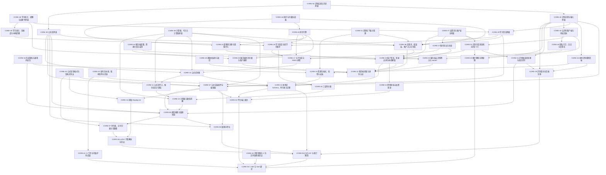

# 01 公共核心 v5

> 版本：v5.1 ｜ 修订日期：2026-10-19 ｜ 适用范围：Android 与 Windows 两端共用的 Rust 核心、契约、服务端与共享 Flutter UI；HarmonyOS 只做接口预留。
> 关联文档：[README](README.md)（需求基线与追踪总表）、[02 Android 端](02-Android端-v5.md)、[03 Windows 端](03-Windows端-v5.md)、[附录 A 架构决策与评审记录](附录A-架构决策与评审记录.md)、[附录 C 资源包内容与开源资源调查](附录C-资源包内容与开源资源调查.md)。
> 契约归属：本文是全部公共契约（函数签名、DTO、错误码、表结构、文件格式、服务端 API）的唯一定义处。平台文档只引用“CORE-xx §接口契约”，不得重新定义。

## 0. 使用方法

每个模块一张卡，字段固定为：目标、范围、依赖、接口契约、实现约束、验收标准、规模。一次 vibe coding 会话交给编码助手的材料是：

1. 目标卡全文；
2. 依赖卡（含间接依赖）的“接口契约”段；
3. CORE-01 与 CORE-02 的“接口契约”段（全部卡片都依赖这两张卡）。

验收标准中的 [Rxx] 指向 [README](README.md) §5 需求追踪总表。卡片编号全局唯一，此后不重排；新增模块取下一个空号，废弃模块保留编号并标“已废弃”。

## 1. 模块依赖图

依赖只指向编号更小的卡片，因此依赖图无环。图中箭头从模块指向它的前置模块；为便于阅读，省略每张卡都有的 CORE-01、CORE-02 依赖，并省略可由其他路径推出的间接依赖边（完整直接依赖见 §3 与各卡“依赖”字段）。



## 2. 建议实施顺序

原则：先搭最小可运行骨架，再逐个增加功能模块；每个阶段结束时两端都能编译运行，并且阶段内每张卡的前置卡都已在本阶段或更早阶段完成。同一阶段内互不依赖的卡可并行。

| 阶段 | 模块 | 出口（可运行的最小形态） |
| --- | --- | --- |
| S0 骨架 | CORE-01、02、03、04、41，AND-01，WIN-01 | 两端空壳应用启动，经 C ABI 调用 `fml_abi_version` 并显示版本号；CI 跑通格式、静态检查与 ABI 头文件比对 |
| S1 公式引擎 | CORE-05、06、07、08、09、10、11、12 | 核心 crate 测试全绿；经 `fml_call` 完成“LaTeX → 解析 → 量纲校验 → 计算 → DisplayList”往返 |
| S2 本地库、账户入口与编辑器 | CORE-13、21、22、45、23、36、37，AND-02、05、06、09，WIN-06、07、10 | 首次启动只能选游客或注册/登录；游客可输入公式、看到排版与错误高亮；数据加密落盘；进程被杀后可恢复 |
| S3 公式库与计算 | CORE-14、38、48、52 | 公式保存、修订历史、搜索、计算器与公式间代入可用；复制公式在 S5 平台写入器（AND-03、WIN-05）完成前只写 LaTeX 文本 |
| S4 内容与学习 | CORE-15、16、17、18、19、20、39、49、51，AND-08，WIN-09 | bootstrap 包与至少一个课程包可安装；选书 → 组学习 → 默写 → 复习的闭环可日常自用；每日提醒 |
| S5 识别与云识别 | CORE-28、29、30、31、32、33、34、35、40、50，AND-03、04、07，WIN-04、05、08 | 手写与照片导入、预处理、候选校正、历史 GC；注册用户逐次授权云识别；游客只有本地/手动路径 |
| S6 同步与备份 | CORE-24、25、26、46、27、47 | 游客转注册、端到端加密同步、导出与恢复 |
| S7 发布 | CORE-42、43、44，AND-11、12，WIN-02、03、12、13 | 门禁全绿、签名发布、安装与更新演练、监控演练、鸿蒙头文件冒烟通过 |

CORE-41 在 S0 建立，之后每个阶段为新模块启用对应门禁。

## 3. 模块索引

| 编号 | 名称 | 代码位置 | 直接依赖 | 预估规模 |
| --- | --- | --- | --- | --- |
| CORE-01 | 仓库骨架与工程约定 | 仓库根 | — | 约 300 行 |
| CORE-02 | 错误码注册表与诊断模型 | `contracts/errors/`、`crates/fml-error/`、`tools/ci/gen_errors.py` | 01 | 约 350 行 |
| CORE-03 | C ABI 与 Dart 绑定 | `crates/fml-ffi/`、`app/lib/binding/` | 01、02 | 约 480 行 |
| CORE-04 | 平台端口契约 | `app/lib/ports/`、`app/lib/composition/`、`app/test/fakes/` | 01、02、03 | 约 480 行 |
| CORE-05 | 公式 AST 与修订模型 | `crates/fml-ast/` | 01、02、03 | 约 450 行 |
| CORE-06 | LaTeX 子集解析与导出 | `crates/fml-latex/` | 01、02、05 | 约 500 行 |
| CORE-07 | 符号表、记号方案与常数集 | `crates/fml-notation/` | 01、02、05、06 | 约 400 行 |
| CORE-08 | 量纲与单位 | `crates/fml-units/` | 01、02、05 | 约 470 行 |
| CORE-09 | 类型推断与量纲校验 | `crates/fml-type/` | 01、02、05、06、07、08 | 约 500 行 |
| CORE-10 | 计算器与数值求解 | `crates/fml-eval/` | 01、02、05、07、08、09 | 约 500 行 |
| CORE-11 | 公式间代入、推导链与计算链 | `crates/fml-derive/` | 01、02、05、09、10 | 约 480 行 |
| CORE-12 | 排版 DisplayList | `crates/fml-typeset/` | 01、02、05、06 | 约 500 行 |
| CORE-13 | 本地库 Schema、单写者与迁移 | `crates/fml-store/` | 01、02、03、04、05 | 约 450 行 |
| CORE-14 | 公式库仓储 | `crates/fml-store/src/library/` | 01、02、05、09、11、13 | 约 500 行 |
| CORE-15 | 资源包格式、验签与安装 | `crates/fml-pack/` | 01、02、03、13 | 约 500 行 |
| CORE-16 | 内容管线与课程内容包 | `tools/content/` | 01、02、05、06、07、08、09、15 | 约 500 行 |
| CORE-17 | 卡片生成与 FSRS 排程 | `crates/fml-srs/`、`crates/fml-store/src/study/cards.rs` | 01、02、05、09、13、14 | 约 500 行 |
| CORE-18 | 三层判分器 | `crates/fml-grade/` | 01、02、05、06、07、09、10 | 约 500 行 |
| CORE-19 | 学习会话与组学习循环 | `crates/fml-study/`、`crates/fml-store/src/study/sessions.rs` | 01、02、13、14、17、18 | 约 500 行 |
| CORE-20 | 学习统计、掌握度与本地提醒 | `crates/fml-study/src/stats/`、`app/lib/study/reminder_service.dart` | 01、02、04、13、17、19 | 约 450 行 |
| CORE-21 | 密钥体系与加密原语 | `crates/fml-crypto/` | 01、02、04 | 约 400 行 |
| CORE-22 | 服务端骨架与身份认证 | `server/src/{main.rs, config.rs, auth/, devices/, meta/}`（附属 `app/lib/net/`） | 01、02 | 约 500 行 |
| CORE-23 | 账户状态、登录边界与本机解锁 | `crates/fml-store/src/account/`、`app/lib/account/` | 01、02、04、13、21、22 | 约 500 行 |
| CORE-24 | 游客转注册与游客并入 | `crates/fml-sync/src/upgrade.rs`（附属 `0024_upgrade.sql`） | 01、02、13、21、22、23 | 约 450 行 |
| CORE-25 | 服务端同步存储与账户删除 | `server/src/sync/`、`server/src/account/` | 01、02、22 | 约 500 行 |
| CORE-26 | 同步引擎（加密、合并与隔离） | `crates/fml-sync/src/{lib.rs, outbox.rs, payload.rs, merge.rs, snapshot.rs}` | 01、02、13、14、17、19、21、24、25 | 约 500 行 |
| CORE-27 | 备份导出与恢复 | `crates/fml-store/src/backup/` | 01、02、04、13、17、21、23 | 约 450 行 |
| CORE-28 | 隐私守卫、日志与复现包 | `app/lib/privacy/`（附属 `crates/fml-error/src/log.rs`） | 01、02、03、04、23 | 约 480 行 |
| CORE-29 | 识别契约与后端注册 | `crates/fml-recognize/src/{lib.rs, registry.rs, ink.rs}` | 01、02、03、05 | 约 320 行 |
| CORE-30 | 图片解码与预处理 | `crates/fml-imgproc/` | 01、02、03 | 约 500 行 |
| CORE-31 | 识别候选后处理与忠实转写 | `crates/fml-recognize/src/post.rs` | 01、02、05、06、07、08、09、29 | 约 380 行 |
| CORE-32 | 识别会话状态机与历史 GC | `crates/fml-recognize/src/session.rs`、`crates/fml-store/src/recognition/` | 01、02、13、21、23、29、30、31 | 约 500 行 |
| CORE-33 | 服务端云识别网关与 worker | `server/src/recognition/` | 01、02、22 | 约 480 行 |
| CORE-34 | 云识别客户端与授权回执 | `app/lib/recognition/cloud/` | 01、02、04、22、23、28、30、32、33 | 约 450 行 |
| CORE-35 | 本地识别模型后端 | `crates/fml-recognize-local/` | 01、02、15、29 | 约 420 行 |
| CORE-36 | 应用壳、组装层、账户入口与导航 | `app/lib/composition/`、`app/lib/ui/shell/` | 01、02、03、04、22、23 | 约 500 行 |
| CORE-37 | 公式渲染组件与编辑器 | `app/lib/ui/editor/` | 01、02、03、04、08、09、12 | 约 500 行 |
| CORE-38 | 公式库界面 | `app/lib/ui/library/` | 01、02、03、04、08、09、13、14、36、37 | 约 490 行 |
| CORE-39 | 学习会话界面 | `app/lib/ui/study/` | 01、02、03、04、19、36、37 | 约 480 行 |
| CORE-40 | 识别流程编排、手写画布与图片预处理界面 | `app/lib/ui/recognition/` | 01、02、03、04、29、30、31、32、34、35、37、39 | 约 490 行 |
| CORE-47 | 设置页与账户安全界面 | `app/lib/ui/settings/` | 01、02、03、04、23、27、32、36 | 约 480 行 |
| CORE-48 | 计算器、代入与计算链界面 | `app/lib/ui/calc/` | 01、02、03、04、09、10、11、13、14、36、37 | 约 480 行 |
| CORE-49 | 学习统计、提醒设置与自建书界面 | `app/lib/ui/study_stats/`、`app/lib/ui/books/` | 01、02、03、04、14、19、20、23、36、37、39 | 约 450 行 |
| CORE-50 | 识别结果、云端确认与识别历史界面 | `app/lib/ui/recognition/pages/` | 01、02、03、04、31、32、34、36、37、38、40 | 约 480 行 |
| CORE-51 | 资源包下载、导入与管理界面 | `app/lib/packs/`、`app/lib/ui/packs/` | 01、02、03、04、15、36 | 约 420 行 |
| CORE-52 | 公式复制格式与富格式导出 | `crates/fml-export/`、`app/lib/export/` | 01、02、03、04、05、06、07、12、37 | 约 450 行 |
| CORE-41 | CI 门禁与可维护性度量 | `.github/workflows/`、`tools/ci/` | 01、02、03 | 约 480 行 |
| CORE-42 | 发布流水线、版本矩阵与回滚 | `tools/release/` | 01、02、13、41 | 约 420 行 |
| CORE-43 | 服务端部署、资源分发与监控 | `server/deploy/`、`server/src/ops/` | 01、02、22、25、33 | 约 420 行 |
| CORE-44 | 鸿蒙预留与 C 头文件消费者验证 | `tools/ohos-smoke/` | 01、02、03 | 约 180 行 |
| CORE-45 | 邮箱验证码与发信 | `server/src/email/` | 01、02、22 | 约 380 行 |
| CORE-46 | 同步与升级协调器 | `app/lib/sync/` | 01、02、04、22、23、24、25、26、36 | 约 450 行 |

“直接依赖”列只写编号尾数，如“05”即 CORE-05。

## 4. 骨架与基础契约

### CORE-01 仓库骨架与工程约定

**目标**：建立单仓库目录、Cargo 与 Flutter 工作区和全局工程约定，使后续每张卡都能在固定位置落代码。

**范围**
- 包含：目录布局、Cargo workspace、Flutter 工程 `app/`、依赖方向规则、命名与注释约定、全局资源预算表、版本号种类。
- 不包含：具体业务代码；CI 工作流（CORE-41）；平台工程细节（AND-01、WIN-01）。

**依赖**：无

**接口契约**

目录布局（全部卡片按此落位）：

```text
crates/                 Rust 核心，禁止 Flutter/Dart/JNI/HTTP 客户端依赖
  fml-error  fml-ast  fml-latex  fml-notation  fml-units  fml-type
  fml-eval   fml-derive  fml-typeset  fml-store  fml-pack  fml-srs
  fml-grade  fml-study  fml-crypto  fml-sync  fml-recognize
  fml-recognize-local  fml-imgproc  fml-export  fml-ffi
contracts/              唯一事实源：错误码注册表、DTO schema、C 头文件、测试向量
  errors/registry.yaml  dto/*.schema.json  include/fmlcore.h  vectors/
app/                    Flutter 工程（Android 与 Windows 共用）
  lib/binding/          生成的 dart:ffi 绑定与类型化包装（CORE-03）
  lib/ports/            平台端口抽象（CORE-04）
  lib/platform/android/ lib/platform/windows/   端口的平台实现（AND/WIN 卡）
  lib/composition/      按平台组装端口与用例
  lib/<feature>/        用例编排：account sync recognition study library privacy export
  lib/ui/<feature>/     Widget：shell editor library study recognition
  android/  windows/    平台原生工程
server/                 服务端模块化单体（CORE-22、25、33、43、45）
packs/                  资源包源数据（CORE-16）
tools/                  content/ ci/ release/ ohos-smoke/
```

依赖方向规则：
1. `fml-ast` 不依赖解析器、存储与 UI；`fml-type` 只依赖 `fml-ast`、`fml-units`、`fml-notation`；`fml-eval` 只依赖 `fml-ast`、`fml-type`、`fml-units`；`fml-typeset` 不直接读字体文件，字体数据由 `fml-pack` 加载后注入。
2. 领域 crate（ast、latex、notation、units、type、eval、derive、typeset、export、srs、grade、study、crypto，以及 sync 的合并逻辑）无 I/O：不访问网络、文件、时钟与平台 API；时间、随机数和文件内容由调用方以参数传入（sans-I/O：输入事件与状态，输出新状态与待执行的 I/O 命令）。
3. `fml-store` 可依赖领域 crate，领域 crate 不得依赖 `fml-store`。
4. `fml-ffi` 是唯一允许出现 `extern "C"` 的 crate。
5. Dart 的 `ui/` 不得直接 import `binding/`、`platform/` 或发起 HTTP，只调用 `lib/<feature>/` 用例。
6. 平台层不得实现公式解析、量纲与单位换算、排版布局、FSRS 调度、同步合并、资源包验签。

全局资源预算（各卡验收引用此表）。测量口径：release 构建，P95，真机，冷启动 ≥30 次、核心操作 ≥1000 次、图片 ≥100 张；基准设备在 M0 登记型号、系统版本与环境温度，不用模拟器替代。

| 指标 | Android 中端（4 GB arm64） | Windows（4 核 / 8 GB / SSD） |
| --- | --- | --- |
| 冷启动到首页 | < 2 s | < 1.5 s |
| 公式解析（≤256 节点） | < 20 ms | < 10 ms |
| 量纲校验 | < 10 ms | < 5 ms |
| 单式排版 | < 30 ms | < 20 ms |
| 单题判分 | ≤ 50 ms | ≤ 25 ms |
| 排程取下一题（10000 条公式 / 50000 张卡） | ≤ 20 ms | ≤ 10 ms |
| 公式库搜索首屏（10000 条） | < 100 ms | < 60 ms |
| 列表滚动 | 60 FPS，掉帧 < 1% | 60 FPS（100%–200% DPI） |
| 手写墨迹上屏 | ≤ 50 ms | ≤ 40 ms |
| 图片预处理 | < 500 ms | < 300 ms |
| 本地模型识别（单式，模型已加载） | ≤ 2 s | ≤ 1 s |
| 本地模型首次加载 | ≤ 3 s | ≤ 2 s |
| 常驻内存 | < 150 MB | < 250 MB |
| 连续 20 张 12 MP 图片 | 无 OOM，60 s 内回落到空闲值 +20 MiB | 无 OOM，+30 MiB |
| 安装包（不含可选模型与内容包） | < 45 MB | 安装器 ≤ 70 MB |
| bootstrap 资源包（计入安装包） | 压缩后 ≤ 8 MiB | 压缩后 ≤ 8 MiB |

预算调整只能经附录 A 的 ADR，由需求负责人接受，且不得改变测量口径。能耗：不设常驻服务，不做周期性网络轮询；空闲时除每日一次本地提醒外没有定时唤醒。

版本号种类：App（SemVer）、ABI（`FML_ABI_MAJOR/MINOR`）、DTO schema、AST schema、DB schema（`PRAGMA user_version`）、服务端 API 主版本（`/v1`）、资源包格式与安全序号、模型与词表版本、FSRS 参数与评分映射版本、AAD 版本。兼容矩阵由 CORE-42 维护。

命名约定：Rust crate 名 `fml-<域>`，模块与函数 snake_case，类型 UpperCamelCase；Dart 文件 snake_case，类型 UpperCamelCase，成员 lowerCamelCase；op 名 `<域>.<动作>`（CORE-03）；错误码见 CORE-02；SQLite 表名与列名 snake_case；资源包 ID 小写短横线（如 `content-hs-math`）。

提交约定：Conventional Commits，格式 `<type>(<模块编号小写>): <摘要>`，如 `feat(core-05): 定义公式 AST 节点`；type 取 feat、fix、refactor、perf、test、docs、build、ci、chore；契约破坏性变更在正文写 `BREAKING CHANGE:` 并引用 ADR。一个提交只涉及一张卡。

注释约定：每个 crate 与 Dart 特性目录有 `README.md`，说明边界、线程模型与错误语义；Rust 公共项启用 `#![deny(missing_docs)]`，Dart 启用 `public_member_api_docs`；公共 API 文档注释含示例与错误条件；复杂算法注明输入假设、单位、精度与失败条件；不要求逐行注释，禁止无信息量的注释。

**实现约束**
- Rust 工具链与 Flutter 版本由 `rust-toolchain.toml` 与 `app/.flutter-version` 固定；依赖全部锁定（`Cargo.lock`、`pubspec.lock`）。
- 领域 crate 加 `#![forbid(unsafe_code)]`；`fml-ffi`、`fml-imgproc`、`fml-recognize-local` 的每个 unsafe 块须带 `// SAFETY:` 注释。
- 不可逆决策（技术栈替换、契约主版本变化、预算调整）写入附录 A 的 ADR。
- 提交按本卡“提交约定”；main 始终可构建；特性分支生命周期不超过 3 天。
- 外部前提：Rust stable 工具链、Flutter stable 渠道与 Dart SDK、Python 3（`tools/` 脚本）的具体版本按 ADR-V5-15（待定）在 M0 锁定；Android SDK/NDK 见 AND-01，Visual Studio 生成工具见 WIN-01。

**验收标准**
- [R18][R23] 干净检出后 `cargo build --workspace`、`flutter build windows --debug`、`flutter build apk --debug` 成功；`tools/ci/check_deps.py`（CORE-41）对本卡依赖规则零违例。
- [R20] `cargo doc --workspace` 无 missing_docs 告警；`dart analyze` 无 `public_member_api_docs` 告警。
- [R22] `tools/ci/yolo_guard.sh` 通过：main 的 `Cargo.toml`、`pubspec.yaml`、`crates/` 与安装产物中无 YOLO 实现、权重或依赖。

**规模**：约 300 行（配置与 README）；仓库根。

### CORE-02 错误码注册表与诊断模型

**目标**：用一份注册表生成 Rust 与 Dart 的错误码和诊断类型，使所有模块的错误可定位、可本地化、可追踪。

**范围**
- 包含：`contracts/errors/registry.yaml` 格式、生成器、`fml-error` crate（`FmlError`、`Diagnostic`、`TraceId`）、Dart 侧 `FmlException` 与消息键。
- 不包含：复现包导出（CORE-28）；各模块具体错误码（各卡在注册表中追加条目）。

**依赖**：CORE-01

**接口契约**

注册表条目（`registry.yaml` 顶层为 `{ registry_version: <u32>, entries: [...] }`）：

```yaml
- code: TYPE_DIM_CONFLICT      # 大写蛇形，前缀为命名空间
  namespace: TYPE
  severity: error             # error | warning | info
  message_key: err.type.dim_conflict
  retryable: false
  since: 1
```

| 字段 | 类型 | 必填 | 取值与校验 |
| --- | --- | --- | --- |
| code | string | 是 | 正则 `^[A-Z]+(_[A-Z0-9]+)+$`；首段等于 namespace；全表唯一 |
| namespace | string | 是 | 下列命名空间之一 |
| severity | enum | 是 | error、warning、info |
| message_key | string | 是 | 正则 `^err\.[a-z0-9_.]+$`；`errors_zh.arb` 中必须存在 |
| retryable | bool | 是 | 调用方原样重试可能成功时为 true |
| since | u32 | 是 | 引入时的 registry_version，≥ 1 |
| deprecated_since | u32 | 否 | 废弃时的 registry_version；废弃条目保留，不得复用 code |
| http_status | u16 | 否 | 仅服务端返回的错误码填写（400–599），默认 400 |

命名空间：`PARSE_ NOTATION_ TYPE_ UNIT_ EVAL_ DERIVE_ TYPESET_ EXPORT_ STORE_ LIB_ PACK_ STUDY_ GRADE_ CRYPTO_ AUTH_ SYNC_ BACKUP_ PRIVACY_ RECOG_ IMG_ CLOUD_ FFI_ PLATFORM_ NET_ SERVER_`。错误码一经发布不得改义，只能废弃。

```rust
// crates/fml-error/src/lib.rs
pub struct TraceId(pub [u8; 16]);
pub enum Severity { Error, Warning, Info }
pub struct Diagnostic {
    pub code: ErrorCode,                 // 由 registry.yaml 生成的枚举
    pub severity: Severity,
    pub node_path: Option<String>,       // NodePath 的文本形式 "0.2.1"（CORE-05）
    pub input_range: Option<(u32, u32)>, // 源码 UTF-8 字节区间
    pub args: Vec<(String, String)>,     // 本地化参数
    pub recovery: Option<String>,        // 修复建议的消息键
    pub needs_confirm: bool,             // Warning 需用户确认时为 true
}
pub struct FmlError {
    pub code: ErrorCode, pub domain: &'static str,
    pub diagnostics: Vec<Diagnostic>, pub trace_id: TraceId, pub retryable: bool,
}
```

Dart：`class FmlException implements Exception { final String code; final List<DiagnosticDto> diagnostics; final String traceId; final bool retryable; }`；消息在 `app/lib/l10n/errors_zh.arb`。`DiagnosticDto` 字段与 `Diagnostic` 一一对应（`code, severity, nodePath?, inputRange?, args, recovery?, needsConfirm`）。

`FmlError` 的 JSON 形式（FFI 返回码 1 的 `out` 与服务端错误响应体共用，字段名固定）：

```json
{ "error": { "code": "TYPE_DIM_CONFLICT", "domain": "type", "retryable": false,
    "trace_id": "0f8e…（32 位小写十六进制）",
    "diagnostics": [ { "code": "TYPE_DIM_CONFLICT", "severity": "error", "node_path": "0.2.1",
        "input_range": [4, 9], "args": { "left": "L", "right": "L·T⁻¹" },
        "recovery": "err.type.dim_conflict.fix", "needs_confirm": false } ] } }
```

`diagnostics` 可为空数组；`node_path`、`input_range`、`recovery` 缺省表示无。`TraceId` 文本形式为 32 位小写十六进制。

生成命令：`tools/ci/gen_errors.py` 输出 `crates/fml-error/src/codes.rs`、`app/lib/binding/error_codes.g.dart` 与 `contracts/errors/README.md`（错误码表）。

**实现约束**
- UI 显示本地化消息；日志只记 `code`、`trace_id`、模块与版本、耗时与预算，不记公式正文、图片、路径、令牌、密钥或恢复码。
- 每次用例调用生成 `trace_id`，跨 FFI 与 HTTP 透传。
- V1 只提供简体中文消息；缺失消息键时 CI 失败。
- 本卡不定义业务错误码；各卡在本卡注册表中追加条目，并在各自“接口契约”的错误码表中写明触发条件。
- 外部前提：Python 3 与 PyYAML（版本按 ADR-V5-15（待定）在 M0 锁定）。

**验收标准**
- [R19] 单元测试：生成器对样例注册表输出确定（两次生成逐字节一致）；重复 code、未知命名空间、缺 message_key 时生成失败。
- [R19] 漂移检查：修改 `registry.yaml` 而未重新生成时 `tools/ci/gen_errors.py --check` 失败。
- [R20] `contracts/errors/README.md` 由生成器产出，含全部错误码、级别与是否可重试。
- [R19] 往返测试：上例 JSON 经 Rust 反序列化再序列化逐字节一致；Dart `FmlException.fromJson` 读出相同的 code、trace_id 与诊断数。

**规模**：约 350 行；主包 `crates/fml-error/`（约 150 行），附属：注册表 `contracts/errors/` 与其生成器 `tools/ci/gen_errors.py`（约 200 行）。

### CORE-03 C ABI 与 Dart 绑定

**目标**：提供唯一的跨语言边界——稳定 C ABI（`fmlcore` 动态库）和由头文件生成的 dart:ffi 绑定，全部核心能力以“op + DTO”形式调用。

**范围**
- 包含：`fml-ffi` crate、`contracts/include/fmlcore.h`、DTO 序列化、同步快速调用与长任务提交/取消/完成回调、句柄与缓冲区管理、panic 隔离、Dart `CoreBinding`。
- 不包含：业务 op 的实现（各功能卡在 `crates/fml-ffi/src/ops/<域>.rs` 中登记）；鸿蒙 NAPI 封装（CORE-44 只验证头文件可被 C 消费）。

**依赖**：CORE-01、CORE-02

**接口契约**

```c
/* contracts/include/fmlcore.h —— 唯一导出面 */
#define FML_ABI_MAJOR 1
#define FML_ABI_MINOR 0
typedef struct { uint8_t *ptr; size_t len; } FmlBuf;   /* 核心分配；只能用 fml_free_buffer 释放一次 */
typedef uint64_t FmlHandle;                           /* 高 16 位为代数（generation），拒绝过期句柄 */
typedef void (*FmlCompletion)(uint64_t job_id, FmlBuf result, void *user_data);

uint32_t fml_abi_version(void);                       /* (MAJOR<<16)|MINOR */
FmlBuf   fml_capabilities(void);                      /* JSON：op 列表、DTO 版本、构建信息 */
int32_t  fml_call(const char *op, const uint8_t *req, size_t req_len, FmlBuf *out);  /* 同步快速路径 */
int32_t  fml_submit(const char *op, const uint8_t *req, size_t req_len, uint64_t *job_id);
int32_t  fml_cancel(uint64_t job_id);                 /* 返回后保证该任务资源已释放 */
int32_t  fml_register_completion(FmlCompletion cb, void *user_data);
void     fml_free_buffer(FmlBuf buf);
int32_t  fml_close_handle(FmlHandle h);
```

- 返回码：`0` 成功（`out` 为响应 DTO）；`1` 业务错误（`out` 为 CORE-02 的 FmlError JSON）；负数为 FFI 层错误，此时 `out` 尽量写入同样格式的 FmlError（分配失败时 `ptr` 为 NULL、`len` 为 0）：

| 返回码 | 错误码 | 可重试 | 触发条件 |
| --- | --- | --- | --- |
| -1 | `FFI_BAD_ARG` | 否 | 空指针、`req_len` 超过 16 MiB、请求不是合法 UTF-8 JSON、顶层缺 `v` 或 `body`、重复释放缓冲区、未注册回调就调用 `fml_submit` |
| -2 | `FFI_UNKNOWN_OP` | 否 | op 未登记，或该 op 不支持当前调用方式（同步 op 走了 `fml_submit`，反之亦然） |
| -3 | `FFI_VERSION_MISMATCH` | 否 | DTO 主版本 `v` 不是该 op 支持的主版本 |
| -4 | `FFI_STALE_HANDLE` | 否 | 句柄代数不符或已关闭；未知 `job_id` |
| -5 | `FFI_PANIC` | 否 | op 内部 panic（已被 `catch_unwind` 捕获） |
| -6 | `FFI_BUSY` | 是 | 长任务队列已满（排队 + 运行 ≥ 64） |

- `fml_cancel`：返回 `0` 表示已取消且不会再回调；返回 `1` 表示任务已完成或回调已发出（取消无效）；未知 `job_id` 返回 `-4`。
- `fml_register_completion`：进程内只保存一个回调，重复调用替换旧值；回调在核心工作线程上执行，`result` 的所有权交给回调方，用完须 `fml_free_buffer`。长任务工作线程数为 `min(4, CPU 核数)`。
- `budget_ms`：只对声明支持预算的 op 生效，超时由该 op 返回本域错误码（如 `EVAL_TIMEOUT`）；其他 op 忽略此字段。
- DTO 映射规则（各卡 FFI op 未另行列出字段时适用）：请求 `body` 与响应 DTO 是对应 Rust 结构体的 serde JSON——字段名与结构体字段同名（snake_case）；无数据的枚举值为 snake_case 字符串，带数据的变体为 `{"<变体名>": 数据}`；`Option` 为 `None` 时省略字段；`FormulaNode` 一律用 CORE-05 规范 JSON；UUID 类 ID 为小写带连字符字符串，`SymbolId` 为整数；十进制数值（值、不确定度、区间端点）一律为字符串；时间为 `*_ms` 整数（Unix 毫秒）；二进制为 base64 字符串。请求缺必填字段或类型不符时返回 `FFI_BAD_ARG`。
- `fml_capabilities` 示例：`{"abi":"1.0","ops":[{"op":"engine.parse","dto":1,"mode":"call"},{"op":"image.decode","dto":1,"mode":"submit"}],"build":{"app":"1.0.0","git":"<sha>","target":"aarch64-linux-android"}}`。
- DTO：UTF-8 JSON，顶层 `{"v": <dto_major>, "trace_id": "...", "budget_ms": <u32 可选>, "body": {...}}`；schema 在 `contracts/dto/<op>.schema.json`；未知主版本拒绝。
- op 命名 `<域>.<动作>`，如 `engine.parse`、`engine.check`、`typeset.layout`、`calc.evaluate`。每张功能卡在“接口契约”中列出它登记的 op。
- 长任务（图片解码、本地推理、导出、迁移）走 `fml_submit`，由核心通过 `FmlCompletion` 通知；不提供轮询接口。回调线程不得持锁，不得重入 UI。

Dart 包装（`app/lib/binding/core_binding.dart`）：

```dart
abstract interface class CoreBinding {
  /// 打开动态库并校验 ABI；可在多个 isolate 中各自打开，共享同一核心状态。
  static CoreBinding open(CoreLibrarySpec spec) => FfiCoreBinding(spec);
  CoreLibrarySpec get spec;          // 可跨 isolate 发送
  int abiVersion();
  Map<String, Object?> call(String op, Map<String, Object?> body, {Duration? budget});
  Future<Map<String, Object?>> submit(String op, Map<String, Object?> body, {CancelToken? cancel});
}
final class CoreLibrarySpec {      // Android 为 'libfmlcore.so'；Windows 为 fmlcore.dll 的绝对路径
  const CoreLibrarySpec(this.path);
  final String path;
}
final class CancelToken {            // 由调用方创建；cancel() 后 submit 的 Future 以 FfiCancelled 结束
  void cancel();
  bool get isCancelled;
}
final class FfiException implements Exception {
  final int status;                  // 负返回码
  final String code;                 // 如 'FFI_BUSY'
  final String? traceId;
}
final class FfiCancelled implements Exception {}
// 业务错误抛 FmlException（CORE-02）；FFI 层错误抛 FfiException。
// 启动时 abiVersion() 的 MAJOR 与 Dart 侧常量不一致即拒绝启动并提示重装。
```

动态库名：Android `libfmlcore.so`，Windows `fmlcore.dll`；加载方式由 AND-01、WIN-01 规定。

**实现约束**
- 不暴露 Rust 泛型、trait 对象与生命周期；所有句柄由核心分配和释放；传入缓冲区必须带长度；字符串消息一次性拷贝。
- 每个导出函数用 `catch_unwind` 包裹，panic 转 `FFI_PANIC` 并记录 trace_id，不得跨边界展开。
- `fml_call` 只用于 P95 ≤30 ms 的操作，超出的 op 必须走 `fml_submit`。
- `fml_call` 必须可从多个线程并发调用；完成回调只由主 isolate 的绑定注册，其他 isolate 打开的绑定调用 `submit` 抛 `StateError`。
- Dart 侧 DTO：调用某 op 的卡在本卡目录手写不可变 DTO 类（`fromJson`/`toJson` 按上述映射规则）；多卡共用的 DTO 放在最先使用它的卡，后续卡引用（`DiagnosticDto` 属 CORE-02，`DisplayListDto`、`NodePathDto` 属 CORE-37）。
- 头文件与 `ffigen` 生成的 Dart 绑定纳入版本控制，CI 做 ABI 漂移检查（CORE-41）。
- 外部前提：Dart `ffigen` 包（版本 M0 锁定，ADR-V5-15（待定））；Android NDK 与 MSVC 工具链见 AND-01、WIN-01。
- 选型：C ABI + dart:ffi 单一导出面，不另引入第二套绑定导出，使未来鸿蒙 NAPI 复用同一头文件（附录 A ADR-V5-02）。

**验收标准**
- [R01] 契约测试（`crates/fml-ffi/tests/abi.rs` 与 `app/test/binding_test.dart`）：同一组 fixtures 在 Android 与 Windows 上得到逐字节相同的输出。
- [R19] 故障注入：过期句柄、重复释放、空指针、超限 DTO、未知 op、未知 DTO 主版本、op 内 panic 均返回上表约定的返回码与错误码，进程不崩溃；第 65 个并发长任务返回 `-6`。
- [R01] 取消测试：提交长任务后立即 `fml_cancel`，回调至多触发一次，`fml_cancel` 返回后存活句柄数归零。
- [R02] `contracts/include/fmlcore.h` 能被纯 C 程序编译链接（由 CORE-44 执行）。

**规模**：约 480 行；主包 `crates/fml-ffi/`（约 330 行），附属：跨语言另一侧 `app/lib/binding/`（约 150 行，其中 ffigen 生成文件不计）。

### CORE-04 平台端口契约

**目标**：用 Dart 抽象接口定义全部平台能力，用例与 UI 只依赖接口，Android 与 Windows 各自提供实现。

**范围**
- 包含：端口接口、端口 DTO、平台错误码在 `contracts/errors/registry.yaml` 中的登记、测试替身（`FakeXxx`）与可复用的端口契约测试套件、`PlatformPorts` 聚合记录。
- 不包含：任何平台实现（AND-xx、WIN-xx 卡）；出网白名单与授权检查（CORE-28 `NetworkGuard` 包裹 `HttpTransport`）。

**依赖**：CORE-01、CORE-02、CORE-03

**接口契约**（`app/lib/ports/`，每个端口一个文件；`CancelToken` 见 CORE-03，`FmlException` 见 CORE-02）

端口 DTO：

```dart
enum KeySecurityLevel { strongBox, tee, software, dpapi, dpapiWithHello }
enum StoreArea { database, packs, recognition, staging, drafts, exports, logs }
enum LifecycleEvent { resumed, paused, detached, lowMemory }
enum HttpMethod { get, post, put, delete }
enum RequestPurpose { packDownload, updateCheck, auth, sync, cloudRecognition, diagnostics }

final class LocalTime {              // 设备本地时区的时刻
  const LocalTime(this.hour, this.minute);   // hour 0–23，minute 0–59，越界抛 ArgumentError
  final int hour; final int minute;
}
final class RuntimeSnapshot {
  final String os;                   // 'android' | 'windows'
  final String osVersion;            // Android 为 API 级别（如 '29'）；Windows 为内部版本号（如 '10.0.17763'）
  final String locale;               // BCP 47，如 'zh-CN'
  final int availMemBytes;           // ≥ 0
  final double dpiScale;             // > 0，1.0 = 160 dpi（Android）或 96 dpi（Windows）
  final String abi;                  // 'arm64-v8a' | 'armeabi-v7a' | 'x86_64' | 'x64'
  final bool gpuAvailable;           // 可用于本地推理加速的 GPU；未知时 false
}
final class HttpRequestDto {
  final HttpMethod method;
  final Uri url;                     // 必须为 https；主机须在 CORE-28 NetworkPolicy 白名单中
  final RequestPurpose purpose;      // 必填；NetworkGuard 据此做白名单与授权检查
  final Map<String, String> headers; // 默认 {}；不得含 Cookie
  final Uint8List? body;             // 默认 null；上限 16 MiB
  final Duration timeout;            // 默认 30 s，总时限；连接超时固定 5 s
  final String? consentToken;        // 仅 purpose == cloudRecognition 时必填（CORE-34 ConsentToken）
  final File? saveTo;                // 非空时响应体流式写入该文件（须位于 StoreArea.staging），HttpResult.body 为空
  final int? rangeStart;             // 断点续传起点字节；仅与 saveTo 同用，服务端返回 206 时追加写入
}
final class HttpResult {
  final int status;                  // HTTP 状态码；非 2xx 不抛异常，调用方按 CORE-02 FmlError 解析响应体
  final Map<String, String> headers; // 键为小写
  final Uint8List body;              // saveTo 非空时为空数组
  final int receivedBytes;           // 本次实际接收字节数
}
abstract interface class ImportedImage {
  String get displayName;            // 仅用于界面显示，不写日志
  String get mimeType;               // 'image/jpeg' | 'image/png' | 'image/webp'；用户选中的 HEIC/HEIF 由平台实现用系统解码器转为 JPEG（质量 92）后再返回
  int get byteLength;
  DateTime get expiresAt;            // 创建后 1 h
  Future<Uint8List> readBytes();     // 只读；过期或导入会话结束后抛 PLATFORM_IO
}
```

端口：

```dart
/// 平台密钥保护：只包装/解包核心生成的密钥，不向 UI 暴露原始密钥。
abstract interface class SecureKeyValueStore {
  Future<Uint8List> wrap(String alias, Uint8List secret);     // 返回包装后的密文；alias 匹配 ^[a-z0-9_.-]{1,64}$
  Future<Uint8List> unwrap(String alias, Uint8List wrapped);  // 密钥失效抛 PLATFORM_KEY_UNAVAILABLE；需认证的别名认证失败或取消抛 PLATFORM_AUTH_FAILED
  Future<void> delete(String alias);                          // 别名不存在时静默成功
  Future<KeySecurityLevel> securityLevel(String alias);
}
/// 应用私有目录；返回的目录都位于应用私有根目录之内，不存在时自动创建。
abstract interface class LocalFileStore {
  Future<Directory> root(StoreArea area);
  Future<int> freeBytes();                                    // 应用私有根目录所在卷的可用字节数
  Future<void> excludeFromSystemBackup(Directory dir);
}
/// 图片来源：系统选择器、文件管理器、拖拽、剪贴板、扫描。
abstract interface class ImagePicker {
  Future<List<ImportedImage>> pick({required int maxCount});  // maxCount 1–10，越界抛 ArgumentError；用户取消返回空列表
}
abstract interface class CameraController {
  Future<ImportedImage?> capture();                           // 用户取消返回 null；只写应用私有目录
}
abstract interface class NotificationScheduler {
  Future<bool> requestPermission();                           // 已授权或无需授权返回 true
  Future<void> scheduleDailyReminder(LocalTime time, String body); // 只保留一个每日提醒，重复调用替换；body 只含待复习数量
  Future<void> cancelAll();
  Stream<void> taps();                                        // 用户点击提醒通知；应用由通知冷启动时，首个订阅者也收到这一次
}
abstract interface class BiometricPrompt {
  Future<bool> isAvailable();
  Future<bool> authenticate(String reasonKey);                // 失败或用户取消返回 false；不可用抛 PLATFORM_UNSUPPORTED
}
abstract interface class ClipboardAdapter {
  Future<String?> readText();
  Future<void> writeText(String text);
  Future<ImportedImage?> readImage();                         // 剪贴板无图片或平台不支持时返回 null
}
abstract interface class RuntimeInfo {
  Future<RuntimeSnapshot> snapshot();
}
abstract interface class AppLifecycle {
  Stream<LifecycleEvent> events();                            // 广播流
}
abstract interface class HttpTransport {
  /// 只允许编译期白名单主机；游客态由 CORE-28 的 NetworkGuard 在调用前拦截。
  Future<HttpResult> send(HttpRequestDto req, {CancelToken? cancel});
}
abstract interface class FileExporter {
  Future<bool> saveAs(String suggestedName, Stream<List<int>> bytes); // 由用户选择保存位置；用户取消返回 false
}
/// 非图片文件选择（备份恢复 CORE-27、公式批量导入 CORE-14）：由系统选择器选取后复制到 StoreArea.staging。
abstract interface class DocumentPicker {
  Future<PickedDocument?> pick({required List<String> extensions, required int maxBytes});
  // extensions 为小写、不含点（如 ['fmlbackup']、['csv', 'tex', 'txt']）；用户取消返回 null；超过 maxBytes 抛 PLATFORM_FILE_TOO_LARGE
}
final class PickedDocument { final File file /* 位于 StoreArea.staging，调用方用完删除 */; final String displayName; final int byteLength; }
final class PlatformPorts {
  final SecureKeyValueStore keys; final LocalFileStore files; final ImagePicker picker;
  final CameraController camera; final NotificationScheduler notifications; final BiometricPrompt biometric;
  final ClipboardAdapter clipboard; final RuntimeInfo runtime; final AppLifecycle lifecycle;
  final HttpTransport http; final FileExporter exporter; final DocumentPicker documents;
  final List<Installer> platformInstallers;   // 平台专属接缝的安装点（如 AND-07、WIN-08 登记编辑器按键与墨迹策略）；默认 const []；在 featureInstallers 之后执行（CORE-36）
}
```

平台错误码（端口以 CORE-02 的 `FmlException` 抛出；由本卡登记到 `contracts/errors/registry.yaml`）：

| 错误码 | 级别 | 可重试 | 触发条件 |
| --- | --- | --- | --- |
| `PLATFORM_UNSUPPORTED` | error | 否 | 当前平台不提供该能力（如 Windows 的 `CameraController`、设备无生物识别） |
| `PLATFORM_PERMISSION_DENIED` | error | 是 | 用户拒绝或系统撤销相机、通知、存储等权限 |
| `PLATFORM_KEY_UNAVAILABLE` | error | 否 | 别名不存在、密钥因生物识别变更或系统重置失效、密文被篡改 |
| `PLATFORM_AUTH_FAILED` | warning | 是 | 需用户认证的别名解包时，系统认证失败或用户取消 |
| `PLATFORM_IO` | error | 是 | 文件读写失败、`ImportedImage` 已过期 |
| `PLATFORM_FILE_TOO_LARGE` | error | 否 | `DocumentPicker.pick` 选中的文件超过 `maxBytes`；`ImportedImage` 原文件超过 20 MiB 时其 `readBytes` |
| `PLATFORM_FILE_TYPE_MISMATCH` | error | 否 | `DocumentPicker.pick` 选中文件的扩展名不在 `extensions` 中（系统选择器无法按自定义扩展名过滤时发生） |
| `PLATFORM_CANCELLED` | info | 否 | 平台对话框被系统中断（用户主动取消按各方法约定返回空值，不抛此码） |
| `PLATFORM_UPDATE_SIG_INVALID` | error | 否 | Windows 自更新：更新包签名校验失败 |
| `PLATFORM_UPDATE_HASH_MISMATCH` | error | 是 | Windows 自更新：下载文件哈希与清单不符 |
| `PLATFORM_UPDATE_DISK_FULL` | error | 是 | Windows 自更新：可用空间不足 |
| `PLATFORM_UPDATE_ROLLED_BACK` | warning | 否 | Windows 自更新：新版本首启失败并已回滚 |
| `NET_OFFLINE` | error | 是 | 无网络连接或 DNS 解析失败 |
| `NET_TLS` | error | 否 | TLS 握手或证书校验失败 |
| `NET_TIMEOUT` | error | 是 | 连接 5 s 或总时限 `timeout` 超时 |
| `NET_HOST_NOT_ALLOWED` | error | 否 | 主机不在编译期白名单，或 URL 不是 https |

- 组装：`app/lib/composition/ports_android.dart` 与 `ports_windows.dart`（由 AND-01、WIN-01 起各平台卡编写）各返回一个 `PlatformPorts`；平台入口文件只调用下方 `runPlatformApp`，不直接依赖 CORE-36。
- 组装原语（本卡定义，供所有后续卡的“安装点”使用；`composeApp` 与安装顺序见 CORE-36）：

```dart
// app/lib/composition/composition.dart
final class FeatureRegistry {                  // 服务按类型登记；取不到即该功能不可用
  void register<T extends Object>(T impl);     // 同类型重复登记 → StateError
  T? get<T extends Object>();
  T require<T extends Object>();               // 取不到 → StateError（只用于组装期）
}
typedef StartupHook = Future<void> Function(FeatureRegistry features);
final class CompositionContext {
  CompositionContext({required this.core, required this.ports, required this.apiBase, required this.packBase});
  final CoreBinding core; final PlatformPorts ports;
  final Uri apiBase, packBase;                 // --dart-define=FML_API_HOST / FML_PACK_HOST（与 CORE-28 NetworkPolicy 同源）
  late HttpTransport http = ports.http;        // 传输安装点可替换（CORE-28 换成 NetworkGuard）
  final FeatureRegistry features = FeatureRegistry();
  void addStartupHook(int order, String name, StartupHook hook);   // order 表见 CORE-36；同 order 按登记顺序
  List<(int, String, StartupHook)> get startupHooks;               // 按 order 稳定排序
}
typedef Installer = void Function(CompositionContext ctx);

// app/lib/composition/entry.dart —— 平台入口与应用入口之间的唯一接缝
typedef AppEntry = Future<void> Function(PlatformPorts ports, CoreBinding core);
const AppEntry appEntry = smokeEntry;   // S0 为冒烟入口；CORE-36 完成时把本行改为 mainCommon（只改这一行，不计入 CORE-36 规模）
Future<void> smokeEntry(PlatformPorts ports, CoreBinding core);   // runApp 一个页面，显示 ABI 版本 MAJOR.MINOR 与 ports.runtime 快照
Future<void> runPlatformApp(CoreLibrarySpec spec, PlatformPorts Function() buildPorts,
    {CoreBinding Function(CoreLibrarySpec)? open /* 测试注入；默认 CoreBinding.open */});
// 步骤：① WidgetsFlutterBinding.ensureInitialized ② open(spec)；加载失败（ArgumentError）或 abiVersion() >> 16 != FML_ABI_MAJOR（ffigen 从头文件生成的常量）
//       → runApp(CoreUnavailableScreen(reason: loadFailed 或 abiMismatch)) 后返回，不调用 buildPorts ③ await appEntry(buildPorts(), core)
```
- `CoreUnavailableScreen` 文案：加载失败“核心组件加载失败，请重新安装”；版本不符“核心版本不匹配，请重新安装”；只提供“退出”按钮，不进入任何功能页。
- 测试替身（`app/test/fakes/`）：`FakeSecureKeyValueStore`（内存，可逆变换，级别 `software`，可注入失效别名与认证失败）、`FakeLocalFileStore`（临时目录）、`FakeImagePicker` / `FakeCameraController` / `FakeClipboardAdapter`（返回预置图片或 null）、`FakeNotificationScheduler`（记录最近一次提醒，可调用 `simulateTap()` 产生点击）、`FakeBiometricPrompt`（预置结果）、`FakeRuntimeInfo`（预置快照）、`FakeAppLifecycle`（手动 `emit(event)`）、`FakeHttpTransport`（按 `(method, url)` 返回预置 `HttpResult` 或错误码，并记录全部请求供审计）、`FakeFileExporter`（写入内存）、`FakeDocumentPicker`（返回预置文件或 null）。
- 契约套件：`app/test/ports/contract/<端口>_contract.dart` 各导出 `void run<端口>Contract(<端口> Function() create)`，Fake 在单元测试中运行，平台卡在 `integration_test/` 中对真实实现运行同一函数。

**实现约束**
- 端口不得把用户内容写入日志；`ImportedImage.readBytes` 只在当前导入会话内有效，过期抛 `PLATFORM_IO`。
- 端口接口只用 Dart SDK 与 `dart:io` 类型，不引入第三方包类型；平台差异只体现在实现与注释中，接口文本两端相同。
- 平台卡内联本卡签名时须逐字复制本节代码，不得增删参数或改写注释。

**验收标准**
- [R01] `app/test/ports/contract/` 下每个端口的契约套件对 Fake 实现通过；AND、WIN 卡用同一套件在真机上跑通各自实现。
- [R41] 两端实现分别位于 `app/lib/platform/android/` 与 `app/lib/platform/windows/`；`tools/ci/check_deps.py` 验证用例与 UI 不 import 平台目录。
- [R19] `FeatureRegistry` 同类型重复登记抛 `StateError`；`startupHooks` 按 order 稳定排序。
- [R18] `runPlatformApp` 注入返回 MAJOR+1 的假绑定时显示 `CoreUnavailableScreen(abiMismatch)` 且 `buildPorts` 未被调用；注入抛 `ArgumentError` 的 `open` 时显示 `loadFailed`。
- [R19] 构造 `LocalTime(24, 0)`、`pick(maxCount: 0)`、`pick(maxCount: 11)` 均抛 `ArgumentError`；过期 `ImportedImage` 的 `readBytes` 抛 `PLATFORM_IO`；`FakeHttpTransport` 对未预置请求抛 `NET_HOST_NOT_ALLOWED`。
- [R20] 错误码表中每个 `PLATFORM_*`、`NET_*` 码都在 `registry.yaml` 中且有中文消息键。

**规模**：约 480 行；`app/lib/ports/` 与 `app/lib/composition/` 中的 composition 与 entry 两个文件（约 300 行）、`app/test/fakes/` 与 `app/test/ports/contract/`（约 180 行），同属 `app/` 包。

---

## 5. 公式引擎

### CORE-05 公式 AST 与修订模型

**目标**：定义公式的唯一权威数据结构——不可变 AST、公式条目与修订、推导与来源记录，以及规范序列化和哈希。

**范围**
- 包含：`fml-ast` crate 的类型、NodePath、规范 JSON 序列化与 BLAKE3 规范哈希、全局复杂度上限常量、取消标志 `CancelFlag`、AST JSON schema；各引擎卡共用的存储形数据类型（`SymbolEnv`、`SymbolDecl`、`TypeDecl`、`MathKind`、`Validation`、`ConfirmRecord`）只在本卡定义，由 CORE-07、CORE-09 填充与判定。
- 不包含：解析（CORE-06）、符号绑定（CORE-07）、类型推断（CORE-09）、持久化（CORE-13/14）。渲染树不作为权威数据保存。

**依赖**：CORE-01、CORE-02、CORE-03

**接口契约**

```rust
// crates/fml-ast/src/lib.rs
pub struct FormulaItemId(pub Uuid);   // 用户条目随机 UUIDv7；资源包条目 UUIDv5(pack_id, entry_key)，跨设备确定
pub struct RevisionId(pub Uuid);
pub struct SymbolId(pub u32);          // 在修订的符号环境内唯一
pub struct NodePath(pub Vec<u16>);     // 自根起的子节点下标；文本形式 "0.2.1"

pub enum FormulaNode {
    Symbol(SymbolId),
    Number(NumberLiteral),              // 十进制文本原样保留 + 有效数字位数
    Unit(UnitRef),                     // 单位符号，不得当作普通变量
    Binary { op: BinaryOp, left: Box<FormulaNode>, right: Box<FormulaNode> },
    Unary { op: UnaryOp, operand: Box<FormulaNode> },
    Function { id: FunctionId, args: Vec<FormulaNode> },   // 函数符号与普通符号区分
    Derivative { kind: DerivKind /* Ordinary|Partial|Dot */, target: Box<FormulaNode>, var: SymbolId, order: u8 },
    Integral { kind: IntegralKind /* Indefinite|Definite|Multiple(n)|Line|Surface|Closed */,
               integrand: Box<FormulaNode>, differentials: Vec<SymbolId>,
               lower: Option<Box<FormulaNode>>, upper: Option<Box<FormulaNode>> },
    SumOrLimit { kind: LimitKind /* Sum|Product|Limit */, index: Option<SymbolId>,
                 lower: Option<Box<FormulaNode>>, upper: Option<Box<FormulaNode>>, body: Box<FormulaNode> },
    Vector { items: Vec<FormulaNode> },
    Matrix { rows: Vec<Vec<FormulaNode>> },
    Relation { op: RelOp /* Eq|Ne|Lt|Le|Gt|Ge|Approx|Equiv */, left: Box<FormulaNode>, right: Box<FormulaNode> },
    Piecewise { branches: Vec<(FormulaNode, Option<FormulaNode>)> },  // (值, 条件)；条件为 None 表示“其他情况”，只能是最后一支
    Hole(u16),                          // 编辑器空位 `\fmlhole`，按出现顺序从 0 编号；只存在于草稿，含 Hole 的 AST 不得写入正式修订（ADR-V5-17（待定））
}
pub struct NumberLiteral { pub text: String /* 十进制原文，如 "6.674e-11"、"9.8" */, pub sig_digits: Option<u8> }
pub struct UnitRef(pub String);         // CORE-08 单位 ID，如 "si:m"、"common:km"、"user:<uuid>"
pub enum BinaryOp { Add, Sub, Mul, Div, Pow, Dot, Cross }  // \frac 与 / 同为 Div，隐式乘与 \cdot 同为 Mul（写法不进 AST）
pub enum UnaryOp { Neg, Plus, Factorial, Transpose, Conjugate, Adjugate }
pub struct FunctionId(pub String);      // 规范名：sin cos tan cot sec csc arcsin arccos arctan sinh cosh tanh exp ln lg log
                                        // （log 的底数为第 2 个参数）sqrt root（参数：被开方式、次数）abs norm floor ceil det tr
                                        // binom P E Var Cov max min gcd；用户函数为 "user:<名称>"
pub enum DerivKind { Ordinary, Partial, Dot }
pub enum IntegralKind { Indefinite, Definite, Multiple(u8), Line, Surface, Closed }
pub enum LimitKind { Sum, Product, Limit }
pub enum RelOp { Eq, Ne, Lt, Le, Gt, Ge, Approx, Equiv }

// 符号环境：由 CORE-06 分配 SymbolId，CORE-07 填充含义，CORE-09 读取 declared_type
pub enum SymbolRole { Variable, Constant, Function, Unit, BoundVar /* 积分/求和变量 */, Parameter }
pub enum MathKind { Scalar, Complex, Vector(Option<u16>), Matrix(Option<u16>, Option<u16>), ScalarField,
                    VectorField, Function(u8), Sequence, Series, Operator, Distribution, Density, Unknown }
pub struct TypeDecl { pub dimension: Option<String> /* 量纲式文本，语法见 CORE-08 */, pub quantity_kind: Option<String>,
                      pub math_kind: Option<MathKind> }
pub struct SymbolDecl {
    pub id: SymbolId, pub glyph: String,             // 显示字形，如 "ν"
    pub role: SymbolRole, pub meaning_key: String,   // 如 "phys.amount_of_substance"；未绑定为 ""
    pub declared_type: Option<TypeDecl>, pub domain: Option<String>,
}
pub struct SymbolEnv { pub decls: Vec<SymbolDecl> }   // 按 id 升序，id 唯一
pub enum Validation { Draft, Unresolved, Invalid, Verified,
                      VerifiedPolymorphic { vars: Vec<u32> /* CORE-09 DimVar 编号 */, constraints: Vec<String> } }
pub struct ConfirmRecord { pub confirmed_at_ms: i64, pub from_kind: String, pub to_kind: String, pub reason_key: String }

pub enum Provenance { UserInput, Handwriting { session: Uuid }, Photo { session: Uuid },
                      Pack { pack_id: String, pack_version: String, entry_key: String }, Import { batch: Uuid } }

pub struct FormulaRevision {
    pub id: RevisionId, pub item: FormulaItemId, pub parents: Vec<RevisionId>,
    pub ast_schema: u16, pub source_latex: String,      // 原文按字节保留
    pub ast: FormulaNode, pub symbols: SymbolEnv,        // SymbolEnv 由 CORE-07 填充
    pub notation_profile_id: String, pub conditions: Vec<FormulaNode>,
    pub validation: Validation,                          // CORE-09 写入
    pub derived_from: Option<Derivation>, pub detached: bool,
    pub provenance: Provenance, pub created_at_ms: i64,
    pub draft: bool,                                     // 未通过校验时只能存为草稿（CORE-14）
}
pub struct FormulaItem {
    pub id: FormulaItemId, pub title: String, pub subject: String, pub course: Option<String>, pub tags: Vec<String>,
    pub head: RevisionId, pub read_only: bool /* 预置条目为 true */, pub trashed_at_ms: Option<i64>,
}
pub struct Derivation {
    pub source_revisions: Vec<RevisionId>, pub target_slot: NodePath,
    pub var_map: Vec<(SymbolId, SymbolId)>, pub conditions: Vec<FormulaNode>, pub branch: Option<u8>,
    pub cross_kind_confirmation: Option<ConfirmRecord>, pub depth: u8,
}

pub struct CancelFlag(pub Arc<AtomicBool>);   // CORE-03 的 fml_cancel 置位；长计算每 CHECKPOINT_MS 检查一次
impl CancelFlag { pub fn new() -> Self; pub fn is_cancelled(&self) -> bool; pub fn cancel(&self); }

pub mod limits {   // 全部模块共用的硬上限
    pub const MAX_SOURCE_BYTES: usize = 64 * 1024;
    pub const MAX_NODES: usize = 4096;
    pub const MAX_DEPTH: usize = 64;
    pub const MAX_MATRIX_DIM: usize = 64;         // 且元素总数 ≤ MAX_MATRIX_ELEMS
    pub const MAX_MATRIX_ELEMS: usize = 1024;
    pub const MAX_NORMALIZE_STEPS: u32 = 100_000;
    pub const CHECKPOINT_MS: u32 = 100;           // 长计算每 100 ms 检查一次取消
    pub const MAX_DERIVATION_DEPTH: u8 = 8;
}

pub enum LimitViolation { SourceBytes(usize), Nodes(usize), Depth(usize), MatrixDim(usize, usize), MatrixElems(usize) }
pub fn check_limits(node: &FormulaNode) -> Result<(), LimitViolation>;   // 调用方映射为 PARSE_LIMIT_EXCEEDED
pub fn canonical_json(node: &FormulaNode) -> String;     // 键序固定、无多余空白
pub fn from_canonical_json(s: &str) -> Result<FormulaNode, FmlError>;  // 不合 schema 返回 AST_JSON_INVALID
pub fn canonical_hash(node: &FormulaNode) -> [u8; 32];   // BLAKE3(canonical_json)
pub fn node_at(node: &FormulaNode, path: &NodePath) -> Option<&FormulaNode>;
pub fn walk(node: &FormulaNode, f: &mut dyn FnMut(&NodePath, &FormulaNode));
```

- schema：`contracts/dto/ast.schema.json`（AST JSON），版本号 `ast_schema = 1`；读到更高主版本时返回 `STORE_SCHEMA_TOO_NEW`（由 CORE-13 使用）。
- 规范 JSON 规则：每个节点是对象，变体名放在键 `"k"`（snake_case，如 `"binary"`、`"sum_or_limit"`）；字段名 snake_case；枚举值 snake_case 字符串（`Multiple(n)` 写作 `{"multiple":n}`）；对象键按 UTF-8 字节序升序；`None` 字段省略，空数组保留；`SymbolId`、`order` 为 JSON 整数，数值字面量只存 `text` 字符串；无空白、无尾随换行；字符串按 RFC 8259 最短转义。
- 规范 JSON 测试向量（`contracts/vectors/ast-canonical.yaml`，哈希值由首次实现生成后冻结）：

| 编号 | 输入（AST 描述） | 规范 JSON |
| --- | --- | --- |
| AST-01 | `x + 1`（x 为 SymbolId 0，1 的有效数字 1 位） | `{"k":"binary","left":{"id":0,"k":"symbol"},"op":"add","right":{"k":"number","sig_digits":1,"text":"1"}}` |
| AST-02 | `-a`（a 为 0） | `{"k":"unary","op":"neg","operand":{"id":0,"k":"symbol"}}` |
| AST-03 | `sin(θ)`（θ 为 0） | `{"args":[{"id":0,"k":"symbol"}],"id":"sin","k":"function"}` |
| AST-04 | `dy/dx`（y 为 0，x 为 1） | `{"k":"derivative","kind":"ordinary","order":1,"target":{"id":0,"k":"symbol"},"var":1}` |
| AST-05 | `\frac{a}{b}` 与 `a/b` | 两者规范 JSON 相同：`{"k":"binary","left":{"id":0,"k":"symbol"},"op":"div","right":{"id":1,"k":"symbol"}}` |

- 错误码（本卡登记）：

| 错误码 | 级别 | 可重试 | 触发条件 |
| --- | --- | --- | --- |
| `AST_JSON_INVALID` | error | 否 | `from_canonical_json` 输入不合 schema、未知变体或字段类型错误 |
| `PARSE_LIMIT_EXCEEDED` | error | 否 | `check_limits` 返回违例（由 CORE-06 及其他构造方返回） |

**实现约束**
- 修订不可变：任何内容变化生成新 `FormulaRevision`，旧修订保留；条目只移动 `head`。
- 规范哈希只依赖语义（AST 与符号绑定），不依赖源码空白与 LaTeX 写法，用于“语义往返不变”的判定。
- 纯数据 crate：无 I/O、无时钟（时间戳由调用方传入）。
- 外部前提：`uuid`、`blake3`、`serde`、`serde_json`、`proptest`（开发依赖）crate，版本 M0 锁定（ADR-V5-15（待定））。

**验收标准**
- [R10] 属性测试（proptest）：随机 AST 经 `canonical_json` → `from_canonical_json` → 再序列化逐字节一致；规范哈希稳定；AST-01～05 向量逐字节一致。
- [R19] 属性测试：每个节点的 NodePath 唯一，`node_at` 能取回该节点；`check_limits` 对 4096 节点、深度 64、64×16 矩阵通过，对 4097 节点、深度 65、65×1 矩阵、33×32（1056 元素）矩阵分别返回对应 `LimitViolation` 且不 panic。
- [R11] 单元测试：修改一条修订生成新 RevisionId，父修订字段指向旧修订，旧修订内容不变。

**规模**：约 450 行；`crates/fml-ast/`。

### CORE-06 LaTeX 子集解析与导出

**目标**：把 LaTeX 子集与 Unicode/ISO 数学符号输入安全地解析为 AST，并能从 AST 导出 LaTeX 与 Unicode 文本。

**范围**
- 包含：词法与语法分析、命令白名单、Unicode 词法别名表、源码映射（AST 节点 → 字符区间）、错误定位与修复建议、LaTeX/Unicode 导出、ISO 80000-2 符号能力清单。
- 不包含：符号含义绑定与记号方案（CORE-07）；量纲（CORE-09）；排版（CORE-12）。

**依赖**：CORE-01、CORE-02、CORE-05

**接口契约**

```rust
// crates/fml-latex/src/lib.rs
pub struct ParseOptions { pub budget_ms: u32 /* 默认 100 */, pub allow_unicode: bool /* 默认 true */ }
pub struct SourceMap { pub spans: Vec<(NodePath, (u32, u32))> }   // UTF-8 字节区间 [start, end)
pub enum RawHint { Plain, FunctionHead /* 后接括号或函数参数 */, Differential /* d 或 ∂ 之后 */, BoundIndex /* 求和/积分/极限下标变量 */, UnitPosition /* 数字之后的单位位置 */ }
pub struct RawSymbol {
    pub id: SymbolId,                   // 解析时按“字形 + 下标”首次出现顺序从 0 分配，AST 中的 Symbol 引用此 id
    pub glyph: String, pub subscript: Option<String>,
    pub occurrences: Vec<NodePath>, pub hint: RawHint,
}
pub struct ParseResult {
    pub ast: Option<FormulaNode>,       // 有 Error 级诊断时可为 None，草稿原文仍保留
    pub source_map: SourceMap,
    pub raw_symbols: Vec<RawSymbol>,    // 未绑定的字形与位置，交给 CORE-07
    pub diagnostics: Vec<Diagnostic>,
}
pub fn parse(source: &str, opts: &ParseOptions, cancel: &CancelFlag) -> ParseResult;
pub fn export_latex(ast: &FormulaNode, symbols: &SymbolEnv) -> String;
pub fn export_unicode(ast: &FormulaNode, symbols: &SymbolEnv) -> Result<String, Vec<Diagnostic>>; // 无法无损导出的节点列出诊断
```

- FFI op（DTO 主版本 1）：
  - `engine.parse`（同步）：请求 `{"source": string（≤ 64 KiB）, "budget_ms": int（1–1000，默认 100）, "allow_unicode": bool（默认 true）}`；响应 `{"ast": AST 规范 JSON | null, "source_map": [{"path": "0.1", "start": int, "end": int}], "raw_symbols": [{"id", "glyph", "subscript"?, "occurrences": ["0.1"], "hint": "plain"|…}], "diagnostics": [DiagnosticDto]}`。
  - `engine.export`（同步）：请求 `{"revision_ast": AST 规范 JSON, "symbols": SymbolEnv JSON, "format": "latex"|"unicode"}`；响应 `{"text": string}`，Unicode 无法无损导出时返回业务错误 `PARSE_UNICODE_NOT_EXPORTABLE`，诊断列出节点。
- 语法白名单（冻结，扩展需走附录 A ADR）：分数 `\frac\dfrac\tfrac`；上下标；根式 `\sqrt[n]{}`；三角/反三角/指数/对数（含国内写法 tg、arctg、lg）；关系符；向量 `\vec\boldsymbol`、矩阵环境 pmatrix/bmatrix/vmatrix/matrix；导数 `\mathrm{d}`、`\partial`、`\dot`、`\ddot`、撇号；积分 `\int\iint\iiint\oint` 与上下限；`\sum\prod\lim`；`\nabla`、`\cdot`、`\times`；分段 cases 环境；概率统计 P(·)、E、D/Var、组合数；括号 `\left\right`；编辑器空位 `\fmlhole`（ADR-V5-17（待定），可出现在任何表达式位置，不能出现在积分变量、求和与极限指标等要求单个符号的位置，否则报 `PARSE_SYNTAX`）。
- 禁止命令：宏定义（def、newcommand 等）、文件引入（input、include）、写文件（write）、网址与超链接、宏包加载、任意 shell 转义。遇到时返回 `PARSE_FORBIDDEN_COMMAND`，不执行、不展开。
- 错误码（每条诊断带 `input_range`、片段与修复建议键）：

| 错误码 | 级别 | 可重试 | 触发条件 |
| --- | --- | --- | --- |
| `PARSE_SYNTAX` | error | 否 | 括号不配对、缺参数、环境未闭合、意外记号 |
| `PARSE_UNSUPPORTED_COMMAND` | error | 否 | 不在白名单、也不在禁止清单中的命令（如 `\overbrace`），保留为草稿 |
| `PARSE_FORBIDDEN_COMMAND` | error | 否 | 禁止清单中的命令 |
| `PARSE_LIMIT_EXCEEDED` | error | 否 | 超过 CORE-05 `limits` 任一上限 |
| `PARSE_TIMEOUT` | error | 是 | 超过 `budget_ms` 或被取消 |
| `PARSE_UNICODE_NOT_EXPORTABLE` | warning | 否 | 节点无对应 Unicode 写法（如矩阵、多重上下限） |
| `PARSE_HOLE_UNFILLED` | error | 否 | 源码含 `\fmlhole`；每个空位一条诊断，`ast` 仍返回（含 `Hole` 节点）供编辑器排版 |

- 往返测试向量（`contracts/vectors/latex-roundtrip.yaml`；“等价”指 `canonical_hash` 相同）：

| 编号 | 输入 | 期望 |
| --- | --- | --- |
| LX-01 | `\frac{a}{b}` | 与 `a/b` 等价；`export_latex` 输出 `\frac{a}{b}` |
| LX-02 | `\mathrm{tg}\,x` 与 `\tan x` | 两者等价，`FunctionId("tan")` |
| LX-03 | `\sqrt[3]{x}` | `root(x, 3)`，导出后再解析等价 |
| LX-04 | `\int_0^1 x^2\,\mathrm{d}x` | `Integral{Definite}`，积分变量 hint 为 `boundIndex` |
| LX-05 | `\begin{pmatrix}1&2\\3&4\end{pmatrix}` | 2×2 `Matrix`；Unicode 导出返回 `PARSE_UNICODE_NOT_EXPORTABLE` |
| LX-06 | `F = ma` 与 Unicode `F＝ma`（全角等号经别名表） | 两者等价 |
| LX-07 | `\frac{a}{` | `PARSE_SYNTAX`，`input_range` 为 [8, 9)（未闭合的 `{`） |
| LX-08 | `\input{x}` | `PARSE_FORBIDDEN_COMMAND`，`input_range` 为 [0, 6)，`ast` 为 null |
| LX-09 | `\overbrace{a}` | `PARSE_UNSUPPORTED_COMMAND`，原文保留 |
| LX-10 | `E = mc^2` | `raw_symbols` 依次为 E(0)、m(1)、c(2) |
| LX-11 | `\frac{\fmlhole}{b}` | `ast` 非 null，分子为 `Hole(0)`；一条 `PARSE_HOLE_UNFILLED`，`input_range` 为 [6, 14) |
- 符号能力清单：`contracts/vectors/iso80000-2.yaml`，每个符号标注 `input / render / compute` 三项能力，与实际能力一致。

**实现约束**
- 原文按字节保留；Unicode 只经显式别名表映射，不做全局兼容规范化（NFKC）。中文输入法组合期间（composition）不触发解析。
- 往返要求是“语义往返”：parse(export(ast)) 的规范哈希与原 AST 相同；不承诺 LaTeX 与 Unicode 文本逐字双射，无法无损导出的符号在编辑器显式提示。
- 不支持的结构保留为草稿并定位，不得静默丢弃。
- 手写递归下降或 PEG 解析器；禁止正则拼接解析、动态代码执行；输入长度、深度、节点数、时间四重预算（CORE-05 `limits`），每 100 ms 检查取消。
- 外部前提：模糊测试用 `cargo-fuzz`，需要 nightly 工具链（仅 CI 模糊测试任务使用，版本 M0 锁定，ADR-V5-15（待定））。

**验收标准**
- [R10] 往返向量 LX-01～LX-11 全部满足期望。
- [R10] 语料测试 `tests/fixtures/formulas/`：每条含 LaTeX、Unicode、AST JSON、期望诊断与来源，覆盖高中数学、高中物理、高等数学、大学物理；≥100 条冻结语法代表式（分数、矩阵、重积分、曲线积分、∇、级数、分段）全部通过。
- [R09] ISO 80000-2 清单逐项做 Unicode↔LaTeX 语义往返，规范哈希不变；清单能力标注与实际行为一致。
- [R19] 错误定位：语法错误、未支持命令的诊断区间精确到字符；禁用命令不执行；64 KiB、4096 节点、深度 64、矩阵 64×64/1024 元素的边界值通过、越界返回 `PARSE_LIMIT_EXCEEDED`，100 ms 内可取消。
- [R19] 模糊测试（cargo-fuzz）24 小时无 panic、无越界、无无限递归。
- [R03] 性能：≤256 节点的公式解析满足 CORE-01 全局资源预算表“公式解析（≤256 节点）”行；测量方法：criterion 基准在两端参考机上取 P95。

**规模**：约 500 行（不含语料）；`crates/fml-latex/`。语料文件随卡提交但不计行数。

### CORE-07 符号表、记号方案与常数集

**目标**：把解析出的字形绑定为有含义的符号（变量、常数、函数、单位），支持国内默认与 ISO 两套记号方案互切，并提供分来源的物理常数集。

**范围**
- 包含：`SymbolEnv`、`NotationProfile`（`cn-default`、`iso`）、`SymbolAlias`、`ConstantSet`（exact / textbook / given）、绑定与歧义诊断、显示切换。
- 不包含：量纲推导（CORE-09）；单位定义（CORE-08）。

**依赖**：CORE-01、CORE-02、CORE-05、CORE-06

**接口契约**

```rust
// crates/fml-notation/src/lib.rs
// SymbolEnv、SymbolDecl、SymbolRole、TypeDecl 定义见 CORE-05；RawSymbol 见 CORE-06
pub struct NotationProfile { pub id: String, pub aliases: Vec<SymbolAlias>, pub defaults: Vec<(String, String)> }
pub struct SymbolAlias { pub glyph: String, pub meaning_key: String, pub context: Option<String> }

pub fn bind(raw: &[RawSymbol], ast: &FormulaNode, profile: &NotationProfile,
            user_decls: &[SymbolDecl]) -> (SymbolEnv, Vec<Diagnostic>);
pub fn display_glyph(decl: &SymbolDecl, profile: &NotationProfile) -> String; // 只改显示，不改 SymbolId 与 AST

pub enum ConstantSource { Exact /* 2019 SI 定义值 + CODATA 2022 */, Textbook /* 教材取值，如 g = 9.8 */, Given /* 题目给定 */ }
pub struct ConstantValue { pub key: String, pub value: String, pub unit: String,
                           pub source: ConstantSource, pub source_ref: String, pub set_version: String }
pub struct ConstantSet { pub id: String, pub values: Vec<ConstantValue> }
pub fn resolve_constant(key: &str, given: &[ConstantValue], textbook: &ConstantSet, exact: &ConstantSet)
    -> Option<ConstantValue>;   // 优先级 given → textbook → exact
```

- FFI op：`notation.profiles`、`notation.bind`、`notation.display`、`constants.resolve`。
- 国内默认方案要点：ν 为物质的量、n 为分子数密度、k 为玻尔兹曼常数、V 为体积；tg/arctg 与 tan/arctan 等价；lg 为常用对数；A* 在线性代数语境为伴随矩阵、在 ISO 方案为共轭转置；D(X) 与 Var(X) 等价；组合数 C_n^k。方案数据在 `packs/bootstrap/notation/`（CORE-16），常数在 `packs/bootstrap/constants/`。
- 错误码：`NOTATION_AMBIGUOUS`（同一方案内同字形多义）、`NOTATION_LOG_BASE`（未写底数的 log，保持 Unresolved）、`NOTATION_UNBOUND`、`NOTATION_CONSTANT_CONFLICT`（给定值与教材值不一致时为 Info，显示所用值）。

**实现约束**
- 一个字形在一个方案内最多映射到一个 SymbolId；记号能力分三级（可输入、可渲染、可计算），不宣称字形与含义一一对应。
- 绑定不改 AST 结构；切换方案只改显示，规范 AST 哈希与 SymbolId 不变。
- 常数集带版本；界面显示所用值、来源与版本；中间计算不修约。

**验收标准**
- [R09] 方案切换测试：tan/tg、arctan/arctg、ln/lg/log_a、A*、D(X)/Var(X)、C_n^k、EX²、ν 与 n 在两方案间切换，显示随方案变化，规范哈希与 SymbolId 不变。
- [R13] 歧义测试：同一方案内同字形多义报 `NOTATION_AMBIGUOUS`；`y = log x` 报 `NOTATION_LOG_BASE` 且状态为 Unresolved（DX-16）。
- [R12] 常数测试：同一常数同时存在 given、textbook、exact 时取 given；切换常数集后结果记录所用来源与版本。

**规模**：约 400 行（不含方案数据）；`crates/fml-notation/`。

### CORE-08 量纲与单位

**目标**：提供七个 SI 基本量纲的有理指数代数、单位注册表、精确换算、仿射温度与角度语义，以及用户自定义单位。

**范围**
- 包含：`Dimension`、`Unit`、`UnitRegistry`、`QuantityKind` 注册表、精确有理换算、仿射单位、伪量纲 Angle/Count、自定义单位的定义与环检测。
- 不包含：表达式类型推断（CORE-09）。

**依赖**：CORE-01、CORE-02、CORE-05

**接口契约**

```rust
// crates/fml-units/src/lib.rs
pub struct Rational { pub num: i64, pub den: i64 }        // 已约分，den > 0；溢出返回 UNIT_OVERFLOW
pub struct Dimension { pub exps: [Rational; 7] }           // 顺序 [L, M, T, I, Θ, N, J]
pub enum PseudoDim { Angle, Count }                         // 库级固定策略，不做用户开关
pub struct DimensionFull { pub base: Dimension, pub pseudo: Vec<(PseudoDim, Rational)> }
impl DimensionFull { pub fn mul(&self, o: &Self) -> Self; pub fn pow(&self, q: Rational) -> Result<Self, FmlError>;
                     pub fn is_dimensionless(&self) -> bool;
                     pub fn parse(text: &str) -> Result<Self, FmlError>;   // CORE-05 TypeDecl.dimension 的文本形式
                     pub fn to_text(&self) -> String; }                    // 规范文本，parse(to_text(d)) == d

pub enum UnitKind { Absolute, AffinePoint /* ℃ 温度点 */, Difference /* 温差 */ }
pub struct Unit { pub id: String, pub namespace: String /* "si" | "common" | "user" | 扩展名 */,
                  pub dimension: DimensionFull, pub scale: Rational, pub offset: Option<Rational>,
                  pub kind: UnitKind, pub version: u32 }
pub struct QuantityKind { pub id: String /* "Energy" */, pub dimension: DimensionFull,
                          pub compatible_with: Vec<String> /* Energy ↔ Heat */ }

pub trait UnitRegistry {
    fn lookup(&self, id: &str) -> Option<&Unit>;
    fn compatible_units(&self, dim: &DimensionFull) -> Vec<&Unit>;
    fn convert(&self, value: &Rational, from: &str, to: &str) -> Result<Rational, FmlError>;
    fn quantity_kind(&self, id: &str) -> Option<&QuantityKind>;
}
pub trait UnitRegistryMut: UnitRegistry {
    fn insert(&mut self, unit: Unit) -> Result<(), FmlError>;
    fn remove(&mut self, id: &str) -> Result<(), FmlError>;     // 被其他用户单位引用时返回 UNIT_IN_USE
}
pub struct UnitDefinition {
    pub id: String,                 // "user:<名称>"，名称匹配 ^[A-Za-z][A-Za-z0-9_]{0,31}$
    pub symbol: String,             // 显示符号，≤ 16 字符
    pub expr: String,               // 以已有单位表示的定义，如 "1000 si:m"、"1/60 si:s"、"si:kg si:m^2 si:s^-2"
    pub offset: Option<String>,     // 仅 AffinePoint；有理数文本
    pub kind: UnitKind,
}
pub fn define_user_unit(reg: &mut dyn UnitRegistryMut, def: UnitDefinition) -> Result<(), FmlError>;
```

- FFI op：`units.compatible`（给量纲返回可选单位，供计算器下拉）、`units.convert`、`units.define_user`、`units.list_user`（返回全部用户单位定义）、`units.delete_user`（仍被引用时 `UNIT_IN_USE`）（同步；DTO 按 CORE-03 映射规则）。
- 量纲文本语法：以空格分隔的因子 `<基>^<指数>`，基为 `L M T I Θ N J` 与伪量纲 `Angle Count`，指数为整数或 `p/q`，指数 1 省略；无量纲写 `1`。规范文本按 `L M T I Θ N J Angle Count` 顺序、省略零指数，如力为 `L M T^-2`，频率为 `T^-1`。
- 内置 QuantityKind（最少）：Energy/Heat（可显式兼容）、Torque、Frequency、AngularFrequency（与 Frequency 换算含 2π）、Temperature、TemperatureDifference、SpecificHeat、SpecificEntropy、Probability、Correlation、Count、Angle。
- 错误码（触发条件）：`UNIT_UNKNOWN`（单位 ID 不存在）、`UNIT_INCOMPATIBLE`（换算两端量纲不同）、`UNIT_AFFINE_MISUSE`（温度点相加、乘除或取幂）、`UNIT_CYCLE`（用户单位定义相互引用）、`UNIT_INVALID_OFFSET`（非 AffinePoint 带 offset 或 offset 非有理数）、`UNIT_OVERFLOW`（有理数分子或分母超出 i64）、`UNIT_DIM_SYNTAX`（量纲文本不合语法）、`UNIT_IN_USE`（删除仍被引用的用户单位）、`UNIT_DUPLICATE`（ID 已存在）。

**实现约束**
- 换算用精确有理系数，只在输出阶段转浮点；π 相关换算给出精度说明。
- 温度：20 ℃ 存储为 293.15 K 的温度点；Δ20 ℃ 存储为 20 K 温差；点 − 点 = 差，点 + 差 = 点，点 + 点拒绝；温度点不得参与乘除、指数与约分，热力学公式（如 pV = νRT）中的绝对温度以开尔文参与。
- 角度在三角函数内按库策略转弧度，外部显示保留用户单位。
- `pow(q)` 的失败条件只有数值溢出或超出策略限制，不因“不能整除”失败。
- 自定义单位位于 `user` 命名空间，定义集合闭合、无环；非 SI 量纲只能经带版本的扩展命名空间引入。

**验收标准**
- [R13] T-UNIT：20 ℃ → 293.15 K、Δ20 ℃ → 20 K、温度点相加被拒；rad 与 deg 换算；ω = 2πf 显式；ω = f 报 QuantityKind 不一致（由 CORE-09 使用本卡数据）。
- [R15] 自定义单位：等价换算成功；循环定义与非法 offset 被拒（`UNIT_CYCLE`、`UNIT_INVALID_OFFSET`）。
- [R13] 属性测试：换算满足结合性与往返一致（a→b→a 精确相等）。
- [R14] 单元测试：`compatible_units` 对力的量纲只返回 N、kN、dyn 等相容单位。
- [R13] 量纲文本：`L M T^-2`、`L^1/2`、`1`、`T^-1 Angle` 解析后 `to_text` 原样返回；`M L T^-2` 规范化为 `L M T^-2`；`L^x` 返回 `UNIT_DIM_SYNTAX`。

**规模**：约 470 行（不含单位数据表）；`crates/fml-units/`。

### CORE-09 类型推断与量纲校验

**目标**：对绑定后的 AST 推导量纲、QuantityKind 与数学结构，给出带定位的诊断和修订的校验状态，支持数学公式的量纲多态。

**范围**
- 包含：`TypeExpr`、带量纲变量的 `DimExpr`、合一（unification）、运算规则表、`Validation` 判定、经验公式处理、`engine.check` 完整管线（parse → bind → infer → unify → 诊断）。
- 不包含：数值计算（CORE-10）；代入（CORE-11）。

**依赖**：CORE-01、CORE-02、CORE-05、CORE-06、CORE-07、CORE-08

**接口契约**

```rust
// crates/fml-type/src/lib.rs
pub struct DimVar(pub u32);                      // 量纲变量 D_f、D_x ……
pub struct DimExpr { pub base: DimensionFull, pub vars: Vec<(DimVar, Rational)> }  // Π base^q · Π D_j^r
// MathKind、Validation、TypeDecl 定义见 CORE-05
pub struct TypeExpr { pub dimension: Option<DimExpr> /* None = Unknown */, pub quantity_kind: Option<String>,
                      pub math_kind: MathKind, pub assumptions: Vec<String> }
pub struct TypedAst { pub types: Vec<(NodePath, TypeExpr)> }
pub struct CheckResult { pub typed: Option<TypedAst>, pub validation: Validation, pub diagnostics: Vec<Diagnostic> }

pub fn check(ast: &FormulaNode, env: &SymbolEnv, units: &dyn UnitRegistry, empirical: bool,
             cancel: &CancelFlag) -> CheckResult;
pub fn infer_slot(ast: &FormulaNode, typed: &TypedAst, slot: &NodePath) -> Option<TypeExpr>; // 供 CORE-11
```

- FFI op：`engine.check`（请求 `{source, notation_profile_id, user_decls, empirical}`，一次完成解析、绑定与校验，响应 `{ast, source_map, symbols, check_result}`）。
- 校验状态规则：存在 Error → Invalid；有未绑定符号、Unknown 量纲或未确认的 Warning → Unresolved；全部通过 → Verified 或 VerifiedPolymorphic。只有 Verified 与 VerifiedPolymorphic 的修订可计算、可代入、可出卡。Unknown 不等于多态。
- 诊断分级与 UI 行为：Error（量纲不匹配、向量结构错误、温度点乘除）阻止保存并高亮节点；Warning（同量纲不同 QuantityKind、经验公式未设系数）允许保存但须确认（`needs_confirm`）；Info（建议单位、有效数字、可简化）只提示。
- 运算规则（规则表在 `crates/fml-type/src/rules.rs`）：加减与关系两侧合一；乘除相乘/相除；幂与根有理指数；导数 D_f·D_x^-k；积分 D_f·D_x；det(A) 为 D_Aⁿ、伴随元素 D_Aⁿ⁻¹；极限、∇/散度/旋度按场类型；sin/cos 参数须为 Angle 或无量纲；exp/log 参数须无量纲；概率无量纲，密度为 D_X⁻¹；点积输出标量，叉积要求三维。
- 符号声明读取：`SymbolDecl.declared_type.dimension` 经 CORE-08 `DimensionFull::parse` 解析，失败按 `UNIT_DIM_SYNTAX` 诊断并使修订为 Unresolved；未声明量纲的符号引入量纲变量。
- `Hole` 节点按未知类型与量纲变量处理，不另报诊断（空位已由 `PARSE_HOLE_UNFILLED` 报告）；含 Hole 的结果状态至多为 Unresolved。
- 经验公式：标记 `empirical = true` 时系统推导使等式配平所需的系数量纲作为建议，用户接受或手工指定前状态为 Unresolved；未标记的经验公式不得跳过校验。
- 错误码：`TYPE_DIM_CONFLICT`、`TYPE_LOG_DIMENSIONED`、`TYPE_FUNC_ARG_DIMENSIONED`、`TYPE_MATHKIND_MISMATCH`、`TYPE_CROSS_DIM`、`TYPE_QK_MISMATCH`（Warning）、`TYPE_UNKNOWN_DIM`（Warning → Unresolved）、`TYPE_EMPIRICAL_COEFF`（Warning）、`TYPE_AFFINE_MISUSE`。

**实现约束**
- 量纲冲突以 `TYPE_DIM_CONFLICT` 定位到首个不可合一的子式；数学量不一律当作无量纲，未指定物理量的函数与变量引入量纲变量。
- 录入时可调整符号的量纲声明；入库后修改量纲声明生成新修订，依赖它的派生修订与卡片标记“待重校”（由 CORE-14 执行），旧修订保留。
- 解析 + 量纲校验总耗时计入 CORE-01 预算。

**验收标准**
- [R13] 正反例集 `tests/fixtures/dimension/dx.yaml` 全部通过：DX-01 F = ma Verified；DX-02 F = m + a Invalid（定位 m + a）；DX-03 ∫dx/x = ln|x| + C 且 x 为长度 → `TYPE_LOG_DIMENSIONED`；DX-04 x 无量纲 → Verified；DX-05 ∫f(x)dx = F(x) + C → VerifiedPolymorphic，F 为 D_f·D_x；DX-06 泰勒公式、DX-07 拉格朗日中值、DX-08 det(AB) = det A·det B、DX-09 AA* = |A|E、DX-10 正态密度、DX-11 切比雪夫不等式 → VerifiedPolymorphic；DX-12 eˣ（x 为长度）Invalid；DX-13 sin(ωt) Verified、sin t（t 为秒）Invalid；DX-14 国内方案 pV = νRT 与 p = nkT Verified；DX-15 v = s/t 且 s 未声明 → Unresolved；DX-16 无底 log → Unresolved。此集冻结后只追加编号、不改既有期望。
- [R13] 规则表测试：积分变量未绑定、点积输出向量、二维叉积、能量与力矩、频率与角频率混用、温度点乘除、经验公式无标记均给出约定诊断。
- [R14] 单元测试：录入时修改符号量纲声明后重新校验，诊断随之变化；修改已入库修订的声明产生新 RevisionId。
- [R13] 属性测试：等价表达式（交换律、结合律变形）推出相同量纲；错误路径不 panic。
- [R03] 性能：解析 + 量纲校验（≤256 节点）满足 CORE-01 预算。

**规模**：约 500 行（规则表另计约 150 行）；`crates/fml-type/`。

### CORE-10 计算器与数值求解

**目标**：对已校验的公式做带单位的直接求值、受限符号反解与区间数值求根，输出值、单位、有效数字与来源说明。

**范围**
- 包含：直接求值、可逆运算链的符号反解、Brent 法求根、有效数字修约、不确定度区间传播、常数自动填入、相容单位列表、计算限额。
- 不包含：公式间代入与计算链（CORE-11）；计算器界面（CORE-38）。积分、极限等 V1 不计算的结构只返回“不可计算”原因。

**依赖**：CORE-01、CORE-02、CORE-05、CORE-07、CORE-08、CORE-09

**接口契约**

```rust
// crates/fml-eval/src/lib.rs
pub struct Assignment { pub symbol: SymbolId, pub value: String /* 十进制文本 */, pub unit: String,
                        pub uncertainty: Option<String> /* 同单位的绝对不确定度 */ }
pub enum SolveMethod { Direct, Symbolic, Numeric { lower: String, upper: String } }
pub struct CalcRequest { pub revision_ast: FormulaNode, pub symbols: SymbolEnv, pub typed: TypedAst,
                         pub assignments: Vec<Assignment>, pub target: SymbolId, pub output_unit: Option<String>,
                         pub interval: Option<(String, String)>, pub given_constants: Vec<ConstantValue>,
                         pub display: DisplayPrecision /* LeastSigFigs | Full | Fixed(3..=10) */ }
pub struct CalcResult { pub value: String, pub unit: String, pub sig_figs: u8,
                        pub uncertainty_interval: Option<(String, String)>,
                        pub method: SolveMethod, pub residual: Option<String>,
                        pub branches: Vec<FormulaNode> /* 多值反解时的各支 */,
                        pub constants_used: Vec<ConstantValue>, pub diagnostics: Vec<Diagnostic> }
pub fn evaluate(req: &CalcRequest, units: &dyn UnitRegistry, cancel: &CancelFlag) -> Result<CalcResult, FmlError>;
pub fn solvable_targets(ast: &FormulaNode, typed: &TypedAst) -> Vec<(SymbolId, SolveCapability)>;
pub enum DisplayPrecision { LeastSigFigs /* 默认 */, Full, Fixed(u8) /* 3..=10 位有效数字 */ }
pub enum SolveCapability { Direct /* 目标在等号左侧单独出现 */, Symbolic, NumericOnly, NotComputable(String /* 原因消息键 */) }
```

- FFI op：`calc.evaluate`（同步，支持 `budget_ms`，默认 200）、`calc.solvable_targets`（同步）；DTO 按 CORE-03 映射规则。
- 数值约定：求值用 f64，单位系数用 CORE-08 精确有理数，只在输出时修约；有效数字按输入中最少者（整数末尾 0 视为有效）；Brent 法相对容差 1e-12、最多 200 次迭代；自动 bracket 在 ±[1e-12, 1e12] 上按对数等距 200 点扫描符号变化，取首个变号区间；不确定度用一阶偏导绝对值和（最坏情况）传播。
- 计算向量（`tests/fixtures/calc/cx.yaml`）：

| 编号 | 公式与输入 | 期望 |
| --- | --- | --- |
| CX-01 | F = ma，m = 2 kg，a = 3 m/s² | F = 6 N，sig_figs 1，method Direct |
| CX-02 | v = s/t，s = 100.0 m，t = 9.58 s，输出 km/h | 37.6 km/h，sig_figs 3 |
| CX-03 | v = s/t，求 t，v = 10.0 m/s，s = 100. m | t = 10.0 s，method Symbolic |
| CX-04 | x² = a，求 x，a = 4 | 两支 ±2，返回 `EVAL_MULTI_BRANCH`（Info） |
| CX-05 | x² = a，求 x，a = −1（Scalar 实数） | `EVAL_DOMAIN` |
| CX-06 | y = 1/x，x = 0 | `EVAL_DIV_ZERO` |
| CX-07 | E = mc²，m = 1 g，输出 J（c 取 exact） | 9e13 J，`constants_used` 含 c 的 exact 来源与版本 |
| CX-08 | v = s/t，s = 100.0 ± 0.1 m，t = 10.00 ± 0.01 s | v = 10.00 m/s，区间 [9.98, 10.02] |
| CX-09 | x·eˣ = 1，求 x，无区间 | 数值解 0.567143…，残差 < 1e-12，method Numeric |
| CX-10 | ∫₀¹ x dx 求值 | `EVAL_NOT_COMPUTABLE`，原因“含积分” |

- 错误码（触发条件）：`EVAL_DIV_ZERO`（除数为 0）、`EVAL_DOMAIN`（实数域外：负数开偶次方、非正数取对数、反三角越界）、`EVAL_NAN_OR_INF`（中间或结果非有限值）、`EVAL_OVERFLOW`（绝对值 > 1e308）、`EVAL_NO_CONVERGE`（Brent 200 次未收敛）、`EVAL_NEEDS_INTERVAL`（自动 bracket 未找到变号区间）、`EVAL_NOT_COMPUTABLE`（含积分/极限、未 Verified、MathKind 不支持）、`EVAL_LIMIT_EXCEEDED`（超 CORE-05 `limits`）、`EVAL_TIMEOUT`（超 `budget_ms` 或取消，可重试）、`EVAL_MULTI_BRANCH`（Info，返回各支）。

**实现约束**
- 只计算 Verified/VerifiedPolymorphic（实例化后）的修订；V1 可计算 MathKind 为 Scalar、基础 Complex、Vector、Matrix。
- 不使用 eval、动态语言、反射；函数白名单固定；节点数、递归深度、步数受 CORE-05 `limits` 约束，每 100 ms 检查取消。
- 求根流程：先尝试符号反解；失败时要求物理合理区间；未给区间时自动 bracket；仍失败返回明确错误，不静默给可疑数值；结果标注“数值解”并给出区间与残差。
- 输出默认按最少有效数字修约，可切换全精度或固定 3–10 位；中间计算不修约。带不确定度的输入按一阶误差传播显示区间；不做统计推断。
- 常数按 CORE-07 `resolve_constant` 自动填入并返回来源。

**验收标准**
- [R12] 计算向量 CX-01～CX-10 全部满足期望。
- [R12] 用例测试（`tests/fixtures/calc/`）：全变量赋值输出值、单位与有效数字；可逆链反解输出表达式；x² = a 反解给出 ±√a 两支，a < 0 报 `EVAL_DOMAIN`（SX-06）；区间求根标注数值解、区间与残差；除零、NaN、Inf、巨大指数、深度超限返回结构化错误不崩溃。
- [R12] 单位：输出单位只允许与目标量纲相容的单位；换算精确或给出误差说明。
- [R12] 常数：given → textbook → exact 优先级；结果列出所用常数值、来源与版本。
- [R19] 属性测试：随机赋值不 panic；超时 100 ms 内可取消。

**规模**：约 500 行；`crates/fml-eval/`。

### CORE-11 公式间代入、推导链与计算链

**目标**：在两条已校验公式之间做类型安全的符号代入，生成带溯源的派生修订；并支持不生成修订的数值计算链。

**范围**
- 包含：代入候选排序、符号代入（变量换名防捕获、条件与分支）、推导链记录、脱离溯源、循环与深度检测、`CalculationPlan` 计算链与重放。
- 不包含：候选的全文检索与持久化（CORE-14 提供候选集合）；界面（CORE-38）。

**依赖**：CORE-01、CORE-02、CORE-05、CORE-09、CORE-10

**接口契约**

```rust
// crates/fml-derive/src/lib.rs
pub struct SlotRef { pub revision: RevisionId, pub path: NodePath, pub slot_type: TypeExpr }
pub struct Candidate { pub revision: RevisionId, pub output: SymbolId, pub output_type: TypeExpr, pub subject: String }
pub enum MatchLevel { QuantityKindExact, DimensionUnified, CrossKind /* 仅 include_cross_kind 时出现 */ }
pub fn rank_candidates(slot: &SlotRef, pool: &[Candidate], include_cross_kind: bool) -> Vec<(Candidate, MatchLevel)>;
// 排序：QuantityKind 匹配 > 量纲合一 > 学科 > 符号名；跨 QuantityKind 的候选默认不列出，仅在 include_cross_kind = true 时列出并标记

pub struct RevisionSnapshot { pub revision: FormulaRevision, pub typed: TypedAst }
pub trait AncestryLookup { fn derivation_depth(&self, rev: &RevisionId) -> u8; fn ancestors(&self, rev: &RevisionId) -> Vec<RevisionId>; }
pub trait RevisionLookup { fn get(&self, id: &RevisionId) -> Option<RevisionSnapshot>; }   // CORE-14 实现
pub struct SubstituteRequest { pub target: RevisionSnapshot, pub slot: NodePath, pub source: RevisionSnapshot,
                               pub source_output: SymbolId, pub var_map: Vec<(SymbolId, SymbolId)>,
                               pub branch: Option<u8>, pub confirm_cross_kind: Option<ConfirmRecord> }
pub struct SubstituteResult { pub new_ast: FormulaNode, pub symbols: SymbolEnv, pub derivation: Derivation,
                              pub check: CheckResult }   // 新修订必须重新完整校验
pub fn substitute(req: &SubstituteRequest, ancestry: &dyn AncestryLookup) -> Result<SubstituteResult, FmlError>;

pub struct CalculationPlan { pub steps: Vec<PlanStep> }   // 上一步输出 → 下一步输入
pub struct PlanStep { pub revision: RevisionId, pub inputs: Vec<Assignment>, pub output: SymbolId, pub feeds: Option<SymbolId> }
pub fn run_plan(plan: &CalculationPlan, revs: &dyn RevisionLookup, units: &dyn UnitRegistry) -> Result<Vec<CalcResult>, FmlError>;
```

- FFI op：`derive.rank`、`derive.substitute`、`derive.run_plan`（同步；DTO 按 CORE-03 映射规则，`derive.rank` 的候选池由 CORE-14 `library.substitution_pool` 提供）。
- 错误码：`DERIVE_NOT_VERIFIED`（目标或来源修订不是 Verified/VerifiedPolymorphic）、`DERIVE_TYPE_MISMATCH`（槽位与来源输出量纲或 MathKind 不能合一）、`DERIVE_CROSS_KIND_UNCONFIRMED`（QuantityKind 不同且未带确认记录）、`DERIVE_DEPTH_EXCEEDED`（> 8）、`DERIVE_CYCLE`（来源修订的祖先含目标修订）、`DERIVE_NODE_LIMIT`（> 4096）、`DERIVE_READ_ONLY`（编辑未脱离的派生修订）。

**实现约束**
- 代入同时检查量纲、MathKind 与 QuantityKind，不能只看量纲；约束变量（积分变量、求和指标）自动换名，不发生变量捕获；多值反解的分支显式选择。
- 跨 QuantityKind 代入只有用户显式确认后才允许，确认记录写入 `Derivation.cross_kind_confirmation`。
- 派生修订默认只读；编辑前须“脱离溯源”，脱离后生成独立修订并标“已脱离”。被引用的母修订删除时，派生修订转为独立修订并记录提示（由 CORE-14 执行）。
- 计算链要求相邻步量纲合一且 QuantityKind 匹配，单位自动换算，不生成修订；计划可保存与重放。

**验收标准**
- [R16] 代入集 `tests/fixtures/dimension/sx.yaml`：SX-01 a = dv/dt 代入 F = ma 生成 F = m·dv/dt；SX-03 约束变量自动换名；SX-04 方差代入切比雪夫不等式仍为 VerifiedPolymorphic；SX-06 多值反解两支。
- [R17] 防误代：SX-02 力矩代入能量变量默认不列为候选，确认后可代入并留记录；SX-05 在 10000 条公式池中为 Count 槽位列候选时不出现 Probability、Correlation 量。
- [R16] SX-07 编辑派生修订返回 `DERIVE_READ_ONLY`，脱离后生成独立修订；SX-08 深度 9、节点超 4096、互相依赖均被拒绝。
- [R12] 计算链：两步计划重放结果与逐步手算一致，单位自动换算，修订数不变。

**规模**：约 480 行；`crates/fml-derive/`。

### CORE-12 排版 DisplayList

**目标**：在 Rust 中完成公式布局，输出平台无关的 DisplayList，使两端渲染、点击定位与快照测试一致。

**范围**
- 包含：数学排版（分式、上下标、根式、大型运算符、矩阵、括号伸缩、换行）、DisplayList 结构、hit-test 区域、无障碍中文朗读串、布局缓存、字体度量注入接口。
- 不包含：光栅化与交互（CORE-37 的 Flutter 组件）；字体文件的加载与验签（CORE-15，字体由调用方注入）。

**依赖**：CORE-01、CORE-02、CORE-05、CORE-06

**接口契约**

```rust
// crates/fml-typeset/src/lib.rs
pub struct FontData { pub id: String, pub bytes: Arc<[u8]> }       // OpenType MATH 表字体，由 CORE-15 注入
pub struct LayoutOptions { pub font_size_px: f32, pub max_width_px: Option<f32>, pub wrap: WrapMode /* Wrap | Scroll */,
                           pub display_style: bool, pub highlight: Vec<NodePath> }
pub enum WrapMode { Wrap, Scroll }
pub struct Rect { pub x: f32, pub y: f32, pub w: f32, pub h: f32 }   // 逻辑像素，原点在左上，y 向下
pub enum PathSeg { MoveTo(f32, f32), LineTo(f32, f32), QuadTo(f32, f32, f32, f32), CubicTo(f32, f32, f32, f32, f32, f32), Close }
pub enum DrawCmd {
    Glyph { font: u16 /* fonts 下标 */, glyph_id: u16, x: f32, y: f32 /* 基线 */, size: f32 },
    Rule { x: f32, y: f32, w: f32, h: f32 },                      // 分数线、根号横线
    Path { segs: Vec<PathSeg>, stroke_width: Option<f32> /* None = 填充 */ },  // 伸缩括号与根号
}
pub struct DisplayList {
    pub layout_version: u16,            // 布局算法版本，当前 1；变化时快照全部更新
    pub nodes: Vec<DrawCmd>,
    pub bounds: Rect, pub baseline: f32,
    pub node_bounds: Vec<(NodePath, Rect)>,
    pub hit_regions: Vec<(NodePath, Rect)>,   // 点击、选区与错误高亮
    pub semantic_text: String,                 // 由 AST 生成的中文数学朗读串
}
pub fn layout(ast: &FormulaNode, symbols: &SymbolEnv, fonts: &[FontData], opts: &LayoutOptions) -> Result<DisplayList, FmlError>;
pub fn hit_test(dl: &DisplayList, x: f32, y: f32) -> Option<NodePath>;
pub fn glyph_outline(fonts: &[FontData], font: u16, glyph_id: u16) -> Option<(u16 /* units_per_em */, Vec<PathSeg>)>;   // 字体设计单位、y 轴向上；op typeset.glyph_outlines 与 CORE-52 SVG 导出共用
```

- FFI op（同步；DTO 按 CORE-03 映射规则，坐标为 JSON 数值，保留 2 位小数）：`typeset.load_fonts`（请求 `{"fonts": [{"id", "pack_id", "path"}]}`，启动时从已安装资源包登记一次，重复登记替换）、`typeset.layout`（请求 `{ast, symbols, options}`，响应 DisplayList）、`typeset.glyph_outlines`（请求 `{"font": u16, "glyph_ids": [u16]}`，响应 `{"units_per_em": u16, "outlines": [{"glyph_id": u16, "segs": [PathSeg]}]}`，字体设计单位、y 轴向上；Flutter 据此把 `Glyph` 画成路径，不经平台文本栈）。`hit_test` 不导出为 FFI op：Flutter 侧（CORE-37）直接按 `hit_regions` 判定，规则与 Rust `hit_test` 相同——取包含该点、面积最小的区域，面积相同取 NodePath 更深者。
- 错误码（触发条件）：`TYPESET_MISSING_GLYPH`（字体中无该字形，诊断带 NodePath；不显示方框）、`TYPESET_DEPTH_EXCEEDED`（嵌套超过 CORE-05 `MAX_DEPTH`）、`TYPESET_NO_FONT`（未登记任何含 MATH 表的字体）。
- 外部前提：OpenType 解析使用 `ttf-parser` crate（须支持 MATH 表），快照测试用 `insta`，版本 M0 锁定（ADR-V5-15（待定））；数学字体按附录 C 的许可审查结果选用，未定前开发用 Latin Modern Math（GUST Font License）。

**实现约束**
- Flutter 只按 DisplayList 光栅化与处理交互，不做公式布局；DisplayList 中坐标与字形 ID 只依赖注入的字体，不依赖平台字体。
- 字体：bootstrap 包内置一套开源数学字体（候选与许可见附录 C），扩展字体走 `font-extension` 包。
- 布局结果按 `(规范哈希, 选项)` 进行按字节计量的 LRU 缓存；最大布局深度与 CORE-05 `MAX_DEPTH` 一致。
- 超长公式按 `WrapMode` 换行或横向滚动，不越界。
- `Hole` 排为虚线方框（宽 0.6 em、高 0.8 em，`Path` 描边 1 px），登记 hit region，`semantic_text` 读作“空位”。
- 选型：保留自研 Rust 布局与 DisplayList，不改为 Flutter 侧公式渲染库（附录 A ADR-V5-04，对 v4 ADR-002 的不采纳决定）。

**验收标准**
- [R01] 快照测试（insta）：语料中全部公式的 DisplayList JSON 在 Android 与 Windows 构建上逐字节一致；光栅化允许像素差异，但布局尺寸与 NodePath 一致。
- [R08] hit-test：点击错误节点区域返回对应 NodePath；属性测试保证 DisplayList 中的 NodePath 与 AST 节点一一对应。
- [R10] 缺字形返回 `TYPESET_MISSING_GLYPH`；超深嵌套返回 `TYPESET_DEPTH_EXCEEDED`；超长公式在 `max_width` 内换行。
- [R08] 无障碍：`semantic_text` 对语料抽样 50 条与人工期望一致。
- [R03] 性能：单式排版满足 CORE-01 全局资源预算表“单式排版”行；测量方法：criterion 基准对语料中 ≤256 节点公式取 P95。

**规模**：约 500 行（排版规则为主，字体解析使用开源 OpenType 解析库）；`crates/fml-typeset/`。

---

## 6. 本地数据、公式库与资源包

### CORE-13 本地库 Schema、单写者与迁移

**目标**：为每个本地账户提供一个加密 SQLite 库，统一表结构、单写者事务模型、迁移链与完整性检查。

**范围**
- 包含：`fml-store` crate 的打开/关闭、SQLCipher 加密、单写者 actor、只读连接池、迁移执行器与迁移前备份、基础设施表（`schema_migration`、`local_setting`、`sync_outbox`、`sync_cursor`、`tombstone`）的 DDL、`sync_outbox` 写入钩子（与业务同事务）、业务表归属清单。
- 不包含：业务表的 DDL 与仓储逻辑（由下表的归属卡在各自迁移文件中定义）；数据库密钥的生成与平台包装（CORE-21、CORE-23）。

**依赖**：CORE-01、CORE-02、CORE-03、CORE-04、CORE-05

**接口契约**

```rust
// crates/fml-store/src/lib.rs
pub struct DbKey(pub Zeroizing<[u8; 32]>);              // 随机生成，由 CORE-23 经平台密钥解包后传入
pub struct StoreConfig { pub db_path: PathBuf, pub backup_dir: PathBuf, pub read_pool: usize /* 默认 2 */ }
pub struct Store { /* 单写者 actor + 只读池 */ }
impl Store {
    pub fn open(cfg: &StoreConfig, key: DbKey) -> Result<Store, FmlError>;   // 校验 user_version 与密钥
    pub fn write<T>(&self, cmd: impl FnOnce(&mut WriteTx) -> Result<T, FmlError>) -> Result<T, FmlError>; // 一个用例命令 = 一个事务
    pub fn read<T>(&self, q: impl FnOnce(&ReadTx) -> Result<T, FmlError>) -> Result<T, FmlError>;          // WAL 快照读
    pub fn integrity_check(&self) -> Result<IntegrityReport, FmlError>;
    pub fn close(self) -> Result<(), FmlError>;
}
pub struct WriteTx<'a> { /* 包装 rusqlite::Transaction */ }
pub struct ReadTx<'a>  { /* 包装只读连接上的快照事务 */ }
impl WriteTx<'_> {
    pub fn conn(&self) -> &rusqlite::Connection;
    pub fn enqueue_outbox(&mut self, op: OutboxOp) -> Result<(), FmlError>;   // 业务写与 outbox 同事务
    pub fn tombstone(&mut self, entity_type: &str, entity_id: &str, at_ms: i64) -> Result<(), FmlError>;
}
impl ReadTx<'_> { pub fn conn(&self) -> &rusqlite::Connection; }
pub enum OutboxKind { Upsert, Delete }
pub struct OutboxOp { pub entity_type: String /* 表名，如 "formula_revision" */, pub entity_id: String,
                      pub kind: OutboxKind, pub payload: Vec<u8> /* 明文实体 JSON，CORE-26 推送前加密 */, pub created_at_ms: i64 }
pub struct IntegrityReport { pub ok: bool, pub sqlite_messages: Vec<String> /* PRAGMA integrity_check 输出，最多 100 行 */,
                             pub foreign_key_violations: u32, pub schema_version: u32 }
pub const SCHEMA_VERSION: u32;   // 由 build.rs 取 migrations/ 中最大序号生成
```

- 迁移文件：`crates/fml-store/migrations/<4 位序号>_<域>.sql`，按序号升序执行，每个文件一个事务并在 `schema_migration` 记一行，`PRAGMA user_version` 等于最后执行的序号。V1 发布前序号取归属卡编号（如 `0013_core.sql`、`0014_library.sql`），发布后新增迁移从 `0100` 起递增，已发布的迁移文件不得修改。
- 基础设施表（本卡 `0013_core.sql`）：

| 表 | 列（类型，约束） | 索引 |
| --- | --- | --- |
| `schema_migration` | `version INTEGER PRIMARY KEY`，`name TEXT NOT NULL`，`applied_at_ms INTEGER NOT NULL`，`checksum TEXT NOT NULL`（迁移文件 BLAKE3 十六进制） | — |
| `local_setting` | `key TEXT PRIMARY KEY`（匹配 `^[a-z0-9_.]+$`），`value TEXT NOT NULL`（JSON），`syncable INTEGER NOT NULL DEFAULT 0 CHECK (syncable IN (0,1))`，`updated_at_ms INTEGER NOT NULL` | — |
| `sync_outbox` | `seq INTEGER PRIMARY KEY AUTOINCREMENT`，`entity_type TEXT NOT NULL`，`entity_id TEXT NOT NULL`，`kind TEXT NOT NULL CHECK (kind IN ('upsert','delete'))`，`payload BLOB NOT NULL`，`created_at_ms INTEGER NOT NULL`，`attempts INTEGER NOT NULL DEFAULT 0` | `(entity_type, entity_id)` |
| `sync_cursor` | `stream TEXT PRIMARY KEY`，`cursor TEXT NOT NULL`，`epoch INTEGER NOT NULL`，`updated_at_ms INTEGER NOT NULL` | — |
| `tombstone` | `entity_type TEXT NOT NULL`，`entity_id TEXT NOT NULL`，`deleted_at_ms INTEGER NOT NULL`，`PRIMARY KEY (entity_type, entity_id)` | `(deleted_at_ms)` |

- 业务表归属（列、约束与索引在归属卡中定义，迁移文件由归属卡提交）：`formula_item`、`formula_revision`、`symbol_binding`、`user_unit`、`notation_profile`、`constant_set`、`derivation`、`mastery_cache` → CORE-14；`formula_draft` → CORE-38；`calculation_plan` → CORE-48；`installed_pack` → CORE-15；`study_card`、`review_event` → CORE-17；`book`、`study_plan`、`study_session`、`attempt`、`confusable_group` → CORE-19；`stats_cache` → CORE-20；`account_state` → CORE-23（设备级 `device_registry.db` 是独立小库，不在本库内）；`upgrade_journal`、`account_key_wrap`、`account_key` → CORE-24；`sync_quarantine`、`merge_choice`、`field_clock`、`push_batch` → CORE-26；`recognition_counter`、`recognition_session`、`recognition_asset`、`cleanup_job`、`pending_cloud_job` → CORE-32。
- 通用列约定：主键为 UUID 文本（小写带连字符）或整数；时间列为 `*_at_ms INTEGER`；布尔为 `INTEGER CHECK (x IN (0,1))`；JSON 列为 `TEXT` 且以 `_json` 结尾；所有外键 `ON DELETE RESTRICT`，启用 `PRAGMA foreign_keys = ON`。
- 不进 outbox 的数据：识别历史、各类 cache、诊断、本机密钥、本地路径。
- 资源包内容在库中只存 `(pack_id, content_hash, entry_key)` 引用；用户需长期保留的文本复制进用户修订。
- FFI op：`store.open`、`store.close`、`store.integrity_check`（长任务走 `fml_submit`）。
- 错误码（触发条件）：`STORE_KEY_INVALID`（密钥无法解密库头）、`STORE_SCHEMA_TOO_NEW`（`user_version` 大于本程序 `SCHEMA_VERSION`）、`STORE_MIGRATION_FAILED`（迁移事务失败，已回滚）、`STORE_CORRUPT`（`integrity_check` 非 ok 或文件头损坏）、`STORE_DISK_FULL`（`SQLITE_FULL` 或迁移前剩余空间小于库文件 2 倍）、`STORE_BUSY`（可重试；写命令排队超过 5 s）。
- 外部前提：`rusqlite`（`bundled-sqlcipher` 特性）与 `zeroize` crate，版本 M0 锁定（ADR-V5-15（待定））；SQLCipher 以 BSD 风格许可随包分发，需在关于页列出。

**实现约束**
- 单用户单库：每个本地账户一个库文件与一个私有资产目录（库文件为 `root(StoreArea.database)/<profile_id>.db`；档案私有资产位于其他 StoreArea 根目录下的 `<profile_id>/` 子目录）。
- SQLCipher（rusqlite 的 bundled-sqlcipher 特性）使用 32 字节原始密钥；数据库文件、WAL 与临时文件均加密；`temp_store = MEMORY`。密钥材料不得写入任何普通表。
- WAL 模式；写入只经单写者 actor；长任务分批提交并让出写锁。
- 迁移：先检查剩余空间，再做受平台密钥保护的本地备份，迁移在单个事务中完成；失败时保留并打开旧库，或以只读模式打开；禁止破坏性迁移与不受控的降级迁移。
- 完整性检查在迁移后、异常关闭后与用户主动诊断时执行，不做周期性 VACUUM。

**验收标准**
- [R27] 离线读取测试：用 sqlite3 或任意未带密钥的工具打开库文件、WAL 与临时文件均失败；对库目录做明文关键字扫描（样例公式与笔记文本）零命中。
- [R18] 迁移链测试：`tests/fixtures/db/` 中每个历史版本的样例库逐级迁移到最新版本，数据与校验和一致；注入迁移中途失败后旧库可打开。
- [R19] 故障注入：写事务中途杀进程，重启后库可打开且无半条记录；磁盘满时返回 `STORE_DISK_FULL`，原数据不变。
- [R28] 单元测试：业务写与 `enqueue_outbox` 同事务，回滚时两者都不落库。

**规模**：约 450 行（不含 DDL）；`crates/fml-store/`（本卡只写 crate 核心代码与 0013_core.sql 迁移；业务仓储子模块由归属卡编写）。

### CORE-14 公式库仓储

**目标**：提供公式条目、修订、推导与计算计划的持久化与检索，支持修订历史、差异、恢复、回收站和 LaTeX/CSV 批量导入。

**范围**
- 包含：`LibraryRepo`、搜索与筛选、修订历史与差异、恢复为新修订、回收站（30 天）、量纲声明变更后的“待重校”标记、母修订删除后的派生转独立、批量导入与校验报告。
- 不包含：界面（CORE-38）；卡片重建（CORE-17 读取本卡标记）。

**依赖**：CORE-01、CORE-02、CORE-05、CORE-09、CORE-11、CORE-13

**接口契约**

```rust
// crates/fml-store/src/library/mod.rs
// FormulaItemId、RevisionId、FormulaItem、FormulaRevision、Provenance、Derivation 定义见 CORE-05
pub enum SourceFilter { Preset /* Provenance::Pack */, User /* UserInput、Handwriting、Photo */, Imported /* Import */, Derived /* derived_from 非空 */ }
pub enum ValidationFilter { Verified, Warning, Error, Unchecked, NeedsRecheck }   // 由 Validation 与待重校标记映射
pub enum MasteryState { NotLearned, Learning, Mastered, NeedsReinforce }   // 判据见 CORE-20；本卡定义 mastery_cache 表，CORE-20 写入
pub struct NewRevision {
    pub source_latex: String,                // ≤ 64 KiB
    pub ast: FormulaNode, pub symbols: SymbolEnv, pub notation_profile_id: String,
    pub conditions: Vec<FormulaNode>,
    pub validation: Validation,              // CORE-09 结果；Error 时只能 draft = true
    pub confirm: Option<ConfirmRecord>,      // Warning 时必填
    pub derived_from: Option<Derivation>, pub provenance: Provenance,
    pub draft: bool,
}
pub struct RevisionSummary { pub id: RevisionId, pub created_at_ms: i64, pub provenance: Provenance,
                             pub draft: bool, pub validation: ValidationFilter }
pub struct ItemView { pub item: FormulaItem, pub head: FormulaRevision, pub needs_recheck: bool, pub revision_count: u32 }
pub struct ItemSummary { pub id: FormulaItemId, pub title: String, pub subject: String, pub source_latex: String,
                         pub validation: ValidationFilter, pub mastery: Option<MasteryState>, pub updated_at_ms: i64 }
pub struct Page<T> { pub items: Vec<T>, pub total: u32, pub page: u32, pub page_size: u32 }
pub struct RevisionDiff { pub source: Vec<TextHunk> /* 行级 unified diff */, pub ast: Vec<AstChange> }
pub struct TextHunk { pub old_start: u32, pub old_len: u32, pub new_start: u32, pub new_len: u32, pub lines: Vec<String> /* 前缀 ' ' '-' '+' */ }
pub enum AstChange { Added { path: NodePath }, Removed { path: NodePath }, Changed { path: NodePath, before: String, after: String } }
pub enum ImportSource { Latex(String) /* 每行一个公式，空行与 % 开头行忽略 */, Csv(String) }
pub struct SearchQuery { pub text: Option<String>, pub subject: Option<String>, pub course: Option<String>,
                         pub tags: Vec<String>, pub source: Option<SourceFilter>, pub dimension: Option<DimensionFull>,
                         pub role: Option<SymbolRole>, pub mastery: Option<MasteryState>, pub validation: Option<ValidationFilter>,
                         pub page: u32, pub page_size: u32 /* ≤ 100 */ }
pub trait LibraryRepo {
    fn create_item(&self, title: &str, subject: &str, rev: NewRevision) -> Result<(FormulaItemId, RevisionId), FmlError>;
    fn add_revision(&self, item: FormulaItemId, rev: NewRevision) -> Result<RevisionId, FmlError>; // 预置条目生成用户修订
    fn get(&self, item: FormulaItemId) -> Result<ItemView, FmlError>;
    fn search(&self, q: &SearchQuery) -> Result<Page<ItemSummary>, FmlError>;
    fn history(&self, item: FormulaItemId) -> Result<Vec<RevisionSummary>, FmlError>;
    fn diff(&self, a: RevisionId, b: RevisionId) -> Result<RevisionDiff, FmlError>;   // 源码差异 + AST 节点差异
    fn restore(&self, item: FormulaItemId, from: RevisionId) -> Result<RevisionId, FmlError>; // 生成新修订，不改历史
    fn trash(&self, item: FormulaItemId) -> Result<(), FmlError>;
    fn untrash(&self, item: FormulaItemId) -> Result<(), FmlError>;
    fn purge_expired(&self, now_ms: i64) -> Result<u32, FmlError>;    // 30 天后物理删除并写 tombstone
    fn mark_recheck_dependents(&self, rev: RevisionId) -> Result<Vec<RevisionId>, FmlError>;
    fn candidates_for(&self, slot: &SlotRef, limit: u32) -> Result<Vec<Candidate>, FmlError>; // 交给 CORE-11 排序
    fn import_batch(&self, rows: ImportSource /* Latex(String) | Csv(String) */) -> Result<ImportReport, FmlError>;
}
pub struct ImportReport { pub accepted: u32, pub rejected: Vec<(u32 /* 行号，从 1 起，含表头 */, Vec<Diagnostic>)> }
```

- 搜索语义：`text` 走 FTS5（标题、标签、LaTeX 源码、符号名，`unicode61` 分词，前缀匹配）；多个筛选条件为“与”；`tags` 为“全部包含”；排序为 FTS 相关度降序，无 `text` 时按 `updated_at_ms` 降序；`page` 从 0 起，`page_size` 默认 50、上限 100，越界返回空页；回收站条目不出现在搜索中。
- 脱离：对派生条目调用 `add_revision` 且 `derived_from = None` 即为脱离，新修订 `detached = true`，此后可正常编辑；脱离前的其他修改返回 CORE-11 的 `DERIVE_READ_ONLY`。
- 表（本卡 `migrations/0014_library.sql`；通用列约定见 CORE-13）：

| 表 | 主要列（类型，约束） | 索引 |
| --- | --- | --- |
| `formula_item` | `id TEXT PK`，`title TEXT NOT NULL`（1–200 字符），`subject TEXT NOT NULL`，`course TEXT`，`tags_json TEXT NOT NULL`（每个 ≤ 32 字符，≤ 20 个），`read_only INTEGER NOT NULL`，`head TEXT NOT NULL`（当前修订），`created_at_ms`，`updated_at_ms`，`trashed_at_ms INTEGER` | `(subject, updated_at_ms)`，`(trashed_at_ms)` |
| `formula_revision` | `id TEXT PK`，`item_id TEXT NOT NULL REFERENCES formula_item(id)`，`parents_json TEXT NOT NULL`，`ast_schema INTEGER NOT NULL`，`source_latex TEXT NOT NULL`，`ast_json TEXT NOT NULL`（CORE-05 规范 JSON），`ast_hash TEXT NOT NULL`，`symbols_json TEXT NOT NULL`，`notation_profile_id TEXT NOT NULL`，`conditions_json TEXT NOT NULL`，`validation_json TEXT NOT NULL`，`validation TEXT NOT NULL`（ValidationFilter 蛇形小写，冗余列供筛选），`confirm_json TEXT`，`derived_from_json TEXT`，`detached INTEGER NOT NULL`，`provenance_json TEXT NOT NULL`，`draft INTEGER NOT NULL`，`needs_recheck INTEGER NOT NULL DEFAULT 0`，`created_at_ms` | `(item_id, created_at_ms)`，`(validation)` |
| `symbol_binding` | `revision_id TEXT NOT NULL`，`symbol_id INTEGER NOT NULL`，`glyph TEXT NOT NULL`，`role TEXT NOT NULL`，`dimension TEXT`，`decl_json TEXT NOT NULL`，PK `(revision_id, symbol_id)` | `(dimension)`，`(role)` |
| `user_unit` | `id TEXT PK`（`user:<name>`），`definition_json TEXT NOT NULL`（CORE-08 UnitDefinition），`updated_at_ms` | — |
| `notation_profile` | `id TEXT PK`，`name TEXT NOT NULL`，`profile_json TEXT NOT NULL`，`updated_at_ms` | — |
| `constant_set` | `id TEXT PK`，`name TEXT NOT NULL`，`constants_json TEXT NOT NULL`，`updated_at_ms` | — |
| `derivation` | `id TEXT PK`，`source_revision TEXT NOT NULL`，`result_revision TEXT NOT NULL`（派生关系索引，一个派生修订的每个母修订一行；内容在 `formula_revision.derived_from_json`），`created_at_ms` | `(source_revision)`，`(result_revision)` |
| `mastery_cache` | `item_id TEXT PK`，`state TEXT NOT NULL`（MasteryState 蛇形小写），`updated_at_ms INTEGER NOT NULL`；本地缓存，不进 outbox | `(state)` |
| `formula_fts` | FTS5 虚表：`title`，`tags`，`latex`，`symbols`；`content_rowid` 关联 `formula_item`；由本卡迁移中 `formula_item` 的 AFTER INSERT/UPDATE/DELETE 触发器维护（`head` 变化时取新修订的 LaTeX 与符号），因此同步写入（CORE-26）与备份恢复（CORE-27）无需另行重建 | — |

- FFI op（DTO 按 CORE-03 映射规则，字段与上面结构体同名）：`library.create`、`library.revise`（对应 `add_revision`）、`library.get`、`library.search`、`library.history`、`library.diff`、`library.restore`、`library.trash`、`library.untrash`、`library.substitution_pool`（请求 `{slot, limit}`，`limit` 默认 50、上限 200，返回 `candidates_for` 结果供 CORE-11 排序）、`library.import`（长任务）。
- CSV 列：`title,subject,latex,tags,symbol_decls_json`，UTF-8（可带 BOM），首行为表头，RFC 4180 引号规则；`tags` 以分号分隔；`symbol_decls_json` 可空，非空时为 `[SymbolDecl]` JSON；单次导入 ≤ 5000 行、≤ 8 MiB，超出整批拒绝（`LIB_IMPORT_TOO_LARGE`）。
- 错误码（触发条件）：`LIB_NOT_FOUND`（ID 不存在或已物理删除）、`LIB_READ_ONLY`（直接修改预置条目或其预置修订；应改走 `add_revision` 生成用户修订）、`LIB_NOT_VERIFIED`（`Validation` 为 Error 且 `draft = false`，或 Warning 缺 `confirm`）、`LIB_IMPORT_ROW_INVALID`（行级诊断，出现在 `ImportReport.rejected` 中，不中断整批）、`LIB_IMPORT_TOO_LARGE`（超行数或字节上限）、`LIB_TRASHED`（对回收站条目执行修订、恢复以外的写操作）。

**实现约束**
- 每次写入都是 CORE-13 的单个写事务，并同时 `enqueue_outbox`（修订、条目元数据、tombstone）。
- 保存前调用 CORE-09 校验：Error 阻止保存为正式修订（可保存草稿）；Warning 需带用户确认记录。
- 预置条目只读；编辑生成用户修订并保留卡片来源。单位定义变更后受影响修订标记待重校。
- 列表使用虚拟列表分页与按字节计量的 LRU 缓存；不同账户之间不共享明文缓存。
- 搜索使用 SQLite FTS5 与必要索引。
- 外部前提：SQLCipher 构建须启用 FTS5（`rusqlite` bundled 构建默认启用，M0 锁定时核对）。

**验收标准**
- [R11] T-LIB：用 `tools/perf` 生成的 10000 条公式、50000 张卡测试库，`library.search` 首屏（`page_size = 50`）满足 CORE-01 全局资源预算表“公式库搜索首屏（10000 条）”行；测量方法：同一查询集 100 次取 P95。
- [R11] 修订：编辑预置条目生成用户修订；历史列表与两版差异（源码与 AST）正确；恢复旧版生成新修订而历史不变。
- [R14] 修改符号量纲声明后，依赖它的派生修订被标记待重校，旧修订保留。
- [R16] 母修订删除后，派生修订转为独立修订并带提示。
- [R04] 回收站条目 30 天后被 `purge_expired` 物理删除并写入 tombstone；30 天内可恢复（以注入时钟测 29 天 23 小时可恢复、30 天后删除）。
- [R04][R04.j] LaTeX/CSV 导入逐行给出校验报告，失败行不入库：10 行 CSV（含 2 行 LaTeX 语法错、1 行量纲冲突）→ `accepted = 7`，`rejected` 行号为对应行；5001 行 CSV 返回 `LIB_IMPORT_TOO_LARGE`。
- [R11] `library.substitution_pool` 对给定槽位返回的候选不含回收站条目与草稿修订。

**规模**：约 500 行；主包 `crates/fml-store/`（`crates/fml-store/src/library/` 与迁移 `crates/fml-store/migrations/0014_library.sql`，DDL 不计）。

### CORE-15 资源包格式、验签与安装

**目标**：定义与程序剥离的通用资源包格式，并在两端以同一实现完成验签、安全解包、原子激活与防回滚。

**范围**
- 包含：包格式与 manifest、Ed25519 签名与条目哈希、安装 7 步、解包安全检查、激活指针与崩溃恢复、防降级、在线更新元数据校验、离线导入、包内资源读取 API。
- 不包含：包内容的制作与签名流水线（CORE-16）；包下载的 HTTP 调用（平台卡与 CORE-43 提供地址）；模型推理（CORE-35）。

**依赖**：CORE-01、CORE-02、CORE-03、CORE-13

**接口契约**

包文件 `<pack_id>-<pack_version>.fmlpack`：受限 ZIP，内含 `manifest.json`、`manifest.sig`、`entries/…`。

```json
{
  "format_version": 1,
  "pack_id": "content-university-physics",
  "pack_version": "1.0.0",
  "security_epoch": 1,
  "key_id": "fml-pack-2026-a",
  "min_app_version": "1.0.0",
  "min_core_version": 1,
  "engine_abi_major": 1,
  "ast_schema": 1,
  "subject": "physics",
  "education_level": "university",
  "dependencies": [{"pack_id": "bootstrap-pack", "min_version": "1.0.0"}],
  "entries": [{"path": "items/mechanics.json", "type": "formula_items", "size": 12345,
               "blake3": "…", "logical_id": "phys.mech"}],
  "source_licenses": [{"source": "self-authored", "license": "CC-BY-4.0", "scope": "all"}],
  "provenance": [{"tool": "fml-content", "version": "1.0.0", "reviewed_by": "…"}]
}
```

```rust
// crates/fml-pack/src/lib.rs
pub struct TrustRoot { pub keys: Vec<(String /* key_id */, [u8; 32] /* Ed25519 公钥 */)> } // 编译进程序，不随包下发
pub struct InstalledPack { pub pack_id: String, pub pack_version: String, pub security_epoch: u32, pub dir: PathBuf, pub content_hash: [u8; 32] }
pub struct Manifest {                       // 字段与上面 JSON 一一对应；未知字段拒绝（PACK_INCOMPATIBLE）
    pub format_version: u16, pub pack_id: String /* ^[a-z0-9-]{3,64}$ */, pub pack_version: semver::Version,
    pub security_epoch: u32, pub key_id: String, pub min_app_version: semver::Version, pub min_core_version: u32,
    pub engine_abi_major: u16, pub ast_schema: u16, pub subject: String, pub education_level: String /* high_school | university | any */,
    pub dependencies: Vec<PackDep>, pub entries: Vec<ManifestEntry>,
    pub source_licenses: Vec<SourceLicense>, pub provenance: Vec<ProvenanceRecord>,
}
pub struct PackDep { pub pack_id: String, pub min_version: semver::Version }
pub struct ManifestEntry { pub path: String, pub r#type: EntryType, pub size: u64, pub blake3: [u8; 32] /* JSON 中为 64 位小写十六进制 */, pub logical_id: String }
pub enum EntryType { FormulaItems, Units, Notation, Constants, Fonts, Model, Lexicon, Metadata }   // JSON 为蛇形小写
pub struct SourceLicense { pub source: String, pub license: String /* SPDX 标识 */, pub scope: String }
pub struct ProvenanceRecord { pub tool: String, pub version: String, pub reviewed_by: String }
pub struct EntryReader { /* impl std::io::Read；读到 EOF 时比对 BLAKE3，不符返回 PACK_HASH_MISMATCH */ }
pub struct SecurityState { pub max_epoch: u32, pub last_timestamp_version: u64, pub last_snapshot_version: u64, pub last_seen_ms: i64 }
pub struct UpdateMetadata { pub root: Vec<u8>, pub timestamp: Vec<u8>, pub snapshot: Vec<u8>, pub targets: Vec<u8> }   // 四个角色的原始 JSON
pub struct PackOffer { pub pack_id: String, pub pack_version: semver::Version, pub security_epoch: u32,
                       pub url_path: String /* 相对 CDN 根，如 packs/<pack_id>/<version>.fmlpack */, pub size: u64, pub blake3: [u8; 32],
                       pub subject: String, pub education_level: String }
pub fn verify_manifest(manifest: &[u8], sig: &[u8], root: &TrustRoot) -> Result<Manifest, FmlError>;
pub fn install(file: &Path, packs_root: &Path, root: &TrustRoot, store: &Store, cancel: &CancelFlag) -> Result<InstalledPack, FmlError>;
pub fn recover(packs_root: &Path, store: &Store) -> Result<Vec<InstalledPack>, FmlError>;  // 启动时清理 staging 与半成品
pub fn open_entry(pack: &InstalledPack, logical_id: &str) -> Result<EntryReader, FmlError>; // 读取时再校验哈希
pub fn verify_update_metadata(meta: &UpdateMetadata, root: &TrustRoot, now_ms: i64, last_seen: &SecurityState) -> Result<Vec<PackOffer>, FmlError>;
pub type UninstallHook = Box<dyn Fn(&str /* pack_id */) -> Result<(), FmlError> + Send + Sync>;
pub fn add_uninstall_hook(hook: UninstallHook);   // pack.uninstall 删除版本目录前按登记顺序调用；任一钩子出错则中止卸载并返回该错误
```

- 安装步骤：① 写入 staging 并校验长度与整包哈希；② 先读 ≤ 1 MiB 的 manifest 并以内置公钥验签；③ 校验 format/app/core/ABI/AST 版本、依赖无环、`security_epoch` 不低于已记录值、`pack_version` 不低于已安装版本；④ 检查限额：条目 ≤ 10000、压缩后 ≤ 256 MiB、解压后 ≤ 512 MiB、单条目 ≤ 128 MiB（模型包例外须经 ADR）、压缩比 ≤ 100；⑤ 流式解压并逐条校验 BLAKE3；⑥ 写入按内容哈希命名的只读版本目录与完成标记并 fsync；⑦ 原子替换 `active.json` 指针并写 `installed_pack`。任一步失败保留旧包。
- 路径拒绝规则：绝对路径、`..`、盘符与 UNC、混用分隔符、重复路径、大小写冲突、NTFS 备用数据流、Windows 保留设备名、符号链接与重解析点。包内禁止 `.so`、`.dll`、`.exe`、脚本与模型自定义算子库。
- 在线更新元数据：服务端发布带 root/targets/snapshot/timestamp 角色的 TUF 风格元数据，timestamp 有效期 ≤ 7 天；使用成熟 TUF 客户端实现，不自研协议；过期或时钟异常时暂停在线更新，已安装内容照常可用。
- 回滚：内容回滚只允许回到本机已验证、未吊销、同 `security_epoch` 的上一可用版本；拒绝远端旧包。
- FFI op：`pack.install`（长任务，请求 `{"file": "<staging 内绝对路径>", "expected_size"?: u64, "expected_blake3"?: "<64 位十六进制>"}`，在线安装由 CORE-51 按 PackOffer 填入，离线导入省略，此时只靠签名与条目哈希；响应 InstalledPack）、`pack.list`（响应 `[InstalledPack]`）、`pack.uninstall`（请求 `{pack_id}`；bootstrap 包与被依赖的包拒绝，返回 `PACK_DEP_MISSING`）、`pack.check_updates`（请求 UpdateMetadata 四个角色的 base64，由平台卡下载；响应 `[PackOffer]`，并持久化新的 SecurityState）、`pack.recover`（启动时调用，响应 `[InstalledPack]`）。
- 表（本卡 `migrations/0015_pack.sql`）：`installed_pack`（`pack_id TEXT PK`，`pack_version TEXT NOT NULL`，`security_epoch INTEGER NOT NULL`，`content_hash TEXT NOT NULL`，`dir TEXT NOT NULL`（相对 `StoreArea.packs`），`manifest_json TEXT NOT NULL`，`installed_at_ms INTEGER NOT NULL`，`previous_version TEXT`）；SecurityState 存于 `local_setting` 键 `pack.security_state`。
- 错误码（触发条件）：

| 错误码 | 触发条件 |
| --- | --- |
| `PACK_SIG_INVALID` | manifest 签名验证失败 |
| `PACK_KEY_UNKNOWN` | `key_id` 不在 TrustRoot 中 |
| `PACK_HASH_MISMATCH` | 整包长度或哈希、条目 BLAKE3 与声明不符（含读取时复验） |
| `PACK_DOWNGRADE` | `pack_version` 低于已安装版本 |
| `PACK_EPOCH_ROLLBACK` | `security_epoch` 低于 `SecurityState.max_epoch`；TUF 元数据版本号回退 |
| `PACK_INCOMPATIBLE` | `format_version`、`min_app_version`、`min_core_version`、`engine_abi_major`、`ast_schema` 不满足，或 manifest 含未知字段 |
| `PACK_DEP_MISSING` | 依赖包未安装或版本不足、依赖成环；卸载被依赖的包 |
| `PACK_LIMIT_EXCEEDED` | 超过第 ④ 步任一限额，或 manifest 超过 1 MiB |
| `PACK_UNSAFE_PATH` | 命中路径拒绝规则 |
| `PACK_FORBIDDEN_ENTRY` | 包含禁止的文件类型（按扩展名与魔数双重判断） |
| `PACK_METADATA_EXPIRED` | timestamp 超过有效期，或本机时间早于 `last_seen_ms` 超过 24 h |

**实现约束**
- 验签在解包之前完成；bootstrap 包虽随安装包内置，也经同一加载器验签。
- 开发构建可加载未签名包，发布构建编译期移除该路径。
- 激活后旧版本目录在无读者句柄时才删除；Windows 上重命名失败时保留旧指针，延迟到下次启动激活。
- 外部前提：`ed25519-dalek`、`blake3`、`zip`（只用读取与存储/deflate）、`semver`、TUF 客户端 `tough` crate，版本 M0 锁定（ADR-V5-15（待定））；TrustRoot 公钥与私钥保管流程由 CORE-16 与 CORE-43 提供，发布前须登记首个 `key_id`。

**验收标准**
- [R29] bootstrap 包在断网首次启动时可用，应用可完成公式输入、校验与排版。
- [R30] 安全用例（`crates/fml-pack/tests/`，夹具由测试内生成的测试密钥签名）：签名错误、公钥被替换、条目哈希错误、版本降级、安全序号回滚、依赖缺失、超限、每条危险路径、包内可执行文件均被拒绝，且返回上表对应错误码；每例结束后旧包仍可 `open_entry`。
- [R30] 元数据：过期 timestamp 返回 `PACK_METADATA_EXPIRED` 且已安装包可用；snapshot 版本回退返回 `PACK_EPOCH_ROLLBACK`。
- [R30] 中断用例：下载或解压中途终止后旧包可用、无半截目录；崩溃恢复只保留完整已验证目录。
- [R01] 同一包在 Android 与 Windows 安装后条目数、逻辑 ID 与内容哈希一致。
- [R19] 对 manifest 解析与 ZIP 读取做模糊测试 24 小时无 panic。

**规模**：约 500 行；主包 `crates/fml-pack/`（约 480 行），附属：领域表迁移 `crates/fml-store/migrations/0015_pack.sql` 与仓储 `crates/fml-store/src/pack.rs`（约 20 行，DDL 不计）。

### CORE-16 内容管线与课程内容包

**目标**：提供把公式内容源数据校验、审校记录、去重、打包并签名的工具链，并规定四类课程内容包与 bootstrap 包的内容结构和发布门槛。

**范围**
- 包含：`packs/` 源数据目录规范、条目 schema、`tools/content/fmlcontent` 命令行工具（校验、覆盖率报告、去重、抽检抽样、构建、签名）、包 ID 清单、内容发布门槛。
- 不包含：内容本身的编写（按批次作为数据任务执行，不计入代码规模）；开源资源调查（附录 C）。

**依赖**：CORE-01、CORE-02、CORE-05、CORE-06、CORE-07、CORE-08、CORE-09、CORE-15

**接口契约**

包 ID：

| 包 | 内置 | 内容 |
| --- | --- | --- |
| `bootstrap-pack` | 必须内置 | 最小数学字体、符号表（ISO 80000-2 与国内记号）、SI 单位与常用单位、常数集（exact 与 textbook）、国内默认与 ISO 记号方案、简体中文消息与朗读资源、少量示例 |
| `content-high-school-math` | 下载 | 高中数学：函数、三角、数列、立体几何、解析几何、概率统计、导数及其应用；积分按课程范围标记 |
| `content-high-school-physics` | 下载 | 高中物理：力学、电磁学、热学、光学、近代物理基础 |
| `content-university-math` | 下载 | 高等数学（同济版教材范围）+ 考研数学数一、数二、数三并集（含线性代数、概率论与数理统计），以 `exam_scope` 区分，不物理删除 |
| `content-university-physics` | 下载 | 大学物理公共课主流板块 |
| `font-extension` | 下载 | 扩展字形 |
| `model-recognition-*` | 下载 | 本地识别模型（格式见 CORE-35） |

源数据目录：`packs/<pack_id>/{manifest.base.yaml, scope.yaml, items/*.yaml, questions/*.yaml, books/*.yaml, notation/, constants/, symbols/, LICENSES.yaml}`。

条目（`items/*.yaml`）必填字段：`key`、`title`、`latex`、`symbol_decls`、`unit_hints`、`education_level`（high_school / university）、`textbook_refs[]`（教材 ID、版次、章、节、页）、`syllabus_id` 与 `syllabus_year`（考研条目）、`kp_ids[]`、`exam_scope` ⊆ {数一, 数二, 数三}、`scope_note`、`scope_origin`（both / textbook_only / syllabus_only）、`requirement_level`（了解 / 理解 / 掌握 / 会用）、`conditions[]`、`notation_profile_ids[]`、`constant_refs[]`、`wording_source` 与 `wording_license`、`provenance`、`review`（author、reviewer、reviewed_at、revision、disagreements；author ≠ reviewer）。选填教学字段：`explanation`、`symbol_notes[]`、`equivalent_forms[]`、`derivation_ref`（派生树）、`confusable_group_id`、`prerequisites[]`、`pitfalls[]`、`example_refs[]`（只存出处索引）、`exam_frequency`（含统计方法与年份，否则留空）。未审字段不显示；“不适用”写 `not_applicable`，与空值区分。

题目（`questions/*.yaml`）：`type`、`stem`、`answer_latex`、`distractors[]`（每个带错误类型：漏系数、正负号、指数、分子分母颠倒、量纲不一致）、`given_constants`、`sig_figs`、`required_form`（可选）。

主要字段的类型与取值（其余字段为字符串或字符串数组，均 UTF-8，单个字符串 ≤ 4000 字符）：

| 字段 | 类型与取值 | 必填 |
| --- | --- | --- |
| `key` | `^[a-z0-9_.-]{3,80}$`，包内唯一；与 `pack_id` 一起生成 UUIDv5 条目 ID（CORE-05） | 是 |
| `latex` | CORE-06 可解析的 LaTeX | 是 |
| `symbol_decls` | `[SymbolDecl]`（CORE-05 字段的 YAML 写法） | 是（可为空数组） |
| `education_level` | `high_school` 或 `university` | 是 |
| `textbook_refs[]` | `{textbook_id, edition, chapter, section, page}`；`textbook_id` 如 `TJ-GS-8` | 是（考研专属条目可空） |
| `exam_scope` | `[shu1 | shu2 | shu3]` 的子集；YAML 中用拼音代号，界面显示数一、数二、数三 | 大学数学条目必填 |
| `requirement_level` | `liaojie | lijie | zhangwo | huiyong`（了解、理解、掌握、会用） | 是 |
| `scope_origin` | `both | textbook_only | syllabus_only` | 是 |
| `review` | `{author, reviewer, reviewed_at (YYYY-MM-DD), revision (整数), disagreements[]}`，`author ≠ reviewer` | 是 |
| `exam_frequency` | `{count, years: [YYYY], method}` 或省略 | 否 |

- 命令退出码：`0` 通过；`1` 存在校验错误（逐条输出 `<文件>:<行> <错误码> <消息>`）；`2` 用法或 I/O 错误。`validate` 与 `coverage` 另写 `dist/<pack_id>.report.json`（`{pack_id, items, verified, errors[], coverage: {kp_total, kp_covered, by_exam_scope: {shu1, shu2, shu3}}}`）。
- 内容错误码（`CONTENT_` 命名空间，登记到 CORE-02 注册表）：`CONTENT_FIELD_MISSING`、`CONTENT_FIELD_INVALID`、`CONTENT_DUPLICATE`、`CONTENT_LICENSE_FORBIDDEN`、`CONTENT_LICENSE_MISSING`、`CONTENT_REVIEW_INVALID`（缺审校人或 author = reviewer）、`CONTENT_NOT_VERIFIED`（CORE-09 结果非 Verified）；解析与量纲错误直接复用 `PARSE_`、`UNIT_`、`TYPE_` 码。
- 签名：`sign` 读取 PKCS#8 PEM 格式的 Ed25519 私钥（路径由 `--key` 指定，不入库），写出 `manifest.sig` 并重新打包。

命令：

```text
fmlcontent validate packs/<id>          # 解析、绑定、量纲校验、字段完整性、许可、去重；非 Verified 条目不得出卡
fmlcontent coverage packs/<id>          # 按 scope.yaml 的知识点清单输出覆盖率与缺项
fmlcontent sample   packs/<id> --batch <n>  # 按 max(50, 10%) 随机抽检样本，供第三人审核
fmlcontent build    packs/<id> -o dist/ # 生成 manifest 与 entries
fmlcontent sign     dist/<file> --key-id <id>   # 只在离线签名机执行
```

**实现约束**
- 工具复用核心 crate（直接链接 `fml-latex`、`fml-type` 等），不得另写一套解析或量纲逻辑。
- 去重键：规范 AST 哈希 + 条件 + 符号映射。
- 版权：公式本身不受著作权保护，但教材与真题的表述受保护，只存出处与自编改写；CC BY-SA、GFDL 与任何 NC 许可的内容不得入包；字体逐个登记许可。LLM 起草的内容与人工内容同等审校，并记录工具与版本。来源与许可调查见附录 C。
- 范围清单：每个课程包的 `scope.yaml` 列出知识点（`kp_id`，最小可判定子句）、适用科目、要求层级与依据页码；高中依据现行普通高中课程标准的必修与选择性必修；高等数学依据同济版《高等数学》第八版（甲方确认，README §6 Q2）与当年考研数学考试大纲；大学物理依据《理工科类大学物理课程教学基本要求》（版本以附录 C 核实记录为准）。
- 签名私钥只存在于离线签名机；CI 只做未签名构建与校验。
- 外部前提：YAML 解析 crate、命令行解析 crate 版本 M0 锁定（ADR-V5-15（待定））；离线签名机与首个 `key_id` 由甲方指定的发布负责人保管（CORE-43 记录）；各课程包内容按批次作为数据任务编写，不阻塞本卡编码。

**验收标准**
- [R05] 四类内容包均非空：`fmlcontent validate` 全部通过，`coverage` 报告随包发布；不得以空包或大学内容替代高中内容。
- [R39] 高中数学、高中物理两个包的 `education_level` 全为 `high_school`，`validate` 对混入 `university` 条目的高中包报 `CONTENT_FIELD_INVALID`。
- [R05] 考研覆盖：数一、数二、数三分别计算“已覆盖知识点 ÷ 知识点总数”，三科各 100%（审核中与未审条目不计）。
- [R05] 抽检：每批按 max(50, 10%) 由作者与审校者以外的第三人抽检，严重错误（系数、正负号、指数、上下限、成立条件、适用范围、量纲）为 0，一般错误 ≤ 2%；不达标的批次不得签名。
- [R21] 每个包的 `LICENSES.yaml` 列出全部来源与许可；`validate` 对缺许可、缺来源或含禁用许可的条目报错。
- [R30] 教育阶段、教材版本与考试范围标签在应用内可检索（由 CORE-38 搜索验证），同一包在两端加载结果一致（CORE-15）。
- [R19] 工具单元测试：故意错误的样例条目（量纲错误、重复、缺审校人、author = reviewer）全部被拒。
- [R04][R04.f][R04.g] 条目的 `exam_scope`、`requirement_level`、`derivation_ref` 与 `confusable_group_id` 经 `validate` 校验（引用不存在的派生条目或易混组报 `CONTENT_FIELD_INVALID`）；按数一、数二、数三筛选出卡的条目集合与覆盖率报告一致。

**规模**：约 500 行（工具代码，不含内容数据）；`tools/content/`。

## 7. 学习

### CORE-17 卡片生成与 FSRS 排程

**目标**：从已校验的公式修订生成学习卡片，用成熟的 FSRS 实现排程，卡片状态始终由追加式复习事件重算。

**范围**
- 包含：卡片与题型生成、`study_card`/`review_event` 仓储、FSRS 调度封装、确定性重放、参数与评分映射版本、个性化参数优化规则、同胞卡隐藏、积压平滑、公式修订后卡片的“保持/重建”选择、学习日切换。
- 不包含：组学习循环（CORE-19）；判分（CORE-18）；统计（CORE-20）。

**依赖**：CORE-01、CORE-02、CORE-05、CORE-09、CORE-13、CORE-14

**接口契约**

```rust
// crates/fml-srs/src/lib.rs
pub enum CardType { NameToFormula, FormulaToName, SymbolCloze, VariableMeaning, UnitDimension, SimpleNumeric,
                    ConditionRecall, ConfusableChoice, DerivationOrder, ContextChoice }
pub enum CardState { New, Learning, Review, Relearning, Suspended, Buried }
pub struct Card { pub id: Uuid, pub item: FormulaItemId, pub revision: RevisionId, pub card_type: CardType,
                  pub siblings_key: FormulaItemId, pub state: CardState, pub due_ms: Option<i64> }
pub enum Rating { Again, Hard, Good, Easy }
pub struct ReviewEvent { pub id: Uuid, pub card: Uuid, pub rating: Rating, pub source_attempt: Uuid,
                         pub algo_version: String, pub params_version: u32, pub rating_map_version: u32,
                         pub reset_epoch: u32, pub device_id: Uuid, pub device_seq: u64, pub at_ms: i64,
                         pub flags: EventFlags /* self_rated | cram | skipped | duplicate | correction_of */ }
pub struct EventFlags { pub self_rated: bool, pub cram: bool, pub skipped: bool, pub duplicate: bool,
                        pub correction_of: Option<Uuid> /* 被改判的事件 ID（CORE-19 申诉） */ }
pub enum RequirementLevel { Liaojie, Lijie, Zhangwo, Huiyong }   // 了解、理解、掌握、会用（CORE-16 字段同名）
pub struct FsrsParams { pub weights: Vec<f32> /* 长度与锁定的 fsrs crate 一致，默认取该 crate 默认值 */,
                        pub desired_retention: f32 /* 0.80–0.95，默认 0.90 */, pub version: u32 /* 0 = 默认参数 */ }
pub struct CardSchedule { pub card: Card, pub stability: f32, pub difficulty: f32, pub due_ms: Option<i64>,
                          pub last_review_ms: Option<i64>, pub reps: u32, pub lapses: u32, pub overdue_days: i32 }
pub struct DailyCaps { pub new_limit: u32 /* 默认 10 */, pub review_limit: u32 /* 默认 200 */, pub backlog_threshold: u32 /* 默认 = review_limit */ }
pub struct DueQueue { pub reviews: Vec<Uuid>, pub new_cards: Vec<Uuid>, pub hidden_siblings: Vec<Uuid>,
                      pub new_limit_effective: u32 /* 积压降级后的新学上限 */, pub backlog: u32 }
pub enum OptimizeOutcome { Adopted { params: FsrsParams, holdout_logloss: f64, default_logloss: f64 },
                           Rejected { holdout_logloss: f64, default_logloss: f64 }, TooSoon { next_allowed_ms: i64 },
                           Insufficient { valid_reviews: u32 } }
pub fn generate_cards(rev: &FormulaRevision, enabled: &[CardType], requirement_level: RequirementLevel) -> Vec<Card>;
// 要求层级“掌握/会用”生成回忆与应用题型；“了解/理解”只生成辨识题型；未 Verified 的修订不出卡
pub fn replay(card: &Card, events: &[ReviewEvent], params: &FsrsParams) -> CardSchedule; // 纯函数，确定性
pub fn due_queue(cards: &[CardSchedule], day: StudyDay, caps: &DailyCaps) -> DueQueue;     // 复习优先，同胞卡同日最多一张
pub struct StudyDay { pub switch_hour: u8 /* 默认 4 */, pub tz: String }
pub fn optimize_params(events: &[ReviewEvent], current: &FsrsParams, last_opt_ms: Option<i64>, now_ms: i64) -> OptimizeOutcome;
```

- FFI op（DTO 按 CORE-03 映射规则）：`srs.generate`（`{revision_id, enabled_types?}` → `[Card]`）、`srs.due_queue`（`{plan_id, now_ms}` → DueQueue）、`srs.record_event`（ReviewEvent → CardSchedule）、`srs.reset_card`（`{card_id}`）、`srs.suspend`（`{card_id, suspended}`）、`srs.optimize`（长任务 → OptimizeOutcome）、`srs.rollback_params`（回到上一参数版本）、`srs.resolve_revision_change`（`{card_id, choice: keep | rebuild}`）。
- 评分由 CORE-19 的 `RatingMap` 产生并写入 `rating_map_version`；本卡只接收 `Rating`，不做映射。
- 表（本卡 `migrations/0017_srs.sql`）：

| 表 | 主要列（类型，约束） | 索引 |
| --- | --- | --- |
| `study_card` | `id TEXT PK`，`item_id TEXT NOT NULL`，`revision_id TEXT NOT NULL`，`card_type TEXT NOT NULL`，`siblings_key TEXT NOT NULL`，`suspended INTEGER NOT NULL`，`pending_choice INTEGER NOT NULL`（修订变化待选择），`reset_epoch INTEGER NOT NULL`，`created_at_ms`；派生列 `state TEXT`、`due_ms INTEGER` 为本地缓存，可由事件重算 | `(due_ms)`，`(siblings_key)`，`(revision_id)` |
| `review_event` | `id TEXT PK`，`card_id TEXT NOT NULL`，`rating TEXT NOT NULL`，`source_attempt TEXT NOT NULL`，`algo_version TEXT NOT NULL`，`params_version INTEGER NOT NULL`，`rating_map_version INTEGER NOT NULL`，`reset_epoch INTEGER NOT NULL`，`device_id TEXT NOT NULL`，`device_seq INTEGER NOT NULL`，`at_ms INTEGER NOT NULL`，`flags_json TEXT NOT NULL`；`UNIQUE (device_id, device_seq)`；只插入不更新 | `(card_id, at_ms)` |

- 重放顺序：按 `(at_ms, device_id, device_seq)` 升序；只取当前 `reset_epoch` 的事件；`duplicate`、`skipped` 事件不进入调度；`correction_of` 事件替换被改判事件的评分。
- 错误码（触发条件）：`STUDY_CARD_NOT_FOUND`（卡片 ID 不存在）、`STUDY_REVISION_NOT_VERIFIED`（对非 Verified 修订调用 `srs.generate`）、`STUDY_RETENTION_OUT_OF_RANGE`（目标保留率不在 [0.80, 0.95]）、`STUDY_OPTIMIZE_TOO_SOON`（本自然月已优化过，`next_allowed_ms` 为下月 1 日学习日起点）、`STUDY_INSUFFICIENT_REVIEWS`（有效复习 < 400）、`STUDY_CARD_PENDING_CHOICE`（对待选择“保持/重建”的卡片记录事件）。

FSRS 样例（`crates/fml-srs/tests/fixtures/fs.yaml`）：期望值由直接调用锁定版本 `fsrs` crate 的调度函数逐步计算得到（参照实现），本卡封装的 `replay` 必须与之逐字段相等；另加下列与参数无关的性质：

| 编号 | 事件序列（学习日） | 期望 |
| --- | --- | --- |
| FS-01 | 新卡 Good（第 0 天） | 状态离开 New，`due_ms` 晚于事件时刻 |
| FS-02 | Good、Good、Good（每次在到期日） | 间隔逐次严格增大 |
| FS-03 | Good、Again | 状态为 Relearning，`lapses = 1` |
| FS-04 | 同一学习日两条 Good | 第二条标 `duplicate`，排程与只有一条时相同 |
| FS-05 | FS-02 的事件乱序到达 | 排程与 FS-02 相同 |
| FS-06 | Good、重置、Good | 只计重置后的事件，与 FS-01 结果相同 |
| FS-07 | Again 后经 `correction_of` 改判为 Good | 与直接 Good 结果相同，原事件保留 |
| FS-08 | 自评兜底事件 Good | 参与调度，但不进入 `optimize_params` 的训练集 |

**实现约束**
- 使用 crates.io 的 `fsrs` crate 并锁定版本（2026-10-18 核实 crates.io 最新为 6.6.2，许可以 `cargo deny` 审查结果为准；最终以 `Cargo.lock` 记录，ADR-V5-15（待定）），不自研算法。
- 复习事件追加不可变；卡片状态只由事件重算，不直接合并状态；重置生成新 `reset_epoch`。
- 同卡同学习日多条事件只取先完成的一次，其余标 `duplicate` 并保留审计。
- 新学量不超过当日复习量；积压时逐级降低新学直至暂停，并按逾期程度分摊到后续几天。
- 个性化：有效复习少于 400 次使用默认参数；只有留出集 log-loss 优于默认时启用，每月最多一次，可一键回退；突击、跳过与自评兜底事件不进优化集；目标保留率限定 0.80–0.95，默认 0.90。
- 学习日按计划的切换时刻（默认 04:00）与时区计算；时钟异常只标记，不改写事件。
- 公式修订变化时，卡片暂停到用户选择“保持进度”或“重建”。

**验收标准**
- [R04][R04.h] 重放测试：FS-01～FS-08 全部通过；同一事件序列在两端、乱序到达后重放得到相同排程；重复事件只计一次。
- [R04] 个性化边界：有效复习 399 与 400 次、log-loss 劣于默认、同月第二次优化、回退、目标保留率 0.79/0.80/0.95/0.96 均按规则处理。
- [R04][R04.h] 排程：复习优先于新学；每日新学上限 10 生效；积压降低新学；同胞卡同学习日最多一张；切换时刻与时区变更后学习日计算正确。
- [R28] 卡片状态不进同步，只同步事件；从合并后的完整事件重算状态一致（由 CORE-26 集成测试复用）。
- [R03] 性能：10000 条公式 / 50000 张卡下 `due_queue` 满足 CORE-01 全局资源预算表“排程取下一题”行；测量方法：criterion 基准 1000 次取 P95。

**规模**：约 500 行；主包 `crates/fml-srs/`（约 380 行），附属：领域表仓储 `crates/fml-store/src/study/cards.rs` 与迁移 `0017_srs.sql`（约 120 行，DDL 不计）。

### CORE-18 三层判分器

**目标**：判定用户作答与标准式是否数学等价，结果只有正确、错误、无法判定三种，绝不猜测。

**范围**
- 包含：第一层规范 AST 比较、第二层数值抽样、第三层 Undetermined、必须形式检查、选择题与顺序题判定、单位按量纲等价判定。
- 不包含：识别转写（CORE-31，判分只接收用户确认后的文本）；评分映射（CORE-19）。

**依赖**：CORE-01、CORE-02、CORE-05、CORE-06、CORE-07、CORE-09、CORE-10

**接口契约**

```rust
// crates/fml-grade/src/lib.rs
pub enum Verdict { Correct, Incorrect { reason: IncorrectReason }, Undetermined { reason: String } }
pub enum IncorrectReason { NotEquivalent { witness: Option<SamplePoint> }, RequiredFormMissing, WrongChoice, WrongOrder, SigFigs }
pub enum GradeTarget {                       // 标准答案
    Expression { ast: FormulaNode, symbols: SymbolEnv },   // 表达式或方程（Relation 节点）
    Numeric { value: String /* 十进制字符串 */, unit: Option<UnitRef>, sig_figs: u8 },
    Choice { correct: Vec<u16> /* 选项下标，多选时升序 */ },
    Order { sequence: Vec<u16> },
}
pub enum GradeAnswer {                       // 用户作答；文本由 CORE-06 解析，失败返回 GRADE_PARSE_FAILED
    Latex(String), Numeric { text: String, unit: Option<String> }, Choice(Vec<u16>), Order(Vec<u16>),
}
pub enum RequiredForm { IntegrationConstant /* 不定积分须带 +C */, InTermsOf { functions: Vec<FunctionId> } /* 只允许出现这些函数 */,
                        NoNegativeExponent, Factored, Expanded }
pub struct SamplePoint { pub values: Vec<(SymbolId, f64)>, pub expected: f64, pub actual: f64 }
pub struct GradeRequest { pub expected: GradeTarget, pub answer: GradeAnswer,
                          pub notation_profile_id: String, pub required_form: Option<RequiredForm>,
                          pub seed: u64, pub budget_ms: u32 /* 默认 50 */ }
pub struct GradeResult { pub verdict: Verdict, pub layer: u8 /* 1|2|3 */, pub diagnostics: Vec<Diagnostic> }
pub fn grade(req: &GradeRequest, units: &dyn UnitRegistry, cancel: &CancelFlag) -> GradeResult;
```

- FFI op：`grade.answer`。
- 层次：① 规范化后比较 AST（交换律/结合律排序只用于满足交换律的类型、常数折叠、移项、按记号方案的别名）；② 数值抽样（固定种子、在定义域内取点、避开奇点、相对容差；方程比较残差 lhs − rhs，常数倍视为等价；任一点不符即 Incorrect；无法抽样转第三层）；③ Undetermined：显示答案由用户自评，事件标记自评兜底，不计客观正确率。
- 必须形式（如不定积分须带 +C、指定用 sin x 表示）在等价判定之后检查。
- 抽样参数：每个自由变量按声明类型取值（实数默认在 [-10, 10]，正量或量纲量在 [0.1, 10]），用 `seed` 初始化的 ChaCha8 生成 16 个点；与奇点（求值返回非有限数）距离不足 1e-6 的点丢弃重取，有效点少于 8 个转第三层；比较用相对容差 1e-9（期望绝对值 < 1e-12 时用绝对容差 1e-12）；方程以残差 lhs − rhs 比较，两边残差之比在全部点上为同一非零常数视为等价。
- 选择题与顺序题直接比较下标序列；数值题按 `sig_figs` 修约后比较，单位经 CORE-08 换算到标准单位后比较。
- 错误码（触发条件）：`GRADE_PARSE_FAILED`（作答文本无法解析，返回 Incorrect 前先提示用户修改，不记事件）、`GRADE_TIMEOUT`（超过 `budget_ms`，结果转 Undetermined）、`GRADE_UNSUPPORTED`（`GradeTarget` 与 `GradeAnswer` 种类不匹配，或包含本判分器不支持的节点，如极限、无穷级数，转 Undetermined）。
- 外部前提：随机数 `rand_chacha` crate，版本 M0 锁定（ADR-V5-15（待定））。

**实现约束**
- 判分不得读取识别置信度、量纲检查结果或识别成功与否；“识别成功”与“量纲通过”都不等于答对。
- 矩阵等不满足交换律的 MathKind 不得使用交换律规范化。
- 数值作答按题目要求的有效数字与标准值修约一致即正确，有效数字不足判错并提示。

**验收标准**
- [R04][R04.c][R04.e] 正反例集 `crates/fml-grade/tests/fixtures/gx.yaml` 全部通过（同一 `seed` 两端结果一致）：GX-01 ½mv² 与 mv²/2 Correct；GX-02 移项 Correct；GX-03 tg 与 1/cos² Correct；GX-04 国内方案 Var(X) = EX² − (EX)² Correct、ISO 方案报 `NOTATION_AMBIGUOUS`；GX-05 漏系数、GX-06 正负号、GX-07 分母错位、GX-08 分子分母颠倒 Incorrect；GX-09 不定积分缺 +C 与 GX-10 不符合要求形式 Incorrect 并说明原因；GX-11 ln x² = 2ln x、GX-12 √(x²) = x Incorrect（抽样发现反例）；GX-13 (AB)ᵀ = AᵀBᵀ Incorrect；GX-14 Γ(1/2)/2 Undetermined。
- [R04] 扩充集：等价集与错误集各 ≥ 600 条（高等数学、线性代数、概率统计、大学物理各 ≥ 120 条，注明来源与变体类型）；等价集 Correct ≥ 99% 且误判 Incorrect ≤ 0.5%，错误集 Incorrect ≥ 99% 且误判 Correct ≤ 0.5%，Undetermined 比例单列。期望值由人工判例给出，不用待测实现生成。
- [R03] 性能：单题判分满足 CORE-01 全局资源预算表“单题判分”行；测量方法：GX 集逐题 100 次取 P95。

**规模**：约 500 行；`crates/fml-grade/`。

### CORE-19 学习会话与组学习循环

**目标**：实现“以不背单词为原型、功能近似”的背诵闭环：选书定计划、分组多轮、错题重现、组后默写、客观结果映射评分、跳过暂停与改判。

**范围**
- 包含：`Book`、`StudyPlan`、`StudySession`、`Attempt` 实体与仓储；组循环状态机（sans-I/O）；出题（含干扰项与易混组）；评分映射；续学；多设备同组；“记错了”申诉。
- 不包含：卡片排程（CORE-17）；判分（CORE-18）；统计（CORE-20）；界面（CORE-39）。不做组队打卡与社交功能。

**依赖**：CORE-01、CORE-02、CORE-13、CORE-14、CORE-17、CORE-18

**接口契约**

```rust
// crates/fml-study/src/lib.rs
pub enum BookSource { Pack { pack_id: String, book_key: String }, User }
pub struct Chapter { pub key: String, pub title: String, pub children: Vec<Chapter>,
                     pub items: Vec<(FormulaItemId, RequirementLevel)> }   // 深度 ≤ 4；用户书只引用条目 ID
pub struct Book { pub id: Uuid, pub title: String /* 1–100 字符 */, pub source: BookSource, pub chapters: Vec<Chapter> }
pub struct StudyPlan { pub book: Uuid, pub daily_new: u16 /* 默认 10 */, pub daily_review_cap: u16,
                       pub group_size: u8 /* 默认 10 */, pub k_new: u8 /* 默认 3，1..=5 */, pub k_review: u8 /* 默认 1 */,
                       pub target_retention: f32, pub enabled_types: Vec<CardType>, pub day: StudyDay,
                       pub exam_date: Option<String> /* YYYY-MM-DD */, pub exam_subject: Option<String> /* shu1|shu2|shu3，同 CORE-16 */ }
// daily_new 0..=200；daily_review_cap 10..=2000（默认 200）；group_size 5..=30；k_review 1..=3；target_retention 0.80..=0.95（默认 0.90）
pub enum SessionKind { New, Review, Dictation, Mistakes, Cram }   // Cram 事件带 cram 标记，不进参数优化
pub enum AnswerMode { Choice, Input, Handwriting, SelfRate }
pub struct QuestionDto { pub card: Uuid, pub card_type: CardType, pub prompt_latex: Option<String>, pub prompt_text: Option<String>,
                         pub options: Vec<String> /* 选择题选项 LaTeX，2–6 个；其他题型为空 */, pub answer_mode: AnswerMode,
                         pub expected: GradeTarget /* 不下发到界面展示，只用于判分 */, pub required_form: Option<RequiredForm>, pub seed: u64 }
pub struct QuestionSource { pub revision: FormulaRevision, pub distractors: Vec<Distractor>, pub confusable: Vec<FormulaRevision> }
pub struct Distractor { pub latex: String, pub error_type: String /* 漏系数|正负号|指数|分子分母颠倒|量纲不一致，同 CORE-16 */ }
pub struct RatingMap { pub version: u32 /* 初值 1 */, pub easy_ratio: f32 /* 0.5 */, pub easy_min_samples: u8 /* 10 */, pub easy_window: u8 /* 30 */ }
pub struct GroupSummary { pub cards: u32, pub first_try_correct: u32, pub reappeared: u32, pub dictation_wrong: Vec<Uuid>, pub duration_ms: u64 }
pub struct Attempt { pub id: Uuid, pub card: Uuid, pub card_revision: RevisionId, pub answer_mode: AnswerMode /* Choice|Input|Handwriting|SelfRate */,
                     pub raw_answer: String, pub canonical_answer: Option<String>, pub verdict: Verdict,
                     pub hint_used: bool, pub self_knew: Option<bool> /* 仅 Undetermined 后自评时有值 */,
                     pub duration_ms: u32, pub device_id: Uuid, pub device_seq: u64, pub at_ms: i64 }

pub enum GroupEvent { Start { cards: Vec<Uuid> }, Answered(Attempt), Skip(Uuid), Pause, Resume { now_ms: i64 }, DictationDone(Vec<Attempt>), Appeal { attempt: Uuid } }
pub enum GroupCommand { Ask(QuestionDto), PersistAttempt(Attempt), EmitReview(ReviewEvent), StartDictation(Vec<Uuid>), Finished(GroupSummary) }
pub struct GroupState { pub queue: Vec<Uuid>, pub cursor: u32, pub streak: Vec<(Uuid, u8)>, pub done: Vec<Uuid>,
                        pub failed: Vec<Uuid>, pub phase: GroupPhase, pub paused: bool }   // 可序列化，作为会话游标持久化
pub enum GroupPhase { Learning, Dictation, Finished }

// 界面边界 DTO（op 入参与出参）。界面不构造 Attempt：判分、verdict、device_seq、id 均由 Rust 侧 op 处理函数生成
pub enum UiAnswer { Graded(GradeAnswer), SelfRate { knew: bool } /* 只用于 AnswerMode::SelfRate 题型 */ }
pub struct AnswerSubmission { pub card: Uuid, pub answer_mode: AnswerMode, pub raw_answer: String /* 原样作答文本或选项下标串 */,
                              pub answer: UiAnswer, pub hint_used: bool, pub duration_ms: u32 }
pub enum SessionInput { Answer(AnswerSubmission), Skip { card: Uuid }, Pause, Resume,
                        SelfRated { attempt_id: Uuid, knew: bool }, DictationDone(Vec<AnswerSubmission>) }
pub struct QuestionView { pub card: Uuid, pub card_type: CardType, pub prompt_latex: Option<String>, pub prompt_text: Option<String>,
                          pub options: Vec<String>, pub answer_mode: AnswerMode, pub hint_latex: Option<String>,
                          pub required_form: Option<RequiredForm>, pub exam_tags: Vec<String> /* 如 "数二·常考" */ }   // QuestionDto 去掉 expected 后下发
pub enum UiCommand {
    Ask(QuestionView),
    Feedback { attempt_id: Uuid, card: Uuid, verdict: Verdict, expected_latex: String, will_reappear: bool,
               related: Vec<RelatedFormula> /* 易混组成员与派生上下游，最多 6 条 */ },
    NeedSelfRate { attempt_id: Uuid, card: Uuid, expected_latex: String, reason: String },   // 判分为 Undetermined
    StartDictation(Vec<QuestionView>),
    Finished(GroupSummary),
}
pub enum Relation { Confusable { note: Option<String> }, DerivedFrom, DerivesTo }
pub struct RelatedFormula { pub item_id: FormulaItemId, pub title: String, pub latex: String, pub relation: Relation }
pub struct TodayInfo { pub plan_id: Option<Uuid>, pub book_title: Option<String>, pub new_available: u32, pub review_due: u32,
                       pub mistakes_due: u32, pub resumable_session: Option<Uuid>, pub exam_days_left: Option<i32> }
pub fn step(state: GroupState, ev: GroupEvent, plan: &StudyPlan, rating_map: &RatingMap) -> (GroupState, Vec<GroupCommand>);
pub fn build_question(card: &Card, content: &QuestionSource, seed: u64) -> QuestionDto; // 干扰项取自内容包的错误变体与易混组
```

- 组循环：出题 → 作答 → 判定（CORE-18 `grade`，`seed` 由卡片 ID 与作答序号派生）；判错、或 Undetermined 后自评“不会”插回本组靠后（当前位置之后第 3 个位置，不足则末尾）并清零连续计数；正确则计数 +1，达到 K 次即该卡完成；全组完成后进入组后默写（可选只默写错题）；默写错误使该卡本组判失败，次日进入错题复习。
- 评分映射（`RatingMap`，带版本，初值）：判错或放弃 → Again；用提示或经组内重现后判对 → Hard；首次判对且无提示 → Good；首次判对、无提示且用时 ≤ 本人该题型最近 30 次判对用时中位数的 50%（判对少于 10 次时不判 Easy）→ Easy；Undetermined → 先返回 `NeedSelfRate`，界面显示标准答案请用户自评，收到 `SelfRated` 后才生成 Attempt（`self_knew` 有值）并推进状态机：自评“会” → Hard 且计入连续计数，自评“不会” → Again；自评不能单独使公式进入 Mastered（CORE-20）。
- 申诉“记错了”：生成引用原 Attempt 的纠正事件并重算排程，原事件保留。
- FFI op（DTO 按 CORE-03 映射规则）：

| op | 入参 → 出参 | 说明 |
| --- | --- | --- |
| `study.books.list` | `{}` → `[Book]` | 不含章节条目以减小体积 |
| `study.books.get` | `{id}` → `Book` | 含章节与条目 |
| `study.books.create` / `study.books.update` | `Book` → `{id}` | 只允许 `BookSource::User` |
| `study.books.delete` | `{id}` → `{}` | 只删书，不删条目；有计划引用时一并停用计划 |
| `study.plan.get` | `{}` → `{plan_id, plan: StudyPlan}` 或 `null` | 当前 active 计划 |
| `study.plan.set` | `StudyPlan` → `{plan_id}` | 新建并设为 active，旧计划 active = 0 |
| `study.today` | `{now_ms}` → `TodayInfo` | 首页数字；复习优先于新学 |
| `study.session.start` | `{plan_id, kind: SessionKind}` → `{session_id, commands: [UiCommand]}` | |
| `study.session.step` | `{session_id, input: SessionInput}` → `{commands: [UiCommand]}` | 处理函数：判分 → 组装 Attempt → 纯函数 `step` → 执行 `PersistAttempt`、`EmitReview` → 映射为 `UiCommand` |
| `study.session.resume` | `{session_id, now_ms}` → `{commands}` | 重发当前题 |
| `study.appeal` | `{attempt_id}` → `{}` | “记错了” |

- 表（本卡 `migrations/0019_study.sql`）：

| 表 | 主要列（类型，约束） | 索引 |
| --- | --- | --- |
| `book` | `id TEXT PK`，`title TEXT NOT NULL`，`source_json TEXT NOT NULL`，`chapters_json TEXT NOT NULL`，`updated_at_ms` | — |
| `study_plan` | `id TEXT PK`，`book_id TEXT NOT NULL REFERENCES book(id)`，`plan_json TEXT NOT NULL`，`active INTEGER NOT NULL`，`updated_at_ms` | `(active)` |
| `study_session` | `id TEXT PK`，`plan_id TEXT NOT NULL`，`kind TEXT NOT NULL`，`state_json TEXT NOT NULL`（GroupState），`started_at_ms`，`last_active_at_ms`，`finished_at_ms INTEGER` | `(plan_id, last_active_at_ms)` |
| `attempt` | Attempt 各字段一列（`verdict_json TEXT`），`session_id TEXT NOT NULL`，`UNIQUE (device_id, device_seq)`；只插入不更新 | `(card, at_ms)`，`(session_id)` |
| `confusable_group` | `id TEXT PK`，`source TEXT NOT NULL`（pack 或 user），`items_json TEXT NOT NULL`（2–8 个条目 ID），`note TEXT` | — |

- 错误码（触发条件）：`STUDY_SESSION_EXPIRED`（`last_active_at_ms` 距今超过 24 h 仍调用 resume，会话结束并保留已完成部分）、`STUDY_K_OUT_OF_RANGE`（`k_new` 不在 1..=5 或 `k_review` 不在 1..=3）、`STUDY_PLAN_INVALID`（其余计划字段越界、书不存在、`exam_subject` 不在取值内）、`STUDY_NO_CARDS`（按计划筛选后没有可出的卡片）、`STUDY_BOOK_READ_ONLY`（更新或删除内容包书）、`STUDY_INPUT_INVALID`（`SessionInput` 的卡片不是当前题、`attempt_id` 不待自评、`UiAnswer` 与 `answer_mode` 不匹配）。

**实现约束**
- 状态机是纯函数，组内顺序与重现位置由事件确定性重放；每次作答与评分只落库一次。
- 跳过当次不计；暂停挂起到手动恢复；关闭的题型不再出卡；会话游标持久化，24 h 内可续学。
- 两台设备同学一组时保留全部 Attempt，按 `(device_id, device_seq)` 与时间重放。
- 用户可自建公式书，书中只引用公式条目 ID。

**验收标准**
- [R04][R04.a][R04.b][R04.d][R04.e] T-SESSION：默认组 10 条、K = 3 与 K = 1、5 通过，K = 0、6 返回 `STUDY_K_OUT_OF_RANGE`；复习卡 K = 1；答错插回本组靠后第 3 位；组后默写全部或只默写错题；默写错误进入次日错题复习；跳过、暂停、关闭题型；23 h 59 min 续学成功、24 h 01 min 返回 `STUDY_SESSION_EXPIRED`；同一组在两台设备完成后结果一致。
- [R04][R04.j] 自建公式书：创建含 3 章、20 个条目引用的用户书并按其定计划出卡；删除书不删除条目。
- [R04] 评分映射单元测试覆盖表中每一行，含“判对少于 10 次不判 Easy”。
- [R04][R04.h] 申诉生成纠正事件（`correction_of` 指向原事件）、原事件保留，排程按纠正后重算。
- [R04] 边界 op：Undetermined 作答返回 `NeedSelfRate` 且未写 Attempt；`SelfRated` 后写入一条 `self_knew` 有值的 Attempt；`QuestionView` 序列化结果不含标准答案；对内容包书调用 `study.books.delete` 返回 `STUDY_BOOK_READ_ONLY`。
- [R04] 端到端（集成测试，Fake 端口）：选书 → 定计划 → 组学习 → 组后默写 → 次日复习全流程离线可完成。

**规模**：约 500 行；主包 `crates/fml-study/`（约 400 行，含边界 DTO 与 op 处理函数），附属：领域表仓储 `crates/fml-store/src/study/sessions.rs` 与迁移 `0019_study.sql`（约 100 行，DDL 不计）。

### CORE-20 学习统计、掌握度与本地提醒

**目标**：从作答与复习事件派生学习统计与掌握度，并按到期数量安排每日本地提醒。

**范围**
- 包含：日/周/月学习量与时长、连续天数、客观正确率、平均用时、题型与章节掌握分布、章节完成率、复习积压、到期预测、易错公式榜；掌握度判据；统计缓存与全量重算；每日提醒用例。
- 不包含：统计界面（CORE-39）；通知的平台实现（AND-08、WIN-09）。

**依赖**：CORE-01、CORE-02、CORE-04、CORE-13、CORE-17、CORE-19

**接口契约**

```rust
// crates/fml-study/src/stats/mod.rs
// MasteryState 定义见 CORE-14（mastery_cache 表也在 CORE-14），本卡负责判定与写入
pub enum Granularity { Day, Week /* 周一起 */, Month }
pub struct StatsQuery { pub from_day: String /* YYYY-MM-DD，学习日 */, pub to_day: String /* 含，跨度 ≤ 366 天 */, pub book: Option<Uuid>, pub granularity: Granularity }
pub struct DayStat { pub day: String /* 区间首个学习日 */, pub new_learned: u32, pub reviewed: u32, pub duration_ms: u64,
                     pub objective_correct: u32, pub objective_total: u32 }
pub struct MasteryDistribution { pub not_learned: u32, pub learning: u32, pub mastered: u32, pub needs_reinforce: u32 }
pub struct StatsCache { pub schema: u32, pub through_event_seq: u64, pub days: Vec<DayStat>, pub mastery: Vec<(FormulaItemId, MasteryState)> }   // 序列化后存 stats_cache
pub struct StatsReport { pub series: Vec<DayStat>, pub streak_days: u32, pub objective_accuracy: f32,
                         pub avg_duration_ms: u32, pub mastery_by_chapter: Vec<(String, MasteryDistribution)>,
                         pub chapter_completion: Vec<(String, f32)>, pub backlog: u32,
                         pub due_forecast: Vec<(String, u32)>, pub error_prone: Vec<FormulaItemId> }
pub fn mastery(attempts: &[Attempt], events: &[ReviewEvent], n_required: u8 /* 默认 3 */) -> MasteryState;
pub fn compute(q: &StatsQuery, attempts: &[Attempt], events: &[ReviewEvent]) -> StatsReport;  // 全量
pub fn apply_incremental(cache: &mut StatsCache, new_attempts: &[Attempt], new_events: &[ReviewEvent]);
```

```dart
// app/lib/study/reminder_service.dart
class ReminderService {
  ReminderService(this._scheduler, this._core);   // NotificationScheduler 见 CORE-04
  Future<void> reschedule({required LocalTime at}); // 正文只含待复习数量，不含公式内容
  // 内部调用 FFI op stats.due_count（→ {"due": u32}）取数量；due = 0 时取消当日提醒；正文消息键 reminder.body（参数 n）
}

// 提醒可靠性自检：平台卡（AND-08）可经 PlatformPorts.platformInstallers 登记实现；未登记的平台（Windows）不显示自检入口
final class ReminderCheckItem {
  const ReminderCheckItem({required this.id, required this.ok, required this.title, this.detail, required this.canFix});
  final String id;          // 平台自定，如 'permission'、'battery_optimization'
  final bool ok; final String title; final String? detail;   // 文案由平台实现给出（简体中文）
  final bool canFix;        // true 时界面显示“去设置”
}
abstract interface class ReminderSelfCheck {
  Future<List<ReminderCheckItem>> run();
  Future<void> openFix(String id);   // 打开对应系统设置页；返回后界面重新 run()
}
```

- 掌握判据：跨 ≥ 2 个学习日、间隔 ≥ 1 天、连续 N 次（默认 3）客观判对且最近一次默写正确 → Mastered；之后任一次判错 → NeedsReinforce；自评结果不能单独使公式进入 Mastered。
- FFI op：`stats.report`（StatsQuery → StatsReport）、`stats.mastery`（`{item_ids}` → `[[id, state]]`）、`stats.rebuild_cache`（长任务）、`stats.due_count`（`{now_ms}` → `{due}`）。
- 指标口径：连续天数 = 截至今天（今天未学则截至昨天）连续有 ≥ 1 次有效作答的学习日数；章节完成率 = 章节内已完成新学的条目 ÷ 章节条目数；复习积压 = 到期未复习的卡数；到期预测为未来 14 个学习日每日到期数；易错榜取最近 30 天客观错误次数前 20 的条目。
- 表（本卡 `migrations/0020_stats.sql`）：`stats_cache`（`book_key TEXT PK`（书 ID 或 `all`），`cache_json TEXT NOT NULL`，`updated_at_ms INTEGER NOT NULL`）；本地缓存，不进 outbox。
- 错误码（触发条件）：`STUDY_STATS_RANGE_INVALID`（日期格式错误、`from_day > to_day` 或跨度超过 366 天）；提醒权限被拒时透传 CORE-04 的 `PLATFORM_PERMISSION_DENIED`。

**实现约束**
- 安装点：`app/lib/study/install.dart` 的 `installReminders(CompositionContext ctx)` 登记 `ReminderService` 并以 order 80 登记“提醒重排”启动钩子；在 CORE-36 `installers.dart` 的 `featureInstallers` 追加一行。
- 重排时机：启动钩子、应用每次进入后台（`installReminders` 订阅 `ports.lifecycle.events()` 的 `paused`，与上次重排间隔 ≥ 1 分钟）与提醒时刻修改后各一次，因此学完一组后退出即按新的到期数安排；应用长期未打开时平台按 AND-08、WIN-09 的规则沿用上次正文。
- 正确率只计客观判定，自评与 Undetermined 不计。掌握度与统计缓存不同步，各端从同步后的事件重算。
- 提醒：每日一次，本地调度，不依赖网络；不做组队打卡。
- 最近 30 天有效复习 ≥ 200 次时，若预测回忆率与实际回忆率之差超过 5 个百分点，提示用户回退个性化参数（调用 CORE-17 `srs.rollback_params`）。

**验收标准**
- [R04][R04.i] T-STATS：随机生成 1000 组事件序列，全量重算与增量缓存结果 100% 一致；同步合并、卡片重置、学习日边界与时区变更后统计正确；自评不计入正确率。
- [R04][R04.d][R04.i] 掌握判据单元测试：仅自评达标不进入 Mastered；跨日与间隔不足不进入 Mastered；判错转 NeedsReinforce。
- [R04][R04.i] 提醒：`reschedule()` 调用 Fake `NotificationScheduler` 时正文只含数量，到期为 0 时不安排；游客与注册用户行为一致且不发网络请求。
- [R04] 学习效果试点（手动，M3 前）：≥ 30 名目标用户连续 ≥ 30 天，记录 7 天与 30 天保留率（目标 ≥ 80% 与 ≥ 70%）、Undetermined 比例（≤ 5%）与申诉改判比例（≤ 1%）；未达标须调整组大小、K 或评分映射后复测，结果写入附录 A 评审记录。

**规模**：约 450 行；主包 `crates/fml-study/src/stats/`（约 380 行，另含迁移 `0020_stats.sql`），附属：跨语言另一侧 `app/lib/study/reminder_service.dart`（约 70 行）。

---

## 8. 账户、加密与同步

### CORE-21 密钥体系与加密原语

**目标**：集中实现全部密钥的生成、派生、包装与 AEAD 加解密，其他模块只调用本 crate，不直接使用密码学库。

**范围**
- 包含：密钥层次与类型、随机数、AEAD、Argon2id、HKDF、恢复码编解码、包装记录格式、AAD 的确定性 CBOR 编码、零化、测试向量。
- 不包含：平台密钥的保存（经 CORE-04 `SecureKeyValueStore`，由 AND-06、WIN-07 实现）；账户状态机（CORE-23）；同步协议（CORE-26）。

**依赖**：CORE-01、CORE-02、CORE-04

**接口契约**

密钥层次：

```text
平台密钥（Android Keystore / Windows DPAPI，经 SecureKeyValueStore）
  ├─ 包装 DbKey（每个本地账户一把，CORE-13）
  ├─ 包装 RecognitionHistoryKey（每个本地账户一把）→ 包装每个识别会话的 SessionKey
  └─ 包装 ResourcePackCacheKey
AccountDataKey（仅注册账户；256 位随机数，不由口令派生）
  ├─ 由 RecoveryKey 包装（恢复码 → HKDF）
  ├─ 由 SyncPassphraseKey 包装（同步密语 → Argon2id；可选）
  └─ 派生 UserFormulaKey / StudyDataKey / UserSettingsKey / BackupKey（HKDF，info 区分用途）
```

```rust
// crates/fml-crypto/src/lib.rs
pub struct SecretKey(Zeroizing<[u8; 32]>);
pub enum KeyPurpose { UserFormula, StudyData, UserSettings, Backup, RecognitionSession, SyncSnapshot }
// HKDF：salt 为空，info = "fml/v1/" + 蛇形小写 purpose + "/" + key_version（十进制），输出 32 字节
pub struct Sealed { pub version: u8 /* 1 */, pub nonce: [u8; 24], pub ciphertext: Vec<u8> /* 含 16 字节标签 */ }
// 字节形式：version(1) ‖ nonce(24) ‖ ciphertext；to_bytes / from_bytes，长度 < 41 → CRYPTO_DECRYPT_FAILED
pub enum WrapKind { Platform, RecoveryCode, SyncPassphrase, ExportPassword }
pub struct AadFields { pub domain: String /* 如 "sync.entity"、"backup.chunk" */, pub account_id: Option<Uuid>,
                       pub entity_type: Option<String>, pub entity_id: Option<String>, pub key_version: u32, pub format_version: u16 }
// CBOR：map，整数键 1..6 依次对应上述字段，缺省字段省略，键升序，最短整数编码，UUID 为 16 字节字节串
pub fn random_key() -> SecretKey;                                         // OS CSPRNG
pub fn derive_subkey(root: &SecretKey, purpose: KeyPurpose, key_version: u32) -> SecretKey; // HKDF-SHA256
pub fn seal(key: &SecretKey, plaintext: &[u8], aad: &[u8]) -> Sealed;     // XChaCha20-Poly1305，192 位随机 nonce
pub fn open(key: &SecretKey, sealed: &Sealed, aad: &[u8]) -> Result<Zeroizing<Vec<u8>>, FmlError>;
pub struct WrapRecord { pub wrap_kind: WrapKind /* Platform|RecoveryCode|SyncPassphrase|ExportPassword */,
                        pub key_version: u32, pub kdf: Option<KdfParams>, pub salt: Option<[u8; 16]>,
                        pub sealed: Sealed, pub created_at_ms: i64 }
pub fn wrap(kek: &SecretKey, key: &SecretKey, kind: WrapKind, key_version: u32) -> WrapRecord;
pub fn unwrap(kek: &SecretKey, rec: &WrapRecord) -> Result<SecretKey, FmlError>;
pub struct RecoveryCode(String);  // 128 位随机 → 26 个 Crockford Base32 数据字符（首字符 0–7）+ 1 个 Crockford mod 37 校验字符，共 27 个；显示为 4-4-4-4-4-4-3 分组；输入时忽略空格与连字符，大小写不敏感，I/L→1、O→0
pub fn new_recovery_code() -> (RecoveryCode, SecretKey);
pub fn recovery_key(code: &str) -> Result<SecretKey, FmlError>;          // 校验位错误 → CRYPTO_RECOVERY_CODE_FORMAT
pub struct KdfParams { pub m_kib: u32 /* ≥ 65536 */, pub t: u32 /* ≥ 3 */, pub p: u32 /* 4 */ }
pub fn passphrase_key(pass: &str, salt: &[u8; 16], params: &KdfParams) -> Result<SecretKey, FmlError>; // Argon2id
pub fn check_passphrase_policy(pass: &str) -> Result<(), FmlError>;     // ≥ 12 个 Unicode 字符（NFC 后计数）；不在内置常见口令表中；不全为同一字符
pub fn aad_cbor(fields: &AadFields) -> Vec<u8>;                          // RFC 8949 确定性 CBOR
```

- 口令在派生前做 Unicode NFC 规范化，UTF-8 编码后输入 Argon2id；`KdfParams` 默认 `m_kib = 65536, t = 3, p = 4`。
- 错误码（触发条件）：`CRYPTO_DECRYPT_FAILED`（标签校验失败、AAD 不符、Sealed 版本未知或长度不足；不区分原因）、`CRYPTO_KEY_VERSION_UNKNOWN`（包装记录的 `key_version` 本地无对应根密钥）、`CRYPTO_RECOVERY_CODE_FORMAT`（字符非法、长度不是 27、首字符 > 7 或校验字符不符）、`CRYPTO_PASSPHRASE_WEAK`（违反口令策略）、`CRYPTO_KDF_MEMORY`（可用内存不足以按 `m_kib` 执行 Argon2id）、`CRYPTO_RNG_FAILED`（OS 随机源返回错误）。

测试向量（`crates/fml-crypto/tests/vectors/`，期望值取自标准文档，不由本实现生成）：

| 编号 | 对象 | 来源 |
| --- | --- | --- |
| KV-01 | XChaCha20-Poly1305 AEAD | draft-irtf-cfrg-xchacha 附录 A.3.1 示例 |
| KV-02～04 | HKDF-SHA256 | RFC 5869 附录 A.1–A.3 |
| KV-05 | Argon2id | RFC 9106 第 5.3 节 |
| KV-06 | Crockford Base32 与 mod 37 校验 | 自编：全 0 密钥、全 1 密钥、随机 3 例，期望值人工按规范计算并双人复核 |
| KV-07 | AAD CBOR | 自编：全字段、只含必填字段、UUID 字段 3 例，期望字节人工编码并用 RFC 8949 附录 A 的编码规则复核 |

**实现约束**
- 只使用经审计的库（RustCrypto 的 chacha20poly1305、argon2、hkdf、sha2 与 blake3）；禁止自研密码算法与自研 PAKE。确定性 CBOR 只需上述字段类型，自写最小编码器，不引入通用 CBOR 库。
- 外部前提：上述 crate 与 `zeroize`、`getrandom` 版本 M0 锁定（ADR-V5-15（待定））；常见口令表的来源与许可在 M0 登记（≤ 100 KiB，编译进 crate）。
- 服务端可见的登录凭据永远不作为端到端加密密钥或其派生来源；同步密语只在客户端使用，从不上传。
- 恢复码使用 HKDF（其熵已足够，不再做慢 KDF）；只显示一次，服务端不保存恢复码或其可离线验证的哈希，只保存它包装的密钥记录。
- Argon2id 参数下限 m = 64 MiB、t = 3、p = 4，盐 128 位；内存占用上限 128 MiB；低内存设备不得降到下限以下，改为提示“改用恢复码”。
- 每类数据使用独立子密钥，可单独删除识别历史；密钥材料不得写入普通 SQLite 表、日志与复现包；内存中用 `Zeroizing` 尽力清零。
- 密钥轮换：更换同步密语或重新生成恢复码只重新包装；设备吊销或怀疑泄露时生成新 AccountDataKey，`key_version` + 1，重新加密快照（由 CORE-26 执行）。所有包装记录带 `key_version` 与创建时间，旧包装在用户确认后过期。
- 云识别供应商 API Key 与本 crate 无关，只在服务端（CORE-33）。

**验收标准**
- [R28] 测试向量：KV-01～KV-07 全部通过；篡改密文、AAD 或 nonce 任一字节均返回 `CRYPTO_DECRYPT_FAILED`。
- [R28] 恢复码：生成 10 万个均为 27 字符且校验通过；对每个样本做全部单字符替换与相邻交换，均被校验字符发现（返回 `CRYPTO_RECOVERY_CODE_FORMAT`）。
- [R28] T-UNLOCK：同步密语解锁（默认 `KdfParams`）在 CORE-01 登记的 Android 基准设备上 P95 ≤ 2 s，内存峰值 ≤ 128 MiB（本卡安全约束，不属于 CORE-01 预算表的性能指标）；测量方法：release 构建 30 次。
- [R19] 静态检查：工作区内除本 crate 外无代码直接依赖密码学库（`cargo deny` 规则或依赖图检查）。
- [R27] 日志与崩溃报告扫描测试：注入已知密钥字节后，日志、复现包中零命中。

**规模**：约 400 行；`crates/fml-crypto/`。

### CORE-22 服务端骨架与身份认证

**目标**：搭建最小服务端（模块化单体），提供注册、登录、令牌刷新、设备登记与版本门禁，作为同步、云识别网关与邮箱验证码的共同基础。

**范围**
- 包含：`server/` 工程骨架、HTTP 框架、数据库迁移、OIDC 授权码 + PKCE 登录（按 ADR-V5-14（待定）：自建部署开源 OIDC 授权服务，本服务实现登录与账户）、注册与找回口令端点（校验邮箱验证码经 `EmailCodeService` 端口）、口令哈希、访问令牌与轮换刷新令牌、账户与设备表、`/v1` 路由约定、最低客户端版本检查（HTTP 426）、速率限制中间件、审计日志、健康检查；客户端最小封装 `ApiClient`。
- 不包含：验证码生成、存储、限流与发信（CORE-45）；同步存储（CORE-25）、云识别网关（CORE-33）、部署与监控（CORE-43）。服务端不提供公式内容搜索、推荐与社交功能。

**依赖**：CORE-01、CORE-02

**接口契约**

```text
POST /v1/auth/register            { email, email_code, password, oidc: { client_id, code_challenge, code_challenge_method: "S256", redirect_uri, state } }
                                  → 201 { account_id, authorization_code }（注册即完成首次登录授权）
POST /v1/auth/password/reset      { email, email_code, new_password } → 204（吊销该账户全部刷新令牌）
GET  /v1/auth/authorize           OIDC 授权码 + PKCE（code_challenge S256）；登录页提交邮箱 + 口令
POST /v1/auth/token               grant_type=authorization_code|refresh_token → 200 { access_token, refresh_token, expires_in, token_type: "Bearer" }
                                  access_token 有效期 15 min；refresh_token 每次使用即轮换，30 天未使用过期
POST /v1/auth/logout              吊销当前设备的刷新令牌 → 204
POST /v1/devices                  { device_id (UUID), platform: android|windows, app_version } → 201；同一 device_id 重复登记返回 200
GET  /v1/devices                  → 200 { devices: [{ device_id, platform, app_version, created_at, last_seen_at, current: bool }] }（只含未吊销设备）
DELETE /v1/devices/{device_id}    吊销设备 → 204（触发 CORE-26 密钥轮换提示）
GET  /v1/meta/client-policy       → 200 { min_app_version, api_major: 1 }（无需令牌）
GET  /healthz                     → 200 { status: "ok", version }
所有请求头：Authorization: Bearer <token>（除注册、令牌、client-policy、healthz）；X-Fml-App-Version；X-Fml-Request-Id（32 位十六进制，缺省由服务端生成）
版本过低：HTTP 426 { error: { code: "SERVER_CLIENT_TOO_OLD", … }, min_app_version }
错误体：CORE-02 的 FmlError JSON（`error.code`、`error.retryable`、`error.trace_id` = 请求 ID）；HTTP 状态取注册表 `http_status`
限流响应：429 + 头 `Retry-After`（秒），错误码 `AUTH_RATE_LIMITED`
```

```rust
// server/src/auth/email_code.rs —— 由 CORE-45 实现，本卡只定义并在测试中使用 Fake
pub enum EmailPurpose { Register, ResetPassword }
#[async_trait]
pub trait EmailCodeService: Send + Sync {
    async fn request(&self, email: &str, purpose: EmailPurpose, client_ip: IpAddr) -> Result<RequestOutcome, FmlError>;
    async fn verify_and_consume(&self, email: &str, purpose: EmailPurpose, code: &str) -> Result<(), FmlError>;
}
pub struct RequestOutcome { pub resend_after_s: u32 }
// server/src/config.rs 中的发信配置键（值由 CORE-43 部署注入）：
// email.primary = "aliyun" | "tencent"、email.fallback、email.aliyun.*、email.tencent.*、email.code_hmac_key
```

```dart
// app/lib/net/api_client.dart（客户端侧最小封装，经 CORE-04 HttpTransport）
final class ApiResponse { final int status; final Map<String, Object?>? json; final String requestId; }
class ApiClient {
  ApiClient(HttpTransport transport, TokenStore tokens, {required Uri baseUrl});
  Future<ApiResponse> call(String method, String path, {Object? json, required String requestId, String? idempotencyKey});
  // 统一附加令牌与版本头；401 时刷新一次后重试一次，刷新失败抛 FmlException('AUTH_REAUTH_REQUIRED')；
  // 426 → 抛 FmlException('SERVER_CLIENT_TOO_OLD') 并广播 clientTooOld 事件，由同步模块停止写入
}
abstract interface class TokenStore {   // 由 CORE-23 实现（经 SecureKeyValueStore 保存刷新令牌）
  Future<String?> accessToken(); Future<String?> refreshToken(); Future<void> save(String access, String refresh); Future<void> clear();
}
```

- 表（`server/migrations/0001_auth.sql`，PostgreSQL）：`account`（`id UUID PK`，`email_normalized TEXT UNIQUE NOT NULL`（小写、去首尾空格），`password_hash TEXT NOT NULL`（Argon2id PHC 字符串），`created_at`，`deleted_at NULL`）、`device`（`id UUID PK`，`account_id UUID NOT NULL`，`platform TEXT`，`app_version TEXT`，`revoked_at NULL`）、`refresh_token`（`id UUID PK`，`family_id UUID`，`account_id`，`device_id`，`token_hash BYTEA`，`expires_at`，`used_at NULL`，`revoked_at NULL`）、`audit_log`（`id`，`account_id`，`action`，`request_id`，`at`）。账户表不设手机号字段。
- 错误码（触发条件）：

| 错误码 | HTTP | 触发条件 |
| --- | --- | --- |
| `AUTH_INVALID_CREDENTIALS` | 401 | 邮箱或口令错误（不区分哪一项） |
| `AUTH_TOKEN_EXPIRED` | 401 | 访问令牌过期 |
| `AUTH_REFRESH_REVOKED` | 401 | 刷新令牌已吊销、过期，或旧刷新令牌被重复使用（同时吊销整个令牌族） |
| `AUTH_REAUTH_REQUIRED` | 401 | 客户端刷新失败后需要重新登录（客户端侧码） |
| `AUTH_EMAIL_TAKEN` | 409 | 注册时邮箱已存在（验证码校验通过之后才返回，避免枚举） |
| `AUTH_PASSWORD_WEAK` | 400 | 口令少于 8 个字符或在常见口令表中 |
| `AUTH_RATE_LIMITED` | 429 | 登录同一邮箱 15 min 内失败 10 次、同一 IP 每分钟超过 60 次认证请求 |
| `SERVER_CLIENT_TOO_OLD` | 426 | `X-Fml-App-Version` 低于 `min_app_version` |
| `SERVER_UNAVAILABLE` | 503 | 数据库或依赖不可用（可重试） |

验证码相关错误码（`AUTH_EMAIL_CODE_*`）由 CORE-45 定义；客户端网络错误为 CORE-04 的 `NET_*`。

**实现约束**
- 技术选型：Rust（axum）+ PostgreSQL + 对象存储；与客户端核心共享 `contracts/` 中的错误码与 DTO 定义（ADR-V5-03，见附录 A）。
- OIDC 协议部分使用成熟开源授权服务，不自研 OAuth/OIDC 协议实现；本服务只实现登录、注册与账户（ADR-V5-14（待定））。
- 资源所有者只取自令牌，忽略客户端提交的 account_id；参数化查询；TLS ≥ 1.2（优先 1.3）；签名与令牌密钥轮换周期 ≤ 90 天。
- API 只做向后兼容的加法变更；破坏性变更升 `/v2`。
- 日志只记账户 ID、请求 ID、路由、状态码与耗时，不记请求体。
- 账户标识只用邮箱：V1 不收集、不绑定手机号，不接短信验证码（暂无运营商短信通道，README §6 Q9）。
- 注册只有验证码校验通过才创建账户；找回口令成功后吊销该账户所有刷新令牌。口令不参与账户密钥派生（ADR-V5-05），找回口令不影响端到端加密数据。
- 外部前提：Rust stable、axum、sqlx（或同类）、argon2、PostgreSQL 与开源 OIDC 授权服务的产品与版本 M0 锁定（ADR-V5-14（待定）、ADR-V5-15（待定））；测试用 PostgreSQL 容器。

**验收标准**
- [R28] 集成测试（`server/tests/auth.rs`，`EmailCodeService` 用 Fake）：注册 → 授权码 + PKCE 登录 → 刷新令牌轮换（旧刷新令牌再次使用返回 `AUTH_REFRESH_REVOKED` 并吊销会话族）→ 登出。
- [R24] 令牌过期或被吊销时，受保护接口返回 401，客户端刷新失败后回到账户入口而本地数据不受影响（`app/test/net/api_client_test.dart`，Fake `HttpTransport`）。
- [R24] 找回口令：Fake 验证码通过后新口令可登录、旧口令返回 `AUTH_INVALID_CREDENTIALS`、原刷新令牌全部失效。
- [R23] 客户端版本低于 `min_app_version` 时返回 426，客户端停止同步写入、本地功能照常（集成测试 + Fake 服务端）。
- [R18] 越权测试：用 A 的令牌访问 B 的设备或数据返回 404/403。

**规模**：约 500 行；主包 `server/`（`src/{main.rs, config.rs, auth/, devices/, meta/}` 约 380 行），附属：客户端另一侧 `app/lib/net/`（约 120 行）。

### CORE-45 邮箱验证码与发信

**目标**：为注册与找回口令生成、发送、校验 6 位邮箱验证码，并以可替换的境内发信服务完成投递（ADR-V5-11）。

**范围**
- 包含：`EmailCodeService` 的实现、验证码存储与限流、`POST /v1/auth/email-codes` 端点、`EmailSender` 端口及阿里云邮件推送、腾讯云 SES、Fake 三个实现、主备切换、邮件模板（简体中文）。
- 不包含：注册与找回口令端点本身（CORE-22）；发信账号、域名 SPF/DKIM/DMARC 与额度告警（CORE-43）。

**依赖**：CORE-01、CORE-02、CORE-22

**接口契约**

```text
POST /v1/auth/email-codes   { email, purpose: register|reset_password } → 202 { resend_after_s: 60 }
                            （无论邮箱是否已注册都返回 202 与相同响应体，不暴露账户是否存在）
```

```rust
// server/src/email/mod.rs —— 发信端口，供应商实现可替换（ADR-V5-11）
pub struct ProviderMessageId(pub String);
pub enum EmailError { Retryable(String) /* 超时、限流、5xx */, Permanent(String) /* 地址无效、鉴权失败、额度用尽 */ }
#[async_trait]
pub trait EmailSender: Send + Sync {
    async fn send_code(&self, to: &str, code: &str, purpose: EmailPurpose, locale: &str)
        -> Result<ProviderMessageId, EmailError>;
}
// 实现：AliyunDirectMail（默认）、TencentSes（备用）、FakeEmailSender（测试，记录到内存）
// server/src/email/service.rs：impl EmailCodeService for EmailCodeServiceImpl（CORE-22 定义的端口）
```

- 表（`server/migrations/0045_email_code.sql`）：`email_code`（`email_hash BYTEA`，`purpose TEXT`，`code_mac BYTEA NOT NULL`，`expires_at TIMESTAMPTZ`，`failed_attempts SMALLINT NOT NULL DEFAULT 0`，`consumed_at NULL`，PK `(email_hash, purpose)`）、`email_send_counter`（`scope TEXT`（`email:<hash>` 或 `ip:<addr>`），`window_start TIMESTAMPTZ`，`count INTEGER`，PK `(scope, window_start)`）。`email_hash` = HMAC-SHA256(服务端密钥, 规范化邮箱)。
- 错误码（触发条件）：`AUTH_EMAIL_CODE_INVALID`（400；验证码不符、已使用、或已因 5 次输错作废）、`AUTH_EMAIL_CODE_EXPIRED`（400；超过 10 分钟）、`AUTH_EMAIL_SEND_FAILED`（503，可重试；主备通道均失败）、`AUTH_RATE_LIMITED`（429；见下方限流，带 `Retry-After`）。

**实现约束**
- 邮箱验证码：6 位数字，由 CSPRNG 生成；有效期 10 分钟、一次性使用；同一邮箱同一用途只保留最新一个；服务端只存 HMAC-SHA256(服务端密钥, 邮箱‖用途‖验证码)，比较用常量时间；输错 5 次即作废，需重新获取。
- 发送限流：同一邮箱 60 秒内 1 次、每日 10 次；同一 IP 每小时 20 次；超限返回 `AUTH_RATE_LIMITED`。限流计数在发送前检查，避免消耗发信额度；两个通道都失败时不计次。
- 主备切换：配置 `email.primary` / `email.fallback`；主通道返回 `Retryable` 时切备用，`Permanent` 不切换；同一验证码最多成功发出一次。
- 计数：每次调用供应商后以 `metrics` crate 门面记一次 `metrics::counter!("fml_email_send_total", "provider" => <id>, "result" => "ok" 或 "retryable" 或 "permanent")`；导出器由 CORE-43 安装，本卡不依赖导出器（未安装时计数为空操作）。
- 邮件只含验证码、用途、有效期与“非本人操作请忽略”；不含链接与跟踪像素。日志不记验证码，邮箱只记脱敏形式（如 `a***@qq.com`）。
- 外部前提：阿里云邮件推送与腾讯云 SES 的发信账号、已验证发信域名与 API 凭据由 CORE-43 提供（附录 A §A.4.3）；两家 HTTP API 的签名方式按各自官方文档实现，SDK 是否引入在 M0 定（ADR-V5-15（待定））；单元测试只用 Fake，供应商实现以录制的请求样例做契约测试。

**验收标准**
- [R24] 邮箱验证码（集成测试 + `FakeEmailSender`）：正确验证码注册成功；过期（第 11 分钟，注入时钟）返回 `AUTH_EMAIL_CODE_EXPIRED`；第 5 次输错后正确码也被拒；已用过的验证码再次使用被拒；60 秒内重复获取返回 `AUTH_RATE_LIMITED`；同一邮箱第 11 次（当日）与同一 IP 第 21 次（每小时）获取被拒。
- [R24] 已注册与未注册邮箱获取验证码的响应码与响应体一致；数据库与日志中查不到明文验证码与完整邮箱。
- [R24] 主发信通道返回可重试错误时切到备用通道，用户只收到一封有效邮件；两个通道都失败返回 `AUTH_EMAIL_SEND_FAILED` 且不扣减限流次数。

**规模**：约 380 行；主包 `server/`（`server/src/email/` 与 `server/src/auth/email_codes_route.rs`）。

### CORE-23 账户状态、登录边界与本机解锁

**目标**：实现“未登录不可使用、可选游客、注册可同步”的账户状态机，管理本机多账户档案、数据库密钥的平台包装、本机解锁层级与登出行为。

**范围**
- 包含：账户状态机、设备级小库 `device_registry.db`（档案、本地设置、包装后的密钥与刷新令牌）、游客创建、注册/登录用例（调用 CORE-22 与 CORE-45 端点）、`TokenStore` 实现、本机解锁层级（系统级默认、可选应用锁）、登出锁库、注册后“是否开启同步”的独立询问。
- 不包含：游客转注册的数据迁移（CORE-24）；同步（CORE-26）；账户界面（CORE-36）；平台密钥的具体实现（AND-03、WIN-04）。

**依赖**：CORE-01、CORE-02、CORE-04、CORE-13、CORE-21、CORE-22

**接口契约**

```text
状态：Uninitialized → GuestUnlocked | RegisteredUnlocked
      RegisteredUnlocked ⇄ RegisteredLocked（登出或应用锁）
      GuestUnlocked ⇄ GuestLocked（仅应用锁）
      GuestUnlocked → UpgradingGuest → RegisteredUnlocked（CORE-24）
Uninitialized：没有已打开的档案；只能看到账户入口（游客 / 注册 / 登录），任何业务 op 返回 AUTH_NO_PROFILE
GuestUnlocked：全部本地功能；网络只允许用户显式触发的公开资源包下载与更新检查
RegisteredUnlocked：全部本地功能 + 云识别（逐次授权）+ 已开启时的同步
RegisteredLocked / GuestLocked：数据库已关闭、内存中的 DbKey 已清零；不做任何上传；业务 op 返回 AUTH_LOCKED
启动：device_registry 中 last_used 档案存在且解锁层级为 System → 自动打开；为 AppLock → 进入 *Locked 等待解锁；无档案 → Uninitialized
```

```rust
// crates/fml-store/src/account/mod.rs
pub enum AccountState { Uninitialized, GuestUnlocked, GuestLocked, RegisteredUnlocked, RegisteredLocked, UpgradingGuest }
pub enum UnlockTier { System, AppLock }   // 默认 System
pub enum BlobKind { DbKey, RefreshToken }
pub struct Profile { pub profile_id: Uuid, pub account_id: Option<Uuid> /* 游客为 None */, pub email_masked: Option<String>,
                     pub db_path: PathBuf, pub unlock_tier: UnlockTier, pub sync_enabled: bool, pub last_used_ms: i64 }
pub struct LocalSetting { pub reminder_time: Option<String> /* "HH:MM"，默认 None（界面按 20:00 显示） */ }   // 识别历史设置归 CORE-32（存 recognition_counter）
pub trait DeviceRegistry {               // device_registry.db：普通 SQLite，位于应用私有目录；不含学习内容，账户只存 ID 与脱敏邮箱
    fn profiles(&self) -> Result<Vec<Profile>, FmlError>;
    fn create_guest(&self) -> Result<(Profile, DbKey), FmlError>;               // 每个系统用户每台设备至多一个游客档案
    fn create_registered(&self, account_id: Uuid, email_masked: &str) -> Result<(Profile, DbKey), FmlError>; // 同一 account_id 已有档案 → 返回该档案与 AUTH_PROFILE_EXISTS
    fn put_blob(&self, profile: Uuid, kind: BlobKind, wrapped: &[u8]) -> Result<(), FmlError>;   // 只存平台包装后的密文
    fn get_blob(&self, profile: Uuid, kind: BlobKind) -> Result<Option<Vec<u8>>, FmlError>;
    fn set_unlock_tier(&self, profile: Uuid, tier: UnlockTier) -> Result<(), FmlError>;
}
// LocalSetting 存在已打开档案库的 local_setting 表（CORE-13），键 device.reminder_time，syncable = 0
pub fn local_setting(store: &Store) -> Result<LocalSetting, FmlError>;
pub fn set_local_setting(store: &Store, s: &LocalSetting) -> Result<(), FmlError>;   // 越界 → AUTH_SETTING_INVALID
```

- 表（`crates/fml-store/migrations/registry/0023_registry.sql`，只用于 device_registry.db）：`profile`（`profile_id TEXT PK`，`account_id TEXT UNIQUE NULL`，`email_masked TEXT NULL`，`is_guest INTEGER`，`db_file TEXT`，`unlock_tier TEXT`，`sync_enabled INTEGER DEFAULT 0`，`last_used_ms INTEGER`；部分唯一索引保证 `is_guest=1` 至多一行）、`profile_blob`（`profile_id`，`kind TEXT`，`wrapped BLOB`，PK `(profile_id, kind)`）。档案库内的 `account_state`（`crates/fml-store/migrations/0023_account.sql`，单行：`profile_id TEXT PK`，`account_id TEXT NULL`，`account_epoch INTEGER NOT NULL DEFAULT 0`，`converted_at_ms INTEGER NULL`）供 CORE-24 在本地提交步骤更新。
- 平台密钥别名（与 AND-06、WIN-07 一致）：系统级解锁用 `fml.<profile_id>.db` 包装 DbKey 与刷新令牌；开启应用锁后 DbKey 改由需用户认证的 `fml.<profile_id>.applock` 包装（解包即触发系统生物识别或设备凭据认证），刷新令牌仍用 `.db`。
- FFI op（请求 → 响应；`db_key` 为 base64，只在本进程 FFI 内传递，Dart 侧用后立即清零）：

| op | 请求 | 响应 |
| --- | --- | --- |
| `account.state` | `{}` | `{ state, profile_id? }` |
| `account.profiles` | `{}` | `{ profiles: Profile[] }` |
| `account.create_guest` | `{}` | `{ profile, db_key }`（Dart 包装后调 `account.put_blob`） |
| `account.create_registered` | `{ account_id, email_masked }` | `{ profile, db_key }` |
| `account.put_blob` / `account.get_blob` | `{ profile_id, kind, wrapped? }` | `{}` / `{ wrapped? }` |
| `account.open_profile` | `{ profile_id, db_key }` | `{ state }`（内部调 CORE-13 `Store::open`） |
| `account.close_profile` | `{ lock: bool }` | `{ state }`（关闭数据库、清零密钥） |
| `account.set_unlock_tier` | `{ profile_id, tier }` | `{}` |
| `account.set_sync_enabled` | `{ profile_id, enabled }` | `{}` |
| `account.local_setting` / `account.set_local_setting` | `{ setting? }`（作用于当前已打开档案） | `{ setting }` / `{}` |

```dart
// app/lib/account/account_controller.dart
abstract class AccountController {
  Stream<AccountState> get state;
  Future<void> continueAsGuest();
  Future<void> requestEmailCode({required String email, required EmailCodePurpose purpose}); // POST /v1/auth/email-codes（CORE-45）
  Future<void> register({required String email, required String emailCode, required String password});
      // POST /v1/auth/register（带 PKCE）→ 用授权码换令牌 → create_registered → 询问是否开启同步（默认不开启）
  Future<void> login();                                    // 经系统浏览器打开 /v1/auth/authorize（授权码 + PKCE，回调深链）
  Future<void> resetPassword({required String email, required String emailCode, required String newPassword});
  Future<void> logout({bool deleteLocalData = false});     // 默认只锁库；删除需二次确认
  Future<void> unlock();                                   // 应用锁：解包 applock 别名，由系统完成认证
  Future<void> setAppLock(bool enabled);                   // 开启前先做一次系统认证；切换时重包装 DbKey
}
enum EmailCodePurpose { register, resetPassword }
// app/lib/account/secure_token_store.dart：implements TokenStore（CORE-22）；访问令牌只在内存，刷新令牌经 SecureKeyValueStore 包装后存 profile_blob
```

- 错误码（触发条件）：

| 错误码 | 级别 | 可重试 | 触发条件 |
| --- | --- | --- | --- |
| `AUTH_NO_PROFILE` | error | 否 | Uninitialized 下调用任何业务 op，或 `profile_id` 不存在 |
| `AUTH_GUEST_EXISTS` | error | 否 | 已有游客档案时再次创建游客 |
| `AUTH_PROFILE_EXISTS` | warning | 否 | 同一 account_id 再次创建注册档案（客户端改为打开已有档案） |
| `AUTH_LOCKED` | error | 否 | *Locked 状态下调用业务 op |
| `AUTH_APP_LOCK_FAILED` | warning | 是 | `unwrap` 抛 `PLATFORM_AUTH_FAILED`（系统认证失败或用户取消）时由本卡转为此码并计入退避 |
| `AUTH_APP_LOCK_BACKOFF` | warning | 是 | 连续 5 次失败后 30 s 内再次尝试；此后每次失败等待时间翻倍，上限 15 min |
| `AUTH_SETTING_INVALID` | error | 否 | `LocalSetting` 字段越界（`reminder_time` 不是 00:00–23:59 的 HH:MM） |
| `PLATFORM_KEY_UNAVAILABLE` | error | 否 | 平台密钥失效（如生物识别变更）→ 引导重新登录 + 恢复码恢复（CORE-24），游客只能新建档案 |

**实现约束**
- 游客是本地一等账户，不是“未登录匿名状态”；游客不向云端提交公式、图片、笔记、复习日志、识别结果、内容偏好或诊断数据。
- 注册用户可离线编辑、查阅、计算和复习；云识别与同步需要网络。登录与注册都需网络；离线时已登录档案照常打开。
- 登出不清空本地数据；选择游客时打开独立的游客库，绝不打开之前注册账户的库。每个档案一个数据库文件（`StoreArea.database` 下 `<profile_id>.db`）。
- 应用锁使用系统认证（Android BIOMETRIC_STRONG 或设备凭据，Windows Hello），不设应用自有 PIN；系统级解锁时 *Locked 只防误操作与后台上传，界面须如实说明。
- 安全等级降级（`securityLevel` 返回 `software`）必须显式提示，不得静默宣称强隔离。
- `DbKey`、刷新令牌明文不落盘、不进日志；Dart 侧 `Uint8List` 用后填零。
- 外部前提：rusqlite（随 CORE-13 锁定）；登录的系统浏览器回调用 AND-03 / WIN-04 提供的深链处理（`fml://auth/callback`）。

**验收标准**
- [R24] 状态机单元测试：Uninitialized 下调用任何业务 op 返回 `AUTH_NO_PROFILE`；*Locked 下返回 `AUTH_LOCKED`；首次启动只显示账户入口（与 CORE-36 集成测试）。
- [R24] 注册流程（Fake `HttpTransport` 模拟 CORE-22/45）：获取验证码 → 注册 → 换令牌 → 生成注册档案；刷新令牌在 `profile_blob` 中只以包装密文存在。
- [R25] 游客创建后全部本地功能可用；同一系统用户第二次创建游客返回 `AUTH_GUEST_EXISTS`。
- [R26] 游客状态网络白名单测试：Fake `HttpTransport` 记录全部请求，只有用户显式触发的资源包下载与更新检查，且请求不含用户内容（与 CORE-28 守卫联测）。
- [R28] 注册后默认不开启同步，用户确认开启后才产生上传请求。
- [R27] 登出后数据库已关闭、密钥已清零；重新登录可打开；删除本地数据需二次确认后才执行。
- [R27] 应用锁：开启后重启进入 *Locked；Fake `SecureKeyValueStore` 模拟认证失败触发退避（5 次后 30 s）；注入别名失效返回 `PLATFORM_KEY_UNAVAILABLE` 并引导恢复流程。

**规模**：约 500 行；主包 `crates/fml-store/`（`crates/fml-store/src/account/` 与 registry 迁移，约 260 行），附属：跨语言另一侧 `app/lib/account/`（约 240 行）。

### CORE-24 游客转注册与游客并入

**目标**：把游客本地数据可靠地转为注册账户，或并入已有注册账户，过程可中断恢复且失败时游客数据始终可用。

**范围**
- 包含：升级日志状态机与表、各步幂等实现（纯本地，网络结果由调用方作为输入传入）、并入已有账户时的去重与 ID 重映射、预置内容派生 ID 的确定性生成、升级后首次全量上传的触发标记。
- 不包含：驱动升级的联网协调器与首次全量上传（CORE-46，经 CORE-25 的 `/v1/keys`）；注册用例（CORE-23）；账户界面（CORE-36）。

**依赖**：CORE-01、CORE-02、CORE-13、CORE-21、CORE-22、CORE-23

**接口契约**

```rust
// crates/fml-sync/src/upgrade.rs
pub enum UpgradeStep { Prepared, IdentityReady, KeyReady, LocalCommitted, Done }
pub enum UpgradeMode { NewAccount, MergeInto }
pub struct UpgradeJournal { pub id: Uuid, pub step: UpgradeStep, pub mode: UpgradeMode, pub target_account: Option<Uuid> /* IdentityReady 后非空 */,
                            pub started_ms: i64, pub updated_ms: i64, pub last_error: Option<String> /* 错误码，不含内容 */ }
pub fn begin(store: &Store, mode: UpgradeMode) -> Result<UpgradeJournal, FmlError>;   // 暂停业务写入（写 op 返回 SYNC_UPGRADE_IN_PROGRESS）
pub enum StepInput {
    Identity { account_id: Uuid },                       // 调用方已完成注册或登录（CORE-23）
    NewKey,                                              // NewAccount：本卡生成 AccountDataKey 与恢复码，返回 KeyOutput 供界面显示与上传
    KeyUploaded { key_version: u32 },                    // 调用方已上传恢复码包装记录且用户已确认保存恢复码
    ExistingKey { account_id: Uuid, records: Vec<WrapRecord>, secret: KeySecret }, // MergeInto：调用方下载的包装记录 + 用户输入，本卡解包
    Commit,                                              // 执行本地提交
}
pub enum KeySecret { RecoveryCode(String), Passphrase(String) }
pub struct KeyOutput { pub recovery_code: RecoveryCode, pub wrap_record: WrapRecord }   // 只返回一次，不落盘恢复码
pub fn import_account_key(store: &Store, account_id: Uuid, records: &[WrapRecord], secret: &KeySecret) -> Result<u32 /* 导入的最高 key_version */, FmlError>;
    // 新设备登录或密钥轮换后：解包全部可解的 key_version 写入 account_key
pub fn rotate_account_key(store: &Store) -> Result<(u32 /* 新 key_version */, KeyOutput), FmlError>;
    // 设备吊销或怀疑泄露：生成新 AccountDataKey 与新恢复码（旧恢复码对新版本无效）；已设同步密语时须由调用方再次包装
pub fn advance(store: &Store, j: &mut UpgradeJournal, input: StepInput) -> Result<(UpgradeStep, Option<KeyOutput>), FmlError>;
    // 只做本地工作，每步幂等，可重入；输入与当前步骤不匹配 → SYNC_UPGRADE_STEP_INVALID
pub fn resume_on_start(store: &Store) -> Result<Option<UpgradeJournal>, FmlError>;   // 启动时读取未完成日志，由协调器继续
pub fn abandon(store: &Store, j: &UpgradeJournal) -> Result<(), FmlError>;           // 仅 LocalCommitted 之前允许；恢复游客写入
pub fn deterministic_pack_id(pack_id: &str, item_key: &str, template_id: &str) -> Uuid;
    // UUIDv5，命名空间 = UUIDv5(NAMESPACE_URL, "urn:fml:pack")，name = pack_id、item_key、template_id 以 0x00 字节连接的 UTF-8
```

- 表（`crates/fml-store/migrations/0024_upgrade.sql`）：`upgrade_journal`（`id TEXT PK`，`step TEXT NOT NULL`，`mode TEXT NOT NULL`，`target_account TEXT NULL`，`started_ms INTEGER`，`updated_ms INTEGER`，`last_error TEXT NULL`；同时至多一行未到 `Done`）、`account_key_wrap`（`key_version INTEGER`，`wrap_kind TEXT`（`RecoveryCode` / `SyncPassphrase`），`record BLOB NOT NULL`（CORE-21 `WrapRecord` 的 CBOR），`uploaded INTEGER NOT NULL DEFAULT 0`，PK `(key_version, wrap_kind)`）、`account_key`（`key_version INTEGER PK`，`key BLOB NOT NULL`；只存在于 SQLCipher 加密的档案库内，不进 outbox）。
- 步骤语义：

| 步骤 | 完成条件 | 中断后重入 |
| --- | --- | --- |
| Prepared | 日志行写入，业务写入暂停 | 直接进入下一步 |
| IdentityReady | 收到 `Identity` 输入，account_id 写入日志 | 同一 account_id 重复输入无副作用；不同 account_id → `SYNC_UPGRADE_STEP_INVALID` |
| KeyReady | `account_key` 与 `account_key_wrap` 写入（`NewKey`），收到 `KeyUploaded` 后 `uploaded = 1`；MergeInto 收到 `ExistingKey` | 已有 `account_key` 时 `NewKey` 不再生成新密钥，返回 `SYNC_UPGRADE_STEP_INVALID` 由协调器改为补传已存包装记录 |
| LocalCommitted | 一个本地事务：`account_state.account_id` 置为目标账户、`account_epoch` 写入、全部用户数据按实体写入 `sync_outbox`（首次全量）、设备档案改为注册（CORE-23 `DeviceRegistry`）；游客 DbKey 保持不变 | 事务原子，重入时检查 `account_state` 已提交即跳过 |
| Done | 日志标记完成，恢复业务写入；返回后由 CORE-23 询问是否开启同步 | — |

- 并入已有账户（MergeInto）：本机已有该账户档案时，游客库数据以新的不可变修订与事件写入该账户档案库（经 `enqueue_outbox`），游客档案在 Done 后保留，由用户确认后删除；本机无该账户档案时游客档案直接转为该账户档案，远端数据由首次同步拉取后按 CORE-26 规则合并。去重规则：预置内容派生的条目与卡片用 `deterministic_pack_id`，两端相同即同一对象；复习事件按 `event_id` 去重；用户自建公式按规范 AST 哈希（CORE-05）相同时生成“可能重复”提示，不自动合并；随机 ID 冲突时为游客侧对象重新生成 ID 并更新所有引用。
- FFI op（`Commit` 步经 CORE-03 长任务提交，其余为快速调用）：`account.upgrade_begin` `{ mode }` → `{ journal }`；`account.upgrade_advance` `{ input }` → `{ step, key_output? }`（`recovery_code` 只在此响应中出现一次）；`account.upgrade_status` `{}` → `{ journal? }`；`account.upgrade_abandon` `{}` → `{}`；`account.import_account_key` `{ account_id, records, secret }` → `{ key_version }`；`account.rotate_account_key` `{}` → `{ key_version, key_output }`；`account.wrap_with_passphrase` `{ key_version, passphrase }` → `{ record }`（CORE-21 口令策略校验）。
- 错误码（触发条件）：

| 错误码 | 级别 | 可重试 | 触发条件 |
| --- | --- | --- | --- |
| `SYNC_UPGRADE_IN_PROGRESS` | warning | 是 | 升级期间调用业务写 op，或已有未完成日志时再次 `begin` |
| `SYNC_UPGRADE_STEP_INVALID` | error | 否 | 输入与当前步骤不匹配，或 IdentityReady 后输入了不同 account_id |
| `SYNC_UPGRADE_KEY_FAILED` | error | 是 | 生成 AccountDataKey 失败（`CRYPTO_RNG_FAILED`），或 `ExistingKey` / `import_account_key` 的恢复码、密语无法解开任何记录（底层 `CRYPTO_*` 原因码记在 `last_error`） |
| `SYNC_UPGRADE_NOT_ABANDONABLE` | error | 否 | 已到 LocalCommitted 后调用 `abandon` |
| `SYNC_MERGE_CONFLICT` | warning | 否 | 随机 ID 冲突且重映射后仍冲突（理论上不应发生，记录并中止该步） |

**实现约束**
- 本机数据库密钥与识别历史密钥从不上传；只上传被恢复码或同步密语包装的 AccountDataKey。新设备生成自己的 DbKey；不得跨设备复制 SQLCipher 库文件。
- 升级成功前不得删除游客原库与原密钥包装；LocalCommitted 之后不自动回退为游客。首次同步失败时保留 outbox 待重试。
- 识别历史与 `*_cache` 表不写入首次全量 outbox。
- 本卡不发网络请求；联网协调（注册或登录、上传与下载包装记录、首次同步）由 CORE-46 完成并做端到端测试。
- 外部前提：`uuid` crate（v5 特性）随 CORE-13 锁定。

**验收标准**
- [R25] 故障注入：在每两个步骤之间杀进程，重启后 `resume_on_start` + `advance` 继续，最终状态一致；LocalCommitted 之前任一步失败或 `abandon` 后游客数据完整可用且可继续写入。
- [R28] LocalCommitted 后 `sync_outbox` 含全部用户公式、修订与复习事件各一次；`account_key_wrap` 只含恢复码 / 同步密语包装记录；outbox 与 `KeyOutput` 中没有 DbKey 与识别历史。
- [R26] 升级开始前游客期间无任何上传（Fake `HttpTransport` 审计）。
- [R28] T-GUESTMERGE：游客并入本机已有账户档案，预置内容派生条目去重、事件不重复、用户公式重复时出现提示、构造的随机 ID 冲突被重映射且引用完整。
- [R28] `deterministic_pack_id` 对固定输入产生固定 UUID（黄金值写入测试），不同字段边界（如 `"ab","c"` 与 `"a","bc"`）结果不同。

**规模**：约 450 行；主包 `crates/fml-sync/`（`crates/fml-sync/src/upgrade.rs`，约 400 行），附属：领域表迁移 `crates/fml-store/migrations/0024_upgrade.sql` 与仓储（约 50 行，DDL 不计）。

### CORE-25 服务端同步存储与账户删除

**目标**：在服务端提供只按对象 ID 存取的密文同步服务、快照、包装密钥记录与账户删除流程，服务端无法解密任何学习内容。

**范围**
- 包含：`/v1/sync` 推送、拉取、快照、重置接口；`(account_id, account_epoch, op_id)` 唯一约束与幂等 ACK；大小、数量与容量配额；包装密钥记录存取与最低版本；账户删除与保留例外；对应表结构。
- 不包含：客户端加密与合并（CORE-26）；部署、对象存储与备份运维（CORE-43）。

**依赖**：CORE-01、CORE-02、CORE-22

**接口契约**

```text
POST /v1/sync/push      { envelopes: Envelope[] }（≤ 200 条且请求体 ≤ 1 MiB）
                        → 200 { results: [ { op_id, status: "ACK", server_seq } | { op_id, status: "CONFLICT" } ], account_epoch }
GET  /v1/sync/pull?after=<cursor>&limit=200&max_bytes=1048576
                        → 200 { envelopes: Envelope[], next_cursor, has_more, account_epoch }（after 缺省 = 从头）
PUT  /v1/sync/snapshots/{snapshot_id}/chunks/{n}   请求体为分片字节（≤ 4 MiB，n 从 0 起，≤ 255）→ 204
POST /v1/sync/snapshots/{snapshot_id}/commit       { covers_through: <cursor>, key_version, chunk_hashes: [sha256 hex] } → 204
GET  /v1/sync/snapshots/latest                     → 200 { snapshot_id, covers_through, key_version, chunks: [{ n, size, sha256, url }] } | 404
POST /v1/sync/reset                                （需 300 s 内重新认证）→ 200 { account_epoch }：删除该账户全部 envelope 与快照，纪元 + 1
GET  /v1/keys                                      → 200 { min_key_version, records: [{ key_version, wrap_kind, record, created_at }] }
PUT  /v1/keys/{key_version}/{wrap_kind}            { record }（base64 的 CORE-21 WrapRecord CBOR，≤ 4 KiB）→ 204；同键覆盖（重新包装）
POST /v1/keys/min-version                          { min_key_version }（只增不减）→ 204
POST /v1/account/delete                            { confirm: "DELETE" }（需 300 s 内重新认证）→ 202 { deletion_id }
GET  /v1/account/deletions/{deletion_id}           → 200 { state: requested|revoked|data_deleted|done }
```

Envelope v2（JSON；二进制字段 base64）：

| 字段 | 类型 | 说明 |
| --- | --- | --- |
| `envelope_version` | u8 | 固定 2 |
| `kind` | `"event"` | 快照走分片接口，不进 envelope |
| `account_epoch` | u32 | 客户端所知纪元；与服务端不同 → `SYNC_EPOCH_STALE` |
| `op_id` | UUID | 客户端为每个 outbox 条目生成，重试不变 |
| `device_id` / `device_seq` | UUID / u64 | 设备与设备内单调序号 |
| `key_version` | u32 | 低于 `min_key_version` → `SYNC_KEY_VERSION_REJECTED` |
| `entity_type` / `entity_id` | string / string | 实体类型取值见 CORE-26；`entity_id` 为随机 UUID |
| `revision_id` | string? | 仅公式修订 |
| `schema_version` / `aad_version` | u16 / u16 | 内层负载版本与 AAD 格式版本 |
| `purpose` | string | CORE-21 `KeyPurpose` 蛇形小写 |
| `nonce` / `ciphertext` | 24 B / ≤ 256 KiB | CORE-21 `Sealed` 的组成部分 |
| `ciphertext_hash` | 64 位十六进制 | SHA-256(ciphertext)，服务端校验 |

- 游标：不透明字符串（base64url 编码的 `v1:<account_epoch>:<server_seq>`）；纪元不符或无法解析 → `SYNC_CURSOR_INVALID`。
- 表（`server/migrations/0025_sync.sql`）：`sync_account`（`account_id PK`，`account_epoch INTEGER NOT NULL DEFAULT 1`，`min_key_version INTEGER NOT NULL DEFAULT 1`，`bytes_used BIGINT`，`object_count BIGINT`）、`sync_envelope`（`server_seq BIGSERIAL PK`，`account_id`，`account_epoch`，`op_id UUID`，`device_id`，`device_seq`，`key_version`，`entity_type`，`entity_id`，`size INTEGER`，`ciphertext_hash BYTEA`，`body BYTEA`，`received_at`；唯一 `(account_id, account_epoch, op_id)`，索引 `(account_id, server_seq)`）、`key_wrap`（PK `(account_id, key_version, wrap_kind)`，`record BYTEA`，`created_at`）、`snapshot`（`snapshot_id UUID PK`，`account_id`，`account_epoch`，`covers_through BIGINT`，`key_version`，`state TEXT`（`uploading`/`committed`），`chunk_hashes JSONB`，`created_at`；分片存对象存储 `snap/<account_id>/<snapshot_id>/<n>`）、`account_deletion`（`deletion_id UUID PK`，`account_id_hash BYTEA`，`state TEXT`，`requested_at`，`completed_at NULL`）、`deletion_manifest`（`account_id_hash`，`deleted_at`；备份恢复后重放）。
- 配额：每账户密文总量 ≤ 512 MiB、对象 ≤ 1 000 000 条、保留最近 2 个已提交快照；推送每账户每分钟 ≤ 60 次请求。
- 错误码（触发条件）：

| 错误码 | HTTP | 可重试 | 触发条件 |
| --- | --- | --- | --- |
| `SYNC_PAYLOAD_TOO_LARGE` | 413 | 否 | 单个 envelope 密文 > 256 KiB、请求 > 200 条或 > 1 MiB、分片 > 4 MiB、包装记录 > 4 KiB |
| `SYNC_HASH_MISMATCH` | 400 | 否 | `ciphertext_hash` 或快照分片哈希与内容不符 |
| `SYNC_KEY_VERSION_REJECTED` | 409 | 否 | `key_version` < `min_key_version`；`min-version` 请求值小于现值 |
| `SYNC_EPOCH_STALE` | 409 | 否 | envelope 或快照的 `account_epoch` 与服务端不符 |
| `SYNC_QUOTA_EXCEEDED` | 507 | 否 | 写入后超出容量或对象数配额 |
| `SYNC_CURSOR_INVALID` | 400 | 否 | 游标无法解析或纪元不符 |
| `SYNC_SNAPSHOT_INCOMPLETE` | 409 | 否 | 提交时缺分片或 `chunk_hashes` 数量与已传分片不符 |
| `AUTH_REAUTH_REQUIRED` | 401 | 否 | 重置或删除请求的认证时间超过 300 s |
| `AUTH_RATE_LIMITED` | 429 | 是 | 超出推送频率 |

**实现约束**
- 服务端只能看到账户 ID、account_epoch、设备 ID 与序号、op_id、key_version、entity_type、随机 entity_id、密文大小与时间；不提供内容搜索；隐私政策须披露 entity_type 频次与大小等元数据。
- 幂等：先在一个数据库事务中持久化再 ACK；同 op_id 同哈希返回原 `server_seq`，不同哈希返回 CONFLICT（该条不写入，其余照常）。`server_seq` 只用于传输游标，不参与合并语义。
- 资源所有者只取自令牌；所有查询带 `account_id` 条件；越权访问返回 404。
- 账户删除：requested →（立即）revoked：吊销全部会话、拒绝之后的上传 → data_deleted：删除生产数据、对象存储分片与包装记录（目标 24 h 内）→ done；备份 30 天内过期，从备份恢复时按 `deletion_manifest` 重放删除；保留例外仅限：费用墓碑（job_id 哈希、计费状态、时间，30 天）、网络与安全日志（按法规不少于 6 个月）、删除清单（至最后一份备份过期）。
- 同步不是备份：服务端数据库每日加密备份由 CORE-43 负责。
- 外部前提：对象存储 S3 兼容接口（产品随 CORE-43 部署选定）；sqlx 与 PostgreSQL 版本随 ADR-V5-15（待定）锁定。

**验收标准**
- [R28] 集成测试（`server/tests/sync.rs`）：推送 → 拉取往返；重复推送同 op_id 返回原 server_seq；同 op_id 不同哈希返回 CONFLICT；每个超限条件返回 `SYNC_PAYLOAD_TOO_LARGE`；分页拉取在 `max_bytes` 内且游标连续。
- [R28] 快照：分片上传 → 提交 → `latest` 返回分片清单；缺分片提交返回 `SYNC_SNAPSHOT_INCOMPLETE`；第 3 个快照提交后最旧快照被清理。
- [R28] 重置：`/v1/sync/reset` 后纪元 + 1，旧纪元的推送与游标分别返回 `SYNC_EPOCH_STALE` 与 `SYNC_CURSOR_INVALID`。
- [R28] 服务端存储检查：数据库与对象存储中无可解析的公式文本（注入已知明文后扫描零命中）。
- [R28] 账户删除：认证时间超过 300 s 被拒；删除后令牌失效、数据查询为空、对象存储无该账户前缀；费用墓碑与安全日志按例外保留。
- [R26] 未注册（无令牌）请求一律 401；[R18] 用 A 的令牌拉取或推送 B 的数据返回 404。

**规模**：约 500 行；`server/`（`server/src/sync/`、`server/src/account/` 与迁移 `server/migrations/0025_sync.sql`，DDL 不计）。

### CORE-26 同步引擎（加密、合并与隔离）

**目标**：在核心内把本地变更加密成 envelope、解密并合并远端变更，保证幂等、可中断、无“最后写入胜出”；网络收发由 CORE-46 完成。

**范围**
- 包含：outbox 取批与 ACK 处理、实体负载编码、加密与 AAD、拉取结果的校验与按实体合并、隔离区、待选择记录、字段逻辑时钟、快照的应用（M3）与生成（M5）、纪元变化处理、密钥轮换后的重新加密；对应 FFI op。
- 不包含：HTTP 收发、触发时机与重试（CORE-46）；服务端（CORE-25）；同步界面（CORE-36）。

**依赖**：CORE-01、CORE-02、CORE-13、CORE-14、CORE-17、CORE-19、CORE-21、CORE-24、CORE-25

**接口契约**

```rust
// crates/fml-sync/src/lib.rs
pub struct AccountKeys { pub account_id: Uuid, pub account_epoch: u32, pub current: u32, keys: BTreeMap<u32, SecretKey> } // 由 account_key 表（CORE-24）加载
pub struct PushBatch { pub batch_id: Uuid, pub envelopes: Vec<Envelope> }        // Envelope 字段见 CORE-25
pub enum PushResult { Ack { op_id: Uuid, server_seq: u64 }, Conflict { op_id: Uuid } }
pub struct PullPage { pub envelopes: Vec<Envelope>, pub next_cursor: String, pub has_more: bool, pub account_epoch: u32 }
pub struct ApplyReport { pub applied: u32, pub duplicates: u32, pub quarantined: u32, pub new_choices: u32 }
pub fn prepare_push(store: &Store, keys: &AccountKeys, max_count: u32 /* ≤ 200 */, max_bytes: u32 /* ≤ 1 MiB */) -> Result<Option<PushBatch>, FmlError>;
pub fn ack(store: &Store, batch_id: Uuid, results: &[PushResult]) -> Result<(), FmlError>;   // 只有 ACK 的条目出队；Conflict 进隔离区
pub fn apply_pull(store: &Store, keys: &AccountKeys, page: &PullPage) -> Result<ApplyReport, FmlError>; // 一个事务：业务表 + 游标
pub fn on_epoch_changed(store: &Store, server_epoch: u32) -> Result<(), FmlError>; // 清游标，按实体重建全量 outbox
pub fn resolve_choice(store: &Store, choice_id: Uuid, chosen: RevisionId) -> Result<(), FmlError>;
pub fn reencrypt_for_rotation(store: &Store, keys: &AccountKeys, new_version: u32) -> Result<u32 /* 入队条数 */, FmlError>;
pub fn build_snapshot(store: &Store, keys: &AccountKeys) -> Result<Vec<Vec<u8>> /* ≤ 4 MiB 分片 */, FmlError>;  // M5
pub fn apply_snapshot(store: &Store, keys: &AccountKeys, chunks: &[Vec<u8>], covers_through: &str) -> Result<(), FmlError>; // M3
```

- 实体类型与密钥用途：

| `entity_type` | 来源表（归属卡） | `KeyPurpose` |
| --- | --- | --- |
| `formula_item`、`formula_revision`（含其 `symbol_binding`）、`user_unit`、`notation_profile`、`constant_set` | CORE-14 | `UserFormula` |
| `calculation_plan` | CORE-48 | `UserFormula` |
| `study_card`、`review_event` | CORE-17 | `StudyData` |
| `book`、`study_plan`、`attempt`、`confusable_group` | CORE-19 | `StudyData` |
| `merge_choice` | 本卡 | `UserFormula` |
| `setting`（`local_setting.syncable = 1` 的键） | CORE-13 | `UserSettings` |
| `tombstone` | CORE-13 | 与被删实体相同 |

  不同步：`derivation`（由修订重建）、`study_session`、`*_cache`、识别历史、`device.*` 设置、本机密钥。
- 负载：明文为确定性 CBOR `{1: schema_version, 2: entity_type, 3: entity_id, 4: body（实体 JSON 的 UTF-8 字节）, 5: lamport}`；密钥 = `derive_subkey(AccountDataKey, purpose, key_version)`；AAD = `aad_cbor(AadFields { domain: "sync.entity", account_id, entity_type, entity_id, key_version, format_version: aad_version })`；解密后内层 `entity_type` / `entity_id` 必须与外层一致。修订负载携带源码与规范化元数据而非 AST，接收端在 CORE-06 预算内重新解析。

合并规则：

| 实体 | 策略 |
| --- | --- |
| 公式修订 | 不可变修订 DAG；出现并发头时生成 `merge_choice`（ID = UUIDv5(item_id 与排序后的头修订 ID)，两端独立生成相同 ID），用户选择一次，选择结果也同步；卡片在选择前保持原绑定 |
| 公式条目元数据、学习计划、书、自定义单位元数据 | 按字段合并；标签为增删集合；标量字段比较 `(lamport, device_id)`，大者胜（这是字段级确定性规则，不是整对象覆盖） |
| 自定义单位、记号方案命名冲突 | 两者都保留，后到者名称加后缀并生成提示，不静默覆盖 |
| 复习事件与作答 | 追加合并，按 event_id 去重；排序与重放规则见 CORE-17 |
| 设置 | 可同步标量按 `(lamport, device_id)`；设备设置不同步 |
| 删除 | 墓碑（只含对象 ID、版本与删除时间）保留 180 天；墓碑之后到达的旧版本被丢弃，防止复活 |

- 表（`crates/fml-store/migrations/0026_sync.sql`）：`sync_quarantine`（`op_id TEXT PK`，`entity_type TEXT`，`reason TEXT NOT NULL`（错误码），`received_at_ms`，`raw BLOB` ≤ 256 KiB；保留 30 天）、`merge_choice`（`id TEXT PK`，`item_id TEXT NOT NULL`，`heads_json TEXT NOT NULL`，`chosen_revision TEXT NULL`，`created_at_ms`，`resolved_at_ms NULL`）、`field_clock`（PK `(entity_type, entity_id, field)`，`lamport INTEGER`，`device_id TEXT`）、`push_batch`（`batch_id TEXT PK`，`op_ids_json TEXT`，`created_at_ms`；未 ACK 的批次在下次 `prepare_push` 原样重发，`op_id` 不变）。`device_seq` 存 `local_setting` 键 `sync.device_seq`（不同步）。
- FFI op：`sync.prepare_push`、`sync.ack`、`sync.apply_pull`、`sync.cursor`（→ `{ cursor, account_epoch }`）、`sync.on_epoch_changed`、`sync.status`（→ `{ outbox_len, quarantined, open_choices, last_applied_ms }`）、`sync.choices`、`sync.resolve_choice`、`sync.reencrypt`、`sync.snapshot_build`、`sync.snapshot_apply`（后三者经 CORE-03 长任务）。请求与响应字段即上方 Rust 函数的参数与返回值（JSON，二进制 base64）。
- 错误码（触发条件）：

| 错误码 | 级别 | 可重试 | 触发条件 |
| --- | --- | --- | --- |
| `SYNC_DECRYPT_FAILED` | warning | 否 | 标签校验失败（该条进隔离区，批次其余照常） |
| `SYNC_AAD_MISMATCH` | warning | 否 | 内层与外层 `entity_type` / `entity_id` / `key_version` 不一致 |
| `SYNC_QUARANTINED` | warning | 否 | 未知 `schema_version`、未知 `entity_type`、负载无法解析或哈希不符 |
| `SYNC_KEY_MISSING` | error | 否 | 本地无 envelope 的 `key_version` 对应密钥：暂停该页、不前移游标，引导用恢复码或同步密语恢复 |
| `SYNC_DISABLED` | info | 否 | 游客或未开启同步时调用任一 `sync.*` op |
| `SYNC_BATCH_UNKNOWN` | error | 否 | `ack` 的 `batch_id` 不存在 |
| `SYNC_CHOICE_INVALID` | error | 否 | `resolve_choice` 选择的修订不在该记录的头集合中 |

**实现约束**
- 禁止对任何数据使用整对象“最后写入胜出”；字段级比较只用于标量字段。
- outbox 与业务同事务写入（CORE-13）；`apply_pull` 在一个事务内写业务表、`field_clock` 与游标，失败整体回滚。
- 每批对象数与字节数限制同 CORE-25；单个负载 > 256 KiB 的实体拆分为修订链或拒绝写入（`LIB_*` 由 CORE-14 校验上限）。
- 核心不发网络请求，不持有令牌。
- 外部前提：CBOR 编码复用 CORE-21 的最小编码器；`uuid` v5。

**验收标准**
- [R28] T-SYNC（Rust 集成测试，两个 `Store` 经内存中继模拟服务端）：两端离线编辑同一公式产生并发头，交换后两端各出现同一 ID 的“待选择”，一端选择后另一端同步到选择结果；复习事件不丢失、不重复；墓碑之后到达的旧版本被丢弃。
- [R28] 中断测试：`prepare_push` 后不 ACK、ACK 丢失后重发同一批次、`apply_pull` 中途失败回滚，最终两端一致且无重复事件。
- [R28] T-AAD：替换 envelope 的 entity_id 或 key_version 后解密被拒并进入隔离区，游标照常前移；`SYNC_KEY_MISSING` 时游标不前移。
- [R28] T-SNAPSHOT（M3 读路径）：`apply_snapshot` 后再应用其后的增量，结果与全量重放一致。
- [R28] 纪元变化：`on_epoch_changed` 后游标清空、outbox 含全部可同步实体各一条。
- [R26] 游客与未开启同步时任一 `sync.*` op 返回 `SYNC_DISABLED`。

**规模**：约 500 行；主包 `crates/fml-sync/`（`crates/fml-sync/src/{lib.rs, outbox.rs, payload.rs, merge.rs, snapshot.rs}`，约 470 行），附属：领域表迁移 `crates/fml-store/migrations/0026_sync.sql`（约 30 行，DDL 不计）。

### CORE-46 同步与升级协调器

**目标**：在 Dart 侧驱动同步与游客升级的全部网络往返：调用 CORE-25 接口，把结果交给 CORE-24、CORE-26 的本地步进 op，处理触发时机、重试、纪元与密钥异常，并向界面提供状态。

**范围**
- 包含：`SyncApi`（CORE-25 端点的 Dart 封装，经 CORE-22 `ApiClient`）、`SyncCoordinator`（拉取 → 推送循环、触发、退避）、`UpgradeCoordinator`（驱动 CORE-24 步骤）、`KeyService`（包装记录上传下载、新设备导入密钥、同步密语、设备吊销后的密钥轮换），并实现 CORE-36 定义的 `SyncFacade` 与 `UpgradeFacade`。
- 不包含：加密、合并与本地状态（CORE-24、CORE-26）；界面（CORE-36）；服务端（CORE-25）。

**依赖**：CORE-01、CORE-02、CORE-04、CORE-22、CORE-23、CORE-24、CORE-25、CORE-26、CORE-36

**接口契约**

```dart
// app/lib/sync/sync_coordinator.dart
// SyncTrigger、SyncPhase、SyncStatus、UpgradeChoice、KeySecretInput 定义在 CORE-36 app/lib/composition/facades.dart，本卡直接使用
abstract interface class SyncCoordinator implements SyncFacade {        // SyncFacade 由 CORE-36 定义；provideKey / setSyncPassphrase / revokeDeviceAndRotate 委托 KeyService
  Stream<SyncStatus> get status;
  Future<SyncStatus> syncNow(SyncTrigger trigger);   // 同一时间只运行一次；并发调用合并为同一次
  Future<void> setEnabled(bool enabled);              // 写 CORE-23 sync_enabled；关闭时取消进行中的同步
  void attach(AppLifecycle lifecycle);                // resumed → syncNow(resumed)；paused → 取消
}
// app/lib/sync/upgrade_coordinator.dart
abstract interface class UpgradeCoordinator implements UpgradeFacade {  // UpgradeFacade 由 CORE-36 定义
  Future<void> run(UpgradeChoice choice, {required Future<bool> Function(String recoveryCode) confirmSaved,
                   Future<KeySecretInput> Function()? askSecret /* mergeInto 必填 */});   // 内部映射为 CORE-24 的 UpgradeMode 与 KeySecret DTO
  Future<void> resumeIfPending();                     // 启动钩子
}
// app/lib/sync/key_service.dart
abstract interface class KeyService {
  Future<void> restoreOnNewDevice(KeySecret secret);  // GET /v1/keys → account.import_account_key
  Future<void> setSyncPassphrase(String passphrase);  // account.wrap_with_passphrase → PUT /v1/keys/{v}/sync_passphrase
  Future<String> rotateAfterRevoke(String deviceId);  // DELETE /v1/devices/{id}（CORE-22）→ account.rotate_account_key → 上传 → sync.reencrypt → 推送完毕后 POST /v1/keys/min-version；返回新恢复码
}
```

- 同步一次（`syncNow`）：① 未开启或游客 → `disabled`，不发请求；② 循环 `GET /v1/sync/pull` → `sync.apply_pull`，直到 `has_more = false`；③ 循环 `sync.prepare_push` → `POST /v1/sync/push` → `sync.ack`，直到无批次；④ 单次最多 50 个往返，超出则结束并在下次触发继续。新设备首次同步先 `GET /v1/sync/snapshots/latest`，有快照则下载分片 → `sync.snapshot_apply`，再从 `covers_through` 拉增量。
- 异常处理：

| 情况 | 处理 |
| --- | --- |
| `NET_*`、5xx、`AUTH_RATE_LIMITED` | `offline` / 退避重试：30 s、60 s、120 s… 上限 15 min，仅在前台；`Retry-After` 优先 |
| 401 | `ApiClient` 刷新一次；仍失败 → `AUTH_REAUTH_REQUIRED`，回到登录，本地数据不动 |
| 426 | `clientTooOld`，停止同步写入 |
| `SYNC_EPOCH_STALE` | 读取响应中的 `account_epoch` → `sync.on_epoch_changed` → 重新同步一次 |
| `SYNC_KEY_VERSION_REJECTED`、`SYNC_KEY_MISSING` | `GET /v1/keys`；本地缺少更高版本 → `needsKey`，界面引导输入恢复码或同步密语（`restoreOnNewDevice`） |
| `SYNC_QUOTA_EXCEEDED` | `failed`，停止推送，拉取照常 |

- 升级（`UpgradeCoordinator.run`）：`account.upgrade_begin` → NewAccount：CORE-23 `register` / MergeInto：`login` → `Identity` → NewAccount：`NewKey` → `confirmSaved` 为真后 `PUT /v1/keys/{v}/recovery_code` → `KeyUploaded`；MergeInto：`GET /v1/keys` + `askSecret` → `ExistingKey` → `Commit` → `Done` → CORE-23 询问是否开启同步，开启则 `syncNow(afterUpgrade)`。任一步失败保留日志，下次启动 `resumeIfPending` 继续。

**实现约束**
- 安装点：`app/lib/sync/install.dart` 的 `installSync(CompositionContext ctx)` 构造 `SyncCoordinator`、`UpgradeCoordinator`、`KeyService`，把前两者登记为 `SyncFacade`、`UpgradeFacade`，并 `attach(ctx.ports.lifecycle)`。
- 只在应用前台、启动/恢复时、升级完成后或用户手动触发时同步；不做常驻后台同步与周期轮询。
- 网络全部经 CORE-22 `ApiClient`（`RequestPurpose.sync`）；恢复码、口令、密钥不进日志与崩溃报告，Dart 字符串用后不再持有引用。
- 推送请求的 `Idempotency-Key` = 批次 ID；同一批次重发不变。
- 外部前提：无新增第三方依赖；测试用内存版 CORE-25 服务端替身 `app/test/fakes/fake_sync_server.dart`（实现本卡用到的全部端点与错误码）。

**验收标准**
- [R28] 两台设备（同一进程内两个档案 + `fake_sync_server`）：设备 A 升级为注册并开启同步，设备 B 登录后用恢复码 `restoreOnNewDevice`，同步后公式与复习事件一致；服务端替身中只有包装记录与密文。
- [R28] 中断：推送响应丢失后重试同一批次，服务端返回原 `server_seq`，本地无重复；`SYNC_EPOCH_STALE` 后自动全量重传并成功。
- [R28] 设备吊销：`rotateAfterRevoke` 后服务端 `min_key_version` 上升，旧版本密文推送被拒，另一设备用新恢复码恢复后可继续同步。
- [R25] 升级故障注入：在每一步网络调用前后让替身返回错误，重启后 `resumeIfPending` 继续，最终完成；失败期间游客数据可用。
- [R26] 游客与未开启同步时，触发任意 `SyncTrigger` 均不产生请求（Fake `HttpTransport` 审计）。
- [R24] 刷新令牌失效时同步停止并回到登录，本地数据与 outbox 保持不变。

**规模**：约 450 行；`app/`（`app/lib/sync/`）。

### CORE-27 备份导出与恢复

**目标**：提供用户可控的加密导出文件与离线恢复；恢复失败时原库保持不变。

**范围**
- 包含：导出范围与表映射、`.fmlbackup` 容器格式、导出后自检、两阶段恢复（准备 → 用户确认 → 提交）、合并与替换规则、临时文件清理、FFI op。
- 不包含：迁移前本地备份（CORE-13）；服务端备份（CORE-43）；保存位置与文件选择（CORE-04 `FileExporter`、`DocumentPicker`，由界面 CORE-36 调用）；识别历史与已安装内容包（不导出，见实现约束）。

**依赖**：CORE-01、CORE-02、CORE-04、CORE-13、CORE-17、CORE-21、CORE-23

**接口契约**

```rust
// crates/fml-store/src/backup/mod.rs
pub struct ExportScope { pub formulas: bool, pub study: bool, pub units: bool, pub plans: bool, pub settings: bool }  // 默认全为 true
pub enum ExportProtection { Password(String) /* CORE-21 口令策略 + Argon2id */, RecoveryCode(String) /* 仅注册用户；CORE-21 recovery_key */ }
pub struct ExportManifest { pub format_version: u16 /* 1 */, pub schema_version: u32, pub app_version: String,
                            pub created_at_ms: i64, pub scope: ExportScope, pub row_counts: BTreeMap<String, u64>,
                            pub payload_len: u64, pub payload_blake3: [u8; 32], pub header_blake3: [u8; 32] }
pub fn export(store: &Store, scope: &ExportScope, prot: &ExportProtection, out_path: &Path, cancel: &CancelFlag) -> Result<ExportManifest, FmlError>;
pub fn verify(file: &Path, prot: &ExportProtection, cancel: &CancelFlag) -> Result<ExportManifest, FmlError>;   // 完整解密并校验，不写库
pub enum RestoreMode { Merge, Replace }
pub struct RestorePreview { pub manifest: ExportManifest, pub mode: RestoreMode, pub inserts: BTreeMap<String, u64>,
                            pub kept_local: u64 /* 合并时两端同主键、保留本地的行数 */, pub replaced: u64 /* 替换时将删除的本地行数 */,
                            pub possible_duplicates: Vec<(FormulaItemId, FormulaItemId)>, pub missing_packs: Vec<String> }
pub struct PreparedRestore { pub token: Uuid, pub preview: RestorePreview }   // 临时库句柄由本卡在进程内按 token 保存
pub fn prepare_restore(store: &Store, file: &Path, prot: &ExportProtection, mode: RestoreMode, staging: &Path, cancel: &CancelFlag) -> Result<PreparedRestore, FmlError>;
pub fn commit_restore(store: &Store, token: Uuid) -> Result<RestoreReport, FmlError>;
pub fn discard_restore(token: Uuid) -> Result<(), FmlError>;
pub fn cleanup_staging(staging: &Path) -> Result<u32, FmlError>;   // 启动时删除遗留临时库，返回删除个数
pub struct RestoreReport { pub inserted: BTreeMap<String, u64>, pub kept_local: u64, pub replaced: u64, pub cards_replayed: u64 }
```

- 容器 `.fmlbackup`（字节序小端）：

| 段 | 内容 |
| --- | --- |
| 头 | `FMLBACK\0`（8 字节）‖ `format_version` u16 = 1 ‖ `header_len` u32 ‖ 头 CBOR：`{1: WrapRecord, 2: chunk_size = 1048576, 3: created_at_ms}`（确定性 CBOR，CORE-21 编码器） |
| 文件密钥 | 每次导出 `random_key()` 生成；`WrapRecord` 的 `wrap_kind` 为 `ExportPassword`（KEK = `passphrase_key`，随机盐，默认 `KdfParams`）或 `RecoveryCode`（KEK = `recovery_key`）；`key_version = 0` |
| 块 | 重复：`len` u32 ‖ `Sealed` 字节；明文 ≤ 1 MiB；AAD = `aad_cbor` `{domain: "backup.chunk" 或末块 "backup.final", entity_id: 块序号十进制, key_version: 0, format_version: 1}` |
| 明文流 | 块 0 = `ExportManifest` CBOR；其后为负载：按表顺序写 `[表名, [列名…]]`，接着每行一个 CBOR 数组（SQLite 值 → null / 整数 / 浮点 / 文本 / 字节串），每表以 `null` 结束 |

- 负载不落明文临时文件：导出时从 `ReadTx` 快照逐行编码、分块加密写入 `out_path`（调用方传入 `StoreArea.staging` 下路径，随后由 Dart 经 `FileExporter.saveAs` 流式保存并删除）；恢复时逐块解密直接插入临时库。
- 导出范围与表（固定顺序，父表在前）：

| 范围 | 表 |
| --- | --- |
| `formulas` | `formula_item`、`formula_revision`、`symbol_binding`、`notation_profile`、`constant_set`、`derivation`、`calculation_plan` |
| `units` | `user_unit` |
| `study` | `book`、`study_card`、`review_event`、`study_session`、`attempt`、`confusable_group` |
| `plans` | `study_plan` |
| `settings` | `local_setting` 中 `syncable = 1` 的行（`device.*` 不导出） |
| 永不导出 | `schema_migration`、`sync_*`、`tombstone`、`field_clock`、`push_batch`、`merge_choice`、`account_*`、`upgrade_journal`、`installed_pack`、识别相关表、`mastery_cache`、`stats_cache`、`formula_fts`、`formula_draft` |

- 准备恢复 6 步：① 读头、解包文件密钥（失败 → `BACKUP_WRONG_SECRET`）；② 解密块 0，核对 `header_blake3`；③ `schema_version > SCHEMA_VERSION` → `BACKUP_SCHEMA_TOO_NEW`；④ 在 `staging` 用随机 `DbKey` `Store::open` 新临时库（迁移到当前版本），按列名插入负载（迁移只增不删，旧备份缺少的新列取默认值；出现当前 schema 没有的列 → `BACKUP_CORRUPT`）；⑤ 核对 `payload_blake3`、行数与末块标记、`integrity_check` 与外键检查；⑥ 计算 `RestorePreview`。任一步失败删除临时库，原库未被写入。
- 提交（单个 `Store::write` 事务，ATTACH 临时库）：
  - `Replace`：删除本地属于所选范围的表的全部行，再整表插入；
  - `Merge`：不可变表（`formula_revision`、`review_event`、`attempt`）按主键插入缺失行；可变表主键已存在时保留本地行（计入 `kept_local`），不存在时插入；用户自建公式规范 AST 哈希相同但 ID 不同只列入 `possible_duplicates`，不自动合并；
  - 两种模式下插入的行都经 `enqueue_outbox`（同步开启时上传）；有新 `review_event` 的卡片用 CORE-17 `replay` 重算 `study_card` 调度；清空 `mastery_cache` 与 `stats_cache`（CORE-20 缺缓存时全量重算）；`formula_fts` 由 CORE-14 触发器维护。
  - 提交成功或失败后都删除临时库；`token` 30 min 未提交自动丢弃。
- FFI op（长任务经 CORE-03 提交，可取消）：`backup.export` `{ scope, protection, out_path }` → `{ manifest }`；`backup.verify` `{ path, protection }` → `{ manifest }`；`backup.prepare_restore` `{ path, protection, mode }` → `{ token, preview }`；快速调用：`backup.commit_restore` `{ token }` → `{ report }`（提交本身也经长任务队列执行）、`backup.discard_restore` `{ token }` → `{}`。口令与恢复码只出现在请求中，不进日志。
- 错误码：

| 错误码 | 级别 | 可重试 | 触发条件 |
| --- | --- | --- | --- |
| `BACKUP_CORRUPT` | error | 否 | 魔数或版本不符、块认证失败、块序号或末块标记不符、哈希或行数不符、未知列、完整性或外键检查失败 |
| `BACKUP_WRONG_SECRET` | error | 是 | 文件密钥解包失败（口令或恢复码不对）；恢复码格式错误时先报 `CRYPTO_RECOVERY_CODE_FORMAT` |
| `BACKUP_SCHEMA_TOO_NEW` | error | 否 | 备份的 `schema_version` 大于本程序 `SCHEMA_VERSION`（提示升级应用） |
| `BACKUP_REPLACE_BLOCKED_BY_SYNC` | error | 否 | 当前档案已开启同步时请求 `Replace`（须先关闭同步，或改用 `Merge`） |
| `BACKUP_DISK_FULL` | error | 是 | 导出前 `staging` 所在卷可用空间 < 库文件大小，或恢复前 < 备份文件 3 倍 |
| `BACKUP_TOKEN_UNKNOWN` | error | 否 | `commit_restore` / `discard_restore` 的 token 不存在或已过期 |
| `BACKUP_PROTECTION_UNAVAILABLE` | error | 否 | 游客或未保存恢复码的账户选择 `RecoveryCode` 保护 |

**实现约束**
- 识别历史不导出：其图片资产归 CORE-32 管理且有保留上限，V1 备份只覆盖用户数据（R27）；已安装内容包不导出，恢复后预置内容派生 ID（CORE-24 `deterministic_pack_id`）在重新安装对应包后自动关联，`missing_packs` 列出需要重新安装的包。
- 导出完成后立即对输出文件调用 `verify`，失败则删除文件并报原错误码。
- 导出时用户再次确认范围；口令保护须通过 CORE-21 `check_passphrase_policy`。
- 应用启动时调用 `cleanup_staging`。
- 外部前提：无新增第三方依赖（加密、CBOR、BLAKE3 已由 CORE-21、CORE-05 引入）。

**验收标准**
- [R27] 往返：随机生成含公式、修订、事件、单位、计划、设置的库，导出 → 新库 `Replace` 恢复，所选范围各表逐行一致，未选范围与永不导出的表为空。
- [R27] 合并：两库有公共与各自独有的数据，`Merge` 后不可变表为两端并集、可变表冲突保留本地、规范 AST 相同的自建公式出现在 `possible_duplicates`、受影响卡片调度与对全部事件 `replay` 的结果一致。
- [R19] 篡改：分别翻转头、块 0、中间块、末块各 1 字节，删除末块，交换两块顺序，均报 `BACKUP_CORRUPT`（头中 WrapRecord 被改报 `BACKUP_WRONG_SECRET`）；错误口令报 `BACKUP_WRONG_SECRET`；以上情况与提交前取消、`discard_restore` 后，原库文件字节不变、`staging` 无遗留。
- [R19] 兼容：用 schema 版本较旧的固定样例备份（`crates/fml-store/tests/fixtures/backup_v1_schema<N>.fmlbackup`，随每次新增迁移保留）恢复成功；人为提高 `schema_version` 的样例报 `BACKUP_SCHEMA_TOO_NEW`。
- [R28] 密钥轮换（CORE-24 `rotate_account_key`）后，旧备份仍可用导出时的恢复码或口令恢复（文件密钥与账户密钥无关）。
- [R26] 已开启同步时 `Replace` 报 `BACKUP_REPLACE_BLOCKED_BY_SYNC`；`Merge` 插入的行全部出现在 `sync_outbox`。
- [R25] 游客可用口令导出与恢复，过程无网络请求（Fake `HttpTransport` 审计）。

**规模**：约 450 行；`crates/fml-store/src/backup/`（同属 fml-store crate）。

### CORE-28 隐私守卫、日志与复现包

**目标**：在代码层面强制隐私红线：所有出网请求经白名单与授权检查，日志在类型层面无法写入用户内容，复现包由用户手动生成且先预览脱敏结果。

**范围**
- 包含：`NetworkGuard`（包裹 CORE-04 `HttpTransport`）与按账户状态、请求用途的放行规则；`NetworkPolicy` 主机配置；`ConsentVerifier` 接口（CORE-34 实现）；Dart 结构化日志 `AppLog` 与 Rust 侧日志写入；日志轮转；复现包生成、脱敏扫描与预览；调试面板数据源；禁止直接构造 HTTP 客户端的源码扫描测试。
- 不包含：云识别授权界面与令牌签发（CORE-34）；平台 HTTP 实现（AND/WIN 卡）；第三方崩溃收集（V1 不接入）；自动诊断上报（V1 不提供，见实现约束）。

**依赖**：CORE-01、CORE-02、CORE-03、CORE-04、CORE-23

**接口契约**

```dart
// app/lib/privacy/network_guard.dart
abstract interface class GuardContext {             // 组装层用 CORE-23 AccountController.state 与当前 Profile.sync_enabled 实现
  AccountState get accountState; bool get syncEnabled;
}
abstract interface class ConsentVerifier {          // CORE-34 实现：令牌存在、未过期、未使用，且与请求体图片哈希一致
  bool verify(String consentToken, Uint8List? body);
}
final class NetworkPolicy {
  final String apiHost;    // --dart-define=FML_API_HOST；auth、sync、cloudRecognition
  final String packHost;   // --dart-define=FML_PACK_HOST；packDownload、updateCheck
  const NetworkPolicy({required this.apiHost, required this.packHost});
  factory NetworkPolicy.fromEnvironment();          // 任一为空 → 启动失败（StateError），不回退到默认主机
}
final class NetworkGuard implements HttpTransport {
  NetworkGuard(HttpTransport inner, GuardContext ctx, NetworkPolicy policy, ConsentVerifier consent);
  @override
  Future<HttpResult> send(HttpRequestDto req, {CancelToken? cancel});
}
// app/lib/privacy/app_log.dart
enum LogLevel { debug, info, warning, error }
sealed class LogValue {}                            // 只能承载数值、错误码、ID 与版本，不能承载任意文本
final class LogInt extends LogValue { LogInt(int v); }
final class LogCode extends LogValue { LogCode(String code); }   // 须匹配 ^[A-Z][A-Z0-9_]{2,63}$，否则断言失败并记为 INVALID_CODE
final class LogTrace extends LogValue { LogTrace(String traceId); } // 32 位小写十六进制
final class LogVersion extends LogValue { LogVersion(String v); }  // 须匹配 ^[0-9A-Za-z.+-]{1,32}$
enum LogKey { module, op, traceId, requestId, elapsedMs, budgetMs, count, version, status, errorCode }
abstract final class AppLog {
  static Future<void> init(Directory logsDir, {LogLevel level = LogLevel.info}); // 同时调用 core.log_init
  static void event(LogLevel level, String event /* 编译期常量 */, Map<LogKey, LogValue> fields);
  static Future<List<String>> tail(int lines);       // 调试面板与复现包使用，最多 500 行
}
// app/lib/privacy/repro.dart
final class ReproInput { final String op; final String traceId; final String sourceLatex; final FmlException? error; }
final class ReproBundle { final String json; final int redactionHits; }  // 预览即展示 json
abstract final class ReproBuilder {
  static Future<ReproBundle> build(ReproInput input, CoreBinding core, {required bool syntheticSource});
  static Future<bool> save(ReproBundle bundle, FileExporter exporter);   // 用户在预览页确认后调用
}
```

```rust
// crates/fml-error/src/log.rs（附属：Rust 侧写日志）
pub enum LogValue { Int(i64), Code(&'static str), Trace(TraceId), Version(&'static str) }   // 无法传入运行期字符串
pub fn log_event(level: Level, event: &'static str, fields: &[(&'static str, LogValue)]);
// FFI op core.log_init（同步）{ dir, level } → {}：之后写入 <dir>/core.log；未初始化时丢弃
```

- 放行规则（按顺序检查，第一条不满足即拒绝）：① URL 为 https 且主机等于该用途对应的 `apiHost` 或 `packHost`，否则 `NET_HOST_NOT_ALLOWED`；② 用途在当前状态下允许（下表），否则 `PRIVACY_REQUEST_BLOCKED`；③ `cloudRecognition` 须 `consent.verify(consentToken, body)` 为真，否则 `PRIVACY_CONSENT_MISSING`；④ 游客与锁定状态的请求不得带 `Authorization` 头，带了即 `PRIVACY_REQUEST_BLOCKED`。

| 用途 | 游客（含锁定） | 升级中 | 注册已解锁 | 注册已锁定 |
| --- | --- | --- | --- | --- |
| `packDownload`、`updateCheck` | 允许（无账户标识） | 允许 | 允许 | 允许 |
| `auth` | 允许（注册、登录、找回口令） | 允许 | 允许 | 允许（刷新令牌） |
| `sync` | 拒绝 | 允许（升级步骤的密钥上传） | 仅 `syncEnabled` | 拒绝 |
| `cloudRecognition` | 拒绝 | 拒绝 | 允许（须授权令牌） | 拒绝 |
| `diagnostics` | `PRIVACY_DIAGNOSTICS_DISABLED` | 同左 | 同左 | 同左 |

- 日志：Dart 与 Rust 各写 `StoreArea.logs` 下 `app.log`、`core.log`，每行一个 JSON `{ts, level, event, …fields}`；按大小轮转 5 MiB × 3；`LogKey` 与 Rust 字段名同为蛇形小写。
- 复现包 JSON：`{format: 1, app_version, core_abi, platform: {os, os_version, abi}, op, trace_id, error: {code, diagnostics}, source, ast, display_list, log_tail}`。`syntheticSource = true`（默认）时，标识符按出现顺序替换为 `x_{1}`、`x_{2}`…、数字逐位替换为 1，再经 `engine.parse` 与 `typeset.layout` 重新生成 `ast` 与 `display_list`；之后对全文运行脱敏扫描：文件路径（盘符路径、`/data/`、`/storage/`、`/Users/`、`/home/`）、JWT 与 `Bearer` 令牌、恢复码形态（27 位 Crockford 分组）、邮箱地址；命中处替换为 `<redacted>` 并计入 `redactionHits`。
- 调试面板数据源：`DebugInfoSource.snapshot()` 返回 `RuntimeSnapshot`、最近 200 行日志、最近 20 个 `trace_id` 与错误码；仅在 `kDebugMode` 或设置中的“开发者选项”开启时可见。
- 错误码：

| 错误码 | 级别 | 可重试 | 触发条件 |
| --- | --- | --- | --- |
| `PRIVACY_REQUEST_BLOCKED` | error | 否 | 用途在当前账户状态下不允许，或游客、锁定状态请求带 `Authorization` |
| `PRIVACY_CONSENT_MISSING` | error | 否 | `cloudRecognition` 请求缺少 `consentToken`，或 `ConsentVerifier` 判定无效、过期、已用或与图片不符 |
| `PRIVACY_DIAGNOSTICS_DISABLED` | info | 否 | 任何 `diagnostics` 用途请求（V1 恒拦截） |
| `PRIVACY_REPRO_FAILED` | error | 是 | 合成源码重新解析或排版失败（复现包仍可选择不含 AST 与 DisplayList 生成） |

**实现约束**
- 安装点：`app/lib/privacy/install.dart` 的 `installPrivacy(CompositionContext ctx)`：`ctx.http = NetworkGuard(ctx.http, _CtxGuard(ctx), NetworkPolicy.fromEnvironment(), _LazyConsent(ctx.features))`；`_CtxGuard` 在调用时才从 `ctx.features` 取 `AccountController`（CORE-36 在传输安装点之后登记），读取当前状态与档案的 `sync_enabled`（取不到时按 Uninitialized 处理），`_LazyConsent` 在调用时才从 `FeatureRegistry` 取 `ConsentVerifier`，取不到则一律返回 false。追加到 `transportInstallers`，且须是第一项。组装完成后其余代码拿不到未包裹的 `ports.http`（CORE-36 生成 `AppDeps` 时把 `ports.http` 替换为 `ctx.http`）。
- 组装层只把 `NetworkGuard` 放入 `PlatformPorts.http` 供用例使用，平台原始 `HttpTransport` 不暴露给其他模块；`app/test/privacy/no_direct_http_test.dart` 扫描 `app/lib/`，除 `app/lib/platform/` 外出现 `dart:io` 的 `HttpClient`、`package:http`、`package:dio` 即失败。
- 游客红线：禁止云同步、云识别、云内容推荐、用户内容诊断上报、崩溃报告自动上传、把本地 ID 发给第三方；允许用户触发的更新检查、显式资源包下载、注册登录与本地导出。界面措辞为“无内容上传”，不写“绝不联网”。
- V1 不提供诊断上报：服务端没有对应端点，`diagnostics` 用途恒被拦截；用户需要反馈时手动导出复现包后自行发送。
- 复现包只由用户手动生成，预览确认后经 `FileExporter` 保存；不自动上传；`syntheticSource = false` 时预览页显著提示“包含原始公式”。
- 外部前提：无新增第三方依赖。

**验收标准**
- [R26] 游客网络审计：自动化流程完成首次启动、录入、学习、拍照识别（本地/手动）、导出，`FakeHttpTransport` 只记录到 `packHost` 的请求，且请求无 `Authorization` 头、请求体不含用户内容。
- [R26] 放行表逐格测试：每种账户状态 × 每种用途 × 有无令牌，结果与上表一致。
- [R40] 缺少或伪造授权令牌的 `cloudRecognition` 请求被拦截并报 `PRIVACY_CONSENT_MISSING`，内层传输未收到请求。
- [R19] 复现包包含 op、trace_id、错误码与诊断、版本、平台、源码、AST、DisplayList 与日志尾部；对含路径、令牌、恢复码、邮箱的输入生成后，脱敏扫描结果为零命中。
- [R20] 日志扫描：注入已知公式文本、路径与令牌后运行全流程，`app.log` 与 `core.log` 零命中；`LogCode` 传入非错误码文本时断言失败。
- [R27] `diagnostics` 用途在所有状态下返回 `PRIVACY_DIAGNOSTICS_DISABLED`；日志文件位于 `StoreArea.logs` 且轮转后不超过 15 MiB。

**规模**：约 480 行；主包 `app/`（`app/lib/privacy/` 与测试，约 400 行）；附属：`crates/fml-error/src/log.rs`（约 80 行，Rust 侧日志写入与 `core.log_init`）。

---

## 9. 识别管线与云端 LLM 网关

### CORE-29 识别契约与后端注册

**目标**：定义与具体模型无关的识别输入、输出与后端能力契约，使本地模型、云端 LLM 与实验后端可插拔替换。

**范围**
- 包含：`Recognizer` trait、输入/上下文/输出类型、后端能力声明、后端注册表与选择规则（本地后端与远程后端描述符）、两种识别模式、墨迹规范表示与规范渲染、`recog.backends` 与 `recog.run` op。
- 不包含：具体后端实现（CORE-34 云端、CORE-35 本地、附录 B 的 YOLO 实验分支）；图片预处理（CORE-30）；后处理（CORE-31）；会话持久化（CORE-32）。

**依赖**：CORE-01、CORE-02、CORE-03、CORE-05

**接口契约**

```rust
// crates/fml-recognize/src/lib.rs
pub enum InputKind { Ink, Image }
pub enum AccountKind { Guest, Registered }
pub struct RecogImage { pub png: Vec<u8>, pub width: u32, pub height: u32, pub sha256: [u8; 32] }   // 来自 CORE-30 img.prepare 写入暂存区的 PNG
pub enum RecognizerInput { Ink(InkStrokes), Image(RecogImage) }
pub struct InkStrokes { pub strokes: Vec<Vec<InkPoint>>, pub width: f32, pub height: f32 }   // 画布逻辑像素；≤ 500 笔、≤ 20000 点
pub struct InkPoint { pub x: f32, pub y: f32, pub t_ms: u32, pub pressure: Option<f32> /* 0..=1 */ }
pub enum RecognitionMode { Lookup /* 查找：可按上下文重排、给出提示 */, Answer /* 作答：忠实转写 */ }
pub struct CorrectionHint { pub wrong: String, pub right: String }   // 用户近期校正过的 LaTeX 片段，最多 20 条
pub struct RecognitionContext { pub mode: RecognitionMode, pub symbol_hints: Vec<String> /* ≤ 50 */, pub subject: Option<String>,
                                pub expected_kind: Option<MathKind> /* CORE-05 */, pub user_corrections: Vec<CorrectionHint> }
pub struct AlignSpan { pub latex_range: (u32, u32), pub region: Option<[f32; 4]> /* 归一化 x, y, w, h */ }
pub struct RawCandidate { pub latex: String, pub confidence: Option<f32> /* 无可靠置信度时为 None */, pub align: Vec<AlignSpan> }
pub struct RawOutput { pub candidates: Vec<RawCandidate>, pub backend_id: String, pub model_version: String, pub diagnostics: Vec<Diagnostic> }
pub struct BackendCaps { pub id: String, pub input_kinds: Vec<InputKind>, pub networked: bool, pub faithful_transcription: bool,
                         pub recommended_pixels: u32, pub memory_budget_mb: u32, pub model_version: String }
pub trait Recognizer: Send + Sync {
    fn caps(&self) -> &BackendCaps;
    fn recognize(&self, input: &RecognizerInput, ctx: &RecognitionContext, cancel: &CancelFlag) -> Result<RawOutput, FmlError>;
}
pub struct Registry { /* 本地后端 + 远程描述符 */ }
impl Registry {
    pub fn register(&mut self, r: Box<dyn Recognizer>);           // 本地后端（CORE-35）；同 id 重复注册替换旧的
    pub fn register_remote(&mut self, caps: BackendCaps);          // 远程后端只登记描述符（networked = true），实际调用在 app 层 CORE-34
    pub fn available(&self, account: AccountKind) -> Vec<BackendCaps>;   // 游客永远不含 networked 后端；按 id 字典序
    pub fn run(&self, id: &str, account: AccountKind, input: &RecognizerInput, ctx: &RecognitionContext, cancel: &CancelFlag) -> Result<RawOutput, FmlError>;
}
pub fn render_ink(ink: &InkStrokes, long_edge_px: u32 /* 256..=2048 */) -> Result<RecogImage, FmlError>;
```

- 墨迹规范渲染：按包围盒缩放到长边 `long_edge_px`，四周留 5% 白边；笔宽 `max(2, long_edge_px / 200)` 像素，圆头圆角，忽略压力；白底黑字 8 位灰度；用 tiny-skia 软件光栅化、png crate 编码（压缩级别固定），使两端像素逐字节一致。
- `run` 的检查顺序：id 不存在 → `RECOG_BACKEND_UNAVAILABLE`；networked 且游客 → `RECOG_BACKEND_NOT_ALLOWED`；networked（注册用户）→ `RECOG_BACKEND_REMOTE`（调用方改走 CORE-34）；输入类型不在 `input_kinds` 且为墨迹 → 先 `render_ink` 再识别；其余调用后端。后端返回空候选 → `RECOG_NO_CANDIDATE`。
- FFI op：`recog.backends`（同步）`{ account }` → `{ backends: BackendCaps[] }`；`recog.register_remote`（同步）`{ caps }` → `{}`（CORE-34 在注册用户解锁后调用）；`recog.run`（长任务）`{ backend_id, account, input: { ink } | { image_path }, context }` → `RawOutput`（`image_path` 须位于 `StoreArea.staging`，由 CORE-30 产出）。
- 错误码：

| 错误码 | 级别 | 可重试 | 触发条件 |
| --- | --- | --- | --- |
| `RECOG_BACKEND_UNAVAILABLE` | error | 否 | 后端 id 未注册，或本地模型未加载成功 |
| `RECOG_BACKEND_NOT_ALLOWED` | error | 否 | 游客请求 networked 后端 |
| `RECOG_BACKEND_REMOTE` | info | 否 | 注册用户经 `recog.run` 请求远程后端（应改走 CORE-34） |
| `RECOG_INPUT_INVALID` | error | 否 | 墨迹为空、超过笔数或点数上限、坐标非有限值；图片路径不在暂存区或不是 PNG |
| `RECOG_CANCELLED` | info | 否 | `CancelFlag` 置位 |
| `RECOG_NO_CANDIDATE` | warning | 是 | 后端返回零个候选 |

**实现约束**
- 作答模式下后端只做逐字转写：不重排、不自动纠错、不补全、不选“最可能的标准式”；查找模式下才允许上下文重排与建议，且建议须用户确认。
- 本地识别低置信度、失败或内存不足时，不得自动切换到云端；本地模式不初始化任何远程 SDK 或遥测。
- 没有安装本地模型时，游客的识别入口显示“不可用”，只提供编辑器与手工输入，不给假结果。
- `yolo-experiment` 只存在于实验分支，主线代码中不得出现其注册调用（附录 B）。
- 外部前提：tiny-skia、png（M0 锁定版本；渲染一致性测试在两端 CI 运行）。

**验收标准**
- [R07] 契约测试：Fake 本地后端注册后可替换；Fake 本地后端与 CORE-34 返回的 `RawOutput` 经同一后处理（CORE-31）。
- [R26] `available(Guest)` 不含任何 `networked = true` 的后端；游客传入远程后端 id 返回 `RECOG_BACKEND_NOT_ALLOWED`。
- [R22] CI 检查：主线源码与依赖树中不存在 `yolo-experiment` 与 YOLO 相关依赖。
- [R06] 墨迹规范渲染：`crates/fml-recognize/tests/fixtures/ink/` 中 20 组笔迹在 Android 与 Windows 上渲染的 PNG 字节一致，与提交的期望哈希相同。
- [R19] 错误表逐行测试：空墨迹、超限墨迹、暂存区外路径、未注册 id 各返回约定错误码。

**规模**：约 320 行；`crates/fml-recognize/src/{lib.rs, registry.rs, ink.rs}`。

### CORE-30 图片解码与预处理

**目标**：在 Rust 侧以内存安全的解码器和固定预算处理导入图片，输出供识别与上传使用的规范图，以及非阻断的质量提示。

**范围**
- 包含：格式识别（魔数）、头部预算检查、流式解码、EXIF 方向修正与元数据剥离、裁剪、长边规范化、灰度与光照归一、去噪、可选自适应二值化与透视/倾斜校正、质量评分、上传图尺寸规整与哈希。
- 不包含：选图与拍照（平台卡：AND-03、AND-04、WIN-04、WIN-05）；HEIC 解码（只由平台系统解码器转成 JPEG 后传入，见 CORE-04 `ImportedImage`）。

**依赖**：CORE-01、CORE-02、CORE-03

**接口契约**

```rust
// crates/fml-imgproc/src/lib.rs
pub struct DecodeLimits { pub max_bytes: u64 /* 20 MiB */, pub max_pixels: u64 /* 40 MP，按头部判断，解码前拒绝 */ }
pub enum ImageFormat { Png, Jpeg, WebP }
pub struct ImageInfo { pub format: ImageFormat, pub width: u32, pub height: u32, pub bytes: u64, pub exif_orientation: u8 /* 1..=8，无则 1 */ }
pub struct WorkingImage { /* 已按方向旋转的 8 位 RGB 缓冲；不可序列化，只在一次 op 内存活 */ }
pub struct Crop { pub x: u32, pub y: u32, pub w: u32, pub h: u32, pub rotation_deg: f32 }
pub struct EnhanceOptions { pub denoise: bool, pub illumination: bool, pub local_contrast: bool, pub deskew: bool, pub binarize: bool /* 默认 false */ }
pub struct QualityReport { pub sharpness: f32 /* 拉普拉斯方差 */, pub too_dark: bool, pub overexposed: bool, pub shadow: f32,
                           pub tilt_deg: f32, pub region_ratio: f32, pub hints: Vec<String> /* 消息键 */ }
pub struct PreparedImage { pub png: Vec<u8>, pub width: u32, pub height: u32, pub sha256: [u8; 32] }
pub fn probe(bytes: &[u8], limits: &DecodeLimits) -> Result<ImageInfo, FmlError>;
pub fn decode_oriented(bytes: &[u8], limits: &DecodeLimits) -> Result<WorkingImage, FmlError>; // 修正方向、剥离全部元数据
pub fn prepare(img: &WorkingImage, crop: &Crop, opts: &EnhanceOptions, long_edge: u32 /* 1600..=2200 */) -> Result<(PreparedImage, QualityReport), FmlError>;
pub fn fit_for_upload(img: &PreparedImage) -> Result<PreparedImage, FmlError>;
// s = min(1, √(4×10⁶ ÷ (w·h)))，重新编码后 ≤ 4 MiB；之后才计算 sha256 并展示预览
```

- FFI op（图片字节不经 JSON 传递，输入输出都是 `StoreArea.staging` 下的文件路径）：`img.probe`（同步）`{ path }` → `ImageInfo`；`img.prepare`（长任务）`{ path, crop, options, long_edge, out_path }` → `{ out_path, width, height, sha256, quality }`（写出 PNG）；`img.fit_for_upload`（长任务）`{ prepared_path, out_path }` → `{ out_path, width, height, sha256, bytes }`。路径不在暂存区 → `IMG_PATH_INVALID`。
- 支持格式：PNG（image crate）、JPEG（zune-jpeg）、静态单帧 WebP（image-webp，不链接 libwebp）；不支持 SVG、PDF 与网页。
- 错误码：

| 错误码 | 级别 | 可重试 | 触发条件 |
| --- | --- | --- | --- |
| `IMG_FORMAT_UNSUPPORTED` | error | 否 | 魔数不是 PNG、JPEG、WebP；动画 WebP；魔数与扩展名不符 |
| `IMG_TOO_LARGE` | error | 否 | 文件 > `max_bytes` |
| `IMG_TOO_MANY_PIXELS` | error | 否 | 头部声明的宽 × 高 > `max_pixels`（解码前判断） |
| `IMG_CORRUPT` | error | 否 | 头部无法解析、数据截断或解码器报错 |
| `IMG_CROP_INVALID` | error | 否 | 裁剪框超出图像、宽或高 < 32 像素、旋转角不在 −45°..45°；`long_edge` 不在 1600..=2200 |
| `IMG_UPLOAD_TOO_LARGE` | error | 否 | 按公式缩放并以最高压缩级别编码后仍 > 4 MiB |
| `IMG_PATH_INVALID` | error | 否 | 输入或输出路径不在 `StoreArea.staging` 内，或为符号链接 |
| `IMG_CANCELLED` | info | 否 | `CancelFlag` 置位 |

**实现约束**
- 不在 Dart、Java/Kotlin 或 C# 侧解码全尺寸位图；平台层只传字节流或系统解码后的 PNG。
- 质量提示不阻断流程，低质量时提示重拍或调整；阈值在 M0 用样本标定后写入 `crates/fml-imgproc/thresholds.yaml`。
- 不强制锐化与二值化；保留灰度图与增强图供用户对照；切换增强选项会重新生成图片与哈希，原有上传授权作废。
- 只有基准测试证明必要时才引入 OpenCV（须经 ADR）。
- 外部前提：image（只启用 png 特性）、zune-jpeg、image-webp、kamadak-exif（读取方向）；cargo-fuzz 目标 `crates/fml-imgproc/fuzz/decode.rs` 由 CORE-41 夜间任务运行。
- 中间结果只在内存或 `StoreArea.staging` 中，会话结束立即清理；不写系统相册或公共目录。
- 单个活动解码/推理任务，排队有上限；一次导入最多 10 张图片。

**验收标准**
- [R32] 样本集（`tests/fixtures/images/`：暗光、阴影、倾斜、模糊、纸张纹理各 ≥ 20 张）经 `prepare` 后，质量提示命中率与人工标注一致性 ≥ 90%；增强前后对照图可在界面展示（CORE-40）。
- [R31] 解码预算：20 MiB 以上、40 MP 以上、魔数与扩展名不符、截断文件均被拒绝并给出约定错误码；解码入口 cargo-fuzz 累计 24 小时无崩溃（发布前门槛）。
- [R40] `fit_for_upload` 输出 ≤ 4 MiB 且 ≤ 4 MP；输出不含 EXIF 等元数据（逐字节检查）。
- [R03] 性能：12 MP 照片 `img.prepare` 满足 CORE-01 预算表“图片预处理”行；连续导入 20 张 12 MP 图片满足“连续 20 张 12 MP 图片”行（基准 `crates/fml-imgproc/benches/prepare.rs`，真机数据由 AND-12、WIN-13 采集）。

**规模**：约 500 行；`crates/fml-imgproc/`。

### CORE-31 识别候选后处理与忠实转写

**目标**：把任何后端返回的不可信候选统一转成经过解析、绑定、量纲校验并按上下文排序的候选，供用户逐符号校正后保存或判分。

**范围**
- 包含：8 步统一后处理、Top-3 选择、逐符号校正数据结构、作答模式的忠实转写保护、对识别输出的预算与过滤。
- 不包含：识别会话持久化（CORE-32）；界面（CORE-40）；判分（CORE-18）。

**依赖**：CORE-01、CORE-02、CORE-05、CORE-06、CORE-07、CORE-08、CORE-09、CORE-29

**接口契约**

```rust
// crates/fml-recognize/src/post.rs
pub struct Candidate { pub latex: String, pub ast: Option<FormulaNode>, pub validation: Option<Validation>,
                       pub score: f32, pub diagnostics: Vec<Diagnostic>, pub symbol_spans: Vec<SymbolSpan> }
pub struct SymbolSpan { pub node_path: NodePath, pub source_range: (u32, u32), pub alternatives: Vec<String> }
pub fn postprocess(raw: &RawOutput, ctx: &RecognitionContext, env: &SymbolEnv, units: &dyn UnitRegistry) -> Vec<Candidate>; // 至多 3 个
pub fn apply_correction(c: &Candidate, span: &SymbolSpan, replacement: &str, env: &SymbolEnv) -> Candidate;
pub fn final_check(latex: &str, env: &SymbolEnv, units: &dyn UnitRegistry) -> Result<Validation, Vec<Diagnostic>>; // 保存前完整校验
```

- 评分 `score`（0..=1，仅查找模式用于排序）：可解析 0.4 + 绑定无未知符号 0.2 + 量纲一致 0.2 + 后端置信度 × 0.2（None 计 0.1）；与 `symbol_hints` 每命中一个加 0.02，上限 0.1；同分保持后端原序。
- FFI op：`recog.postprocess`（同步，预算 30 ms × 候选数，超出走长任务）`{ raw, context, symbol_env_ref }` → `{ candidates }`；`recog.correct` `{ candidate, span_index, replacement }` → `{ candidate }`；`recog.final_check` `{ latex }` → `{ validation } | FmlError`。`symbol_env_ref` 为当前公式库或学习书的符号环境标识，由 CORE-14 解析。
- 8 步：① 候选 LaTeX 解析（CORE-06 预算）；② 构造 AST；③ 符号表绑定（CORE-07）；④ 类型与量纲推导（CORE-09）；⑤ 按 `RecognitionContext` 重排（仅查找模式）；⑥ 取 Top-3；⑦ 逐符号校正；⑧ 保存前完整校验。
- 作答模式：跳过第 ⑤ 步；候选顺序保持后端原序；不做任何自动替换；量纲诊断只显示，不用于排序或判分。
- 白名单过滤：候选去掉首尾空白与 `$`、`\[` 等定界符后，只允许 CORE-06 子集中的命令与可打印字符；出现 `<script`、`http://`、`https://`、`\href`、`\url`、`\input`、`\include`、函数调用形式的 JSON 或代码围栏即拒绝该候选。
- 错误码：

| 错误码 | 级别 | 可重试 | 触发条件 |
| --- | --- | --- | --- |
| `RECOG_OUTPUT_TOO_LARGE` | error | 否 | `RawOutput` 全部候选 LaTeX 总长 > 256 KiB，或候选数 > 10 |
| `RECOG_OUTPUT_REJECTED` | warning | 否 | 某候选命中白名单过滤规则（该候选丢弃，其余继续） |
| `RECOG_ALL_CANDIDATES_INVALID` | warning | 否 | 全部候选被拒绝或无法解析（界面仍显示原文供手工修改） |
| `RECOG_SPAN_INVALID` | error | 否 | `apply_correction` 的 span 不属于该候选，或替换文本为空 |

**实现约束**
- 识别输出永远是不可信输入：先做长度检查与白名单过滤，再交给解析器。
- 无可靠置信度时 `confidence` 为 None，界面提示用户确认，不编造分数。
- 不能解析的候选仍显示原文，供用户手工修改。

**验收标准**
- [R06] 后处理单元测试：Fake 后端返回 5 个候选（含非法 LaTeX、量纲错误、正确式），输出 ≤ 3 个，且查找模式下正确式排第一。
- [R13] 量纲错误候选带诊断且保存时被 `final_check` 阻止。
- [R04] 作答模式：返回 `m v^2`（漏 ½）时候选不被纠正为 ½mv²，交给判分后判错（与 CORE-18 GX-05 联测）。
- [R07] 含脚本标签、超长输出与外链的返回被拒绝。

**规模**：约 380 行；`crates/fml-recognize/src/post.rs`。

### CORE-32 识别会话状态机与历史 GC

**目标**：持久化识别会话、按“保留最近 N 次识别”规则可靠地清理历史，并保证中断、崩溃与云端未知状态下不丢结果、不残留数据、不重复付费。

**范围**
- 包含：识别会话状态机、序号与计数、`recognition_counter`、`recognition_session`、`recognition_asset`、`cleanup_job`、`pending_cloud_job` 五张表与仓储、会话文件加密存储、两阶段 GC、磁盘配额、Pin、采纳关联与“识别图片已清理”提示、一键清空、启动恢复、FFI op。
- 不包含：云端调用（CORE-34）；界面（CORE-40）；平台目录（AND-06、WIN-07 经 CORE-04 `LocalFileStore` 提供 `StoreArea.recognition` 与 `StoreArea.staging` 的实际位置）。

**依赖**：CORE-01、CORE-02、CORE-13、CORE-21、CORE-23、CORE-29、CORE-30、CORE-31

**接口契约**

```text
IMPORTED → PREVIEW → [AUTHORIZED（仅云端）] → RUNNING → SUCCEEDED | FAILED | CANCELLED | UNKNOWN_REMOTE
UNKNOWN_REMOTE → SUCCEEDED | FAILED | CANCELLED | EXPIRED_UNKNOWN（“可能已计费”）
终态 → RETAINED（保留）| DELETING → PURGED
```

```rust
// crates/fml-recognize/src/session.rs
pub struct RecognitionSession { pub id: Uuid, pub seq: u64 /* 每 (设备, 账户) 单调递增，开始时分配 */, pub state: SessionState,
                                pub source: InputSource /* Ink | Camera | Gallery | File | Clipboard | DragDrop */,
                                pub backend_id: String, pub model_version: String, pub mode: RecognitionMode,
                                pub pinned: bool, pub adopted_revision: Option<RevisionId>, pub quality: Option<QualityReport>, pub created_ms: i64 }
pub trait HistoryRepo {
    fn start(&self, source: InputSource, mode: RecognitionMode) -> Result<RecognitionSession, FmlError>;
    fn transition(&self, id: Uuid, to: SessionState, payload: TransitionPayload) -> Result<(), FmlError>;
    fn record_pending_cloud(&self, id: Uuid, job_id: &str, image_hash: [u8; 32]) -> Result<(), FmlError>;
    fn pending_cloud_jobs(&self) -> Result<Vec<PendingCloudJob>, FmlError>;   // 启动时由 CORE-34 查询状态，不重新提交
    fn pin(&self, id: Uuid, on: bool) -> Result<(), FmlError>;
    fn adopt(&self, id: Uuid, rev: RevisionId) -> Result<(), FmlError>;      // 公式库中保存文本 + 来源会话 ID
    fn list(&self, page: u32) -> Result<Page<SessionSummary>, FmlError>;
    fn clear_all(&self) -> Result<(), FmlError>;                             // 轮换 RecognitionHistoryKey
}
pub fn gc_plan(store: &Store) -> Result<GcPlan, FmlError>;   // keep_last 与 history_disk_cap_mb 读自 recognition_counter  // 阶段一：单写者事务内标记 DELETING、删会话密钥包装、写 cleanup_job
pub fn gc_execute(plan: &GcPlan, fs: &dyn HistoryFs) -> Result<GcReport, FmlError>; // 阶段二：幂等删除密文、缩略图、推理缓存、临时副本，置 PURGED
pub fn recover_on_start(store: &Store, fs: &dyn HistoryFs) -> Result<RecoveryReport, FmlError>;
pub enum SessionState { Imported, Preview, Authorized, Running, Succeeded, Failed, Cancelled, UnknownRemote, ExpiredUnknown, Deleting, Purged }
pub enum InputSource { Ink, Camera, Gallery, File, Clipboard, DragDrop }
pub enum AssetKind { Confirmed /* 确认输入图（降采样） */, Original /* 仅“保存原图”开启时 */, Upload, Thumbnail, Ink }
pub struct TransitionPayload { pub assets: Vec<(AssetKind, PathBuf /* 暂存区明文文件，写入后删除 */)>, pub candidates: Option<Vec<Candidate>>,
                               pub error_code: Option<String>, pub quality: Option<QualityReport>, pub backend_id: Option<String>, pub model_version: Option<String> }
pub struct PendingCloudJob { pub session_id: Uuid, pub job_id: String, pub image_hash: [u8; 32], pub submitted_ms: i64, pub expires_ms: i64 }
pub struct SessionSummary { pub id: Uuid, pub seq: u64, pub state: SessionState, pub source: InputSource, pub backend_id: String,
                            pub created_ms: i64, pub pinned: bool, pub adopted: bool, pub has_images: bool }
pub struct GcPlan { pub sessions: Vec<Uuid>, pub job_ids: Vec<i64> }
pub struct GcReport { pub purged: u32, pub retry_later: u32, pub bytes_freed: u64 }
pub struct RecoveryReport { pub staging_cleared: u32, pub jobs_resumed: u32, pub orphans_removed: u32, pub pending_cloud: u32 }
pub trait HistoryFs {                       // 平台目录由 StoreArea.recognition 提供；文件名只用 <session_id>/<asset_kind>.bin
    fn write(&self, session: Uuid, kind: AssetKind, sealed: &[u8]) -> Result<u64, FmlError>;
    fn read(&self, session: Uuid, kind: AssetKind) -> Result<Vec<u8>, FmlError>;
    fn remove_session(&self, session: Uuid) -> Result<(), FmlError>;   // 不存在视为成功；不跟随符号链接或重解析点
    fn list_sessions(&self) -> Result<Vec<Uuid>, FmlError>;             // 只列受控目录下名称为 UUID 的子目录
    fn used_bytes(&self) -> Result<u64, FmlError>;
}
```

- 表（主包外附属：`crates/fml-store/migrations/0032_recognition.sql` 与仓储 `crates/fml-store/src/recognition/`；全部本地，不进 outbox、不导出）：

| 表 | 列 | 说明 |
| --- | --- | --- |
| `recognition_counter` | `id INTEGER PK CHECK (id = 1)`，`next_seq INTEGER NOT NULL`，`history_key BLOB NOT NULL`（32 字节随机，库本身由 SQLCipher 加密），`history_key_version INTEGER NOT NULL`，`keep_last INTEGER NOT NULL DEFAULT 5 CHECK (keep_last BETWEEN 0 AND 100)`，`history_disk_cap_mb INTEGER NOT NULL DEFAULT 200 CHECK (history_disk_cap_mb BETWEEN 50 AND 2000)` | 每个档案库一行，即每（设备，账户） |
| `recognition_session` | `id TEXT PK`，`seq INTEGER UNIQUE NOT NULL`，`state`，`source`，`mode`，`backend_id`，`model_version`，`pinned INTEGER`，`adopted_revision TEXT NULL`，`quality_json TEXT NULL`，`result_sealed BLOB NULL`（候选与校正，用会话密钥加密），`error_code TEXT NULL`，`session_key_wrap BLOB NOT NULL`（会话密钥由 history_key 包装），`created_ms INTEGER`，`finished_ms INTEGER NULL` | 索引 `(state, seq)` |
| `recognition_asset` | `session_id TEXT`，`kind TEXT`，`sha256 BLOB`，`bytes INTEGER`；PK `(session_id, kind)` | 文件内容在 `HistoryFs` |
| `cleanup_job` | `id INTEGER PK`，`session_id TEXT`，`attempts INTEGER`，`next_try_ms INTEGER`，`last_error TEXT NULL` | 阶段二待办 |
| `pending_cloud_job` | `session_id TEXT PK`，`job_id TEXT`，`image_hash BLOB`，`submitted_ms INTEGER`，`expires_ms INTEGER` | 24 h 过期 |

- 状态转换合法表：`Imported → Preview | Cancelled`；`Preview → Authorized | Running | Cancelled`（`Authorized` 仅当 `backend_id` 为 networked）；`Authorized → Running | Cancelled`；`Running → Succeeded | Failed | Cancelled | UnknownRemote`；`UnknownRemote → Succeeded | Failed | Cancelled | ExpiredUnknown`；终态 → `Deleting`（仅 GC 或清空）；`Deleting → Purged`。其余转换 → `RECOG_TRANSITION_INVALID`。

- 计数单位：一次识别会话 = 一张图片或一块墨迹画布（含其中所有公式区域）；一次导入 10 张图片 = 10 个会话；重试复用原会话，“再次识别”新建会话；作答模式同样计数；空导入与导入前取消不计。终态 SUCCEEDED、FAILED、CANCELLED、EXPIRED_UNKNOWN 都计入。按开始序号排序，不按完成时间。
- 保留规则：在终态会话中保留序号最大的 `keep_last` 个普通会话（默认 5，范围 0–100）；Pinned 与 Adopted 会话不受次数 GC；超出 `history_disk_cap_mb`（默认 200 MB，可调）时先清缓存与暂存，再按序号从旧到新清普通会话。`keep_last = 0` 表示识别完成后立即清空未采纳历史（结果只在内存中的确认页），已入库公式不受影响。
- 保留内容：用户确认的实际输入图（降采样图；开启“保存原图”时另存原图，默认关闭）、实际上传图（按哈希去重）、候选与校正、诊断、识别来源、质量分、时间、后端与模型版本、与已入库公式的溯源关联。导入的全尺寸原始副本在会话结束后删除。
- 触发 GC：会话进入终态、调小 `keep_last`、启动恢复、存储紧张、账户清理。
- FFI op：`recog.session.start` `{ source, mode }` → `{ session }`；`recog.session.transition` `{ id, to, payload }` → `{}`；`recog.session.get` `{ id }` → `{ session, candidates?, assets }`（图片以解密到暂存区的路径返回，界面用完删除）；`recog.pending_cloud.record / list`；`recog.pin`、`recog.adopt`、`recog.history.list` `{ page }`、`recog.clear_all`、`recog.gc`（长任务，`gc_plan` + `gc_execute`）、`recog.recover`（长任务，启动时调用）；`recog.settings.get` `{}` → `{ keep_last, history_disk_cap_mb }`；`recog.settings.set` `{ keep_last?, history_disk_cap_mb? }` → `{}`（`keep_last` 越界 → `RECOG_KEEP_LAST_OUT_OF_RANGE`；`history_disk_cap_mb` 取值 50–2000，越界同样拒绝；值存 `recognition_counter`，设置变小后立即触发一次 `recog.gc`）。
- 错误码：

| 错误码 | 级别 | 可重试 | 触发条件 |
| --- | --- | --- | --- |
| `RECOG_SESSION_NOT_FOUND` | error | 否 | id 不存在或已 `Purged` |
| `RECOG_ACTIVE_TASK_EXISTS` | warning | 是 | 已有会话处于 `Running` 或 `Authorized` 时 `start` 新会话（`UnknownRemote` 不占用） |
| `RECOG_TRANSITION_INVALID` | error | 否 | 不在合法转换表中的转换 |
| `RECOG_KEEP_LAST_OUT_OF_RANGE` | error | 否 | 设置 `keep_last` 不在 0–100，或 `history_disk_cap_mb` 不在 50–2000 |
| `RECOG_QUOTA_EXCEEDED` | warning | 否 | GC 后 `used_bytes` 仍超过 `history_disk_cap_mb`（只剩 Pinned/Adopted），新会话仍可进行但提示用户取消固定 |
| `RECOG_IMAGE_LOST` | warning | 否 | 读取的资产文件不存在或解密失败（界面显示“识别图片已清理”） |
| `STORE_DISK_FULL` | error | 是 | 写资产文件时空间不足（沿用 CORE-13 码） |

**实现约束**
- 每个会话使用独立随机会话密钥，由 `RecognitionHistoryKey` 包装；元数据与密文分开存储；删除会话时删除密文、缩略图、缓存、记录与被包装的会话密钥。
- 阶段二失败保留 `cleanup_job`，指数退避，启动时重试；只按受控目录与文件 ID 对账孤儿文件，不扫描用户源目录，不跟随符号链接或重解析点。
- 暂存区：未提交云端的暂存在崩溃后启动时清理；已提交的保留到终态或 24 h；暂存运行期 TTL ≤ 1 h。
- 同一账户最多一个活动识别任务；`pending_cloud_job` 不受 N 限制，24 h 后过期为 EXPIRED_UNKNOWN。
- 被引用（Adopted）的会话不受次数 GC；被一键清空或用户手动删除后，公式来源显示“识别图片已清理”。V1 不提供“另存为公式附件”（需要长期保留时用 Pin）。
- 历史不同步；GC 保证逻辑不可访问并尽力物理删除，界面披露闪存擦除的局限。

**验收标准**
- [R33] GC 用例：`keep_last` = 0、1、5、100 时连续完成 N + 3 次识别，保留集合等于序号最大的 N 个普通会话 + 全部 Pinned/Adopted 会话。
- [R34] 设置 −1 与 101 被界面、FFI 与 `local_setting` 约束三处拒绝；0 与 100 可设置。
- [R35] 新建账户的默认 `keep_last` 为 5。
- [R36] 保留的会话可查看确认图、上传图、候选与校正结果；被清理的会话所有文件与密钥均不存在（磁盘扫描与数据库检查）。
- [R33] 故障注入：GC 各步骤之间杀进程、文件被占用、磁盘满，重启后最终一致且无孤儿文件；调小 N 与识别完成并发时结果正确。
- [R40] 已提交云端的会话在进程重启后保持 RUNNING/UNKNOWN_REMOTE，经状态查询收敛，不重新提交（与 CORE-34 联测）。
- [R27] 一键清空后历史目录为空、历史密钥已轮换、WAL 中无残留记录。

**规模**：约 500 行；主包 `crates/fml-recognize/`（`src/session.rs`、`src/gc.rs`，约 330 行）；附属：`crates/fml-store/src/recognition/` 与 `migrations/0032_recognition.sql`（约 170 行，归属本卡的表）。

### CORE-33 服务端云识别网关与 worker

**目标**：提供唯一的云端识别入口，统一鉴权、配额、幂等、供应商调用与临时数据清理，供应商 API Key 只存在于服务端。

**范围**
- 包含：`/v1/recognition/jobs` 接口、任务表与状态机、配额预留与结算、幂等、供应商适配器（统一图片输入、请求上限、模型版本、返回结构与错误分类）、超时与取消、输出过滤、临时图片加密存储与清理、费用墓碑、全局预算熔断。
- 不包含：客户端（CORE-34）；部署、密钥管理与监控（CORE-43）。

**依赖**：CORE-01、CORE-02、CORE-22

**接口契约**

```text
GET  /v1/recognition/policy               → 200 { providers: [{ backend_id, provider_name, model_version, region: "cn", policy_version, retention_days, trains_on_data: false,
                                                                consent_id? /* 当前账户已同意当前版本时返回 */ }],
                                                   quota: { daily_limit, used_today } }
POST /v1/recognition/consents             { backend_id, policy_version, age_under_14: bool, guardian_confirmed: bool } → 201 { consent_id }
     （同一账户、backend_id、policy_version 重复调用返回同一 consent_id；age_under_14 为自我声明（README §6 Q14（待确认）），为 true 时 guardian_confirmed 须为 true，否则 403）
POST /v1/recognition/jobs
  Headers: Authorization: Bearer <access_token>; Idempotency-Key: <uuid>
  Body: { image_base64 (PNG，≤ 4 MiB，≤ 4 MP), image_hash (SHA-256 小写十六进制), consent_id, policy_version, backend_id,
          mode: "lookup"|"answer", context: { subject?, symbol_hints[≤ 32] } }
  → 202 { job_id, state: "QUEUED" }
GET  /v1/recognition/jobs/{job_id}        → 200 { state, candidates?: [{ latex, confidence? }], model_version, error_code?, billed: "none"|"reserved"|"charged"|"unknown" }
POST /v1/recognition/jobs/{job_id}/cancel → 200 { state }（已提交供应商的任务只置 CANCEL_REQUESTED，结果到达后丢弃，billed 如实返回）
服务端状态：QUEUED → SUBMITTING → RUNNING → SUCCEEDED | FAILED；QUEUED/SUBMITTING/RUNNING → CANCEL_REQUESTED → CANCELLED；
            worker 在 SUBMITTING 后崩溃 → UNKNOWN；结果保留期（24 h）过后查询 → EXPIRED_UNKNOWN（只剩墓碑）
```

```rust
// server/src/recognition/provider.rs
pub struct ProviderPrompt { pub mode: RecognitionModeDto, pub subject: Option<String>, pub symbol_hints: Vec<String> } // 模板在 server/src/recognition/prompts/
pub struct ProviderOutput { pub candidates: Vec<(String, Option<f32>)>, pub model_version: String, pub billed_units: u32 }
pub enum ProviderError { Timeout, RateLimited, Rejected(String /* 供应商错误码，不含图片或文本 */), Transport, Unknown }
#[async_trait]
pub trait VisionProvider: Send + Sync {
    fn id(&self) -> &str;                          // = backend_id；端点来自配置白名单
    fn model_version(&self) -> &str;
    async fn recognize(&self, png: &[u8], prompt: &ProviderPrompt, deadline: Duration) -> Result<ProviderOutput, ProviderError>;
}
// 实现：server/src/recognition/providers/<id>.rs；测试替身 FakeVisionProvider（可编程延迟、错误、非法输出，记录调用次数）
```

- 表（`server/migrations/0033_recognition.sql`）：`recognition_consent`（`consent_id UUID PK`，`account_id`，`backend_id`，`policy_version`，`age_under_14`，`guardian_confirmed`，`created_at`；UNIQUE `(account_id, backend_id, policy_version)`）；`recognition_job`（`job_id UUID PK`，`account_id`，`device_id`，`idempotency_key`，`image_hash`，`backend_id`，`mode`，`state`，`billed`，`model_version NULL`，`result_sealed BYTEA NULL`（服务端数据密钥加密），`error_code NULL`，`created_at`，`updated_at`，`expires_at`；UNIQUE `(account_id, idempotency_key)`）；`recognition_quota`（`(scope, scope_key, day) PK`，scope ∈ account/device/ip，`reserved`，`charged`）；`recognition_budget`（`day PK`，`spent_units`）；`recognition_tombstone`（`job_id_hash PK`，`billed`，`final_state`，`created_at`；30 天）。临时图片存对象存储 `recog-tmp/<job_id>`，以每任务随机密钥加密，密钥只在 `recognition_job` 行内（终态即删）。
- worker：`tokio` 任务池，并发 `recognition.workers`（默认 4）；取任务用 `SELECT … FOR UPDATE SKIP LOCKED`；先把状态写为 SUBMITTING 并提交事务，再调用供应商。
- 配置键（`server/deploy/config.example.toml`，CORE-43 注入）：`recognition.providers[] = { id, endpoint, model, api_key_env, timeout_s = 30 }`、`recognition.quota.account_daily = 50`、`device_daily = 50`、`ip_daily = 100`、`recognition.daily_budget_units`、`recognition.policy_version`、`recognition.workers = 4`。
- 错误码（HTTP 状态取 CORE-02 注册表）：

| 错误码 | 级别 | 可重试 | 触发条件 |
| --- | --- | --- | --- |
| `CLOUD_NOT_ELIGIBLE`（403） | error | 否 | 账户已删除或冻结 |
| `CLOUD_CONSENT_INVALID`（403） | error | 否 | `consent_id` 不属于该账户与 backend，或 `policy_version` 不是当前版本，或未满 14 周岁未经监护人确认 |
| `CLOUD_IMAGE_TOO_LARGE`（413） | error | 否 | 解码后 > 4 MiB 或 > 4 MP，或不是 PNG |
| `CLOUD_HASH_MISMATCH`（400） | error | 否 | 图片字节的 SHA-256 与 `image_hash` 不符 |
| `CLOUD_IDEMPOTENCY_CONFLICT`（409） | error | 否 | 同一 Idempotency-Key 已用于不同 `image_hash` |
| `CLOUD_QUOTA_EXCEEDED`（429） | warning | 是 | 账户、设备或 IP 当日配额用尽（`Retry-After` = 次日 0 点，Asia/Shanghai） |
| `CLOUD_BUDGET_BREAKER`（503） | error | 是 | 全局当日预算用尽或运维手动熔断 |
| `CLOUD_PROVIDER_TIMEOUT` | error | 是 | 供应商 30 s 内无响应（任务 FAILED，billed 按供应商回执，未知则 unknown） |
| `CLOUD_PROVIDER_ERROR` | error | 是 | 供应商返回错误或限流 |
| `CLOUD_OUTPUT_REJECTED` | warning | 否 | 供应商输出 > 256 KiB 或全部候选被过滤 |
| `CLOUD_UNKNOWN_OUTCOME` | warning | 否 | 任务处于 UNKNOWN（查询时作为 `error_code` 返回） |
| `CLOUD_JOB_NOT_FOUND`（404） | error | 否 | job_id 不存在或不属于该账户 |

**实现约束**
- 只接受内联图片，不接受 URL；供应商端点固定白名单，不按请求内容转发任意地址，不执行工具、不访问外链、不运行返回代码。
- 只允许注册账户；无匿名端点。按账户、设备、IP 的每日配额，超出返回 429；全局每日预算熔断；异常时只冻结云识别。
- 幂等：持久化 (account_id, idempotency_key) 唯一、输入哈希与配额预留后才交给 worker；同键同图返回已有任务；提交给供应商后崩溃标记 UNKNOWN，不自动重新付费调用。
- 超时：连接 5 s、供应商 30 s、排队等待 30 s。供应商输出 ≤ 256 KiB，按不可信输入过滤。
- 临时图片加密暂存，终态后 ≤ 60 s 清理；崩溃残留 TTL ≤ 1 h；任务结果与幂等记录 ≤ 24 h，之后只保留费用与状态墓碑 30 天。日志、APM 与备份不含图片和识别文本。
- 供应商 API Key 由服务端密钥管理保存，可轮换；不进入客户端发布产物、资源包、日志或复现包。
- 只接入已核实保留、训练与删除政策的供应商；默认不跨境；政策变化时提升 `policy_version`（客户端须重新征得同意，CORE-34）。
- 供应商选型（具体厂商、模型与合同条款）为 M0 待定事项，见附录 A ADR-V5-16（待定）；本卡只依赖 `VisionProvider` 端口，验收全部使用 `FakeVisionProvider`。
- 外部前提：tokio、axum、sqlx、async-trait、对象存储 S3 兼容接口与服务端数据密钥（由 CORE-43 的密钥管理提供）；版本随 ADR-V5-15（待定）锁定；测试用 PostgreSQL 容器与内存对象存储替身。

**验收标准**
- [R40] 集成测试（Fake 供应商）：提交 → 查询 → 成功；取消；供应商超时；供应商返回非法内容被过滤。
- [R40] 幂等：同键同图重复提交只产生一次供应商调用；同键不同图返回 409；worker 在提交后崩溃 → UNKNOWN 且不重调。
- [R26] 无令牌、游客或配额耗尽时不向供应商发起任何请求（Fake 供应商调用计数为 0）。
- [R26][R40] 同意：无 consent、consent 属于其他账户、`policy_version` 过期或未满 14 周岁未经监护人确认时返回 `CLOUD_CONSENT_INVALID`，Fake 供应商调用计数为 0；提升 `recognition.policy_version` 后旧 consent 全部失效。
- [R40] `image_hash` 与图片不符返回 `CLOUD_HASH_MISMATCH`；取消已提交任务时结果被丢弃且 `billed` 如实返回。
- [R40] 清理：终态后 60 s 内临时图片不存在；日志中无图片字节与识别文本（扫描）。
- [R07] 更换供应商只需新增 `VisionProvider` 实现与配置，客户端无改动。

**规模**：约 480 行；`server/src/recognition/`（含 `server/src/recognition/providers/fake.rs` 与 `server/migrations/0033_recognition.sql`）；具体供应商适配器在 ADR-V5-16（待定） 定案后另加，每个约 120 行。

### CORE-34 云识别客户端与授权回执

**目标**：在客户端完成注册用户的云识别：功能级知情同意、逐次上传预览与确认、提交、状态查询、取消与重启恢复，且绝不重复付费调用。

**范围**
- 包含：拉取供应商政策与配额、功能级同意（按 backend 与 `policy_version` 各一次，含年龄自我声明与监护人确认）、远程后端描述符登记（`recog.register_remote`）、逐次上传预览与确认、`ConsentToken` 签发与校验（实现 CORE-28 `ConsentVerifier`）、调用 CORE-33 接口、状态映射与识别会话状态推进、取消、启动时恢复 `pending_cloud_job`、失败回退到手工或本地。
- 不包含：HTTP 传输实现（AND-09、WIN-10）；同意页与预览页的界面（CORE-40，本卡只提供数据与动作）；监护人身份核验（V1 不做，见 README §6 Q14（待确认））。

**依赖**：CORE-01、CORE-02、CORE-04、CORE-22、CORE-23、CORE-28、CORE-30、CORE-32、CORE-33

**接口契约**

```dart
// app/lib/recognition/cloud/cloud_recognition_service.dart
final class ProviderPolicy {               // 来自 GET /v1/recognition/policy
  final String backendId, providerName, modelVersion, region, policyVersion; final int retentionDays; final bool trainsOnData;
  final String? consentId;                 // 非空 = 当前账户已同意该版本
}
final class QuotaInfo { final int dailyLimit, usedToday; }
final class CloudPolicySnapshot { final List<ProviderPolicy> providers; final QuotaInfo quota; final DateTime fetchedAt; }
final class FeatureConsentInput { final bool ageUnder14; final bool guardianConfirmed; }
final class UploadPreview {
  final String sessionId; final ProviderPolicy policy; final QuotaInfo quota;
  final File image;                        // StoreArea.staging 下 fit_for_upload 的输出 PNG（无元数据），即实际上传的字节
  final Uint8List imageHash;               // 该文件的 SHA-256
  final int width, height, byteLength;
}
final class ConsentToken { final String tokenId; final Uint8List imageHash; final DateTime expiresAt; } // 有效 10 分钟，只能用于一次提交
sealed class CloudJobState { const CloudJobState(); }
final class CloudRunning extends CloudJobState {}
final class CloudSucceeded extends CloudJobState { final List<({String latex, double? confidence})> candidates; final String modelVersion; }
final class CloudFailed extends CloudJobState { final String errorCode; final String billed; }
final class CloudCancelled extends CloudJobState { final String billed; }
final class CloudUnknown extends CloudJobState { final String billed; }     // UNKNOWN：不自动重新提交
final class CloudExpiredUnknown extends CloudJobState {}                    // 查询不到且已过 24 h：显示“可能已计费”

abstract interface class CloudRecognitionService implements ConsentVerifier {
  Future<CloudPolicySnapshot> fetchPolicy();
      // 游客 → RECOG_BACKEND_NOT_ALLOWED；成功后对 consentId 非空的 provider 调 recog.register_remote（BackendCaps：networked = true，
      // input_kinds = [image]，model_version 取自政策），对其余 provider 不登记
  Future<String> grantFeatureConsent(ProviderPolicy p, FeatureConsentInput input);   // POST /v1/recognition/consents → consentId；之后登记远程后端
  Future<UploadPreview> preparePreview(String sessionId, String backendId);
      // 取会话的裁剪增强图（CORE-32 recog.session.get）→ img.fit_for_upload（CORE-30）→ 计算哈希；会话转 Preview
  ConsentToken confirmUpload(UploadPreview preview);   // 用户在预览页点“上传识别”后调用；会话转 Authorized
  Future<String> submit(UploadPreview preview, ConsentToken token, {String? subject, List<String> symbolHints = const []});
      // POST /v1/recognition/jobs，返回 job_id；随后 recog.pending_cloud.record，会话转 Running
  Stream<CloudJobState> watch(String jobId);           // 前台时轮询 GET /jobs/{id}：1 s 起，×2 退避，上限 10 s；终态后关闭流并推进会话状态
  Future<void> cancel(String jobId);
  Future<int> resumePending();                         // 启动时对 recog.pending_cloud.list 逐个查询，只查询不重新提交；返回恢复的任务数
  @override
  bool verify(String consentToken, Uint8List? body);   // 供 NetworkGuard 调用
}
// app/lib/recognition/cloud/cloud_recognition_service_impl.dart：唯一实现，经 ApiClient（CORE-22，其 transport 为 NetworkGuard）访问服务端
```

- 幂等键：`Idempotency-Key = UUIDv5(NS_FML_CLOUD, sessionId + ":" + hex(imageHash))`，`NS_FML_CLOUD` 为固定常量（写在实现文件中）。同一会话、同一张图的任何重试（含进程被杀后）都得到同一个键，服务端据此返回已有任务。
- `verify` 规则：令牌存在于内存表、未过期、未使用；请求体 JSON 的 `image_hash` 与令牌 `imageHash` 相同，且 `image_base64` 解码后 SHA-256 与之相同。校验通过即把令牌标为已用（同一令牌第二次校验返回 false）。令牌只存内存，进程重启后作废。
- 状态映射（服务端 → `CloudJobState` → CORE-32 会话状态）：

| 服务端 state | CloudJobState | 会话状态 |
| --- | --- | --- |
| QUEUED、SUBMITTING、RUNNING、CANCEL_REQUESTED | `CloudRunning` | Running |
| SUCCEEDED | `CloudSucceeded`（候选交 CORE-31 后处理） | Succeeded |
| FAILED | `CloudFailed` | Failed |
| CANCELLED | `CloudCancelled`（界面不保证未计费，显示 billed） | Cancelled |
| UNKNOWN | `CloudUnknown` | UnknownRemote |
| EXPIRED_UNKNOWN，或 404 且距提交已超过 24 h | `CloudExpiredUnknown` | ExpiredUnknown |
| 网络失败、5xx | 保持上一状态，流不结束 | 不变 |

- 错误码（新增登记到 `contracts/errors/registry.yaml` 的只有前两项，其余复用）：

| 错误码 | 级别 | 可重试 | 触发条件 |
| --- | --- | --- | --- |
| `CLOUD_TOKEN_EXPIRED` | warning | 否 | `submit` 时令牌已过期或已用；界面回到预览页重新确认 |
| `CLOUD_PREVIEW_STALE` | warning | 否 | 预览生成后会话图片被重新裁剪或切换增强（哈希变化） |
| `RECOG_BACKEND_NOT_ALLOWED` | error | 否 | 游客或锁定状态调用任何方法 |
| `PRIVACY_CONSENT_MISSING` | error | 否 | 由 NetworkGuard 抛出：令牌校验失败 |
| `CLOUD_*`（CORE-33） | — | — | 服务端返回，原样透传 |
| `NET_*`、`AUTH_REAUTH_REQUIRED` | — | — | 传输与令牌刷新失败，原样透传 |

**实现约束**
- 安装点：`app/lib/recognition/cloud/install.dart` 的 `installCloud(CompositionContext ctx)` 构造唯一实现，登记为 `CloudRecognitionService` 与 `ConsentVerifier` 两个类型，并以 order 60 登记 `resumePending` 启动钩子（游客跳过）；账户切换为注册用户解锁后调用一次 `fetchPolicy` 以登记远程后端。
- 前后台：`installCloud` 订阅 `ports.lifecycle.events()`；`paused` 时暂停全部 `watch` 的轮询计时器（流不关闭、不发请求）；`resumed` 时对每个未终结任务立即查询一次再按退避继续；进程被杀后由启动钩子 `resumePending` 接续。两端行为相同，平台卡不参与。
- 每次上传都需用户在预览页确认：预览显示实际上传的图（`UploadPreview.image`，已剥离元数据）、处理目的、网关与模型供应商、保留天数与是否用于训练、删除方式与今日剩余额度。只上传裁剪图或墨迹规范渲染图与最小上下文；不上传原图、相册、源路径、位置、完整笔记或设备标识。
- 功能级同意展示供应商、模型、用途、数据范围、保留、训练、处理地域（V1 只有境内，见 README §6 Q8）、费用；政策版本变化后 `consentId` 为空，须重新同意。同意页要求用户声明是否未满 14 周岁；声明未满时须由监护人勾选确认，否则不调用接口、云识别不可用（README §6 Q7）。V1 只做自我声明，不做监护人身份核验。
- 上传请求的 `HttpRequestDto` 用 `purpose: cloudRecognition` 并携带 `consentToken: token.tokenId`，经 ApiClient → NetworkGuard 发送；本卡不得直接使用平台 `HttpTransport`。
- 云识别失败时保留校正页面，允许手工输入或用户主动选择本地模型；本地识别失败时不得自动上传。
- 超时只表示客户端停止等待；重试只用同一幂等键；`resumePending` 从不发起 POST /jobs。
- 外部前提：`uuid`（v5）与 `crypto`（SHA-256）Dart 包，版本随 ADR-V5-15（待定）锁定；测试用 CORE-04 `FakeHttpTransport` 模拟服务端。

**验收标准**
- [R40] 端到端（Fake 服务端）：注册用户首次使用出现功能级同意；每次识别出现预览确认；确认后提交 → 查询 → 候选进入后处理（CORE-31）→ 校正 → 保存；会话状态依次为 Preview、Authorized、Running、Succeeded。
- [R26] 游客在任何入口都看不到云识别；直接调用 `fetchPolicy` 或 `submit` 抛 `RECOG_BACKEND_NOT_ALLOWED` 且 Fake 传输层无请求；`recog.backends` 对游客不含远程后端。
- [R40] 重复点击“上传识别”、提交后杀进程再启动、取消后重启、令牌过期、配额不足（429）均不产生第二个 job（Fake 服务端按幂等键计数为 1）；费用状态可解释（显示 `billed`）。
- [R31] 上传的字节与预览图哈希一致，且无元数据；预览后改裁剪再提交得到 `CLOUD_PREVIEW_STALE`。
- [R40] `verify`：同一令牌第二次校验为 false；哈希不符为 false；过期为 false。
- [R40] `policy_version` 变化后需重新同意；声明未满 14 周岁且未经监护人确认时不发起同意请求，云识别入口禁用。
- [R40] `FakeAppLifecycle` 发出 `paused` 后 5 分钟（假时钟）内 `FakeHttpTransport` 无 `GET /v1/recognition/jobs/{id}` 请求；发出 `resumed` 后立即查询一次；全程只有一次 `POST /v1/recognition/jobs`。

**规模**：约 450 行；`app/lib/recognition/cloud/`。

### CORE-35 本地识别模型后端

**目标**：以可选模型包的形式提供离线手写与照片公式识别，主安装包不含模型权重。

**范围**
- 包含：模型包内容约定（在 CORE-15 包格式内用 `Model` 与 `Metadata` 条目承载）、推理运行时的内部抽象 `InferenceEngine` 与一个选定运行时的实现、预处理与贪心/束搜索解码、`LocalModel` 后端（实现 CORE-29 `Recognizer`）、懒加载与内存释放、模型包安装后的注册与卸载时注销、FFI op。
- 不包含：模型训练、导出与数据集（附录 B、附录 C）；YOLO 检测器（只在实验分支）；模型包的下载与安装入口（CORE-51，经 CORE-15 安装）。

**依赖**：CORE-01、CORE-02、CORE-15、CORE-29

**接口契约**

模型包约定（不改 CORE-15 `Manifest`，未知字段仍拒绝）：`pack_id` 以 `model-` 开头；条目 `model/model.json`（`type = metadata`，`logical_id = "model-config"`）+ 一个或多个 `type = model` 的权重条目（每个 ≤ 128 MiB，不申请 CORE-15 的限额例外）+ `model/vocab.txt`（`type = lexicon`，一行一个 LaTeX 记号）。`model.json`：

```json
{ "model_family": "hmer-encoder-decoder", "runtime": "onnxruntime" | "mnn", "runtime_min_version": "1.17.0", "opset": 17,
  "files": { "encoder": "model/encoder.onnx", "decoder": "model/decoder.onnx" },
  "input": { "channels": 1, "long_edge": 512, "max_short_edge": 256, "normalize": { "mean": 0.5, "std": 0.5 }, "invert": true },
  "decode": { "max_tokens": 200, "beam_width": 3, "bos": 1, "eos": 2, "pad": 0 },
  "vocab_version": "v1", "model_version": "local-light-1.0.0",
  "model_license": "Apache-2.0", "weights_license": "Apache-2.0", "training_data_refs": ["CROHME-2019", "HME100K"],
  "memory_budget_mb": 300, "benchmark": { "device": "ref-android-mid", "p95_ms": 1500, "peak_mb": 260, "exp_rate": 0.52 } }
```

```rust
// crates/fml-recognize-local/src/engine.rs —— 运行时抽象（具体实现由 cargo feature 选择：ort 或 mnn，M0 只保留一个，见 ADR-V5-13（待定））
pub struct Tensor { pub shape: Vec<i64>, pub data: TensorData }
pub enum TensorData { F32(Vec<f32>), I64(Vec<i64>) }
pub trait InferenceEngine: Send {
    fn load(files: &[(String /* 角色 encoder|decoder */, PathBuf)], threads: u32) -> Result<Self, FmlError> where Self: Sized;
    fn run(&mut self, role: &str, inputs: &[(&str, Tensor)]) -> Result<Vec<Tensor>, FmlError>;
}
pub struct FakeEngine { /* 测试替身：按输入哈希返回预置 token 序列，可注入延迟与 OOM */ }

// crates/fml-recognize-local/src/lib.rs
pub struct ModelConfig { /* 与 model.json 一一对应；serde deny_unknown_fields */ }
pub struct LocalModel { /* caps、config、vocab、Option<Box<dyn InferenceEngine>>（懒加载）、last_used_ms */ }
impl LocalModel {
    pub fn from_pack(pack: &InstalledPack) -> Result<LocalModel, FmlError>;  // 只读 model.json 与 vocab.txt 并校验；不加载权重
    pub fn ensure_loaded(&mut self) -> Result<(), FmlError>;                // 首次识别时调用
    pub fn unload(&mut self);                                               // 释放引擎与张量缓冲
    pub fn is_loaded(&self) -> bool;
}
impl Recognizer for LocalModel { /* caps: id = "local:" + pack_id, input_kinds = [Image]（墨迹由 Registry 先 render_ink），
                                    networked = false, faithful_transcription = true, recommended_pixels, memory_budget_mb, model_version */ }
pub fn preprocess(img: &RecogImage, cfg: &InputSpec) -> Result<Tensor, FmlError>;   // 灰度、按长边缩放（不放大超过 2 倍）、反色、归一化、补边
pub fn decode_tokens(ids: &[i64], vocab: &[String]) -> Result<String, FmlError>;   // 记号以空格连接，再交 CORE-31 规范化
```

- 识别流程：`preprocess` → encoder 一次 → decoder 逐步束搜索（`beam_width` 条，`max_tokens` 上限，每步检查 `CancelFlag`）→ 每条束得到 `RawCandidate { latex, confidence: Some(exp(平均对数概率)), align: [] }`，按置信度降序。
- FFI op：`recog.local.register`（同步）`{ pack_id }` → `BackendCaps`（`from_pack` 后调 CORE-29 `Registry::register`；同 id 重复注册替换）；`recog.local.unregister` `{ pack_id }` → `{}`（`pack.uninstall` 前由调用方先调）；`recog.local.unload_all`（同步）`{}` → `{ freed: u32 }`。识别本身走 CORE-29 `recog.run`。启动时由组装层对 `pack.list` 中 `model-` 开头的包逐个调 `register`。
- 卸载联动：首次执行 `recog.local.register` 时向 CORE-15 `add_uninstall_hook` 登记一次钩子：卸载 `model-` 开头的包前先 `unload` 并从 CORE-29 注册表移除对应后端（Windows 上释放文件句柄，保证目录可删）；资源包管理页（CORE-51）因此无需依赖本卡。
- 错误码：

| 错误码 | 级别 | 可重试 | 触发条件 |
| --- | --- | --- | --- |
| `RECOG_MODEL_NOT_INSTALLED` | error | 否 | `pack_id` 未安装，或包内缺 `model.json`、权重或词表条目 |
| `RECOG_MODEL_INCOMPATIBLE` | error | 否 | `runtime` 与本构建的运行时不同、`runtime_min_version` 高于内置版本、`opset` 不支持、词表行数与解码器输出维度不符或 `model.json` 有未知字段 |
| `RECOG_MODEL_OOM` | error | 是 | 加载或推理时分配失败，或驻留内存超过 `memory_budget_mb` 的 1.2 倍（加载后检查）；随即卸载 |
| `RECOG_MODEL_TIMEOUT` | warning | 是 | 单次识别超过 10 s（解码循环内检查，已产生的束丢弃） |
| `RECOG_CANCELLED` | info | 否 | 识别中 `CancelFlag` 置位（复用 CORE-29） |

**实现约束**
- 模型包只含权重、配置与词表，禁止自定义算子库与可执行文件（CORE-15 规则）；推理运行时随应用发布，静态链接或随包分发的动态库版本写在 `THIRD_PARTY_NOTICES`（CORE-42）。
- 首次识别时懒加载；组装层订阅 CORE-04 `AppLifecycle.events()`，收到 `paused` 超过 30 s 或 `lowMemory` 时调用 `recog.local.unload_all`。
- 推理线程数 = min(4, 逻辑核数 / 2)，在 CORE-03 长任务线程上执行，不阻塞 FFI 同步调用。
- 模型与训练数据许可逐项登记（附录 C），`model_license`、`weights_license` 或 `training_data_refs` 为空的包拒绝注册（`RECOG_MODEL_INCOMPATIBLE`）。
- 本地后端不联网、不初始化遥测；运行时的遥测或在线功能须在构建配置中关闭。
- 性能按 CORE-01 预算表“本地模型识别”“本地模型首次加载”两行验收；`benchmark` 字段只作说明，以本卡验收的实测为准。
- 外部前提：运行时二选一（ONNX Runtime 的 Rust 绑定 `ort`，或 MNN 的 C API 自写绑定）及其版本，M0 定案（ADR-V5-13（待定））；可用的公开模型与许可见附录 B、附录 C；在模型就绪前，本卡全部单测与集成测试用 `FakeEngine` 与 `tests/fixtures/model-fake/` 假模型包完成。

**验收标准**
- [R06] 离线识别：断网状态下安装模型包后，标准手写样本集（`tests/fixtures/ink/`，≥ 200 条）可识别并给出候选；ExpRate 与模型包 `benchmark.exp_rate` 相差不超过 2 个百分点（模型就绪后执行）。
- [R06] 用 `FakeEngine`：`preprocess` 输出形状与数值与金标准一致；束搜索在 `eos` 与 `max_tokens` 处正确停止；取消后 100 ms 内返回 `RECOG_CANCELLED`。
- [R29] 主安装包中不含模型权重（构建产物文件清单检查）；未安装模型时 `recog.backends` 不含本地后端，识别入口显示“不可用”。
- [R03] 识别时内存峰值不超过 `memory_budget_mb`；`unload_all` 后 5 s 内驻留内存回落到加载前 +20 MB 以内；单式识别与首次加载满足 CORE-01 预算表。
- [R07] 本地后端与云端后端经同一 `Registry` 注册与替换；安装新版本模型包后重新 `register` 即替换旧后端。
- [R29] `model.json` 缺许可字段、含未知字段或运行时不匹配时拒绝注册，错误码符合上表。
- [R29] 已注册并加载的模型包执行 `pack.uninstall` 成功，之后 `recog.backends` 不再列出该后端，版本目录已删除。

**规模**：约 420 行；`crates/fml-recognize-local/`（不含测试夹具）。

---

## 10. 共享 Flutter UI

> 本章各卡只依赖 Dart 侧的 `CoreBinding`（CORE-03）与平台端口（CORE-04），两端共用同一份代码；平台差异只通过端口和 `RuntimeInfo` 表达，不写 `Platform.isAndroid` 分支（CI 检查 `app/lib/ui/` 下禁止出现该调用）。

### CORE-36 应用壳、组装层、账户入口与导航

**目标**：提供两端共用的应用骨架：组装层与功能安装点、启动流程、账户入口（游客 / 注册 / 登录 / 找回口令）、主导航、主题与无障碍基线，以及界面访问同步与升级的门面接口。

**范围**
- 包含：`app/lib/main_common.dart` 启动流程；组装层 `app/lib/composition/compose_app.dart` 与 `installers.dart`（`composeApp`、功能安装点列表；原语见 CORE-04）；门面接口 `SyncFacade`、`UpgradeFacade` 及其禁用实现；账户入口页（游客、注册含邮箱验证码、登录、找回口令）与首启隐私政策展示；主导航（公式库、学习、识别、设置）与路由守卫；主题（浅色/深色）、字体缩放；简体中文文案资源的组织方式。
- 不包含：设置页各子页、升级向导、恢复码与设备管理界面（CORE-47）；各功能页面（CORE-37～40）；平台端口实现与 `PlatformPorts` 构造（AND-01、WIN-01 起各平台卡）；平台窗口与系统栏（AND-05、WIN-06）。

**依赖**：CORE-01、CORE-02、CORE-03、CORE-04、CORE-22、CORE-23

**接口契约**

```dart
// app/lib/composition/compose_app.dart（CompositionContext、FeatureRegistry、Installer、StartupHook 定义在 CORE-04）
Future<AppDeps> composeApp({required CoreBinding core, required PlatformPorts ports});
    // ① 建 ctx → ② 依次执行 transportInstallers → ③ 用 ctx.http 构造 TokenStore、ApiClient、AccountController 并登记到 ctx.features
    // → ④ 依次执行 featureInstallers，再依次执行 ports.platformInstallers → ⑤ 生成 AppDeps（ports.http 替换为 ctx.http；sync/upgrade 取不到时用 Disabled 实现）
// app/lib/composition/installers.dart —— 唯一允许后续卡各追加一行的文件（只追加自己的 installXxx 引用，不改其他行）
final List<Installer> transportInstallers = [ /* CORE-28: installPrivacy */ ];
final List<Installer> featureInstallers = [ /* 顺序固定：installEditor（CORE-37）、installFormulaCopy（CORE-52）、installStudy（CORE-39）、installRecognition（CORE-40）、installStorageGuard（CORE-50）、
                                                 installCloud（CORE-34）、installReminders（CORE-20）、installSync（CORE-46）、installPacks（CORE-51） */ ];

final class AppDeps {
  final CoreBinding core; final PlatformPorts ports; final AccountController account; final FeatureRegistry features;
  final SyncFacade sync; final UpgradeFacade upgrade; final List<(int, String, StartupHook)> startupHooks;   // 来自 ctx.startupHooks
}

// app/lib/composition/facades.dart —— 界面只依赖这些类型；实现由 CORE-46 提供
enum SyncTrigger { appStart, resumed, manual, afterUpgrade }
enum SyncPhase { disabled, idle, syncing, offline, needsKey, clientTooOld, failed }
final class SyncStatus { final SyncPhase phase; final DateTime? lastSuccessAt; final int outboxLen, quarantined, openChoices; final String? lastErrorCode; }
enum UpgradeChoice { newAccount, mergeInto }
sealed class KeySecretInput { const KeySecretInput(); }
final class RecoveryCodeInput extends KeySecretInput { const RecoveryCodeInput(this.code); final String code; }
final class PassphraseInput extends KeySecretInput { const PassphraseInput(this.passphrase); final String passphrase; }
abstract interface class SyncFacade {
  Stream<SyncStatus> get status;
  Future<SyncStatus> syncNow(SyncTrigger trigger);
  Future<void> setEnabled(bool enabled);
  Future<void> provideKey(KeySecretInput secret);          // needsKey 时由界面收集恢复码或同步密语
  Future<void> setSyncPassphrase(String passphrase);
  Future<String> revokeDeviceAndRotate(String deviceId);   // 返回新恢复码
}
abstract interface class UpgradeFacade {
  Future<void> run(UpgradeChoice choice, {required Future<bool> Function(String recoveryCode) confirmSaved,
                   Future<KeySecretInput> Function()? askSecret /* mergeInto 必填 */});
  Future<void> resumeIfPending();
}
final class DisabledSyncFacade implements SyncFacade { /* status 恒为 disabled；其余方法抛 FmlException('SYNC_NOT_AVAILABLE') */ }
final class DisabledUpgradeFacade implements UpgradeFacade { /* run 抛 SYNC_NOT_AVAILABLE；resumeIfPending 什么也不做 */ }

// app/lib/composition/shell_ext.dart —— 平台卡经 PlatformPorts.platformInstallers 扩展外壳；ui/ 中不得判断平台
abstract interface class AppNavigator { void go(String location); }   // ③ 登记；路由器建好前的调用排队，建好后按序执行
abstract interface class ShellKeyHandler {                           // 可选；AppShell 根 Focus 先交给它，返回 ignored 再走页面
  KeyEventResult handle(KeyEvent event, AppNavigator nav); }
abstract interface class SettingsSection { String get id; int get order; String get titleKey; Widget build(BuildContext context); }
final class SettingsSections { final List<SettingsSection> items = []; }   // ③ 登记空列表；CORE-47 设置首页按 order 渲染

// app/lib/ui/shell/app_shell.dart
class AppShell extends StatelessWidget { const AppShell({super.key, required this.deps}); final AppDeps deps; }
// app/lib/main_common.dart
Future<void> mainCommon(PlatformPorts ports, CoreBinding core);   // 平台 main.dart 构造端口与 CoreBinding 后调用
```

- 路由表（go_router）：本卡只提供 `/`（账户入口；无档案时唯一可达页面）、`/account/register`、`/account/login`、`/account/reset`、`/privacy` 与主导航外壳；功能路由由各卡在自己目录下提供 `List<GoRoute> xxxRoutes(AppDeps deps)`，经 `app/lib/ui/shell/routes.dart` 汇总（该文件同样只允许追加行）。归属：

| 路由前缀 | 提供函数 | 卡片 |
| --- | --- | --- |
| `/library`、`/library/new`、`/library/:itemId` | `libraryRoutes` | CORE-38 |
| `/calc` | `calcRoutes` | CORE-48 |
| `/study`、`/study/books`、`/study/books/:bookId`、`/study/plan/:bookId`、`/study/session/:id` | `studyRoutes` | CORE-39 |
| `/study/stats`、`/study/reminder`、`/study/books/new`、`/study/books/:bookId/edit` | `statsRoutes` | CORE-49 |
| `/recognize`、`/recognize/history`、`/recognize/history/:sessionId` | `recognitionRoutes` | CORE-50 |
| `/settings` 及其子路由 | `settingsRoutes` | CORE-47 |
| `/packs` | `packRoutes` | CORE-51 |

- 汇总顺序：静态路径先于带参数路径（`statsRoutes` 排在 `studyRoutes` 之前，使 `/study/books/new` 不被 `/study/books/:bookId` 吞掉）；主导航四个入口指向 `/library`、`/study`、`/recognize`、`/settings`，对应路由尚未追加时入口置灰。
- 入口接缝：本卡完成时把 CORE-04 `entry.dart` 中的 `appEntry` 由 `smokeEntry` 改为 `mainCommon`（只改这一行）。
- 启动钩子（`mainCommon` 在首帧后按 order 依次 await，单个钩子失败只记 `AppLog`（CORE-28 就绪前用 `debugPrint`）并继续）：

| order | 钩子 | 登记者 |
| --- | --- | --- |
| 10 | `pack.recover`，再 `pack.list` 确认 bootstrap 包 | 本卡 |
| 15 | 资源包更新检查（后台进行，不阻塞后续钩子，只检查不下载） | CORE-51 的安装点 |
| 20 | `account.profiles` → 恢复账户状态 → 打开档案（应用锁开启时先 `unlock`） | 本卡 |
| 30 | 升级日志恢复（`UpgradeFacade.resumeIfPending`） | 本卡（经门面） |
| 40 | 本地模型注册（对 `model-` 开头的包调 `recog.local.register`） | CORE-40 的安装点 |
| 50 | 识别历史恢复（`recog.recover`） | CORE-40 的安装点 |
| 55 | 存储空间检查（可用空间 < 500 MiB 时 `recog.gc`） | CORE-50 的安装点 |
| 60 | 云任务查询（`resumePending`，仅注册用户） | CORE-34 的安装点 |
| 70 | 前台同步（`syncNow(appStart)`，已开启时） | 本卡（经门面） |
| 80 | 提醒重排 | CORE-20 的安装点 |

- 文案键集中在 `app/lib/l10n/zh_CN.arb`；错误码到文案的映射由 CORE-02 生成（`app/lib/l10n/errors.g.dart`）。
- 错误码：`SYNC_NOT_AVAILABLE`（info，否：同步模块未安装或当前为游客时调用门面方法）由本卡登记；账户相关错误复用 CORE-22、CORE-23。

**实现约束**
- Uninitialized 状态下路由守卫只放行 `/`、`/account/*` 与 `/privacy`；游客隐藏云识别与同步入口（以 `FeatureRegistry` 取不到或 `account.state` 为游客判断，不写平台分支）。
- `composeApp` 与 `installers.dart` 之外的代码不得构造服务实现；界面只从 `AppDeps` 取依赖。`installers.dart` 与 `routes.dart` 的追加行不计入追加方卡片的规模，也不视为跨构建单元。
- 状态恢复：`MaterialApp.router` 设 `restorationScopeId: 'fml'`，`GoRouter` 设 `restorationScopeId: 'router'`，使 Android 进程被回收重建后回到原路由（平台侧见 AND-05）；需要恢复的页面状态以路由参数表达，不依赖内存对象。
- 外壳扩展：`composeApp` ③ 同时登记 `AppNavigator`（实现 `_QueuedNavigator`）与空的 `SettingsSections`；`AppShell` 根部 `Focus(onKeyEvent:)` 先调用 `features.get<ShellKeyHandler>()`。平台窗口、托盘、快捷键与平台设置项（WIN-03、WIN-06、WIN-08、WIN-09）只经这三个接缝接入。
- 提醒点击：`mainCommon` 在路由器创建后订阅 `ports.notifications.taps()`，每次收到即 `router.go('/study')`（未完成账户入口时先完成入口再跳转）。
- 冷启动只加载 bootstrap 包与当前档案，其余资源按需加载；首帧不等待启动钩子；冷启动满足 CORE-01 预算（Android < 2 s，Windows < 1.5 s）。
- 无障碍：所有可点击控件有语义标签；公式控件提供 CORE-12 的 `semantic_text` 朗读。
- 外部前提：`go_router` 与 `flutter_localizations`（随 Flutter SDK），版本随 ADR-V5-15（待定）锁定。

**验收标准**
- [R24] Widget 测试：无档案时访问任一业务路由都被重定向到账户入口；注册页走“发送验证码 → 填写 → 注册”（Fake 传输层），找回口令页同理。
- [R25] 选择“游客模式”后可进入全部本地功能；同步与云识别入口隐藏。
- [R19] 路由器建好前调用 `AppNavigator.go('/study')` 两次，建好后依次执行且最终位于 `/study`；登记测试用 `ShellKeyHandler` 后按键先交给它。
- [R28] `installers.dart` 为空列表时 `composeApp` 成功，`deps.sync` 为 `DisabledSyncFacade`，调用 `setEnabled` 抛 `SYNC_NOT_AVAILABLE`；登记 Fake 门面后取得的是 Fake。
- [R19] 启动钩子按 order 执行；一个钩子抛错时其后的钩子仍执行，错误被记录。
- [R03] 集成测试测量冷启动时间，满足 CORE-01 预算（两端真机测量由 AND-12、WIN-13 执行）。
- [R04] Widget 测试：`FakeNotificationScheduler.simulateTap()` 后当前路由为 `/study`。

**规模**：约 500 行；`app/lib/composition/`、`app/lib/ui/shell/`、`app/lib/main_common.dart`。

### CORE-37 公式渲染组件与编辑器

**目标**：提供两端共用的公式显示组件与结构化/LaTeX 双模式编辑器；编辑状态只有一份 LaTeX 源码，排版全部来自 Rust DisplayList，校验错误在编辑器内即时标注。

**范围**
- 包含：`FormulaView`（按 DisplayList 绘制、字形路径缓存、光标/选区/诊断下划线、命中测试）；`FormulaEditorController`（源码与光标模型、结构化停靠点导航、空位 `\fmlhole`、模板片段、删除、撤销/重做、复制粘贴、模式切换、符号声明）；`EditorWorker`（后台 isolate 中执行 `engine.check` 与 `typeset.layout`）；`SymbolPalette`（按学科分组的符号面板，数据为资产文件）；复制入口 `FormulaCopyButton` 与接缝 `FormulaCopier`（格式生成由 CORE-52 实现）；`FormulaEditor`（页面统一使用的完整编辑器组件）与平台接缝 `EditorPlatformBindings`；`DeclarationPanel`（符号的量纲、单位、量的种类、数学类型）；编辑器用到的 Dart DTO；组装函数 `installEditor`。
- 不包含：草稿与修订的持久化（调用方订阅 `draftChanges`，由 CORE-38 写库）；手写画布（AND-07、WIN-08 采集笔迹，CORE-40 识别）；平台按键映射、快捷键与软键盘附件栏的实现（AND-07、WIN-08，经 `EditorPlatformBindings` 接入）。

**依赖**：CORE-01、CORE-02、CORE-03、CORE-04、CORE-08、CORE-09、CORE-12

**接口契约**

```dart
// app/lib/ui/editor/editor_types.dart
enum EditorMode { structured, latex }
enum CursorMove { left, right, up, down, lineStart, lineEnd, nextHole, prevHole }
enum TemplateId { fraction, sqrt, nthRoot, superscript, subscript, parentheses, abs,
                  integral, definiteIntegral, sum, product, limit, vector, matrix2x2, cases }
final class EditorContext {
  final String notationProfileId; final bool empirical; final LayoutOptionsDto layout;  // LayoutOptions 见 CORE-12
}
final class EditorSnapshot {
  final String source; final TextSelection selection;     // 下标一律为 UTF-16 code unit
  final EditorMode mode;
  final DisplayListDto? display; final bool stale;          // 源码无法解析时保留上一次排版并置 stale
  final List<DiagnosticDto> diagnostics;                    // inputRange 已由 UTF-8 字节换算为 UTF-16
  final String validation;                                  // CORE-05 Validation 的 snake_case 名
  final int holeCount;
  bool get canSave;   // 无 Error 级诊断 && holeCount == 0 && !stale
}
final class EditorDraft { final String source; final List<SymbolDeclDto> userDecls; }
EditorMode defaultEditorMode(RuntimeSnapshot rt) =>
    rt.os == 'windows' ? EditorMode.latex : EditorMode.structured;   // 工具栏可临时切换，不保存偏好（README §6 Q13（待确认））

// app/lib/ui/editor/editor_controller.dart
final class FormulaEditorController extends ValueNotifier<EditorSnapshot> {
  FormulaEditorController({required EditorWorker worker, required EditorContext context,
      required EditorMode initialMode, String initialSource = '', List<SymbolDeclDto> initialDecls = const []});
  void insertText(String text);            // 键入字符或符号面板片段；光标选中空位时替换该空位
  void insertTemplate(TemplateId id);      // 有选区时选区内容放入第一个空位
  void deleteBackward(); void deleteForward();
  void moveCursor(CursorMove m, {bool extend = false});
  void tapAt(Offset local);                // 命中区域 → 最近停靠点（结构化）或源码下标（LaTeX）
  void setSelection(TextSelection s);      // LaTeX 模式源码文本框回写
  bool get canUndo; bool get canRedo; void undo(); void redo();
  String copySelection();                  // 返回选区对应源码；结构化模式先扩到完整节点
  void paste(String text);
  bool setMode(EditorMode m);              // false = 被拒（见实现约束）
  List<SymbolDeclDto> get userDecls;
  void declareSymbol(SymbolDeclDto decl);  // 按 glyph 覆盖
  void removeDeclaration(String glyph);
  Stream<EditorDraft> get draftChanges;    // 去抖 500 ms
}

// app/lib/ui/editor/editor_worker.dart
final class EditorWorker {
  static Future<EditorWorker> start(CoreLibrarySpec spec);   // 常驻 isolate，内部 CoreBinding.open(spec)
  Future<EditorResult> run(EditorRequest req);   // 新请求到达时丢弃尚未开始的旧请求，其 Future 以 EditorSuperseded 结束
  Future<DisplayListDto> layoutStatic(String latex, {LayoutOptionsDto? layout});   // 只读公式；独立 FIFO 队列，不被 run 取代；(latex, layout) 256 项 LRU
  Future<void> close();
}
final class EditorRequest { final String source; final String notationProfileId;
  final List<SymbolDeclDto> userDecls; final bool empirical; final LayoutOptionsDto layout; }
final class EditorResult { final CheckResponseDto check; final DisplayListDto? display; }
final class EditorSuperseded implements Exception {}

// app/lib/ui/editor/formula_view.dart
final class FormulaDecorations {
  final Rect? caret; final List<Rect> selection; final List<(Rect, String /* severity */)> underlines;
  static const none = FormulaDecorations();
}
class FormulaView extends StatelessWidget {
  const FormulaView({super.key, required this.display, this.decorations = FormulaDecorations.none,
                     this.onTap, this.scale = 1.0});
  final DisplayListDto display; final FormulaDecorations decorations;
  final void Function(NodePathDto? path, Offset local)? onTap; final double scale;
}

// app/lib/ui/editor/math_text.dart：只读公式显示（题干、选项、列表项），排版失败时显示等宽源码
class MathText extends StatelessWidget {
  const MathText(this.latex, {super.key, required this.worker, this.scale = 1.0});
  final String latex; final EditorWorker worker; final double scale;
}

// app/lib/ui/editor/palette.dart 与 declaration_panel.dart
class SymbolPalette extends StatelessWidget {
  const SymbolPalette({super.key, required this.onInsert});   // 数据为本卡资产 app/assets/editor/palette.json：[{group, items: [{latex, label, iso}]}]
  final void Function(String latex) onInsert;
}
class DeclarationPanel extends StatelessWidget {
  const DeclarationPanel({super.key, required this.controller, required this.core});  // core 只用于 units.compatible
  final FormulaEditorController controller; final CoreBinding core;
}

// app/lib/ui/editor/formula_editor.dart：页面统一使用的完整编辑器
class FormulaEditor extends StatefulWidget {
  const FormulaEditor({super.key, required this.controller, required this.features,
                       this.showPalette = true, this.autofocus = false});
  final FormulaEditorController controller; final FeatureRegistry features;   // features 只用于取 EditorPlatformBindings
  final bool showPalette, autofocus;
}
void paintDisplayList(Canvas canvas, DisplayListDto display, {double scale = 1.0});   // FormulaView 内部同样调用；供离屏渲染（CORE-52 复制图片）
enum FormulaCopyFormat { auto, latex, unicode, mathml, image }
abstract interface class FormulaCopier {           // CORE-52 实现并登记；未登记时 FormulaCopyButton 只复制 LaTeX 文本
  Future<Set<FormulaCopyFormat>> formatsFor(String latex, {String notationProfileId = 'cn-default'});   // 供“复制为”菜单置灰
  Future<bool> copy(String latex, {FormulaCopyFormat format = FormulaCopyFormat.auto, String notationProfileId = 'cn-default'});   // true = 系统已显示复制反馈
}
class FormulaCopyButton extends StatelessWidget {  // 各页面的统一复制入口（CORE-38、CORE-50）
  const FormulaCopyButton({super.key, required this.latex, required this.features, required this.clipboard,
                           this.notationProfileId = 'cn-default', this.compact = false});
  final String latex; final FeatureRegistry features; final ClipboardAdapter clipboard; final String notationProfileId;
  final bool compact;                              // true = 只显示图标
}
abstract interface class EditorPlatformBindings {   // 平台卡经 PlatformPorts.platformInstallers 登记；未登记时用 DefaultEditorBindings
  KeyEventResult handleKey(FormulaEditorController c, KeyEvent e);        // 结构化模式下公式区持有焦点时调用
  Widget? accessoryBar(BuildContext context, FormulaEditorController c);  // 显示在公式区与符号面板之间；null 表示无
}
final class DefaultEditorBindings implements EditorPlatformBindings {
  const DefaultEditorBindings();
  // handleKey：←/→/↑/↓（Shift 扩选）、Home/End、Tab/Shift+Tab → nextHole/prevHole、Backspace/Delete、
  //            Ctrl+Z/Ctrl+Y → undo/redo；其余返回 ignored；accessoryBar 返回 null
}

// app/lib/ui/editor/install.dart
Future<void> installEditor(CompositionContext ctx);   // EditorWorker.start(ctx.core.spec) 后注册到 ctx.features
```

- Dart DTO（`app/lib/ui/editor/dto.dart`，按 CORE-03 映射规则手写）：`DisplayListDto`、`DrawCmdDto`、`NodePathDto`、`LayoutOptionsDto`、`SourceSpanDto`、`CheckResponseDto`（`ast, source_map, symbols, check_result`）、`SymbolDeclDto`（CORE-05 `SymbolDecl` 镜像）。
- 调用的 op：`engine.check`（CORE-09，`budget_ms = 100`）、`typeset.layout` 与 `typeset.glyph_outlines`（CORE-12）、`units.compatible`（CORE-08）。
- 模板片段（`app/lib/ui/editor/templates.dart`；插入后光标落在第一个空位）：

| TemplateId | 插入的源码 | 空位数 |
| --- | --- | --- |
| fraction | `\frac{\fmlhole}{\fmlhole}` | 2 |
| sqrt / nthRoot | `\sqrt{\fmlhole}` / `\sqrt[\fmlhole]{\fmlhole}` | 1 / 2 |
| superscript / subscript | `^{\fmlhole}` / `_{\fmlhole}` | 1 / 1 |
| parentheses / abs | `\left(\fmlhole\right)` / `\left|\fmlhole\right|` | 1 / 1 |
| integral | `\int \fmlhole \,\mathrm{d}x` | 1 |
| definiteIntegral | `\int_{\fmlhole}^{\fmlhole} \fmlhole \,\mathrm{d}x` | 3 |
| sum / product | `\sum_{i=\fmlhole}^{\fmlhole} \fmlhole` / `\prod_{i=\fmlhole}^{\fmlhole} \fmlhole` | 3 / 3 |
| limit | `\lim_{x \to \fmlhole} \fmlhole` | 2 |
| vector | `\vec{\fmlhole}` | 1 |
| matrix2x2 | `\begin{pmatrix}\fmlhole & \fmlhole \\ \fmlhole & \fmlhole\end{pmatrix}` | 4 |
| cases | `\begin{cases}\fmlhole & \fmlhole \\ \fmlhole & \fmlhole\end{cases}` | 4 |

- 本卡处理的错误码与界面行为：

| 错误码 | 级别 | 可重试 | 触发条件与界面行为 |
| --- | --- | --- | --- |
| `PARSE_HOLE_UNFILLED` | error | 否 | 源码仍有空位；不画下划线，空位框高亮，`canSave` 为 false |
| `PARSE_SYNTAX` 等 `PARSE_*` | error | 否 | 按 `inputRange` 画波浪下划线，点击显示诊断气泡与修复建议；排版置 stale |
| `PARSE_LIMIT_EXCEEDED` | error | 否 | 粘贴或输入后源码超过 64 KiB：拒绝本次修改，提示条显示原因 |
| `PARSE_TIMEOUT` | error | 是 | worker 自动以同一请求重试 1 次，仍超时则保留 stale 排版并提示 |
| `TYPE_*`、`UNIT_*`、`NOTATION_*` | 按诊断 | 否 | 按 NodePath 区域画下划线；Error 阻止保存，Warning 保存时须确认 |
| `TYPESET_NO_FONT` | error | 否 | 显示“数学字体未安装”占位，源码仍可编辑 |

**实现约束**
- 源码是唯一事实：结构化与 LaTeX 两种模式编辑同一字符串，切换模式不改写源码；不维护独立的结构化文档树。
- 字节与 UTF-16 换算：Rust 的 `input_range` 与 `source_map` 是 UTF-8 字节区间，controller 对每个源码版本建一次换算表，界面层只使用 UTF-16 下标。
- 停靠点（结构化模式）：取 `source_map` 中的叶节点（Symbol、Number、Unit、Hole，以及没有子节点的 Function 名），每个叶节点的起止下标为停靠点，去重后排序；空位以整段为一个停靠点（选中状态）。left/right 走相邻停靠点；up/down 取当前叶节点 `node_bounds` 正上/正下方水平重叠最多的叶节点；nextHole/prevHole 循环遍历空位（键盘 Tab / Shift+Tab 由平台卡映射）。光标矩形取叶节点矩形的左/右边，高为该矩形高。光标不会落在命令名内部。
- 键入（结构化模式）：在光标处插入原文；光标选中空位时用键入内容替换该空位。LaTeX 模式下 `\fmlhole` 作为普通文本可编辑。
- 删除（结构化模式）：退格删除以光标为终点的叶节点源码；若删除后其所在组为空（前一字符为 `{` 且后一字符为 `}`），补入 `\fmlhole`。光标在空位上退格时：若该空位所属模板的所有槽位都是空位，删除整个模板；否则移到前一个停靠点。LaTeX 模式按字符删除。
- 撤销：快照 `(source, selection)`，上限 200 步；1 s 内同一位置连续 `insertText` 合并为一步；模式切换不是撤销步。
- 模式切换：结构化 → LaTeX 总是允许；LaTeX → 结构化要求最近一次 `engine.check` 的 `ast` 非 null，否则返回 false 并提示“源码有语法错误，修正后才能切换”。
- 粘贴：超过 64 KiB 拒绝；结构化模式下粘贴后若 `ast` 为 null，自动切到 LaTeX 模式并保留粘贴内容与诊断。
- 后台计算：`engine.check` 与 `typeset.layout` 只在 `EditorWorker` 的 isolate 中调用，UI 线程不调用这两个 op；每次修改发出一个请求，worker 只执行最新请求；结果按 `(source, userDecls, notationProfileId, layout)` 哈希做 64 项 LRU 缓存；`layout.highlight` 填入 Error 级诊断的 NodePath。
- 绘制：`Glyph` 用 `typeset.glyph_outlines` 得到的路径绘制（按 `size / units_per_em` 缩放并翻转 y 轴），路径按 `(font, glyph_id)` 缓存（上限 4096 条）；`Rule` 画矩形，`Path` 按描边或填充绘制；不使用平台字体渲染公式字形。语义标签用 `semantic_text`。
- `canSave` 为 false 时调用方不得保存正式修订；Warning 由调用方在保存时确认并记录；Info 只提示。
- 外部前提：只用 Flutter SDK 自带库（`dart:isolate`、`dart:ui` 的 `Path`）；不引入第三方编辑器或数学渲染包（附录 A ADR-V5-04）。空位记法 `\fmlhole` 见 ADR-V5-17（待定）。
- `FormulaEditor` 布局：工具栏（模式切换、撤销、重做、模板菜单）→ 结构化模式为 `FormulaView`（含光标与选区装饰），LaTeX 模式为等宽源码 `TextField` 加其下的 `FormulaView` 预览 → 诊断提示条 → `bindings.accessoryBar` → `SymbolPalette`（`showPalette` 时）。CORE-38、39、40、48、50 的公式输入一律使用 `FormulaEditor`，不自行组合 `FormulaView` 与源码文本框。
- 结构化模式的文字输入：公式区获得焦点时打开 `TextInputConnection`（`enableDeltaModel: true`、`autocorrect: false`、`enableSuggestions: false`）；`TextEditingDeltaInsertion` → `insertText`，`TextEditingDeltaDeletion` → `deleteBackward`；组合输入（composing 区间非空）期间不提交，组合结束后整体插入；硬件按键先交 `bindings.handleKey`。
- `FormulaCopyButton`：点击执行 `copy(format: auto)`；长按、右键或按钮旁下拉箭头打开“复制为”菜单（LaTeX、Unicode 文本、MathML、图片），按 `formatsFor` 结果把不可用项置灰并显示原因（“公式未完成，只能复制 LaTeX”“含无法用 Unicode 表示的结构”“公式过大”）；`copy` 返回 false 时显示“已复制”，抛错时显示“复制失败，请重试”；`features` 中无 `FormulaCopier` 时点击即 `clipboard.writeText(latex)`，菜单只有 LaTeX 一项。
- 组装：`installEditor` 在 `app/lib/composition/installers.dart` 的功能安装段追加一行；`DeclarationPanel` 的量的种类为自由文本，合法性由 `engine.check` 诊断给出。

**验收标准**
- [R08] Widget 测试：15 种模板逐一插入后 `engine.check` 返回非空 `ast`，空位数与模板表一致；nextHole 依次经过全部空位；在空位键入后该空位被替换。
- [R08] 结构化导航：语料抽样 50 条公式，left/right 遍历的停靠点集合与叶节点起止下标去重集合相同，光标从不落在命令名内部。
- [R08] 删除：`\frac{a}{b}` 光标在 b 后连续退格依次得到 `\frac{a}{\fmlhole}` → 光标移到 a 后 → `\frac{\fmlhole}{\fmlhole}` → 空串。
- [R08] 撤销/重做 50 步后源码与选区逐步复原；1 s 内连续键入合并为一步；结构化 → LaTeX → 结构化后源码逐字相同；LaTeX 模式源码含 `PARSE_SYNTAX` 时切换返回 false。
- [R10] 结构化模式粘贴 `\input{x}`：自动切到 LaTeX 模式，`PARSE_FORBIDDEN_COMMAND` 下划线覆盖 UTF-16 [0, 6)；源码前有中文与全角字符时下划线位置仍正确（字节换算单元测试）。
- [R09] 符号面板每一项单独 `engine.check` 无 Error；标为 ISO 的项在 `contracts/vectors/iso80000-2.yaml` 中 `input` 能力为真；国内方案与 ISO 方案下 `\mathrm{tg}\,x` 均能排版且无 Error。
- [R14] 在声明面板修改量纲后，下一个 worker 结果即更新诊断；冲突时 `TYPE_DIM_CONFLICT` 的 NodePath 区域出现 Error 下划线。
- [R01] 黄金图测试：同一 DisplayList 在两端渲染像素差 ≤ 1%（固定字体包与缩放）。
- [R03] 性能：在基准设备上连续输入 100 字符，UI 线程帧时间 P95 ≤ 16.7 ms；worker 内耗时满足 CORE-01 全局资源预算表“公式解析”“量纲校验”“单式排版”三行之和；按键到新排版上屏 P95 ≤ 80 ms（Android）/ 50 ms（Windows）。
- [R08] Widget 测试：`FormulaCopyButton` 点击调用一次 `copy(format: auto)`，返回 false 时显示“已复制”；右键与长按打开“复制为”菜单，`formatsFor` 不含的项置灰；未登记 `FormulaCopier` 时点击写入 LaTeX 文本。
- [R08] Widget 测试：`FeatureRegistry` 中登记测试用 `EditorPlatformBindings` 时其 `accessoryBar` 出现在公式区下方且按键先交给它；未登记时 Tab 依次选中空位；模拟 IME 组合输入“α”期间源码不变，组合结束后插入一次。

**规模**：约 500 行；`app/lib/ui/editor/`（另含数据文件 `app/assets/editor/palette.json`，不计行数）。

### CORE-38 公式库界面

**目标**：提供公式库的浏览、检索、详情、修订历史与恢复、新建与编辑、回收站、批量导入和自定义单位界面。

**范围**
- 包含：库列表页（虚拟列表、筛选器）、详情页（公式显示、复制公式、符号说明与量纲、来源与许可、修订历史与差异、恢复、派生来源与“脱离”）、编辑页（组合 CORE-37 的编辑器、符号面板与声明面板；草稿自动保存；保存为修订）、回收站、LaTeX/CSV 导入向导与报告、自定义单位页；附属的草稿仓储与 op（`formula_draft` 表）。
- 不包含：计算器、代入向导与计算链（CORE-48）；学习相关页面与易混组（CORE-39）；单位换算算法（CORE-08）。

**依赖**：CORE-01、CORE-02、CORE-03、CORE-04、CORE-08、CORE-09、CORE-13、CORE-14、CORE-36、CORE-37

**接口契约**

```dart
// app/lib/ui/library/library_routes.dart —— 在 CORE-36 routes.dart 追加一行；静态路径先于 :itemId 声明
// /library  /library/new  /library/trash  /library/import  /library/units  /library/:itemId  /library/:itemId/edit
List<GoRoute> libraryRoutes(AppDeps deps);

// app/lib/ui/library/library_vm.dart
final class LibraryQuery {            // 字段对应 CORE-14 SearchQuery（page 由 VM 管理）
  final String? text, subject, course, source /* preset|user|imported|derived */, dimension, role, mastery, validation;
  final List<String> tags;
}
final class LibraryVm extends ChangeNotifier {
  LibraryVm(CoreBinding core);
  LibraryQuery get query; void setQuery(LibraryQuery q);   // text 变化去抖 200 ms，其余立即生效
  int get total; ItemSummaryDto? itemAt(int index);        // 每页 50 条懒加载；未加载返回 null 并触发加载
  Future<void> refresh();
}
final class FormulaDetailVm extends ChangeNotifier {
  FormulaDetailVm(CoreBinding core, String itemId);
  ItemViewDto? get item; DisplayListDto? get display; List<RevisionSummaryDto> get history;
  Future<RevisionDiffDto> diff(String fromRevision, String toRevision);
  Future<void> restore(String revisionId);   // library.restore：生成新修订，不改历史
  Future<void> detach();                     // 派生条目：提交 derived_from = null 的新修订（CORE-14 脱离规则）
  Future<void> trash();
}
sealed class SaveOutcome {}
final class Saved extends SaveOutcome { final String itemId, revisionId; }
final class NeedsConfirm extends SaveOutcome { final List<DiagnosticDto> warnings; }   // 带 confirm 再调 save
final class Blocked extends SaveOutcome { final List<DiagnosticDto> errors; }          // 含 Error 或空位
final class FormulaEditVm extends ChangeNotifier {
  static Future<FormulaEditVm> open(AppDeps deps, {String? itemId, String? initialLatex});  // 有草稿时先问“继续编辑草稿 / 放弃草稿”；initialLatex 只用于新建
  FormulaEditorController get editor;
  String title; String subject; String? course; List<String> tags;
  Future<SaveOutcome> save({ConfirmRecordDto? confirm});   // library.create 或 library.revise，draft = false
  Future<void> discardDraft();
}
final class ImportWizardVm extends ChangeNotifier {
  ImportWizardVm(CoreBinding core, PlatformPorts ports);
  Future<bool> pick();                       // DocumentPicker：['csv', 'tex', 'txt']，maxBytes 8 MiB
  Future<ImportReportDto> run({CancelToken? cancel});   // library.import（长任务）
  Future<bool> exportFailedRows();           // FileExporter.saveAs('import-failed.csv', …)：原行 + 错误码 + 消息
}
final class UserUnitsVm extends ChangeNotifier {
  UserUnitsVm(CoreBinding core);
  List<UnitDefinitionDto> get units;         // units.list_user
  Future<void> define(UnitDefinitionDto def); Future<void> delete(String unitId);   // units.define_user / units.delete_user
}
```

```rust
// crates/fml-store/src/library/draft.rs（附属：Rust 侧草稿仓储与 op）
pub struct FormulaDraft { pub draft_key: String /* "item:<uuid>" 或 "new" */, pub item_id: Option<FormulaItemId>,
                          pub title: String, pub subject: String, pub source_latex: String,
                          pub user_decls: Vec<SymbolDecl>, pub notation_profile_id: String, pub updated_at_ms: i64 }
pub fn put_draft(tx: &mut WriteTx, d: &FormulaDraft) -> Result<(), FmlError>;     // 同 key 覆盖
pub fn get_draft(rx: &ReadTx, key: &str) -> Result<Option<FormulaDraft>, FmlError>;
pub fn delete_draft(tx: &mut WriteTx, key: &str) -> Result<(), FmlError>;
```

- 表 `formula_draft`（迁移 `crates/fml-store/migrations/0038_formula_draft.sql`）：`draft_key TEXT PK`，`item_id TEXT`，`title TEXT NOT NULL`，`subject TEXT NOT NULL`，`source_latex TEXT NOT NULL`（≤ 64 KiB），`user_decls_json TEXT NOT NULL`，`notation_profile_id TEXT NOT NULL`，`updated_at_ms INTEGER NOT NULL`；只在本机，不进 outbox、不导出。
- 本卡登记的 op：`library.draft_put`、`library.draft_get`（`{draft_key}` → `FormulaDraft | null`）、`library.draft_delete`（同步）。
- 调用的 op：`library.*`（CORE-14）、`engine.check`（经 CORE-37 worker）、`typeset.layout`（详情页显示）、`units.list_user`、`units.define_user`、`units.delete_user`（CORE-08）。
- 错误码与界面行为：

| 错误码 | 级别 | 可重试 | 触发条件与界面行为 |
| --- | --- | --- | --- |
| `LIB_NOT_FOUND` | error | 否 | 打开的条目不存在或已物理删除：提示后返回列表 |
| `LIB_TRASHED` | error | 否 | 对回收站条目编辑：提示先恢复 |
| `LIB_NOT_VERIFIED` | error | 否 | 保存时核心仍判定未通过：返回 `Blocked`，草稿保留 |
| `LIB_READ_ONLY` | error | 否 | 不应出现（预置条目一律走 `library.revise`）；出现时提示并上报日志 |
| `LIB_IMPORT_TOO_LARGE`、`PLATFORM_FILE_TOO_LARGE` | error | 否 | 导入文件超过 5000 行或 8 MiB：向导停在选择文件一步 |
| `LIB_IMPORT_ROW_INVALID` | error | 否 | 行级失败：列入报告，不中断整批 |
| `UNIT_CYCLE`、`UNIT_DUPLICATE`、`UNIT_IN_USE` 等 `UNIT_*` | error | 否 | 单位页表单内就地显示 |

**实现约束**
- 列表只按 `total` 与页懒加载，不一次取全量；筛选条件组合为“与”，与 CORE-14 搜索语义一致。
- 编辑页：标题 1–200 字符、学科必填；`editor.canSave` 为 false 时保存按钮禁用；Warning 弹确认框，确认后带 `ConfirmRecord` 保存；保存成功后删除对应草稿。
- 草稿：订阅 `editor.draftChanges`（500 ms 去抖）与标题等表单变化，写 `library.draft_put`；新建公式只保留一份 `"new"` 草稿。应用转入后台时立即写一次。
- 预置条目（`read_only`）可编辑，保存走 `library.revise` 生成用户修订；派生条目在脱离前只读，编辑按钮显示为“脱离后编辑”。
- 差异页：源码按 `TextHunk` 行级显示；AST 差异在两侧 DisplayList 上用 `layout.highlight` 标出变更节点。
- 导入向导四步：选择文件 → 预览前 20 行 → 运行（可取消）→ 报告（成功数、失败行号与诊断、导出失败行）。
- 组装：`libraryRoutes` 追加到 `app/lib/ui/shell/routes.dart`；本卡不新增 Installer。 `/library/new` 接受 `extra: NewFormulaArgs { String latex }`（CORE-50 识别结果保存时使用），保存成功后以 `Saved` 作为页面返回值 pop。
- 外部前提：`go_router`（CORE-36 已引入）；不新增第三方包。
- 复制公式：详情页标题栏与列表项菜单放置 CORE-37 `FormulaCopyButton`（`latex` 为当前修订的 `source_latex`，`notationProfileId` 为该公式的记号方案），本卡不直接访问剪贴板。

**验收标准**
- [R11] Widget 测试（Fake CoreBinding 回放）与集成测试（真实核心）各一套：搜索、按学科/课程/来源/量纲/掌握度/校验状态筛选、打开详情、查看历史与差异、恢复旧版生成新修订、移入回收站与恢复。
- [R08] Widget 测试：详情页点击“复制公式”后登记的假 `FormulaCopier` 收到当前修订的 `source_latex` 与 `format: auto`；列表项菜单“复制为 → 图片”收到 `format: image`。
- [R11] 10000 条测试库：列表滚动满足 CORE-01 全局资源预算表“列表滚动”行；首屏满足“公式库搜索首屏（10000 条）”行。
- [R08] 编辑页：含空位或 Error 时保存禁用；Warning 时确认后修订带 `ConfirmRecord`；编辑中杀进程，重开编辑页提示恢复草稿且源码、声明、标题一致。
- [R04][R04.j] 导入 100 行 CSV（其中 3 行错误）：报告 accepted 97、rejected 3 且行号正确；失败行可导出为 CSV。
- [R15] 单位页：定义 `user:li = 500 m` 后出现在列表并可在计算器单位下拉中选到；循环定义显示 `UNIT_CYCLE`；被公式引用的单位删除时显示 `UNIT_IN_USE`。

**规模**：约 490 行；主包 `app/lib/ui/library/`（约 430）；附属 `crates/fml-store/src/library/draft.rs` 与迁移（约 60，DDL 不计）。

### CORE-39 学习会话界面

**目标**：以不背单词为原型（只求功能近似），提供学习首页、书架、计划设置、组学习作答、即时反馈、组后默写、跳过暂停与“记错了”申诉界面。

**范围**
- 包含：学习首页（今日新学 / 复习 / 错题数、考试倒计时、续学入口）；书架（内容包书与自建书、按章节浏览条目及考试标签）；计划设置页；组学习页与内置作答方式（选择、公式输入、自评）；作答方式扩展点（手写由 CORE-40 注册）；即时反馈（判定、标准答案、是否重现、易混与派生公式）；Undetermined 后自评；组后默写；跳过、暂停、续学；“记错了”申诉；组结束小结。
- 不包含：统计页、提醒设置与自建书编辑（CORE-49）；手写画布与识别（CORE-40）；出题、判分与排程（CORE-17～19）。

**依赖**：CORE-01、CORE-02、CORE-03、CORE-04、CORE-19、CORE-36、CORE-37

**接口契约**

```dart
// app/lib/ui/study/
List<GoRoute> studyRoutes(AppDeps deps);   // /study、/study/books、/study/books/:bookId、/study/plan/:bookId、/study/session/:id

final class StudyHomeVm extends ChangeNotifier {
  StudyHomeVm(this._core, {int Function()? nowMs});
  TodayInfoDto? get today; Object? get error;
  Future<void> refresh();                                  // study.today
  Future<String> start(SessionKindDto kind);               // study.session.start → session_id；STUDY_NO_CARDS 时显示空态
}
final class BookshelfVm extends ChangeNotifier {
  List<BookDto> get books; Future<void> load();            // study.books.list
  Future<BookDto> open(String bookId);                     // study.books.get
}
final class PlanSettingsVm extends ChangeNotifier {
  PlanSettingsVm(this._core, String bookId);               // 已有 active 计划且同书时载入，否则用 CORE-19 默认值
  StudyPlanDto get draft; Map<String, String> get fieldErrors;   // 键为字段名，值为消息键
  void update(StudyPlanDto Function(StudyPlanDto) edit);  // 同步做范围校验
  Future<bool> save();                                     // study.plan.set；后端错误映射到字段
}

sealed class SessionScreen {}
final class Loading extends SessionScreen {}
final class Asking extends SessionScreen { final QuestionViewDto q; final int index; final int total; }
final class ShowingFeedback extends SessionScreen { final FeedbackDto f; }
final class SelfRating extends SessionScreen { final String attemptId; final String expectedLatex; final String reason; }
final class Dictating extends SessionScreen { final List<QuestionViewDto> qs; }
final class Paused extends SessionScreen {}
final class Summary extends SessionScreen { final GroupSummaryDto s; }
final class Expired extends SessionScreen {}

final class SessionVm extends ChangeNotifier {
  SessionVm({required CoreBinding core, required String sessionId, required AnswerInputRegistry inputs, int Function()? nowMs});
  SessionScreen get screen;
  Future<void> open();                                     // study.session.resume
  Future<void> submit(AnswerSubmissionDto a);              // study.session.step Answer
  Future<void> next();                                     // ShowingFeedback → 下一条 Ask
  Future<void> skip(); Future<void> pause(); Future<void> resumeSession();
  Future<void> selfRate(bool knew);
  Future<void> appeal(String attemptId);                   // study.appeal，“记错了”
  Future<void> submitDictation(List<AnswerSubmissionDto> answers);
}

// 作答方式扩展点
typedef AnswerSink = void Function(AnswerSubmissionDto submission);
abstract interface class AnswerInputFactory {
  AnswerModeDto get mode;
  Widget build(BuildContext context, QuestionViewDto q, AnswerSink sink, {required bool dictation});
}
final class AnswerInputRegistry {
  void register(AnswerInputFactory f);                     // 同一 mode 后注册者覆盖
  AnswerInputFactory resolve(AnswerModeDto mode);          // 无 Handwriting 实现时返回 Input 并带“手写不可用”提示
}
void installStudy(CompositionContext ctx);                 // 在 ctx.features 注册 AnswerInputRegistry（含 Choice、Input、SelfRate）
```

- Dart DTO（`app/lib/ui/study/dto.dart`，按 CORE-03 映射规则手写，CORE-40、CORE-49 复用）：`TodayInfoDto`、`BookDto`、`ChapterDto`、`StudyPlanDto`、`SessionKindDto`、`AnswerModeDto`、`QuestionViewDto`、`FeedbackDto`（含 `RelatedFormulaDto`）、`VerdictDto`、`AnswerSubmissionDto`、`GroupSummaryDto`、`UiCommandDto`（sealed）。
- 调用的 op：`study.*`（CORE-19）；公式显示经 CORE-37 `MathText` 与 `EditorWorker.layoutStatic`；公式输入题使用 CORE-37 `FormulaEditorController`。
- 组装：`studyRoutes` 追加到 `app/lib/ui/shell/routes.dart`；`installStudy` 追加到 CORE-36 `installers.dart` 的 `featureInstallers`，须排在 `installRecognition` 之前。
- 错误码与界面行为：

| 错误码 | 级别 | 可重试 | 界面行为 |
| --- | --- | --- | --- |
| `STUDY_NO_CARDS` | info | 否 | 首页显示空态与“调整计划”入口 |
| `STUDY_SESSION_EXPIRED` | warning | 否 | 进入 `Expired`，显示已完成部分并返回首页 |
| `STUDY_K_OUT_OF_RANGE` / `STUDY_PLAN_INVALID` | error | 否 | 计划页对应字段标红，不离开页面 |
| `STUDY_INPUT_INVALID` | error | 否 | 重新 `open()` 同步当前题，记录 AppLog |
| `GRADE_PARSE_FAILED` | warning | 是 | 留在当前题，输入框标出错误位置，不计作答 |

**实现约束**
- 界面状态完全由 `UiCommand` 驱动：`Ask` → `Asking`，`Feedback` → `ShowingFeedback`，`NeedSelfRate` → `SelfRating`，`StartDictation` → `Dictating`，`Finished` → `Summary`；VM 不自行判断对错，不缓存标准答案。
- 每次作答立即提交（不去抖）；提交中禁用作答控件，防止重复提交；`duration_ms` 从题目显示到提交计时，暂停与切后台期间不计。
- 反馈页：判错时显示标准答案与“将在本组稍后重现”；`related` 非空时列出易混与派生公式，点击进入 CORE-38 详情页；判对、判错都提供“记错了”按钮，申诉后提示“已更正，排程已重算”。
- Undetermined：显示标准答案与原因，请用户选“会 / 不会”，界面标注“自评”；自评结果不显示为“正确”。
- 公式输入题：Windows 默认 LaTeX 模式，Android 默认结构化模式（CORE-37 `defaultEditorMode`）；`required_form` 非空时在题干下提示要求形式（如“须带 +C”）。
- 题干与反馈不显示识别置信度；考试标签（`exam_tags`）显示在题干上方。
- 计划页字段与 CORE-19 一一对应：每日新学 0–200、复习上限 10–2000、组大小 5–30、K 新学 1–5、K 复习 1–3、目标保留率 0.80–0.95、题型开关、考试日期、考研科目（数一 / 数二 / 数三 / 不选）；考研科目只在书含 `exam_scope` 时可选。
- 外部前提：go_router（ADR-V5-15（待定） 锁定版本）。

**验收标准**
- [R04][R04.a] Widget 测试（Fake 核心）：在书架选书 → 计划页设每日新学 10、组大小 10、K = 3 → 保存后首页显示今日新学 10；K 输入 6 时字段标红且不调用 `study.plan.set`。
- [R04][R04.d] 预置 `Feedback`（判错，`will_reappear = true`）后显示标准答案与重现提示，`next()` 后显示下一条 `Ask`。
- [R04][R04.e] 收到 `StartDictation` 后进入默写页，逐题作答后一次提交 `DictationDone`，收到 `Finished` 显示小结（首次正确数、重现数、默写错题）。
- [R04][R04.f] 题干显示考试标签；书不含 `exam_scope` 时计划页考研科目不可选。
- [R04][R04.g] 反馈 `related` 含 2 条易混公式时，反馈页列出两条并可跳转详情。
- [R04][R04.h] 点“记错了”调用 `study.appeal` 一次并显示更正提示；Undetermined 时进入自评页，选择后发送 `SelfRated`。
- [R04] 跳过、暂停、续学：暂停后切到后台 10 min 再恢复，`duration_ms` 不含暂停时长；`STUDY_SESSION_EXPIRED` 进入过期页。
- [R06] `AnswerInputRegistry`：未注册 Handwriting 时 `resolve(handwriting)` 返回 Input 实现并带提示；注册 Fake 手写实现后返回该实现。

**规模**：约 480 行；`app/lib/ui/study/`。

### CORE-40 识别流程编排、手写画布与图片预处理界面

**目标**：在 Dart 侧编排一次识别会话的完整流程（输入 → 裁剪增强 → 选后端 → 本地或云端识别 → 候选），并提供手写画布、图片裁剪增强页与手写作答输入。

**范围**
- 包含：`RecognitionFlow` 流程控制器（调用 CORE-29～32、34 的 op 与服务，推进 CORE-32 会话状态）；手写画布（笔迹采集、渲染、撤销笔画、清空）；多图导入队列（≤ 10 张，逐张处理）与超出 N 的导入前提示；裁剪、旋转、增强选项与对照预览、质量提示；后端列表与选择；进度与取消；手写作答输入（向 CORE-39 注册 `Handwriting` 作答方式，转写确认后提交）；启动钩子与生命周期处理。
- 不包含：候选与逐符号校正页、云识别同意页与上传预览页、识别历史页、识别主页面与路由（CORE-50）；平台选图、拍照、剪贴板与拖拽（AND-03、AND-04、WIN-04、WIN-05 提供 `ImportedImage`）。

**依赖**：CORE-01、CORE-02、CORE-03、CORE-04、CORE-29、CORE-30、CORE-31、CORE-32、CORE-34、CORE-35、CORE-37、CORE-39

**接口契约**

```dart
// app/lib/ui/recognition/flow/
enum RecognitionModeDto { lookup, answer }
enum InputSourceDto { ink, camera, gallery, file, clipboard, dragDrop }

sealed class RecognitionStep {}
final class Idle extends RecognitionStep {}
final class Cropping extends RecognitionStep {            // 图片输入；previewPath 为 img.prepare 输出（暂存区）
  final String sessionId; final ImageInfoDto info; final CropDto crop; final EnhanceOptionsDto options;
  final String? previewPath; final QualityReportDto? quality; final int queueIndex, queueLength; }
final class ChoosingBackend extends RecognitionStep { final String sessionId; final List<BackendCapsDto> backends; }
final class CloudConsentNeeded extends RecognitionStep { final String sessionId; final ProviderPolicy policy; }
final class CloudPreviewing extends RecognitionStep { final UploadPreview preview; }
final class Running extends RecognitionStep { final String sessionId; final String backendId; final bool networked; }
final class CandidatesReady extends RecognitionStep { final String sessionId; final List<CandidateDto> candidates; }
final class FlowFailed extends RecognitionStep { final String sessionId; final String errorCode; final bool canRetry; }
final class FlowCancelled extends RecognitionStep { final String? sessionId; }

final class RecognitionFlow extends ChangeNotifier {
  RecognitionFlow({required CoreBinding core, required PlatformPorts ports, required RecognitionModeDto mode,
                   required AccountKindDto account, required String symbolEnvRef, CloudRecognitionService? cloud});
  RecognitionStep get step;
  Future<bool> needsKeepLastWarning(int imageCount);       // recog.settings.get：0 < keep_last < imageCount 时为 true
  Future<void> startInk(InkStrokesDto ink);                // session.start{ink} → 写墨迹文件 → transition Preview{Ink} → ChoosingBackend
  Future<void> startImages(List<ImportedImage> images, InputSourceDto source);   // 1–10 张；逐张：写暂存区 → img.probe → session.start → Cropping
  Future<void> updateCrop(CropDto crop, EnhanceOptionsDto options);   // img.prepare（长任务，可取消，最新者生效）
  Future<void> confirmInput();                             // transition Preview{Confirmed[, Original], quality} → ChoosingBackend
  Future<void> run(String backendId);                      // 本地：transition Running → recog.run → recog.postprocess → Succeeded{candidates}
                                                           // 远程：fetchPolicy；无 consentId → CloudConsentNeeded，否则 preparePreview → CloudPreviewing
  Future<void> grantCloudConsent(FeatureConsentInput input);   // CloudConsentNeeded → CloudPreviewing
  Future<void> confirmUpload();                            // confirmUpload → submit → watch；CloudSucceeded → recog.postprocess → CandidatesReady
  Future<void> backToCrop();                               // CloudPreviewing → Cropping（原预览作废）
  Future<void> cancel();                                   // 取消当前长任务或云任务，会话转 Cancelled
  Future<void> retry();                                    // FlowFailed 且 canRetry：复用原会话重新 run
  Future<bool> next();                                     // 队列中还有图片时处理下一张，返回是否还有
}

// app/lib/ui/recognition/ink/
class InkCanvas extends StatefulWidget {
  const InkCanvas({super.key, required this.controller, this.policy = const DefaultInkInputPolicy()});
  final InkController controller; final InkInputPolicy policy;   // 页面传 features.get<InkInputPolicy>() ?? const DefaultInkInputPolicy()
}
abstract interface class InkInputPolicy {          // 平台卡经 PlatformPorts.platformInstallers 登记（AND-07、WIN-08）
  bool accept(PointerDownEvent e, {required bool stylusSeen});   // false = 整笔丢弃（防手掌误触）；stylusSeen = 本画布清空后出现过触控笔
  double? pressureOf(PointerEvent e);                            // 0..1；null = 不记录压力
  bool isEraser(PointerEvent e);                                 // true = 该笔为擦除（触及的笔画整笔删除）
}
final class DefaultInkInputPolicy implements InkInputPolicy {
  const DefaultInkInputPolicy();   // accept 恒为 true；pressureOf：stylus 取 e.pressure 归一化，其余 null；isEraser：kind == invertedStylus
}
final class InkController extends ChangeNotifier {
  InkStrokesDto get strokes; bool get isEmpty;
  void onPointer(PointerEvent e);                          // 平台卡可从原生笔事件转 PointerEvent 后调用
  void undoStroke(); void clear();                         // 超过 500 笔或 20000 点时拒绝新笔画并提示
}
// app/lib/ui/recognition/crop/
class CropEnhancePage extends StatelessWidget { const CropEnhancePage({super.key, required this.flow}); final RecognitionFlow flow; }
// app/lib/ui/recognition/answer_input.dart
final class HandwritingAnswerInput implements AnswerInputFactory { const HandwritingAnswerInput(this.deps); final AppDeps deps; }
// app/lib/ui/recognition/install.dart
void installRecognition(CompositionContext ctx);
```

- Dart DTO（`app/lib/ui/recognition/flow/dto.dart`，CORE-50 复用）：`InkStrokesDto`、`ImageInfoDto`、`CropDto`、`EnhanceOptionsDto`、`QualityReportDto`、`BackendCapsDto`、`CandidateDto`（含 `SymbolSpanDto`）、`AccountKindDto`、`SessionSummaryDto`、`SessionStateDto`。
- 调用的 op：`recog.session.start / transition / get`、`recog.settings.get`、`recog.recover`（CORE-32）；`img.probe / prepare`（CORE-30）；`recog.backends / run`（CORE-29）；`recog.postprocess`（CORE-31）；`recog.local.register / unload_all`（CORE-35）；云端经 CORE-34 `CloudRecognitionService`。
- 错误码与界面行为（本卡不新增错误码）：

| 错误码 | 级别 | 可重试 | 界面行为 |
| --- | --- | --- | --- |
| `RECOG_ACTIVE_TASK_EXISTS` | warning | 是 | 提示“已有识别在进行”，提供“查看”与“取消它” |
| `IMG_*`（CORE-30 解码与尺寸错误） | warning | 否 | 跳过该图并在队列末尾汇总；会话转 Cancelled |
| `RECOG_MODEL_NOT_INSTALLED` / `RECOG_BACKEND_UNAVAILABLE` | warning | 否 | 显示“手工输入”与“选择其他本地模型”，不出现自动改用云端 |
| `RECOG_TIMEOUT` / `RECOG_OOM` | warning | 是 | `FlowFailed(canRetry: true)` |
| `RECOG_NO_CANDIDATE` | info | 是 | 提示重写或调整裁剪 |
| `CLOUD_*`（CORE-34） | 按 CORE-34 | 按 CORE-34 | `CloudUnknown`、`CloudExpiredUnknown` 显示“结果未知，可能已计费”，不自动重提 |

**实现约束**
- 一个 `RecognitionFlow` 同时只推进一个会话；多图逐张处理，每张一个会话（CORE-32 计数口径）；空导入与进入 `Cropping` 前取消不调用 `recog.session.start`。
- `ImportedImage` 字节写入 `StoreArea.staging` 后立即交 `img.probe`；HEIC 已由平台卡转为 JPEG（CORE-04），若仍收到未知格式按 `IMG_*` 处理；暂存文件在会话转换写入资产后删除，页面销毁时删除剩余暂存文件。
- 增强选项或裁剪变化后旧 `previewPath` 作废；在 `CloudPreviewing` 返回裁剪必须重新 `preparePreview` 与确认（同一哈希原则见 CORE-34）。
- 后端列表：游客只列 `networked = false`；作答模式只列 `faithful_transcription = true`；`cloud` 为 null 时不出现任何云端项。本地失败不得自动切换后端。
- 墨迹：坐标为画布逻辑像素，`t_ms` 从第一笔起算；`policy.pressureOf` 返回 null 时 `pressure` 为 null；`policy.accept` 为 false 的按下事件及该指针后续事件整笔丢弃；擦除笔触及的笔画整笔删除（可撤销）；笔迹绘制在 `CustomPainter` 中增量绘制，端到端延迟满足 CORE-01 预算（Android ≤ 50 ms，Windows ≤ 40 ms）。
- 手写作答：`HandwritingAnswerInput` 以 `RecognitionModeDto.answer`、`symbolEnvRef = 'book:<id>'` 运行流程；展示 Top-1 转写到 CORE-37 编辑器（LaTeX 模式）供用户修改，点“确认作答”后才调用 `AnswerSink`（`answer_mode = handwriting`、`Graded(Latex)`）；不显示识别置信度。
- 安装点：`installRecognition(ctx)` 以 order 40 登记“本地模型注册”（`pack.list` 中 `model-` 开头的包逐个 `recog.local.register`，失败只记录）、order 50 登记 `recog.recover`；向 `ctx.features` 中的 `AnswerInputRegistry`（CORE-39）注册 `HandwritingAnswerInput`；订阅 `ports.lifecycle.events()`，`paused` 持续 30 s 或 `lowMemory` 时调用 `recog.local.unload_all`。在 CORE-36 `installers.dart` 追加一行，位于 `installStudy` 之后。
- 不把图片写入系统相册或公共目录。
- 外部前提：无新增第三方库（裁剪手势用 Flutter 内置 `InteractiveViewer` 与自绘裁剪框）。

**验收标准**
- [R06] 流程测试（Fake 核心与 Fake 端口）：`startInk` → `ChoosingBackend` → `run(local)` → `CandidatesReady`；会话转换序列为 Imported → Preview → Running → Succeeded。
- [R31] `startImages` 3 张：逐张进入 `Cropping`，生成 3 个会话；第 2 张解码失败时跳过并在结束时汇总。
- [R32] 修改增强选项后 `previewPath` 更新；在 `CloudPreviewing` 调用 `backToCrop` 后必须重新预览确认，旧 `ConsentToken` 未被使用。
- [R33] `keep_last = 5` 时导入 8 张 `needsKeepLastWarning` 为 true；`keep_last = 0` 时为 false。
- [R40] 注册用户云端路径（Fake `CloudRecognitionService`）：无同意 → `CloudConsentNeeded` → 同意 → `CloudPreviewing` → 确认 → `Running` → `CandidatesReady`；`cancel()` 后会话为 Cancelled；`CloudUnknown` 不触发重提。
- [R26] 游客：`ChoosingBackend.backends` 不含 networked 后端，且未调用任何 `CloudRecognitionService` 方法。
- [R04][R04.e] 手写作答：识别返回 `m v^2` 时编辑器显示原样转写；未点“确认作答”前不调用 `AnswerSink`；确认后提交 `answer_mode = handwriting`。
- [R03] 墨迹延迟：在 Windows Fake 指针事件注入下，从事件到绘制帧 P95 ≤ 40 ms（Android 平台卡复测 ≤ 50 ms）。

**规模**：约 490 行；`app/lib/ui/recognition/`（含 flow、ink、crop 子目录与 answer_input.dart、install.dart；不含 pages 子目录，后者属 CORE-50）。

---

### CORE-47 设置页与账户安全界面

**目标**：提供设置页及其子页：账户与设备管理、同步开关与状态、游客升级向导、恢复码与同步密语、导出与恢复、识别历史设置、提醒与关于。

**范围**
- 包含：`/settings` 及子路由 `/settings/account`、`/settings/devices`、`/settings/sync`、`/settings/upgrade`、`/settings/backup`、`/settings/history`、`/settings/reminders`、`/settings/privacy`、`/settings/about` 的页面与视图模型；升级向导（新建账户 / 并入已有账户）、恢复码展示与确认保存、needsKey 时的恢复码或同步密语输入、设备吊销后展示新恢复码；导出与恢复的选择、口令输入、预览与确认（调用 CORE-27 op，文件经 CORE-04 `DocumentPicker` 与 `FileExporter`）；识别历史 `keep_last` 设置与一键清空；关于页与开源许可。
- 不包含：门面与组装层（CORE-36）；同步与升级逻辑（CORE-46）；备份格式与恢复逻辑（CORE-27）；识别历史 GC（CORE-32）。

**依赖**：CORE-01、CORE-02、CORE-03、CORE-04、CORE-23、CORE-27、CORE-32、CORE-36

**接口契约**

```dart
// app/lib/ui/settings/settings_routes.dart
List<GoRoute> settingsRoutes(AppDeps deps);                 // 追加到 CORE-36 routes.dart
// app/lib/ui/settings/view_models.dart（均为 ChangeNotifier，可脱离 Widget 单测）
final class SyncSettingsVm    { SyncSettingsVm(SyncFacade sync, AccountController account); SyncStatus get status; Future<void> toggle(bool on); Future<void> syncNow(); }
final class UpgradeWizardVm   { UpgradeWizardVm(UpgradeFacade upgrade); UpgradeStep get step; String? get recoveryCode; Future<void> start(UpgradeChoice c); Future<void> confirmSaved(); }
enum UpgradeStep { choose, credentials, showRecoveryCode, askSecret, running, done, failed }
final class BackupVm          { BackupVm(CoreBinding core, PlatformPorts ports); Future<void> export(BackupScopeDto scope, String password);
                                Future<RestorePreviewDto> pickAndPrepare(String secret); Future<void> commit(RestoreModeDto mode); Future<void> discard(); }
final class HistorySettingsVm { HistorySettingsVm(CoreBinding core); int get keepLast; Future<void> setKeepLast(int n); Future<void> clearAll(); }
final class DevicesVm         { DevicesVm(ApiClient api, SyncFacade sync); Future<List<DeviceDto>> load(); Future<String> revoke(String deviceId); }
```

- op 与端点：备份 `backup.export / prepare_restore / commit_restore / discard_restore`（CORE-27）；识别历史 `recog.settings.get / set`、`recog.clear_all`（CORE-32）；设备 `GET /v1/devices`（CORE-22）与 `SyncFacade.revokeDeviceAndRotate`。`BackupScopeDto`、`RestorePreviewDto`、`RestoreModeDto`、`DeviceDto` 为 `contracts/` 生成类型。
- 错误码：不新增；展示 CORE-27、CORE-32、CORE-46 与 CORE-36 的错误码对应文案。

**实现约束**
- 平台设置项：设置首页在“关于”之前按 `order` 渲染 `deps.features.require<SettingsSections>().items`（CORE-36）的 `build` 结果，标题取 `titleKey`；本卡不认识具体平台项。
- 恢复码只在 `showRecoveryCode` 步骤显示一次，页面设置防截屏标志（经 CORE-04 `RuntimeInfo` 能力判断，平台不支持时显示提示），离开页面后从内存清除；用户须勾选“已保存”才能继续。
- 导出口令须经两次输入一致并满足 CORE-21 `check_passphrase_policy`；恢复先 `prepare_restore` 显示预览（条目数、时间、范围），用户确认后才 `commit_restore`；离开页面自动 `discard_restore`。
- `keep_last` 控件限制在 0–100，并说明“0 表示识别完成后不保留历史”。
- 游客设置页显示“游客：无内容上传”，隐藏同步、设备与云识别项；所有页面只从 `AppDeps` 取依赖。
- 设置主页含“资源包”一项，跳转 `/packs`（CORE-51 提供；该路由未追加时置灰，同 CORE-36 主导航规则）。

**验收标准**
- [R19] 向 `SettingsSections` 加入两个测试项（order 20、10）后设置首页依次显示 order 10、20 两项，未加入时不显示该区。
- [R28] 注册用户设置页可开启/关闭同步并显示最近同步时间、待推送数量与错误（Fake `SyncFacade` 驱动各 `SyncPhase`）。
- [R28] 升级向导：Fake `UpgradeFacade` 下“新建账户”经过显示恢复码 → 勾选已保存 → 完成；未勾选时无法继续；“并入已有账户”要求输入恢复码或同步密语。
- [R25] 游客设置页显示“游客：无内容上传”，不出现同步、设备与云识别项。
- [R27] 导出 → 选择文件恢复（Fake 端口）走完预览与确认；在预览页返回后 `discard_restore` 被调用，原库不变。
- [R34] 设置 `keep_last` 时输入 101 被拒绝并提示范围；设为 0 后调用 `recog.settings.set` 且 `keep_last` 为 0。

**规模**：约 480 行；`app/lib/ui/settings/`。

---

### CORE-48 计算器、代入与计算链界面

**目标**：查看公式时把它当计算器使用（代入数值与单位求值、反解、数值求根），在量纲匹配处把另一公式代入，编辑并运行计算链。

**范围**
- 包含：计算器页（目标选择、输入行与单位下拉、输出单位、有效数字与区间显示、所用常数来源、数值求根 6 步）、代入向导（选槽位、候选列表、跨种类确认、预览并保存派生修订）、计算链页（步骤增删、上一步输出接下一步输入、运行、保存）；附属的计算链仓储与 op（`calculation_plan` 表）。
- 不包含：公式编辑与单位定义（CORE-37、CORE-38）；求值、代入与计算链算法（CORE-10、CORE-11）。

**依赖**：CORE-01、CORE-02、CORE-03、CORE-04、CORE-09、CORE-10、CORE-11、CORE-13、CORE-14、CORE-36、CORE-37

**接口契约**

```dart
// app/lib/ui/calc/calc_routes.dart —— 在 CORE-36 routes.dart 追加一行
// /calc?revision=<id>   /calc/substitute?revision=<id>   /calc/plan?revision=<id>
List<GoRoute> calcRoutes(AppDeps deps);

// app/lib/ui/calc/calculator_vm.dart
enum NumericStep { chooseUnknown, giveInterval, solve, showResidual, markNumeric, confirm }
final class InputRow { final int symbolId; final String glyph; String value; String unit; String? uncertainty;
                       final List<String> unitChoices; }   // unitChoices 来自 units.compatible
final class CalculatorVm extends ChangeNotifier {
  static Future<CalculatorVm> open(CoreBinding core, String revisionId);
  // 打开流程：library.get 取修订 → engine.check（source_latex + 修订 symbols 作 user_decls）取 typed → calc.solvable_targets
  List<(int symbolId, String capability)> get targets; int get target; void setTarget(int symbolId);
  List<InputRow> get inputs; String? outputUnit; String precision;   // 'least_sig_figs' | 'full' | 'fixed:<3..10>'
  NumericStep? get numericStep; (String, String)? interval; void nextNumericStep();
  CalcResultDto? get result;
  Future<void> evaluate();   // calc.evaluate，budget_ms 200
}
// app/lib/ui/calc/substitute_vm.dart
final class SubstituteVm extends ChangeNotifier {
  static Future<SubstituteVm> open(CoreBinding core, String targetRevisionId);
  List<NodePathDto> get slots;                 // 目标修订中可代入的 Symbol 叶节点
  Future<void> selectSlot(NodePathDto path);   // library.substitution_pool → derive.rank
  bool includeCrossKind;                       // 打开后列出跨种类候选并标记
  List<RankedCandidateDto> get candidates;     // (候选, MatchLevel)
  Future<SubstitutePreviewDto> preview(RankedCandidateDto c, {int? branch});   // derive.substitute
  Future<String> commit(SubstitutePreviewDto p, {required String title, ConfirmRecordDto? confirm});
  // commit：library.create，NewRevision.derived_from = preview.derivation，返回新条目 ID
}
// app/lib/ui/calc/plan_vm.dart
final class PlanVm extends ChangeNotifier {
  static Future<PlanVm> open(CoreBinding core, {String? planId, String? startRevision});
  List<PlanStepDto> get steps; void addStep(String revisionId); void removeStep(int index);
  void setInput(int step, int symbolId, String value, String unit); void setFeed(int step, int? symbolId);
  Future<List<CalcResultDto>> run();           // derive.run_plan
  Future<String> save(String name);            // library.plan_put
}
```

```rust
// crates/fml-store/src/library/plan.rs（附属：Rust 侧计算链仓储与 op）
pub struct SavedPlan { pub id: Uuid, pub name: String, pub revision_id: RevisionId /* 第一步修订 */,
                       pub plan: CalculationPlan /* CORE-11 */, pub updated_at_ms: i64 }
pub fn put_plan(tx: &mut WriteTx, p: &SavedPlan) -> Result<(), FmlError>;   // 写 outbox（实体类型 calculation_plan）
pub fn list_plans(rx: &ReadTx, revision: Option<&RevisionId>) -> Result<Vec<SavedPlan>, FmlError>;
pub fn delete_plan(tx: &mut WriteTx, id: Uuid) -> Result<(), FmlError>;     // 写墓碑
```

- 表 `calculation_plan`（迁移 `crates/fml-store/migrations/0048_calculation_plan.sql`；通用列约定见 CORE-13）：`id TEXT PK`，`name TEXT NOT NULL`（1–100 字符），`revision_id TEXT NOT NULL`，`plan_json TEXT NOT NULL`（CORE-11 `CalculationPlan`，≤ 20 步），`updated_at_ms INTEGER NOT NULL`；索引 `(revision_id)`；可同步、可备份。
- 本卡登记的 op：`library.plan_put`、`library.plan_list`（`{revision_id?}`）、`library.plan_delete`（同步）。
- 调用的 op：`library.get`、`library.create`、`library.substitution_pool`（CORE-14）；`engine.check`（CORE-09）；`calc.evaluate`、`calc.solvable_targets`（CORE-10）；`derive.rank`、`derive.substitute`、`derive.run_plan`（CORE-11）；`units.compatible`（CORE-08）。
- 错误码与界面行为：

| 错误码 | 级别 | 可重试 | 触发条件与界面行为 |
| --- | --- | --- | --- |
| `EVAL_NEEDS_INTERVAL` | error | 否 | 自动 bracket 失败：进入数值求根第 2 步，要求输入区间 |
| `EVAL_MULTI_BRANCH` | info | 否 | 多值反解：列出各支，用户选择后显示 |
| `EVAL_TIMEOUT` | error | 是 | 结果区显示“重试”按钮 |
| 其他 `EVAL_*` | error | 否 | 结果区显示消息与定位的输入行或子式 |
| `DERIVE_TYPE_MISMATCH` | error | 否 | 不应出现在列表中（排序已排除）；出现时候选置灰 |
| `DERIVE_CROSS_KIND_UNCONFIRMED` | warning | 否 | 弹二次确认框；确认后带 `ConfirmRecord` 重新调用 `derive.substitute` |
| `DERIVE_NOT_VERIFIED`、`DERIVE_DEPTH_EXCEEDED`、`DERIVE_CYCLE`、`DERIVE_NODE_LIMIT` | error | 否 | 向导内提示原因，不生成修订 |
| `LIB_NOT_VERIFIED` | error | 否 | 派生结果校验未通过：预览页显示诊断，不允许保存 |

**实现约束**
- 只有 Verified 或 VerifiedPolymorphic 的修订可进入计算器与代入向导；其他状态显示原因并链接到编辑页（CORE-38）。
- 数值求根 6 步依次为：选择未知量 → 给出区间或初值 → 求解 → 显示残差 → 标注“数值解” → 用户确认是否把结果写入计算链；任何一步可返回上一步。
- 结果按 `CalcResult` 显示：值与单位、有效数字位数、不确定度区间、求解方式（直接/符号/数值）、`constants_used` 的来源与版本。
- 代入向导：默认不列跨种类候选；打开“显示跨种类候选”后列出并标记，选择时必须二次确认，确认记录随推导写入修订；派生修订保存后只读。
- 计算链：上一步的输出符号只能接到下一步量纲相同的输入（由 `derive.run_plan` 校验），保存前先运行一次。
- 组装：`calcRoutes` 追加到 `app/lib/ui/shell/routes.dart`；详情页（CORE-38）以路由字符串跳转本卡页面。
- 外部前提：无新增第三方包。

**验收标准**
- [R12] 计算器（CX-01）：`F = m a` 代入 m = 2 kg、a = 3 m/s²，显示 6 N、有效数字 1 位、求解方式“直接”；切换目标为 a 后反解得到 a = F/m 的数值。
- [R12] 数值求根：`x \cdot e^{x} = 1`（CX-09）依次经过 6 步，显示残差 < 1e-12 与“数值解”标注；CX-08 显示区间 [9.98, 10.02]；CX-07 显示常数 c 的来源与版本。
- [R16] 代入向导：把 `v = a t` 代入 `E_k = \frac{1}{2} m v^2` 的 v 槽位，生成派生修订且校验为 Verified；派生条目只读。
- [R17] 防误代：能量量纲的式子代入力矩槽位时默认不出现；打开跨种类候选后选择须二次确认，修订中的 `cross_kind_confirmation` 非空；量纲不同的候选不出现。
- [R12] 计算链：两步计划（`v = a t` 输出 v 接 `E_k = \frac{1}{2} m v^2`）运行、保存、重开后运行结果一致；同步后在另一设备可见（集成测试用 Fake 服务端）。

**规模**：约 480 行；主包 `app/lib/ui/calc/`（约 430）；附属 `crates/fml-store/src/library/plan.rs` 与迁移（约 50，DDL 不计）。

### CORE-49 学习统计、提醒设置与自建书界面

**目标**：提供学习统计页、每日提醒设置页与自建公式书编辑界面。

**范围**
- 包含：统计页（日 / 周 / 月切换的学习量与时长曲线、日历热力图、连续天数、客观正确率与平均用时、章节完成率与掌握分布、复习积压、到期预测、易错公式榜，点击跳转 CORE-38 详情）；提醒设置页（开关、时刻、权限请求与被拒说明）；自建书编辑（新建、改名、删除；章节树增删、改名、排序，深度 ≤ 4；从公式库多选条目加入章节并设要求层级）。
- 不包含：统计与掌握度计算（CORE-20）；通知的平台实现（AND-08、WIN-09）；学习会话（CORE-39）。

**依赖**：CORE-01、CORE-02、CORE-03、CORE-04、CORE-14、CORE-19、CORE-20、CORE-23、CORE-36、CORE-37、CORE-39

**接口契约**

```dart
// app/lib/ui/study_stats/ 与 app/lib/ui/books/
List<GoRoute> statsRoutes(AppDeps deps);   // /study/stats、/study/reminder、/study/books/new、/study/books/:bookId/edit

enum GranularityDto { day, week, month }   // 时间窗：day 近 30 天、week 近 26 周、month 近 12 个月（均 ≤ 366 天）
final class StatsVm extends ChangeNotifier {
  StatsVm(this._core, {String? bookId, int Function()? nowMs});
  GranularityDto get granularity; Future<void> setGranularity(GranularityDto g);
  StatsReportDto? get report; Object? get error;
  Future<void> refresh();                                   // stats.report
}
class CalendarHeatmap extends StatelessWidget {            // 近 26 周；5 档颜色按当日学习量（新学 + 复习）分档：0、1–9、10–29、30–59、≥ 60
  const CalendarHeatmap({super.key, required this.days, this.onTapDay});
  final List<DayStatDto> days; final void Function(String day)? onTapDay;
}

final class ReminderSettingsVm extends ChangeNotifier {
  ReminderSettingsVm(this._core, this._reminders);          // ReminderService 见 CORE-20
  bool get enabled; LocalTime? get at; String? get permissionMessageKey;
  Future<void> load();                                      // account.local_setting 读 device.reminder_time
  Future<void> setEnabled(bool on, {LocalTime? at});        // 写 device.reminder_time（关闭写 null）后 reschedule 或取消
}

final class BookEditorVm extends ChangeNotifier {
  BookEditorVm(this._core, {String? bookId});               // null = 新建
  BookDto get draft; bool get dirty; Map<String, String> get errors;
  void rename(String title);                                // 1–100 字符
  void addChapter(List<int> parentPath, String title);      // 深度 > 4 时记 errors['chapters']
  void renameChapter(List<int> path, String title);
  void moveChapter(List<int> path, int newIndex);
  void removeChapter(List<int> path);                       // 只移除引用
  void addItems(List<int> path, List<String> itemIds, RequirementLevelDto level);   // 重复引用忽略
  void removeItem(List<int> path, String itemId);
  Future<String?> save();                                   // study.books.create / update → id
  Future<bool> delete();                                    // study.books.delete；二次确认后调用
}
```

- Dart DTO（`app/lib/ui/study_stats/dto.dart`）：`StatsReportDto`、`DayStatDto`、`MasteryDistributionDto`、`RequirementLevelDto`；`BookDto`、`ChapterDto` 复用 CORE-39。
- 调用的 op：`stats.report`（CORE-20）；`account.local_setting / set_local_setting`（CORE-23，键 `device.reminder_time`）；`study.books.get / create / update / delete`（CORE-19）；`library.list`（CORE-14，条目多选）。
- 组装：`statsRoutes` 追加到 `app/lib/ui/shell/routes.dart`；`ReminderService` 从 `ctx.features` 取（CORE-20 `installReminders` 注册）；本卡不新增 Installer。
- 错误码与界面行为：

| 错误码 | 级别 | 可重试 | 界面行为 |
| --- | --- | --- | --- |
| `STUDY_STATS_RANGE_INVALID` | error | 否 | 不应出现（时间窗由本卡计算）；出现即记 AppLog 并显示通用错误 |
| `PLATFORM_PERMISSION_DENIED` | warning | 是 | 提醒开关回到关闭，显示“到系统设置开启通知”说明 |
| `STUDY_PLAN_INVALID` / `STUDY_BOOK_READ_ONLY` | error | 否 | 自建书页显示错误；内容包书不显示编辑入口 |

**实现约束**
- 提醒自检：提醒设置页在 `features.get<ReminderSelfCheck>()` 非空时显示“提醒不准时？检查设置”入口，进入后逐项列出 `ReminderCheckItem`（未通过项标红，`canFix` 时显示“去设置”，返回前台后重新检查）；为空时不显示入口。
- 图表用 Flutter `CustomPaint` 自绘，不引入图表库；曲线与柱状图共用一个坐标轴组件；空数据显示“还没有学习记录”。
- 统计页正确率只显示客观判定（CORE-20 口径），标注“不含自评”；连续天数与积压直接取 `StatsReport`，界面不重算。
- 掌握分布四段（未学、学习中、已掌握、需巩固）用同一配色；易错榜每行用 CORE-37 `MathText` 显示公式，点击跳转 `/library/:itemId`。
- 提醒：打开开关时先调用 `ReminderService.reschedule(at:)`，失败（权限被拒）则不写设置；默认时刻 20:00；正文只含待复习数量。
- 自建书：离开页面时 `dirty` 为真弹出“保存 / 放弃”；章节树操作在内存完成，保存时一次提交整本书。
- 外部前提：无新增第三方库。

**验收标准**
- [R04][R04.i] Widget 测试（Fake 核心）：预置 30 天 `StatsReport`，统计页显示连续天数、正确率、平均用时、章节完成率与积压；切到“周”后以 `Granularity::Week` 重新请求，跨度 ≤ 366 天。
- [R04][R04.i] 热力图分档：学习量 0、5、20、45、80 分别落入 5 档颜色。
- [R04][R04.i] 提醒：开启并选 21:30 后 `FakeNotificationScheduler` 记录 21:30 的提醒且 `device.reminder_time` 为 21:30；权限被拒时开关回到关闭、设置未写入。
- [R04][R04.j] 自建书：新建 3 章（含一个二级章）、加入 20 个条目后保存，`study.books.create` 收到的章节树与条目一致；第 5 层章节被拒；删除书后条目仍在公式库。
- [R04][R04.i] Widget 测试：登记返回两项（一项未通过且 `canFix`）的测试用 `ReminderSelfCheck` 时入口出现，点“去设置”调用 `openFix`；未登记时入口不出现。

**规模**：约 450 行；`app/lib/ui/study_stats/` 与 `app/lib/ui/books/`（同属 Flutter `app/` 构建单元）。

### CORE-50 识别结果、云端确认与识别历史界面

**目标**：提供识别主页面与路由、候选选择与逐符号校正、保存到公式库、云识别功能级同意页与逐次上传预览页，以及识别历史页。

**范围**
- 包含：识别主页面（按 `RecognitionFlow.step` 切换子页面，入口选择手写 / 导入）；候选页（Top-3、逐符号替换、保存前完整校验、保存到公式库或复制公式（CORE-37 `FormulaCopyButton`））；云识别同意页（供应商、模型版本、地区、保留期、是否用于训练、年龄与监护人确认）；上传预览页（实际上传图片、尺寸与字节数、政策摘要、今日剩余额度）；识别历史页（分页列表、Pin、查看、删除、一键清空、“识别图片已清理”）。
- 不包含：流程编排、画布与裁剪（CORE-40）；历史保留设置（CORE-47）。

**依赖**：CORE-01、CORE-02、CORE-03、CORE-04、CORE-31、CORE-32、CORE-34、CORE-36、CORE-37、CORE-38、CORE-40

**接口契约**

```dart
// app/lib/ui/recognition/pages/
List<GoRoute> recognitionRoutes(AppDeps deps);   // /recognize、/recognize/history、/recognize/history/:sessionId

class RecognizePage extends StatefulWidget { const RecognizePage({super.key, required this.deps}); final AppDeps deps; }   // 持有 RecognitionFlow（lookup 模式）

final class CandidateVm extends ChangeNotifier {
  CandidateVm(this._core, {required String sessionId, required List<CandidateDto> candidates});
  int get selected; void select(int index);
  CandidateDto get current;
  void replaceSymbol(int spanIndex, String replacement);   // recog.correct
  Future<List<DiagnosticDto>> check();                     // recog.final_check
  String get latex;                                        // 复制用（交给 FormulaCopyButton）
  Future<bool> save(BuildContext context);                 // push('/library/new', extra: NewFormulaArgs(latex))；返回 Saved 时调 recog.adopt {id, revision}
}

class CloudConsentPage extends StatelessWidget {
  const CloudConsentPage({super.key, required this.policy, required this.onGrant, required this.onDecline});
  final ProviderPolicy policy; final void Function(FeatureConsentInput) onGrant; final VoidCallback onDecline;
}
class UploadPreviewPage extends StatelessWidget {
  const UploadPreviewPage({super.key, required this.preview, required this.onConfirm, required this.onBack});
  final UploadPreview preview; final VoidCallback onConfirm, onBack;
}

final class HistoryVm extends ChangeNotifier {
  HistoryVm(this._core);
  List<SessionSummaryDto> get items; bool get hasMore;
  Future<void> loadMore();                                 // recog.history.list {page}
  Future<void> setPinned(String sessionId, bool on);       // recog.pin
  Future<HistoryDetail> open(String sessionId);            // recog.session.get；图片缺失时 imageLost = true
  Future<void> clearAll();                                 // 二次确认后 recog.clear_all
}

// app/lib/ui/recognition/pages/drop.dart
abstract interface class ImageDropSource {          // 平台卡经 platformInstallers 登记（WIN-04）；未登记时识别页不响应拖放
  Stream<DroppedImages> drops(); }
final class DroppedImages { final List<ImportedImage> images /* 1–10 */; final int skippedNotImage, skippedOverLimit; }

// app/lib/ui/recognition/pages/storage_guard.dart
final class StorageStatus extends ValueNotifier<bool> { StorageStatus() : super(false); }   // true = 存储紧张，识别页顶部显示提示条
void installStorageGuard(CompositionContext ctx);
final class HistoryDetail { final SessionSummaryDto summary; final String? confirmedImagePath; final List<CandidateDto> candidates; final bool imageLost; }
```

- 调用的 op：`recog.correct / final_check`（CORE-31）；`recog.history.list / pin / adopt / session.get / clear_all / transition`（CORE-32，删除单条走 `transition` 到 `Deleting` 由 GC 完成）；云端经 `RecognitionFlow` 转调 CORE-34。
- 组装：`recognitionRoutes` 追加到 `app/lib/ui/shell/routes.dart`；`installStorageGuard` 追加到 `featureInstallers`（紧跟 `installRecognition`）。
- 错误码与界面行为：

| 错误码 | 级别 | 可重试 | 界面行为 |
| --- | --- | --- | --- |
| `RECOG_SPAN_INVALID` | error | 否 | 替换被拒，保持原候选 |
| `RECOG_IMAGE_LOST` | warning | 否 | 详情页显示“识别图片已清理”，结果文本仍可查看 |
| `RECOG_SESSION_NOT_FOUND` | warning | 否 | 从列表移除该项并提示 |
| `RECOG_QUOTA_EXCEEDED` | warning | 否 | 历史页顶部提示“固定记录过多，建议取消部分固定” |
| `CLOUD_CONSENT_MISSING` 等 `CLOUD_*` | 按 CORE-34 | 按 CORE-34 | 回到同意页或显示 CORE-34 定义的消息 |

**实现约束**
- 拖放：`RecognizePage` 可见时订阅 `features.get<ImageDropSource>()?.drops()`，收到即 `flow.startImages(images, InputSourceDto.dragDrop)`；`skippedNotImage` 或 `skippedOverLimit` 非 0 时提示“已导入 n 张，跳过 a 个非图片文件、b 张超出上限”。
- 候选页显示 Top-3（不足 3 个按实际数），默认选中第 1 个；查找模式可显示置信度分档（高 / 中 / 低），作答模式不经过本页（CORE-40 自带转写确认）。
- 逐符号校正：点公式中的符号显示 `alternatives` 与“自定义”输入；每次替换后重新 `final_check`，Error 级诊断阻止保存。
- 保存：经 CORE-38 新建页（预填 LaTeX）完成，本卡不直接写公式库；新建页返回 `Saved` 后由本卡调用 `recog.adopt`（会话标记 Adopted，不受次数 GC）；返回 null 表示用户放弃。
- 同意页：未勾选年龄问题不可提交；选“未满 14 周岁”时必须勾选监护人同意；拒绝后返回后端选择且本次不再提示。
- 预览页显示的图片就是 `UploadPreview.image` 文件（同一哈希）；剩余额度为 0 时“上传识别”禁用并说明次日重置。
- 历史页：按序号倒序；Pinned 置顶标记；`has_images = false` 的项显示“识别图片已清理”；游客与注册用户界面一致，但游客永不出现云端标识。
- 页面销毁时删除 `recog.session.get` 返回的暂存图片。
- 存储守护：`installStorageGuard` 登记 `StorageStatus` 与 order 55 启动钩子，并订阅 `ports.lifecycle.events()` 的 `resumed` 与 `lowMemory`（两次检查间隔至少 10 分钟）：`ports.files.freeBytes()` < 500 MiB 时 `core.submit('recog.gc', {})` 一次并置 `StorageStatus` 为 true，恢复到 ≥ 600 MiB 后置回 false；提示条文案“存储空间不足，已清理识别缓存；可在设置中减少保留的识别记录”，并提供跳转 `/settings/history`。

**验收标准**
- [R37] 登记 Fake `ImageDropSource` 并推送含 3 张图、`skippedNotImage = 1` 的批次：流程进入 `Cropping`，来源为 `dragDrop`，并显示跳过提示。
- [R06] 候选页：选第 2 个候选 → 替换一个符号 → `final_check` 无 Error → `save` 打开新建页且预填该 LaTeX；新建页返回 `Saved` 后调用一次 `recog.adopt`，返回 null 时不调用；Error 级诊断时保存按钮禁用。
- [R40] 同意页：选“未满 14 周岁”且未勾选监护人同意时提交按钮禁用；预览页显示的文件 SHA-256 等于 `UploadPreview.imageHash`；额度为 0 时不可确认。
- [R33] 历史页：Pin 的会话在 GC 后仍在列表；一键清空后列表为空；`has_images = false` 项显示“识别图片已清理”。
- [R26] 游客界面审计：`cloud` 为 null 时识别页、历史页均无云端入口与云端标识（Widget 树中查找不到对应 Key）。
- [R33] `FakeLocalFileStore.freeBytes` 返回 400 MiB 时启动后恰好提交一次 `recog.gc` 且 `StorageStatus` 为 true；10 分钟内再次 `resumed` 不重复提交。

**规模**：约 480 行；`app/lib/ui/recognition/pages/`。

### CORE-51 资源包下载、导入与管理界面

**目标**：在两端以同一 Dart 实现完成资源包的更新检查、断点续传下载、安装、离线导入、卸载，以及按教育阶段与学科筛选的资源包管理页。

**范围**
- 包含：`PackService`（下载更新元数据 → `pack.check_updates` → 下载包文件 → `pack.install`；离线导入；卸载）；资源包管理页 `/packs`（已安装、可下载与可更新、筛选、进度、错误与续传）；启动后的后台更新检查（只检查不下载）；安装点 `installPacks`。
- 不包含：验签、解包、激活与防回滚（CORE-15）；包内容制作（CORE-16）；CDN 与元数据重签（CORE-43）；模型包卸载前的模型释放（CORE-35 经 CORE-15 卸载钩子完成）；存储紧张时的识别历史清理（CORE-50）。

**依赖**：CORE-01、CORE-02、CORE-03、CORE-04、CORE-15、CORE-36

**接口契约**

```dart
// app/lib/packs/pack_service.dart
final class PackOfferDto {
  final String packId, version, subject, educationLevel /* high_school | university | any */, urlPath, blake3Hex;
  final int sizeBytes;
  final bool upgrade;                 // 本机已装该包的较低版本
}
final class InstalledPackDto { final String packId, version; final int securityEpoch; }
sealed class PackTaskState { const PackTaskState(); }
final class PackDownloading extends PackTaskState { final int received, total; }
final class PackInstalling extends PackTaskState {}
final class PackDone extends PackTaskState { final InstalledPackDto pack; }
final class PackFailed extends PackTaskState { final String errorCode; final bool resumable; }

final class PackService {
  PackService({required CoreBinding core, required HttpTransport http, required LocalFileStore files,
               required DocumentPicker documents, required Uri packBase});
  ValueListenable<List<PackOfferDto>> get offers;                 // 最近一次检查结果（已过滤掉本机已装的同版本）
  Future<List<InstalledPackDto>> installed();                      // pack.list
  Future<List<PackOfferDto>> checkUpdates();                       // 见实现约束 ①
  Stream<PackTaskState> download(PackOfferDto offer, {CancelToken? cancel});   // 同时只执行一个任务，其余排队；同一 packId 重复调用返回同一流
  Future<InstalledPackDto?> importFile();                          // DocumentPicker.pick(extensions: ['fmlpack'], maxBytes: 256 MiB) → pack.install；取消返回 null
  Future<void> uninstall(String packId);                           // pack.uninstall；bootstrap-pack 不提供入口
}

// app/lib/ui/packs/
List<GoRoute> packRoutes(AppDeps deps);                            // /packs
final class PacksVm extends ChangeNotifier {
  PacksVm(this._service);
  String? levelFilter; String? subjectFilter;                      // null = 全部；取值同 PackOfferDto
  List<InstalledPackDto> get installedPacks; List<PackOfferDto> get visibleOffers;
  PackTaskState? taskOf(String packId);
  Future<void> refresh(); Future<void> download(PackOfferDto o); Future<void> cancel(String packId);
  Future<void> importFile(); Future<void> uninstall(String packId);
}
// app/lib/packs/install.dart
void installPacks(CompositionContext ctx);   // 登记 PackService；order 15 启动钩子
```

- 错误码（本卡登记）：

| 错误码 | 级别 | 可重试 | 触发条件 |
| --- | --- | --- | --- |
| `PACK_STORAGE_LOW` | warning | 是 | 下载或导入前 `freeBytes()` < 包大小 × 3 + 100 MiB |
| `PACK_DOWNLOAD_INCOMPLETE` | warning | 是 | 下载结束时 `.part` 文件长度不等于 `sizeBytes` |

- 界面行为：`NET_*` 与 `PACK_DOWNLOAD_INCOMPLETE` 显示“下载中断”与“继续”按钮（`resumable = true`）；`PACK_*` 安装错误（CORE-15）显示对应文案并删除下载文件，旧版本保持可用；`PACK_METADATA_EXPIRED` 显示“更新信息已过期，请稍后重试或校准系统时间”，已安装内容照常使用。

**实现约束**
- ① 更新检查：经 `http`（组装后即 CORE-28 的 NetworkGuard）以 `purpose: updateCheck` 依次 GET `<packBase>/packs/metadata/{root,timestamp,snapshot,targets}.json`，四份原文 base64 后 `core.call('pack.check_updates', {root, timestamp, snapshot, targets})`；结果与 `pack.list` 比较，去掉已装同版本，标记 `upgrade`。游客同样可检查（CORE-28 允许 `updateCheck` 与 `packDownload`），请求不带账户令牌。
- ② 下载：目标文件 `root(StoreArea.staging)/<pack_id>-<version>.fmlpack.part`；已存在且长度 L < `sizeBytes` 时以 `rangeStart: L` 续传；`HttpRequestDto(method: get, url: packBase.resolve(urlPath), purpose: packDownload, saveTo: part, timeout: 60 s + sizeBytes / 128 KiB 秒)`；进度每 500 ms 读取 `.part` 长度；完成后长度不符 → `PACK_DOWNLOAD_INCOMPLETE` 并保留文件。
- ③ 安装：`core.submit('pack.install', {file, expected_size, expected_blake3})`；成功或安装错误后删除 `.part`；网络错误保留以便续传；`.part` 超过 7 天未完成时在下次检查时删除。
- ④ 启动钩子 order 15：`unawaited` 执行一次 `checkUpdates`，失败只记录 `AppLog`；有可更新项时管理页入口显示圆点；V1 不自动下载，也不区分 Wi-Fi 与蜂窝网络，下载前显示大小由用户确认。
- 管理页按 `educationLevel`（全部 / 高中 / 大学）与 `subject`（全部 / 数学 / 物理）筛选；已安装区显示版本与“卸载”（`bootstrap-pack` 与被依赖的包不显示卸载，后者以 `PACK_DEP_MISSING` 兜底）。
- 组装：`installPacks` 追加到 CORE-36 `installers.dart` 的 `featureInstallers` 末尾；`packRoutes` 追加到 `routes.dart`；页面只从 `AppDeps` 取依赖。
- 外部前提：无新增第三方库（`ValueListenable` 来自 Flutter SDK）。

**验收标准**
- [R30] `FakeHttpTransport` 提供元数据与包文件夹具：`checkUpdates` 返回 4 个课程包报价；`download` 依次产生 `PackDownloading` → `PackInstalling` → `PackDone`，之后 `installed()` 含该包且再次检查不再报价同版本。
- [R30] 续传：传输层在一半字节处抛 `NET_OFFLINE` → 状态 `PackFailed(resumable: true)`；再次下载的请求 `rangeStart` 等于已收字节，安装成功。
- [R29] `importFile` 导入篡改过的 `.fmlpack` 返回 `PACK_SIG_INVALID`，原已装版本仍在 `installed()` 中，暂存文件被删除。
- [R39] 筛选“高中”时可见 `content-high-school-math` 与 `content-high-school-physics`，筛选“大学 + 物理”只见 `content-university-physics`。
- [R26] 游客档案下完成检查与下载：`FakeHttpTransport` 记录的请求均为 `packBase` 主机、用途为 `updateCheck` 或 `packDownload`、无 `Authorization` 头。
- [R29] `freeBytes` 小于阈值时 `download` 直接返回 `PackFailed('PACK_STORAGE_LOW')`，未发出请求。

**规模**：约 420 行；`app/lib/packs/`、`app/lib/ui/packs/`。


### CORE-52 公式复制格式与富格式导出

**目标**：复制公式时一次写入多种常见剪贴板格式，由粘贴目标自动选用（纯文本编辑器得到 LaTeX，Office 得到可编辑公式，绘图与聊天软件得到图片）；另提供“复制为”菜单单独复制某一种格式。

**范围**
- 包含：Rust 导出 crate `fml-export`（MathML、SVG；Unicode 文本复用 CORE-06）；FFI op `export.formula`；Dart 用例 `DefaultFormulaCopier`（实现 CORE-37 `FormulaCopier`：按格式组装剪贴板负载、渲染 PNG、生成 HTML 片段、缓存、无平台写入器时降级为纯文本）；平台接缝 `FormulaClipboardWriter`；安装点 `installFormulaCopy`。
- 不包含：各平台把负载写入系统剪贴板（WIN-05、AND-03）；复制按钮与“复制为”菜单（CORE-37 `FormulaCopyButton`）；公式绘制函数本身（CORE-37 `paintDisplayList`）；粘贴与粘贴图片（CORE-37、CORE-50）；应用私有剪贴板格式与复制后自动清空（README §6 Q12 不采用）。

**依赖**：CORE-01、CORE-02、CORE-03、CORE-04、CORE-05、CORE-06、CORE-07、CORE-12、CORE-37

**接口契约**

```rust
// crates/fml-export/src/lib.rs
pub struct MathMlOptions { pub display_block: bool /* true → <math display="block"> */, pub annotate_latex: bool /* 附 LaTeX 原文注释 */ }
pub fn export_mathml(ast: &FormulaNode, symbols: &SymbolEnv, profile: &NotationProfile,
                     source: &str, source_map: &SourceMap, opts: &MathMlOptions) -> Result<String, FmlError>;
pub struct SvgOptions { pub padding_px: f32 /* 默认 8 */, pub title: Option<String> /* 写入 <title>，用 LaTeX 原文 */ }
pub fn export_svg(dl: &DisplayList, fonts: &[FontData], opts: &SvgOptions) -> Result<String, FmlError>;
```

- FFI op（长任务，经 CORE-03 `submit` 调用）：`export.formula`
  - 请求 `{"source": string（≤ 64 KiB）, "notation_profile_id": string（默认 "cn-default"）, "user_decls": [SymbolDecl]（默认 []）, "formats": ["unicode"|"mathml"|"svg"|"display"]}`。
  - 处理：CORE-06 `parse`（`budget_ms = 200`）→ CORE-07 `bind`（与 `engine.check` 相同的方案与声明规则，不做量纲校验）→ CORE-12 `layout`（`font_size_px = 20`、`display_style = true`、`WrapMode::Scroll`）→ 按 `formats` 导出。
  - 响应 `{"unicode"?: string, "mathml"?: string, "svg"?: string, "display"?: DisplayList, "omitted": [{"format": string, "code": string}]}`；某一格式失败只记入 `omitted`，不影响其他格式。

```dart
// app/lib/export/formula_copy.dart
final class FormulaClipboardPayload {             // null 字段不写入剪贴板
  const FormulaClipboardPayload({this.text, this.latex, this.mathml, this.html, this.svg, this.png, this.pngWidth = 0, this.pngHeight = 0});
  final String? text;                              // 纯文本（auto 与 latex 时为 LaTeX 源码；unicode / mathml 时为对应文本）
  final String? latex, mathml, html, svg;          // 专用格式：text/x-latex、MathML、HTML 片段、SVG
  final Uint8List? png; final int pngWidth, pngHeight;   // 透明背景 PNG 与像素尺寸
}
abstract interface class FormulaClipboardWriter {  // 平台卡经 PlatformPorts.platformInstallers 登记（WIN-05、AND-03）
  Future<bool> write(FormulaClipboardPayload payload);   // 平台不支持的字段忽略；返回 true 表示系统已显示复制反馈（如 Android 13+）
}
// FormulaCopyFormat、FormulaCopier 定义见 CORE-37
final class DefaultFormulaCopier implements FormulaCopier {
  DefaultFormulaCopier({required CoreBinding core, required FeatureRegistry features, required ClipboardAdapter clipboard});
}
String formulaHtmlFragment({required String latex, required Uint8List png, required double width, required double height});
void installFormulaCopy(CompositionContext ctx);   // ctx.features.register<FormulaCopier>(DefaultFormulaCopier(...))
```

- 格式组合（`FormulaCopier.copy` 生成的负载）：

| 选择 | text | latex | mathml | html | svg | png |
| --- | --- | --- | --- | --- | --- | --- |
| 自动（默认点击） | LaTeX 源码 | LaTeX 源码 | MathML | 内嵌 PNG 的 HTML 片段 | SVG | PNG |
| 复制为 LaTeX | LaTeX 源码 | LaTeX 源码 | — | — | — | — |
| 复制为 Unicode 文本 | Unicode 文本 | — | — | — | — | — |
| 复制为 MathML | MathML 文本 | — | — | — | — | — |
| 复制为图片 | — | — | — | — | SVG | PNG |

- 错误码（本卡登记）：

| 错误码 | 级别 | 可重试 | 触发条件 |
| --- | --- | --- | --- |
| `EXPORT_NOT_RENDERABLE` | warning | 否 | 源码无法解析（`ast` 为 null）或含空位 `\fmlhole`；此时只能复制 LaTeX |
| `EXPORT_TOO_LARGE` | warning | 否 | MathML 超过 1 MiB、SVG 超过 4 MiB，或 PNG 在 1 倍缩放下仍超过 8192 像素边长；该格式被省略 |

- 界面行为：由 CORE-37 `FormulaCopyButton` 呈现；本卡以 `formatsFor` 告知不可用格式（`EXPORT_NOT_RENDERABLE` → 只有 auto 与 latex；Unicode 导出失败 → 无 unicode；`EXPORT_TOO_LARGE` → 无对应格式）。

**实现约束**
- MathML：输出 MathML Core（`<math xmlns="http://www.w3.org/1998/Math/MathML">`），`annotate_latex` 时外包 `<semantics>` 并附 `<annotation encoding="application/x-tex">`。映射：Symbol → `mi`（正体或斜体按 CORE-07 `display_glyph` 与方案），Number → `mn`，Unit → `mi mathvariant="normal"`，分式 → `mfrac`，根式 → `msqrt/mroot`，上下标 → `msup/msub/msubsup`，求和与极限 → `munderover`，矩阵与向量 → `mtable`，分段 → 左大括号加 `mtable`。AST 不记写法时按 `source_map` 取运算符所在源码片段决定显示：`\cdot` → ·，`\times` → ×，并列 → `<mo>&#x2062;</mo>`（不可见乘号）；`\frac` → `mfrac`，`/` → `<mo>/</mo>`；函数名后加 `<mo>&#x2061;</mo>`。含 `Hole` 时不导出。
- SVG：`viewBox` 取 DisplayList `bounds` 外扩 `padding_px`；`Glyph` 用 CORE-12 `glyph_outline` 取轮廓、按 `size / units_per_em` 缩放并翻转 y 轴后写成 `<path>`；`Rule` → `<rect>`；`Path` 按描边或填充写出；填充 `#000000`、背景透明；只含 `svg/title/g/path/rect` 元素，不含 `text`、字体、脚本、样式表、外部引用与 `foreignObject`。
- PNG 在 Dart 侧生成：以 `display` 调用 CORE-37 `paintDisplayList`（`scale = 3`，四周 8 逻辑像素留白，透明背景）→ `toImage` → PNG；任一边超过 8192 像素时依次降到 2、1 倍，仍超过则省略图片并记 `EXPORT_TOO_LARGE`。与界面同一绘制函数，两端图片与屏幕显示一致。
- HTML 片段：`<span class="fml-formula">" style="width:Wpx;height:Hpx;vertical-align:middle"></span>`（W、H 为逻辑尺寸），不含脚本、样式表与外部链接；富文本编辑器、邮件与网页编辑框据此粘贴为图片。
- `DefaultFormulaCopier`：每次复制时才从 `features` 取 `FormulaClipboardWriter`（平台安装点在功能安装点之后执行）；取不到时任何选择都退化为 `clipboard.writeText(text)`（“复制为图片”置灰）。导出结果按 `(latex, notationProfileId)` 做 16 项 LRU 缓存；`EXPORT_NOT_RENDERABLE` 时“自动”只写 text 与 latex。
- 只在用户点击复制时调用；公式源码与导出内容不写日志（CORE-28）。
- 组装：`installFormulaCopy` 追加到 CORE-36 `installers.dart` 的 `featureInstallers`，紧随 `installEditor`；各页面的复制入口为 CORE-37 `FormulaCopyButton`，本卡不提供界面。
- 外部前提：Rust 侧无新增第三方库（XML 转义自写，测试用 dev-dependency `roxmltree` 解析输出，版本 M0 锁定，ADR-V5-15）；Dart 侧只用 Flutter SDK。

**验收标准**
- [R08] 语料全部可解析公式导出的 MathML 能被 `roxmltree` 解析，元素只属于 MathML Core；`a\cdot b`、`a\times b`、`ab` 分别得到 ·、×、`&#x2062;`；`\frac{a}{b}` 与 `a/b` 分别得到 `mfrac` 与 `<mo>/</mo>`；附带的 annotation 等于原 LaTeX。
- [R08] SVG 只含允许的元素；`<path>` 数等于 DisplayList 中 Glyph 与 Path 命令数之和，`<rect>` 数等于 Rule 数；`<title>` 为 LaTeX 原文。
- [R08] 单元测试（登记假写入器）：五种选择得到的负载字段与“格式组合”表逐格一致；含 `\fmlhole` 时“自动”只含 text 与 latex，`formatsFor` 只含 auto 与 latex；未登记写入器时调用 `clipboard.writeText`。
- [R10] 源码中的 `<`、`&`、`"` 在 MathML、SVG 与 HTML 中均被转义；HTML 与 SVG 输出中不出现 `<script`、`on*=` 属性与 `http:`/`https:` 链接。
- [R20] 复制后检查日志目录，不含公式源码与导出内容。
- [R03] 性能：语料中 ≤256 节点公式在基准设备上从点击到写入器收到负载 P95 ≤ 300 ms（Android）/ 150 ms（Windows）。

**规模**：约 450 行；主包 `crates/fml-export/`（约 260 行），附属：FFI 处理函数 `crates/fml-ffi/src/ops/export.rs`（约 30 行）与跨语言另一侧 `app/lib/export/`（约 160 行）。


## 11. 工程门禁、发布与预留

### CORE-41 CI 门禁与可维护性度量

**目标**：把格式、静态检查、测试、依赖许可、ABI、迁移、资源包、隐私与文档追踪等检查固化为 CI 门禁，并持续度量可维护性。

**范围**
- 包含：`tools/ci/` 下的检查脚本与公共库；CI 工作流定义 `.github/workflows/ci.yml` 与 `weekly.yml`（附属，只编排脚本，不含检查逻辑）；`CODEOWNERS`；门禁阈值配置 `tools/ci/thresholds.yaml`。
- 不包含：发布打包与签名（CORE-42 与平台卡）；性能基准的测量程序本身（AND-12、WIN-13 与各卡测试）；鸿蒙冒烟工程（CORE-44，本卡只编排其编译任务）。

**依赖**：CORE-01、CORE-02、CORE-03

**接口契约**

```text
tools/ci/
  common.py           Finding(path, line, rule, message)；输出格式 "path:line: RULE message"；退出码 0 = 无违例，1 = 有违例，2 = 脚本自身错误
  check_deps.py       --root .   规则 DEP-1～DEP-4 对应 CORE-01 依赖方向规则 1～4：解析各 crate 的 Cargo.toml 依赖、
                      app/lib 下 Dart import；领域 crate 引用 std::fs / std::net / std::time::SystemTime 视为 DEP-2 违例
  check_unsafe.py     --root .   unsafe 只允许在 fml-ffi、fml-imgproc、fml-recognize-local，且每个 unsafe 块前 3 行内有 "// SAFETY:"（UNSAFE-1/2）
  check_abi.py        --header include/fmlcore.h --base-ref <上一发布标签>   函数签名删除或改变 → ABI-1（须提升 fml_abi_version 主版本）
  check_errors.py     --registry contracts/errors/registry.yaml   与 Rust/Dart 生成代码逐项一致（ERR-1），代码中出现未登记的错误码字面量（ERR-2）
  check_privacy.py    --root .   app/lib 中 privacy/ 与 composition/ 以外出现 HttpClient、package:http、dart:io Socket（PRIV-1）；
                      app/lib/ui 中出现 Platform.isAndroid / Platform.isWindows（PRIV-2）
  check_sadd.py       --sadd SADD   模块卡就绪检查（见 README §8 就绪定义）：7 个字段齐全且顺序正确、规模 ≤ 500 行、依赖方向、
                      依赖与总索引一致、依赖图无环、阶段表覆盖、README §5 追踪表与卡片验收 [Rxx] 双向一致、相对链接有效（SADD-1～SADD-8）
  yolo_guard.sh       main 分支 Cargo.toml、pubspec.yaml、crates/ 与安装产物中不得出现 YOLO 实现、权重或依赖（R22）
  maint_report.py     --out build/maint.md   圈复杂度（Rust 用 lizard；Dart 按分支关键字近似）、unsafe 行数、FFI op 数、文件长度及与上周对比
  thresholds.yaml     file_max_lines: 800; fn_max_ccn: 15; core_line_coverage: 0.80; dart_ccn_warn_only: true
.github/workflows/
  ci.yml              PR 与 main：lint（cargo fmt --check、cargo clippy -D warnings、dart format --set-exit-if-changed、flutter analyze）
                      → test（cargo test --workspace、cargo llvm-cov、flutter test）→ checks（tools/ci/*）→ build 矩阵
                      （ubuntu：apk debug、aarch64-unknown-linux-ohos 冒烟；windows：flutter build windows）→ deny（cargo deny check）
  weekly.yml          每周一：maint_report.py、cargo audit、模糊测试 10 min/目标；结果作为构件归档
CODEOWNERS            crates/fml-crypto/、crates/fml-sync/、contracts/ 需两人评审
```

- 门禁阈值：`clippy -D warnings`；Rust `#![deny(missing_docs)]` 与 Dart `public_member_api_docs`（CORE-01）；单文件 ≤ 800 行（生成代码与 `*.g.dart` 除外）；Rust 函数圈复杂度 ≤ 15；核心 crate 行覆盖率 ≥ 80%；Dart 复杂度只警告。
- 本卡不产生运行时错误码；违例以规则编号（`DEP-n`、`UNSAFE-n`、`ABI-n`、`ERR-n`、`PRIV-n`、`SADD-n`）报告：

| 规则 | 级别 | 可豁免 | 触发条件 |
| --- | --- | --- | --- |
| `DEP-1`～`DEP-4` | error | 否 | 违反 CORE-01 依赖方向规则 1～4 |
| `UNSAFE-1` / `UNSAFE-2` | error | 否 | 允许清单外出现 unsafe / unsafe 块缺 SAFETY 注释 |
| `ABI-1` | error | 提升主版本后消除 | 头文件出现不兼容变更而 ABI 主版本未变 |
| `ERR-1` / `ERR-2` | error | 否 | 生成代码与注册表不一致 / 使用未登记错误码 |
| `PRIV-1` / `PRIV-2` | error | 否 | 绕过 NetworkGuard 的 HTTP / UI 层平台分支 |
| `SADD-1`～`SADD-8` | error | 否 | 文档就绪检查不通过（改 SADD 的 PR 必跑） |
| `MAINT-1` | warning | 是 | 文件行数、复杂度或覆盖率越过阈值（覆盖率低于阈值在 main 上为 error） |

**实现约束**
- 主干必须始终可构建；PR 需全部 error 级门禁通过才能合并；`fml-crypto`、`fml-sync` 与 `contracts/` 的改动需两人评审。
- 检查脚本只用 Python 3 标准库与 PyYAML（版本按 ADR-V5-15（待定） 锁定）；`lizard` 只用于周报；每个脚本自带 `tools/ci/tests/` 下的正反例用例。
- 工作流只调用 `tools/ci/` 脚本与官方工具，不在 YAML 中写检查逻辑，便于本地 `python tools/ci/run_all.py` 复现（`run_all.py` 依次运行全部检查并汇总退出码）。
- 提交信息遵循 Conventional Commits（带模块卡编号，如 `feat(CORE-19): …`）；发布使用签名标签。
- 属性测试与模糊测试发现的失败样例保存为回归用例；模型权重不进 Git（发布产物或 LFS，并记录哈希）。
- 外部前提：GitHub Actions（或等价 CI，迁移时只替换 `.github/workflows/`）；`cargo-deny`、`cargo-audit`、`cargo-llvm-cov`、`lizard`；OpenHarmony SDK 的 Rust 目标（CORE-44）；版本按 ADR-V5-15（待定） 锁定。

**验收标准**
- [R18] `tools/ci/tests/` 中的反例：故意引入依赖方向违规、领域 crate 调用 `std::fs`、无 SAFETY 注释的 unsafe、ABI 不兼容变更、未登记错误码，对应脚本退出码为 1 且输出 `path:line: RULE`；正例退出码为 0。
- [R23] `ci.yml` 在 main 合并后构建 Android（arm64）、Windows（x64）与鸿蒙编译冒烟目标（CORE-44），任一失败即标红。
- [R20] `check_sadd.py` 对当前 SADD 零违例；删除任一卡的“验收标准”字段或在 README §5 删去一个模块卡编号时报对应 `SADD-n`。
- [R19] 迁移链、资源包签名与隐私删除测试在 CI 中运行并归档结果；`check_privacy.py` 对在 `app/lib/ui/` 写入 `Platform.isAndroid` 的反例报 `PRIV-2`。
- [R18] `weekly.yml` 生成 `maint.md`，含与上周对比；超过阈值的指标在 PR 评论中警告。

**规模**：约 480 行；主包 `tools/ci/`（约 430 行，含 tests/ 正反例），附属：`.github/workflows/ci.yml`、`weekly.yml` 与 `CODEOWNERS`（约 50 行，只编排）。

### CORE-42 发布流水线、版本矩阵与回滚

**目标**：统一两端的版本号、兼容矩阵、可复现构建、制品哈希与 SBOM、发布检查清单与回滚流程。

**范围**
- 包含：版本种类与兼容矩阵、`tools/release/` 脚本（版本号写入、构建、汇总哈希、生成 SBOM 与许可清单）、发布检查清单、保留最近两个正式版本的回退支持、事故复盘转为测试的流程。
- 不包含：平台签名与安装包制作（AND-11、WIN-02、WIN-12）；服务端部署（CORE-43）。

**依赖**：CORE-01、CORE-02、CORE-13、CORE-41

**接口契约**

| 版本 | 规则 |
| --- | --- |
| 应用版本 | SemVer，两端同号发布 |
| C ABI | `fml_abi_version()` 主版本不同即拒绝加载 |
| DTO schema、AST schema | 整数版本，只做向后兼容加法 |
| 数据库 schema | `SCHEMA_VERSION`，只前向迁移 |
| 服务端 API | `/v1`，低于最低客户端版本返回 426 |
| 资源包 | `format_version`、`pack_version`、`security_epoch` |
| 模型 | `model_version` + `vocab_version` |
| FSRS | 算法版本、参数版本、评分映射版本 |

```text
tools/release/                （命令行约定同 CORE-41 common.py：退出码 0 成功 / 1 门禁失败 / 2 脚本错误）
  bump_version.py <x.y.z>     同步写入 Cargo.toml、pubspec.yaml（version: x.y.z+build）、Android versionCode（= x*10000+y*100+z 再 ×10 + 修订位）、
                              Windows 版本资源；任一文件版本不一致时退出 1
  collect_artifacts.py --dist dist/   汇总 AAB、APK、Windows 安装包与 update.json、资源包，写 dist/SHA256SUMS 与 dist/manifest.json（文件、字节、哈希、构建提交）
  size_gate.py --dist dist/   按下文体积上限检查，失败时输出按目录与文件类型分解的体积构成
  scan_secrets.py --dist dist/   解包 APK/AAB/MSIX 与安装包，扫描供应商 API Key 样式（正则表在脚本内维护）、测试密钥指纹、本机绝对路径
  sbom.py --out dist/sbom.json   由 cargo metadata 与 pubspec.lock 生成 CycloneDX 1.5 SBOM 与 dist/THIRD_PARTY_LICENSES.txt
  repro_check.py --a dist1/ --b dist2/   比较两次构建的 Rust 核心库（libfmlcore.so、fmlcore.dll）与资源包哈希
  checklist.md                发布检查清单（逐项签字）
  rollback.md                 回滚流程
```

**实现约束**
- 锁定工具链版本（ADR-V5-15（待定））与依赖锁文件；Rust 核心库与资源包要求逐字节可复现（`--remap-path-prefix`、`SOURCE_DATE_EPOCH`，Windows 链接加 `/Brepro`）；完整安装包因平台签名与时间戳不要求逐字节一致，只记录哈希。发布标签 `vX.Y.Z` 并附变更日志。
- 回滚：Android 与 Windows 都不依赖“降级安装”；回滚版本 = 上一正式版代码 + 当前版本的全部迁移文件（迁移只增不删，CORE-13），版本号继续递增后发布（roll-forward）；服务端最低客户端版本不因回滚上调。
- 本卡不产生运行时错误码。
- 包体积门禁：Android 单 ABI 安装包 < 45 MB，Windows 安装包 ≤ 70 MB（不含可选资源包与模型包）；bootstrap 包 ≤ 8 MiB。
- 发布检查清单包含：两端真机冒烟、隐私网络审计、制品无供应商 API Key 与调试路径（字符串扫描）、符号与 mapping 归档、许可清单完整、隐私政策与 SDK/域名清单更新。
- 事故复盘的每个根因必须转为一条自动化测试或门禁。

**验收标准**
- [R03] 体积门禁：超过上限时发布流水线失败并输出体积构成。
- [R23] 发布演练：从同一标签在干净环境构建两次，`repro_check.py` 报告 Rust 核心库与资源包哈希一致；SBOM 与许可清单生成；`bump_version.py` 后四处版本号一致。
- [R40] 制品扫描：APK、AAB、EXE、DLL、资源包中无供应商 API Key 样式字符串与测试密钥。
- [R23] 回滚演练：安装含新迁移的版本 N+1 并写入数据，再覆盖安装回滚版本 N+2（N 的代码 + N+1 的迁移），数据库正常打开且数据完整。

**规模**：约 420 行；`tools/release/`。

### CORE-43 服务端部署、资源分发与监控

**目标**：部署认证、发信、同步与云识别网关服务，提供资源包、TUF 元数据与 Windows 更新清单的分发，并在不采集内容的前提下监控可用性与费用。

**范围**
- 包含：部署清单（容器镜像、编排、配置样例与必填键检查）；密钥与供应商 API Key（云识别、邮件发信）的注入与轮换流程；服务端数据密钥；发信域名 SPF/DKIM/DMARC 与发信额度告警；资源包、TUF 元数据（含定时重签 timestamp/snapshot）与 Windows 更新清单的静态分发；数据库每日加密备份与季度恢复演练；指标导出（`server/src/ops/`）与告警规则；日志保留策略；签名密钥保管记录。
- 不包含：业务接口（CORE-22、25、33、45；CORE-45 的发信计数由其自行经 `metrics` 门面上报，本卡不依赖 CORE-45）；内容包制作与包签名（CORE-16）；Windows 更新清单内容的生成（WIN-12）。

**依赖**：CORE-01、CORE-02、CORE-22、CORE-25、CORE-33

**接口契约**

```text
server/deploy/
  docker/Dockerfile          单一镜像（模块化单体，非 root 用户运行）；入口 fml-server --config /etc/fml/config.toml
  compose.yaml               本地与预发：server、postgres、minio（S3 兼容替身）、prometheus
  config.example.toml        全部配置键的样例（键由各业务卡定义：CORE-22 auth.*、email.*；CORE-25 sync.*；CORE-33 recognition.*；
                             本卡 database.url、storage.{endpoint,bucket,region}、data_key.env、ops.metrics_addr）；机密值只写 *_env（环境变量名）
  required_keys.txt          必填键清单；preflight.py 据此检查
  preflight.py --config <path>   缺键、机密键未以 _env 提供、对应环境变量为空、端点不在白名单 → 退出 1 并逐项列出
  backup.sh / restore.sh     pg_dump → age 加密 → 对象存储（保留 35 天）；restore 到新实例后运行 CORE-25 删除清单重放
  alerts.yaml                Prometheus 告警规则（见下）
  keys.md                    签名与机密保管记录：TUF root/targets 私钥离线（发布负责人保管，首个 key_id 登记于此）、
                             snapshot/timestamp 私钥在线（密钥管理服务）、包签名密钥（CORE-16）、服务端数据密钥、供应商 Key 的轮换周期
  tuf/refresh.sh             每日定时：用 tuftool 以在线密钥重签 snapshot 与 timestamp（timestamp 有效期 7 天），上传 /packs/metadata/
server/src/ops/
  metrics.rs                 安装 metrics-exporter-prometheus 导出器（业务卡用 metrics crate 门面计数，如 CORE-45 的发信计数）；
                             HTTP 中间件（按路由与状态码计数、时延直方图）；每 60 s 的数据库采样（识别任务按终态计数、
                             队列积压与最老排队时长、当日费用 ÷ 预算）；在 ops.metrics_addr（仅内网）暴露 /metrics
  health.rs                  GET /healthz（进程存活）、GET /readyz（数据库与对象存储可达）

静态分发：https://<cdn>/packs/<pack_id>/<version>.fmlpack、/packs/metadata/{root,targets,snapshot,timestamp}.json、/windows/update.json
```

| 指标（不含内容） | 告警阈值 |
| --- | --- |
| `fml_http_requests_total{route,status}` | 同步路由 5xx 比例 5 min 内 > 1% |
| `fml_recognition_jobs_total{state}` | `unknown` 终态 1 h 内占比 > 2% |
| `fml_recognition_budget_ratio` | ≥ 0.8 |
| `fml_recognition_queue_oldest_seconds` | 持续 10 min > 60 |
| `fml_email_send_total{provider,result}` | 失败比例 1 h 内 > 5%，或当日发送量 ≥ 免费额度 80%（附录 A §A.4.3） |
| `fml_tuf_timestamp_expires_seconds` | < 2 天（重签任务失效） |

- 本卡不新增业务错误码；`preflight.py` 退出码同 CORE-41 约定。

**实现约束**
- 部署地域在境内（README §6 Q8）；云厂商与对象存储产品按 ADR-V5-18（待定）选择，配置只依赖 S3 兼容接口与 PostgreSQL，不使用厂商专有 SDK。
- 机密只经环境变量或密钥管理服务注入，镜像与仓库中不含机密；供应商 Key 轮换时新旧两把并存不超过 24 h。
- 恢复目标：RPO ≤ 24 h、RTO ≤ 8 h；每日加密备份，季度恢复演练并在 `keys.md` 同目录的 `drills.md` 记录。
- 网络与安全日志按法规保留不少于 6 个月，不含请求体与内容；`/metrics` 只在内网暴露，指标标签不含账户 ID、邮箱或 IP。
- 资源包 CDN 不需要账户，也不接收用户内容；访问日志只保留 IP 与路径的最短必要期限，并在隐私政策中披露；供应商与网络域名清单随隐私政策公开。
- 外部前提：Docker、PostgreSQL、S3 兼容对象存储、Prometheus、`metrics` 与 `metrics-exporter-prometheus` crate、`tuftool`（tough 项目 CLI）、`age`；版本按 ADR-V5-15（待定） 锁定；发信账号与域名、云识别供应商账号由甲方开通。

**验收标准**
- [R28] 预发环境用 `compose.yaml` 部署后运行服务端全部集成测试（含认证、发信、同步、云识别）均通过；删除 `required_keys.txt` 中任一键的值时 `preflight.py` 退出 1 并指出该键。
- [R40] 供应商 API Key 轮换演练：注入新 Key 并重启后新请求成功，撤销旧 Key 后无失败，客户端无需更新。
- [R30] 上传新版本资源包并运行 `tuf/refresh.sh` 后，客户端 `pack.check_updates` 能发现并安装；停用重签 8 天后客户端报告 `PACK_METADATA_EXPIRED`，`fml_tuf_timestamp_expires_seconds` 告警先于过期触发。
- [R19] 告警演练：用 Fake 供应商制造超时与 UNKNOWN、用 Fake 发信制造失败，对应告警按阈值触发；`/metrics` 输出中不含邮箱与账户 ID。
- [R28] 恢复演练：`restore.sh` 恢复到新实例，同步数据完整，删除清单被重放。

**规模**：约 420 行；主包 `server/deploy/`（配置与脚本约 260 行），附属：`server/src/ops/`（指标与健康检查约 160 行，与 `server/` 同一 Cargo 构建单元）。

### CORE-44 鸿蒙预留与 C 头文件消费者验证

**目标**：在 V1 不发布鸿蒙版本的前提下，保证核心引擎可编译到鸿蒙目标、C 头文件可被非 Dart 消费者调用，并记录端口在鸿蒙上的对应能力，为未来 ArkTS/ArkUI 前端或 Flutter 鸿蒙方案留出接口。

**范围**
- 包含：鸿蒙目标三元组 `aarch64-unknown-linux-ohos` 的交叉编译冒烟；一个最小 C 消费者程序；端口在鸿蒙上的对应关系表（本卡正文即该表，不另建文档）；CI 作业接入。
- 不包含：鸿蒙 UI、ArkTS/N-API 绑定、打包与上架（V1 范围外；甲方确认 V1 只保留 C ABI 与编译冒烟，见 README §6 Q6）。

**依赖**：CORE-01、CORE-02、CORE-03

**接口契约**

```text
tools/ohos-smoke/
  build.sh          参数：--target ohos|host（默认 ohos）
                    ohos：OHOS_NDK_HOME 指向 OpenHarmony SDK native 目录；用其 clang 作为 linker，
                          cargo build -p fml-ffi --release --target aarch64-unknown-linux-ohos，产物 libfmlcore.so 存在且导出表含 fml_* 全部符号即成功
                    host：cargo build -p fml-ffi（debug），再用 clang -fsanitize=address 编译 consumer 并链接 libfmlcore 后运行
                    退出码：0 成功；1 构建或检查失败；2 环境缺失（如 OHOS_NDK_HOME 未设置）
  consumer.c        只 #include "fmlcore.h"（contracts/include/），步骤：
                    ① fml_abi_version() 的 MAJOR 等于 FML_ABI_MAJOR
                    ② fml_capabilities() 返回的 JSON 含 "engine.check"，随后 fml_free_buffer
                    ③ fml_call("engine.check", {"v":1,"trace_id":"ohos-smoke","body":{"source":"E = m c^2","notation_profile_id":"cn-default","user_decls":[],"empirical":false}})
                       返回 0，响应 JSON 中 "ast" 非 null；fml_free_buffer
                    ④ fml_call("no.such_op", ...) 返回 -2 且 out 为 FmlError JSON（含 "FFI_UNKNOWN_OP"）；fml_free_buffer
                    ⑤ 每步失败打印步骤号并以 1 退出；全部通过打印 OK 并以 0 退出
                    JSON 只做子串检查，不引入 JSON 库
.github/workflows/ci.yml 中的 ohos-smoke 作业（与 CORE-41 共用文件，本卡追加一个 job）
```

端口在鸿蒙上的对应能力（未来实现时参考；V1 不编码）：

| CORE-04 端口 | 鸿蒙对应能力 | 备注 |
| --- | --- | --- |
| `SecureKeyValueStore` | HUKS（通用密钥库） | 包装密钥不出 HUKS |
| `LocalFileStore` | 应用沙箱目录（`filesDir`/`cacheDir`） | StoreArea 一一对应 |
| `ImagePicker` | PhotoViewPicker | 只取用户选中项 |
| `CameraController` | 相机服务 | 需相机权限 |
| `NotificationScheduler` | 后台代理提醒（reminderAgent） | 系统对提醒数量有上限 |
| `BiometricPrompt` | 用户认证服务（userAuth） | |
| `ClipboardAdapter` | 剪贴板服务（pasteboard） | |
| `RuntimeInfo` | 设备信息与系统能力查询 | abi 为 arm64 |
| `AppLifecycle` | UIAbility 生命周期 | 后台与低内存事件 |
| `HttpTransport` | 网络服务（http） | 仍须经 CORE-28 NetworkGuard |
| `FileExporter` | DocumentViewPicker 保存模式 | |
| `DocumentPicker` | DocumentViewPicker 选择模式 | |

- 本卡不登记 op，也不新增错误码；`consumer.c` 只使用 CORE-03 已登记的返回码与错误码。

**实现约束**
- 核心 crate 不得引入阻止鸿蒙目标编译的依赖；新增 Rust 依赖的 PR 若使 ohos-smoke 作业失败则不得合并（与 CORE-41 的必过检查一同配置）。
- `fml-ffi` 中与平台相关的代码只允许按 `target_os` 分支，鸿蒙目标走 Linux 分支，不新增鸿蒙专有代码路径。
- C 消费者在 x86_64 Linux 主机上以 AddressSanitizer 运行一次，验证头文件不依赖 Dart 专有约定；鸿蒙目标只编译不运行（CI 无鸿蒙设备）。
- 外部前提：Rust 工具链安装 `aarch64-unknown-linux-ohos` 目标（Rust 二级目标）；OpenHarmony SDK native 工具链版本在 M0 随 ADR-V5-15（待定） 锁定并缓存到 CI 镜像；SDK 下载需开发者账号时由开发团队在 M0 办理。

**验收标准**
- [R02] CI 的 ohos-smoke 作业中 `build.sh --target ohos` 成功，`libfmlcore.so` 导出 `fmlcore.h` 声明的全部函数；人为引入一个只支持 Windows 的依赖后作业失败并阻止合并。
- [R02] `build.sh --target host` 运行 `consumer.c` 五个步骤全部通过并打印 OK，AddressSanitizer 不报告泄漏或越界。
- [R02] 删除 `OHOS_NDK_HOME` 后 `build.sh` 以退出码 2 结束并提示缺失的环境变量。

**规模**：约 180 行；主包 `tools/ohos-smoke/`（约 160 行），附属：`.github/workflows/ci.yml` 中追加的 ohos-smoke 作业（约 20 行）。
