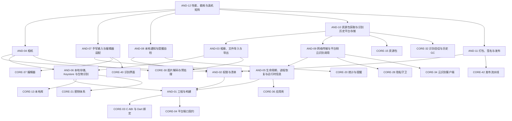

# 02 Android 端 v5

> 版本：v5 ｜ 修订日期：2026-10-18 ｜ 适用范围：Android 手机与平板（minSdk 26，即 Android 8.0 及以上）。
> 关联文档：[README](README.md)（需求基线与追踪总表）、[01 公共核心](01-公共核心-v5.md)、[03 Windows 端](03-Windows端-v5.md)、[附录 A 架构决策与评审记录](附录A-架构决策与评审记录.md)。
> 契约归属：本文只定义 Android 专属模块。公共契约（端口接口、FFI、DTO、错误码、表结构、服务端 API）只在 01 中定义；本文引用时写“CORE-xx §章节”，并内联实现时要调用的关键签名，不重新定义。

## 0. 使用方法

一次 vibe coding 会话交给编码助手的材料是：本文中目标 AND 卡全文 + 它依赖的 AND 卡与 CORE 卡的“接口契约”段 + CORE-01、CORE-02 的“接口契约”段。卡片字段与 01 相同；验收标准中的 [Rxx] 指向 [README](README.md) §5 需求追踪总表。

Android 端的职责边界：

- 只实现 CORE-04 §4 定义的平台端口，以及工程、清单、打包、生命周期等 Android 专属事务。
- 不得在 Kotlin/Java 或 Android 专属 Dart 代码中实现公式解析、量纲与单位、排版、判分、FSRS、同步合并、资源包验签或识别后处理；这些只调用 Rust 核心（经 CORE-03 §4 的 `CoreBinding`）。
- Android 专属 Dart 代码放在 `app/lib/platform/android/`，原生代码放在 `app/android/`；共享界面 `app/lib/ui/` 中不得出现 `Platform.isAndroid` 分支，差异通过端口或 `RuntimeInfo` 注入。

## 1. 模块依赖图

箭头从模块指向它的前置模块；省略每张卡都有的 CORE-01、CORE-02 依赖。



## 2. 建议实施顺序

与 [01 §2](01-公共核心-v5.md) 的阶段对齐；每张卡的前置卡都在同一阶段或更早阶段完成。

| 阶段 | 模块 | 出口 |
| --- | --- | --- |
| S0 骨架 | AND-01 | 空壳应用在真机启动，经 C ABI 显示 `fml_abi_version` |
| S2 本地库与账户入口 | AND-02、AND-05、AND-06 | 清单权限最小化；加密库落盘、平台密钥包装可用；进程被杀后恢复到原页面 |
| S4 内容与学习 | AND-08 | 每日复习提醒与提醒自检可用 |
| S5 识别与云识别 | AND-03、AND-04、AND-07、AND-09、AND-10 | 相册/文件/相机导入、手写、云识别调用、资源包下载与历史目录清理 |
| S7 发布 | AND-11、AND-12 | AAB 与 APK 签名发布；真机性能与能耗矩阵达标 |

## 3. 模块索引

| 编号 | 名称 | 代码位置 | 直接依赖 | 预估规模 |
| --- | --- | --- | --- | --- |
| AND-01 | 工程与构建 | `app/android/`、`app/lib/main_android.dart`、`app/lib/composition/ports_android.dart` | CORE-01、02、03、04 | 约 300 行 |
| AND-02 | 权限与清单 | `app/android/app/src/main/AndroidManifest.xml`、`app/lib/platform/android/permissions.dart` | CORE-01、02、04，AND-01 | 约 200 行 |
| AND-03 | 相册、文件导入与导出 | `app/lib/platform/android/picker/`、`app/android/.../ImportBridge.kt` | CORE-01、02、04、30，AND-06 | 约 450 行 |
| AND-04 | 相机 | `app/lib/platform/android/camera/`、`app/android/.../CameraBridge.kt` | CORE-01、02、04、30，AND-02、06 | 约 450 行 |
| AND-05 | 生命周期、进程恢复与运行时信息 | `app/lib/platform/android/lifecycle/` | CORE-01、02、04、36，AND-01 | 约 350 行 |
| AND-06 | 本地存储、Keystore 与生物识别 | `app/lib/platform/android/storage/`、`app/android/.../KeystoreBridge.kt` | CORE-01、02、04、13、21，AND-01 | 约 450 行 |
| AND-07 | 手写输入与编辑器适配 | `app/lib/platform/android/ink/`、`app/lib/platform/android/editor/` | CORE-01、02、04、37、40，AND-05 | 约 400 行 |
| AND-08 | 本地通知与提醒自检 | `app/lib/platform/android/notify/` | CORE-01、02、04、20，AND-02 | 约 400 行 |
| AND-09 | 网络传输与平台侧云识别调用 | `app/lib/platform/android/net/` | CORE-01、02、04、28、34，AND-05 | 约 300 行 |
| AND-10 | 资源包获取与识别历史平台存储 | `app/lib/platform/android/packs/`、`app/lib/platform/android/history/` | CORE-01、02、04、15、32，AND-03、09 | 约 350 行 |
| AND-11 | 打包、签名与发布 | `app/android/app/build.gradle`、`tools/release/android/` | CORE-01、02、42，AND-01、02 | 约 250 行 |
| AND-12 | 性能、能耗与真机矩阵 | `app/integration_test/android/`、`tools/perf/android/` | CORE-01、02，AND-04、07、08、10、11 | 约 400 行 |

## 4. 端口实现映射

CORE-04 §4 的每个端口在 Android 上由下表的卡实现；`composition/ports_android.dart`（AND-01）负责组装。

| 端口（CORE-04 §4） | Android 实现 | 卡片 |
| --- | --- | --- |
| `SecureKeyValueStore` | Android Keystore（优先 StrongBox，降级 TEE，再降级软件密钥并提示） | AND-06 |
| `LocalFileStore` | `noBackupFilesDir` / `filesDir` / `cacheDir` 私有目录 | AND-06 |
| `BiometricPrompt` | AndroidX Biometric（BIOMETRIC_STRONG 或设备凭据） | AND-06 |
| `ImagePicker` | Photo Picker、ACTION_PICK、SAF `ACTION_OPEN_DOCUMENT` | AND-03 |
| `ClipboardAdapter` | ClipboardManager（文本；图片 URI 只读一次） | AND-03 |
| `FileExporter` | SAF `ACTION_CREATE_DOCUMENT` | AND-03 |
| `CameraController` | CameraX | AND-04 |
| `AppLifecycle`、`RuntimeInfo` | Flutter 生命周期 + `onTrimMemory` + ActivityManager | AND-05 |
| `NotificationScheduler` | AlarmManager（非精确）/ WorkManager + NotificationManager | AND-08 |
| `HttpTransport` | 平台 HTTP 客户端（OkHttp 或 Dart `HttpClient`），由 CORE-28 `NetworkGuard` 包裹 | AND-09 |

---

## 5. 工程与系统集成

### AND-01 工程与构建

**目标**：建立 Android 工程，把 Rust 核心编译为 `libfmlcore.so` 并经 C ABI 加载，组装 Android 端口，产出可在真机运行的调试包。

**范围**
- 包含：`app/android/` Gradle 工程、Cargo 交叉编译（cargo-ndk）、ABI 选择、`libfmlcore.so` 打包与加载、ABI 版本检查、`main_android.dart` 入口、`composition/ports_android.dart` 组装（未实现的端口先用 Fake 并在启动日志中标注）、调试构建变体。
- 不包含：清单权限（AND-02）；签名与发布（AND-11）；各端口的具体实现（AND-03～10）。

**依赖**：CORE-01、CORE-02、CORE-03、CORE-04

**接口契约**

调用的公共契约（定义见 CORE-03 §4 与 CORE-04 §4，此处只列关键签名）：

```c
uint32_t fml_abi_version(void);          // 主版本不一致 → 拒绝启动并显示“核心版本不匹配”
const char* fml_capabilities(void);      // JSON
```

```dart
// CORE-03：CoreBinding.open(DynamicLibrary lib)；CORE-04：PlatformPorts 聚合全部端口
// app/lib/composition/ports_android.dart（本卡实现）
PlatformPorts buildAndroidPorts();      // 组装 AND-03～AND-10 的实现
// app/lib/main_android.dart（本卡实现）
void main() => runCommon(core: CoreBinding.open(DynamicLibrary.open('libfmlcore.so')), ports: buildAndroidPorts());
```

构建产物：

| 项目 | 规则 |
| --- | --- |
| minSdk | 26（Android 8.0） |
| targetSdk | 按 Google Play 与国内主流应用市场当年要求 |
| ABI | `arm64-v8a` 必须；`armeabi-v7a` 按目标用户设备占比数据决定；`x86_64` 只用于模拟器调试 |
| Rust 目标 | `aarch64-linux-android`、（可选）`armv7-linux-androideabi` |
| 原生库 | `app/android/app/src/main/jniLibs/<abi>/libfmlcore.so`，由 Gradle 任务调用 `cargo ndk` 生成 |
| 发布格式 | 应用商店 AAB；官网 APK |

**实现约束**
- 绑定方式只用 C ABI + `dart:ffi`（ffigen 生成），不使用 flutter_rust_bridge（ADR-V5-02，见附录 A）。
- 原生库按 16 KB 内存页对齐构建（NDK r27 及以上默认参数），以兼容 16 KB 页设备。
- Release 构建开启 R8，并保留 FFI 所需符号（`proguard-rules.pro` 中列出）；`.so` 去除调试符号，符号文件另行归档（AND-11）。
- 构建可复现：锁定 NDK、Rust 工具链与 Gradle 版本，写入 `app/android/toolchain.versions`。

**验收标准**
- [R01] 在 arm64 真机安装调试包，启动后首页显示 `fml_abi_version` 与 `fml_capabilities` 结果。
- [R18] 人为把核心 ABI 主版本加 1 后重新构建，应用拒绝启动并显示约定错误文案，不崩溃。
- [R41] 在 `app/lib/ui/` 中搜索 `Platform.isAndroid` 与 `dart:io` 的平台判断，零命中（CI 规则由 CORE-41 执行，本卡确保 Android 代码只在 `app/lib/platform/android/`）。
- [R23] 两次干净构建得到的 `libfmlcore.so` 哈希一致。

**规模**：约 300 行（Gradle 脚本、入口与组装）；`app/android/`、`app/lib/main_android.dart`、`app/lib/composition/ports_android.dart`。

### AND-02 权限与清单

**目标**：把 Android 权限压到最少，按需请求，拒绝后功能可降级使用，并在构建时审计合并后的清单。

**范围**
- 包含：`AndroidManifest.xml` 声明、运行时权限请求封装、拒绝与“不再询问”后的引导、合并清单审计脚本、备份规则文件引用（规则内容由 AND-06 定义）。
- 不包含：各功能对权限的具体使用（AND-04 相机、AND-08 通知）。

**依赖**：CORE-01、CORE-02、CORE-04、AND-01

**接口契约**

```dart
// app/lib/platform/android/permissions.dart
enum AndroidPermission { camera, postNotifications }
enum PermissionOutcome { granted, denied, permanentlyDenied }
abstract class PermissionService {
  Future<PermissionOutcome> request(AndroidPermission p, {required String rationaleKey}); // 先显示用途说明
  Future<void> openAppSettings();
}
```

允许声明的权限只有：

| 权限 | 时机 |
| --- | --- |
| `INTERNET` | 安装时（普通权限） |
| `CAMERA` | 用户第一次点击“拍照识别”时 |
| `POST_NOTIFICATIONS`（Android 13+） | 用户开启复习提醒时 |

- 错误码：权限被拒时端口抛 `PLATFORM_PERMISSION_DENIED`（CORE-04 §4 定义）。

**实现约束**
- 不申请 `READ_EXTERNAL_STORAGE`、`READ_MEDIA_IMAGES`、`MANAGE_EXTERNAL_STORAGE`、定位、通讯录、电话、麦克风、精确闹钟（`SCHEDULE_EXACT_ALARM`）与前台服务权限；选图走系统选择器（AND-03）。
- 每次请求前先显示用途说明；拒绝后不反复弹窗，只在用户再次主动使用该功能时提示并提供“去设置”。
- 第三方依赖带入的权限必须在清单中用 `tools:node="remove"` 移除，或在 ADR 中说明。
- 不使用 Google Play 服务专属能力（推送、Play Integrity、Google 登录），保证无 GMS 设备可用。

**验收标准**
- [R38] 合并清单审计（`tools/ci/check_android_manifest.py`）：Release 构建的合并清单权限集合等于上表，多出任何一项构建失败。
- [R31] 手动：拒绝相机权限后，“相册导入”与“文件导入”仍可用并能完成识别。
- [R04] 手动：拒绝通知权限后学习功能不受影响，设置页显示“提醒未开启”。
- [R01] 在无 GMS 的国产手机上完成首次启动、游客模式、学习与识别冒烟。

**规模**：约 200 行；`AndroidManifest.xml`、`app/lib/platform/android/permissions.dart`、`tools/ci/check_android_manifest.py`。

### AND-05 生命周期、进程恢复与运行时信息

**目标**：让应用在被系统回收或切到后台后能恢复到原状态，并向共享层提供生命周期事件与运行时信息。

**范围**
- 包含：`AppLifecycle` 与 `RuntimeInfo` 端口实现；`onTrimMemory` 映射为 `lowMemory`；页面路由与会话游标的恢复；后台时暂停轮询与相机；返回手势按层级回退；系统栏与深色模式适配；平板与折叠屏的窗口尺寸变化。
- 不包含：草稿与学习进度的持久化逻辑本身（CORE-37 去抖 500 ms 写草稿、CORE-19 游标持久化）；云任务查询（AND-09 调用 CORE-34）。

**依赖**：CORE-01、CORE-02、CORE-04、CORE-36、AND-01

**接口契约**

实现的端口（CORE-04 §4）：

```dart
abstract class AppLifecycle { Stream<LifecycleEvent> events(); }      // resumed | paused | detached | lowMemory
abstract class RuntimeInfo  { Future<RuntimeSnapshot> snapshot(); }    // os, osVersion, locale, availMemBytes, dpiScale, abi
```

调用的公共契约：CORE-36 §10 的启动钩子顺序（`pack.recover` → `account.profiles` → 打开档案 → 升级日志恢复 → 识别历史恢复 → 云任务查询 → 前台同步）；本卡在 `resumed` 时重新触发其中“云任务查询”和“前台同步”两项。

```dart
// app/lib/platform/android/lifecycle/restoration.dart（本卡实现）
class AndroidRestoration {
  Future<void> saveRoute(String location);         // 写入 Flutter RestorationManager
  Future<String?> restoreRoute();                  // 进程重建后回到原路由
}
```

**实现约束**
- 不使用常驻服务和前台服务；后台不做周期性网络轮询。
- `lowMemory` 时释放 DisplayList 缓存、缩略图与解码缓冲（各模块监听事件自行释放）；不得因此丢弃未保存草稿。
- 恢复时先重建账户作用域（CORE-23），再恢复页面；注册账户处于 RegisteredLocked 时先进入解锁页。
- 平板横屏与折叠屏展开时，公式库与详情采用双栏；尺寸变化不重建编辑器状态。
- 返回手势：识别校正页、编辑器、学习会话页按层级回退，学习会话中退出时提示“进度已保存”。

**验收标准**
- [R27] 手动 + 集成测试：在编辑器输入公式后用“不保留活动”开发者选项或 `adb shell am kill <package>` 杀进程，重启后草稿与路由恢复（草稿最多丢失最后 500 ms 输入）。
- [R04] 学习会话进行中杀进程，重启后提示继续，组内进度与已作答记录不丢失、不重复。
- [R03] 模拟 `onTrimMemory(TRIM_MEMORY_RUNNING_LOW)` 后内存回落，应用不崩溃。
- [R08] 平板横竖屏切换与折叠屏展开/折叠时编辑器内容、光标与撤销栈保持不变。

**规模**：约 350 行；`app/lib/platform/android/lifecycle/`。

### AND-06 本地存储、Keystore 与生物识别

**目标**：提供 Android 私有目录布局、Keystore 密钥包装与生物识别端口，使数据库与识别历史在本机加密并排除出系统备份。

**范围**
- 包含：`LocalFileStore`、`SecureKeyValueStore`、`BiometricPrompt` 端口实现；目录布局；备份排除规则（`data_extraction_rules.xml` 与 `full_backup_content.xml`）；安全等级探测与降级提示；空间不足处理。
- 不包含：数据库本身（CORE-13）；密钥层次与 AEAD（CORE-21）；账户状态机与应用锁策略（CORE-23）。

**依赖**：CORE-01、CORE-02、CORE-04、CORE-13、CORE-21、AND-01

**接口契约**

实现的端口（CORE-04 §4）：

```dart
abstract class SecureKeyValueStore {
  Future<Uint8List> wrap(String alias, Uint8List secret);
  Future<Uint8List> unwrap(String alias, Uint8List wrapped);   // 失效 → PLATFORM_KEY_UNAVAILABLE
  Future<void> delete(String alias);
  Future<KeySecurityLevel> securityLevel(String alias);        // strongBox | tee | software
}
abstract class LocalFileStore {
  Future<Directory> root(StoreArea area);   // database | packs | recognition | staging | drafts | exports | logs
  Future<int> freeBytes();
  Future<void> excludeFromSystemBackup(Directory dir);
}
abstract class BiometricPrompt { Future<bool> isAvailable(); Future<bool> authenticate(String reasonKey); }
```

目录布局：

| `StoreArea` | Android 位置 | 说明 |
| --- | --- | --- |
| database | `noBackupFilesDir/accounts/<profile_id>/db/` | SQLCipher 库与 WAL（CORE-13）；设备级 `device_registry.db` 在 `noBackupFilesDir/` |
| packs | `filesDir/packs/` | 已验证的只读资源包目录（CORE-15） |
| recognition | `noBackupFilesDir/accounts/<profile_id>/recognition/` | 识别历史密文与缩略图（CORE-32） |
| staging | `noBackupFilesDir/accounts/<profile_id>/staging/` | 加密暂存区 |
| drafts | `noBackupFilesDir/accounts/<profile_id>/drafts/` | 编辑器与笔迹草稿 |
| exports | 不落私有目录，经 `FileExporter`（AND-03）写到用户选择的位置 | — |
| logs | `filesDir/logs/` | 本地脱敏日志（CORE-28） |
| （临时） | `cacheDir/tmp-import/` | 导入的临时副本，处理完成即删（AND-03） |

Keystore 别名：`fml.<profile_id>.db`、`fml.<profile_id>.history`、`fml.packcache`、`fml.<profile_id>.applock`（需用户认证）。每个识别会话的会话密钥不建 Keystore 别名，由 `RecognitionHistoryKey` 包装（CORE-21 §8）。

**实现约束**
- Keystore 使用 AES-256-GCM 包装密钥；创建时优先请求 StrongBox，失败降级 TEE，再降级软件密钥；`securityLevel` 如实返回，软件级时设置页显示安全等级提示（CORE-23 §8 要求降级必须显式提示）。
- 应用锁别名设置 `setUserAuthenticationRequired(true)`（BIOMETRIC_STRONG 或 DEVICE_CREDENTIAL）；生物识别信息变更导致密钥失效时抛 `PLATFORM_KEY_UNAVAILABLE`，由 CORE-23 引导恢复。生物识别只用于本机解锁，不作为账户凭据。
- 所有用户数据目录排除出 Auto Backup 与设备迁移（备份规则文件排除 `noBackupFilesDir` 以外的 `filesDir/logs` 与 `databases/`）；不使用 MediaStore 与公共目录。
- 恢复出厂或清除应用数据会导致本机密钥丢失：首次注册与设置页提示“开启同步或定期导出”。
- 空间不足时先清临时目录与缓存，再提示用户；不得删除未同步的用户数据。
- `FLAG_SECURE` 作为可选设置（默认关闭）。

**验收标准**
- [R27] 运行 CORE-04 端口契约测试套件 `app/test/ports_contract_test.dart` 的 Android 设备版，全部通过。
- [R27] 手动：用 `adb backup` / 设备迁移工具导出后，备份中不含数据库、识别历史与草稿目录。
- [R27] 在支持 StrongBox、仅 TEE、模拟器（软件）三类设备上 `securityLevel` 返回正确，软件级出现提示。
- [R33] 删除识别会话后，`recognition/` 目录中对应文件不存在（与 CORE-32 联测）。
- [R25] 新增生物识别指纹后，应用锁解锁失败并进入恢复流程，游客与注册账户数据均未丢失。

**规模**：约 450 行；`app/lib/platform/android/storage/`、`app/android/.../KeystoreBridge.kt`。

---

## 6. 输入与识别

### AND-03 相册、文件导入与导出

**目标**：用系统选择器从相册与文件管理器导入图片（不申请存储权限），提供剪贴板与导出文件能力。

**范围**
- 包含：`ImagePicker`、`ClipboardAdapter`、`FileExporter` 端口实现；Photo Picker（Android 13+ 及经 Google Play 系统更新回移的设备）、ACTION_PICK 与 SAF `ACTION_OPEN_DOCUMENT`（Android 8–12 及无 Photo Picker 的设备）、多选上限 10、复制到临时目录、临时文件清理。
- 不包含：图片解码与预处理（CORE-30，在 Rust 中流式完成）；裁剪与增强界面（CORE-40）；识别会话记录（CORE-32）。

**依赖**：CORE-01、CORE-02、CORE-04、CORE-30、AND-06

**接口契约**

实现的端口（CORE-04 §4）：

```dart
abstract class ImagePicker { Future<List<ImportedImage>> pick({required int maxCount}); } // maxCount ≤ 10
class ImportedImage { final String displayName; final int byteLength; Future<Uint8List> readBytes(); final DateTime expiresAt; }
abstract class ClipboardAdapter { Future<String?> readText(); Future<void> writeText(String t); Future<ImportedImage?> readImage(); }
abstract class FileExporter { Future<bool> saveAs(String suggestedName, Stream<List<int>> bytes); }
```

调用的公共契约（CORE-30 §9）：`img.probe`（读取格式与尺寸，超限直接拒绝，不完整解码）；超过 20 MiB 返回 `IMG_TOO_LARGE`，超过 4000 万像素返回 `IMG_TOO_MANY_PIXELS`。

ImportBridge（Kotlin，本卡实现）：

```kotlin
// app/android/.../ImportBridge.kt  —— MethodChannel "fml/import"
fun pickImages(maxCount: Int): List<Map<String, Any>>   // [{displayName, byteLength, tmpPath}]，tmpPath 位于 cacheDir/tmp-import/
fun createDocument(suggestedName: String, mime: String): String? // 返回 content URI，Dart 侧流式写入
```

**实现约束**
- 不请求持久 URI 权限（不调用 `takePersistableUriPermission`）；读取一次即复制到 `cacheDir/tmp-import/<随机名>`，不保存源 URI 与原文件路径。
- 复制时检查 `byteLength`，超过 20 MiB 直接拒绝；MIME 只接受 `image/jpeg`、`image/png`、`image/webp`、`image/heic`、`image/heif`。HEIC/HEIF 由系统解码器（`ImageDecoder`，API 28+）转为 PNG 后再交给 Rust；API 26–27 上 HEIC 提示“请转换为 JPEG”。
- Dart/Java 层不得把全尺寸图解码为 Bitmap；解码与降采样在 Rust（CORE-30）中流式完成。
- `ImportedImage.expiresAt` 默认 1 h；导入流程结束、取消或过期时删除临时副本；应用启动时清空 `tmp-import/`。
- 只删除本应用创建的副本，绝不删除或修改相册与文件管理器中的原始文件；不向相册写入。
- 剪贴板只在用户点击“粘贴”时读取，不在后台监听。

**验收标准**
- [R38] 手动：分别通过 Photo Picker 与文件管理器（SAF）选择图片，均能进入裁剪页；全程未出现存储权限请求。
- [R38] 多选 11 张时选择器限制为 10 张或提示超限；选择后 `tmp-import/` 中有 10 个文件，流程结束后为空。
- [R31] 1200 万像素 JPEG 导入不 OOM（与 AND-12 联测），超 20 MiB 文件被拒绝并提示。
- [R36] 导入、识别、GC 完成后，原始相册图片的哈希与修改时间不变。
- [R27] 导出：选择“导出备份”后经 SAF 保存，文件可在 CORE-27 恢复流程中验证通过。

**规模**：约 450 行；`app/lib/platform/android/picker/`、`app/android/.../ImportBridge.kt`。

### AND-04 相机

**目标**：用 CameraX 拍摄公式照片，提供实时取景提示，用完立即释放相机，照片只进私有目录。

**范围**
- 包含：`CameraController` 端口实现、取景页的原生预览嵌入（PlatformView 或 Texture）、实时质量提示（清晰度、曝光、阴影、倾斜、公式区域占比）、拍摄与写入临时目录、后台与中断时释放。
- 不包含：拍后预处理（CORE-30）；裁剪与识别界面（CORE-40）。

**依赖**：CORE-01、CORE-02、CORE-04、CORE-30、AND-02、AND-06

**接口契约**

实现的端口（CORE-04 §4）：

```dart
abstract class CameraController { Future<ImportedImage?> capture(); }  // 用户取消返回 null；权限被拒抛 PLATFORM_PERMISSION_DENIED
```

调用：AND-02 `PermissionService.request(AndroidPermission.camera, rationaleKey: 'camera_rationale')`；CORE-30 §9 `img.probe` 质量评估（拍后对照提示）。

```kotlin
// app/android/.../CameraBridge.kt —— MethodChannel "fml/camera"，EventChannel "fml/camera/hints"
fun open(): Long                    // 返回 Texture id
fun capture(): Map<String, Any>?    // {displayName, byteLength, tmpPath}
fun close()
// hints 事件：{sharpness: 0..1, exposure: -1..1, shadow: 0..1, tiltDeg: Float, areaRatio: 0..1}
```

**实现约束**
- 实时提示使用低分辨率 YUV 帧在后台线程计算，不把预览帧复制到 Dart；每秒最多 10 次事件。
- 拍摄结果直接写入 `cacheDir/tmp-import/`，不写相册、不写 MediaStore。
- 页面进入后台、来电、分屏失焦或离开取景页时立即 `close()` 释放相机与缓冲。
- 相机不可用（被占用、无相机）时提示并提供相册导入入口。

**验收标准**
- [R31] 手动：拍照 → 裁剪 → 增强 → 识别 → 校正 → 保存全流程通过；照片未出现在系统相册。
- [R32] 取景时遮挡光线或倾斜手机，提示文案相应变化。
- [R03] 拍摄过程中按 Home 键，`dumpsys media.camera` 显示相机已释放；返回后可重新打开。
- [R31] 拒绝相机权限后进入相机入口，显示说明并提供相册导入，不崩溃。

**规模**：约 450 行；`app/lib/platform/android/camera/`、`app/android/.../CameraBridge.kt`。

### AND-07 手写输入与编辑器适配

**目标**：在 Android 上高保真采集手写笔迹（触笔优先、防手掌误触），并让编辑器适配软键盘、符号面板与小屏布局。

**范围**
- 包含：原生笔迹采集（历史采样点、压力、工具类型）、120 Hz 重采样、手写模式下隐藏输入法、可选“仅触笔书写”与手掌误触过滤开关、横屏临时切换；编辑器软键盘适配（键盘遮挡、模板快捷栏）、Android 输入方式到 `EditorActions` 的映射、无障碍朗读。
- 不包含：画布渲染与笔画撤销（CORE-40 `InkCanvas`）；编辑器逻辑（CORE-37）；笔迹渲染为识别图（CORE-29 `render_ink`）。

**依赖**：CORE-01、CORE-02、CORE-04、CORE-37、CORE-40、AND-05

**接口契约**

调用的公共契约（CORE-40 §10、CORE-37 §10）：

```dart
class InkCanvas extends StatefulWidget { const InkCanvas({required this.onStrokesChanged, this.pressureSupported = false}); }
class InkPointerAdapter { void onPointer(PointerEvent e); }    // 本卡提供 Android 实现替换默认适配器
class EditorActions { static const undo = 'undo', redo = 'redo', fraction = 'fraction', /* … */ toggleMode = 'toggle_mode'; }
```

```dart
// app/lib/platform/android/ink/android_ink_adapter.dart（本卡实现）
class AndroidInkAdapter extends InkPointerAdapter {
  AndroidInkAdapter({required this.stylusOnly, required this.palmRejection});
  final bool stylusOnly; final bool palmRejection;
  // 读取 PointerEvent.kind（stylus / touch）、pressure、历史采样点；无压力时压力取 0.5；坐标归一化到画布
}
// app/lib/platform/android/editor/android_editor_bindings.dart（本卡实现）
Map<String, String> androidTemplateBar();   // 软键盘上方快捷栏：分式、上下标、根式、积分、求和、希腊字母 → EditorActions
```

**实现约束**
- 使用 Flutter 指针事件的合并历史点（对应原生 `getHistoricalX/Y`），确保快速书写不丢点；按 120 Hz 重采样后交给画布。
- `stylusOnly` 开启时只接受 `PointerDeviceKind.stylus`；`palmRejection` 开启时忽略接触面积大于阈值或与触笔同时出现的触摸点。
- 手写模式下隐藏软键盘；横屏只在手写页临时允许。
- 编辑器优先级：符号面板与结构化输入为主，手写其次，LaTeX 源码为辅（由 CORE-37 的默认模式规则与 `RuntimeInfo` 决定）。
- 公式显示只用 CORE-12 DisplayList 渲染，不使用 WebView；为 TalkBack 提供 `semantic_text`。
- 笔迹在游客模式下只能走本地识别或手动输入；注册用户上传笔迹渲染图同样经预览与授权（CORE-34）。
- 笔迹延迟满足 CORE-01 预算（Android ≤ 50 ms）。

**验收标准**
- [R06] 手动：在触笔平板与普通手机上快速书写 ∫、∑ 与分式，笔画连续不丢点；“仅触笔”开启时手指触摸不留笔迹。
- [R06] 手动：手掌压在屏幕上书写，误触被过滤。
- [R08] 软键盘弹出时编辑区不被遮挡；快捷栏每个按钮插入对应模板。
- [R03] 笔迹延迟测量（高速摄像或系统 trace）≤ 50 ms。
- [R01] 同一笔迹样本在 Android 与 Windows 上经 `render_ink` 得到的规范化图哈希一致（与 WIN-08 联测）。

**规模**：约 400 行；`app/lib/platform/android/ink/`、`app/lib/platform/android/editor/`。

### AND-09 网络传输与平台侧云识别调用

**目标**：提供 Android 上的 `HttpTransport` 实现，并处理云识别在网络切换、后台与进程重启下的平台行为。

**范围**
- 包含：`HttpTransport` 端口实现（TLS、超时、取消、证书校验）、网络状态监听、应用进入后台时暂停状态轮询、回到前台时恢复 `watch`、进程重启后触发 `resumePending`、省电模式与流量节省模式下的提示。
- 不包含：云识别业务流程、授权与回执（CORE-34）；网络白名单与授权检查（CORE-28 `NetworkGuard` 包裹本卡实现）；服务端网关（CORE-33）。

**依赖**：CORE-01、CORE-02、CORE-04、CORE-28、CORE-34、AND-05

**接口契约**

实现的端口（CORE-04 §4）：

```dart
abstract class HttpTransport { Future<HttpResult> send(HttpRequestDto req, {CancelToken? cancel}); }
// 错误：NET_OFFLINE | NET_TLS | NET_TIMEOUT | NET_HOST_NOT_ALLOWED
```

调用的公共契约（CORE-34 §9）：

```dart
Stream<CloudJobState> watch(String jobId);   // 前台轮询
Future<void> cancel(String jobId);
Future<void> resumePending();                // 启动与回到前台时调用，只查询不重新提交
```

```dart
// app/lib/platform/android/net/android_cloud_lifecycle.dart（本卡实现）
class AndroidCloudLifecycle {
  AndroidCloudLifecycle(this._lifecycle, this._cloud, this._connectivity);
  void attach();   // paused → 停止 watch 轮询；resumed → resumePending() 并重新 watch；网络恢复 → 同 resumed
}
```

**实现约束**
- 连接超时 5 s、请求总时限 30 s（与 CORE-33 §9 的网关时限一致）；超时只表示客户端停止等待，不自动重新提交。
- 后台不保持网络连接、不使用前台服务或 WorkManager 继续轮询云任务。
- 只信任系统 CA；不允许用户证书（`network_security_config.xml` 中 `cleartextTrafficPermitted="false"`）。
- 不在请求日志中记录请求体、令牌或图片哈希以外的内容（CORE-28 日志规则）。

**验收标准**
- [R40] 手动（预发网关）：注册用户手写渲染图与照片裁剪图均完成云识别、候选校正与入库。
- [R40] 提交后立即切到后台 5 分钟再返回，任务状态经查询收敛，网关日志显示只有一次供应商调用。
- [R40] 提交后飞行模式 → 恢复网络，状态保持并最终收敛；提交后杀进程重启，`resumePending` 只查询不重复提交。
- [R26] 游客模式下抓包（mitmproxy）全流程，只有白名单内资源包与更新检查请求。
- [R40] APK、AAB、`.so` 与日志中扫描不到供应商 API Key（与 CORE-42 制品扫描联测）。

**规模**：约 300 行；`app/lib/platform/android/net/`。

### AND-10 资源包获取与识别历史平台存储

**目标**：在 Android 上下载与离线导入资源包，并为识别历史提供存储紧张时的清理触发与“一键清空”的平台侧确认。

**范围**
- 包含：资源包下载（断点续传、仅 Wi-Fi 选项、校验前不激活）、离线 `.fmlpack` 文件导入（经 AND-03 选择器）、存储紧张检测并触发 CORE-32 GC、一键清空前展示删除范围、清空后目录检查。
- 不包含：验签与安装（CORE-15 `pack.install`）；GC 规则与执行（CORE-32）；内容筛选界面（CORE-38）。

**依赖**：CORE-01、CORE-02、CORE-04、CORE-15、CORE-32、AND-03、AND-09

**接口契约**

调用的公共契约：

```text
CORE-15 §6：pack.check_updates、pack.install（长任务，经 fml_submit）、pack.list、pack.uninstall
CORE-32 §9：gc_plan / gc_execute（经 FFI op recog.gc）、HistoryRepo.clear_all（op recog.clear_all）
CORE-43 §11：https://<cdn>/packs/<pack_id>/<version>.fmlpack、/packs/metadata/{root,targets,snapshot,timestamp}.json
```

```dart
// app/lib/platform/android/packs/pack_downloader.dart（本卡实现）
class AndroidPackDownloader {
  Future<File> download(Uri url, {required int expectedSize, required bool wifiOnly, CancelToken? cancel}); // 写入 StoreArea.staging，支持 Range 续传
}
// app/lib/platform/android/history/storage_pressure.dart（本卡实现）
class StoragePressureWatcher { void attach(); } // 可用空间 < 500 MB 或 onTrimMemory 时调用 recog.gc
```

**实现约束**
- 下载经 `NetworkGuard`（不带账户令牌与用户内容）；下载完成后交给 `pack.install`，验签失败删除下载文件。
- 下载与导入失败时保留旧包；界面按教育阶段、学科、教材版本与考试范围展示可下载的四类内容包（`content-high-school-math`、`content-high-school-physics`、`content-university-math`、`content-university-physics`）。
- 一键清空前显示将删除的会话数与占用空间，并说明“不会删除相册或文件管理器中的原图”。

**验收标准**
- [R30] 手动：下载四类内容包各一个版本并安装，按教育阶段与考试范围筛选可见；下载中断后重新打开继续下载并安装成功。
- [R29] 离线导入一个 `.fmlpack` 文件成功；导入篡改过的包被拒绝且旧包可用。
- [R33] 填充存储使可用空间 < 500 MB，触发 GC 后先清缓存与暂存，再按序号清普通会话。
- [R36] 一键清空后 `recognition/` 与 `staging/` 目录为空，私有目录中无未加密图片与缩略图。
- [R39] 首次安装后可下载并加载高中数学与高中物理内容包，检索得到高中条目。

**规模**：约 350 行；`app/lib/platform/android/packs/`、`app/lib/platform/android/history/`。

---

## 7. 学习提醒

### AND-08 本地通知与提醒自检

**目标**：在不依赖厂商推送与网络的前提下，按到期数量每日本地提醒复习，并提供提醒可靠性自检与国产 ROM 设置引导。

**范围**
- 包含：`NotificationScheduler` 端口实现（非精确闹钟 + WorkManager 兜底）、通知渠道、点击通知打开学习页、开机与时区变化后重新调度、提醒自检页（通知权限、调度状态、电池优化、自启动、后台限制）、按 `Build.MANUFACTURER` 的设置跳转表。
- 不包含：提醒时间与正文的生成（CORE-20 `ReminderService`）。

**依赖**：CORE-01、CORE-02、CORE-04、CORE-20、AND-02

**接口契约**

实现的端口（CORE-04 §4）：

```dart
abstract class NotificationScheduler {
  Future<bool> requestPermission();                                  // 调用 AND-02 PermissionService（postNotifications）
  Future<void> scheduleDailyReminder(LocalTime time, String body);   // body 由 CORE-20 生成，只含待复习数量
  Future<void> cancelAll();
}
```

```dart
// app/lib/platform/android/notify/reminder_self_check.dart（本卡实现）
class ReminderCheckItem { final String id; final bool ok; final String? fixActionKey; }
abstract class ReminderSelfCheck {
  Future<List<ReminderCheckItem>> run();     // permission | scheduled | battery_optimization | autostart | background_restriction
  Future<void> openFix(String id);           // 跳转到对应系统设置页；未知 ROM 打开应用详情页
}
```

**实现约束**
- 不使用厂商推送、不使用 Google 推送；不申请精确闹钟权限（`setAndAllowWhileIdle` 非精确调度，允许数分钟偏差），WorkManager 每日任务作兜底；重复触发时只显示一次。
- 通知正文只含“今天有 N 条公式待复习”，不含公式内容；通知操作只有“开始复习”，不提供“记得/忘了”快捷评分（评分须来自客观判定，CORE-19）。
- 当日无到期卡片时不提醒。
- ROM 设置跳转表放在 `app/lib/platform/android/notify/rom_settings.yaml`，覆盖主流国产 ROM；跳转失败回退到应用详情页。自检结果保存在 `local_setting` 之外的本地偏好，不同步。

**验收标准**
- [R04] 手动：设置 1 分钟后提醒，锁屏等待，通知按时（±10 min）出现，点击进入学习页；重启手机后提醒仍被调度。
- [R04] 自检页在关闭通知权限、开启电池优化、关闭自启动的设备上逐项标红，并能跳转到设置页。
- [R26] 提醒全流程无网络请求（游客与注册账户一致）。
- [R04] 通知正文审计：只包含数量，不含公式标题或内容。

**规模**：约 400 行；`app/lib/platform/android/notify/`。

---

## 8. 打包与质量

### AND-11 打包、签名与发布

**目标**：产出签名的 AAB（应用商店）与 APK（官网），归档符号与 mapping，并执行 Android 发布检查。

**范围**
- 包含：Release 构建配置、签名配置（密钥不入仓库）、AAB 与 APK 构建、体积检查、符号与 mapping 归档、16 KB 页对齐检查、国内应用市场上架材料清单（隐私政策、权限说明、SDK 清单、应用备案信息）。
- 不包含：版本号与 SBOM（CORE-42 `tools/release/`）；真机性能测试（AND-12）。

**依赖**：CORE-01、CORE-02、CORE-42、AND-01、AND-02

**接口契约**

调用的公共契约（CORE-42 §11）：`tools/release/bump_version.py <x.y.z>`、`collect_artifacts.py`、`sbom.py`、`checklist.md`。

```text
tools/release/android/（本卡实现）
  build_release.sh        构建 AAB 与 APK（arm64-v8a；按决定加入 armeabi-v7a）
  check_artifacts.py      检查：签名证书指纹、.so 16 KB 对齐（zipalign -c -P 16 与 readelf 段对齐）、
                          体积（单 ABI APK < 45 MB）、清单权限（复用 AND-02 脚本）、无调试标志
  archive_symbols.sh      归档 R8 mapping 与 .so 调试符号到发布制品库
```

**实现约束**
- 上传密钥与签名密钥分离；签名密钥只在 CI 的受保护环境变量或签名服务中，不进入仓库。
- AAB 与 APK 由同一提交、同一构建脚本产出，行为一致。
- 发布前检查清单（CORE-42）中的 Android 项：arm64 真机冷启动、R8 后 FFI 正常、AAB 与 APK 行为一致、符号与 mapping 已归档、哈希与签名已归档、隐私合规检测通过、应用备案与软件著作权材料就绪。

**验收标准**
- [R01] 用 bundletool 从 AAB 生成设备 APK 安装后，与官网 APK 在同一设备上执行冒烟脚本结果一致。
- [R03] `check_artifacts.py`：单 ABI APK < 45 MB，超限失败。
- [R23] 发布制品库中存在对应版本的 mapping、符号文件、SHA-256 清单与 SBOM。
- [R40] 制品字符串扫描无供应商 API Key 与测试密钥（调用 CORE-42 扫描）。
- [R01] `.so` 16 KB 对齐检查通过。

**规模**：约 250 行；`app/android/app/build.gradle`（release 部分）、`tools/release/android/`。

### AND-12 性能、能耗与真机矩阵

**目标**：在真机矩阵上验证 Android 性能、内存与能耗预算，并给出可重复执行的测量脚本。

**范围**
- 包含：Flutter 集成测试与宏基准（冷启动、列表滚动、编辑器排版、手写延迟、图片预处理、连续 20 张大图）、内存采样、能耗检查（Battery Historian）、真机矩阵与结果记录模板、与 Windows 的跨端一致性抽查。
- 不包含：各功能的正确性测试（由各卡完成）。

**依赖**：CORE-01、CORE-02、AND-04、AND-07、AND-08、AND-10、AND-11

**接口契约**

预算（定义见 CORE-01 §4 全局预算表，此处列 Android 值）：

| 指标 | Android 目标 |
| --- | --- |
| 冷启动（到可交互首页） | < 2 s |
| 列表滚动 | 60 FPS，掉帧 < 1% |
| 常驻内存 | < 150 MB |
| 公式解析 + 校验 | < 20 ms + < 10 ms（合计 < 30 ms） |
| 排版 | < 30 ms |
| 判分 | ≤ 50 ms |
| 到期队列 | ≤ 20 ms |
| 搜索首屏 | < 100 ms |
| 笔迹延迟 | ≤ 50 ms |
| 单张图片预处理 | < 500 ms |
| 连续导入 20 张 1200 万像素图片 | 不 OOM，峰值内存增量 ≤ 20 MiB |
| 后台能耗 | 无常驻服务、无周期性网络轮询、无唤醒锁残留 |

```text
tools/perf/android/（本卡实现）
  run_matrix.sh            依次在已连接设备上运行 integration_test 并收集 JSON 结果
  report_template.md       记录：设备、系统版本、RAM、ROM、各指标 P50/P95、是否达标
app/integration_test/android/
  cold_start_test.dart  scroll_test.dart  editor_latency_test.dart  ink_latency_test.dart  import_20_images_test.dart
```

真机矩阵（至少）：4 GB RAM 中端机、8 GB RAM 主流机、无 GMS 的国产 ROM 机型（至少两家厂商）、Android 8 / 13 / 当前主流版本各一台、平板或折叠屏一台、学习平板一台。

**实现约束**
- 测量使用 Release 或 Profile 构建，不用 Debug 构建。
- 每个指标至少 20 次采样，报告 P50 与 P95；不达标项须在发布前修复或经评审记录豁免（附录 A）。
- 能耗：执行 30 分钟“学习 + 识别”脚本后用 Battery Historian 检查无常驻唤醒与后台网络。

**验收标准**
- [R03] 中端机（4 GB）全部预算项 P95 达标，结果写入报告。
- [R31] `import_20_images_test` 在 4 GB 机型上不 OOM。
- [R03] 能耗检查无常驻服务、无周期性网络轮询。
- [R01] 跨端一致性抽查：同一组 50 条公式在 Android 与 Windows 上的 AST JSON、诊断码与 NodePath 完全一致（脚本比对 CORE-09 输出）。
- [R41] 报告模板中逐项列出本文各卡的手动验收结果，作为 Android 发布签字依据。

**规模**：约 400 行（测试与脚本）；`app/integration_test/android/`、`tools/perf/android/`。
