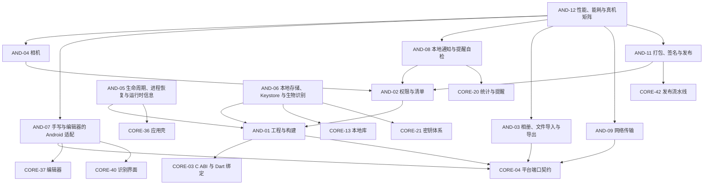

# 02 Android 端 v5

> 版本：v5.1 ｜ 修订日期：2026-10-18 ｜ 适用范围：Android 手机与平板（minSdk 26，即 Android 8.0 及以上）。
> 关联文档：[README](README.md)（需求基线与追踪总表）、[01 公共核心](01-公共核心-v5.md)、[03 Windows 端](03-Windows端-v5.md)、[附录 A 架构决策与评审记录](附录A-架构决策与评审记录.md)。
> 契约归属：本文只定义 Android 专属模块。公共契约（端口接口、FFI、DTO、错误码、表结构、服务端 API）只在 01 中定义；本文引用时写“CORE-xx §章节”，并内联实现时要调用的关键签名，不重新定义。

## 0. 使用方法

一次 vibe coding 会话交给编码助手的材料是：本文中目标 AND 卡全文 + 它依赖的 AND 卡与 CORE 卡的“接口契约”段 + CORE-01、CORE-02 的“接口契约”段。卡片字段与 01 相同；验收标准中的 [Rxx] 指向 [README](README.md) §5 需求追踪总表。

Android 端的职责边界：

- 只实现 CORE-04 §4 定义的平台端口，以及工程、清单、打包、生命周期等 Android 专属事务。
- 不得在 Kotlin/Java 或 Android 专属 Dart 代码中实现公式解析、量纲与单位、排版、判分、FSRS、同步合并、资源包验签或识别后处理；这些只调用 Rust 核心（经 CORE-03 §4 的 `CoreBinding`）。
- Android 专属 Dart 代码放在 `app/lib/platform/android/`，原生代码放在 `app/android/`；共享界面 `app/lib/ui/` 中不得出现 `Platform.isAndroid` 分支，差异通过端口或 `RuntimeInfo` 注入。

## 1. 模块依赖图

箭头从模块指向它的前置模块；省略每张卡都有的 CORE-01、CORE-02 依赖。



## 2. 建议实施顺序

与 [01 §2](01-公共核心-v5.md) 的阶段对齐；每张卡的前置卡都在同一阶段或更早阶段完成。

| 阶段 | 模块 | 出口 |
| --- | --- | --- |
| S0 骨架 | AND-01 | 空壳应用在真机启动，经 C ABI 显示 `fml_abi_version` |
| S2 本地库与账户入口 | AND-02、AND-05、AND-06、AND-09 | 清单权限最小化；加密库落盘、平台密钥包装可用；进程被杀后恢复到原页面；注册与登录走真实网络传输 |
| S4 内容与学习 | AND-08 | 每日复习提醒与提醒自检可用 |
| S5 识别与云识别 | AND-03、AND-04、AND-07 | 相册/文件/相机导入、手写与编辑器适配（云识别与资源包下载由 CORE-34、CORE-51 经 AND-09 传输完成） |
| S7 发布 | AND-11、AND-12 | AAB 与 APK 签名发布；真机性能与能耗矩阵达标 |

## 3. 模块索引

| 编号 | 名称 | 代码位置 | 直接依赖 | 预估规模 |
| --- | --- | --- | --- | --- |
| AND-01 | 工程与构建 | `app/android/`、`app/lib/main_android.dart`、`app/lib/composition/ports_android.dart` | CORE-01、02、03、04 | 约 300 行 |
| AND-02 | 权限与清单 | `app/android/app/src/main/AndroidManifest.xml`、`app/lib/platform/android/permissions.dart`、`tools/ci/check_android_manifest.py` | CORE-01、02、04，AND-01 | 约 230 行 |
| AND-03 | 相册、文件导入与导出 | `app/lib/platform/android/picker/`、`app/android/.../ImportBridge.kt` | CORE-01、02、04 | 约 450 行 |
| AND-04 | 相机 | `app/lib/platform/android/camera/`、`app/android/.../CameraBridge.kt` | CORE-01、02、04，AND-02 | 约 400 行 |
| AND-05 | 生命周期、进程恢复与运行时信息 | `app/lib/platform/android/lifecycle/` | CORE-01、02、04、36，AND-01 | 约 250 行 |
| AND-06 | 本地存储、Keystore 与生物识别 | `app/lib/platform/android/storage/`、`app/android/.../KeystoreBridge.kt` | CORE-01、02、04、13、21，AND-01 | 约 420 行 |
| AND-07 | 手写与编辑器的 Android 适配 | `app/lib/platform/android/editing/` | CORE-01、02、04、37、40 | 约 220 行 |
| AND-08 | 本地通知与提醒自检 | `app/lib/platform/android/notify/`、`app/android/.../ReminderBridge.kt` | CORE-01、02、04、20，AND-02 | 约 380 行 |
| AND-09 | 网络传输 | `app/lib/platform/android/net/`、`app/android/.../NetBridge.kt` | CORE-01、02、04 | 约 260 行 |
| AND-11 | 打包、签名与发布 | `tools/release/android/`、`app/android/app/build.gradle`（release 段） | CORE-01、02、42，AND-01、02 | 约 260 行 |
| AND-12 | 性能、能耗与真机矩阵 | `app/integration_test/android/`、`tools/perf/android/` | CORE-01、02，AND-03、04、07、08、09、11 | 约 420 行 |

> AND-10（资源包获取与识别历史平台存储）已在 v5.1 撤销：资源包下载与管理并入 CORE-51，存储紧张时的识别历史清理并入 CORE-50（两端共用同一 Dart 实现）。编号不复用；理由见附录 D。

## 4. 端口实现映射

CORE-04 §4 的每个端口（共 12 个）在 Android 上由下表的卡实现；`composition/ports_android.dart`（AND-01）负责组装，实现卡只替换该端口对应的一行。

| 端口（CORE-04 §4） | Android 实现 | 卡片 |
| --- | --- | --- |
| `SecureKeyValueStore` | Android Keystore（优先 StrongBox，降级 TEE，再降级软件密钥并提示） | AND-06 |
| `LocalFileStore` | `noBackupFilesDir` 下按 `StoreArea` 分目录 | AND-06 |
| `BiometricPrompt` | AndroidX Biometric（BIOMETRIC_STRONG 或设备凭据） | AND-06 |
| `ImagePicker` | Photo Picker、ACTION_PICK、SAF `ACTION_OPEN_DOCUMENT` | AND-03 |
| `ClipboardAdapter` | ClipboardManager（文本；图片 URI 只读一次） | AND-03 |
| `FileExporter` | SAF `ACTION_CREATE_DOCUMENT` | AND-03 |
| `DocumentPicker` | SAF `ACTION_OPEN_DOCUMENT`（按扩展名映射 MIME 过滤） | AND-03 |
| `CameraController` | CameraX | AND-04 |
| `AppLifecycle`、`RuntimeInfo` | Flutter 生命周期 + `onTrimMemory` + ActivityManager | AND-05 |
| `NotificationScheduler` | AlarmManager（非精确）/ WorkManager + NotificationManager | AND-08 |
| `HttpTransport` | `dart:io` `HttpClient`（系统 CA、系统代理），由 CORE-28 `NetworkGuard` 包裹 | AND-09 |

---

## 5. 工程与系统集成

### AND-01 工程与构建

**目标**：建立 Android 工程，把 Rust 核心编译为 `libfmlcore.so` 并经 C ABI 加载，组装 Android 端口，产出可在真机运行的调试包。

**范围**
- 包含：`app/android/` Gradle 工程与 `MainActivity`；Cargo 交叉编译（cargo-ndk）的 Gradle 任务；ABI 选择；`libfmlcore.so` 打包；`main_android.dart` 入口；`composition/ports_android.dart` 组装（未实现的端口先用 CORE-04 的 Fake）；工具链版本文件；调试构建。
- 不包含：清单权限（AND-02）；签名与发布（AND-11）；各端口的具体实现（AND-03～10）；ABI 版本校验与“核心不可用”页面（CORE-04 `runPlatformApp`）。

**依赖**：CORE-01、CORE-02、CORE-03、CORE-04

**接口契约**

调用的公共契约（定义见 CORE-03 与 CORE-04，此处逐字摘录关键签名）：

```dart
static CoreBinding open(CoreLibrarySpec spec) => FfiCoreBinding(spec);           // CORE-03
Future<void> runPlatformApp(CoreLibrarySpec spec, PlatformPorts Function() buildPorts,
    {CoreBinding Function(CoreLibrarySpec)? open /* 测试注入；默认 CoreBinding.open */});   // CORE-04 entry.dart
```

本卡实现：

```dart
// app/lib/main_android.dart
void main() => runPlatformApp(const CoreLibrarySpec('libfmlcore.so'), buildAndroidPorts);

// app/lib/composition/ports_android.dart
PlatformPorts buildAndroidPorts();
// 每个端口字段一行：初始全部为 CORE-04 的 FakeXxx，并 debugPrint('port <字段名>: fake')；
// platformInstallers 初始为 const []；AND-07、AND-08 各向其中追加一项（追加行同样不计入规模）。
// AND-03～AND-09 实现某端口时只替换该字段对应的一行（替换行不计入该卡规模，也不视为跨构建单元）。
```

```text
app/android/
  settings.gradle、build.gradle、app/build.gradle    Android Gradle 工程（Kotlin DSL 或 Groovy 由 M0 定，全工程统一）
  app/src/main/kotlin/.../MainActivity.kt            FlutterActivity 子类；本卡只注册 MethodChannel 前缀 "fml/android/"，各平台卡在其下建自己的通道
  toolchain.versions                                 ndk=、rust=、cargo-ndk=、gradle=、agp=、kotlin=、flutter= 的锁定版本（每行 key=value）
Gradle 任务 cargoNdkBuild（preBuild 依赖它）：
  cargo ndk -t arm64-v8a [-t armeabi-v7a] [-t x86_64（仅 debug）] -o app/src/main/jniLibs build -p fml-ffi [--release]
  cargo 退出码非 0 → Gradle 构建失败并原样输出 cargo 错误
构建命令：flutter build apk --debug --dart-define=FML_API_HOST=<host> --dart-define=FML_PACK_HOST=<host>
```

| 项目 | 规则 |
| --- | --- |
| minSdk | 26（Android 8.0） |
| targetSdk / compileSdk | 按 Google Play 与国内主流应用市场当年要求；数值写入 `toolchain.versions` 旁的 `app/build.gradle`，升级走 PR |
| ABI | `arm64-v8a` 必须；`armeabi-v7a` 默认不打包（若 AND-12 真机矩阵或甲方提供的用户设备数据显示需要，再开启）；`x86_64` 只用于模拟器调试 |
| Rust 目标 | `aarch64-linux-android`；可选 `armv7-linux-androideabi`、`x86_64-linux-android` |
| 原生库 | `app/android/app/src/main/jniLibs/<abi>/libfmlcore.so`（构建产物，不入库） |
| 发布格式 | 应用商店 AAB；官网 APK（AND-11） |

- 本卡不新增错误码；核心加载失败与 ABI 不符由 CORE-04 `runPlatformApp` 处理。

**实现约束**
- 绑定方式只用 C ABI + `dart:ffi`（ffigen 生成），不使用 flutter_rust_bridge（附录 A ADR-V5-02）。
- 原生库按 16 KB 内存页对齐（NDK r27 及以上默认；更早版本加链接参数 `-Wl,-z,max-page-size=16384`），以兼容 16 KB 页设备。
- Release 构建开启 R8，`proguard-rules.pro` 保留 Flutter 与各 MethodChannel 处理类；`.so` 去除调试符号，符号文件另行归档（AND-11）。
- 构建可复现：`toolchain.versions` 中的版本即 CI 使用的版本；Rust 构建设置 `--remap-path-prefix` 与固定 `SOURCE_DATE_EPOCH`。
- 外部前提：Android SDK、NDK、cargo-ndk、Flutter SDK 的具体版本随 ADR-V5-15（待定） 在 M0 锁定；调试真机至少一台 arm64 设备。

**验收标准**
- [R01] 在 arm64 真机安装调试包，S0 阶段启动后显示 CORE-04 冒烟页（ABI 版本与运行时快照）；启动日志列出全部 12 个端口当前为 fake。
- [R18] 用 MAJOR+1 的核心库替换 `jniLibs` 中的 `libfmlcore.so` 后安装，应用显示“核心版本不匹配，请重新安装”，不崩溃。
- [R41] `app/lib/ui/` 中 `Platform.isAndroid` 与平台判断零命中（CI 规则由 CORE-41 执行）；Android 专属 Dart 代码只在 `app/lib/platform/android/`、`main_android.dart` 与 `ports_android.dart`。
- [R23] 两次干净构建得到的 `libfmlcore.so` 哈希一致；`llvm-readelf -l` 显示所有 LOAD 段对齐为 0x4000。

**规模**：约 300 行（Gradle 脚本、MainActivity、入口与组装）；`app/android/`、`app/lib/main_android.dart`、`app/lib/composition/ports_android.dart`（同属 `app/` 构建单元）。

### AND-02 权限与清单

**目标**：把 Android 权限压到最少，按需请求，拒绝后功能可降级使用，并在构建时审计合并后的清单。

**范围**
- 包含：`AndroidManifest.xml` 声明；运行时权限请求封装（Dart 接口 + Kotlin 通道）；拒绝与“不再询问”后的引导；合并清单审计脚本；备份规则文件的引用（规则内容由 AND-06 定义）。
- 不包含：各功能对权限的具体使用（AND-04 相机、AND-08 通知）。

**依赖**：CORE-01、CORE-02、CORE-04、AND-01

**接口契约**

```dart
// app/lib/platform/android/permissions.dart
enum AndroidPermission { camera, postNotifications }
enum PermissionOutcome { granted, denied, permanentlyDenied }
abstract interface class PermissionService {
  /// 已授权直接返回 granted；否则先显示用途说明对话框（文案键 rationaleKey，用户点“暂不”则返回 denied 且不弹系统框），
  /// 再弹系统权限框。Android 12 及以下请求 postNotifications 直接返回 granted（系统无此运行时权限）。
  Future<PermissionOutcome> request(AndroidPermission p, {required String rationaleKey});
  Future<PermissionOutcome> status(AndroidPermission p);     // 不弹任何对话框
  Future<void> openAppSettings();                            // 打开本应用的系统设置页
}
final class ChannelPermissionService implements PermissionService { ChannelPermissionService(); }
```

```text
MethodChannel "fml/android/permissions"（Kotlin 侧 PermissionsHandler.kt，挂在 MainActivity）
  status  {perm: "camera" 或 "post_notifications"} → "granted" 或 "denied" 或 "permanently_denied"
  request {perm} → 同上（用 ActivityResultContracts.RequestPermission；
                    拒绝且 shouldShowRequestPermissionRationale 为 false 且曾请求过 → permanently_denied）
  openSettings → null（Settings.ACTION_APPLICATION_DETAILS_SETTINGS）
tools/ci/check_android_manifest.py <merged-manifest.xml> → 退出码 0 通过；1 时逐行打印多出或缺少的权限
```

允许声明的权限只有：

| 权限 | 时机 |
| --- | --- |
| `INTERNET` | 安装时（普通权限） |
| `CAMERA` | 用户第一次点击“拍照识别”时 |
| `POST_NOTIFICATIONS`（Android 13+） | 用户开启复习提醒时 |

- 错误码：调用方在 `denied/permanentlyDenied` 时由端口抛 `PLATFORM_PERMISSION_DENIED`（CORE-04 登记），本卡不新增错误码。
- 清单其他固定项：`android:allowBackup="false"`，并以 `android:dataExtractionRules` / `android:fullBackupContent` 指向 AND-06 的规则文件（全部排除）；`android:usesCleartextTraffic="false"`；无导出的 Service、Receiver、Provider（AND-08 的提醒接收器 `exported="false"`）。

**实现约束**
- 不申请 `READ_EXTERNAL_STORAGE`、`READ_MEDIA_IMAGES`、`MANAGE_EXTERNAL_STORAGE`、定位、通讯录、电话、麦克风、精确闹钟（`SCHEDULE_EXACT_ALARM`）与前台服务权限；选图走系统选择器（AND-03）。
- 每次请求前先显示用途说明；拒绝后不反复弹窗，只在用户再次主动使用该功能时提示并提供“去设置”。
- 第三方依赖带入的权限必须在清单中用 `tools:node="remove"` 移除，或在附录 A 新增 ADR 说明。
- 不使用权限类第三方插件，权限请求只经本卡通道；不使用 Google Play 服务专属能力（推送、Play Integrity、Google 登录），保证无 GMS 设备可用。
- 审计脚本输入为 Gradle 生成的 `build/intermediates/merged_manifests/release/AndroidManifest.xml`；CI 在 release 构建后调用（CORE-41 的 `ci.yml` 追加一步）。

**验收标准**
- [R38] `check_android_manifest.py`：Release 构建的合并清单权限集合等于上表；在 `app/build.gradle` 引入一个带 `READ_EXTERNAL_STORAGE` 的测试依赖后脚本退出 1 并打印该权限。
- [R38] Widget 测试（假通道）：用户在用途说明中点“暂不”时不调用系统请求；`permanently_denied` 时返回 `permanentlyDenied` 且不再弹系统框。
- [R31] 手动：拒绝相机权限后，“相册导入”与“文件导入”仍可用并能完成识别。
- [R04] 手动：拒绝通知权限后学习功能不受影响，提醒设置页显示“提醒未开启”。
- [R01] 在无 GMS 的国产手机上完成首次启动、游客模式、学习与识别冒烟。

**规模**：约 230 行；主包 `app/`（`AndroidManifest.xml`、`permissions.dart`、`PermissionsHandler.kt`，约 170 行），附属：`tools/ci/check_android_manifest.py`（约 60 行，供 CORE-41 的 CI 调用）。

### AND-05 生命周期、进程恢复与运行时信息

**目标**：向共享层提供 Android 生命周期事件与运行时信息，并保证应用被系统回收后能经 Flutter 状态恢复回到原页面。

**范围**
- 包含：`AppLifecycle` 与 `RuntimeInfo` 端口实现；`onTrimMemory` 映射为 `lowMemory`；Activity 重建与 Flutter 状态恢复的平台配置；系统栏与深色模式跟随；窗口尺寸变化（平板、折叠屏、分屏）时不重建 Activity。
- 不包含：收到事件后的业务反应（CORE-46 在 `resumed` 时同步、CORE-40 在 `paused/lowMemory` 时卸载模型、CORE-37 草稿去抖、CORE-19 学习游标）；路由恢复的共享配置（CORE-36 `restorationScopeId`）；双栏布局（共享界面卡）。

**依赖**：CORE-01、CORE-02、CORE-04、CORE-36、AND-01

**接口契约**

实现的端口（CORE-04，逐字摘录）：

```dart
abstract interface class AppLifecycle {
  Stream<LifecycleEvent> events();                            // 广播流
}
abstract interface class RuntimeInfo {
  Future<RuntimeSnapshot> snapshot();
}
```

本卡实现：

```dart
// app/lib/platform/android/lifecycle/android_lifecycle.dart
final class AndroidAppLifecycle implements AppLifecycle {
  AndroidAppLifecycle();   // WidgetsBindingObserver：resumed → resumed；paused → paused；detached → detached；
                           // inactive、hidden 不转发；通道事件 trimMemory(level ≥ 10, 即 TRIM_MEMORY_RUNNING_LOW) → lowMemory
}
// app/lib/platform/android/lifecycle/android_runtime.dart
final class AndroidRuntimeInfo implements RuntimeInfo { AndroidRuntimeInfo(); }
```

```text
EventChannel  "fml/android/lifecycle"   Kotlin MainActivity.onTrimMemory(level) → {"trimMemory": level}；同一等级 10 s 内只发一次
MethodChannel "fml/android/runtime"     snapshot → {api_level: int, locale: "zh-CN", avail_mem: int, density: double, abi: string, gpu: bool}
  映射：os='android'；osVersion=api_level 的十进制字符串；availMemBytes=ActivityManager.MemoryInfo.availMem；
        dpiScale=density（DisplayMetrics.density，1.0=160 dpi）；abi=Build.SUPPORTED_ABIS[0]；gpuAvailable=false（V1 不探测）
AndroidManifest 中 MainActivity：android:configChanges 含 orientation|screenSize|smallestScreenSize|screenLayout|density|keyboardHidden；
  android:enableOnBackInvokedCallback="true"（预测性返回）
```

- 本卡不新增错误码；通道调用失败时 `snapshot()` 返回 `availMemBytes=0`、`gpuAvailable=false` 的保底值，不抛异常。

**实现约束**
- 不使用常驻服务和前台服务；后台不做周期性网络轮询。
- `lowMemory` 只发事件，不在平台层释放任何东西；各模块自行监听释放缓存，不得丢弃未保存草稿。
- 进程被回收后的恢复只依赖 Flutter 状态恢复（CORE-36 已设 `restorationScopeId`）；本卡不额外持久化路由，不写用户内容。
- 系统栏颜色与图标明暗随主题切换（`SystemChrome.setSystemUIOverlayStyle` 由共享主题调用，平台侧只在 `styles.xml` 中设置启动主题与 edge-to-edge）。

**验收标准**
- [R27] 集成测试（`integration_test/android/lifecycle_test.dart`）：在 `/library` 路由下用 `adb shell am kill <package>` 杀进程（应用在后台），重新打开后回到 `/library`。
- [R03] `adb shell am send-trim-memory <package> RUNNING_LOW` 后 `events()` 收到一次 `lowMemory`，10 s 内重复发送不再收到；应用不崩溃。
- [R01] CORE-04 的 `AppLifecycle` 与 `RuntimeInfo` 契约套件在真机通过；`snapshot()` 的 `osVersion` 等于 `Build.VERSION.SDK_INT`，`abi` 为 `arm64-v8a`。
- [R08] 平板横竖屏切换、折叠屏展开/折叠与分屏调整时 Activity 不重建（Kotlin 侧 `onCreate` 计数不变），当前路由保持。

**规模**：约 250 行；`app/lib/platform/android/lifecycle/` 与 MainActivity 中的通道代码（同属 `app/` 构建单元）。

### AND-06 本地存储、Keystore 与生物识别

**目标**：提供 Android 私有目录、Keystore 密钥包装与生物识别端口，使数据库与识别历史只存在本机私有目录并排除出系统备份与设备迁移。

**范围**
- 包含：`LocalFileStore`、`SecureKeyValueStore`、`BiometricPrompt` 端口实现；各 `StoreArea` 的根目录；备份与迁移排除规则文件；安全等级探测；Kotlin 侧 `KeystoreBridge.kt`。
- 不包含：数据库本身（CORE-13）；密钥层次与 AEAD（CORE-21）；账户状态机、应用锁策略与退避（CORE-23）；档案子目录的创建（共享层在各根目录下建 `<profile_id>/`）。

**依赖**：CORE-01、CORE-02、CORE-04、CORE-13、CORE-21、AND-01

**接口契约**

实现的端口（CORE-04，逐字摘录）：

```dart
abstract interface class SecureKeyValueStore {
  Future<Uint8List> wrap(String alias, Uint8List secret);     // 返回包装后的密文；alias 匹配 ^[a-z0-9_.-]{1,64}$
  Future<Uint8List> unwrap(String alias, Uint8List wrapped);  // 密钥失效抛 PLATFORM_KEY_UNAVAILABLE；需认证的别名认证失败或取消抛 PLATFORM_AUTH_FAILED
  Future<void> delete(String alias);                          // 别名不存在时静默成功
  Future<KeySecurityLevel> securityLevel(String alias);
}
abstract interface class LocalFileStore {
  Future<Directory> root(StoreArea area);
  Future<int> freeBytes();                                    // 应用私有根目录所在卷的可用字节数
  Future<void> excludeFromSystemBackup(Directory dir);
}
abstract interface class BiometricPrompt {
  Future<bool> isAvailable();
  Future<bool> authenticate(String reasonKey);                // 失败或用户取消返回 false；不可用抛 PLATFORM_UNSUPPORTED
}
```

本卡实现：`AndroidKeyStore implements SecureKeyValueStore`、`AndroidFileStore implements LocalFileStore`、`AndroidBiometric implements BiometricPrompt`（`app/lib/platform/android/storage/`），经 MethodChannel `"fml/android/keystore"` 调用 Kotlin：

```text
keystore.wrap      {alias, secret: bytes}   → bytes   格式：0x01 ‖ IV(12) ‖ AES-256-GCM 密文与标签；别名不存在则先创建密钥
keystore.unwrap    {alias, wrapped: bytes}  → bytes
keystore.delete    {alias}                  → null
keystore.level     {alias}                  → "strong_box" 或 "tee" 或 "software"
biometric.available                         → bool    androidx.biometric BiometricManager.canAuthenticate(BIOMETRIC_STRONG 或 DEVICE_CREDENTIAL) == SUCCESS
biometric.auth     {title, subtitle}        → bool    文案由 Dart 按 reasonKey 查 l10n 后传入
Kotlin 异常映射：KeyPermanentlyInvalidatedException、AEADBadTagException、别名不存在 → PLATFORM_KEY_UNAVAILABLE；
                 UserNotAuthenticatedException、认证取消或失败 → PLATFORM_AUTH_FAILED；其他 IO 错误 → PLATFORM_IO
```

目录（`root(area)` 的返回值；全部位于 `noBackupFilesDir` 之下，不存在时创建）：

| `StoreArea` | Android 位置 | 使用者 |
| --- | --- | --- |
| database | `noBackupFilesDir/database/` | `<profile_id>.db` 与 WAL（CORE-13、CORE-23）、`device_registry.db`（CORE-23） |
| packs | `noBackupFilesDir/packs/` | 已验证的资源包（CORE-15） |
| recognition | `noBackupFilesDir/recognition/` | 识别历史密文资产（CORE-32） |
| staging | `noBackupFilesDir/staging/` | 导入、下载与导出的暂存文件 |
| drafts | `noBackupFilesDir/drafts/` | 编辑器与笔迹草稿 |
| exports | `noBackupFilesDir/exports/` | 导出前的临时产物（随后经 `FileExporter` 保存） |
| logs | `noBackupFilesDir/logs/` | 本地脱敏日志（CORE-28） |

Keystore 别名（由 CORE-23 使用，见 CORE-23 实现约束）：`fml.<profile_id>.db`（无需认证）、`fml.<profile_id>.applock`（需用户认证）；其他密钥由 CORE-21 在已解包密钥之下派生或包装，不建别名。

**实现约束**
- 创建密钥：API 28+ 先请求 StrongBox（`setIsStrongBoxBacked(true)`），`StrongBoxUnavailableException` 时降级为普通 Keystore；`keystore.level` 由 `KeyInfo` 判定（API 31+ 用 `securityLevel`，更早用 `isInsideSecureHardware`），如实返回 `software`。
- `.applock` 别名：API 30+ 用 `setUserAuthenticationParameters(0, BIOMETRIC_STRONG 或 DEVICE_CREDENTIAL)`，解包时以 `BiometricPrompt.CryptoObject` 逐次认证；API 26–29 用 10 s 时效认证，解包前先经 androidx.biometric 认证（允许设备凭据）；认证提示文案为“解锁公式库”。
- 备份：清单 `android:allowBackup="false"`，并提供 `data_extraction_rules.xml`（Android 12+：cloud-backup 与 device-transfer 均排除全部域）与 `full_backup_content.xml`（排除全部域）；`excludeFromSystemBackup` 对上述根目录内的路径为空操作，对根目录之外的路径抛 `ArgumentError`。
- 不使用 MediaStore 与公共目录；恢复出厂或清除应用数据会丢失本机密钥，提示文案由 CORE-23/CORE-47 负责。
- `freeBytes()` 取 `StatFs(noBackupFilesDir).availableBytes`；空间不足的处理由调用方按 CORE-15、CORE-32 的规则执行，本卡不删除任何文件。
- 外部前提：`androidx.biometric` 版本随 ADR-V5-15（待定） 锁定。

**验收标准**
- [R27] CORE-04 的 `SecureKeyValueStore`、`LocalFileStore`、`BiometricPrompt` 契约套件在真机（`integration_test/android/storage_test.dart`）全部通过。
- [R27] 手动：执行 `adb shell bmgr backupnow <package>` 与设备迁移后，新设备上不存在 `database/`、`recognition/`、`drafts/` 内容。
- [R27] 在支持 StrongBox、仅 TEE、模拟器三类设备上 `securityLevel` 分别返回 `strongBox`、`tee`、`software`。
- [R25] 开启应用锁后新增一个指纹：`unwrap(".applock")` 抛 `PLATFORM_KEY_UNAVAILABLE`；取消认证对话框时抛 `PLATFORM_AUTH_FAILED`；`.db` 别名不受影响。
- [R27] 篡改 `wrap` 结果中任一字节后 `unwrap` 抛 `PLATFORM_KEY_UNAVAILABLE`。

**规模**：约 420 行；`app/lib/platform/android/storage/` 与 `app/android/.../KeystoreBridge.kt`、两个备份规则 XML（同属 `app/` 构建单元）。

---

## 6. 输入与识别

### AND-03 相册、文件导入与导出

**目标**：用系统选择器从相册与文件管理器导入图片和文档（不申请存储权限），提供剪贴板与导出文件能力。

**范围**
- 包含：`ImagePicker`、`DocumentPicker`、`ClipboardAdapter`、`FileExporter` 端口实现；Photo Picker / SAF 选择；HEIC/HEIF 转 JPEG；临时副本管理；Kotlin 侧 `ImportBridge.kt`。
- 不包含：图片探测、解码与预处理（CORE-30，由 CORE-40 调用）；裁剪与识别界面（CORE-40）；私有目录的位置（经注入的 CORE-04 `LocalFileStore` 接口取得，实现在 AND-06）。

**依赖**：CORE-01、CORE-02、CORE-04

**接口契约**

实现的端口（CORE-04，逐字摘录；`ImportedImage`、`PickedDocument` 定义见 CORE-04）：

```dart
abstract interface class ImagePicker {
  Future<List<ImportedImage>> pick({required int maxCount});  // maxCount 1–10，越界抛 ArgumentError；用户取消返回空列表
}
abstract interface class ClipboardAdapter {
  Future<String?> readText();
  Future<void> writeText(String text);
  Future<ImportedImage?> readImage();                         // 剪贴板无图片或平台不支持时返回 null
}
abstract interface class FileExporter {
  Future<bool> saveAs(String suggestedName, Stream<List<int>> bytes); // 由用户选择保存位置；用户取消返回 false
}
abstract interface class DocumentPicker {
  Future<PickedDocument?> pick({required List<String> extensions, required int maxBytes});
  // extensions 为小写、不含点（如 ['fmlbackup']、['csv', 'tex', 'txt']）；用户取消返回 null；超过 maxBytes 抛 PLATFORM_FILE_TOO_LARGE
}
```

本卡实现（`app/lib/platform/android/picker/`）：

```dart
final class AndroidImagePicker implements ImagePicker { AndroidImagePicker(); }
final class AndroidClipboard implements ClipboardAdapter { AndroidClipboard(); }      // 文本经 Flutter Clipboard；图片经通道
final class AndroidFileExporter implements FileExporter { AndroidFileExporter(); }
final class AndroidDocumentPicker implements DocumentPicker { AndroidDocumentPicker(this.files); final LocalFileStore files; }
// ports_android.dart 中以 AndroidDocumentPicker(<AND-06 的 LocalFileStore 实例>) 组装
```

```text
MethodChannel "fml/android/import"（ImportBridge.kt）
  pickImages   {max}                    → [{name, mime, size, tmp_path?}]
               API 33+ 或有回移 Photo Picker 的设备用 PickMultipleVisualMedia(max)，否则 ACTION_OPEN_DOCUMENT（MIME image/jpeg、image/png、image/webp，
               API 28+ 另加 image/heic、image/heif；EXTRA_ALLOW_MULTIPLE，超过 max 时只取前 max 个）
               每项：size > 20 MiB → 不复制，tmp_path 缺省（readBytes 抛 PLATFORM_FILE_TOO_LARGE）；
                     HEIC/HEIF → ImageDecoder 解码（目标长边 ≤ 4096）后以 JPEG 质量 92 写出，mime 改为 image/jpeg；
                     其余原样复制到 cacheDir/tmp-import/<UUID>
  clipboardImage                        → {name, mime, size, tmp_path} 或 null（主剪贴项为 image/* 的 content URI 时复制一次）
  createDocument {name, mime}           → content URI 字符串或 null（用户取消）
  writeChunk   {uri, bytes, append}     → null      Dart 按 64 KiB 分块推送；任一块失败抛 PLATFORM_IO 并删除已写文档
  openDocument {mimes}                  → {name, size, uri} 或 null
  copyDocument {uri, dest_path, max}    → null      超过 max 中止并删除目标，抛 PLATFORM_FILE_TOO_LARGE
扩展名 → MIME：fmlbackup → application/octet-stream；csv → text/csv；tex、txt → text/plain；json → application/json；png → image/png
DocumentPicker：按 MIME 打开；选中文件扩展名不在 extensions 中 → PLATFORM_FILE_TYPE_MISMATCH；
                复制到 root(StoreArea.staging)/<UUID>.<ext>，返回 PickedDocument
```

- 错误码：只使用 CORE-04 登记的 `PLATFORM_IO`、`PLATFORM_FILE_TOO_LARGE`、`PLATFORM_FILE_TYPE_MISMATCH`；本卡不新增错误码。

**实现约束**
- 不申请存储权限，不调用 `takePersistableUriPermission`；读取一次即复制，不保存源 URI 与原文件路径。
- Dart/Kotlin 层除 HEIC 转换外不解码图片；HEIC 解码在原生侧降采样输出，不把全尺寸 Bitmap 交给 Dart。
- `ImportedImage.expiresAt` 为创建后 1 h；到期或导入会话结束时删除副本；应用启动时清空 `cacheDir/tmp-import/`（在 `AndroidImagePicker` 构造时异步执行）。
- 只删除本应用创建的副本，绝不删除或修改相册与文件管理器中的原始文件；不向相册写入。
- 剪贴板只在用户点击“粘贴”时读取，不在后台监听。

**验收标准**
- [R38] 手动：分别通过 Photo Picker 与 SAF 选择图片，均返回 `ImportedImage`；全程未出现存储权限请求。
- [R38] 选择 11 张时只返回 10 个；导入会话结束后 `cacheDir/tmp-import/` 为空。
- [R31] 选择一张 25 MiB 的图片：`byteLength` 正确，`readBytes` 抛 `PLATFORM_FILE_TOO_LARGE`，未产生副本；在 API 28+ 选择 HEIC 照片得到 `image/jpeg`。
- [R36] 导入并完成识别后，原始相册图片的哈希与修改时间不变。
- [R27] `saveAs` 经 SAF 保存 50 MiB 流后文件哈希与源一致；`DocumentPicker.pick(extensions: ['fmlbackup'])` 选中 `.txt` 文件时抛 `PLATFORM_FILE_TYPE_MISMATCH`。
- [R01] CORE-04 的 `ImagePicker`、`ClipboardAdapter`、`FileExporter`、`DocumentPicker` 契约套件在真机通过（选择器步骤用 UI Automator 驱动）。

**规模**：约 450 行；`app/lib/platform/android/picker/` 与 `app/android/.../ImportBridge.kt`（同属 `app/` 构建单元）。

### AND-04 相机

**目标**：用 CameraX 拍摄公式照片，取景时给出实时质量提示，用完立即释放相机，照片只进私有临时目录。

**范围**
- 包含：`CameraController` 端口实现；原生全屏取景 Activity（CameraX `PreviewView`，提示叠加层用原生视图绘制）；实时质量提示（清晰度、曝光、倾斜）；拍摄与写入临时目录；后台与中断时释放。
- 不包含：拍后预处理（CORE-30）；裁剪与识别界面（CORE-40）；权限对话框（AND-02 `PermissionService`）。

**依赖**：CORE-01、CORE-02、CORE-04、AND-02

**接口契约**

实现的端口（CORE-04，逐字摘录）：

```dart
abstract interface class CameraController {
  Future<ImportedImage?> capture();                           // 用户取消返回 null；只写应用私有目录
}
```

本卡实现：

```dart
// app/lib/platform/android/camera/android_camera.dart
final class AndroidCameraController implements CameraController {
  AndroidCameraController(this.permissions);   // AND-02 PermissionService
  final PermissionService permissions;
  // capture()：① permissions.request(camera, rationaleKey: 'camera_rationale')，非 granted 抛 PLATFORM_PERMISSION_DENIED
  //            ② 通道 capture → null 返回 null；否则包装为 ImportedImage（mimeType 'image/jpeg'）
}
```

```text
MethodChannel "fml/android/camera"（CameraBridge.kt）
  capture → {name, mime: "image/jpeg", size, tmp_path} 或 null
            启动 CameraActivity（全屏，竖屏锁定）；拍照写入 cacheDir/tmp-import/<UUID>.jpg（CameraX ImageCapture，JPEG 质量 95，
            写入时去除 GPS 等 EXIF，只保留方向）；用户返回或取消 → null；相机被占用或不存在 → 抛 PLATFORM_UNSUPPORTED
实时提示（CameraActivity 内，ImageAnalysis 640×480 YUV，后台线程，每秒 ≤ 10 次）：
  清晰度 = Y 平面拉普拉斯方差，< 阈值 → “请对焦或保持稳定”
  曝光   = Y 平面均值，< 50 → “光线太暗”；> 205 → “光线过亮”
  倾斜   = 加速度计与竖直方向夹角，> 15° → “请把手机放平”
阈值写在 CameraBridge.kt 常量中，AND-12 真机标定后可调
```

- 错误码：`PLATFORM_PERMISSION_DENIED`、`PLATFORM_UNSUPPORTED`（CORE-04 登记）；本卡不新增错误码。

**实现约束**
- 预览帧不复制到 Dart；提示文案在原生 `strings.xml`（简体中文）。
- 照片不写相册、不写 MediaStore；临时副本的过期与清理规则同 AND-03（`ImportedImage` 1 h）。
- CameraActivity 进入 `onPause`（Home、来电、分屏失焦）时立即解绑全部用例并释放相机；返回后重新绑定。
- 相机不可用时由调用方（CORE-40）提示并提供相册导入入口。
- 外部前提：CameraX（`camera-core`、`camera-camera2`、`camera-lifecycle`、`camera-view`）版本随 ADR-V5-15（待定） 锁定。

**验收标准**
- [R31] 手动：拍照 → 裁剪 → 增强 → 识别 → 校正 → 保存全流程通过；照片未出现在系统相册；照片 EXIF 中无 GPS 字段。
- [R32] 取景时遮挡光线、晃动或倾斜手机，提示依次出现“光线太暗”“请对焦或保持稳定”“请把手机放平”。
- [R03] 取景中按 Home 键，`adb shell dumpsys media.camera` 显示相机已释放；返回后可继续拍摄。
- [R31] 拒绝相机权限后 `capture()` 抛 `PLATFORM_PERMISSION_DENIED`，应用不崩溃。

**规模**：约 400 行；`app/lib/platform/android/camera/` 与 `app/android/.../CameraBridge.kt`、`app/android/.../CameraActivity.kt`（同属 `app/` 构建单元）。

### AND-07 手写与编辑器的 Android 适配

**目标**：通过 CORE-37、CORE-40 预留的接缝，为 Android 提供手写输入策略（触控笔优先、防手掌误触、压力、橡皮擦）与软键盘上方的模板快捷栏。

**范围**
- 包含：`AndroidInkPolicy`（实现 CORE-40 `InkInputPolicy`）；`AndroidEditorBindings`（实现 CORE-37 `EditorPlatformBindings`，含软键盘快捷栏）；安装点 `installAndroidEditing` 及其在 `ports_android.dart` 中的登记行。
- 不包含：画布、笔画模型与撤销（CORE-40）；编辑器逻辑、模板与符号面板（CORE-37）；笔迹渲染为识别图（CORE-29 `render_ink`）；原生 `MotionEvent` 采集（不做，笔迹点来自 Flutter 指针事件）。

**依赖**：CORE-01、CORE-02、CORE-04、CORE-37、CORE-40

**接口契约**

实现的接缝（逐字摘录，定义见 CORE-37、CORE-40）：

```dart
abstract interface class EditorPlatformBindings {
  KeyEventResult handleKey(FormulaEditorController c, KeyEvent e);
  Widget? accessoryBar(BuildContext context, FormulaEditorController c);
}
abstract interface class InkInputPolicy {
  bool accept(PointerDownEvent e, {required bool stylusSeen});
  double? pressureOf(PointerEvent e);
  bool isEraser(PointerEvent e);
}
```

本卡实现：

```dart
// app/lib/platform/android/editing/android_ink_policy.dart
final class AndroidInkPolicy implements InkInputPolicy {
  const AndroidInkPolicy({this.palmRadiusPx = 24});
  final double palmRadiusPx;      // 逻辑像素；e.radiusMajor 超过即视为手掌
  // accept：kind 为 stylus 或 invertedStylus → true；
  //         kind 为 touch：stylusSeen → false（本画布出现过触控笔后忽略手指）；radiusMajor > palmRadiusPx → false；否则 true；
  //         其余 kind（mouse、trackpad）→ true
  // pressureOf：stylus 与 invertedStylus 且 pressureMax > pressureMin 时取 (pressure − pressureMin) / (pressureMax − pressureMin) 并截到 0..1；否则 null
  // isEraser：kind == invertedStylus，或 buttons 含 kSecondaryStylusButton
}

// app/lib/platform/android/editing/android_editor_bindings.dart
final class AndroidEditorBindings implements EditorPlatformBindings {
  const AndroidEditorBindings();
  // handleKey：委托 const DefaultEditorBindings()（外接键盘与平板键盘）
  // accessoryBar：MediaQuery.viewInsetsOf(context).bottom > 0（软键盘显示）时返回 TemplateBar，否则 null
}
// TemplateBar：高 44 dp、横向可滚动的一行按钮，顺序固定：
//   分式 fraction、上标 superscript、下标 subscript、根号 sqrt、括号 parentheses、积分 integral、求和 sum、
//   极限 limit、下一空位（CursorMove.nextHole）、收起键盘
//   模板按钮调用 controller.insertTemplate(TemplateId.<名>)；按钮文字与无障碍标签来自 app/lib/platform/android/editing/strings.dart

// app/lib/platform/android/editing/install.dart
void installAndroidEditing(CompositionContext ctx) {
  ctx.features.register<EditorPlatformBindings>(const AndroidEditorBindings());
  ctx.features.register<InkInputPolicy>(const AndroidInkPolicy());
}
// ports_android.dart：向 platformInstallers 列表追加 installAndroidEditing
```

- 错误码：无（只实现策略与界面接缝）。

**实现约束**
- 只读 Flutter `PointerEvent` 字段（`kind`、`pressure`、`pressureMin/Max`、`radiusMajor`、`buttons`），不新增 MethodChannel，不写 Kotlin。
- 手掌判定阈值 `palmRadiusPx` 为常量默认值，AND-12 真机矩阵标定后可调整；V1 不提供“仅触控笔”开关（出现触控笔后自动忽略手指，清空画布后恢复）。
- 快捷栏不遮挡输入：其高度计入 `FormulaEditor` 布局，不使用 Overlay；横竖屏切换后随 `viewInsets` 重新判断。
- 墨迹上屏延迟预算见 CORE-01 预算表“手写墨迹上屏”（Android ≤ 50 ms），由 AND-12 测量。

**验收标准**
- [R06] 单元测试：`AndroidInkPolicy` 对 stylus 按下返回 true；`stylusSeen: true` 时 touch 返回 false；`radiusMajor: 30` 的 touch 返回 false；`pressure 0.5`（min 0、max 1）得 0.5；invertedStylus 判为橡皮擦。
- [R06] 手动（触控笔平板）：用笔书写时手掌压在屏幕上不留笔迹；只用手指的手机上可正常书写；笔尾橡皮擦删除整笔。
- [R08] Widget 测试：模拟 `viewInsets.bottom = 300` 时 `FormulaEditor` 下方出现快捷栏，点“分式”后源码为 `\frac{\fmlhole}{\fmlhole}`，点“下一空位”后选区移到第二个空位；`viewInsets.bottom = 0` 时无快捷栏。
- [R08] 手动：软键盘弹出时公式区与快捷栏均可见，不被键盘遮挡。

**规模**：约 220 行；`app/lib/platform/android/editing/`。

### AND-09 网络传输

**目标**：提供 Android 上的 `HttpTransport` 端口实现：仅 HTTPS、系统证书、超时、取消、流式落盘与断点续传，并跟随系统代理。

**范围**
- 包含：`AndroidHttpTransport`（基于 `dart:io` `HttpClient`）；系统代理读取（通道 `fml/android/net`）；异常到 CORE-04 错误码的映射；契约套件真机运行。
- 不包含：主机白名单、用途与授权检查（CORE-28 `NetworkGuard` 包裹本卡实现）；云识别前后台行为（CORE-34）；资源包下载流程（CORE-51）；服务端（CORE-22、CORE-33、CORE-43）。

**依赖**：CORE-01、CORE-02、CORE-04

**接口契约**

实现的端口（CORE-04，逐字摘录；`HttpRequestDto`、`HttpResult`、`CancelToken` 定义见 CORE-04、CORE-03）：

```dart
abstract interface class HttpTransport {
  Future<HttpResult> send(HttpRequestDto req, {CancelToken? cancel});
}
```

本卡实现：

```dart
// app/lib/platform/android/net/android_http.dart
final class AndroidHttpTransport implements HttpTransport {
  AndroidHttpTransport();   // 内部持有一个 HttpClient：connectionTimeout 5 s，idleTimeout 15 s，autoUncompress true，userAgent 'FML/<版本> Android'
}
```

```text
send(req, cancel) 步骤：
  1 req.url.scheme != 'https' 或 headers 含 cookie（不区分大小写）→ 抛 NET_HOST_NOT_ALLOWED
  2 rangeStart != null 而 saveTo == null → ArgumentError
  3 打开请求；saveTo 非空且 rangeStart > 0 时加 Range: bytes=<rangeStart>-
  4 写入 body；读取响应：
      saveTo == null → 收集到内存（上限 16 MiB，超出中止并抛 PLATFORM_IO）
      saveTo != null → 206 追加写入；200 截断后从头写入；其他状态码不写文件，body 读入内存返回
  5 总时限 req.timeout 覆盖 3–4；cancel 每 64 KiB 及等待期间检查，取消时中止连接（HttpClientRequest.abort）并抛 FfiCancelled
异常映射：SocketException、HttpException（连接被重置）→ NET_OFFLINE；HandshakeException、TlsException → NET_TLS；
          TimeoutException → NET_TIMEOUT；FileSystemException → PLATFORM_IO
系统代理：构造时与网络变化后经 MethodChannel "fml/android/net" 的 proxy → {host, port} 或 null（ConnectivityManager.getDefaultProxy），
          设置 HttpClient.findProxy；读取失败按直连
```

- 错误码：只使用 CORE-04 登记的 `NET_OFFLINE`、`NET_TLS`、`NET_TIMEOUT`、`NET_HOST_NOT_ALLOWED`、`PLATFORM_IO`；取消抛 CORE-03 `FfiCancelled`；本卡不新增错误码。

**实现约束**
- 证书只用 `dart:io` 默认信任库（系统 CA，不含用户安装的证书）；不设置 `badCertificateCallback`，不做证书固定（V1）。
- 非 2xx 状态码不抛异常，原样返回 `HttpResult`（调用方按 CORE-02 解析）；不自动重试、不跟随跨主机重定向（`followRedirects = false`）。
- 不记录请求体、响应体与请求头值；`AppLog` 只记录用途、状态码、耗时与 trace id（CORE-28 日志规则）。
- 后台不保持连接、不使用前台服务或 WorkManager；应用退到后台时进行中的请求由调用方决定是否取消。
- 外部前提：不引入 HTTP 插件或 OkHttp；Kotlin 侧只有代理查询一个方法。

**验收标准**
- [R01] CORE-04 `HttpTransport` 契约套件在真机上对本实现通过（测试服务器由 `integration_test/android/http_server.dart` 在主机启动，证书为测试 CA，测试构建临时信任）。
- [R30] 续传：服务器发送一半后断开 → 抛 `NET_OFFLINE`，`saveTo` 保留已收字节；以 `rangeStart` 重发收到 206 后文件哈希与源一致；服务器忽略 Range 返回 200 时文件被截断重写且哈希一致。
- [R26] `http://` URL 与带 `Cookie` 头的请求抛 `NET_HOST_NOT_ALLOWED`，测试服务器未收到请求；自签名证书服务器返回 `NET_TLS`。
- [R40] 服务器延迟 40 s 响应、`timeout` 30 s 时抛 `NET_TIMEOUT`；请求进行中调用 `cancel()` 后 1 s 内抛 `FfiCancelled` 且服务器观察到连接关闭。

**规模**：约 260 行；`app/lib/platform/android/net/` 与 `app/android/.../NetBridge.kt`（同属 `app/` 构建单元）。

---

## 7. 学习提醒

### AND-08 本地通知与提醒自检

**目标**：不依赖厂商推送与网络，按 CORE-20 安排的时刻每日本地提醒复习；提供提醒可靠性自检与国产 ROM 设置跳转。

**范围**
- 包含：`NotificationScheduler` 端口实现（AlarmManager 非精确闹钟、通知渠道、点击回调、开机与时区变化后重排）；`ReminderSelfCheck` 实现（CORE-20 定义）与按厂商的设置跳转表；Kotlin 侧 `ReminderBridge.kt`、`ReminderReceiver.kt`、`RomSettings.kt`。
- 不包含：提醒时刻与正文的生成、重排时机（CORE-20 `ReminderService`）；提醒设置页与自检页界面（CORE-49）；通知权限对话框（AND-02 `PermissionService`）。

**依赖**：CORE-01、CORE-02、CORE-04、CORE-20、AND-02

**接口契约**

实现的端口与接缝（逐字摘录，定义见 CORE-04、CORE-20）：

```dart
abstract interface class NotificationScheduler {
  Future<bool> requestPermission();
  Future<void> scheduleDailyReminder(LocalTime time, String body);
  Future<void> cancelAll();
  Stream<void> taps();
}
abstract interface class ReminderSelfCheck {
  Future<List<ReminderCheckItem>> run();
  Future<void> openFix(String id);
}
```

本卡实现（`app/lib/platform/android/notify/`）：

```dart
final class AndroidNotificationScheduler implements NotificationScheduler {
  AndroidNotificationScheduler(this.permissions);   // AND-02；requestPermission：API 33+ 请求 postNotifications，以下版本查询通知是否被关闭
  final PermissionService permissions;
}
final class AndroidReminderSelfCheck implements ReminderSelfCheck { const AndroidReminderSelfCheck(); }
void installAndroidReminders(CompositionContext ctx) =>
    ctx.features.register<ReminderSelfCheck>(const AndroidReminderSelfCheck());   // 追加到 ports_android.dart 的 platformInstallers
```

```text
MethodChannel "fml/android/reminder"（ReminderBridge.kt）
  schedule {hour, minute, body}  → null   存入 SharedPreferences（fml_reminder：hour、minute、body、last_shown_day），
                                          以 AlarmManager.setAndAllowWhileIdle(RTC_WAKEUP) 安排下一次该时刻（已过则明天）
  cancel                         → null   取消闹钟并清空存储
  consumeLaunchTap               → bool   本次启动是否由提醒通知打开（读取后清除）
  selfCheck                      → [{id, ok, can_fix}]
  openFix {id}                   → null
EventChannel "fml/android/reminder/taps"  应用运行中点击通知时发送一次
ReminderReceiver：
  闹钟到达 → 若 last_shown_day ≠ 今天：在渠道 "study_reminder"（重要性 DEFAULT）发通知 id 1001，正文 = 存储的 body，
             点击打开 MainActivity（extra fml_reminder_tap = true），记录 last_shown_day；然后安排明天同一时刻
  BOOT_COMPLETED、TIMEZONE_CHANGED、TIME_SET、MY_PACKAGE_REPLACED → 按存储重新安排（无存储则不动作）
taps()：订阅时先调用 consumeLaunchTap，为 true 则先发一次；之后转发 EventChannel 事件
selfCheck 项（id → 判定，标题文案在 Dart 侧）：
  permission              NotificationManagerCompat.areNotificationsEnabled()           can_fix：打开应用通知设置
  scheduled               存储中有提醒且下一次闹钟已安排（未开启提醒时 ok = true）        can_fix = false
  battery_optimization    PowerManager.isIgnoringBatteryOptimizations()                can_fix：ACTION_IGNORE_BATTERY_OPTIMIZATION_SETTINGS
  background_restriction  API 28+ ActivityManager.isBackgroundRestricted() 为 false     can_fix：应用详情页
  autostart               无法检测，恒 ok = false 且 detail 说明“部分手机需允许自启动”     can_fix：RomSettings 表中的厂商页面
RomSettings：按 Build.MANUFACTURER（小写）匹配 huawei/honor、xiaomi/redmi、oppo/realme/oneplus、vivo/iqoo、meizu、samsung 的
             自启动设置组件名；启动失败或未匹配 → 应用详情页（Settings.ACTION_APPLICATION_DETAILS_SETTINGS）
```

- 错误码：`PLATFORM_PERMISSION_DENIED`（`scheduleDailyReminder` 时通知被关闭，CORE-04 登记）；本卡不新增错误码。

**实现约束**
- 不使用厂商推送或 FCM，不申请 `SCHEDULE_EXACT_ALARM` / `USE_EXACT_ALARM`，不使用 WorkManager 或前台服务；非精确闹钟允许系统推迟（通常数分钟）。
- 应用多日未打开时，后续每天沿用最近一次 `scheduleDailyReminder` 给出的正文（CORE-20 无法在后台计算到期数）；正文只含数量，不含公式内容；通知只有点击动作，不提供“记得/忘了”快捷评分（评分须来自客观判定，CORE-19）。
- `RECEIVE_BOOT_COMPLETED` 权限与 Receiver 声明在 AND-02 清单白名单内登记（本卡提交时同步更新 `check_android_manifest.py` 白名单的这一项）。
- 同一天最多显示一次提醒（`last_shown_day` 判断），时区变化后按新时区的本地时刻重排。

**验收标准**
- [R04][R04.i] 手动：设置 2 分钟后提醒并锁屏，通知在 15 分钟内出现，点击后进入学习页（`/study`）；应用被划掉后点击通知冷启动同样进入学习页。
- [R04][R04.i] 手动：设置提醒后重启手机，次日同一时刻通知仍出现；修改系统时区后提醒按新时区本地时刻触发。
- [R04][R04.i] 自检：在关闭通知、开启电池优化的设备上 `permission` 与 `battery_optimization` 为未通过，“去设置”分别打开对应系统页；无 GMS 的国产 ROM（至少两家）上“自启动”跳转到厂商页面或应用详情页。
- [R26] 提醒全流程无网络请求（抓包为空）；通知正文审计只含数量。
- [R01] CORE-04 `NotificationScheduler` 契约套件在真机通过（`taps()` 项以 UI Automator 点击通知驱动）。

**规模**：约 380 行；`app/lib/platform/android/notify/` 与 `app/android/.../` 下的 ReminderBridge、ReminderReceiver、RomSettings 三个 Kotlin 文件（同属 `app/` 构建单元）。

---

## 8. 打包与质量

### AND-11 打包、签名与发布

**目标**：从同一提交产出签名的 AAB（应用商店）与 APK（官网），执行 Android 专属发布检查并归档符号与 mapping。

**范围**
- 包含：`tools/release/android/` 三个脚本；`app/android/app/build.gradle` 的 release 段（签名配置读取环境变量、R8 与 ProGuard 规则、ABI 过滤）；国内应用市场上架材料清单（`tools/release/android/store_materials.md`）。
- 不包含：版本号写入、哈希汇总、体积门禁、密钥扫描、SBOM（CORE-42 `tools/release/`，本卡只调用）；清单权限检查脚本（AND-02）；真机性能（AND-12）。

**依赖**：CORE-01、CORE-02、CORE-42、AND-01、AND-02

**接口契约**

调用（CORE-42，命令行约定：退出码 0 成功 / 1 门禁失败 / 2 脚本错误）：`bump_version.py <x.y.z>`、`collect_artifacts.py --dist dist/`、`size_gate.py --dist dist/`、`scan_secrets.py --dist dist/`、`sbom.py --out dist/sbom.json`；AND-02 `tools/ci/check_android_manifest.py`。

```text
tools/release/android/（本卡实现，退出码约定同上）
  build_release.sh --dist dist/
      需要环境变量 FML_ANDROID_KEYSTORE（base64 的 .jks）、FML_ANDROID_KEYSTORE_PASSWORD、FML_ANDROID_KEY_ALIAS、FML_ANDROID_KEY_PASSWORD，
      FML_API_HOST、FML_PACK_HOST；缺任一 → 退出 2
      flutter build appbundle --release --split-debug-info=build/symbols/android --obfuscate --dart-define=...
      flutter build apk --release --target-platform android-arm64 （同一参数）
      产出 dist/fml-<版本>.aab、dist/fml-<版本>-arm64.apk
  check_artifacts.py --dist dist/
      ① apksigner verify --print-certs：证书 SHA-256 等于 tools/release/android/cert_sha256.txt
      ② zipalign -c -P 16 -v 4 通过，且每个 .so 的 LOAD 段对齐 ≥ 16 KB（readelf -lW）
      ③ AndroidManifest：android:debuggable 不存在或为 false；调用 check_android_manifest.py 通过
      ④ bundletool build-apks --mode=universal 后与 APK 的 classes.dex 数量与 .so 列表一致
      任一失败 → 退出 1，并逐项输出失败原因
  archive_symbols.sh --dist dist/
      打包 build/symbols/android（Dart 符号）、build/app/outputs/mapping/release/mapping.txt、
      未裁剪的 libfmlcore.so 调试符号 → dist/fml-<版本>-android-symbols.zip
store_materials.md：隐私政策链接、权限用途说明（对应 AND-02 白名单逐项）、SDK 与第三方库清单（由 sbom.json 生成）、
                    域名清单（FML_API_HOST、FML_PACK_HOST）、应用备案号与软件著作权登记号（发布前由甲方提供）
```

- 错误码：本卡不产生运行时错误码。

**实现约束**
- 签名密钥只来自 CI 受保护环境变量，脚本把 .jks 解码到临时目录并在退出时删除；仓库中不得出现 keystore 文件与口令（`.gitignore` 含 `*.jks`、`key.properties`）。Google Play 使用 Play App Signing 时，本密钥为上传密钥。
- AAB 与 APK 必须由同一次 `build_release.sh`、同一提交、同一 `--dart-define` 产出。
- R8 规则保留 Flutter 引擎与各 MethodChannel 处理类；JNI 不需要保留规则（核心库经 `dart:ffi` 加载，不经 JNI）。
- 外部前提：Android SDK build-tools（`apksigner`、`zipalign`，版本 ≥ 35 以支持 `-P 16`）、`bundletool`、NDK 的 `llvm-readelf`；版本写入 `app/android/toolchain.versions`（ADR-V5-15（待定））。

**验收标准**
- [R01] 在 CI 发布作业中 `build_release.sh` → `check_artifacts.py` → `archive_symbols.sh` 全部退出 0；用 bundletool 从 AAB 生成的设备 APK 与官网 APK 在同一真机上运行 AND-01 冒烟（显示 ABI 版本）结果一致。
- [R01] 用另一证书签名的 APK 放入 dist 时 `check_artifacts.py` 退出 1 并指出证书不符；去掉 16 KB 对齐的 .so 时退出 1。
- [R23] `dist/` 中存在 `fml-<版本>-android-symbols.zip`，其中含 mapping.txt 与 Dart 符号；`collect_artifacts.py` 的清单列出 AAB、APK 与符号包的哈希。
- [R40] 对本卡产出运行 CORE-42 `scan_secrets.py` 退出 0；缺少签名环境变量时 `build_release.sh` 退出 2 且不产出未签名制品。

**规模**：约 260 行；主包 `tools/release/android/`（约 220 行），附属：`app/android/app/build.gradle` release 段与 `proguard-rules.pro`（约 40 行）。

### AND-12 性能、能耗与真机矩阵

**目标**：在真机矩阵上测量 Android 性能、内存与能耗预算，给出可重复执行的测量脚本、报告模板，以及需要真机才能完成的跨卡联测（进程恢复、导入大图）。

**范围**
- 包含：`app/integration_test/android/` 测量用集成测试；`tools/perf/android/` 矩阵运行与报告汇总脚本；真机矩阵定义；进程被杀后的草稿与会话恢复联测；跨端一致性抽查。
- 不包含：各卡的功能正确性测试（各卡完成）；预算数值本身（CORE-01 预算表，本卡只引用）；修复不达标项（由对应卡修复）。

**依赖**：CORE-01、CORE-02、AND-03、AND-04、AND-07、AND-08、AND-09、AND-11

**接口契约**

测量项与预算（数值以 CORE-01 预算表为准，下表只列 Android 列的引用名）：

| 测量项 | CORE-01 预算表行 | 集成测试文件 |
| --- | --- | --- |
| 冷启动到可交互首页 | 冷启动到首页 | `cold_start_test.dart` |
| 公式库列表滚动 | 列表滚动 | `scroll_test.dart` |
| 公式解析、量纲校验、单式排版 | 公式解析（≤256 节点）、量纲校验、单式排版 | `editor_latency_test.dart` |
| 手写墨迹上屏 | 手写墨迹上屏 | `ink_latency_test.dart` |
| 公式库搜索首屏 | 公式库搜索首屏（10000 条） | `search_test.dart` |
| 单张图片预处理、连续导入 20 张 1200 万像素图片 | 图片预处理、连续 20 张 12 MP 图片 | `import_20_images_test.dart` |
| 本地模型识别（模型已加载）、首次加载 | 本地模型识别、本地模型首次加载 | `local_model_test.dart`（无模型包时跳过并在报告注明） |
| 常驻内存 | 常驻内存 | 各测试结束时采样 `dumpsys meminfo` |

```text
tools/perf/android/（本卡实现；退出码 0 全部达标 / 1 有不达标项 / 2 脚本错误）
  run_matrix.sh [--serial <id>]...   对每台已连接设备：flutter drive --profile 运行上表测试 20 次，结果写 out/<设备>/<测试>.json
                                     JSON：{device, android_api, ram_gb, rom, metric, unit, samples[], p50, p95, budget, pass}
  summarize.py out/ → out/report.md  按 report_template.md 汇总，每项 P50、P95、预算、是否达标
  energy_check.sh --minutes 30       运行“学习 + 识别”脚本后导出 batterystats，检查：无持有 > 60 s 的唤醒锁、后台无网络、无前台服务
  report_template.md                 设备、系统版本、RAM、ROM、各指标结果、手动验收清单（02 文档各卡的手动验收项逐条列出，签字栏）
app/integration_test/android/
  上表测试文件；process_restore_test.dart（见验收）；consistency_test.dart（读 CORE-06 与 CORE-09 契约向量中的公式，至少 50 条，
  输出 engine.check 的 AST JSON、诊断码与 NodePath 到 out/consistency-android.json，由 WIN-13 的同名输出比对）
```

真机矩阵（至少）：4 GB RAM 中端机、8 GB RAM 主流机、无 GMS 的国产 ROM（至少两家厂商）、Android 8 / Android 13 / 当年主流版本各一台、平板或折叠屏一台（带触控笔优先）、学习平板一台。

- 错误码：无。

**实现约束**
- 只用 Profile 或 Release 构建测量；每项至少 20 次采样，报告 P50 与 P95；预算比较按 P95。
- 不达标项须在发布前由对应卡修复，或在附录 A 记录豁免（含原因与期限）后才可签字发布。
- 测试不依赖网络（云识别与资源包下载不在本卡测量），飞行模式下可运行。
- 外部前提：真机矩阵设备由甲方或开发团队提供（附录 D 记录到位情况）；`adb`、Flutter SDK 版本随 ADR-V5-15（待定） 锁定。

**验收标准**
- [R03] 4 GB 中端机上 `run_matrix.sh` 全部项 P95 达标并生成 `out/report.md`；人为把某预算改小 1 ms 时脚本退出 1 并标出该项。
- [R31] `import_20_images_test.dart` 在 4 GB 机型上连续导入 20 张 1200 万像素 JPEG（经 AND-03 选择器的测试注入路径）不 OOM，峰值内存增量在 CORE-01 预算内。
- [R03] `energy_check.sh` 在 30 分钟脚本后退出 0（无长唤醒锁、无后台网络、无前台服务）。
- [R08][R04] `process_restore_test.dart`：编辑公式草稿与学习会话进行中执行 `adb shell am kill <包名>`（模拟后台回收），重新打开后回到原页面，草稿内容与会话进度保留。
- [R01] `consistency_test.dart` 输出与 WIN-13 的 Windows 输出逐字节一致（AST JSON、诊断码、NodePath）。
- [R41] `report_template.md` 逐项列出 02 文档全部手动验收项，矩阵中每台设备填写完成后作为 Android 发布签字依据。

**规模**：约 420 行；主包 `app/integration_test/android/`（约 300 行），附属：`tools/perf/android/`（约 120 行，脚本与模板）。
