# 03 Windows 端 v5.3.2

> 版本：v5.3.2 ｜ 修订日期：2026-10-20 ｜ 适用范围：Windows 10 1809（build 17763）及以上 x64 桌面，Windows 11 为主测环境（甲方确认，见 README §6 Q5）。
> 关联文档：[README](README.md)（需求基线与追踪总表）、[01 公共核心](01-公共核心-v5.md)、[02 Android 端](02-Android端-v5.md)、[附录 A 架构决策与评审记录](附录A-架构决策与评审记录.md)。
> 契约归属：本文只定义 Windows 专属模块。公共契约（端口接口、FFI、DTO、错误码、表结构、服务端 API）只在 01 中定义；本文引用时写“CORE-xx §章节”，并内联实现时要调用的关键签名，不重新定义。

## 0. 使用方法

每次会话的完整材料以 [README §8.1](README.md#81-每次会话的材料) 为准，不使用简化清单；字段与 01 相同，验收中的 [Rxx] 指向 README §5。

Windows 端的职责边界：

- 只实现 CORE-04 §4 定义的平台端口，以及工程、安装、更新、窗口、键盘效率等 Windows 专属事务。
- 不得在 C++/C# 或 Windows 专属 Dart 代码中实现公式解析、量纲与单位、排版、判分、FSRS、同步合并、资源包验签或识别后处理；这些只调用 Rust 核心（经 CORE-03 §4 的 `CoreBinding`）。
- Windows 专属 Dart 代码放在 `app/lib/platform/windows/`，原生代码放在 `app/windows/`；共享界面 `app/lib/ui/` 中不得出现 `Platform.isWindows` 分支。
- 桌面端的输入优先级与 Android 不同：LaTeX 源码 > 结构化模板 > 图片/手写导入（默认模式由 CORE-37 `defaultEditorMode` 按 `RuntimeInfo` 决定）。
- 平台专属界面行为只经接缝接入：`PlatformPorts.platformInstallers`（CORE-04）登记 `EditorPlatformBindings`、`InkInputPolicy`（CORE-37、CORE-40）、`ShellKeyHandler`、`SettingsSections`、`AppNavigator`（CORE-36）、`FormulaClipboardWriter`（CORE-52）、`ImageDropSource`（CORE-50）、`InputModalitySource` / `MotionScaleSource` / `DevicePrefStore` / `ShortcutLabelSource`（CORE-55）；不修改共享界面文件。
- 桌面交互（WIN-15）：键鼠优先，学习流程可全程用键盘完成；全应用只有 WIN-15 的 `WindowsKeyRouter` 登记为 `ShellKeyHandler`，WIN-08 的全局快捷键挂入其中；最小窗口 600 × 500 逻辑像素；视觉与交互遵守 CORE-55，Windows 不登记 `UiFeedbackSink`。

## 1. 模块依赖图

箭头从模块指向它的前置模块；省略每张卡都有的 CORE-01、CORE-02 依赖。

```mermaid
graph TD
  C03["CORE-03 C ABI 与 Dart 绑定"]
  C04["CORE-04 平台端口契约"]
  C13["CORE-13 本地库 Schema、单写者与迁移"]
  C20["CORE-20 学习统计、掌握度与本地提醒"]
  C21["CORE-21 密钥体系与加密原语"]
  C23["CORE-23 账户状态、登录边界与本机解锁"]
  C28["CORE-28 隐私守卫、日志与复现包"]
  C36["CORE-36 应用壳、组装层、账户入口与导航"]
  C37["CORE-37 公式渲染组件与编辑器"]
  C40["CORE-40 识别流程编排、手写画布与图片预处理界面"]
  C50["CORE-50 识别结果、云端确认与识别历史界面"]
  C52["CORE-52 公式复制格式与富格式导出"]
  C55["CORE-55 界面设计系统与主题"]
  C42["CORE-42 发布流水线、版本矩阵与回滚"]
  C43["CORE-43 服务端部署、资源分发与监控"]
  C58["CORE-58 设计组件、命令与外观入口"]
  C59["CORE-59 公式编辑控制器与输入组件"]
  C65["CORE-65 账户客户端控制器与安全令牌存取"]
  C64["CORE-64 墨迹控制器与手写画布"]
  W01["WIN-01 工程与构建"]
  W02["WIN-02 安装器与卸载"]
  W03["WIN-03 自更新客户端"]
  W06["WIN-06 窗口、DPI、生命周期与单实例"]
  W07["WIN-07 本地存储、DPAPI 与 Windows Hello"]
  W04["WIN-04 文件导入、拖拽与导出"]
  W05["WIN-05 剪贴板与多格式复制"]
  W08["WIN-08 编辑器快捷键、输入法与笔输入"]
  W14["WIN-14 快捷键自定义"]
  W15["WIN-15 Windows 桌面交互与窗口适配"]
  W10["WIN-10 网络传输"]
  W09["WIN-09 应用内提醒、托盘与开机自启"]
  W12["WIN-12 代码签名与发布检查"]
  W13["WIN-13 性能与环境矩阵"]
  W16["WIN-16 启动器与更新恢复"]
  W01 --> C03
  W01 --> C04
  W02 --> C42
  W02 --> W01
  W02 --> W16
  W03 --> C04
  W03 --> C23
  W03 --> C36
  W03 --> C43
  W03 --> W02
  W03 --> W16
  W03 --> C65
  W03 --> C28
  W06 --> C04
  W06 --> C36
  W06 --> W01
  W07 --> C04
  W07 --> C13
  W07 --> C21
  W07 --> C36
  W07 --> W01
  W04 --> C04
  W04 --> C50
  W04 --> W01
  W05 --> C04
  W05 --> C52
  W05 --> W04
  W08 --> C04
  W08 --> C36
  W08 --> C37
  W08 --> C40
  W08 --> W15
  W08 --> C59
  W08 --> C64
  W08 --> C28
  W14 --> C04
  W14 --> C36
  W14 --> W06
  W14 --> W08
  W14 --> W15
  W14 --> C28
  W15 --> C04
  W15 --> C36
  W15 --> C55
  W15 --> W01
  W15 --> W06
  W15 --> C58
  W15 --> C28
  W10 --> C04
  W10 --> W01
  W09 --> C04
  W09 --> C20
  W09 --> C36
  W09 --> W06
  W12 --> C42
  W12 --> W02
  W12 --> W03
  W13 --> W04
  W13 --> W05
  W13 --> W08
  W13 --> W09
  W13 --> W10
  W13 --> W12
  W13 --> W15
  W13 --> W14
  W16 --> W01
  W16 --> W06
  W16 --> W07
```



## 2. 建议实施顺序

与 [01 §2](01-公共核心-v5.md) 的阶段对齐；每张卡的前置卡都在同一阶段或更早阶段完成。

| 阶段 | 模块 | 出口 |
| --- | --- | --- |
| S0 骨架 | WIN-01 | Release 构建在 Windows 10/11 启动并显示 CORE-04 冒烟页（ABI 版本与运行时快照） |
| S2 本地库与账户入口 | WIN-06、WIN-07、WIN-10、WIN-15 | 单实例、高 DPI 窗口与位置恢复；最小窗口、标题栏深浅色、输入方式与学习键盘命令；加密库落盘、DPAPI 与 Hello 包装可用；HTTPS 传输契约套件通过 |
| S4 内容与学习 | WIN-09 | 托盘、应用内提醒与开机自启 |
| S5 识别与云识别 | WIN-04、WIN-05、WIN-08、WIN-14 | 文件、拖放、剪贴板导入；多格式复制；快捷键（含自定义）与笔输入 |
| S7 发布 | WIN-16、WIN-02、WIN-03、WIN-12、WIN-13 | 签名安装器、卸载、自更新与回滚演练；环境矩阵达标 |

## 3. 模块索引

| 编号 | 名称 | 代码位置 | 直接依赖 | 预估规模 |
| --- | --- | --- | --- | --- |
| WIN-01 | 工程与构建 | `app/windows/`、`app/lib/main_windows.dart`、`app/lib/composition/ports_windows.dart` | CORE-01、CORE-02、CORE-03、CORE-04 | 380 |
| WIN-02 | 安装器与卸载 | `installer/windows/` | CORE-01、CORE-02、CORE-42、WIN-01、WIN-16 | 300 |
| WIN-03 | 自更新客户端 | `app/lib/platform/windows/update/`、`app/windows/runner/update_channel.cpp` | CORE-01、CORE-02、CORE-04、CORE-23、CORE-36、CORE-43、WIN-02、WIN-16、CORE-65、CORE-28 | 360 |
| WIN-04 | 文件导入、拖拽与导出 | `app/lib/platform/windows/picker/`、`app/windows/runner/file_dialog.cpp` | CORE-01、CORE-02、CORE-04、CORE-50、WIN-01 | 450 |
| WIN-05 | 剪贴板与多格式复制 | `app/lib/platform/windows/clipboard/`、`app/windows/runner/clipboard_channel.cpp` | CORE-01、CORE-02、CORE-04、CORE-52、WIN-04 | 320 |
| WIN-06 | 窗口、DPI、生命周期与单实例 | `app/lib/platform/windows/window/`、`app/windows/runner/` | CORE-01、CORE-02、CORE-04、CORE-36、WIN-01 | 420 |
| WIN-07 | 本地存储、DPAPI 与 Windows Hello | `app/lib/platform/windows/storage/`、`app/windows/runner/keystore_channel.cpp` | CORE-01、CORE-02、CORE-04、CORE-13、CORE-21、CORE-36、WIN-01 | 450 |
| WIN-08 | 编辑器快捷键、输入法与笔输入 | `app/lib/platform/windows/editing/`、`app/windows/runner/pen_channel.cpp` | CORE-01、CORE-02、CORE-04、CORE-36、CORE-37、CORE-40、WIN-15、CORE-59、CORE-64、CORE-28 | 460 |
| WIN-09 | 应用内提醒、托盘与开机自启 | `app/lib/platform/windows/notify/`、`app/windows/runner/tray_channel.cpp` | CORE-01、CORE-02、CORE-04、CORE-20、CORE-36、WIN-06 | 380 |
| WIN-10 | 网络传输 | `app/lib/platform/windows/net/`、`app/windows/runner/net_channel.cpp` | CORE-01、CORE-02、CORE-04、WIN-01 | 240 |
| WIN-12 | 代码签名与发布检查 | `tools/release/windows/` | CORE-01、CORE-02、CORE-42、WIN-02、WIN-03 | 250 |
| WIN-13 | 性能与环境矩阵 | `app/integration_test/windows/`（附属 `tools/perf/windows/`） | CORE-01、CORE-02、WIN-04、WIN-05、WIN-08、WIN-09、WIN-10、WIN-12、WIN-15、WIN-14 | 430 |
| WIN-14 | 快捷键自定义 | `app/lib/platform/windows/keymap/` | CORE-01、CORE-02、CORE-04、CORE-36、WIN-06、WIN-08、WIN-15、CORE-28 | 340 |
| WIN-15 | Windows 桌面交互与窗口适配 | `app/lib/platform/windows/interaction/`、`app/windows/runner/interaction_channel.cpp`、`app/integration_test/windows/interaction_test.dart` | CORE-01、CORE-02、CORE-04、CORE-36、CORE-55、WIN-01、WIN-06、CORE-58、CORE-28 | 440 |
| WIN-16 | 启动器与更新恢复 | `installer/windows/launcher/` | CORE-01、CORE-02、WIN-01、WIN-06、WIN-07 | 500 |

> WIN-11（资源包获取与识别历史平台存储）已在 v5.1 撤销：资源包下载、续传与管理并入 CORE-51，存储空间检查与历史清理并入 CORE-50 与 CORE-32，两端共用同一 Dart 实现；编号不复用，理由见附录 D。


## 4. 端口实现映射

| 端口（CORE-04） | Windows 实现 | 卡片 |
| --- | --- | --- |
| `SecureKeyValueStore` | DPAPI（`CryptProtectData`，当前用户范围）；`.applock` 别名另加 Windows Hello 签名派生密钥 | WIN-07 |
| `LocalFileStore` | `%LOCALAPPDATA%\BubeiGongshi\` 下按 `StoreArea` 分目录，受保护 DACL | WIN-07 |
| `BiometricPrompt` | Windows Hello（`UserConsentVerifier`） | WIN-07 |
| `ImagePicker` | `IFileOpenDialog` 多选 | WIN-04 |
| `DocumentPicker` | `IFileOpenDialog` 按扩展名过滤 | WIN-04 |
| `FileExporter` | `IFileSaveDialog`，默认“文档” | WIN-04 |
| `CameraController` | 不实现，抛 `PLATFORM_UNSUPPORTED`（桌面端用文件、拖放、剪贴板导入） | WIN-04 |
| `ClipboardAdapter` | 文本经 Flutter `Clipboard`；图片读取 PNG / CF_DIBV5 / CF_DIB；复制公式写 MathML、HTML、SVG、PNG、CF_DIB、Unicode 文本与 text/x-latex | WIN-05 |
| `AppLifecycle`、`RuntimeInfo` | 窗口消息、低内存通知；`RtlGetVersion`、DXGI | WIN-06 |
| `NotificationScheduler` | 应用内定时 + 托盘通知（`NIF_INFO`）+ 任务栏闪烁 | WIN-09 |
| `HttpTransport` | `dart:io` `HttpClient`（系统 CA、系统静态代理），由 CORE-28 `NetworkGuard` 包裹 | WIN-10 |

共 12 个端口（`AppLifecycle` 与 `RuntimeInfo` 合为一行）。接缝实现：`ImageDropSource`（WIN-04）、`FormulaClipboardWriter`（WIN-05）、`EditorPlatformBindings` / `InkInputPolicy`（WIN-08）、`ShellKeyHandler`（WIN-15 `WindowsKeyRouter`，WIN-08 的 `WindowsShellKeys` 挂入）、`InputModalitySource` / `MotionScaleSource` / `DevicePrefStore` / `ShortcutLabelSource`（WIN-15；不登记 `UiFeedbackSink`）、`TrayPresence`（WIN-09）；`SettingsSections` 项由 WIN-03（90）、WIN-06（80）、WIN-09（75）、WIN-07（70）、WIN-08（65，笔与数位板）、WIN-14（60，快捷键）加入。

---

## 5. 工程、安装与更新

### WIN-01 工程与构建

**目标**：建立 Windows 桌面工程，把 Rust 核心编译为 `fmlcore.dll` 并按绝对路径安全加载，组装 Windows 端口，产出可运行的 Release 构建。

**范围**
- 包含：`app/windows/` CMake 工程与 runner；Cargo 构建 `x86_64-pc-windows-msvc` 并把 `fmlcore.dll` 装入构建输出；DLL 搜索路径加固；`main_windows.dart` 入口；`composition/ports_windows.dart` 组装（未实现的端口先用 CORE-04 的 Unsupported 占位）；通道注册约定；版本资源；工具链版本文件。
- 不包含：安装器与启动器（WIN-02、WIN-16）；自更新（WIN-03）；签名（WIN-12）；各端口实现（WIN-04～10）；ABI 校验与“核心不可用”页面（CORE-04 `runPlatformApp`）。

**依赖**：CORE-01、CORE-02、CORE-03、CORE-04

**接口契约**

调用的公共契约（定义见 CORE-03 与 CORE-04，逐字摘录）：

```dart
static CoreBinding open(CoreLibrarySpec spec) => FfiCoreBinding(spec);           // CORE-03
Future<void> runPlatformApp(CoreLibrarySpec spec, PlatformPorts Function() buildPorts,
    {CoreBinding Function(CoreLibrarySpec)? open /* 测试注入；默认 CoreBinding.open */});   // CORE-04 entry.dart
```

本卡实现：

```dart
// app/lib/main_windows.dart
Future<void> main(List<String> args) async {
  // 仅显式FML_TEST_BUILD测试构建允许故障注入；正式发布流水线拒绝全部FML_TEST_* define。
  const crash = bool.fromEnvironment('FML_TEST_CRASH_ON_FIRST_START');
  const testBuild = bool.fromEnvironment('FML_TEST_BUILD');
  if (crash && !testBuild) throw StateError('test define in production');
  if (crash && args.any((a) => a.startsWith('--update-nonce'))) exit(3);
  setWindowsLaunchArguments(args);
  await runPlatformApp(CoreLibrarySpec(appDirFile('fmlcore.dll')), buildWindowsPorts);
}
// app/lib/composition/windows_launch.dart（本卡所有；只记录参数，不解析更新或托盘业务）
List<String> get windowsLaunchArguments; // 不可变快照
void setWindowsLaunchArguments(List<String> args); // main调用一次，再写抛StateError
// runner使用Flutter Windows模板GetCommandLineArguments()/DartProject.set_dart_entrypoint_arguments透传用户参数；
// 不将更新nonce误从Dart VM的Platform.executableArguments读取；后续卡各自读取windowsLaunchArguments。
String appDirFile(String name) => File(Platform.resolvedExecutable).parent.uri.resolve(name).toFilePath();   // 可执行文件同目录的绝对路径

// app/lib/composition/ports_windows.dart
PlatformPorts buildWindowsPorts();
// 每个端口字段一行：初始全部为 CORE-04 的 Unsupported 占位Xxx，并 debugPrint('port <字段名>: unsupported')；camera 恒为 WIN-04 的不支持实现（WIN-04 完成前用 UnsupportedCamera）。
// platformInstallers 初始为 const []；后续卡按下文最终顺序表接入。
// WIN-04～WIN-10 实现某端口时只替换该字段对应的一行；替换与追加行不计入该卡规模，也不视为跨构建单元。
```

```text
app/windows/
  CMakeLists.txt            BINARY_NAME = "bubeigongshi_app"（固定名 BubeiGongshi.exe 留给 WIN-16 启动器）
  rust.cmake                add_custom_command：cargo build -p fml-ffi --release --target x86_64-pc-windows-msvc
                            （RUSTFLAGS 含 -C target-feature=+crt-static 与 --remap-path-prefix），产物 fmlcore.dll 经 install(FILES) 放到 exe 同目录；
                            cargo 退出码非 0 → CMake 构建失败并原样输出
  runner/main.cpp           wWinMain 第一行：SetDefaultDllDirectories(LOAD_LIBRARY_SEARCH_APPLICATION_DIR | LOAD_LIBRARY_SEARCH_SYSTEM32); SetDllDirectoryW(L"");
  runner/flutter_window.cpp OnCreate 中按“每个平台卡一行”调用 RegisterXxxChannel(messenger, hwnd)；通道名前缀 "fml/windows/"
  runner/Runner.rc          FileVersion/ProductVersion 取 pubspec 版本；ProductName "BubeiGongshi"
  runner/runner.exe.manifest  dpiAwareness PerMonitorV2；supportedOS Windows 10
  toolchain.versions        msvc=、windows_sdk=、cmake=、inno= 的锁定版本（每行 key=value；Rust 与 Flutter 只在 CORE-01 的 rust-toolchain.toml、app/.flutter-version）
构建命令：flutter build windows --release --dart-define=FML_API_HOST=<host> --dart-define=FML_PACK_HOST=<host>
```

- 本卡不新增错误码；核心加载失败与 ABI 不符由 CORE-04 `runPlatformApp` 处理。

**runner 公共约定（ADR-V5-37）**
- WIN-01 唯一维护 flutter_window.cpp；每卡只追加 `RegisterXxxChannel(messenger, topHwnd, viewHwnd)` 一行。topHwnd 是 Win32Window 顶层窗口；viewHwnd 取 `controller->view()->GetNativeWindow()`，不得混用。
- 通道 handler、MethodResult 回复、EventSink/InvokeMethod 均在平台线程执行。工作线程仅计算/复制，把含 request_id 的结果放进互斥队列，再 PostMessage(topHwnd, WM_APP+1,0,0) 唤醒；唯一调度 delegate 在平台线程取结果并回复一次。PostMessage 失败须回收结果；窗口关闭后丢弃未回复请求，不访问 messenger。
- 顶层消息每卡登记 RegisterTopLevelWindowProcDelegate，保存 token，关闭时注销。子视图消息须由本卡可移除的 SetWindowSubclass 转发到对应模块；不得替换引擎 WndProc，不在工作线程直接访问 HWND 对象所有者。消息只观察返回 nullopt，消费才返回 LRESULT。
- 退出顺序：停止接受请求→取消任务/等待工作线程→注销等待句柄/事件/窗口委托与子类化→释放通道与 messenger 引用→销毁 FlutterViewController/窗口。清理幂等；不在持锁状态 join 或发送同步窗口消息。
- Release：C++ runner/启动器编译 `/Zi`、链接 `/DEBUG:FULL /Brepro /PDBALTPATH:%_PDB%`；Rust `[profile.release] debug = "line-tables-only"`，Windows target rustflags 加 `-C link-arg=/Brepro`（保持路径映射）。PDB 保留构建产物，仅符号归档发布，不能装入安装器；完整可复现性仍由两次干净构建验证。

最终组装表（只随对应卡落地启用，不要求S0引用未来实现）：buildWindowsPorts先创建唯一WindowsPrefs，传给WindowsNotificationScheduler，并以闭包`(ctx) => installWindowsShell(ctx, prefs)`登记同一实例；初始Unsupported期间不创建此实例。端口构造先于安装点执行，构造器不得读取FeatureRegistry。

| 安装顺序 | 安装点 | 前置/用途 |
| --- | --- | --- |
| 1 | installWindowsShell（WIN-06） | 登记已构造的prefs、shell |
| 2 | installWindowsInteraction（WIN-15） | 取得prefs，唯一ShellKeyHandler |
| 3 | installWindowsStorage（WIN-07） | SettingsSections |
| 4 | installWindowsEditing（WIN-08） | attach到WIN-15 |
| 5 | installWindowsImport（WIN-04） | 注册拖放 |
| 6 | installWindowsClipboard（WIN-05） | 注册公式复制 |
| 7 | installWindowsTray（WIN-09） | 取得WIN-06 shell/prefs |
| 8 | installWindowsKeymap（WIN-14） | 编辑/学习键位均已登记 |
| 9 | installWindowsUpdater（WIN-03） | 全局账户安装点CORE-65已完成 |

本表只约束平台安装点相对顺序；CORE-36总编排仍为transportInstallers→featureInstallers→platformInstallers。WIN-10为端口构造替换，无安装点。

**实现约束**
- 绑定方式只用 C ABI + `dart:ffi`（ADR-V5-02）；只按绝对路径加载 `fmlcore.dll`，不经当前工作目录、PATH 或用户目录搜索。
- `fmlcore.dll` 静态链接 C 运行时（`+crt-static`），不依赖另行安装的 VC++ 运行库；Flutter 自带的 `msvcp140.dll` 等按 Flutter 模板随包分发。
- 目标架构 x64；ARM64 原生构建不在 V1 范围（ARM64 设备以仿真运行，不做专项承诺）。
- Release 构建 MSVC 链接参数含 `/Brepro`，与 Rust 的路径重映射一起使 DLL 可复现。
- 外部前提：Visual Studio 生成工具（MSVC）、Windows SDK、CMake、Inno Setup 的具体版本由本卡按 ADR-V5-15 在 S0 写入 `toolchain.versions`；Rust 与 Flutter 以 CORE-01 的 `rust-toolchain.toml`、`app/.flutter-version` 为准。

**验收标准**
- [R01] 在 Windows 10 1809 与 Windows 11 上运行 Release 构建，S0 阶段显示 CORE-04 冒烟页（ABI版本；runtime Unsupported时按CORE-04显示固定未实现提示，不读取不存在快照）；启动日志列出全部 12 个端口当前为 unsupported。
- [R18] 用 MAJOR+1 的核心库替换 `fmlcore.dll` 后启动，显示“核心版本不匹配，请重新安装”，不崩溃；删除 `fmlcore.dll` 后显示“核心组件加载失败，请重新安装”。
- [R19] DLL 劫持测试：在当前工作目录与 `%PATH%` 首个目录放置同名 `fmlcore.dll` 后从其他目录启动，Process Monitor 显示只加载了 exe 同目录中的 DLL。
- [R41] `app/lib/ui/` 中 `Platform.isWindows` 与平台判断零命中（CORE-41 规则）；Windows 专属 Dart 代码只在 `app/lib/platform/windows/`、`main_windows.dart` 与 `ports_windows.dart`。
- [R23] 两次干净构建得到的 `fmlcore.dll` 哈希一致；`dumpbin /dependents` 显示其不依赖 `vcruntime140.dll`。

**规模**：约 380 行（CMake、runner 修改、入口与组装）；`app/windows/`、`app/lib/main_windows.dart`、`app/lib/composition/ports_windows.dart`（同属 `app/` 构建单元）。

### WIN-02 安装器与卸载

**目标**：用 Inno Setup 提供按用户安装、无需管理员权限的官方安装器；卸载默认保留用户数据，删除数据须用户明确选择并二次确认。

**范围**
- 包含：`installer/windows/bubeigongshi.iss` 安装脚本（ADR-V5-12 选定 Inno Setup 6）；程序文件放置与经 WIN-16 `--register-install` 的版本登记；开始菜单快捷方式与 AppUserModelId；更新模式参数 `/UPDATE=1`；安装前空间检查与降级拦截；卸载选项与清理；简体中文界面文本。
- 不包含：启动器（WIN-16）与更新下载（WIN-03）；代码签名与构建脚本（WIN-12 调用 ISCC 并签名）；数据库迁移（CORE-13）。

**依赖**：CORE-01、CORE-02、CORE-42、WIN-01、WIN-16

**接口契约**

```text
安装布局（per-user；完整文件清单与控制文件格式以 WIN-16 为准，本卡只放置程序文件）：
  %LOCALAPPDATA%\Programs\BubeiGongshi\
    BubeiGongshi.exe        启动器（WIN-16 构建；快捷方式、开机自启都指向它）
    app-<version>\          WIN-01 构建输出（bubeigongshi_app.exe、fmlcore.dll、flutter_windows.dll、data\）
    current.txt、pending.txt、journal.json 等控制文件   只由 WIN-16 写入；安装器经 --register-install 登记版本
  用户数据根：%LOCALAPPDATA%\BubeiGongshi\（布局见 WIN-07）；注册表：HKCU\Software\BubeiGongshi（WIN-06）

ISCC 调用（由 WIN-12 build_release.ps1 执行）：
  ISCC /DAppVersion=<x.y.z> /DBuildDir=<app 构建输出> /DLauncher=<BubeiGongshi.exe> [/DSignToolName=fmlsign /Sfmlsign=<命令>] bubeigongshi.iss
  输出 dist\BubeiGongshi-<x.y.z>-setup.exe

关键指令：AppId={{<M0 生成后固定的 GUID>}；PrivilegesRequired=lowest；DefaultDirName={localappdata}\Programs\BubeiGongshi；DisableDirPage=yes；
          ArchitecturesAllowed=x64compatible；ArchitecturesInstallIn64BitMode=x64compatible；MinVersion=10.0.17763；
          AppMutex=Local\BubeiGongshi.SingleInstance（与 WIN-06 同名，Setup/Uninstall启动时均检查）；CloseApplications=no；
          Compression=lzma2/max；SolidCompression=yes；定义 SignToolName 时 SignTool={#SignToolName} 且 SignedUninstaller=yes
快捷方式：{userprograms}\BubeiGongshi.lnk → {app}\BubeiGongshi.exe，AppUserModelID: "BubeiGongshi.App"

[Code] 规则：
  InitializeSetup    可用空间 < 3 × 安装后体积 → 提示并中止；已安装 current.txt 版本高于 AppVersion → 提示“已安装更新的版本”并中止
  IsUpdateMode       ExpandConstant('{param:UPDATE|0}') = '1'（命令行含 /UPDATE=1）
  [Files] 启动器     不用 onlyifdoesntexist，按 Inno 默认版本比较（仅 FileVersion 更高时替换，版本由 WIN-16 单独维护），
                     并加 Check: ShouldInstallLauncher（Result := not IsUpdateMode and not CheckForMutexes('Local\BubeiGongshi.Launcher')）：
                     更新模式与启动器运行中都不替换；首版固定 launcher_protocol=1，协议不兼容须停止更新并走专项安装迁移 ADR，不能静默替换。
  ssPostInstall      普通模式：Exec(ExpandConstant('{app}\BubeiGongshi.exe'), '--register-install {#AppVersion}', '', SW_HIDE, ewWaitUntilTerminated, ResultCode)；首次安装由其写 current，
                     已有 current 时登记 pending，不能绕过验证；退出码非 0（启动器正在验证/恢复或 10 s 内拿不到互斥）→ 提示
                     “应用正在更新或恢复，请稍后重新运行安装程序”，app-<AppVersion> 已放置但未登记，不改变当前版本
                     更新模式：不写任何控制文件、不重建快捷方式；登记由发起安装的 WIN-16 --install-after-exit 进程在 Inno 退出码 0 后完成
  InitializeUninstall 自定义窗体：单选 [保留本机数据（默认）] / [同时删除本机数据]，按钮 [继续卸载] / [取消卸载并打开应用导出备份]
                     后者启动 {app}\BubeiGongshi.exe 并中止卸载；选择删除数据时二次确认“未同步或未导出的数据将无法恢复”
  usPostUninstall    删除 {app} 整个目录、HKCU\Software\Microsoft\Windows\CurrentVersion\Run 下的值 BubeiGongshi、HKCU\Software\BubeiGongshi；
                     选择删除数据时 DelTree('{localappdata}\BubeiGongshi')
```

- 错误码：安装器不经核心，不使用错误码；失败以 Inno 退出码表示（0 完成；2 安装前取消；5 安装中取消或错误对话框 Abort；全部非零都不能切换版本，其他含未知码记 PLATFORM_IO；不是所有 5 都代表主动取消）。

- 自动更新由 WIN-16 `--install-after-exit` 模式发起；该进程先取得旧应用的进程句柄、校验创建时间，等句柄结束且 SingleInstance 不存在后才启动 Inno，最长 30 s。安装器仍保留 AppMutex，用户手工启动时正常提示关闭；不依赖 InitializeSetup 比 AppMutex 更早执行。退出中不能强杀旧应用。安装状态持有 Launcher mutex，后来的快捷方式不能启动新写者。
- 安装器不直接写 current/pending/journal 等控制文件（Inno Pascal 无法满足 WIN-16 的原子写与 journal 检查）；全部经 WIN-16 命令完成，失败保留旧 current。安装成功后不自动启动应用；更新失败的提示与 update-failed.txt 由 WIN-16 负责。
- 官方行为依据：Inno 的 AppMutex 与 Setup Exit Codes（见附录 A ADR-V5-31）。

**实现约束**
- 不写 `C:\Program Files` 与 HKLM，不请求管理员权限；安装器与卸载器都不访问网络。
- 安装包不含供应商 API Key、测试密钥与调试符号；体积门禁由 WIN-12 `check_artifacts.py` 按 CORE-01 预算表“安装包”行执行。
- 界面语言简体中文：使用 Inno Setup 非官方翻译 `ChineseSimplified.isl`（随许可证一并入库于 `installer/windows/`），自定义文本写在 `[CustomMessages]`。
- 外部前提：Inno Setup 6.x 具体版本见 `app/windows/toolchain.versions` 的 `inno=`（WIN-01，ADR-V5-15）；AppId GUID 在 M0 生成后写入脚本且永不更改。

**验收标准**
- [R01] 在标准用户（非管理员）账户上安装，无 UAC 提示；开始菜单快捷方式启动应用；Windows 10 1709 上安装器拒绝运行。
- [R27] 卸载选“保留本机数据”→ 重新安装后原数据可打开；选“同时删除本机数据”并确认 → `%LOCALAPPDATA%\BubeiGongshi\` 与 `HKCU\Software\BubeiGongshi` 不存在。
- [R27] 点“取消卸载并打开应用导出备份”后应用启动，“应用和功能”中仍有本应用。
- [R23] 已装 1.1.0 时运行 1.0.0 安装器被拒绝；经 WIN-16 `--install-after-exit` 以 `/UPDATE=1` 安装 1.2.0 后 `current.txt` 仍为 1.1.0、`pending.txt` 为 1.2.0、`app-1.2.0\` 存在；直接运行带 `/UPDATE=1` 的安装器只放置 `app-1.2.0\`，不产生控制文件。
- [R03] 应用运行时启动卸载，提示先关闭应用（AppMutex 生效）。

- [R23] 旧应用延迟 0/800/5000 ms 退出时自动更新均在进程句柄结束后启动 Inno；30 s 未退出则中止且 current/pending 不变；安装器非零退出不启动新版本。

- [R23] 自动更新过程中固定启动器未被覆盖，安装器不因其 exe 文件占用失败；不兼容 launcher_protocol 的清单拒绝自动安装；手工安装 FileVersion 更高的启动器时替换，启动器运行中（Launcher mutex 存在）不替换。

- [R23] 启动器处于 verifying 时手工运行安装器：--register-install 返回 1，提示稍后重试，current/pending/journal 不变。

**规模**：约 300 行；`installer/windows/`（安装脚本与其中的 Code 段；翻译文件为第三方文件，不计入）。

### WIN-03 自更新客户端

**目标**：检查、下载、校验新版本并在用户退出时安装；新版本首次启动失败时由启动器自动回滚到旧版本与更新前的数据库。

**范围**
- 包含：Dart 侧 `WindowsUpdater`（清单获取、下载与续传、哈希与 Authenticode 校验、退出时安装、健康确认与档案打开确认）；设置页“检查更新”区；更新清单格式。
- 不包含：独立启动器、验证与回滚状态机（WIN-16）；安装脚本（WIN-02）；托管与 CDN（CORE-43 提供 `/windows/update.json`）；资源包更新（CORE-51）。

**依赖**：CORE-01、CORE-02、CORE-04、CORE-23、CORE-36、CORE-43、WIN-02、WIN-16、CORE-65、CORE-28

**接口契约**

更新清单（`https://<FML_PACK_HOST>/windows/update.json`，CORE-43 托管，本卡定义）：

```json
{ "schema": 1, "launcher_protocol": 1, "version": "1.2.0", "min_os_build": 17763,
  "url": "https://<FML_PACK_HOST>/windows/BubeiGongshi-1.2.0-setup.exe",
  "size": 61234567, "sha256": "<64 位小写十六进制>", "released_at": "2026-10-18T00:00:00Z", "notes": "简体中文更新说明" }
```

```dart
// app/lib/platform/windows/update/windows_updater.dart
final class UpdateOffer { final String version; final Uri url; final int size; final String sha256; final String notes; }
sealed class UpdateState { const UpdateState(); }
final class UpdateIdle extends UpdateState {}             final class UpdateChecking extends UpdateState {}
final class UpdateAvailable extends UpdateState { final UpdateOffer offer; }
final class UpdateDownloading extends UpdateState { final UpdateOffer offer; final int received; }
final class UpdateReady extends UpdateState { final UpdateOffer offer; }      // 已校验，退出时安装
final class UpdateFailed extends UpdateState { final String errorCode; }      // 含上次回滚：PLATFORM_UPDATE_ROLLED_BACK
final class WindowsUpdater extends ValueNotifier<UpdateState> {
  WindowsUpdater({required HttpTransport http /* ctx.http，即 CORE-28 NetworkGuard */, required LocalFileStore files,
                  required AppLifecycle lifecycle, required String currentVersion, required Uri manifestUrl});
  Future<UpdateOffer?> check();                  // RequestPurpose.updateCheck；无更新或已被标记跳过返回 null
  Future<void> download({CancelToken? cancel});  // 用户点击下载后调用；RequestPurpose.updateCheck（含清单与安装包），允许计量网络； 写 staging\updates\BubeiGongshi-<v>-setup.exe.part，按已收字节 rangeStart 续传
  void installOnExit();                          // 仅 UpdateReady 有效；退出前先向 WIN-16 提交等待安装请求，取得 armed 确认后才 exitApp
  Future<void> confirmHealthy();                 // 经 WIN-16 --confirm-healthy 确认当前 version/nonce；无 nonce 时 no-op；子进程至多等 1500 ms
  Future<void> confirmOpened();                  // 经 WIN-16 --confirm-opened 确认档案已打开；无 nonce 时 no-op；子进程至多等 1500 ms
}
void installWindowsUpdater(CompositionContext ctx);
// install读取 WIN-01 的 windowsLaunchArguments 解析 --update-nonce，版本取本构建常量，nonce只在内存且不记日志；
// 登记 WindowsUpdater；向 SettingsSections 加入 order 90 的“检查更新”区；启动钩子 order 85：距上次检查 ≥ 24 h 时自动 check（只提示，不下载）；
// firstFrameHooks order 20：confirmHealthy（独立于顺序 startupHooks，早于其 order 20 解锁）；读取 installRoot\rolled-back.txt 存在时置 UpdateFailed(PLATFORM_UPDATE_ROLLED_BACK)、
//   installRoot\update-failed.txt 存在时置 UpdateFailed(PLATFORM_IO)，读后删除该文件；
// 有 nonce 时订阅 ctx.features 中 CORE-23 的 AccountController.state，首次出现 GuestUnlocked 或 RegisteredUnlocked 时调用一次 confirmOpened（档案打开含迁移已成功）
```

```text
installRoot = File(Platform.resolvedExecutable).parent.parent（即 %LOCALAPPDATA%\Programs\BubeiGongshi\）
check：GET 清单 → schema != 1、launcher_protocol != 1 或字段缺失视为无更新；version 按 SemVer 不高于当前、等于 state.json 中 skipped_version、
       或 min_os_build 大于 RuntimeSnapshot.osVersion 的 build 号 → null
download：freeBytes < size × 3 → PLATFORM_UPDATE_DISK_FULL；完成后 SHA-256 不符 → 删除文件，PLATFORM_UPDATE_HASH_MISMATCH；
          通道 "fml/windows/update" verify {path} → {ok, signer_cert_sha256}（WinVerifyTrust 验链/时间戳/吊销策略后计算实际签名叶证书 DER 的 SHA-256）；ok 为 false 或指纹不在
          编译期 kAllowedSignerCertSha256 集合 → 删除文件，PLATFORM_UPDATE_SIG_INVALID；全部通过后去掉 .part 后缀并进入 UpdateReady
安装：退出前启动 WIN-16 的 --install-after-exit <installer 绝对路径> --version <offer.version> --pid <本进程 PID> --created <本进程创建 FILETIME>；
      update 通道按 WIN-16 命名管道协议 10 s 内连接、核验服务端 PID，读到 armed\n 后 shell.exitApp；连接失败、超时或内容不符
      → UpdateFailed(PLATFORM_IO)，保留安装包、不退出。不在 detached 事件中竞争启动 Inno；安装成功后不自动重启应用，下次启动由 WIN-16 验证。
state.json（staging\updates\）：{last_check_ms, skipped_version?}；回滚后把失败版本写入 skipped_version。
健康确认：firstFrameHooks 中只调用 BubeiGongshi.exe --confirm-healthy <nonce> --version <currentVersion>；档案首次打开后调用 --confirm-opened（参数同）；
          两者都至多等待子进程 1500 ms（在 CORE-36 每项 2 s 上限内），超时记 AppLog、不重试、不终止子进程；
          启动器按 WIN-16 协议写带 nonce 的 healthy/opened 文件；应用锁等待与网络同步不延迟健康确认。
版本选择、数据备份、首启等待、原子提交与回滚全部由 WIN-16 唯一定义。
```

- 错误码：只使用 CORE-04 登记的 `PLATFORM_UPDATE_SIG_INVALID`、`PLATFORM_UPDATE_HASH_MISMATCH`、`PLATFORM_UPDATE_DISK_FULL`、`PLATFORM_UPDATE_ROLLED_BACK`、`PLATFORM_IO` 与 CORE-04 的 `NET_*`；本卡不新增错误码。

**实现约束**
- 不在应用运行时替换已加载文件：新版本装入新目录，切换由启动器在下次启动完成；不静默强制重启。
- 清单完整性依靠 HTTPS 与安装包 Authenticode 签名（实际签名证书指纹在编译期白名单内）；不另设清单签名私钥。
- 游客也可检查更新；请求不带账户令牌与设备标识（NetworkGuard 对 `updateCheck` 的规则见 CORE-28）。
- 下载客户端不控制或终止验证进程；仅实现 WIN-16 的安装与健康协议。
- 外部前提：签名叶证书 DER SHA-256 小写64位十六进制在 S7 登记后写入 `kAllowedSignerCertSha256`；证书获取见 WIN-12。

**验收标准**
- [R23] 手动：从 1.0.0 经设置页更新到 1.1.0，数据与设置保留；下载中断网后恢复，续传完成且哈希一致。
- [R19] 故障注入：篡改安装包一个字节 → `PLATFORM_UPDATE_HASH_MISMATCH` 且文件被删除；用另一证书签名的安装包 → `PLATFORM_UPDATE_SIG_INVALID`；以 `--dart-define=FML_TEST_BUILD=true --dart-define=FML_TEST_CRASH_ON_FIRST_START=true` 构建的新版本首启退出 → 启动器回滚，旧版本启动并显示“更新失败，已恢复到 1.0.0”，数据库可打开。
- [R27] 回滚后 `database\` 的文件哈希与更新前备份一致。
- [R26] 游客检查更新的请求不含 `Authorization` 头与设备标识（抓包验证）。
- [R23] 连续 3 次更新后 `%LOCALAPPDATA%\Programs\BubeiGongshi\` 下只保留 2 个 `app-*` 目录。
- [R23] 启动器子进程挂起时 confirmHealthy/confirmOpened 在 1.5 s 内返回，每次启动各至多调用一次；管道内容不符或服务端 PID 不符时不退出并显示 PLATFORM_IO；Inno 失败后下次启动显示更新失败且 update-failed.txt 被删除。

**规模**：约 360 行；`app/lib/platform/windows/update/` 与 `app/windows/runner/update_channel.cpp`（同属 `app/` 构建单元）。

### WIN-06 窗口、DPI、生命周期与单实例

**目标**：提供高 DPI 清晰、多显示器位置正确、单实例运行的桌面窗口，实现 `AppLifecycle` 与 `RuntimeInfo` 端口，并提供 Windows 偏好存储与退出流程。

**范围**
- 包含：`AppLifecycle`、`RuntimeInfo` 端口实现；窗口位置与最大化状态记忆及离屏纠正；单实例；关闭与退出流程；低内存通知；`WindowsPrefs`（HKCU 偏好）；`TrayPresence` 接缝；设置页“窗口”区。
- 不包含：托盘图标与菜单（WIN-09，经 `TrayPresence` 接入）；快捷键（WIN-08）；布局断点、深色模式、高对比度与字体缩放（CORE-55 共享界面按 `MediaQuery` 处理）；最小窗口、标题栏深浅色、输入方式与设备偏好接缝（WIN-15）。

**依赖**：CORE-01、CORE-02、CORE-04、CORE-36、WIN-01

**接口契约**

实现的端口（CORE-04，逐字摘录）：

```dart
abstract interface class RuntimeInfo {
  Future<RuntimeSnapshot> snapshot();
}
abstract interface class AppLifecycle {
  Stream<LifecycleEvent> events();                            // 广播流
}
```

本卡实现（`app/lib/platform/windows/window/`）：

```dart
final class WindowsRuntimeInfo implements RuntimeInfo { const WindowsRuntimeInfo(); }
final class WindowsLifecycle implements AppLifecycle { WindowsLifecycle(); }
final class WindowsPrefs {                       // HKCU\Software\BubeiGongshi\Prefs 下的字符串值；只存设备偏好，不存用户内容
  Future<String?> get(String key); Future<void> set(String key, String? value);   // key 匹配 ^[a-z0-9_.]{1,64}$；null 删除
}
abstract interface class TrayPresence {          // WIN-09 登记；未登记时关闭即退出
  bool get iconReady;                            // 托盘图标已创建成功
  Future<void> hideToTray();
  Future<void> destroy();                        // 幂等，停止定时并移除托盘图标
}
final class WindowsShell {
  WindowsShell(this.lifecycle, this.prefs, this.features);
  Future<void> exitApp();                        // 发 paused、detached → TrayPresence.destroy（至多200 ms）→ 总等待上限800 ms → 通道 destroy
}
void installWindowsShell(CompositionContext ctx, WindowsPrefs prefs);  // 登记ports_windows构造并共享的prefs、WindowsShell；向 SettingsSections 加入 order 80 的“窗口”区；订阅关闭请求；
// firstFrameHooks order 15（最小化兜底）：有 --minimized 且 TrayPresence 未登记或 iconReady 为 false → 通道 show
```

```text
MethodChannel "fml/windows/window"（app/windows/runner/window_channel.cpp）
  runtime                  → {os_version: "10.0.22631", avail_mem: int, gpu: bool}   RtlGetVersion、GlobalMemoryStatusEx、DXGI 枚举到非软件适配器
  destroy                  → null   DestroyWindow → PostQuitMessage
  hide / show              → null   show 时 SW_RESTORE + SetForegroundWindow
  prefs.get {key} / prefs.set {key, value?}
  Dart 收到的调用：lifecycle {event: "resumed"|"paused"|"lowMemory"}、closeRequested
事件来源：WM_SIZE SIZE_MINIMIZED 或窗口隐藏 → paused；还原、显示 → resumed（失去焦点不算 paused）；
          CreateMemoryResourceNotification(LowMemoryResourceNotification) + RegisterWaitForSingleObject（一次性，60 s 后重新登记）→ lowMemory
关闭：WM_CLOSE 不直接销毁，改发 closeRequested；Dart 按偏好 window.close_action（"exit" 默认，见 README §6 Q15；或 "tray"，后者仅 TrayPresence 已登记时生效）
      调 TrayPresence.hideToTray() 或 WindowsShell.exitApp()
单实例：main.cpp 在创建窗口前 CreateMutexW(L"Local\\BubeiGongshi.SingleInstance")；已存在 → 每100 ms调用FindWindowW(L"BubeiGongshiMainWindow", nullptr)，最多10次；
        超时提示“应用正在启动，请稍后重试”，退出10且不创建第二窗口、不打开库；找到后，
        GetWindowThreadProcessId 后 AllowSetForegroundWindow(该 PID)，SendMessageTimeoutW(WM_COPYDATA, SMTO_ABORTIFHUNG, 5000 ms) 发送
        COPYDATASTRUCT{dwData = 0x464D4C31（"FML1"），lpData = argv[1..] 的 UTF-16LE 串，每个参数以 NUL 结束、末尾再加一个 NUL，
        cbData ≤ 32 KiB（超出时截到最后一个完整参数）}，然后以退出码 10（仅转发，非启动失败）退出；
        已运行实例只接受 dwData 匹配的消息，V1 只做 SW_RESTORE + SetForegroundWindow（参数暂不处理）；WIN-16 启动器激活时使用同一格式
窗口位置：WM_EXITSIZEMOVE 与关闭时 GetWindowPlacement 写入 HKCU\Software\BubeiGongshi\Window\Placement（REG_BINARY）；
          启动时读取，MonitorFromRect(rcNormalPosition, MONITOR_DEFAULTTONULL) 为空则在主显示器工作区居中 1280×800（不超过工作区）
启动参数：--minimized → runner 首帧回调不调用 Show()（模板默认首帧后 Show；窗口保持创建时的隐藏状态，避免闪现），首帧照常渲染；
          firstFrameHooks order 10 由 WIN-09 创建托盘图标并置 iconReady，order 15 由本卡兜底显示，不能留下不可进入的隐藏窗口；
          无 --minimized 时首帧后 Show。启动器透传验证 nonce，不改变是否渲染首帧。
```

- `RuntimeSnapshot` 取值：`os = 'windows'`，`abi = 'x64'`，`locale` 取 `PlatformDispatcher.instance.locale`，`dpiScale` 取当前视图的 `devicePixelRatio`，其余来自通道 `runtime`。
- 错误码：通道失败映射为 `PLATFORM_IO`；本卡不新增错误码。

窗口设置区order80的唯一控件：关闭行为单选`window.close_action`（exit默认/tray；无iconReady时按exit并说明托盘尚未可用）；“记住窗口位置”开关`window.remember_position`（字符串true默认/false）。false时启动使用默认居中1280×800且不读写Placement；true时Placement的WINDOWPLACEMENT同时保存正常位置/最大化状态，按离屏规则纠正。损坏或未知偏好回退默认。WIN-09只链接此关闭行为控件，不另造第二份；自启仍归WIN-09。

**实现约束**
- runner 窗口类名改为 `BubeiGongshiMainWindow`；清单 PerMonitorV2 由 WIN-01 设置；DPI 变化由 Flutter 重新布局，公式按 DisplayList 重新绘制，不缩放位图。
- 单实例保证同一数据库只有一个写者进程（CORE-13 单写者）。
- 退出流程不做数据保存逻辑：学习进度由 CORE-39 每步写库，其他功能在 `paused/detached` 时自行收尾；800 ms 后无论如何退出。
- 偏好键只允许设备级设置（窗口、托盘、自启、快捷键、外观 `appearance.v1`），由各 WIN 卡在本卡登记的 `WindowsPrefs` 上读写；卸载时整键删除（WIN-02）。

**验收标准**
- [R01] CORE-04 的 `RuntimeInfo`、`AppLifecycle` 契约套件在 Windows 10 1809 与 Windows 11 上通过；最小化发 `paused`、还原发 `resumed`，切换到其他窗口不发事件。
- [R01] 手动：100%、150%、200% 缩放下公式与界面无模糊；在两块不同 DPI 的显示器间拖动窗口，公式即时按新 DPI 绘制。
- [R01] 窗口位于副显示器时退出，断开副显示器后启动，窗口出现在主显示器可见区域。
- [R27] 已运行时再次启动，任务管理器中只有一个 `bubeigongshi_app.exe`，已运行窗口被激活。
- [R01] S2用Fake页面记录paused/detached及托盘destroy，退出在2 s内结束且顺序正确；学习会话恢复联测由WIN-13在S7执行。
- [R01] 以 `--minimized` 启动（含开机自启）录屏逐帧无窗口闪现；模拟托盘创建失败时 2 s 内显示窗口；dwData 不符的 WM_COPYDATA 被忽略。

**规模**：约 420 行；`app/lib/platform/windows/window/` 与 `app/windows/runner/` 中的 `app/windows/runner/window_channel.cpp`、单实例与窗口位置代码（同属 `app/` 构建单元）。

### WIN-07 本地存储、DPAPI 与 Windows Hello

**目标**：提供 Windows 私有目录、DPAPI 密钥包装与基于 Windows Hello 的应用锁包装，并在设置页如实说明 DPAPI 的安全边界。

**范围**
- 包含：`LocalFileStore`、`SecureKeyValueStore`、`BiometricPrompt` 端口实现；各 `StoreArea` 根目录与私有 ACL；`.applock` 别名的 Windows Hello 第二层包装；设置页“安全说明”区。
- 不包含：数据库（CORE-13）；密钥层次与 AEAD（CORE-21）；账户状态机、应用锁策略与退避（CORE-23）；档案子目录（共享层在各根目录下建 `<profile_id>/`）。

**依赖**：CORE-01、CORE-02、CORE-04、CORE-13、CORE-21、CORE-36、WIN-01

**接口契约**

实现的端口（CORE-04，逐字摘录）：

```dart
abstract interface class SecureKeyValueStore {
  Future<Uint8List> wrap(String alias, Uint8List secret);     // 返回包装后的密文；alias 匹配 ^[a-z0-9_.-]{1,64}$
  Future<Uint8List> unwrap(String alias, Uint8List wrapped);  // 密钥失效抛 PLATFORM_KEY_UNAVAILABLE；需认证的别名认证失败或取消抛 PLATFORM_AUTH_FAILED
  Future<void> delete(String alias);                          // 别名不存在时静默成功
  Future<KeySecurityLevel> securityLevel(String alias);
}
abstract interface class LocalFileStore {
  Future<Directory> root(StoreArea area);
  Future<int> freeBytes();                                    // 应用私有根目录所在卷的可用字节数
  Future<void> excludeFromSystemBackup(Directory dir);
}
abstract interface class BiometricPrompt {
  Future<bool> isAvailable();
  Future<bool> authenticate(String reasonKey);                // 失败或用户取消返回 false；不可用抛 PLATFORM_UNSUPPORTED
}
```

本卡实现：`WindowsKeyStore`、`WindowsFileStore`、`WindowsHello`（`app/lib/platform/windows/storage/`）与 `installWindowsStorage(CompositionContext ctx)`（向 `SettingsSections` 加入 order 70 的“安全说明”区），经 MethodChannel `"fml/windows/keystore"`（`app/windows/runner/keystore_channel.cpp`）调用：

```text
wrap   {alias, secret}  → bytes
       普通别名：0x02 ‖ CryptProtectData(secret, entropy = UTF-8(alias), CRYPTPROTECT_UI_FORBIDDEN)
       以.applock结尾：当前一律PLATFORM_UNSUPPORTED；持久化密钥保护方案尚未成立，禁止生成0x03或用签名哈希作恢复密钥
unwrap {alias, wrapped} → bytes   .applock当前PLATFORM_UNSUPPORTED；普通别名版本字节不符、DPAPI 解密失败、GCM 校验失败、凭据不存在 → PLATFORM_KEY_UNAVAILABLE；
                                   Hello 被取消或验证失败 → PLATFORM_AUTH_FAILED
delete {alias}          → null    .applock 别名同时删除对应 Hello 凭据
level  {alias}          → 普通别名"dpapi"；.applock当前PLATFORM_UNSUPPORTED，未验证能力不声明dpapi_with_hello
hello.available         → bool    KeyCredentialManager.IsSupportedAsync()
hello.verify {message}  → bool    IUserConsentVerifierInterop::RequestVerificationForWindowAsync(hwnd, message)，Verified 为 true
free_bytes              → int     GetDiskFreeSpaceExW(数据根)
```

目录（`root(area)` 的返回值，不存在时创建）：

| `StoreArea` | Windows 位置 | 使用者 |
| --- | --- | --- |
| database | `%LOCALAPPDATA%\BubeiGongshi\database\` | `<profile_id>.db` 与 WAL（CORE-13、CORE-23）、`device_registry.db`（CORE-23）；WIN-16 启动器按此路径备份 |
| packs | `…\packs\` | 已验证的资源包（CORE-15） |
| recognition | `…\recognition\` | 识别历史密文资产（CORE-32） |
| staging | `…\staging\` | 导入、下载与导出暂存；更新下载在 `staging\updates\`（WIN-03） |
| drafts | `…\drafts\` | 编辑器与笔迹草稿 |
| exports | `…\exports\` | 导出前的临时产物（随后经 `FileExporter` 保存） |
| logs | `…\logs\` | 本地脱敏日志（CORE-28） |

- 错误码：只使用 CORE-04 登记的 `PLATFORM_KEY_UNAVAILABLE`、`PLATFORM_AUTH_FAILED`、`PLATFORM_UNSUPPORTED`、`PLATFORM_IO`；本卡不新增错误码。

2026-10-20已读取Microsoft官方RequestSignAsync与IUserConsentVerifierInterop文档：后者仅为用户同意验证提供HWND调用，不证明存在IKeyCredentialManagerInterop，也未证明签名值可作为稳定可恢复密钥。hello.verify传WIN-01 topHwnd；凭据创建/签名的桌面归属窗口、提示前后台与持久化包装能力均为M0阻断项，不能把UserConsent验证等同密钥保护。来源见ADR-V5-37补充。

**实现约束**
- 首次创建 `%LOCALAPPDATA%\BubeiGongshi\` 时设置受保护 DACL（`SetNamedSecurityInfoW` + `PROTECTED_DACL_SECURITY_INFORMATION`）：只授予当前用户与 SYSTEM 完全控制，不继承父目录权限。
- 数据只写 `%LOCALAPPDATA%`（不漫游）；不写安装目录、桌面、下载与公共文档目录；`excludeFromSystemBackup` 对数据根内路径为空操作，对根外路径抛 `ArgumentError`。
- DPAPI 不等于 Windows Hello，界面不得混称；“安全说明”区必须列出：更换 Windows 用户或重置系统后密钥不可恢复；同机管理员与已解锁会话中的恶意软件不在防护范围内；卸载、重装、重置前应导出备份或开启同步；第三方整盘备份软件可能复制密文目录。
- `freeBytes` 只读不删；空间不足由调用方按 CORE-15、CORE-32、CORE-50 的规则处理。
- 外部前提：Windows Hello 需设备已设置 PIN 或生物识别；C++/WinRT 随 Windows SDK 提供，不引入其他库。

**验收标准**
- [R27] CORE-04 的 `SecureKeyValueStore`、`LocalFileStore`、`BiometricPrompt` 契约套件（`integration_test/windows/storage_test.dart`）全部通过。
- [R27] 把数据目录复制到另一 Windows 用户下运行，`unwrap` 抛 `PLATFORM_KEY_UNAVAILABLE`，应用提示且不崩溃；篡改包装结果任一字节同样抛该码。
- [R27] `icacls "%LOCALAPPDATA%\BubeiGongshi"` 只列出当前用户与 SYSTEM，且无继承项。
- [R25] 开启应用锁后 `unwrap(".applock")` 弹出 Windows Hello；取消时抛 `PLATFORM_AUTH_FAILED`；删除该 Hello 凭据后抛 `PLATFORM_KEY_UNAVAILABLE`；`.db` 别名不受影响。
- [R27] 设置页显示“安全说明”区，包含上述四项说明。

**规模**：约 450 行；`app/lib/platform/windows/storage/` 与 `app/windows/runner/keystore_channel.cpp`（同属 `app/` 构建单元）。

---

## 6. 输入、识别与网络

### WIN-04 文件导入、拖拽与导出

**目标**：通过文件对话框与拖放导入图片和文档，通过保存对话框导出文件；导入不冻结界面、不改动原文件、不残留临时副本。

**范围**
- 包含：`ImagePicker`、`DocumentPicker`、`FileExporter`、`CameraController`（不支持）端口实现；`ImageDropSource`（CORE-50 定义）实现与登记；拖入文件夹的一层扫描与确认；HEIC/HEIF 经 WIC 转 JPEG；临时副本管理。
- 不包含：图片探测、解码与预处理（CORE-30，由 CORE-40 调用）；裁剪与识别界面（CORE-40、CORE-50）；资源包安装（CORE-51 经 `DocumentPicker` 选文件后调用 CORE-15）。

**依赖**：CORE-01、CORE-02、CORE-04、CORE-50、WIN-01

**接口契约**

实现的端口与接缝（逐字摘录，定义见 CORE-04、CORE-50；`ImportedImage`、`PickedDocument` 见 CORE-04）：

```dart
abstract interface class ImagePicker {
  Future<List<ImportedImage>> pick({required int maxCount});  // maxCount 1–10，越界抛 ArgumentError；用户取消返回空列表
}
abstract interface class CameraController {
  Future<ImportedImage?> capture();                           // 用户取消返回 null；只写应用私有目录
}
abstract interface class FileExporter {
  Future<bool> saveAs(String suggestedName, Stream<List<int>> bytes); // 由用户选择保存位置；用户取消返回 false
}
abstract interface class DocumentPicker {
  Future<PickedDocument?> pick({required List<String> extensions, required int maxBytes});
  // extensions 为小写、不含点（如 ['fmlbackup']、['csv', 'tex', 'txt']）；用户取消返回 null；超过 maxBytes 抛 PLATFORM_FILE_TOO_LARGE
}
abstract interface class ImageDropSource { Stream<DroppedImages> drops({Future<bool> Function(int count, int bytes, int other)? confirmFolder}); }
```

本卡实现（`app/lib/platform/windows/picker/`）：

```dart
final class WindowsImagePicker implements ImagePicker { WindowsImagePicker(this.files); final LocalFileStore files; }
final class WindowsDocumentPicker implements DocumentPicker { WindowsDocumentPicker(this.files); final LocalFileStore files; }
final class WindowsFileExporter implements FileExporter { const WindowsFileExporter(); }
final class WindowsCamera implements CameraController { const WindowsCamera(); }   // capture() 恒抛 FmlException(PLATFORM_UNSUPPORTED)
final class WindowsImageDrop implements ImageDropSource { WindowsImageDrop(this.files); final LocalFileStore files; }
void installWindowsImport(CompositionContext ctx);   // 登记 ImageDropSource；追加到 ports_windows.dart 的 platformInstallers
// files 为 WIN-07 的 WindowsFileStore 实例，在 ports_windows.dart 中注入
```

```text
MethodChannel "fml/windows/files"（app/windows/runner/file_dialog.cpp；对话框在 UI 线程以 IFileDialog 模态显示，复制与转码在工作线程）
  openImages {max}            → [{name, size, path}] 或 []   IFileOpenDialog，FOS_ALLOWMULTISELECT | FOS_FILEMUSTEXIST | FOS_FORCEFILESYSTEM，
                                过滤器 “图片 (*.png;*.jpg;*.jpeg;*.webp;*.heic;*.heif)”；选中超过 max 时只取前 max 个并在结果附 truncated: true
  openDocument {exts}         → {name, size, path} 或 null    过滤器由 exts 生成（“*.fmlbackup” 等）
  saveDocument {name, ext}    → path 或 null                  IFileSaveDialog，默认文件夹 FOLDERID_Documents，FOS_OVERWRITEPROMPT
  copyImage {src, dest_dir, max_bytes} → {mime, size, path}
                                size > max_bytes → 不复制，返回 {mime, size}（无 path）；
                                .heic/.heif → IWICImagingFactory 解码（长边 ≤ 4096）后以 JPEG 质量 92 写出，mime 为 image/jpeg；
                                创建解码器或GetFrame/CopyPixels任一步失败→抛PLATFORM_UNSUPPORTED；其余按扩展名定 mime 并复制
  copyDocument {src, dest_path, max_bytes} → null             超过 max_bytes 抛 PLATFORM_FILE_TOO_LARGE
  scanFolder {path}           → {images: [path], other: int, bytes: int}   只扫描一层，不跟随符号链接与连接点
  Dart 收到的调用：dropped {paths: [string]}                    WM_DROPFILES（DragAcceptFiles(hwnd, TRUE)）→ DragQueryFileW 全部路径

规则：
  ImagePicker.pick：openImages → 逐个 copyImage(dest_dir = root(staging)\tmp-import, max_bytes = 20 MiB)；无 path 的项其 readBytes 抛 PLATFORM_FILE_TOO_LARGE
  DocumentPicker.pick：openDocument → 扩展名（小写）不在 extensions → PLATFORM_FILE_TYPE_MISMATCH；size > maxBytes → PLATFORM_FILE_TOO_LARGE；
                       否则 copyDocument 到 root(staging)\<UUID>.<ext>
  FileExporter.saveAs：saveDocument → null 返回 false；否则写入 <path>.fmlpart（64 KiB 分块，Dart 侧 IOSink），完成后改名覆盖目标；失败删除 .fmlpart，抛 PLATFORM_IO
  ImageDropSource.drops：dropped 路径按扩展名分为图片与其他；某路径为文件夹 → scanFolder，调用drops的confirmFolder(count,bytes,other)，共享界面负责确认框；回调缺失按取消，平台不创建业务确认UI；
                       取消则整批丢弃；图片取前 10 张 copyImage，其余计入 skippedOverLimit，非图片计入 skippedNotImage；
                       0 张图片时仍发送批次以便提示（images 为空的批次不进入识别流程，由 CORE-50 只显示提示）
```

- 错误码：只使用 CORE-04 登记的 `PLATFORM_UNSUPPORTED`、`PLATFORM_IO`、`PLATFORM_FILE_TOO_LARGE`、`PLATFORM_FILE_TYPE_MISMATCH`；本卡不新增错误码。

**实现约束**
- 读取一次即复制；不保存原文件路径（含识别历史），不删除、不修改、不加锁用户原文件；复制失败时删除已写部分。
- Dart 层除 HEIC 转换外不解码图片；HEIC 转换在原生工作线程降采样输出，主线程只等待通道结果。
- `ImportedImage.expiresAt` 为创建后 1 h；到期或导入会话结束删除副本；`WindowsImagePicker` 构造时异步清空 `staging\tmp-import\`。删除前确保本卡打开的句柄已关闭；删除失败的副本留待下次启动清空。
- 拖放只在识别页订阅期间生效（CORE-50）；其他页面拖入时 `drops` 无订阅者，事件被丢弃且不复制文件。
- 外部前提：HEIC/HEIF的WIC编解码能力取决于系统、HEIF图像扩展与可能需要的HEVC视频扩展（含授权）；1809/11组合须M0实测。任一解码步骤失败提示“当前系统无法解码，请检查HEIF/HEVC扩展或转换为JPEG”，不保证安装某一扩展必然成功。

**验收标准**
- [R37] 手动：经文件对话框选择 1 张与 10 张图片均进入裁剪页；选择 12 张时只导入前 10 张。
- [R37] 拖入 3 张图片与 1 个 txt：识别页进入裁剪，提示跳过 1 个非图片文件；拖入含 200 张图片的文件夹先显示数量与大小确认框，取消后无副本产生。
- [R31] 拖入 25 MiB 图片：不复制，`readBytes` 抛 `PLATFORM_FILE_TOO_LARGE` 并提示；导入 1200 万像素 JPEG 期间界面无超过 100 ms 的帧卡顿（DevTools 时间线）。
- [R36] 导入并完成识别后 `staging\tmp-import\` 为空，原文件哈希与修改时间不变；`WindowsCamera.capture()` 抛 `PLATFORM_UNSUPPORTED`。
- [R27] 经保存对话框导出 50 MiB 备份：默认位于“文档”，文件哈希与源一致；取消返回 false 且无 `.fmlpart` 残留；`DocumentPicker.pick(extensions: ['fmlbackup'])` 选中 `.txt` 抛 `PLATFORM_FILE_TYPE_MISMATCH`。
- [R01] CORE-04 的 `ImagePicker`、`DocumentPicker`、`FileExporter`、`CameraController` 契约套件（对话框步骤以 显式FML_TEST_BUILD构建中的FML_TEST_DIALOG_RESULT编译期define注入预设路径；默认入口为空；正式发布CI拒绝FML_TEST_*，非测试构建发现非空define在运行时抛StateError）在 Windows 10 与 11 上通过。

**规模**：约 450 行；`app/lib/platform/windows/picker/` 与 `app/windows/runner/file_dialog.cpp`（同属 `app/` 构建单元）。

### WIN-05 剪贴板与多格式复制

**目标**：只在用户显式操作时访问剪贴板；支持粘贴文本与图片；复制公式时一次写入多种 Windows 常见剪贴板格式，由粘贴目标自动选用（README §6 Q12）。

**范围**
- 包含：`ClipboardAdapter` 端口实现（文本经 Flutter `Clipboard`，图片经原生通道）；`WindowsFormulaClipboard`（实现 CORE-52 `FormulaClipboardWriter`）与登记；CF_HTML 包装。
- 不包含：各格式内容的生成（CORE-52）；复制按钮与“复制为”菜单（CORE-37）；粘贴文本的解析与安全预算（CORE-37 `paste` → CORE-06）；粘贴图片后的裁剪（CORE-40/50）。

**依赖**：CORE-01、CORE-02、CORE-04、CORE-52、WIN-04

**接口契约**

实现的端口与接缝（逐字摘录，定义见 CORE-04、CORE-52）：

```dart
abstract interface class ClipboardAdapter {
  Future<String?> readText();
  Future<void> writeText(String text);
  Future<ImportedImage?> readImage();                         // 剪贴板无图片或平台不支持时返回 null
}
abstract interface class FormulaClipboardWriter {
  Future<bool> write(FormulaClipboardPayload payload);         // 字段定义见 CORE-52 FormulaClipboardPayload
}
```

本卡实现（`app/lib/platform/windows/clipboard/`）：

```dart
final class WindowsClipboard implements ClipboardAdapter { WindowsClipboard(this.files); final LocalFileStore files; }
final class WindowsFormulaClipboard implements FormulaClipboardWriter { const WindowsFormulaClipboard(); }   // write 恒返回 false（由应用显示“已复制”）
void installWindowsClipboard(CompositionContext ctx) =>
    ctx.features.register<FormulaClipboardWriter>(const WindowsFormulaClipboard());
// 追加到 ports_windows.dart 的 platformInstallers
```

```text
MethodChannel "fml/windows/clipboard"（app/windows/runner/clipboard_channel.cpp）
  readImage {dest_dir}  → {mime: "image/png", size, path} 或 null
                         依次尝试注册格式 "PNG"、CF_DIBV5、CF_DIB；DIB 经 WIC 编码为 PNG；写入 dest_dir\<UUID>.png；
                         像素数 > 4000 万 → 不写文件，返回 {mime, size: 0}（readBytes 抛 PLATFORM_FILE_TOO_LARGE）
  setFormula {text?, latex?, mathml?, html?, svg?, png?} → null      （png 为字节；其余为字符串；缺省字段不写）
                         OpenClipboard（失败时每 50 ms 重试，最多 5 次）→ EmptyClipboard → 依次 SetClipboardData：
                           mathml → 注册格式 "MathML Presentation"、"MathML"、"application/mathml+xml"（UTF-8，无 BOM）
                           html   → 注册格式 "HTML Format"（CF_HTML：Version/StartHTML/EndHTML/StartFragment/EndFragment 头 + UTF-8）
                           svg    → 注册格式 "image/svg+xml"（UTF-8）
                           png    → 注册格式 "PNG" = 原字节；CF_DIB = 合成到白底后的 32 位 DIB
                           text   → CF_UNICODETEXT
                           latex  → 注册格式 "text/x-latex"（UTF-8）
                         → CloseClipboard；任一步失败 → 抛 PLATFORM_IO
WindowsClipboard：readText、writeText 用 Flutter Clipboard.getData/setData('text/plain')；
                  readImage 的 dest_dir = root(staging)\tmp-import（与 WIN-04 共用清理规则），返回的 ImportedImage 有效期 1 h
```

- 粘贴目标的选用（由目标程序决定，本卡只保证格式齐全）：

| 粘贴目标 | 预期取用的格式 | 得到 |
| --- | --- | --- |
| 记事本、VS Code、终端、聊天输入框的纯文本 | CF_UNICODETEXT | LaTeX 源码 |
| Word / PowerPoint / OneNote（Microsoft 365） | MathML 格式（优先）或 PNG | 可编辑公式（不认 MathML 时为图片） |
| 浏览器富文本编辑框、邮件客户端 | HTML Format | 公式图片（alt 为 LaTeX） |
| 画图、截图标注、QQ/微信图片粘贴 | PNG 或 CF_DIB | 公式图片 |
| Inkscape 等矢量软件 | image/svg+xml | 矢量公式 |

- 错误码：只使用 CORE-04 登记的 `PLATFORM_IO`、`PLATFORM_FILE_TOO_LARGE`；本卡不新增错误码。

**实现约束**
- 只在用户按 Ctrl+V / Ctrl+C 或点击“粘贴”“复制公式”时访问剪贴板；不注册剪贴板监听（`AddClipboardFormatListener`），不读取剪贴板历史。
- 一次复制在同一次 `OpenClipboard` 内写完全部格式，先写信息量大的格式（顺序见上）；不使用延迟渲染（`SetClipboardData(fmt, NULL)`），应用退出后内容仍可粘贴。
- 不写应用私有格式；不设置“复制后自动清空”；不设置 `ExcludeClipboardContentFromMonitorProcessing` 等隐藏标记（剪贴板历史由用户的系统设置决定）。
- 剪贴板内容与复制的公式不写入日志（CORE-28 日志规则）。
- 粘贴的图片只返回 `ImportedImage`，是否进入裁剪由调用方决定（CORE-50 先进入裁剪预览，不直接识别）。
- 外部前提：Office 识别的 MathML 剪贴板格式名（"MathML Presentation"、"MathML"）与可编辑公式转换行为在 M0 用 Microsoft 365 当前通道验证并记入附录 D；不识别时 Word 退回 PNG，不影响其余目标。

**验收标准**
- [R37] 手动：用截图工具复制公式区域，在识别页按 Ctrl+V 进入裁剪预览；从画图复制（仅 CF_DIB）同样可粘贴。
- [R10] 粘贴含 `\input` 的 LaTeX 文本到编辑器，显示 `PARSE_FORBIDDEN_COMMAND` 并定位（经 CORE-37 `paste`）。
- [R08] 集成测试：以 CORE-52 夹具负载调用 `setFormula` 后用 `EnumClipboardFormats` 读回，九个注册/标准格式名（三种 MathML 名、HTML Format、image/svg+xml、PNG、CF_DIB、CF_UNICODETEXT、text/x-latex）全部存在且内容逐字节等于输入；CF_HTML 头中的偏移指向的片段等于 `html`；“复制为图片”负载只有 PNG、CF_DIB 与 SVG，无 CF_UNICODETEXT。
- [R08] 手动矩阵（结果记入附录 D）：在公式详情点“复制公式”后，记事本得到 LaTeX 源码；Word 得到可编辑公式或清晰图片；画图得到图片；浏览器富文本框得到图片；“复制为 → Unicode 文本”在记事本得到 Unicode 文本。
- [R20] 粘贴与复制后检查 `logs\`，不含剪贴板文本与公式源码。
- [R01] CORE-04 `ClipboardAdapter` 契约套件在 Windows 上通过；剪贴板为空时 `readImage` 返回 null。

**规模**：约 320 行；`app/lib/platform/windows/clipboard/` 与 `app/windows/runner/clipboard_channel.cpp`（同属 `app/` 构建单元）。

### WIN-08 编辑器快捷键、输入法与笔输入

**目标**：通过 CORE-36、CORE-37、CORE-40 预留的接缝，为 Windows 提供编辑器快捷键、全局快捷键与触控笔、外接数位板、触屏的手写输入策略；默认键位尽量贴近 Word 与常见 LaTeX 编辑器，键位表可由 WIN-14 自定义（README §6 Q11）。

**范围**
- 包含：快捷键模型 `ShortcutCommand`、`Keymap`（组合键 `KeyChord` 定义见 WIN-15），默认键位表 `defaultKeymap`，保留键判定 `isReservedChord`，当前键位持有者 `KeymapHolder`；`WindowsEditorBindings`（实现 CORE-59 `EditorPlatformBindings`）；`WindowsShellKeys`（实现 CORE-36 `ShellKeyHandler`，挂入 WIN-15 `WindowsKeyRouter`，不直接登记）；`WindowsInkPolicy`（实现 CORE-64 `InkInputPolicy`）；笔设备检测 `WindowsPenStatus` 与设置区“笔与数位板”（order 65）；runner 侧通道 `fml/windows/pen`（笔设备枚举、关闭系统长按右键与笔势）；安装点 `installWindowsEditing`。
- 不包含：编辑器逻辑、撤销与模板（CORE-37）；画布与笔画模型（CORE-40）；快捷键设置界面、录制、冲突处理与持久化（WIN-14）；学习流程键盘命令与全应用按键入口（WIN-15）；LaTeX 命令补全（CORE-53）与公式库批量操作（CORE-54）的按键，二者在共享界面实现，键位固定，本卡只把 Ctrl+T、Shift+F10 列为保留键，避免被自定义占用（README §6 Q16）；数位板快捷键按钮、触控环、压感曲线与板面映射区域（由厂商驱动设置）；WinTab 接口（见 README §6 Q31）。

**依赖**：CORE-01、CORE-02、CORE-04、CORE-36、CORE-37、CORE-40、WIN-15、CORE-59、CORE-64、CORE-28

**接口契约**

实现的接缝（逐字摘录，定义见 CORE-36、CORE-37、CORE-40）：

```dart
abstract interface class EditorPlatformBindings {
  KeyEventResult handleKey(FormulaEditorController c, KeyEvent e);
  Widget? accessoryBar(BuildContext context, FormulaEditorController c);
}
abstract interface class ShellKeyHandler {
  KeyEventResult handle(KeyEvent event, AppNavigator nav); }
abstract interface class InkInputPolicy {
  bool accept(PointerDownEvent e, {required bool stylusSeen});
  double? pressureOf(PointerEvent e);
  bool isEraser(PointerEvent e);
}
```

本卡定义与实现（`app/lib/platform/windows/editing/`）：

```dart
enum ShortcutScope { editor, global }
enum ShortcutCommand {                              // 顺序即设置页显示顺序；name 用作持久化键（WIN-14），不得改名
  superscript, subscript, fraction, sqrt, parentheses, toggleMode,          // editor
  newFormula, findInLibrary, goStudy, goLibrary, goRecognize, goSettings;          // global（导航顺序同 CORE-36；计算页无全局命令）
  ShortcutScope get scope;
  String get titleKey;                              // 本地化键 shortcut.<name>
}
// KeyChord：定义见 WIN-15（app/lib/platform/windows/interaction/keys.dart），本卡 import 使用，不重复定义
final class Keymap {                                // 不可变；每个命令 0–2 个组合键
  const Keymap(this.bindings);
  final Map<ShortcutCommand, List<KeyChord>> bindings;
  ShortcutCommand? lookup(KeyChord chord, ShortcutScope scope);
}
const Keymap defaultKeymap;                         // 见下表“默认按键”列
bool isReservedChord(KeyChord c);                   // 下表“保留”各行；为 true 的组合键不能分配给命令
final class KeymapHolder extends ValueNotifier<Keymap> {
  KeymapHolder() : super(defaultKeymap);
  bool suspended = false;                           // 为 true 时两个按键处理器一律返回 ignored（WIN-14 录制组合键期间使用）
}
final class WindowsEditorBindings implements EditorPlatformBindings { const WindowsEditorBindings(this.holder); final KeymapHolder holder; }   // accessoryBar 恒返回 null
final class WindowsShellKeys implements ShellKeyHandler { const WindowsShellKeys(this.holder); final KeymapHolder holder; }
final class WindowsInkPolicy implements InkInputPolicy { const WindowsInkPolicy(); }
final class PenDevice { const PenDevice(this.name, {required this.integrated}); final String name; final bool integrated; }  // integrated = 屏上笔；false = 外接数位板或数位屏
final class PenStatus {
  const PenStatus({this.devices = const [], this.wintabDriver = false});
  final List<PenDevice> devices; final bool wintabDriver;
  bool get needsInkHint => wintabDriver && devices.every((d) => d.integrated);   // 装有数位板驱动但系统未登记外接笔 → 提示开启 Windows Ink
}
final class WindowsPenStatus {                      // 通道 fml/windows/pen 的 Dart 侧
  Future<PenStatus> read();                         // 通道失败返回 const PenStatus()，记 AppLog warning，不向用户报错
  Stream<void> get changes;                         // devicesChanged 事件
}
void installWindowsEditing(CompositionContext ctx);
// 登记 KeymapHolder、WindowsEditorBindings、WindowsInkPolicy、WindowsPenStatus；向 SettingsSections 加入 order 65 的“笔与数位板”区；WindowsShellKeys 经 ctx.features.require<WindowsKeyRouter>().attach 挂入，
// 不作为 ShellKeyHandler 登记；追加到 ports_windows.dart 的 platformInstallers（在 installWindowsInteraction 之后）
```

默认键位（只处理 `KeyDownEvent` 与 `KeyRepeatEvent`；未命中的按键交给 `const DefaultEditorBindings()`，其行为见 CORE-37）：

| 范围 | 命令 | 默认按键 | 动作 | 依据 |
| --- | --- | --- | --- | --- |
| 编辑器 | 上标 `superscript` | Ctrl+Shift+=（Ctrl+加号） | `insertTemplate(TemplateId.superscript)` | Word 上标 |
| 编辑器 | 下标 `subscript` | Ctrl+= | `insertTemplate(TemplateId.subscript)` | Word 下标 |
| 编辑器 | 分式 `fraction` | Ctrl+/ | `insertTemplate(TemplateId.fraction)` | Word 公式线性格式以“/”生成分式 |
| 编辑器 | 根号 `sqrt` | Ctrl+R | `insertTemplate(TemplateId.sqrt)` | 本应用约定（Word 与常见 LaTeX 编辑器无默认键） |
| 编辑器 | 圆括号 `parentheses` | Ctrl+9 | `insertTemplate(TemplateId.parentheses)` | 本应用约定（数字键 9 上为“(”） |
| 编辑器 | 结构化 / LaTeX 切换 `toggleMode` | Ctrl+E | `setMode` 互换；返回 false 时不切换（CORE-37 规则） | 本应用约定 |
| 全局 | 新建公式 `newFormula` | Alt+= | `nav.go('/library/new')` | Word 插入公式 |
| 全局 | 在公式库中查找 `findInLibrary` | Ctrl+F | `nav.go('/library?search=1')`（CORE-38 聚焦搜索框） | Word 与 LaTeX 编辑器的查找 |
| 全局 | 学习 `goStudy` / 公式库 `goLibrary` / 识别 `goRecognize` / 设置 `goSettings` | Ctrl+1 / Ctrl+2 / Ctrl+3 / Ctrl+4 | `nav.go` 到 `/study`、`/library`、`/recognize`、`/settings`（与 CORE-36 导航顺序一致）；计算页从公式详情进入，无全局快捷键，Ctrl+5 默认不分配（可在 WIN-14 自定义给其他命令） | 本应用约定 |
| 保留（固定） | 撤销 / 重做 | Ctrl+Z / Ctrl+Y、Ctrl+Shift+Z | `undo` / `redo`（Ctrl+Z、Ctrl+Y 由 `DefaultEditorBindings` 处理，Ctrl+Shift+Z 由本卡转为 `redo`） | Word；Overleaf 等 LaTeX 编辑器 |
| 保留（固定） | 编辑与导航 | Ctrl+C/X/V/A、方向键、Home/End、Tab/Shift+Tab、Backspace/Delete、Enter、Esc | CORE-37 与文本框 | 系统与 Word 通用 |
| 保留（固定） | LaTeX 补全与公式库批量操作 | 补全弹层的 ↑/↓、PageUp/PageDown、Tab、Enter、Esc；公式库列表的 Space、Shift+方向键、Ctrl+A、Delete、Ctrl+T、Shift+F10 | CORE-53、CORE-54（共享界面处理，本卡不拦截） | 补全按键同 TeXstudio、Overleaf；列表按键同 Windows 资源管理器；Ctrl+T 为本应用约定 |
| 保留（不可分配） | 系统与输入法 | Alt+F4、Alt+Tab、含 Win 键的组合、Ctrl+Space、Shift+Space、Ctrl+.、Ctrl+Alt+任意键 | 不处理，交给系统 | 系统窗口操作；微软拼音等输入法的中英文、全半角与标点切换；Ctrl+Alt 与 AltGr 等价 |

```text
WindowsInkPolicy：
  accept：kind 为 stylus 或 invertedStylus → true；kind 为 touch 且 stylusSeen → false；其余 → true（鼠标可书写；未开启 Windows Ink 的数位板按鼠标上报，同样可书写）
  pressureOf：stylus 与 invertedStylus 且 pressureMax > pressureMin 时归一化到 0..1；否则 null（CORE-40 按 0.5 处理）
  isEraser：kind == invertedStylus（笔尾），或按下时 buttons 含 kPrimaryStylusButton 或 kSecondaryStylusButton（按住笔侧键落笔）

笔侧键规则（屏上笔与外接数位板一致）：
  书写区（InkCanvas）内：按住侧键落笔 = 擦除，触及的笔画整笔删除（上面的 isEraser）
  书写区外：点按侧键 = 右键，打开与鼠标右键相同的上下文菜单（WIN-15 d 表“右键菜单”）
  笔长按：不模拟右键（系统长按右键已由本卡关闭），按 Flutter 长按手势处理，与触摸长按一致

外接数位板（README §6 Q31）：
  开启 Windows Ink（驱动选项，如“使用 Windows Ink”）：与屏上笔相同——压感、笔尾与侧键擦除、悬停、防手掌误触
    多显示器映射、板面区域、压感曲线与快捷键按钮由驱动决定；应用按窗口逻辑坐标接收笔事件，不做换算
  未开启 Windows Ink（只有 WinTab）：按鼠标处理——可书写，pressure 为 null，无笔尾擦除与防误触；设置区给出开启提示

通道 fml/windows/pen（app/windows/runner/pen_channel.cpp）：
  status → {devices: [{name, integrated}], wintab_driver}
    devices：GetPointerDevices 中 type 为 POINTER_DEVICE_TYPE_INTEGRATED_PEN（integrated = true）或 POINTER_DEVICE_TYPE_EXTERNAL_PEN（false）的项，name 取 productString
    wintab_driver：%SystemRoot%\System32\Wintab32.dll 存在（数位板驱动通常会安装；只判断文件存在，不加载）
  事件 devicesChanged：收到 WM_POINTERDEVICECHANGE（插拔数位板、驱动切换 Windows Ink 后）时发出，500 ms 内合并为一次
  窗口初始化：先 RegisterPointerDeviceNotifications(topHwnd, FALSE)，失败记录 PLATFORM_IO、设备枚举仍可手动刷新；对 viewHwnd（Flutter 子视图）及 topHwnd SetProp(L"MicrosoftTabletPenServiceProperty", TABLET_DISABLE_PRESSANDHOLD | TABLET_DISABLE_FLICKS)，
    并在 WM_TABLET_QUERYSYSTEMGESTURESTATUS 返回同值——笔或手指长按不再弹出系统右键圆环，笔势不触发翻页

设置区“笔与数位板”（order 65）：
  列出检测到的设备：“屏上触控笔”或“数位板：<name>”；都没有时显示“未检测到触控笔或数位板，可用鼠标或触屏书写”
  needsInkHint 为 true 时显示提示：“检测到数位板驱动，但系统没有登记 Windows Ink 笔。请在数位板驱动设置中开启“使用 Windows Ink”
    （Wacom：数位板属性 → 映射；其他品牌在驱动的“Windows Ink”或“笔模式”选项中），再重新插拔数位板或重启本应用。
    未开启时数位板按鼠标使用，没有压感与橡皮擦。”
  订阅 changes 刷新；本区只读，不提供压感曲线、映射与按钮设置
```

- 错误码：无（只实现按键与输入策略接缝）。

笔消息子类化使用 WIN-01 runner 协议；在 viewHwnd 处理 WM_TABLET_QUERYSYSTEMGESTURESTATUS，销毁时 RemoveProp/RemoveWindowSubclass。Windows 10 1809、数位板驱动组合为外部前提（M0 实测并记录 D），不可从 API 存在推定设备行为。

**实现约束**
- 分发：两个处理器都先以 `KeyChord.fromEvent` 取组合键，再查 `holder.value`（键位修改即时生效，不需重启）。`WindowsShellKeys` 只查 `global` 范围，由 WIN-15 `WindowsKeyRouter` 先行调用（学习命令在其后查找，见 WIN-15 b）；`WindowsEditorBindings` 只查 `editor` 范围，未命中再交给 `DefaultEditorBindings`。`WindowsKeyRouter`（WIN-15，全应用唯一的 `ShellKeyHandler`）先于页面收到按键（CORE-36），WIN-14 保证同一组合键不会同时分配给两个命令（含 WIN-15 学习命令）。
- `defaultKeymap` 是默认键位的唯一来源；WIN-14 的设置区、帮助列表与“恢复默认”都由它与 `KeymapHolder` 渲染，不另行维护表格。
- 键位比较用逻辑键（`LogicalKeyboardKey`），使“=”“/”“9”等按键在中文与英文键盘布局下一致；小键盘的“/”“=”不等同于主键盘按键。
- 不处理无 Ctrl 或 Alt 修饰的字符键（学习页不带修饰的选项与自评键由 WIN-15 处理）；输入法组合期间的按键由 `FormulaEditor` 的文本输入连接先行消费（CORE-37），本卡不另做 IME 处理；不注册系统级热键（`RegisterHotKey`）。
- 手写延迟预算见 CORE-01 预算表“手写墨迹上屏”（Windows ≤ 40 ms），由 WIN-13 测量。
- 外部前提：笔输入依赖 Flutter Windows 嵌入层把笔事件上报为 `PointerDeviceKind.stylus`（含压力、笔尾橡皮擦为 `invertedStylus`、侧键为 `kPrimaryStylusButton`、悬停为 `PointerHoverEvent`）；屏上笔与开启 Windows Ink 的外接数位板走同一路径。M0 在锁定的 Flutter 版本上用二合一设备与外接数位板各验证一次，若不满足则笔按鼠标处理、压力为 null，并记入附录 D。书写区外侧键点按是否上报为次键点击同在 M0 核实；不满足时笔用户经“更多”按钮（CORE-55 f 的可见按钮等价）打开同一菜单，并记入附录 D。
- 不加载 Wintab32.dll、不调用 WinTab API；笔设备检测只用 `GetPointerDevices` 与文件是否存在。关闭系统长按右键与笔势只作用于本应用主窗口。
- 产品取舍（2026-10-19 甲方确认）：外接数位板只支持 Windows Ink、不接入 WinTab，见 README §6 Q31。
- 产品取舍（2026-10-19 甲方确认）：计算页不设全局快捷键（Ctrl+5 默认不分配）见 README §6 Q29。

**验收标准**
- [R08] Widget 测试：在 `FormulaEditor` 中按 Ctrl+/ 后源码为 `\frac{\fmlhole}{\fmlhole}`，按 Tab 选区移到第二个空位；Ctrl+Shift+= 插入上标、Ctrl+= 插入下标；Ctrl+E 切换模式；表中每个编辑器命令触发对应动作；Ctrl+Shift+Z 与 Ctrl+Y 都执行重做。
- [R19] Widget 测试（`WindowsShellKeys` 挂入 WIN-15 `WindowsKeyRouter`）：在任意页面按 Ctrl+1，`AppNavigator` 收到 `'/study'`；Ctrl+2、Ctrl+3、Ctrl+4 分别收到 `'/library'`、`'/recognize'`、`'/settings'`，Ctrl+5 不导航；Alt+= 收到 `'/library/new'`；Ctrl+F 收到 `'/library?search=1'`；编辑器获得焦点时按 Ctrl+1 同样导航，按 Ctrl+/ 不导航。
- [R08] 单元测试：把 `holder.value` 换成分式为 Ctrl+Shift+F 的键位后，Ctrl+Shift+F 插入分式、Ctrl+/ 不再插入；`suspended = true` 时两个处理器均返回 ignored；`isReservedChord` 对 Ctrl+C、Ctrl+Space、Ctrl+.、Alt+F4、Ctrl+Alt+E、Ctrl+T、Shift+F10 返回 true。
- [R08] 手动：使用微软拼音输入法在 LaTeX 模式输入中文注释，组合期间方向键与 Backspace 不移动公式光标，Ctrl 快捷键在上屏后才生效；Ctrl+Space 切换输入法不被本应用拦截。
- [R06] 单元测试：`WindowsInkPolicy` 对 stylus 返回 true，`stylusSeen: true` 时 touch 返回 false，mouse 返回 true 且 `pressureOf` 为 null；invertedStylus、以及 buttons 含 `kPrimaryStylusButton` 的 stylus 按下判为橡皮擦，只含 `kStylusContact` 的不判；手动（二合一设备）：笔书写时手掌不留笔迹，笔尾擦除整笔。
- [R06] Widget 测试（假通道）：`status` 返回 `{devices: [], wintab_driver: true}` 时设置区“笔与数位板”显示开启 Windows Ink 提示；返回含 `integrated: false` 的设备时显示“数位板：<name>”且无提示；发出 `devicesChanged` 后刷新；通道失败时显示“未检测到触控笔或数位板”且无错误提示。
- [R06] 手动（外接数位板，驱动开启 Windows Ink，如 Wacom 或同类）：设置区列出该数位板；书写后调试构建打印的 `InkController.strokes` 中 pressure 非 null 且随用力变化；笔尾擦除整笔；书写区内按住侧键落笔擦除；书写区外点按侧键打开与鼠标右键相同的菜单（或按外部前提记入附录 D）；在书写区长按不弹出系统右键圆环；数位板映射到双显示器全部区域与只映射一台显示器两种设置下，窗口在两台显示器上的落笔位置都与光标一致。
- [R06] 手动（同一数位板在驱动中关闭 Windows Ink）：仍可按鼠标书写，设置区显示开启提示；在驱动中重新开启并插拔数位板后提示消失，压感与擦除恢复。

**规模**：约 460 行；`app/lib/platform/windows/editing/`（约 380 行，含笔设备检测与设置区）、`app/windows/runner/pen_channel.cpp` 与 `app/windows/runner/flutter_window.cpp` 的一行注册（约 80 行），同属 `app/` 构建单元。

### WIN-14 快捷键自定义

**目标**：在设置页提供快捷键自定义入口：查看全部快捷键（含 WIN-15 学习流程命令）、为命令录制新的组合键、检测冲突与保留键、恢复默认；自定义键位按设备保存（README §6 Q11）。

**范围**
- 包含：`KeymapPrefs`（键位的读取与保存，含学习命令）；把 WIN-15 `StudyCommand` 并入可自定义列表“学习”组；`KeymapEditorVm`（分配、冲突、清除与恢复默认）；设置区“快捷键”（order 60）与录制对话框；启动时加载自定义键位；安装点 `installWindowsKeymap`。
- 不包含：按键分发、默认键位表与保留键规则（WIN-08；学习命令的分发、默认键位与命令 ID 见 WIN-15）；键位方案的导入导出、多套预设方案与跨设备同步（V1 不做）；LaTeX 命令补全（CORE-53）与公式库批量操作（CORE-54）的按键（固定，经 WIN-08 表中“保留（固定）”行只读列出）。

**依赖**：CORE-01、CORE-02、CORE-04、CORE-36、WIN-06、WIN-08、WIN-15、CORE-28

**接口契约**

使用的上游类型（定义见 WIN-06、WIN-08、WIN-15、CORE-36）：`WindowsPrefs`（`get/set` 字符串偏好）；`ShortcutCommand`、`ShortcutScope`、`Keymap`、`defaultKeymap`、`isReservedChord`、`KeymapHolder`（WIN-08）；`KeyChord`、`StudyCommand`、`defaultStudyBindings`、`StudyKeymapHolder`、`WindowsKeyRouter`（WIN-15）；`SettingsSection`、`SettingsSections`。

```dart
// app/lib/platform/windows/keymap/
sealed class BindableCommand { const BindableCommand(); String get persistKey; String get titleKey; }
final class AppCommand extends BindableCommand { const AppCommand(this.command); final ShortcutCommand command; }       // persistKey = command.name
final class StudyKeyCommand extends BindableCommand { const StudyKeyCommand(this.command); final StudyCommand command; } // persistKey = command.id（如 "study.pause"）
final class KeymapSet {                             // 默认值 KeymapSet(defaultKeymap, defaultStudyBindings)
  const KeymapSet(this.app, this.study);
  final Keymap app; final Map<StudyCommand, List<KeyChord>> study;
}
final class KeymapPrefs {
  KeymapPrefs(this._prefs);                         // WindowsPrefs（WIN-06）
  Future<KeymapSet> load();                         // 读偏好 keymap.v1；缺失 → 默认；解析失败、含保留键或违反实现约束 ① ② → 默认并记 AppLog warning
  Future<void> save(KeymapSet s);                   // 只写与默认不同的命令；全部与默认相同时删除该偏好
}
sealed class AssignResult { const AssignResult(); }
final class Assigned extends AssignResult {}
final class Rejected extends AssignResult { final String reasonKey; }        // 见实现约束 ②
final class Conflict extends AssignResult { final BindableCommand other; }   // 该组合键已分配给 other
final class KeymapEditorVm extends ChangeNotifier {
  KeymapEditorVm(this._holder, this._study, this._router, this._prefs);   // KeymapHolder、StudyKeymapHolder、WindowsKeyRouter、KeymapPrefs
  List<BindableCommand> get commands;               // ShortcutCommand 声明顺序在前（按 scope 分组），其后 StudyCommand 声明顺序（“学习”组）
  List<KeyChord> chordsOf(BindableCommand c);
  bool isDefault(BindableCommand c);
  AssignResult tryAssign(BindableCommand c, KeyChord chord, {int slot = 0});  // slot 0 或 1；Assigned 时立即生效并保存
  Future<void> replace(BindableCommand c, KeyChord chord, {int slot = 0});    // 用户确认“替换”后：从原命令移除该键再分配
  Future<void> clear(BindableCommand c, int slot);
  Future<void> resetCommand(BindableCommand c);
  Future<void> resetAll();                          // 需界面二次确认
}
void installWindowsKeymap(CompositionContext ctx);
// 登记 order 12 启动钩子：KeymapPrefs.load → KeymapHolder.value 与 StudyKeymapHolder.value；向 SettingsSections 加入 order 60 的“快捷键”区；追加到 platformInstallers（在 installWindowsEditing 之后）
```

```text
偏好 keymap.v1（WindowsPrefs，HKCU\Software\BubeiGongshi\Prefs 下的字符串值）：
  {"v": 1, "bindings": {"fraction": ["ctrl+shift+0x00000000066"], "sqrt": [], "study.pause": ["ctrl+shift+0x00000000071"]}}
  键为 BindableCommand.persistKey；只含与默认不同的命令；值为 0–2 个 KeyChord.encode() 字符串，空数组表示该命令不分配按键；
  未知命令名忽略（向前兼容）；"v" 不为 1 时整体按默认处理
设置区“快捷键”：
  分“编辑器”“全局”“学习”三组（“学习”组按 WIN-15 a 表，组说明“数字与字母键只在焦点不在文本框时生效”），每行：命令名称 | 组合键 1 | 组合键 2 | “更改”“清除”“恢复默认”（与默认不同时显示）
  组底部列出 WIN-08 表中的“保留（固定）”按键作说明，不可编辑；顶部“全部恢复默认”
录制对话框：
  打开时 KeymapHolder.suspended 与 WindowsKeyRouter.suspended 均为 true，关闭时恢复；显示“请按下新的组合键”，捕获下一次非修饰键的 KeyDownEvent
  Esc 取消；Rejected 显示原因并等待重按；Conflict 显示“已被『<命令名>』使用”与“替换”“取消”
```

- 错误码：无（偏好无效时回退默认并记日志，不向用户报错）。

BindableCommand必须按具体子类型与枚举值实现==/hashCode：AppCommand(x)==AppCommand(x)，StudyKeyCommand(x)==StudyKeyCommand(x)，跨子类型不等；持久化键仅使用声明的唯一ID，不以显示标题比较。KeyChord严格复用WIN-15规范格式，不接受短位宽旧示例。

**实现约束**
- ① 一个组合键在全部命令中只能出现一次（不分范围，含“学习”组）：全局命令先于页面收到按键，若与编辑器命令同键，编辑器命令永远不会触发。
- ② 拒绝的组合键：`isReservedChord` 为 true（显示“系统或输入法使用该组合键”）；不含 Ctrl 或 Alt 且不是 F2～F12（显示“需要包含 Ctrl 或 Alt”）；Shift+字符（显示“会与正常输入冲突”）。例外：`unmodifiedAllowed` 为 true 的学习命令（WIN-15）另允许不带修饰的字母 A～Z 与数字 0～9（仍先查 `isReservedChord`），因 WIN-15 在焦点位于文本框时不分发这类按键。
- ③ 修改即时生效：每次成功分配、清除或恢复后写 `KeymapHolder.value` 并调用 `KeymapPrefs.save`；保存失败时保留内存中的键位并提示“快捷键未能保存，重启后将恢复为上次保存的设置”。
- ④ 设置区与帮助只读取 `defaultKeymap`、`KeymapHolder` 与 `ShortcutCommand.titleKey`，不复制键位表；新增编辑器或全局命令时只改 WIN-08，新增学习命令时只改 WIN-15（命令 ID 先在 CORE-58 `StudyCommand` 登记）。
- ⑤ 只在 Windows 登记；共享界面不出现平台判断（设置区经 CORE-36 `SettingsSections` 接入）。
- 外部前提：无新增第三方库。

**验收标准**
- [R08] 单元测试：把分式改为 Ctrl+Shift+F 后 `KeymapHolder.value` 立即生效；重新 `load` 后保持；偏好中只含 `fraction` 一项；`resetCommand` 后偏好被删除。
- [R08] 单元测试：把根号设为 Ctrl+/ 返回 `Conflict(fraction)`；`replace` 后分式不再有该键、根号有；把新建公式（全局）设为 Ctrl+R 返回 `Conflict(sqrt)`。
- [R08] 单元测试：为编辑器或全局命令录制 Ctrl+C、Ctrl+Space、Ctrl+.、Alt+F4、Ctrl+Alt+E、单独字母 A、Shift+A 均返回 `Rejected`；F5 与 Alt+Shift+M 返回 `Assigned`。
- [R19] 单元测试：`keymap.v1` 为非法 JSON、`"v": 2` 或含保留键时 `load` 返回默认（`defaultKeymap` 与 `defaultStudyBindings`）且不抛异常；`resetAll` 后两组键位都等于默认且偏好被删除。
- [R08] Widget 测试：设置页“快捷键”区按 WIN-08 默认表列出全部命令与按键；录制对话框打开期间按 Ctrl+1 不导航、按 Ctrl+/ 不插入分式、按 Ctrl+Enter 不触发学习主操作；修改后的键位在列表中显示并标记可“恢复默认”。
- [R42.b] 单元测试：把 `study.pause` 改为 Ctrl+Shift+Q 后 `StudyKeymapHolder.value` 与 WIN-15 `WindowsShortcutLabels.labelOf('study.pause')` 立即更新，重新 `load` 后保持且偏好 `bindings` 只含 `"study.pause"`；为 `study.option1` 录制单独字母 Q 返回 `Assigned`，为 `study.skip` 录制单独字母 Q 返回 `Rejected`；为 `study.rateKnew` 录制 Ctrl+F 返回 `Conflict(AppCommand(findInLibrary))`；为全局命令 `goStudy` 录制 Ctrl+Enter 返回 `Conflict(StudyKeyCommand(primary))`。
- [R42.b] 单元测试（键位冲突）：`defaultStudyBindings` 中任一组合键 `isReservedChord` 为 false，且与 `defaultKeymap` 全部组合键无交集；`KeymapPrefs.load` 读入的默认 `KeymapSet` 满足实现约束 ① ②。
- [R42.b] Widget 测试：设置页“学习”组按 WIN-15 a 表顺序列出 12 个命令与默认按键；“全部恢复默认”后学习键位等于 `defaultStudyBindings`。
- [R08] 手动：开启微软拼音输入法时录制 Ctrl+Space 被拒绝并提示原因；修改“下标”为 Ctrl+Shift+- 后在编辑器中立即可用，重启应用后仍然有效。

- [R42.d] 将本卡完整keymap JSON示例作为fixture，decode全部成功且encode返回逐字相同的11位hex规范串。

**规模**：约 340 行；`app/lib/platform/windows/keymap/`。

### WIN-15 Windows 桌面交互与窗口适配

**目标**：让共享界面在 Windows 上按键鼠优先优化：经 CORE-55 接缝注入输入方式、动画开关、设备偏好存储与键位提示；学习流程每一步都可用键盘完成；最小窗口与断点、跨显示器 DPI 变化、标题栏深浅色、系统高对比度与二合一触摸密度在 Windows 上表现正确（README §6 Q11、Q19）。

**范围**
- 包含：CORE-55 接缝的 Windows 实现（`WindowsInputModalitySource`、`WindowsMotionScale`、`WindowsDevicePrefStore`、`WindowsShortcutLabels`）；全应用唯一的 `ShellKeyHandler` 实现 `WindowsKeyRouter`；组合键模型 `KeyChord`（自 WIN-08 移入）；学习流程键盘命令表 `StudyCommand`、默认键位 `defaultStudyBindings` 与持有者 `StudyKeymapHolder`；跟随 `AppearanceController.resolvedChanges` 的标题栏 `WindowsTitleBar`；最小窗口尺寸；原生 `interaction_channel.cpp`（顶层窗口消息委托）；安装点 `installWindowsInteraction` 及其在 `ports_windows.dart` 中的登记行；焦点、悬停、右键菜单、滚轮与触摸板滚动的 Windows 行为对照表及其真机验收。
- 不包含：宽度分档、矮高度、密度、组件、焦点环样式、悬停提示时长、动效与“减少动效”、高对比度令牌（CORE-55 §接口契约，本卡不重定义）；学习各状态的命令声明与动作（CORE-39 动作绑定与 CORE-58 `FmlCommandScope`）；窗口位置恢复、PerMonitorV2 与 DPI 重绘、单实例（WIN-06）；编辑器与全局快捷键、保留键规则（WIN-08）；快捷键设置界面与 `keymap.v1` 持久化（WIN-14）；`UiFeedbackSink`（Windows 不登记，桌面无触感，外观页“触感反馈”开关因此不显示）。

**依赖**：CORE-01、CORE-02、CORE-04、CORE-36、CORE-55、WIN-01、WIN-06、CORE-58、CORE-28

**接口契约**

实现与使用的接缝（逐字摘录，定义见 CORE-55 §接口契约、CORE-36 §接口契约、WIN-06）：

```dart
abstract interface class InputModalitySource { InputModality get initial; Stream<InputModality> get changes; }
abstract interface class MotionScaleSource { double get scale; Stream<double> get changes; }
abstract interface class DevicePrefStore { Future<String?> read(String key); Future<void> write(String key, String value); }
abstract interface class ShortcutLabelSource { String? labelOf(String commandId); Listenable get changes; }
abstract interface class ShellKeyHandler { KeyEventResult handle(KeyEvent event, AppNavigator nav); }
// 只读使用：AppearanceController.resolved / resolvedChanges（ResolvedAppearance.brightness、colors）；
//           FmlCommands.invoke / isAvailable（CORE-55）；WindowsPrefs.get / set（WIN-06）
```

本卡定义与实现（`app/lib/platform/windows/interaction/`）：

```dart
// keys.dart
final class KeyChord {                              // 自 WIN-08 移入，签名与语义不变；WIN-08、WIN-14 引用本定义
  const KeyChord(this.key, {this.ctrl = false, this.shift = false, this.alt = false});
  final LogicalKeyboardKey key; final bool ctrl, shift, alt;     // key 不为修饰键；不支持 Win 键组合
  static KeyChord? fromEvent(KeyEvent e);           // 修饰状态取 HardwareKeyboard.instance；纯修饰键返回 null
  String get label;                                 // 显示用，如 "Ctrl+Enter"
  String encode();                                  // 持久化：按ctrl、alt、shift顺序仅输出已置位修饰，各后接+；末尾0x加11位小写十六进制keyId（不足补0），如ctrl+0x0010000000d
  static KeyChord? decode(String s);                // 非规范键序、大小写、位宽、重复修饰或非法keyId返回null
  @override bool operator ==(Object other);          // key.keyId和ctrl/alt/shift逐字段相等
  @override int get hashCode;                        // 与值相等一致
}
// StudyCommand 从 CORE-58 app/lib/design/commands.dart 导入；不得复制枚举或字符串表。
const Map<StudyCommand, List<KeyChord>> defaultStudyBindings;    // 见下表 a“默认按键”列；每个命令 0–2 个组合键
final class StudyKeymapHolder extends ValueNotifier<Map<StudyCommand, List<KeyChord>>> {
  StudyKeymapHolder() : super(defaultStudyBindings);
  StudyCommand? lookup(KeyChord chord);
}
// router.dart
final class WindowsKeyRouter implements ShellKeyHandler {
  WindowsKeyRouter(this.study);
  final StudyKeymapHolder study;
  bool suspended = false;                           // 为 true 时一律返回 ignored（WIN-14 录制组合键期间使用）
  void attach(ShellKeyHandler inner);               // WIN-08 挂入 WindowsShellKeys；至多一个，重复调用以后者为准
}
final class WindowsShortcutLabels implements ShortcutLabelSource {
  WindowsShortcutLabels(this.study);                // labelOf：study.* → 该命令首个组合键的 label，无键位为 null；其他 ID → null
  final StudyKeymapHolder study;                    // changes 即 study（键位变化时通知）
}
// platform_sources.dart
final class WindowsInputModalitySource implements InputModalitySource {
  WindowsInputModalitySource(this._channel);
  Future<void> start();                             // 读一次 interactionMode 作 initial（读取前或失败为 pointer），再订阅事件流；与当前值不同才发出
}
final class WindowsMotionScale implements MotionScaleSource {
  WindowsMotionScale(this._channel);
  Future<void> start();                             // clientAreaAnimation 为 false → 0.0，否则 1.0；读取失败为 1.0
}
final class WindowsDevicePrefStore implements DevicePrefStore {
  const WindowsDevicePrefStore(this.prefs);         // read → prefs.get(key)；write → prefs.set(key, value)；键规则相同（^[a-z0-9_.]{1,64}$）
  final WindowsPrefs prefs;
}
final class WindowsTitleBar {
  WindowsTitleBar(this.appearance, this._channel);
  Future<void> attach();                            // 首帧回调中按 appearance.resolved 设一次，并订阅 resolvedChanges；与上次参数相同则不调用
}
abstract final class WindowsWindowLimits { static const Size minLogical = Size(600, 500); }   // README §6 Q24
// install.dart
void installWindowsInteraction(CompositionContext ctx);
// 登记 StudyKeymapHolder、WindowsKeyRouter（作为 ShellKeyHandler 与自身类型各登记一次）、WindowsShortcutLabels、
// InputModalitySource、MotionScaleSource、DevicePrefStore（WindowsDevicePrefStore，WindowsPrefs 用 ctx.features.require 取得）；
// 调用 minSize、创建 WindowsTitleBar 并 attach、两个 source 的 start（均不 await）；不登记 UiFeedbackSink
// ports_windows.dart：向 platformInstallers 追加 installWindowsInteraction，位于 installWindowsShell（WIN-06）之后、installWindowsEditing（WIN-08）之前
```

```text
MethodChannel "fml/windows/interaction"（app/windows/runner/interaction_channel.cpp；经 FlutterEngine::RegisterTopLevelWindowProcDelegate 挂接，
                                         flutter_window.cpp 的 OnCreate 只追加一行注册调用，不改 WIN-06 的消息处理）
  titleBar {dark: bool, caption: int?, text: int?} → null
        DwmSetWindowAttribute(DWMWA_USE_IMMERSIVE_DARK_MODE)：build ≥ 18985 用属性 20，17763～18984 用 19；
        build ≥ 22000 且 caption、text 非空时另设 DWMWA_CAPTION_COLOR（35）、DWMWA_TEXT_COLOR（36），值为 COLORREF；
        系统高对比度开启时不设颜色，两色恢复 DWMWA_COLOR_DEFAULT，由系统绘制
  minSize {width: double, height: double} → null
        逻辑像素；runner 保存，WM_GETMINMAXINFO 时乘 GetDpiForWindow/96 写入 ptMinTrackSize，且不超过窗口所在显示器的工作区；
        WM_WINDOWPOSCHANGING 中非最大化、非最小化且未带 SWP_NOSIZE 时把 cx/cy 放大到同一下限（覆盖启动时恢复的过小位置）
  interactionMode → "touch" | "pointer"
        先GetSystemMetrics(SM_MAXIMUMTOUCHES)>0，否则pointer；有触屏才检测以下touch条件：HKCU\Software\Microsoft\Windows\CurrentVersion\ImmersiveShell 的 TabletMode = 1（仅Windows 10读取；Windows 11不使用该注册值），
               或 GetSystemMetrics(SM_CONVERTIBLESLATEMODE) = 0（二合一键盘拆下或翻折为平板姿态）；否则 pointer
  clientAreaAnimation → bool（SystemParametersInfo(SPI_GETCLIENTAREAANIMATION)；“设置 → 辅助功能 → 视觉效果 → 动画效果”）
  windowMetrics → {dpi, work_area_px: {w, h}, min_track_px: {w, h}, high_contrast: bool, slate: bool}
        只供集成测试与诊断，界面布局不读（布局只按 MediaQuery，CORE-55）
EventChannel  "fml/windows/interaction/events"
  WM_SETTINGCHANGE（lParam 为 "UserInteractionMode" 或 "ConvertibleSlateMode"）→ {"interactionMode": "touch" | "pointer"}
  WM_SETTINGCHANGE（wParam 为 SPI_SETCLIENTAREAANIMATION）→ {"clientAreaAnimation": bool}
  窗口过程委托对上述消息只观察、返回 std::nullopt，不拦截
```

a. 学习流程键盘命令（S2～S4 由本卡按默认键处理；S5 起 WIN-14 把本表并入 `keymap.v1` 可自定义列表“学习”组）

| 命令 ID（CORE-58） | `StudyCommand` | 默认按键 | 作用 | 分发条件 |
| --- | --- | --- | --- | --- |
| `study.primary` | `primary` | Ctrl+Enter | 当前状态的唯一主操作：首页开始或续学、公式输入题提交、反馈页下一题、默写末题提交、暂停后继续、小结继续、过期页返回首页 | 任意焦点（含公式编辑器与文本框） |
| `study.option1`～`study.option4` | `option1`～`option4` | 1 / 2 / 3 / 4，另 A / B / C / D | 选择 A～D 并提交 | 不带修饰；焦点不在可编辑文本内 |
| `study.rateKnew` | `rateKnew` | Y | 自评“会” | 同上 |
| `study.rateForgot` | `rateForgot` | N | 自评“不会” | 同上 |
| `study.skip` | `skip` | Ctrl+Shift+S | 跳过本题 | 任意焦点 |
| `study.pause` | `pause` | Ctrl+Shift+P | 暂停（与顶栏“暂停”同一动作） | 任意焦点 |
| `study.appeal` | `appeal` | Ctrl+Shift+M | “记错了”申诉 | 任意焦点 |
| `study.prevQuestion` / `study.nextQuestion` | `prevQuestion` / `nextQuestion` | Ctrl+PageUp / Ctrl+PageDown | 默写上一题 / 下一题 | 任意焦点 |

键位核对（与 WIN-08 默认键位、保留键逐一比对，无重复）：WIN-08 的编辑器与全局命令都带 Ctrl 或 Alt，且不含 Enter、PageUp/PageDown 与 Ctrl+Shift+S/P/M；本表无修饰键只用数字 1～4 与字母 A～D、Y、N，不在 WIN-08 保留表中（保留的 Space、Enter、Esc、Tab、方向键、Delete 均不使用；Ctrl+Enter、Ctrl+PageUp/PageDown 带修饰，不等同于保留的 Enter 与补全弹层 PageUp/PageDown）；不使用 Alt+字母（无菜单栏的 Win32 窗口按 Alt+字母会响提示音）、Ctrl+Alt 与 Win 组合。新增或修改默认键时须重跑 WIN-14 验收中的键位冲突测试（WIN-14 同时依赖本卡与 WIN-08）。

b. 分发规则（`WindowsKeyRouter.handle`）

| 步骤 | 规则 |
| --- | --- |
| 1 | `suspended` 为 true，或事件既不是 `KeyDownEvent` 也不是 `KeyRepeatEvent` → ignored |
| 2 | 已 `attach` 的内层处理器（WIN-08 `WindowsShellKeys`）先处理，返回 handled 即结束 |
| 3 | 文本/IME焦点时库批量分支ignored；否则若库列表scope声明对应CORE-58 library.batch命令且可用，invoke后handled；repeat只允许move/extend，删除/撤销/打开等非方向命令的repeat直接ignored |
| 4 | 库分支未处理且为KeyRepeatEvent → ignored；否则查StudyKeymap，未命中ignored。学习无修饰命令遇EditableText或有效composing时ignored，不带入文本输入 |
| 5 | 学习命令FmlCommands.isAvailable(id)为true才invoke并handled，否则ignored；各分支消费后不再交给后续分支或页面 |

c. 窗口尺寸与断点（分档规则见 CORE-55 d，本表只列 Windows 典型窗口）

| 情形 | 逻辑尺寸（约） | CORE-55 分档 | 说明 |
| --- | --- | --- | --- |
| 最小窗口 | 600 × 500 | 中等，rail | 拖动缩放不能更小；更小工作区按CORE-55通用断点处理 |
| 默认窗口（WIN-06） | 1280 × 800 | 宽，常驻侧栏 | 双栏 |
| Windows 11 贴靠三分之一（1920×1080 @100%） | 640 × 1032 | 中等，rail | 单列 |
| 半屏贴靠（1920×1080 @100%） | 960 × 1032 | 宽 | 双栏（列表 360） |
| 小屏高缩放（1366×768 @200%） | 683 × 364（工作区） | 中等 + 矮高度 | 最小尺寸被工作区截断，学习页按矮高度左右排列 |
| 最大化（1920×1080 @150%） | 1280 × 693 | 宽 | 内容总宽 ≤ `contentMax` 居中 |
| 二合一平板姿态 | 按当前窗口 | 按上表 | 只改密度为 `touch`（控件 48），不改分档 |

d. 桌面交互对照（规范见 CORE-55 e、f、i；本表为 Windows 真机验收清单）

| 项 | Windows 行为 | 实现位置 |
| --- | --- | --- |
| 焦点顺序 | Tab / Shift+Tab 按阅读顺序：导航（rail 或侧栏）→ 顶栏 → 内容 → 操作栏；宽档双栏为列表 → 详情 | 共享界面默认 `ReadingOrderTraversalPolicy`；本卡验收 |
| 焦点可见 | 键盘操作时焦点环可见，鼠标点击后不显示；保持 Flutter 默认 `FocusHighlightStrategy.automatic`，平台层不改 | CORE-55 焦点环 |
| 激活 | 焦点在按钮或选项上按 Enter 或 Space 激活（Flutter 默认 `ActivateIntent`），与 a 表命令并存 | 共享组件 |
| 悬停与提示 | `pointer` 下显示悬停态，悬停 500 ms 出提示；`ShortcutHint` 与选项徽标经 `WindowsShortcutLabels` 显示 a 表键位 | CORE-55 + 本卡标签源 |
| 右键菜单 | 鼠标右键与触控笔侧键点按（书写区外）打开共享组件的上下文菜单（如“复制为”）；书写区内按住侧键为擦除（WIN-08 侧键规则）；键盘等价为 Shift+F10 或菜单键；文本框沿用 Flutter 默认复制粘贴菜单 | 共享组件；本卡验收 |
| 滚轮 | 一格滚动距离随系统“一次滚动的行数”；Shift+滚轮横向滚动（`FormulaStage` 过宽时）；鼠标拖动不滚动列表 | Flutter Windows 嵌入层与默认 `ScrollBehavior`；本卡验收 |
| 精确式触摸板 | 双指平滑滚动带惯性（`PointerPanZoom` 事件）；不做双指缩放 | 同上 |
| 触屏 | 触摸按下即切到 `touch` 密度（CORE-55 根部 `Listener`），平板姿态或平板模式由本卡事件切换；鼠标或触摸板移动后回到 `pointer` | CORE-55 + 本卡 |
| 触控笔与数位板 | 屏上笔与开启 Windows Ink 的外接数位板上报为 `stylus`，悬停或落笔即切到触控笔密度；未开启 Windows Ink 的数位板上报为鼠标，按 `pointer` 处理；驱动设置提示在设置区“笔与数位板”（WIN-08）；支持方式见 README §6 Q31 | CORE-55 + WIN-08 |
| 深浅色 | 外观模式“跟随系统”时随 Windows“应用模式”切换；标题栏随 `resolvedChanges` 改深浅色，Windows 11 标题栏底色取 `colors.surface`、文字取 `colors.onSurface` | CORE-55 + 本卡 |
| 高对比度 | 开启系统对比度主题时 `MediaQuery.highContrast` 为真，CORE-55 改用高对比度令牌；标题栏交还系统绘制 | Flutter 嵌入层 + CORE-55 |
| 文本大小 | “辅助功能 → 文本大小”经嵌入层映射为 `textScaler`，按 CORE-55 大字号降档 | Flutter 嵌入层 |
| DPI | 100%～200% 与跨显示器移动由 WIN-06 重绘；本卡只保证最小尺寸随 DPI 换算、分档按新逻辑尺寸重算且页面状态不丢 | WIN-06 + 本卡 |

- 错误码：无（通道失败时输入方式取 `pointer`、动画取 1.0、标题栏保持系统默认，记 AppLog warning，不向用户报错）。

本卡登记CORE-04 ScreenSecurity接缝，通过interaction通道对topHwnd设置窗口捕获策略；Windows 10 2004+请求WDA_EXCLUDEFROMCAPTURE，旧版请求WDA_MONITOR，失败返回false；1809效果为M0实测前提，不能承诺截图一定被阻止。

LibraryBatchCommands（CORE-58）只在库列表scope生效、编辑文本焦点ignored：↑/↓/Home/End/PageUp/PageDown分别→library.batch.move.up/down/home/end/pageUp/pageDown，Shift组合对应library.batch.extend.up/down/home/end/pageUp/pageDown（每项均独立无参ID），Space→toggle，Ctrl+A→selectAll，Esc→clear，Enter→open，Delete→trash，Ctrl+T→editTags，Shift+F10/菜单键→menu，Ctrl+Z→undo；handled后不再执行页面默认动作，命令不可用返回ignored。Android同样由early handler安装点路由，不另加第二个ShellKeyHandler。

ScreenSecurity逐字采用CORE-04 setScreenSecure方法及enabled/bool协议，不另定义字段；本卡契约套件测试开启/关闭、失败、两页嵌套最后释放与窗口重建重放。

**实现约束**
- 唯一按键入口：全应用只有 `WindowsKeyRouter` 登记为 `ShellKeyHandler`（CORE-36 只取一个）；WIN-08 不再直接登记，改为 `attach`。学习命令只经 `FmlCommands` 调用，本卡不 import `app/lib/ui/study/`，命令 ID 直接引用 CORE-58 `StudyCommand.id`（本卡单元测试与 a 表比对；本卡在 S2，不依赖 S4 的 CORE-39）。
- `defaultStudyBindings` 是学习键位默认值的唯一来源；WIN-14 设置区、`ShortcutHint` 文本与“恢复默认”都由它与 `StudyKeymapHolder` 渲染。
- 设备偏好：登记 `WindowsDevicePrefStore`，`appearance.v1`（含 `haptics` 字段，Windows 上无意义但原样保存）写入 WIN-06 的 `HKCU\Software\BubeiGongshi\Prefs`；不写 `%LOCALAPPDATA%` 下的 `device_prefs/`，卸载时随整键删除（WIN-02），不进同步与备份（README §6 Q19）。
- 标题栏：全应用只有 `WindowsTitleBar` 调用 `titleBar`；Windows 10 只切深浅色，Windows 11 另设底色与文字色；不自绘标题栏、不扩展客户区（保留系统贴靠布局与窗口按钮）。
- 最小窗口：600 × 500 逻辑像素（见 README §6 Q24），在启动首帧前设置；拖动缩放与跨 DPI 移动时由 runner 按当前 DPI 换算；工作区更小时以工作区为限，此时 CORE-55 的矮高度档生效。
- 输入方式：初值取 `interactionMode`，之后以本卡事件与 CORE-55 根部 `Listener` 的指针种类共同决定（平台源事件优先，CORE-55 e）；切换只改密度与提示，不改分档、不移动焦点。
- 不调用 `SystemChrome`、不判断 `Platform.isWindows` 于共享界面；所有 Windows 判断限于 `app/lib/platform/windows/` 与 `app/windows/`。
- 性能：通道调用不阻塞 UI 线程；标题栏只在参数变化时调用；相关预算为 CORE-01 预算表“点击到可见反馈（按压态出现）”“作答到判定反馈（提交到判定条出现，含判分）”“转场与动效”“旋转与窗口尺寸变化（到新布局首帧）”“主题切换（预设或外观模式，到新主题首帧）”Windows 列，由 WIN-13 测量。
- 外部前提：系统高对比度与“文本大小”经 Flutter Windows 嵌入层上报为 `MediaQuery.highContrast` 与 `textScaler`、精确式触摸板上报为 `PointerPanZoom`、滚轮距离随系统滚动行数，均在 CORE-01 写入 `app/.flutter-version`（ADR-V5-15）后核实；不满足的项记入附录 D，需要时按 README §8.4 先修订 CORE-55 增加接缝。
- 产品取舍（2026-10-19 甲方确认）：高对比度跟随系统见 README §6 Q22、最小窗口 600×500 Q24、学习流程默认按键 Q28、Windows 11 标题栏着色 Q30。

**验收标准**
- [R42.d] Widget 测试（假通道）：`interactionMode` 返回 touch 时 `InputModalityScope.of` 为 `touch`、控件高 48；事件发出 pointer 后为 `pointer`、控件高 36，布局档与焦点不变；通道失败时为 `pointer`。
- [R42.c] 单元测试（假通道）：`clientAreaAnimation` 为 false 时 `WindowsMotionScale.scale` 为 0 并发出一次，事件改为 true 后为 1.0；通道失败为 1.0。
- [R42.f] Widget 测试：执行 `installWindowsInteraction` 后 `AppearanceController.load` 经 `WindowsDevicePrefStore` 读写，Fake `WindowsPrefs` 收到键 `appearance.v1` 与 `{"v":1,…,"haptics":true}`；`features.get<UiFeedbackSink>()` 为 null，外观页不显示“触感反馈”开关。
- [R42.f] Widget 测试（假通道）：`resolvedChanges` 发出 dark 时通道收到 `titleBar {dark: true, caption: <surface>, text: <onSurface>}`，相同参数连续发出只调用一次；扫描测试：`app/lib/` 中 `"titleBar"` 只出现在 `windows_title_bar.dart`。
- [R42.b] 单元测试：`StudyCommand` 的全部 `id` 与 a 表命令 ID 逐字相等且无重复；`defaultStudyBindings` 内部无重复组合键，带修饰的组合键均含 Ctrl，不带修饰的只属于 `unmodifiedAllowed` 命令；`KeyChord.encode` 与 `decode` 往返一致。
- [R42.b] Widget 测试（Fake 学习页挂 `FmlCommandScope`）：按 2 调用 `study.option2` 回调；焦点在 `TextField` 中按 2 不调用且文本框收到“2”；公式编辑器获得焦点时按 Ctrl+Enter 调用 `study.primary`；命令值为 null 时按键返回 ignored 并交给页面；`suspended = true` 时任何键返回 ignored；按住 Ctrl+Enter 重复只调用一次；挂入的内层处理器返回 handled 时不再查学习命令。
- [R42.b] Widget 测试：登记 `WindowsShortcutLabels` 后指针密度下 `ShortcutHint('study.primary')` 显示“Ctrl+Enter”；把 `StudyKeymapHolder.value` 中 `pause` 改为 Ctrl+Shift+Q 后 `changes` 通知、`labelOf('study.pause')` 为“Ctrl+Shift+Q”，按 Ctrl+Shift+Q 触发暂停、Ctrl+Shift+P 不再触发。
- [R42.e] 集成测试（`app/integration_test/windows/interaction_test.dart`，真机）：以 `SetWindowPos` 设为 400 × 300 逻辑像素后 `windowMetrics.min_track_px` 等于 600 × 500 × DPI/96（工作区更小时等于工作区），窗口实际不小于该值；在学习页输入未提交文本后于 1280 × 800、600 × 500、最大化之间切换各 2 次，路由、文本、光标与滚动偏移不变。
- [R42.e] 手动（100% + 200% 双显示器）：在 100%、125%、150%、175%、200% 下最小窗口均可用且无截断；把窗口从 100% 显示器拖到 200% 显示器后最小尺寸按新 DPI 生效、分档按新逻辑尺寸重算、正在输入的公式与焦点不丢。
- [R42.b] 手动（键盘，不用鼠标）：从学习首页按 Ctrl+Enter 开始，选择题按 1～4 或 A～D、自评按 Y / N、公式输入题按 Ctrl+Enter 提交、反馈页 Ctrl+Enter 下一题、Ctrl+Shift+M 记错了、Ctrl+Shift+S 跳过、Ctrl+Shift+P 暂停后 Ctrl+Enter 继续、默写用 Ctrl+PageUp/PageDown 换题并提交，完成一组到小结；全程焦点环可见，Tab 顺序与 d 表一致；开启微软拼音输入法时以上按键行为不变。
- [R42.d] 手动（鼠标与精确式触摸板）：按 d 表逐行核对悬停提示、右键菜单（含 Shift+F10）、滚轮行数与 Shift+滚轮横滚、触摸板双指惯性滚动。
- [R42.d] 手动（外接数位板，驱动开启 Windows Ink）：笔悬停或落笔后切到触控笔密度，移动鼠标后回到指针密度，布局档与焦点不变；书写区外点按笔侧键打开与鼠标右键相同的上下文菜单（M0 不满足时按 WIN-08 外部前提处理）。
- [R42.d] 手动（Windows 11 二合一触屏 + 触控笔）：拆下键盘或翻折为平板姿态后控件变为触摸密度、快捷键提示隐藏；接回键盘并移动触摸板后恢复指针密度；全过程不改布局档、不丢输入。
- [R42.f] 手动：Windows 10 1809 与 Windows 11 上切换系统深浅色（外观模式“跟随系统”）及应用内深浅色，标题栏随之切换；开启对比度主题（如“夜空”“沙漠”）后应用改用高对比度令牌、标题栏为系统颜色，关闭后恢复。
- [R42.c] WIN-13 在基线机型与二合一机型上测量 CORE-01 预算表 a 段所列五行，P95 在 Windows 列预算内。

- [R11][R42.d] Fake库scope按↓/Shift+↓分别只invoke move.down/extend.down一次；文本焦点不调用，方向repeat可调用，Delete repeat不调用；WIN-08内层handled时库/学习均不调用，未声明命令继续焦点链。

**规模**：约 440 行；`app/lib/platform/windows/interaction/`（约 260 行）、`app/windows/runner/interaction_channel.cpp` 与 `app/windows/runner/flutter_window.cpp` 的一行注册（约 120 行）、`app/integration_test/windows/interaction_test.dart`（约 60 行），同属 `app/` 构建单元。

### WIN-10 网络传输

**目标**：提供 Windows 上的 `HttpTransport` 端口实现：仅 HTTPS、系统证书、超时、取消、流式落盘与断点续传，并跟随系统静态代理。

**范围**
- 包含：`WindowsHttpTransport`（基于 `dart:io` `HttpClient`）；系统代理读取（通道 `fml/windows/net`）；异常到 CORE-04 错误码的映射；契约套件运行。
- 不包含：主机白名单、用途与授权检查（CORE-28 `NetworkGuard` 包裹本卡实现）；云识别前后台行为（CORE-34）；资源包下载流程（CORE-51）；更新下载流程（WIN-03）。

**依赖**：CORE-01、CORE-02、CORE-04、WIN-01

**接口契约**

实现的端口（CORE-04，逐字摘录；`HttpRequestDto`、`HttpResult`、`CancelToken` 定义见 CORE-04、CORE-03）：

```dart
abstract interface class HttpTransport {
  /// 底层只执行传输/TLS/超时；主机白名单与游客授权唯一由 CORE-28 NetworkGuard 在调用前校验，平台不复制策略。
  Future<HttpResult> send(HttpRequestDto req, {CancelToken? cancel});
}
```

本卡实现：

```dart
// app/lib/platform/windows/net/windows_http.dart
final class WindowsHttpTransport implements HttpTransport {
  WindowsHttpTransport(AppLifecycle lifecycle, {SecurityContext? testContext});
  void dispose();   // 内部持有一个 HttpClient：connectionTimeout 5 s，idleTimeout 15 s，autoUncompress false（仅接受identity），userAgent 'FML/<版本> Windows'
}
```

```text
send(req, cancel) 步骤（调用前由CORE-28完成HTTPS/主机/Cookie/用途校验）：
  1 rangeStart != null且(saveTo==null或rangeStart<0) → ArgumentError；rangeStart>0要求文件存在且长度恰好相等，否则ArgumentError，不修改文件
  2 打开请求、followRedirects=false、Accept-Encoding: identity；rangeStart>0加Range: bytes=<rangeStart>-；写入body
  3 saveTo==null → 收集响应上限16 MiB，超出中止并抛PLATFORM_IO
  4 saveTo非空：200截断重写；206仅在Content-Range起点==rangeStart（未指定视为0）、终点/长度合法、Content-Encoding为空或identity时追加；
    错位、非法或压缩206不写入本次响应，关闭响应后只重发一次无Range请求（仍在原总时限内）并截断重下；重发仍非法则PLATFORM_IO，不递归重试；其他状态不写文件，响应body按16 MiB上限返回
  5 req.timeout覆盖连接/响应/落盘与一次纠错重发；cancel在等待及每64 KiB检查，HttpClientRequest.abort并抛FfiCancelled
异常映射：SocketException、HttpException → NET_OFFLINE；HandshakeException、TlsException → NET_TLS；TimeoutException → NET_TIMEOUT；FileSystemException → PLATFORM_IO
系统代理：构造时与每次 lifecycle resumed 后经 MethodChannel "fml/windows/net" 的 proxy → {host, port} 或 null
          （WinHttpGetIEProxyConfigForCurrentUser：取 lpszProxy 中 https= 项，无则取不带协议前缀的项；fAutoDetect 或 lpszAutoConfigUrl 存在而无静态代理 → null）
          设置 HttpClient.findProxy；读取失败按直连
```

- 错误码：只使用 CORE-04 登记的 `NET_OFFLINE`、`NET_TLS`、`NET_TIMEOUT`、`PLATFORM_IO`；取消抛 CORE-03 `FfiCancelled`；本卡不新增错误码。

构造器订阅传入的AppLifecycle，在构造和resumed后刷新代理；dispose取消订阅并关闭HttpClient（本卡实现显式dispose方法，组装层生命周期清理调用）。testContext仅供非发布测试构造；kReleaseMode且非空运行时抛StateError，不用assert，不设置badCertificateCallback。生产使用默认信任库。与AND-09共同遵守CORE-04的续传验证协议；平台不引用对方卡作会话材料。

**实现约束**
- 证书只用 `dart:io` 默认信任库；不设置 `badCertificateCallback`，不做证书固定（V1）。
- 非 2xx 不抛异常、不自动重试、`followRedirects = false`；不记录请求体、响应体与请求头值。
- 两端传输实现刻意保持同构（同一步骤与映射表），差异只在代理读取；两者都跑 CORE-04 契约套件。
- 外部前提：不引入 HTTP 插件；PAC 自动代理脚本不支持（记入附录 D 遗留），企业网络需配置静态代理。

**验收标准**
- [R01] CORE-04 `HttpTransport` 契约套件对本实现通过（测试服务器 `integration_test/windows/http_server.dart`，测试 CA 只在测试构建中信任）。
- [R30] 续传：服务器发送一半后断开 → `NET_OFFLINE` 且保留已收字节；以 `rangeStart` 重发收到 206 后哈希一致；返回 200 时截断重写且哈希一致。
- [R26] 组合CORE-28包装后http/Cookie请求在守卫被拒，inner未收到请求；底层自签名证书返回NET_TLS；非测试构造器拒绝testContext。
- [R40] 服务器延迟 40 s、`timeout` 30 s 时抛 `NET_TIMEOUT`；进行中 `cancel()` 后 1 s 内抛 `FfiCancelled`。
- [R01] 在“设置 → 网络 → 代理”配置静态代理后，请求经该代理发出（代理日志可见）。

**规模**：约 240 行；`app/lib/platform/windows/net/` 与 `app/windows/runner/net_channel.cpp`（同属 `app/` 构建单元）。

---

## 7. 学习提醒与托盘

### WIN-09 应用内提醒、托盘与开机自启

**目标**：在应用运行或驻留托盘时按时提醒复习（托盘通知与任务栏闪烁），提供托盘菜单、关闭到托盘与可选开机自启。

**范围**
- 包含：`NotificationScheduler` 端口实现（应用内定时）；托盘图标、菜单与通知（`Shell_NotifyIconW`）；任务栏闪烁；`TrayPresence`（WIN-06 定义）实现与登记；开机自启（HKCU Run）；设置页“提醒与托盘”区。
- 不包含：提醒时刻、正文与重排时机（CORE-20）；提醒设置页（CORE-49）；通知点击后的导航（CORE-36 订阅 `taps()`）；窗口隐藏与退出流程（WIN-06）。

**依赖**：CORE-01、CORE-02、CORE-04、CORE-20、CORE-36、WIN-06

**接口契约**

实现的端口与接缝（逐字摘录，定义见 CORE-04、WIN-06）：

```dart
abstract interface class NotificationScheduler {
  Future<bool> requestPermission();                           // 已授权或无需授权返回 true
  Future<void> scheduleDailyReminder(LocalTime time, String body); // 只保留一个每日提醒，重复调用替换；body 只含待复习数量
  Future<void> cancelAll();
  Stream<void> taps();                                        // 用户点击提醒通知；应用由通知冷启动时，首个订阅者也收到这一次
}
abstract interface class TrayPresence {
  bool get iconReady;
  Future<void> hideToTray();
  Future<void> destroy();                        // 幂等，停止定时并移除托盘图标
}
```

本卡实现（`app/lib/platform/windows/notify/`）：

```dart
final class WindowsNotificationScheduler implements NotificationScheduler {
  WindowsNotificationScheduler(this.prefs);    // WIN-06 WindowsPrefs；requestPermission 恒返回 true
  final WindowsPrefs prefs;
}
final class WindowsTray implements TrayPresence { WindowsTray(this.nav, this.shell); final AppNavigator nav; final WindowsShell shell; }
void installWindowsTray(CompositionContext ctx);
// 登记 TrayPresence；向 SettingsSections 加入 order 75 的“提醒与托盘”区；firstFrameHooks order 10：创建托盘图标，成功后置 iconReady（--minimized 时窗口自始未显示，失败由 WIN-06 order 15 兜底显示）；不经顺序启动钩子，不等待解锁；
// 追加到 ports_windows.dart 的 platformInstallers（须位于 installWindowsShell 之后）
```

```text
MethodChannel "fml/windows/tray"（app/windows/runner/tray_channel.cpp）
  create {tooltip}                 → null   NOTIFYICONDATAW（uVersion NOTIFYICON_VERSION_4，图标取 exe 资源）
  notify {title, body}             → null   NIF_INFO 通知（Windows 10/11 显示为系统通知）；窗口可见时另调 FlashWindowEx(FLASHW_TRAY | FLASHW_TIMERNOFG)
  destroy                          → null   NIM_DELETE，重复调用成功；取消Timer/订阅并清iconReady
  autostart.get → bool；autostart.set {enabled, command} → null   HKCU\Software\Microsoft\Windows\CurrentVersion\Run 值 "BubeiGongshi"
  Dart 收到的调用：trayClick（左键单击）、menu {id: "open"|"study"|"recognize"|"exit"}（右键菜单）、notifyClick（NIN_BALLOONUSERCLICK）、
                  timeChanged（WM_TIMECHANGE）、resumed（WM_POWERBROADCAST PBT_APMRESUMEAUTOMATIC）
定时：scheduleDailyReminder 写 prefs reminder.time = "HH:MM"、reminder.body，并以 Timer 安排到下一次该时刻；cancelAll 删除两项并取消 Timer；
      Timer 到时：prefs reminder.last_shown_day ≠ 今天 → notify("背公式", body)，写 last_shown_day，安排明天；
      timeChanged 或 resumed：重新计算 Timer；若当天时刻已在过去 2 h 内且今天未提醒 → 立即提醒一次；
      应用启动时只安排，不补发
taps()：notifyClick 时发送一次；同时 show 主窗口（WIN-06 通道 show）
托盘菜单：open → 显示主窗口；study → 显示并 nav.go('/study')；recognize → 显示并 nav.go('/recognize')；exit → shell.exitApp()
开机自启命令："<installRoot>\BubeiGongshi.exe" --minimized；installRoot 下无 BubeiGongshi.exe（开发构建）时开关禁用并说明
“提醒与托盘”区：链接WIN-06“关闭行为”控件；开关“开机自启并驻留托盘”（默认关）、
               说明“应用完全退出后不会提醒；需要每日提醒请开启开机自启并驻留托盘”
```

- 错误码：通道失败映射为 `PLATFORM_IO`；本卡不新增错误码。

Explorer恢复：注册`RegisterWindowMessageW(L"TaskbarCreated")`，WIN-01平台线程delegate收到时重新NIM_ADD并NIM_SETVERSION，成功才置iconReady；失败置false并显示主窗口（含--minimized）。退出先取消重建标志/委托再NIM_DELETE，不能退出后重添。图标重建不补发提醒；WIN-06只经TrayPresence.destroy统一销毁，原生窗口最终清理也须幂等兜底。

**实现约束**
- 不安装服务、计划任务或常驻后台进程；应用完全退出时不保证提醒（在设置区说明）。
- 提醒正文只含待复习数量（CORE-20 给出），不含公式内容；提醒全流程不发网络请求。
- 托盘图标在应用运行期间常驻；退出流程（WIN-06 `exitApp`）前调用 `destroy`，避免残留图标。
- 不使用 Toast COM 激活与 AppUserModelId 注册（系统通知由 `NIF_INFO` 呈现）；专注助手开启时系统可能隐藏通知，任务栏闪烁仍生效。
- 卸载时自启值由 WIN-02 删除。

**验收标准**
- [R04] 手动：设置 1 分钟后提醒，关闭窗口到托盘，按时出现系统通知；点击通知后主窗口显示并进入学习页（CORE-36 `taps()`）。
- [R04] 单元测试（假时钟）：提醒时刻前 1 s 安排的 Timer 到时只提醒一次；同一天再次 `scheduleDailyReminder` 后不重复提醒；模拟 `resumed` 发生在时刻后 30 min 且当天未提醒时补发一次，3 h 后不补发。
- [R04] 开机自启默认关闭；开启后注销再登录，应用驻留托盘且无主窗口；关闭开关后 Run 值被删除。
- [R26] 提醒全流程抓包无网络请求；通知正文只含数量。
- [R03] 托盘菜单“退出”后进程结束、托盘图标消失。

- [R23][R27] 应用锁开启且 --minimized 首启时，解锁等待超过 120 s 托盘仍存在；点“打开”能显示解锁页，首帧健康标记已写；模拟托盘创建失败时窗口保持可见。

**规模**：约 380 行；`app/lib/platform/windows/notify/` 与 `app/windows/runner/tray_channel.cpp`（同属 `app/` 构建单元）。

---

## 8. 签名与质量

### WIN-12 代码签名与发布检查

**目标**：对 EXE、DLL 与安装器做 Authenticode 签名，生成更新清单，并执行 Windows 制品门禁与符号归档。

**范围**
- 包含：`tools/release/windows/` 下的构建编排、签名、签名验证、制品检查、更新清单生成与 PDB 归档脚本；Windows 发布检查清单项。
- 不包含：版本号写入、哈希汇总与 SBOM（CORE-42）；安装脚本（WIN-02）；启动器源码（WIN-16）；更新清单的托管（CORE-43）；MSIX（ADR-V5-12 不采用）。

**依赖**：CORE-01、CORE-02、CORE-42、WIN-02、WIN-03

**接口契约**

```text
tools/release/windows/（PowerShell 7 与 Python 3；退出码约定同 CORE-42：0 成功 / 1 门禁失败 / 2 脚本错误）
  build_release.ps1 -Version <x.y.z> -ApiHost <host> -PackHost <host> [-Unsigned]
      1 flutter build windows --release --dart-define=FML_API_HOST=… --dart-define=FML_PACK_HOST=…
      2 cmake 构建 installer/windows/launcher（Release，/Brepro）
      3 未给 -Unsigned 时 sign.ps1 仅签名本项目生成的 runner、fmlcore.dll、启动器；Flutter/插件/微软运行库作为供应方制品，保持原字节与签名，按 dependency-pes.json 记录来源/哈希/签名策略
      4 ISCC（WIN-02 参数；未给 -Unsigned 时传 /DSignToolName=fmlsign 与 /Sfmlsign="pwsh sign.ps1 $f"）→ dist\BubeiGongshi-<v>-setup.exe
      5 verify_signatures.ps1、check_artifacts.py、archive_symbols.ps1、gen_update_manifest.py 依次执行，任一非 0 即停止
  sign.ps1 <path…>
      硬件令牌：signtool sign /fd SHA256 /tr $env:FML_SIGN_TIMESTAMP_URL /td SHA256 /sha1 $env:FML_SIGN_CERT_THUMBPRINT <path>
      云签名：设置 $env:FML_SIGN_COMMAND 时改为执行该命令（{path} 占位）；两个变量都缺失 → 退出 2
  verify_signatures.ps1 -Dir <dir>   对自有 PE 文件 signtool verify /pa /all，并核对实际签名叶证书 DER SHA-256 在 signer-pins.json；依赖 PE 按 dependency-pes.json 的锁定哈希与供应方签名策略校验，未知 PE 拒绝
  check_artifacts.py --setup <exe> --build <dir>
      安装器字节 ≤ CORE-01 预算表“安装包”行的 Windows 值（70 MB）；
      构建输出与安装器解包内容（innounp 或 ISCC 输出清单）不含 .pdb、.map、测试证书；
      对全部文件做密钥字符串扫描（CORE-41 secret_scan 规则）；fmlcore.dll 的 dumpbin /dependents 不含 vcruntime140.dll
  archive_symbols.ps1 -Version <v>   先断言三个 PDB 存在且非空（缺失退出1），再复制 bubeigongshi_app.pdb、fmlcore.pdb、BubeiGongshi.pdb 到 dist\symbols\<v>\ 并写 SHA256SUMS
  gen_update_manifest.py --setup <exe> --version <v> --pack-host <host> --notes <md>   输出 dist\windows\update.json（格式见 WIN-03）
  signer-pins.json                   {"schema":1,"cert_sha256":["<64位小写hex>"]}；生成 WIN-03 编译期白名单
  dependency-pes.json                {"schema":1,"files":[{"path":"<相对路径>","sha256":"<64hex>","signature":"microsoft|vendor|hash-only","source":"<锁定发布来源>"}]}；禁止路径穿越，微软 DLL 必须有效微软签名
```

- 错误码：脚本不经核心，不使用错误码。

证书轮换：先发布含旧/新双指纹、仍由旧证书签名的桥接版本，再以新证书发布；未安装桥接版的客户端引导手动安装。不从网络清单扩展信任；CN 不作为身份依据。供应方二进制绝不重签（ADR-V5-37）。

**实现约束**
- 签名私钥只在硬件令牌或云签名服务中，不进入仓库、普通 CI 变量与构建日志；时间戳服务必须使用 RFC 3161。
- 代码签名不保证立即获得 SmartScreen 信誉；发布说明不承诺 EV 证书一定消除拦截。
- 不产出 MSIX：启动器与版本子目录布局（WIN-02、WIN-16）与 MSIX 的只读安装目录和自身更新机制冲突（ADR-V5-12）。
- 外部前提：代码签名证书（OV 或 EV）与时间戳服务由甲方在 S7 开始前提供；Inno Setup、Windows SDK（signtool）版本见 `app/windows/toolchain.versions`（WIN-01，ADR-V5-15）。

**验收标准**
- [R01] `verify_signatures.ps1` 对构建输出与安装器全部通过；把一个未签名 DLL 放入目录后退出 1。
- [R03] 安装器超过 70 MB 时 `check_artifacts.py` 退出 1；含 `.pdb` 时退出 1。
- [R23] 发布目录含 `dist\symbols\<v>\` 与其 SHA256SUMS、`dist\windows\update.json`；`update.json` 的 sha256 与安装器一致，且被 WIN-03 `check()` 正确解析。
- [R40] 在构建输出中放入含测试 API Key 字符串的文件，`check_artifacts.py` 退出 1。
- [R23] 未设置签名变量且未给 `-Unsigned` 时 `build_release.ps1` 退出 2 并说明缺少的变量。

**规模**：约 250 行；`tools/release/windows/`。

### WIN-13 性能与环境矩阵

**目标**：在 Windows 环境矩阵上按 CORE-01 预算表测量性能与内存，检查无常驻唤醒，并汇总各 WIN 卡的手动验收结果作为发布签字依据。

**范围**
- 包含：`app/integration_test/windows/` 下的性能集成测试与一致性测试；`tools/perf/windows/` 下的矩阵运行、汇总与能耗检查脚本；环境矩阵与报告模板。
- 不包含：功能正确性测试（各卡自带）；Android 测量（AND-12）。

**依赖**：CORE-01、CORE-02、WIN-04、WIN-05、WIN-08、WIN-09、WIN-10、WIN-12、WIN-15、WIN-14

**接口契约**

测量项与 CORE-01 预算表行的对应（预算值只在 CORE-01 中维护，脚本按行名读取 Windows 列）：

| 测量项 | 预算表行 | 方法 |
| --- | --- | --- |
| 冷启动 | 冷启动到首页 | 进程启动到首页首帧（`FML_PERF_MARK` 日志） |
| 公式解析、量纲校验、单式排版 | 公式解析（≤256 节点）、量纲校验、单式排版 | 按CORE-67 manifest固定mode计时；解析/校验/排版同步op使用core.call，不改submit；CORE-06/09/12契约向量各至少1000次，报告分别列FFI总耗时与算法耗时 |
| 公式库搜索 | 公式库搜索首屏（10000 条） | 预置 10000 条公式的库 |
| 列表滚动 | 列表滚动 | `watchPerformance` 帧时间，100%、125%、150%、175%、200% DPI 各一次 |
| 手写 | 手写墨迹上屏 | 合成指针事件到帧呈现 |
| 点击反馈 | 点击到可见反馈（按压态出现） | 合成鼠标按下到按压态首帧（`FML_PERF_MARK`）；二合一机型另以触摸按下测一次 |
| 判定反馈 | 作答到判定反馈（提交到判定条出现，含判分） | 学习页按数字键（选择题）与 Ctrl+Enter（公式输入题）提交到判定条首帧，各 20 次 |
| 转场与动效 | 转场与动效 | `watchPerformance` 记录页面转场、判定条与小结动效的帧时间、掉帧率与单段时长；“动画效果”关闭时记录时长为 0 |
| 窗口尺寸变化 | 旋转与窗口尺寸变化（到新布局首帧） | `SetWindowPos` 在 600 × 500、1280 × 800 与最大化间切换到新布局首帧；拖动缩放 5 s 的帧时间；在 100% 与 200% 显示器间移动一次；DPI 100%～200% 各一次 |
| 主题切换 | 主题切换（预设或外观模式，到新主题首帧） | 外观页切换预设与深浅色，及“跟随系统”时切换 Windows 应用模式，到新主题首帧 |
| 图片 | 图片预处理、连续 20 张 12 MP 图片 | 经 WIN-04 导入路径，`GetProcessMemoryInfo` 采样 |
| 本地模型 | 本地模型识别（单式，模型已加载）、本地模型首次加载 | Fake 模型仅测管线开销；真实模型性能待 M-MODEL，报告标 N/A，不能以 Fake 值判通过 |
| 内存 | 常驻内存 | 首页空闲 60 s 后 Private Bytes |
| 安装包 | 安装包（不含可选模型与内容包） | 由 WIN-12 `check_artifacts.py` 记录 |

```text
app/integration_test/windows/
  perf_test.dart              上表各项；UI项≥20次，冷启动≥30次、核心操作≥1000次、图片≥100张，输出 build/perf/windows-<机型>.json：[{row, p50, p95, samples}]
  consistency_test.dart       读 CORE-06 与 CORE-09 契约向量中的公式（至少 50 条），输出 AST JSON、诊断码与 NodePath 到
                              build/consistency/windows.json，与 AND-12 的 android.json 由 tools/perf/windows/compare.py 比对
  soft_render_test.dart       在专用矩阵机切换到 Microsoft Basic Display Adapter 后运行冒烟与滚动测量；记录 DXGI 适配器名，不能仅凭远程桌面宣称禁用 GPU
tools/perf/windows/
  run_matrix.ps1 -Machines <csv>     分别构建 Profile 并运行集成测试、安装正式 Release 做外部冒烟与采样；收集 JSON 并标注 build_mode
  summarize.py --in build/perf --budget SADD/01-公共核心-v5.md --out build/perf/report.md
                                     按行名解析 CORE-01 预算表 Windows 列，标记 PASS/FAIL；任一 FAIL 退出 1
  energy_check.ps1                   powercfg /energy /duration 60（需管理员，在矩阵机上手动执行），检查报告中本应用的计时器分辨率请求与唤醒
  compare.py                         两端一致性比对，任一字段不同退出 1
  report_template.md                 环境矩阵、测量结果、各 WIN 卡手动验收项勾选表、豁免记录（链接附录 A）
环境矩阵（最少）：Windows 10 1809 x64 实体机或虚拟机；Windows 11 23H2 4 核 / 8 GB / SSD（基线）；Windows 11 二合一触屏 + 触控笔（含平板姿态与键盘姿态切换）；
                 外接数位板（如 Wacom 或同类，驱动开启与关闭 Windows Ink 各一轮，含双显示器映射）；
                 高 DPI 双显示器（100% + 200%）；禁用 GPU（专用矩阵机切换到 Microsoft Basic Display Adapter，同 soft_render_test；远程桌面会话不算禁用 GPU）；远程桌面连接冒烟一轮（启动、渲染与输入）；系统对比度主题开启（如“夜空”）的冒烟一轮
```

- 错误码：测试与脚本不新增错误码。

按 CORE-41 acceptance_jobs.json 收集本平台所有真机/手动验收；缺设备或依赖未交付记 pending，不能记通过。性能用Release与CORE-01采样，进程内交互可用Profile integration_test；回滚/旋转/杀进程由外部主机驱动。跨端截图对照检查关键元素位置/可见性/语义，主机黄金图不代替平台检查。

**实现约束**
- integration_test 用 Profile：flutter drive -d windows --profile --driver=test_driver/integration_test.dart --target=integration_test/windows/perf_test.dart（consistency/soft_render 同理，驱动使用 integrationDriver 写出结果）；不依赖 Release 的 VM service。Release 由外部进程脚本采集启动/版本/签名/内存及 FML_PERF_MARK 时间日志，界面操作按 checklist 执行；不开放远程测试端口。UI项至少20次，冷启动/核心/图片优先遵守CORE-01的30/1000/100样本口径，报告 P50 与 P95；不达标项须修复，或在附录 A 记录豁免（含原因、影响与复测计划）。
- 预算值不复制到脚本或测试中；测试只输出测量值，判定由 `summarize.py` 读取 CORE-01 完成。
- 不在 CI 每次提交运行全矩阵；CI 只在 Windows 构建机上运行 `perf_test.dart` 的冒烟子集（冷启动、解析）作 Profile 趋势记录；Release 签名制品另跑外部冒烟。

S7业务恢复联测：学习页作答落库后从窗口/托盘退出，重启恢复原会话；S2的WIN-06只验Fake生命周期。依赖闭包经WIN-12→WIN-02/03→WIN-16覆盖02/03/06/07，经WIN-08覆盖14的反向并不成立，故本卡显式依赖WIN-14以验自定义键位。

**验收标准**
- [R03] 基线机型 `report.md` 中全部预算行 P95 达标（或有附录 A 豁免记录）。
- [R03] 禁用 GPU 环境下应用可用、公式清晰，滚动测量值记录在报告中。
- [R03] `energy_check.ps1` 报告中本应用无常驻高分辨率计时器请求，空闲 60 s 内无周期性唤醒。
- [R01] `compare.py` 比对 Windows 与 Android 的一致性输出，全部一致。
- [R42.c] 基线机型与二合一机型的 `report.md` 列出 CORE-01 预算表界面性能五行（点击到可见反馈、作答到判定反馈、转场与动效、旋转与窗口尺寸变化、主题切换）的 P50 与 P95，Windows 列全部达标或有附录 A 豁免。
- [R42.e] 窗口尺寸变化在 100%、125%、150%、175%、200% DPI 下各测一次并跨显示器移动一次，均达标，且测量后路由、输入文本与滚动位置不变。
- [R42.f] 系统对比度主题开启时冒烟测试（首页、学习一题、外观页）通过并截图存入报告；二合一机型在触摸密度与指针密度下各完成一次点击反馈测量。
- [R06] 外接数位板（开启 Windows Ink）上测量 CORE-01 预算表“手写墨迹上屏”，P95 在 Windows 列预算内；WIN-08 的数位板手动项（开启与关闭 Windows Ink 两轮）全部勾选并写入报告。
- [R41] `report_template.md` 逐项列出本文各卡的手动验收项，填写完成后作为 Windows 发布签字依据。

- [R03][R23] 报告分列 Profile 集成测试与 Release 外部测量，记录完整命令、Flutter 锁定版本、设备/适配器；Profile 驱动取得 VM service 并写出 JSON；Release 启动、版本、签名检查通过，无 FLUTTER_ENGINE_SWITCH 环境变量注入。

**规模**：约 430 行；主包 `app/`（`app/integration_test/windows/`，约 310 行），附属：`tools/perf/windows/`（约 120 行，测量脚本，与测试一同维护）。

## 9. 独立启动器

### WIN-16 启动器与更新恢复

**目标**：以独立 C++ 构建单元安全选择版本、等待安装、验证首帧与档案打开，失败时恢复更新前数据库；并发启动不触发重复回滚。

**范围**
- 包含：固定路径 BubeiGongshi.exe、CMake/CTest、installRoot 文件布局与控制文件格式（本卡为唯一权威）、原子状态文件与持久化 journal、单启动器互斥、进程等待与命名管道确认、安装登记命令、数据库快照与恢复、故障注入夹具。
- 不包含：下载/签名校验（WIN-03）；安装脚本（WIN-02）；业务迁移算法（CORE-13，下游说明，非契约）；SecureKV 迁移；整库恢复后的设备身份更换（同步客户端按 ADR-V5-33 处理）。

**依赖**：CORE-01、CORE-02、WIN-01、WIN-06、WIN-07

**接口契约**

决策依据：ADR-V5-31（启动、安装与恢复时序，补充见附录 A §A.4.5）；整库恢复后的设备身份见 ADR-V5-33。

```text
installRoot = %LOCALAPPDATA%\Programs\BubeiGongshi\（控制文件只由启动器写；安装器只放置程序文件）
  BubeiGongshi.exe     启动器（launcher_protocol=1）
  app-<v>\             WIN-01 构建输出；稳定后只保留当前与上一版两个
  current.txt          当前版本，如 1.2.0
  pending.txt          待验证版本（仅 pending/verifying 期间存在）
  journal.json         更新 journal（idle 时不存在）
  healthy.json         本轮首帧确认 {"version":"<N>","nonce":"<nonce>"}
  opened.json          本轮档案已打开确认，格式同 healthy.json
  rolled-back.txt      被回滚的版本号 N；WIN-03 读取后删除
  update-failed.txt    "<N> <Inno 退出码十进制>"（一个空格分隔）；WIN-03 读取后删除
  launcher.log         本机日志，达到 1 MiB 轮转为 launcher.log.1（只留一份）；不记录内容、密钥与 nonce
数据根（WIN-07）：备份集 = StoreArea.database 整个目录 + StoreArea.packs 下 CORE-15 的 pack_meta.db 及其 -wal/-shm；
                 不含 security_state.json 与包版本目录；下文“数据库”均指这一备份集
备份：<数据根>\staging\updates\db-backup-<C>\{database\…, packs\pack_meta.db[-wal|-shm], manifest.txt}；构建中名为 db-backup-<C>.tmp
```

- 构建：`cmake -S installer/windows/launcher -B build/launcher` 后 `cmake --build build/launcher --config Release`；输出 `BubeiGongshi.exe`。只链接 Windows 系统库，不链接 Flutter/Rust/安装器；首版协议固定 launcher_protocol=1，协议升级须另立 ADR 与迁移安装器；WIN-02 用 /DLauncher 消费制品，因此不存在 WIN-02 ↔ WIN-03 循环。启动器 VERSIONINFO 的 FileVersion 在 `installer/windows/launcher/launcher_version.h` 单独维护（CORE-42 bump_version 不改它），仅启动器代码变更时递增，供 WIN-02 按版本比较替换。
- 文本格式：全部控制文件为 UTF-8、无 BOM、无尾换行；版本号为严格 SemVer 2.0（不含构建元数据，拒绝路径字符）；nonce 为 BCryptGenRandom 生成的 128 bit，写成 32 个小写十六进制字符。
- journal.json：单行 JSON，键按下列顺序、无多余空白：`{"schema":1,"state":"verifying","C":"1.1.0","N":"1.2.0","nonce":"<32 hex>","pid":1234,"created":"133414560000000000","backup_ready":true,"restore_step":"none","open_attempts":0}`。state ∈ `pending`、`verifying`、`committed`、`rolling-back`、`rolled-back`（idle 即文件不存在）；pid 为 JSON 整数（未登记为 0）；created 为进程创建时间 FILETIME 的 u64 十进制字符串（未登记为 "0"，避免 JSON 数值精度损失）；restore_step ∈ `none`、`moved-failed`、`restored`；open_attempts 为 0～255 的整数。解析失败、schema≠1、缺键或出现未知键视为 journal 损坏：不改任何文件，进入救援对话框。
- manifest.txt：首行 `fml-db-backup 1`，其后每个文件一行 `<字节数十进制>\t<SHA-256 小写 hex>\t<相对备份根的路径，分隔符 />`，按路径的 UTF-8 字节序升序，每行以 LF 结尾，不列 manifest 自身。备份回读与恢复都按它逐文件核验大小与哈希。
- 原子写：任何控制文件写同目录 `<name>.tmp` → FlushFileBuffers → 关闭句柄 → MoveFileExW(MOVEFILE_REPLACE_EXISTING | MOVEFILE_WRITE_THROUGH)；写失败不推进状态。journal 是恢复依据，不能把多个 rename 声称为跨文件事务。
- 普通模式（无参数或用户参数）：按下表推进；用户参数原样透传给应用，verifying 与 committed 期间追加 `--update-nonce <nonce>`。
- `--install-after-exit <installer> --version <N> --pid <u32> --created <u64 FILETIME>`：打开 SYNCHRONIZE | PROCESS_QUERY_LIMITED_INFORMATION 句柄并核验创建时间后，创建命名管道 `\\.\pipe\BubeiGongshi.Launcher.<pid 十进制>`（PIPE_ACCESS_OUTBOUND | FILE_FLAG_FIRST_PIPE_INSTANCE、PIPE_REJECT_REMOTE_CLIENTS，DACL 只允许当前用户 SID），接受一个连接后写入 6 字节 ASCII `armed\n` 并关闭；10 s 内无连接则退出 1、不安装。客户端（WIN-03）须在 10 s 内连接，以 GetNamedPipeServerProcessId 核验服务端是自己启动的启动器 PID，只接受恰好 `armed\n`。随后最多等待 30 s 至句柄结束且 SingleInstance 不存在，再启动 `<installer> /VERYSILENT /SUPPRESSMSGBOXES /NORESTART /UPDATE=1` 并等待其退出：退出码 0 且 `app-<N>\bubeigongshi_app.exe` 存在 → 按 `--register-install` 规则登记 pending=N，不自动启动应用（下次用户启动时验证）；非零或文件缺失 → current/pending 不变，写 update-failed.txt 并弹原生 MessageBoxW“更新未完成（代码 <x>），仍使用 <C>”。不阻塞 UI 线程、不仅按 PID 轮询。
- `--register-install <V>`（只供 WIN-02 普通模式调用）：10 s 内取得 Launcher mutex，否则退出 1；无 current.txt → 原子写 current=V；current=V → 无操作；journal 为 verifying 或 rolling-back → 退出 1、不改文件；其余情况原子写 pending=V（committed 尚未 opened 时同样允许，旧备份在新备份核验后才删除）。成功退出 0。
- `--confirm-healthy <nonce> --version <N>`：只在 journal.state=verifying、N/nonce 匹配且登记的 pid/created 仍存活时原子写 healthy.json；不取得 Launcher mutex、不改 journal；否则退出 1。普通启动不能用此分支切换版本。
- `--confirm-opened <nonce> --version <N>`：journal.state ∈ verifying、committed 且 N/nonce 匹配时原子写 opened.json，表示档案已打开（含 CORE-13 迁移成功）；同样不取得 mutex、不改 journal；否则退出 1。
- 互斥：普通/安装/登记/恢复模式从入口到完成持有 `Local\BubeiGongshi.Launcher` mutex；拿不到时只按 WIN-06 的 WM_COPYDATA 格式激活现有窗口，没有窗口则提示“正在安装或恢复，请稍后”，不碰文件、不启动第二个验证进程。进入 pending → verifying 前以 OpenMutexW(SYNCHRONIZE) 检查 `Local\BubeiGongshi.SingleInstance`：存在则只激活、不开始验证。应用返回码 10 只表示转发：N 以 10 退出时把 journal 原子改回 pending（backup_ready=false、pid=0、created="0"），删除本轮备份与 healthy/opened，不恢复数据库，下次无实例运行时重新验证。

| 状态转换 | 先决条件与持久化动作 | 失败/重启规则 |
| --- | --- | --- |
| idle → pending | `--register-install` 或安装模式已写 pending=N（current=C、app-N 存在）；普通启动写 journal（state=pending） | 无 pending 时启动 current 后退出；有运行实例只激活、不开始验证 |
| pending → verifying | SingleInstance 不存在；复制数据库到 db-backup-<C>.tmp，写 manifest 并回读核验后 rename 为 db-backup-<C>，再删除上一轮遗留备份；journal.backup_ready=true；删旧 healthy/opened，写新 nonce；CreateProcess N 透传 --update-nonce；登记 pid/created 并写 state=verifying | 备份不完整删除 .tmp 并启动 C；重启读取 journal，不覆盖有效备份 |
| verifying → committed | 500 ms 轮询，120 s 内出现匹配 healthy 且目标仍存活；原子 current=N、删 pending，再写 state=committed（open_attempts=0） | current=N 而 journal 未提交时按匹配 nonce 补提交；不重复验证 |
| committed → idle | 匹配本轮的 opened.json 已存在（提交时或后续启动时检查） | 删备份、journal、healthy/opened 与多余 app 目录；清理失败记日志、下次重试 |
| committed（未 opened） | 启动时 open_attempts+1 并原子写回，再以同一 nonce 启动 N；超过 3 次时弹原生对话框 [继续尝试]（open_attempts 归 0）/[恢复到 <C> 与更新前数据]（转 rolling-back）/[退出]，阈值见 README §6 Q36（待确认） | 期间保留 app-<C> 与备份；选择恢复同样要求 SingleInstance 不存在 |
| verifying → rolling-back | N 非 10 退出，或 120 s 超时且无匹配 healthy；超时时 TerminateProcess 后 WaitForSingleObject 直到句柄结束，未结束绝不动数据库；写 state=rolling-back、restore_step=none | 见下一行 |
| rolling-back → rolled-back → idle | none：把现库各项移到 database.failed-<N> 与 packs\pack_meta.failed-<N>\ → moved-failed：删除残留 .restoring 后从备份复制到 database.restoring 与 packs\pack_meta.restoring\，按 manifest 核验后 rename 就位 → restored：原子 current=C、删 pending、写 rolled-back.txt=N 与 state=rolled-back，启动 C；之后删 journal、healthy/opened 与已用备份 | 每步按项幂等，重启按 restore_step 与目录存在判定续做；failed-<N> 库保留到下一轮更新进入 idle |

- verifying 状态重启：先核验 pid/created，若旧 N 仍活着则继续同 nonce 验证，不能重开；否则恢复备份。创建 N 后尚未来得及写 PID 的崩溃窗口，必须先检查 SingleInstance；存在时只提示关闭后恢复，不能凭缺 PID 改库。
- rename/替换遇共享冲突重试 5 次、间隔 200 ms；耗尽保留 app-C、journal、备份和失败库，不在未恢复或部分迁移的库上启动 C。恢复失败或 journal 损坏显示独立原生救援对话框（重试、打开日志/数据目录、退出）；旧程序只有恢复并核验成功才能启动。程序不删除唯一有效备份。
- 错误复用 CORE-04 的 PLATFORM_IO / PLATFORM_UPDATE_ROLLED_BACK，不记录内容/密钥；CLI 失败退出码 1，转发为 10，成功为 0。本卡不新增公共错误码。

**实现约束**
- 持久化顺序按上述表，文件/进程/管道调用封装可注入；所有等待在启动器进程执行。无常驻服务、无网络访问。
- 备份/回滚只允许写文档指定目录，路径正规化拒绝重解析点逃逸；写者退出之前禁止复制与恢复。备份保留到 opened 后的 committed → idle 清理或恢复核验完成；committed 期间保留 app-<C>。
- 首帧健康只表示壳与路由可呈现；opened 只表示档案打开（含迁移）成功；二者都不代表同步成功。后续同步、账户失败由对应模块报告，不自动回滚用户解锁；整库恢复后由同步客户端按 ADR-V5-33 更换设备身份，本卡不改库内容。

**验收标准**
- [R23][R27] CTest 故障注入覆盖每次文件提交前后、复制中断、CreateProcess/PID 登记间隙与重启；最终为完整 C+原库或已确认 N，不出现混合数据库。
- [R23] 验证期间连续双击 20 次只激活现有实例，不产生第二个 N、不回滚；已有实例运行时启动不进入 verifying；N 以返回码 10 退出时 journal 回到 pending、数据库未被恢复，与异常退出分别验证。
- [R23][R27] N 崩溃/超时恢复后数据库哈希与快照一致；模拟 TerminateProcess 后句柄仍未结束不改库；5 次 rename 失败进入救援，保留 C 与唯一备份，不启动损坏库。
- [R23][R27] 陈旧 healthy/opened、错误 nonce、错误版本均不能提交或清理；首帧完成后解锁等待超过 120 s 不回滚；提交后档案始终未打开时备份与 app-C 保留，第 4 次启动出现恢复对话框，选择恢复后数据库哈希与快照一致；--minimized 同样通过。
- [R23] 安装模式校验 PID 创建时间、armed 确认、30 s 超时与 Inno 非零退出（写 update-failed.txt 并提示，current/pending 不变）；只有旧进程结束后启动安装器；成功后不自动启动应用且 pending=N。
- [R23] journal、manifest、healthy/opened、update-failed 与黄金文件逐字节一致；截断、含未知键或 schema=2 的 journal 进入救援且不改文件；其他进程抢先创建同名管道时客户端拒绝；verifying 期间 `--register-install` 返回 1 且文件不变。

**规模**：约 500 行；`installer/windows/launcher/`（独立 C++/CMake 构建单元；状态机约 310 行，文件/进程/管道适配约 110 行，CTest 故障夹具约 80 行；超过预算先再拆卡）。

