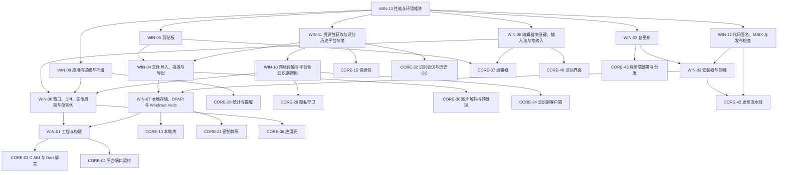

# 03 Windows 端 v5

> 版本：v5 ｜ 修订日期：2026-10-18 ｜ 适用范围：Windows 10 1809 及以上 x64 桌面（最低版本是否上调见 README 待确认事项）。
> 关联文档：[README](README.md)（需求基线与追踪总表）、[01 公共核心](01-公共核心-v5.md)、[02 Android 端](02-Android端-v5.md)、[附录 A 架构决策与评审记录](附录A-架构决策与评审记录.md)。
> 契约归属：本文只定义 Windows 专属模块。公共契约（端口接口、FFI、DTO、错误码、表结构、服务端 API）只在 01 中定义；本文引用时写“CORE-xx §章节”，并内联实现时要调用的关键签名，不重新定义。

## 0. 使用方法

一次 vibe coding 会话交给编码助手的材料是：本文中目标 WIN 卡全文 + 它依赖的 WIN 卡与 CORE 卡的“接口契约”段 + CORE-01、CORE-02 的“接口契约”段。卡片字段与 01 相同；验收标准中的 [Rxx] 指向 [README](README.md) §5 需求追踪总表。

Windows 端的职责边界：

- 只实现 CORE-04 §4 定义的平台端口，以及工程、安装、更新、窗口、键盘效率等 Windows 专属事务。
- 不得在 C++/C# 或 Windows 专属 Dart 代码中实现公式解析、量纲与单位、排版、判分、FSRS、同步合并、资源包验签或识别后处理；这些只调用 Rust 核心（经 CORE-03 §4 的 `CoreBinding`）。
- Windows 专属 Dart 代码放在 `app/lib/platform/windows/`，原生代码放在 `app/windows/`；共享界面 `app/lib/ui/` 中不得出现 `Platform.isWindows` 分支。
- 桌面端的输入优先级与 Android 不同：LaTeX 源码 > 结构化模板 > 图片/手写导入（默认模式由 CORE-37 按 `RuntimeInfo` 决定）。

## 1. 模块依赖图

箭头从模块指向它的前置模块；省略每张卡都有的 CORE-01、CORE-02 依赖。



## 2. 建议实施顺序

与 [01 §2](01-公共核心-v5.md) 的阶段对齐；每张卡的前置卡都在同一阶段或更早阶段完成。

| 阶段 | 模块 | 出口 |
| --- | --- | --- |
| S0 骨架 | WIN-01 | 空壳应用在 Windows 10/11 启动，经 C ABI 显示 `fml_abi_version` |
| S2 本地库与账户入口 | WIN-06、WIN-07 | 单实例、高 DPI 窗口；加密库落盘、DPAPI 包装可用；窗口位置恢复 |
| S4 内容与学习 | WIN-09 | 应用内提醒与托盘入口 |
| S5 识别与云识别 | WIN-04、WIN-05、WIN-08、WIN-10、WIN-11 | 文件/拖拽/剪贴板导入、快捷键与笔输入、云识别调用、资源包下载与历史清理 |
| S7 发布 | WIN-02、WIN-03、WIN-12、WIN-13 | 签名安装器、卸载、自更新与回滚演练；环境矩阵达标 |

## 3. 模块索引

| 编号 | 名称 | 代码位置 | 直接依赖 | 预估规模 |
| --- | --- | --- | --- | --- |
| WIN-01 | 工程与构建 | `app/windows/`、`app/lib/main_windows.dart`、`app/lib/composition/ports_windows.dart` | CORE-01、02、03、04 | 约 300 行 |
| WIN-02 | 安装器与卸载 | `installer/windows/` | CORE-01、02、42，WIN-07 | 约 350 行 |
| WIN-03 | 自更新 | `app/lib/platform/windows/update/`、`installer/windows/updater/` | CORE-01、02、43，WIN-02 | 约 450 行 |
| WIN-04 | 文件导入、拖拽与导出 | `app/lib/platform/windows/picker/`、`app/windows/runner/file_dialog.cpp` | CORE-01、02、04、30，WIN-07 | 约 450 行 |
| WIN-05 | 剪贴板 | `app/lib/platform/windows/clipboard/` | CORE-01、02、04、30、37，WIN-04 | 约 300 行 |
| WIN-06 | 窗口、DPI、生命周期与单实例 | `app/lib/platform/windows/window/`、`app/windows/runner/` | CORE-01、02、04、36，WIN-01 | 约 400 行 |
| WIN-07 | 本地存储、DPAPI 与 Windows Hello | `app/lib/platform/windows/storage/`、`app/windows/runner/dpapi.cpp` | CORE-01、02、04、13、21，WIN-01 | 约 400 行 |
| WIN-08 | 编辑器快捷键、输入法与笔输入 | `app/lib/platform/windows/editor/`、`app/lib/platform/windows/ink/` | CORE-01、02、04、37、40，WIN-06 | 约 400 行 |
| WIN-09 | 应用内提醒与托盘 | `app/lib/platform/windows/notify/` | CORE-01、02、04、20，WIN-06 | 约 350 行 |
| WIN-10 | 网络传输与平台侧云识别调用 | `app/lib/platform/windows/net/` | CORE-01、02、04、28、34，WIN-06 | 约 300 行 |
| WIN-11 | 资源包获取与识别历史平台存储 | `app/lib/platform/windows/packs/`、`app/lib/platform/windows/history/` | CORE-01、02、04、15、32，WIN-04、10 | 约 350 行 |
| WIN-12 | 代码签名、MSIX 与发布检查 | `tools/release/windows/` | CORE-01、02、42，WIN-02 | 约 250 行 |
| WIN-13 | 性能与环境矩阵 | `app/integration_test/windows/`、`tools/perf/windows/` | CORE-01、02，WIN-03、05、08、09、11、12 | 约 350 行 |

## 4. 端口实现映射

| 端口（CORE-04 §4） | Windows 实现 | 卡片 |
| --- | --- | --- |
| `SecureKeyValueStore` | DPAPI（`CryptProtectData`，当前用户范围）；应用锁可选 Windows Hello | WIN-07 |
| `LocalFileStore` | `%LOCALAPPDATA%\BubeiGongshi\` 下的私有目录 | WIN-07 |
| `BiometricPrompt` | Windows Hello（`UserConsentVerifier` / `KeyCredentialManager`） | WIN-07 |
| `ImagePicker` | `IFileOpenDialog` + 拖拽 | WIN-04 |
| `FileExporter` | `IFileSaveDialog` | WIN-04 |
| `ClipboardAdapter` | Win32 剪贴板（CF_UNICODETEXT、CF_DIB / PNG） | WIN-05 |
| `CameraController` | 不实现，返回 `PLATFORM_UNSUPPORTED`（桌面端用文件、拖拽、剪贴板导入） | WIN-04 |
| `AppLifecycle`、`RuntimeInfo` | 窗口消息 + Flutter 生命周期；DPI、GPU 信息 | WIN-06 |
| `NotificationScheduler` | 应用内提醒 + 托盘气泡 + 任务栏闪烁；Toast 可选 | WIN-09 |
| `HttpTransport` | WinHTTP 或 Dart `HttpClient`（系统证书），由 CORE-28 `NetworkGuard` 包裹 | WIN-10 |

---

## 5. 工程、安装与更新

### WIN-01 工程与构建

**目标**：建立 Windows 桌面工程，把 Rust 核心编译为 `fmlcore.dll` 并以安全方式按绝对路径加载，组装 Windows 端口。

**范围**
- 包含：`app/windows/` CMake 工程、Cargo 构建 `x86_64-pc-windows-msvc`、`fmlcore.dll` 复制到输出目录、DLL 安全加载、ABI 版本检查、`main_windows.dart` 入口、`composition/ports_windows.dart` 组装、版本资源（文件版本、产品名）。
- 不包含：安装器（WIN-02）；签名（WIN-12）；各端口实现（WIN-04～11）。

**依赖**：CORE-01、CORE-02、CORE-03、CORE-04

**接口契约**

调用的公共契约（CORE-03 §4、CORE-04 §4）：

```c
uint32_t fml_abi_version(void);          // 主版本不一致 → 拒绝启动并显示“核心版本不匹配”
const char* fml_capabilities(void);
```

```dart
// app/lib/composition/ports_windows.dart（本卡实现）
PlatformPorts buildWindowsPorts();
// app/lib/main_windows.dart（本卡实现）
void main() => runCommon(core: CoreBinding.open(DynamicLibrary.open(appDirFile('fmlcore.dll'))), ports: buildWindowsPorts());
// appDirFile：返回与可执行文件同目录的绝对路径
```

```cpp
// app/windows/runner/main.cpp（本卡修改）
SetDefaultDllDirectories(LOAD_LIBRARY_SEARCH_APPLICATION_DIR | LOAD_LIBRARY_SEARCH_SYSTEM32);
SetDllDirectoryW(L"");   // 从搜索路径中移除当前工作目录
```

**实现约束**
- 绑定方式只用 C ABI + `dart:ffi`（ADR-V5-02，见附录 A）。
- 只从应用安装目录按绝对路径加载 `fmlcore.dll`；不从当前工作目录、用户图片目录或 PATH 搜索。
- 目标架构 x64；ARM64 原生构建不在 V1 范围（x64 版本在 ARM64 设备上以仿真运行，不做专项承诺）。
- 锁定 MSVC 工具集、Windows SDK 与 Rust 工具链版本，写入 `app/windows/toolchain.versions`。

**验收标准**
- [R01] 在 Windows 10 1809 与 Windows 11 上运行 Release 构建，首页显示 `fml_abi_version` 与 `fml_capabilities`。
- [R18] 核心 ABI 主版本加 1 后应用拒绝启动并显示约定文案，不崩溃。
- [R19] DLL 劫持测试：在当前工作目录与图片目录放置同名恶意 `fmlcore.dll` 后启动，加载的仍是安装目录中的 DLL（Process Monitor 验证）。
- [R41] `app/lib/ui/` 中 `Platform.isWindows` 零命中（CORE-41 规则）。

**规模**：约 300 行；`app/windows/`、`app/lib/main_windows.dart`、`app/lib/composition/ports_windows.dart`。

### WIN-02 安装器与卸载

**目标**：提供按用户安装、无需管理员权限的官方安装器，卸载时保留用户数据并给出明确的导出与删除选项。

**范围**
- 包含：官方安装器（Inno Setup 或 WiX，二选一在 S7 开始前定案并记入附录 A）、安装到用户目录、开始菜单快捷方式（设置 AppUserModelId）、卸载流程（默认保留数据，提供“导出备份”和“删除本机数据”两个明确选项）、安装前磁盘空间检查、版本资源与发布哈希。
- 不包含：自更新（WIN-03）；代码签名与 MSIX（WIN-12）；数据库迁移（CORE-13）。

**依赖**：CORE-01、CORE-02、CORE-42、WIN-07

**接口契约**

```text
installer/windows/（本卡实现）
  bubeigongshi.iss | bubeigongshi.wxs   安装脚本
  安装目录：%LOCALAPPDATA%\Programs\BubeiGongshi\<version>\（版本子目录，便于更新与回滚）
  当前版本指针：%LOCALAPPDATA%\Programs\BubeiGongshi\current.txt
  快捷方式：开始菜单 BubeiGongshi.lnk，AppUserModelId = "BubeiGongshi.App"
  卸载入口：“应用和功能”中按用户注册（HKCU）
  卸载选项：[导出备份…] → 启动应用的导出流程（CORE-27，经 FileExporter）；[删除本机数据] → 二次确认后删除 %LOCALAPPDATA%\BubeiGongshi\
```

数据目录与安装目录分离（数据目录定义见 WIN-07）。

**实现约束**
- 按用户安装（per-user），不写 `C:\Program Files` 与 HKLM，不需要管理员权限。
- 卸载默认保留 `%LOCALAPPDATA%\BubeiGongshi\` 下的用户数据；“删除本机数据”须二次确认，并提示“未同步或未导出的数据将无法恢复”。
- 安装与升级前检查可用空间（至少为安装包大小的 3 倍）。
- 安装包不含供应商 API Key、测试密钥与调试符号；体积 ≤ 70 MB（不含可选资源包与模型包，CORE-42 门禁）。
- 卸载时清理快捷方式、AUMID 与开机自启注册项。

**验收标准**
- [R01] 在标准用户（非管理员）账户上安装成功，未出现 UAC 提示；开始菜单可启动。
- [R27] 卸载时选择保留数据 → 重新安装后数据可打开；选择“删除本机数据”后数据目录不存在。
- [R27] 卸载界面中的“导出备份”生成可在 CORE-27 恢复流程中验证通过的文件。
- [R03] 安装包体积 ≤ 70 MB。
- [R23] 发布制品附带安装包的 SHA-256 与 SBOM（CORE-42）。

**规模**：约 350 行（安装脚本与辅助代码）；`installer/windows/`。

### WIN-03 自更新

**目标**：在不强制重启的前提下检查、下载、校验并安装新版本，失败时自动回滚到旧版本。

**范围**
- 包含：更新清单的下载与验签、断点续传、签名与哈希校验、安装前备份数据库与资源包激活指针、并列版本目录安装、切换 `current.txt`、失败回滚、手动与延迟更新选项、保留前两个安装版本。
- 不包含：资源包内容更新（CORE-15 + WIN-11）；服务端托管（CORE-43 提供 `/windows/update.json`）。

**依赖**：CORE-01、CORE-02、CORE-43、WIN-02

**接口契约**

更新清单（托管于 CORE-43 §11 的 `https://<cdn>/windows/update.json`，本卡定义其内容）：

```json
{ "version": "1.2.0", "min_os_build": 17763, "url": "https://<cdn>/windows/BubeiGongshi-1.2.0-setup.exe",
  "size": 61234567, "sha256": "…", "released_at": "2026-10-18T00:00:00Z", "notes_key": "release_1_2_0",
  "signature": "<Ed25519 签名，覆盖以上字段的规范 JSON>" }
```

```dart
// app/lib/platform/windows/update/updater.dart（本卡实现）
enum UpdatePolicy { manual, notifyOnly, downloadThenAsk }   // 默认 notifyOnly
abstract class WindowsUpdater {
  Future<UpdateOffer?> check();                               // 用户触发或启动后检查；游客也允许（不带用户内容与账户标识）
  Stream<double> download(UpdateOffer offer, {CancelToken? cancel}); // 断点续传到 %LOCALAPPDATA%\BubeiGongshi\staging\updates\
  Future<void> installOnExit(UpdateOffer offer);              // 校验后在用户退出时安装；不强制重启
}
```

- 安装步骤：校验清单签名（内置公钥）与安装包 SHA-256 → 验证安装包 Authenticode 签名 → 检查磁盘空间与当前数据库 schema 兼容（`min_os_build` 不满足则不提供）→ 备份数据库与资源包激活指针（`active.json`）→ 安装到新版本目录 → 新版本首次启动成功并完成迁移后才删除最旧版本；启动失败自动切回旧版本目录与备份。
- 错误码：`PLATFORM_UPDATE_SIG_INVALID`、`PLATFORM_UPDATE_HASH_MISMATCH`、`PLATFORM_UPDATE_DISK_FULL`、`PLATFORM_UPDATE_ROLLED_BACK`（定义见 CORE-04 §4 平台错误码）。

**实现约束**
- 不在进程运行时覆盖已加载的 DLL；使用并列版本目录或签名安装器完成替换。
- 不静默强制重启；用户可选择手动更新或延迟更新。
- 清单签名私钥只在离线签名机；客户端内置公钥。

**验收标准**
- [R23] 手动：从 1.0.0 更新到 1.1.0，数据与设置保留；更新过程中断网后恢复，下载续传成功。
- [R19] 故障注入：篡改清单签名、篡改安装包哈希、让新版本首次启动崩溃，三种情况下均回到旧版本且数据库可打开。
- [R27] 更新前自动备份数据库；回滚后数据与更新前一致。
- [R26] 游客检查更新的请求不含账户标识与用户内容（抓包验证）。

**规模**：约 450 行；`app/lib/platform/windows/update/`、`installer/windows/updater/`。

### WIN-06 窗口、DPI、生命周期与单实例

**目标**：提供高 DPI 清晰、多显示器正确、单实例运行的桌面窗口，并向共享层提供生命周期事件与运行时信息。

**范围**
- 包含：per-monitor DPI 感知（v2）、窗口大小与位置记忆、多显示器迁移后回到可见区域、单实例（第二个实例把参数转交给已运行实例后退出）、关闭与最小化到托盘的行为（托盘本身见 WIN-09）、退出前等待长任务取消与写事务提交、`AppLifecycle` 与 `RuntimeInfo` 端口、大屏双栏/三栏布局断点、深色模式与高对比度、系统字体缩放。
- 不包含：快捷键与输入法（WIN-08）；提醒与托盘菜单（WIN-09）。

**依赖**：CORE-01、CORE-02、CORE-04、CORE-36、WIN-01

**接口契约**

实现的端口（CORE-04 §4）：

```dart
abstract class AppLifecycle { Stream<LifecycleEvent> events(); }      // resumed | paused（最小化/失焦）| detached | lowMemory
abstract class RuntimeInfo  { Future<RuntimeSnapshot> snapshot(); }    // os, osVersion, locale, availMemBytes, dpiScale, abi（另含 GPU 是否可用）
```

```dart
// app/lib/platform/windows/window/window_service.dart（本卡实现）
class WindowPlacement { final Rect bounds; final bool maximized; final String monitorId; }
abstract class WindowService {
  Future<void> restorePlacement();          // 不可见时移到主显示器工作区
  Future<void> savePlacement();
  Stream<double> dpiChanges();
  Stream<List<String>> secondInstanceArgs(); // 单实例：命名互斥体 "Local\BubeiGongshi.SingleInstance" + 命名管道转交参数
  Future<bool> requestExit();                // 等待 CoreBinding 长任务取消与写事务提交，最长 5 s
}
```

**实现约束**
- 清单启用 `PerMonitorV2` DPI 感知；公式渲染使用 DisplayList 按当前 DPI 重新光栅化，不缩放位图。
- 单实例保证同一账户数据库只有一个写者进程（CORE-13 单写者）；额外窗口在同一进程内打开。
- 关闭按钮默认行为：用户首次关闭时询问“最小化到托盘 / 退出”，记住选择；退出前确认未完成的学习组进度已保存。
- 窗口位置等设备偏好存于本机，不同步。

**验收标准**
- [R01] 手动：100%、150%、200% 缩放下公式与界面无模糊；在两块不同 DPI 的显示器间拖动窗口，公式即时按新 DPI 渲染。
- [R01] 断开副显示器后启动，窗口出现在主显示器可见区域。
- [R27] 已运行时再次启动应用，不出现第二个进程，已运行窗口被激活。
- [R27] 学习会话中点击退出，进度保存后进程退出；强制结束进程后重启，草稿与会话可恢复。
- [R08] 宽度 ≥ 1280 时公式库为三栏布局，≥ 900 时为双栏。

**规模**：约 400 行；`app/lib/platform/windows/window/`、`app/windows/runner/`。

### WIN-07 本地存储、DPAPI 与 Windows Hello

**目标**：提供 Windows 私有目录布局、DPAPI 密钥包装与可选的 Windows Hello 应用锁，并在设置页如实说明 DPAPI 的安全边界。

**范围**
- 包含：`LocalFileStore`、`SecureKeyValueStore`、`BiometricPrompt` 端口实现；目录布局与私有 ACL；密钥健康检查；DPAPI 限制说明；备份提醒；空间不足处理。
- 不包含：数据库（CORE-13）；密钥层次（CORE-21）；应用锁策略与账户状态（CORE-23）。

**依赖**：CORE-01、CORE-02、CORE-04、CORE-13、CORE-21、WIN-01

**接口契约**

实现的端口（CORE-04 §4）：

```dart
abstract class SecureKeyValueStore {
  Future<Uint8List> wrap(String alias, Uint8List secret);      // CryptProtectData(CRYPTPROTECT_UI_FORBIDDEN)，entropy = alias 的 UTF-8
  Future<Uint8List> unwrap(String alias, Uint8List wrapped);   // 失败 → PLATFORM_KEY_UNAVAILABLE
  Future<void> delete(String alias);
  Future<KeySecurityLevel> securityLevel(String alias);        // dpapi | dpapiWithHello
}
abstract class LocalFileStore { Future<Directory> root(StoreArea area); Future<int> freeBytes(); Future<void> excludeFromSystemBackup(Directory dir); }
abstract class BiometricPrompt { Future<bool> isAvailable(); Future<bool> authenticate(String reasonKey); }
```

目录布局（根 `%LOCALAPPDATA%\BubeiGongshi\`）：

| `StoreArea` | 路径 |
| --- | --- |
| database | `accounts\<profile_id>\db\`（设备级 `device_registry.db` 在根目录） |
| packs | `packs\` |
| recognition | `accounts\<profile_id>\recognition\` |
| staging | `accounts\<profile_id>\staging\`（更新下载另在 `staging\updates\`） |
| drafts | `accounts\<profile_id>\drafts\` |
| exports | 不落私有目录，经 `FileExporter`（WIN-04）由用户选择路径，默认建议“文档”文件夹 |
| logs | `logs\` |
| （临时） | `cache\tmp-import\` |

包装记录文件：`accounts\<profile_id>\keys\<alias>.wrap`（内容为 DPAPI 输出，不是明文密钥）。

**实现约束**
- 数据只写 `%LOCALAPPDATA%`（不漫游）；创建目录时设置只允许当前用户与 SYSTEM 访问的 ACL；禁止写安装目录、`C:\Program Files`、桌面、下载目录与公共文档目录。
- 密钥不写入普通 JSON 或 SQLite 明文字段。
- 应用锁（可选）：Windows Hello 验证通过后才解开第二层包装（`KeyCredentialManager` 签名派生的包装密钥）；DPAPI 本身不等于 Windows Hello，界面不得混称。
- 设置页“安全说明”必须列出：更换 Windows 用户账户后密钥可能不可恢复；同机管理员与已解锁会话中的恶意软件不在 DPAPI 防御边界内；卸载、重装、系统重置前应导出备份或开启同步；域账户与漫游配置文件需实测。
- 提供密钥健康检查（能否解包全部包装记录）与备份提醒；不能保证第三方备份软件排除识别历史，须在说明中披露。

**验收标准**
- [R27] 运行 CORE-04 端口契约测试 `app/test/ports_contract_test.dart` 的 Windows 版，全部通过。
- [R27] 用另一个 Windows 用户账户复制数据目录后尝试打开，解包失败并提示，不崩溃。
- [R27] 检查目录 ACL：其他标准用户无法读取 `%LOCALAPPDATA%\BubeiGongshi\`。
- [R27] 数据库与识别历史目录中做明文关键字扫描，零命中（与 CORE-13 联测）。
- [R25] 开启 Windows Hello 应用锁后，取消验证无法进入；关闭后恢复系统级解锁。

**规模**：约 400 行；`app/lib/platform/windows/storage/`、`app/windows/runner/dpapi.cpp`。

---

## 6. 输入与识别

### WIN-04 文件导入、拖拽与导出

**目标**：通过文件对话框和拖拽导入图片与资源包文件，通过保存对话框导出文件，导入过程不冻结界面、不残留临时文件。

**范围**
- 包含：`ImagePicker`（`IFileOpenDialog` 多选）、拖拽导入（单文件、多文件、文件夹可选递归扫描）、`FileExporter`（`IFileSaveDialog`）、`CameraController` 的“不支持”实现、扩展名与大小预检、复制到临时目录、临时文件清理；扫描文件夹导入作为增强。
- 不包含：解码与预处理（CORE-30）；裁剪界面（CORE-40）；资源包安装（WIN-11 调用 CORE-15）。

**依赖**：CORE-01、CORE-02、CORE-04、CORE-30、WIN-07

**接口契约**

实现的端口（CORE-04 §4）：

```dart
abstract class ImagePicker { Future<List<ImportedImage>> pick({required int maxCount}); }   // maxCount ≤ 10
class ImportedImage { final String displayName; final int byteLength; Future<Uint8List> readBytes(); final DateTime expiresAt; }
abstract class FileExporter { Future<bool> saveAs(String suggestedName, Stream<List<int>> bytes); }
abstract class CameraController { Future<ImportedImage?> capture(); }  // Windows：抛 PLATFORM_UNSUPPORTED
```

调用的公共契约（CORE-30 §9）：`img.probe`（只读文件头与尺寸）；超过 20 MiB 返回 `IMG_TOO_LARGE`，超过 4000 万像素返回 `IMG_TOO_MANY_PIXELS`，格式不支持返回 `IMG_FORMAT_UNSUPPORTED`。

```dart
// app/lib/platform/windows/picker/drop_target.dart（本卡实现）
class DropScanResult { final int imageCount; final int totalBytes; final List<String> rejected; }
abstract class DropTarget {
  Stream<List<String>> droppedPaths();                                   // 绝对路径
  Future<DropScanResult> scan(List<String> paths, {bool recursive = false}); // 文件夹先统计数量与大小再确认
  Future<List<ImportedImage>> importPaths(List<String> paths);            // ≤ 10，复制到 cache\tmp-import\
  Future<String?> pickPackFile();                                         // 选择 .fmlpack，交给 WIN-11
}
```

**实现约束**
- 支持 PNG、JPEG、WebP；HEIC 仅在系统 HEIF 扩展可用时经 WIC 转码后支持，否则提示安装扩展或转换格式。
- 文件读取与复制在后台 isolate 执行；Dart 层不生成全尺寸位图，降采样在 Rust 中流式完成。
- 一次最多 10 张；非图片文件给出明确错误；拖入文件夹必须先显示数量与预估大小，确认后才导入；拖拽取消后不残留临时文件。
- 用户选中的原文件只作为输入来源，不保存其路径到识别历史，GC 不删除或修改原文件。
- `ImportedImage.expiresAt` 默认 1 h；导入流程结束、取消或过期时删除副本；启动时清空 `tmp-import\`。
- 关闭解码与文件映射句柄后再删除临时文件；删除失败交由 CORE-32 的 `cleanup_job` 重试。

**验收标准**
- [R37] 手动：经文件对话框选择 1 张与 10 张图片均进入裁剪页；选择第 11 张被限制。
- [R37] 拖入 3 个图片文件与 1 个 txt 文件：3 张导入，txt 给出“非图片文件”提示；拖入含 200 张图片的文件夹先显示数量与大小。
- [R31] 拖入 1 亿像素图片被拒绝并提示；1200 万像素图片导入时界面保持响应（主线程无 > 100 ms 卡顿）。
- [R36] 流程结束后 `cache\tmp-import\` 为空，原文件哈希与修改时间不变。
- [R27] 经保存对话框导出备份，默认目录为“文档”，由用户确认路径。

**规模**：约 450 行；`app/lib/platform/windows/picker/`、`app/windows/runner/file_dialog.cpp`。

### WIN-05 剪贴板

**目标**：支持粘贴图片、LaTeX 与 Unicode 数学文本，复制公式为 LaTeX、Unicode 与渲染图片，且只在用户显式操作时访问剪贴板。

**范围**
- 包含：`ClipboardAdapter` 端口实现；粘贴图片进入裁剪预览；粘贴文本交给编辑器（走同一解析器与安全预算）；复制公式的三种格式；复制时附带来源公式 ID（应用私有格式）；可选“复制后 N 秒自动清空”。
- 不包含：LaTeX 解析（CORE-06，经 CORE-37 `paste`）；公式渲染图生成（CORE-12 DisplayList 光栅化）。

**依赖**：CORE-01、CORE-02、CORE-04、CORE-30、CORE-37、WIN-04

**接口契约**

实现的端口（CORE-04 §4）：

```dart
abstract class ClipboardAdapter {
  Future<String?> readText();
  Future<void> writeText(String t);
  Future<ImportedImage?> readImage();   // CF_DIBV5 或 "PNG" 格式；复制到 cache\tmp-import\（复用 WIN-04 的副本规则）
}
```

调用的公共契约（CORE-37 §10）：`FormulaEditorController.paste(String text)`；`FormulaView(displayList: …)`。

```dart
// app/lib/platform/windows/clipboard/formula_clipboard.dart（本卡实现）
abstract class FormulaClipboard {
  Future<void> copyFormula({required String latex, required String unicode, required Uint8List png, required String formulaItemId});
  // 同时写入 CF_UNICODETEXT（unicode）、"text/x-latex"（latex）、"PNG"（png）与私有格式 "BubeiGongshi.FormulaRef"（formulaItemId）
  void setAutoClear(Duration? after);   // 默认 null（不自动清空）
}
```

**实现约束**
- 只在用户按 Ctrl+V 或点击“粘贴”时读取；不监听剪贴板变化，不读取其他应用的剪贴板历史。
- 粘贴的图片先进入裁剪预览，不直接识别。
- 剪贴板内容不写入日志。
- 粘贴来自本应用的私有格式时，可在编辑器中插入对该公式的内部引用（用于 CORE-11 代入）。

**验收标准**
- [R37] 手动：从截图工具复制公式图片，在识别页 Ctrl+V，进入裁剪预览。
- [R10] 粘贴含 `\input` 的 LaTeX，编辑器显示 `PARSE_COMMAND_FORBIDDEN` 并定位。
- [R08] 复制公式后在记事本粘贴得到 Unicode 文本，在支持 LaTeX 的编辑器得到 LaTeX，在画图粘贴得到渲染图。
- [R20] 粘贴后检查日志文件，不含剪贴板内容。

**规模**：约 300 行；`app/lib/platform/windows/clipboard/`。

### WIN-08 编辑器快捷键、输入法与笔输入

**目标**：让 Windows 编辑器达到键盘高效：完整快捷键、命令补全、批量操作与输入法兼容，并支持触屏与触控笔手写。

**范围**
- 包含：默认快捷键映射到 CORE-37 `EditorActions` 与全局动作、快捷键自定义与冲突检测、命令自动补全（LaTeX 命令白名单）、括号匹配、公式库批量选择与批量改标签的键盘操作、输入法（IME）组合输入兼容、触控笔与触屏笔迹采集（压力、橡皮擦端）、二合一设备的手写模式。
- 不包含：编辑器逻辑（CORE-37）；画布（CORE-40）。

**依赖**：CORE-01、CORE-02、CORE-04、CORE-37、CORE-40、WIN-06

**接口契约**

调用的公共契约（CORE-37 §10、CORE-40 §10）：

```dart
class EditorActions { static const undo = 'undo', redo = 'redo', fraction = 'fraction', /* … */ toggleMode = 'toggle_mode'; }
class InkPointerAdapter { void onPointer(PointerEvent e); }
```

默认快捷键（`app/lib/platform/windows/editor/default_keymap.yaml`，本卡实现）：

| 操作 | 快捷键 | 动作 |
| --- | --- | --- |
| 保存 | Ctrl+S | `save` |
| 搜索当前页 | Ctrl+F | `find` |
| 公式库全局搜索 | Ctrl+Shift+F | `global_search` |
| 撤销 / 重做 | Ctrl+Z / Ctrl+Y | `undo` / `redo` |
| 插入分式 | Ctrl+/ | `fraction` |
| 插入上标 / 下标 | Ctrl+. / Ctrl+, | `superscript` / `subscript` |
| 插入根式 | Ctrl+R | `sqrt` |
| 切换 LaTeX / 结构化 | Ctrl+E | `toggle_mode` |
| 打开识别导入 | Ctrl+I | `open_import` |
| 开始复习 | Ctrl+D | `start_review` |

```dart
// app/lib/platform/windows/editor/keymap_service.dart（本卡实现）
abstract class KeymapService {
  Map<LogicalKeySet, String> current();
  Future<KeymapConflict?> rebind(String action, LogicalKeySet keys);  // 与已有绑定或系统保留键冲突时返回冲突
  Future<void> resetToDefault();
}
// app/lib/platform/windows/ink/windows_ink_adapter.dart（本卡实现）
class WindowsInkAdapter extends InkPointerAdapter { /* PointerDeviceKind.stylus / invertedStylus（橡皮擦）、pressure */ }
```

**实现约束**
- 默认快捷键布局稳定并写入应用内帮助；用户可自定义，自定义存于本机偏好。
- IME 组合输入期间不触发快捷键与补全；中文输入法下全角符号不被误识别为命令。
- 命令补全只列 CORE-06 白名单命令。
- 错误定位显示到行列与公式节点（使用 CORE-09 诊断中的 NodePath 与输入范围）。
- 笔迹延迟满足 CORE-01 预算（Windows ≤ 40 ms）；无压力时压力取 0.5。

**验收标准**
- [R08] Widget 测试：表中每个默认快捷键触发对应动作；重新绑定为已占用组合时返回冲突。
- [R10] 输入 `\fra` 弹出补全并只含白名单命令；输入错误 LaTeX 时状态栏显示行列，编辑器下划线定位到节点。
- [R08] 手动：使用微软拼音输入法输入中文注释时快捷键不误触发。
- [R06] 手动：在触屏二合一设备上用触控笔书写，橡皮擦端可擦除笔画；笔迹延迟 ≤ 40 ms。
- [R11] 公式库中 Shift/Ctrl 多选 20 条后批量添加标签成功。

**规模**：约 400 行；`app/lib/platform/windows/editor/`、`app/lib/platform/windows/ink/`。

### WIN-10 网络传输与平台侧云识别调用

**目标**：提供 Windows 上的 `HttpTransport` 实现，并处理云识别在最小化、睡眠、网络切换与进程重启下的平台行为。

**范围**
- 包含：`HttpTransport` 端口实现（系统证书、代理设置、超时、取消）、网络状态监听、窗口最小化或系统睡眠时暂停状态轮询、恢复时 `resumePending` 并重新 `watch`、企业代理与 TLS 拦截环境的错误提示。
- 不包含：云识别流程、授权与回执（CORE-34）；白名单与授权检查（CORE-28）；网关（CORE-33）。

**依赖**：CORE-01、CORE-02、CORE-04、CORE-28、CORE-34、WIN-06

**接口契约**

实现的端口（CORE-04 §4）：

```dart
abstract class HttpTransport { Future<HttpResult> send(HttpRequestDto req, {CancelToken? cancel}); }
// 错误：NET_OFFLINE | NET_TLS | NET_TIMEOUT | NET_HOST_NOT_ALLOWED
```

调用的公共契约（CORE-34 §9）：`watch(jobId)`、`cancel(jobId)`、`resumePending()`（只查询，不重新提交）。

```dart
// app/lib/platform/windows/net/windows_cloud_lifecycle.dart（本卡实现）
class WindowsCloudLifecycle {
  WindowsCloudLifecycle(this._lifecycle, this._cloud, this._power);
  void attach();   // 最小化或 PBT_APMSUSPEND → 停止轮询；恢复 / PBT_APMRESUMEAUTOMATIC / 网络恢复 → resumePending() 并重新 watch
}
```

**实现约束**
- 连接超时 5 s、请求总时限 30 s（与 CORE-33 §9 一致）；超时不自动重新提交。
- 使用系统代理设置；TLS 证书校验失败（如企业 TLS 拦截）时报 `NET_TLS` 并提示，不提供“忽略证书”选项。
- 不在日志中记录请求体与令牌。

**验收标准**
- [R40] 手动（预发网关）：注册用户的墨迹渲染图与照片图均完成云识别、候选校正与入库。
- [R40] 提交后让系统睡眠 5 分钟再唤醒，状态经查询收敛，网关日志只有一次供应商调用。
- [R40] 提交后结束进程并重启，`resumePending` 只查询不重复提交；超时、取消、断网与配额不足均显示明确状态并保留校正页。
- [R26] 游客模式下全流程抓包（Fiddler 或 mitmproxy），只有白名单内资源包与更新检查请求。
- [R40] EXE、DLL、安装器与日志中扫描不到供应商 API Key（CORE-42 制品扫描）。

**规模**：约 300 行；`app/lib/platform/windows/net/`。

### WIN-11 资源包获取与识别历史平台存储

**目标**：在 Windows 上下载与离线导入资源包，处理文件占用导致的激活与删除失败，并为识别历史提供空间不足时的清理触发。

**范围**
- 包含：资源包下载（断点续传）、离线 `.fmlpack` 导入（经 WIN-04 `pickPackFile` 或拖拽）、激活时目录重命名失败的延迟激活、句柄占用导致删除失败时的重试、磁盘空间不足触发 CORE-32 GC、一键清空前展示删除范围。
- 不包含：验签与安装（CORE-15）；GC 规则（CORE-32）；内容筛选界面（CORE-38）。

**依赖**：CORE-01、CORE-02、CORE-04、CORE-15、CORE-32、WIN-04、WIN-10

**接口契约**

调用的公共契约：

```text
CORE-15 §6：pack.check_updates、pack.install（长任务，经 fml_submit）、pack.list、pack.uninstall、pack.recover
CORE-32 §9：recog.gc、recog.clear_all、recog.recover
CORE-43 §11：https://<cdn>/packs/<pack_id>/<version>.fmlpack、/packs/metadata/{root,targets,snapshot,timestamp}.json
```

```dart
// app/lib/platform/windows/packs/pack_downloader.dart（本卡实现）
class WindowsPackDownloader {
  Future<File> download(Uri url, {required int expectedSize, CancelToken? cancel}); // 写入 StoreArea.staging，Range 续传
}
// app/lib/platform/windows/history/disk_watcher.dart（本卡实现）
class DiskSpaceWatcher { void attach(); }   // 数据盘可用空间 < 1 GB 时调用 recog.gc
```

**实现约束**
- 下载经 `NetworkGuard`，不带账户令牌与用户内容；验签失败删除下载文件，保留旧包。
- 新包验证后切换活动版本，不覆盖仍被读取的旧文件；目录重命名失败时保留旧指针，下次启动再激活（CORE-15 约束）。
- 删除失败（`ERROR_SHARING_VIOLATION`）时先关闭本进程的解码与映射句柄再重试，仍失败则交给 `cleanup_job`，界面显示“清理未完成，将在下次启动时继续”。
- 界面按教育阶段、学科、教材版本与考试范围展示四类内容包，与 Android 使用同一包 ID。

**验收标准**
- [R30] 手动：下载四类内容包并安装，按教育阶段与考试范围筛选可见；下载中断后续传成功。
- [R29] 离线导入 `.fmlpack` 成功；导入篡改包被拒绝且旧包可用。
- [R33] 用另一进程以独占方式打开一个历史缩略图后触发 GC，界面提示清理未完成；关闭占用后重启，文件被删除。
- [R36] 一键清空后 `%LOCALAPPDATA%\BubeiGongshi\accounts\<profile_id>\recognition\` 中无图片与缩略图。
- [R39] 首次安装后可下载并加载高中数学与高中物理内容包，检索得到高中条目。

**规模**：约 350 行；`app/lib/platform/windows/packs/`、`app/lib/platform/windows/history/`。

---

## 7. 学习提醒

### WIN-09 应用内提醒与托盘

**目标**：以应用内提醒、托盘气泡与任务栏闪烁为主方案提醒复习，Toast 作为可选增强。

**范围**
- 包含：`NotificationScheduler` 端口实现（应用运行或驻留托盘时按时提醒）、托盘图标与菜单（开始复习、打开识别导入、退出）、托盘气泡、任务栏闪烁、可选开机自启（默认关闭）、可选 Toast（依赖 WIN-02 注册的 AppUserModelId）、免打扰（专注助手）时的降级。
- 不包含：提醒内容与时间（CORE-20 `ReminderService`）。

**依赖**：CORE-01、CORE-02、CORE-04、CORE-20、WIN-06

**接口契约**

实现的端口（CORE-04 §4）：

```dart
abstract class NotificationScheduler {
  Future<bool> requestPermission();                                  // Windows 恒为 true；Toast 被系统关闭时返回 false
  Future<void> scheduleDailyReminder(LocalTime time, String body);   // body 只含待复习数量
  Future<void> cancelAll();
}
```

```dart
// app/lib/platform/windows/notify/tray_service.dart（本卡实现）
abstract class TrayService {
  Future<void> show({required String tooltipKey});
  Stream<String> menuActions();         // start_review | open_import | exit
  Future<void> balloon(String body);
  Future<void> flashTaskbar();
}
abstract class AutostartService { Future<bool> isEnabled(); Future<void> setEnabled(bool on); } // HKCU\…\Run，默认关闭
```

**实现约束**
- 应用完全退出时不保证提醒（设置页说明，并建议开启“开机自启并驻留托盘”）；不安装后台服务或计划任务。
- 提醒内容不包含公式正文，只显示数量；当日无到期卡片时不提醒。
- “退出”前确认，避免误退出；退出时学习进度已保存（WIN-06 `requestExit`）。
- 卸载时清理自启注册项（WIN-02）。

**验收标准**
- [R04] 手动：设置 1 分钟后提醒，应用最小化到托盘，按时出现托盘气泡与任务栏闪烁；点击进入学习页。
- [R04] 开启 Toast 且已安装开始菜单快捷方式时显示 Toast；专注助手开启时降级为任务栏闪烁。
- [R04] 开机自启默认关闭；开启后重启系统，应用驻留托盘。
- [R26] 提醒全流程无网络请求，正文只含数量。

**规模**：约 350 行；`app/lib/platform/windows/notify/`。

---

## 8. 签名与质量

### WIN-12 代码签名、MSIX 与发布检查

**目标**：对 EXE、DLL 与安装器做代码签名，可选产出 MSIX，并执行 Windows 发布检查。

**范围**
- 包含：签名脚本（SHA-256 Authenticode + 时间戳）、签名验证、可选 MSIX 打包（作为次要分发渠道）、体积检查、符号（PDB）归档、Windows 发布检查清单项。
- 不包含：版本号与 SBOM（CORE-42）；安装器脚本（WIN-02）。

**依赖**：CORE-01、CORE-02、CORE-42、WIN-02

**接口契约**

调用的公共契约（CORE-42 §11）：`bump_version.py`、`collect_artifacts.py`、`sbom.py`、`checklist.md`。

```text
tools/release/windows/（本卡实现）
  sign_all.ps1          对 BubeiGongshi.exe、fmlcore.dll、安装器签名并加时间戳（signtool sign /fd SHA256 /tr <TSA> /td SHA256）
  verify_signatures.ps1 signtool verify /pa 全部制品；任何未签名文件 → 失败
  build_msix.ps1        可选：生成 MSIX（per-user，使用同一签名证书）
  check_artifacts.py    体积 ≤ 70 MB、无调试符号与测试密钥、PDB 已归档
```

**实现约束**
- 签名证书私钥在硬件令牌或云签名服务中，不进入仓库与普通 CI 变量。
- 代码签名不保证立即获得 SmartScreen 声誉；发布说明不承诺 EV 证书一定消除拦截。
- 官方安装器为主渠道，MSIX 为可选渠道；两者由同一提交构建，行为一致。

**验收标准**
- [R01] `verify_signatures.ps1` 对全部 EXE、DLL 与安装器验证通过。
- [R03] 安装包 ≤ 70 MB，超限构建失败。
- [R23] 发布制品库中有 PDB、SHA-256 清单与 SBOM。
- [R40] 制品字符串扫描无供应商 API Key。

**规模**：约 250 行；`tools/release/windows/`。

### WIN-13 性能与环境矩阵

**目标**：在目标环境矩阵上验证 Windows 性能与内存预算，并检查无常驻唤醒与后台轮询。

**范围**
- 包含：集成测试与宏基准（冷启动、列表滚动、排版、笔迹延迟、图片预处理、搜索）、内存采样、能耗检查（`powercfg /energy`）、环境矩阵与结果模板、跨端一致性抽查。
- 不包含：功能正确性测试（各卡完成）。

**依赖**：CORE-01、CORE-02、WIN-03、WIN-05、WIN-08、WIN-09、WIN-11、WIN-12

**接口契约**

预算（定义见 CORE-01 §4 全局预算表，此处列 Windows 值）：

| 指标 | Windows 目标 |
| --- | --- |
| 冷启动 | < 1.5 s |
| 列表滚动 | 60 FPS |
| 常驻内存 | < 250 MB |
| 公式解析 + 校验 | < 10 ms + < 5 ms（合计 < 15 ms） |
| 排版 | < 20 ms |
| 判分 | ≤ 25 ms |
| 到期队列 | ≤ 10 ms |
| 公式库搜索首屏 | < 60 ms（大屏 < 100 ms） |
| 笔迹延迟 | ≤ 40 ms |
| 单张图片预处理 | < 300 ms |
| 连续导入 20 张 1200 万像素图片 | 界面不冻结，峰值内存增量 ≤ 30 MiB |

```text
tools/perf/windows/（本卡实现）
  run_matrix.ps1        运行 integration_test 并收集 JSON 结果
  report_template.md    记录：系统版本、CPU、内存、显卡/是否禁用硬件加速、磁盘类型、DPI、各指标 P50/P95
app/integration_test/windows/
  cold_start_test.dart  scroll_test.dart  editor_latency_test.dart  ink_latency_test.dart  import_20_images_test.dart
```

环境矩阵（至少）：Windows 10 1809、Windows 11 当前版本；100% / 150% / 200% DPI；双显示器迁移；无独显或禁用硬件加速；机械硬盘与 SSD；触屏二合一设备一台。

**实现约束**
- 使用 Release 构建测量；每项至少 20 次采样，报告 P50 与 P95；不达标项须修复或经评审记录豁免（附录 A）。

**验收标准**
- [R03] 基线机型全部预算项 P95 达标，结果写入报告。
- [R03] 禁用硬件加速环境下应用可用、公式清晰，滚动性能记录在案。
- [R03] `powercfg /energy` 报告中无本应用的常驻唤醒与高频定时器。
- [R01] 跨端一致性抽查：同一组 50 条公式与 Android 的 AST JSON、诊断码与 NodePath 完全一致（与 AND-12 共用脚本）。
- [R41] 报告模板逐项列出本文各卡的手动验收结果，作为 Windows 发布签字依据。

**规模**：约 350 行（测试与脚本）；`app/integration_test/windows/`、`tools/perf/windows/`。
