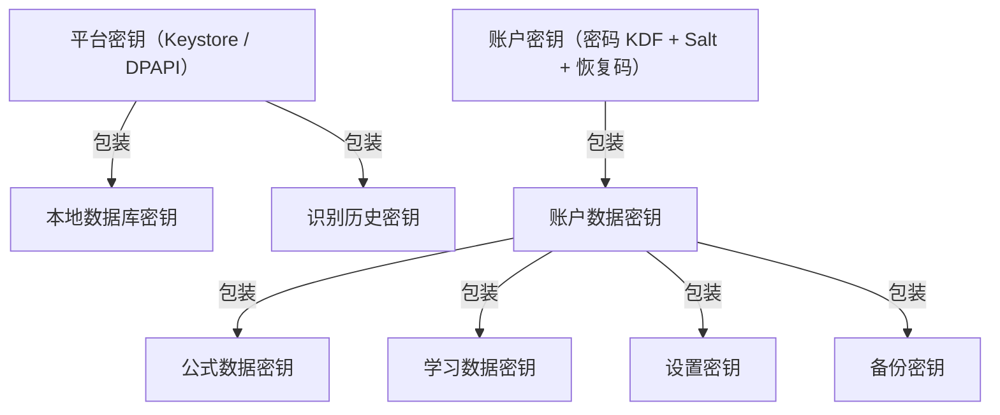
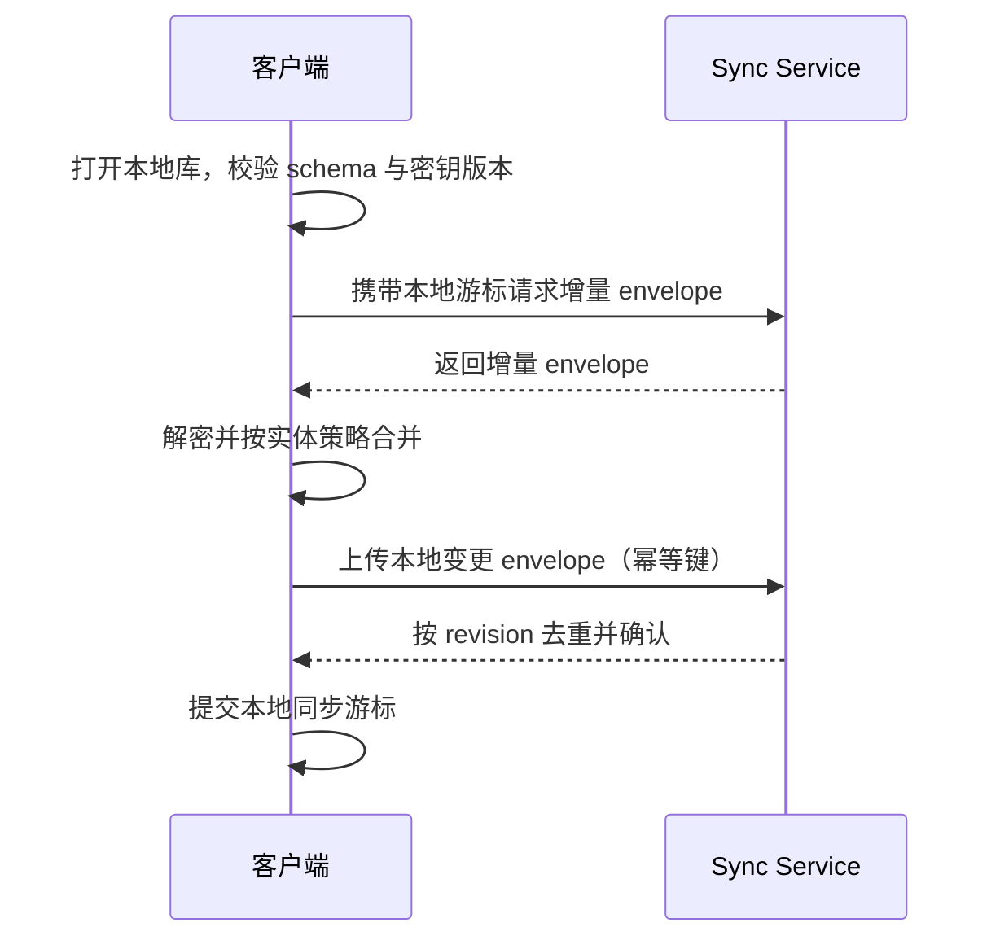

# 05 数据安全与同步设计 v2.2

> 历史版本提示（2026-10-18）：本文保留为 v2 评审输入，正文含已被修订的契约。当前设计和验收以 [v3 文档入口](README.md) 为准；历史范围确认仅按 [需求证据](00-需求基线与文档效力-v3.md) 解释。


> 目标：满足“未登录不可使用；未注册可使用游客账户；游客不向云端提交内容；注册后可同步”的原始需求，同时保证轻量化、可恢复和可审计。

> 需求确认：使用云端 API 的 LLM 识别为 V1 必交付能力。注册用户单次授权后的识别上传，与端到端加密的私有同步分别管理。

## 1. 数据分类

| 数据 | 示例 | 敏感级别 | 默认位置 |
| --- | --- | --- | --- |
| 账户身份 | 邮箱/手机号、认证 token | 高 | 服务端 + 本机安全存储 |
| 用户私有数据 | 公式、笔记、标签、复习记录、设置 | 高 | 本机加密库，注册后端到端同步 |
| 识别历史 | 图片、候选、校正结果 | 高 | 本机加密存储，默认不同步 |
| 预置内容包 | 高中/大学学科公式、单位、常数 | 低 | 签名资源包 |
| 诊断日志 | 崩溃栈、性能、错误码 | 中 | 默认本机，用户显式导出/上报 |
| 云识别请求 | 裁剪后增强图 | 高 | 仅注册用户单次授权 |

## 2. 账户模型

### 2.1 账户状态

```text
GuestAccount
  ├─ account_id: local UUID
  ├─ state: guest
  ├─ created_at
  └─ local_data_key_id

RegisteredAccount
  ├─ account_id: server account UUID
  ├─ state: registered
  ├─ auth: refresh/access token
  ├─ account_key: derived from password + KDF + recovery key
  └─ wrapped_local_keys
```

### 2.2 强制登录边界

- 应用首次启动必须选择“游客模式”或“注册/登录”。
- 没有账户状态时不能进入核心功能。
- 游客是本地一等账户，不是未登录匿名状态。
- 游客不向云端提交公式、图片、笔记、复习日志、识别结果、内容偏好或诊断数据。
- 注册用户可离线编辑、查阅、计算和复习；云 API 识别与同步需要网络，离线识别需要已安装的本地模型。
- 退出登录不清空本地数据，必须由用户显式选择删除。

### 2.3 游客转注册

流程：

1. 用户发起注册。
2. 服务端创建账户并返回账户 ID。
3. 客户端基于用户密码和恢复码派生账户密钥。
4. 生成账户数据密钥 `AccountDataKey`。
5. 使用 `AccountDataKey` 包装当前游客 `LocalDataKey`。
6. 将被包装的密钥和加密后的同步元数据上传。
7. 本机事务提交账户状态变更。
8. 首次同步执行全量加密上传。

约束：

- 升级过程失败时游客数据必须保持可用。
- 服务端永远拿不到明文 `AccountDataKey`。
- 升级成功前不得删除原始游客密钥。
- 升级后保留一次本地回滚窗口，直到用户确认同步成功。

## 3. 密钥体系

### 3.1 密钥层次



> 资源包与模型包是签名公开内容：完整性由 Ed25519 签名保证，不需要机密性加密，缓存目录由平台文件权限保护即可。因此密钥层次中不设置“资源包缓存密钥”。

### 3.2 密钥规则

- 平台密钥只保护本机数据，不用于云端同步。
- 账户密钥由密码 KDF 派生，不能由服务端存储。
- 每类数据可用独立密钥，便于单独删除识别历史。
- 密钥轮换必须生成新包装记录，旧包装在确认后过期。
- 所有包装记录含 key version 和创建时间。
- 密钥材料不得写入普通 SQLite 表。
- 崩溃日志和复现包不得包含密钥。
- 云识别供应商 API Key 由网关的服务端密钥管理保护，与用户数据密钥分开；客户端仅持有账户令牌，不接触供应商凭据。

### 3.3 恢复码

注册时生成一次性显示的恢复码：

- 用于密码丢失时解密账户数据密钥。
- 客户端生成，服务端只保存哈希或包装凭证。
- 显示时强制用户确认已保存。
- 支持重新生成，但必须重新包装密钥并上传。
- 恢复码错误次数限制和冷却时间必须存在。

## 4. 本地加密

### 4.1 数据库

- SQLite 数据库使用 SQLCipher 或平台层加密卷。
- 数据库文件、WAL 文件和临时文件均受保护。
- 打开数据库时校验 schema version 和密钥版本。
- 备份导出为用户选择路径下的加密包。

### 4.2 识别图片

- 每个识别会话使用独立随机会话密钥。
- 会话密钥由 `RecognitionHistoryKey` 包装。
- 图片先降采样，再加密存储。
- 元数据与密文分开存储。
- 删除会话时删除密文、缩略图、缓存、数据库记录和被包装会话密钥。

### 4.3 平台实现

| 平台 | 本机密钥 |
| --- | --- |
| Android | Keystore，优先 StrongBox，失败降级 TEE，再降级软件密钥并提示 |
| Windows | DPAPI，可选 Windows Hello |
| 鸿蒙预留 | 未来 HUKS |

降级必须显式提示安全等级，不能静默宣称强隔离。

## 5. 同步模型

### 5.1 同步对象

| 对象 | 同步策略 |
| --- | --- |
| 公式条目与修订 | 端到端加密，不可变修订 |
| 符号/单位自定义 | 端到端加密 |
| 卡片与复习日志 | 端到端加密，日志追加 |
| 用户设置 | 可选择同步，设备特定设置不同步 |
| 识别历史 | 默认不同步 |
| 资源包 | 不走用户同步通道，走签名分发 |
| 账户元数据 | 服务端可见，最小化 |

### 5.2 同步协议



要求：

- 所有私有同步上传对象为 `EncryptedEnvelope`；主动授权的云识别请求走独立协议，不能误用对推理方不可解密的同步密文作为图片输入。
- envelope 只包含账户 ID、对象 ID、revision、大小、算法、时间。
- 服务端不提供内容搜索，只按对象 ID 同步。
- 每次同步限制对象数量和字节数。
- 网络失败必须可重试且幂等。
- 同步在应用前台或用户手动触发，不做常驻后台同步。

### 5.3 冲突策略

| 实体 | 策略 |
| --- | --- |
| `FormulaItem` | 元数据字段按字段合并；冲突字段提示用户选择 |
| `FormulaRevision` | 不可变，双方保留，父条目指向新默认修订 |
| `ReviewLog` | 追加合并，按 `(device_id, local_seq)` 去重 |
| 学习状态 | 从合并后的完整日志重算，不直接合并状态 |
| 自定义单位 | 命名冲突提示改名，不静默覆盖 |
| 设置 | 用户显式选择来源设备 |
| 识别历史 | 不参与同步 |

禁止对所有数据使用“最后写入胜出”。

### 5.4 删除与墓碑

- 删除对象生成加密墓碑。
- 墓碑保留时间默认 180 天。
- 墓碑包含对象 ID、版本和删除时间，不包含正文。
- 同步删除后回收站保留 30 天，可恢复。
- 账户删除时按法规要求处理服务端数据和本机数据。

## 6. 备份与恢复

### 6.1 备份类型

| 类型 | 内容 | 密钥 |
| --- | --- | --- |
| 本机自动快照 | 数据库快照、schema、版本 | 平台密钥 |
| 用户导出包 | 全部用户数据 + 包装密钥 | 账户密码/恢复码 |
| 注册同步备份 | 云端加密 envelope | 账户密钥 |

### 6.2 导出包要求

- 单文件 ZIP 或自定义容器。
- 包含 manifest、schema version、app version、创建时间。
- 全部用户内容加密。
- 校验和与防篡改。
- 导出前用户确认范围。
- 导出后可验证完整性。
- 支持离线导入到新设备。

### 6.3 恢复流程

1. 校验导出包签名/哈希和版本。
2. 解密元数据。
3. 校验 schema 兼容。
4. 恢复到临时数据库。
5. 运行迁移和完整性测试。
6. 用户确认后原子替换当前库。
7. 失败保留原库。

## 7. 隐私与云端能力

### 7.1 游客红线

游客模式下禁止：

- 云同步。
- 云识别。
- 云内容推荐。
- 用户内容诊断上报。
- 崩溃报告自动上传。
- 将本地 ID 发送给第三方。

允许：

- 应用更新检查（用户触发或系统商店机制）。
- 显式资源包下载，且不携带用户内容。
- 用户主动导出本地文件。

### 7.2 云端 API 的 LLM 识别授权

云识别为首版交付需求，支持墨迹渲染图和照片裁剪图。仅注册用户可用，且每次识别显式授权：

1. 用户选择照片并裁剪，或把墨迹渲染为只含公式的规范化图像。
2. 预览将要上传的增强图。
3. 显示处理目的、网关/模型供应商、已核实的保留和训练政策、删除方式。
4. 上传裁剪图与最小上下文。
5. 移除 EXIF，不上传原图、相册、源路径、位置、完整笔记或无关设备标识。
6. 完成、取消或超时后清理网关临时图片；供应商删除能力按核实的接口/合同处理，不声称未验证的即时删除。
7. 识别结果进入本机历史，默认不上传为训练数据。

私有同步的端到端加密保证同步服务不能解密学习内容。云识别过程中网关和供应商必须处理所授权图片的明文，不能承诺推理方不可见；这次授权不授予读取完整公式库、笔记或同步密钥的权限。

### 7.3 API 凭据、费用和异常处理

- 服务端限定供应商端点、模型与请求尺寸，执行账户认证、速率和费用配额。
- 供应商 API Key 不进入客户端发布产物、资源包、日志或复现包，支持服务端轮换。
- 请求以 `request_id`、幂等键和 `job_id` 跟踪，客户端恢复后先查询状态，避免重复提交。
- 超时或取消后供应商可能已经执行并计费；客户端不能假设请求未发生，只有确认幂等或未提交才重试。
- 云任务临时数据设存活上限；常规完成清理与超时清扫均覆盖图片、临时副本和可识别的请求内容。
- 网关和供应商不按请求文本执行工具、访问任意 URL 或运行返回代码；客户端仍对白名单 LaTeX 执行解析预算。

## 8. 数据生命周期

```text
创建 → 本机加密 → 可选同步 → 使用 → GC / 回收站 → 硬删除
```

- 识别历史按保留次数和字节配额 GC。
- 公式删除进回收站。
- 账户删除提供本机和服务端两阶段流程。
- 所有删除操作写入审计事件，不记录内容正文。

## 9. 安全测试

必须测试：

- 数据库文件离线读取失败。
- WAL/临时文件不泄露明文。
- 游客模式网络请求白名单为空或仅资源下载。
- 云识别无原图上传。
- APK、EXE、DLL、资源包和日志无供应商 API Key。
- 游客、未授权、令牌过期和配额不足不能向供应商发起识别请求。
- 超时、取消、重复点击和进程重启不导致自动重复付费调用；已发生费用状态可解释。
- 网关临时图像在完成/取消/超时后清理，供应商保留政策有可验证的发布配置。
- 恢复码错误锁定。
- 密钥轮换后旧备份可恢复。
- 同步冲突不覆盖复习日志。
- 删除识别历史后磁盘和缓存无残留。
- 导出包篡改检测。
- 崩溃日志无公式正文、图片和密钥。

## 10. 合规要求

- 隐私政策明确本地存储、云同步、云识别、诊断上报的数据范围。
- 提供账户注销、数据导出、数据删除。
- 未成年人使用场景需评估默认隐私设置。
- 开源内容来源和许可写入资源包 manifest。
- 第三方 SDK 与网络域名清单公开。
- 服务端数据处理协议与保留期限明确。
