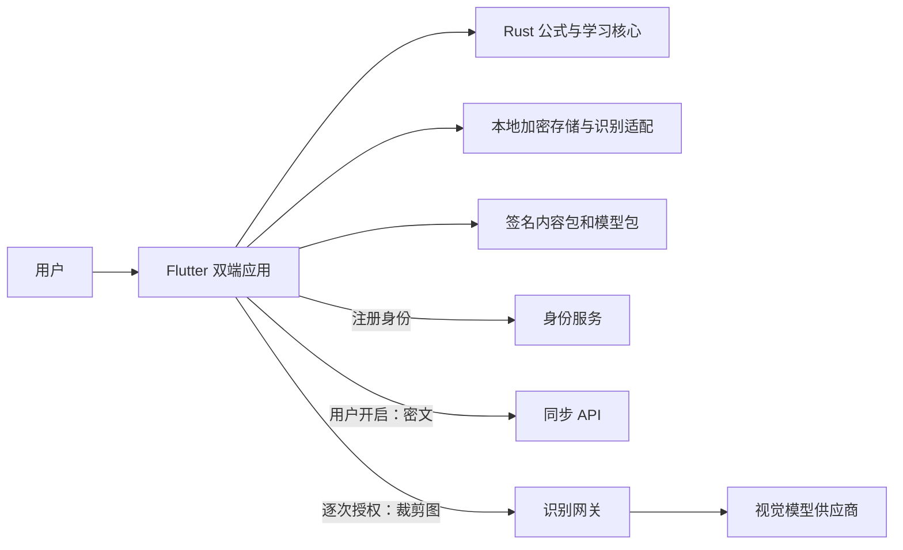
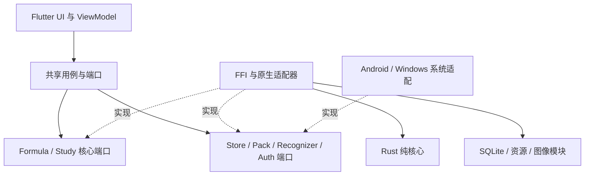

# 10 软件架构设计 v3.0

_BubeiGongshi · 2026-10-18 · Windows / Android 主线，HarmonyOS 接口预留_

---

## 🎯 目标、范围与质量属性

本系统帮助用户回忆、理解和使用公式。核心闭环是：选课程 → 录入或识别公式 → 绑定符号/单位 → 校验 → 入库 → 回忆与复习；公式详情可赋值计算，并通过显式代入形成可追溯推导。首次启动必须创建本地游客账户或登录注册账户。

Windows 与 Android 使用同一领域核心和资源包。游客内容不上传，基础功能离线可用。用户注册后主动开启加密同步；云识别单次确认。HarmonyOS 预留 ABI 与平台端口，未来实现独立 UI/平台适配，不承诺当前 Flutter 项目可以直接发布鸿蒙版本。范围来源和历史扩展见 [00](00-需求基线与文档效力-v3.md)。

| 优先级 | 属性 | 设计响应 |
| --- | --- | --- |
| P0 | 公式可信 | AST、单位、量纲、定义域由同一 Rust 核心处理；未知不是通过 |
| P0 | 数据隔离 | 本地账户独立加密库；游客上传在用例层与网关两处禁止 |
| P0 | 可维护 | 模块职责、版本化契约、错误码、脱敏复现和可重放用例 |
| P1 | 轻量 | 模块化单体、SQLite、按需模型、后台单任务图像管线；无常驻学习服务 |
| P1 | 可恢复 | 本地事务、持久化 outbox、清理队列、原子资源激活、迁移备份 |
| P1 | 可用性 | 源码和模板编辑、人工校正、离线内容、本地复习；不强迫每次联网认证 |

性能数值和指定负载见 [13](13-需求追踪与验收-v3.md)，未测得的数据一律是预算，不是实测结果。

## 🏗️ 系统结构与依赖

### 系统运行视图



此图描述运行调用和数据流，不表示领域核心依赖网络、文件或平台。

### 代码依赖视图



共享 Dart 应用层编排状态与 I/O；Rust 只提供纯计算和明确的本地服务。UI 不直接操作数据库或 HTTP。依赖注入集中在启动组合处，不在业务模块内查找全局服务。

### 推荐技术栈与初始模块

Flutter 官方支持 Android 和 Windows；具体范围以锁定 SDK 的支持矩阵为准。[S01](12-资源包内容与开源资源调查-v3.md)。Rust 用于纯领域核心及本地服务，SQLite/SQLCipher 用于本地事务与加密，FSRS 使用 `fsrs-rs` 的适配封装 [S03]，不自己设计记忆算法或密码算法。

```text
apps/flutter/lib/
  presentation/      # 页面、ViewModel、输入与无障碍
  application/       # Import / Edit / Review / Sync 用例与端口
  adapters/          # FFI、HTTP、模型、平台接口实现
  composition/       # 配置、依赖装配、账户作用域
crates/
  fml-core/          # ast、latex、types、units、eval、study，纯函数，无 I/O
  fml-store/         # SQLCipher、迁移、仓储、outbox、清理任务
  fml-assets/        # 包清单、验签、校验、安装与激活
  fml-recognition/   # 图像预处理、候选校验、可选本地运行时适配
  fml-ffi/           # 版本化 DTO、句柄、缓冲区、异步任务边界
server/              # 模块化单体：账户绑定、同步、识别、配额与审计
tools/content/       # 离线内容摄入、来源、许可与打包
SADD/                # 本设计；目录树其他路径均为未来实现规划
```

先按模块目录隔离，只有独立复用、构建或发布需求出现时才继续拆 crate。`fml-core` 禁止 HTTP、SQLite、文件、Flutter、JNI 依赖；其他 Rust 基础设施模块可以按职责使用 I/O。FFI 绑定可采用 flutter_rust_bridge，但生成绑定是可替换适配层，公共核心契约仍独立保留 C ABI。

### 端口契约

| 端口 | 输入/输出 | 失败与约束 |
| --- | --- | --- |
| `FormulaEngine` | 源码+符号表 → AST/诊断；AST+赋值 → 值/单位 | 有预算、无 I/O；返回明确 unsupported |
| `StudyEngine` | 固定参数版本+日志 → 下一次调度 | 确定性重放，时间参数显式传入 |
| `FormulaStore` | 账户作用域、修订/卡片/事件 | 事务写入；不由 UI 拼 SQL |
| `FormulaView` | 规范 LaTeX+语义串 → 渲染与无障碍 | 渲染失败不删除原输入，不决定数学正确性 |
| `FormulaRecognizer` | 受限图像/墨迹+选定后端 → 实际候选 | capabilities、取消、超时、版本、预算；置信度可为空 |
| `PackStore` | 签名包 → 验证结果/已激活版本 | 先验证后解包，失败保持旧包 |
| `ImageImport` | 用户选中的 URI/文件 → 私有输入资产 | 有效期、大小限制、只读原文件、取消清理 |
| `SecureStore` | 账户作用域的密钥包装/解锁 | 不把原始密钥串返回 UI，不记录敏感值 |
| `Auth` / `Sync` | 身份凭证 / 密文事件 | 游客不进入上传端口；不共享第三方供应商密钥 |

### C ABI 与线程

导出 `abi_version`、`capabilities`、`submit_job`、`poll_job`、`cancel_job`、`free_buffer`、`close_handle` 的契约语义；名称和最终头文件在 M0 冻结。使用定长整数、长度明确的 UTF-8/字节缓冲，不把 Rust String、Vec、引用或异常跨 ABI 传递。

缓冲由分配方释放且只释放一次；句柄带 generation 防止过期重用。每个请求携带 schema 版本、request ID、资源预算，未知主要版本拒绝执行。Rust panic 在边界转换为内部错误，不跨语言 unwind；进程级致命故障通过平台崩溃机制恢复，不伪装成功。后台 worker 运行解码/推理/迁移，回调不持锁、不回入 UI；取消后仍须等待任务确认释放后销毁句柄。

HarmonyOS 未来用 NAPI 适配相同 ABI，平台端口包括文件选择、HUKS、路径、生命周期、通知、网络；M0 只要求头文件与平台无关核心验证，不把缺失鸿蒙 SDK 的 CI 冒烟当作已完成适配。

## 🧮 公式、量纲和计算模型

### 单一语义源

`FormulaRevision` 保存原始输入、规范 LaTeX、版本化 AST、符号定义、单位/类型、适用条件、来源和校验状态。源码是用户可恢复材料，AST 是已验证语义的权威表示；渲染树不是权威数据。

| 实体 | 关键字段 |
| --- | --- |
| FormulaItem | 随机 ID、owner、标题、学科、标签、来源、当前修订头 |
| FormulaRevision | revision ID、parent IDs、schema、source、AST、符号环境、条件、状态 |
| Symbol | ID、显示名、数学类型、量纲、QuantityKind、定义域、角色 |
| Derivation | 来源修订、替换目标 node ID、变量映射、条件、分支选择 |
| UnitDefinition | 命名空间、七维指数、scale、offset、角度/温差语义、版本 |
| Diagnostic | code、severity、source range、revision ID、node ID、解释与修复建议 |

绑定变量用 SymbolId 而不是显示名称。NodeId 只在一份修订内稳定；跨修订需重新映射，不能宣称数组路径在任意编辑后稳定。被引用修订按引用计数保留，不删除母式后悄悄改变推导含义。

### 输入与解析

使用 UTF-8、保留原文及源码位置，支持中文输入法组合态，合成期间不阻塞用户输入。Unicode 符号通过显式词法别名表映射；不全局应用会混淆数学符号的兼容归一化。对等价写法只承诺“AST 语义往返”，不承诺 Unicode 和 LaTeX 文本双射。

LaTeX 是数学输入子集，拒绝 `\input`、`\include`、`\write`、外部 URL、宏定义、文件和 shell 能力。冻结的语法清单覆盖分数、上下标、根式、三角/指数/对数、关系、向量/矩阵、微分、偏导、积分、多重积分、曲线/曲面积分、极限、求和、分段与常用概率统计记号。遇到暂不支持结构保留草稿并定位原因，不静默删命令。

初始硬上限：输入 64 KiB、AST 4096 节点、深度 64、矩阵 100×100 且仍受节点预算约束、规范化 100000 步、单任务 100 ms 可取消检查点。后台超限返回错误；不依靠 UI 超时停止仍在执行的计算。极端合法表达式可显式导出源码而不继续计算。

### 类型与校验状态

```text
TypeExpr = {
  dimension: [Rational; 7] | Unknown,
  math_kind: Scalar | Vector(n) | Matrix(r,c) | Function(signature) | ...,
  quantity_kind: known semantic role | Unspecified,
  assumptions: domain, coordinate system, commutativity, conditions
}
SI 维度顺序 = [L, M, T, I, Θ, N, J]
Validation = Draft | Unresolved | Invalid | Verified
```

有理指数采用约分整数对并限制分子分母范围，避免数值膨胀。无量纲是七个零，不能用 Unknown 代替。纯数学变量可由课程或用户显式声明无量纲；物理变量缺少声明时进入 Unresolved。编辑器可以保存任意草稿，只有 Verified 修订可作为已校验公式用于计算、代入和教学推荐。

| 运算 | 量纲与语义规则 |
| --- | --- |
| 加减、等式 | 两侧量纲一致，形状兼容；不能靠改显示单位消除冲突 |
| 乘除 | 指数相加减；检查向量/矩阵乘法含义，禁止隐式点乘/叉乘 |
| 幂/根 | 数值常量指数允许有理量纲；变量指数要求底数无量纲；负值实数根按定义域报错 |
| 导数 | `dim(df/dx)=dim(f)/dim(x)`，绑定自变量和阶数 |
| 积分 | `dim(∫f dx)=dim(f)*dim(x)`；上下限匹配积分变量，线/面积元携带维度和方向 |
| 极限/级数 | 自变量、上下界和收敛条件显式记录，不以量纲证明收敛 |
| 梯度/散度/旋度 | 用坐标维度及场类型推断，不把所有 ∇ 当作无量纲函数 |
| sin/cos | 接受角度或明确的无量纲弧度值，统一换算后求值 |
| exp/log | 自变量无量纲，log 需正值或显式复数模式 |
| 概率/密度 | 概率无量纲；概率密度对带单位变量具有其逆量纲，不能混为概率 |
| 经验公式 | 系数携带所需单位，不能用 Empirical 标记跳过校验 |

Angle 和 Count 是语义标签，不额外扩展 SI 基本量纲。角度、循环频率和角频率不能仅按相同指数静默代换；`ω=2πf` 是显式公式关系。

温度输入区分绝对温度和温差：`20 °C → 293.15 K`，`Δ20 °C → 20 K`。摄氏 offset 不能直接乘除或约分；绝对温度先转 Kelvin，允许在 `pV=nRT` 中按 AbsoluteTemperature 角色参与乘法。温度点相减得温差、点加温差得点，点加点默认拒绝。单位系数可用有理数与受限符号常数 π，非精确换算记录精度；不能声称所有换算都为有理数。

自定义单位用用户命名空间，不覆盖内置 SI；定义必须闭合且无循环。自定义量纲标签可作为语义 QuantityKind，若确需非 SI 独立维度，使用版本化扩展命名空间并标记与 SI 不可自动转换，不能悄悄将其当作无量纲。

QuantityKind 用于筛选物理角色，数学结构和硬性角色约束优先。Energy 与 Torque 默认禁止自动代入；只有显式映射、说明物理关系且人工确认后才继续，不能因“软警告”绕过向量/标量、仿射单位等硬错误。

### 计算器与代入

V1 计算器提供标量/向量基础运算、白名单初等函数、单位换算，以及按已声明输出变量直接求值。展示的理论公式不必都能数值求解：缺少边界条件的积分、无穷级数、场方程和任意符号积分应明确标记“支持编辑/校验，暂不支持此求值”。课程覆盖和计算能力是两份清单。

受限反解只处理已证明单值的运算链；平方根等多值关系必须让用户选分支并继承条件。数值求根作为受控扩展，要求用户给区间、连续性适用条件、端点判断、迭代上限与残差；失败返回无解/不收敛，不能自动假设找到唯一物理解。内部双精度结果展示数值误差说明，不把浮点结果宣称精确符号解。

代入过程：选定 A 的子式 → 查看其类型 → 找到 B 中显式定义的目标输出 → 变量映射与单位转换 → 检查 B 右式和目标子式的关系与使用条件 → alpha-renaming 避免捕获积分/求和绑定变量 → 生成新修订并完整复验。**量纲相同只是候选筛选条件**；不允许把任意同量纲的数或等式当作数学等价替换。

每次代入保存来源修订、槽位、变量映射和分支条件；推导深度 8、总节点仍不超过 4096，依赖图必须无环。例：`F=ma` 中将 `a` 替换为满足同一运动情境的 `dv/dt` 合法；不能仅因速度与某个同量纲表达式匹配就认定两者在该情境相等。

## 🖥️ 编辑器、公式库和学习流程

### 渲染与编辑取舍

通过 `FormulaView` 封装成熟数学渲染库；初选 `flutter_math_fork`，包 API 核实的版本为 0.7.4，但正式锁定依赖前仍须跑覆盖、许可证和维护状态门槛 [S02]。Rust 输出规范 LaTeX、语义和诊断，不在 V1 自研字形排版引擎。

LaTeX 源编辑、Unicode 符号面板、结构模板插入、撤销/重做、复制粘贴、源码错误高亮是必需能力。代入可通过 AST 子式列表选择；不把渲染器没有提供的字形命中测试宣称为精确所见即所得。渲染适配器可以有自己的解析树，但不得决定校验或计算语义。渲染失败显示源码及诊断。

公式库支持名称、课程、标签、来源、量纲/物理角色筛选；预置条目只读，编辑生成用户修订，不改签名包。UI 虚拟列表、按页检索、缓存按字节 LRU；只缓存渲染结果，不缓存跨账户明文。自定义单位或符号变化触发受影响公式重新校验并保留旧修订。

无障碍由 AST 生成中文数学语义串；常规文本由系统屏幕阅读器读取。大字体、键盘访问、高对比、错误定位、中文 IME、分屏等进入双端测试，不以渲染截图代替语义无障碍。

### 背诵闭环

卡片从固定修订派生，题型包含名称回忆公式、符号挖空、变量含义、单位量纲和数值应用。流程为“先回忆/手写 → 主动揭示答案 → 查看解释 → 忘记/困难/良好/容易评分 → 排程”，不把识别成功或量纲通过当作答案正确。自动比对只能提示，用户决定评分。

FSRS 参数、算法版本、目标保留率和复习事件都有版本标识。记录 event ID、card ID、card revision、device sequence、复习时间、评分、算法版本和 reset epoch。同步后去重并按确定顺序重放；重置是一个新事件/epoch，不物理覆盖历史。系统时钟异常作提示和排序标记，不偷偷修改过去评分。卡片更新公式时明确选择保持进度或重建卡片。

## 📷 手写、照片和识别管线

### 输入与图像预算

两端均提供墨迹板和系统文件管理器选图。Android 以 Photo Picker 选相册、SAF `ACTION_OPEN_DOCUMENT` 选文件；URI 只在会话内读取，通过 ContentResolver 复制受限私有副本，完成后释放 URI 权限。某些 provider 可能从云盘下载原文件，应在选择时说明这是用户指定的外部来源访问，不是应用上传游客内容。Windows 使用 `IFileOpenDialog`，可选拖拽和剪贴板；拒绝把路径拼进 shell。

初始支持 JPEG/PNG，WebP 仅静态单帧；不接受 SVG、PDF 和任意网页作为图像，HEIC 需额外 decoder 能力声明。检查扩展名之外的实际 magic/header、文件 ≤20 MiB、解码像素 ≤4000 万；超出时提示裁剪或转换。后台原生受限解码，绝不先在 UI 构造完整大位图。一次导入最多 10 张，按张确认，单个活动解码/推理任务，等待队列有上限。


纠正 EXIF 方向后移除元数据，工作图长边初始 ≤2048 px；模型输入按模型卡另缩放。增强包括轻度中值/双边去噪、背景光照估计、局部对比增强、倾斜/透视校正和可选自适应二值化。不能强制连续锐化和二值化：小数点、负号、分数线与细笔画易被破坏。保留灰度/增强对照，用户切换后重新生成 image hash 和授权。大依赖如 OpenCV 只有基准证明必要时启用受限构建。

### 识别后端

`capabilities` 至少说明 input kinds、支持语法/语言、模型与词表版本、推荐像素、内存预算、是否联网。墨迹可提供归一化笔画；只支持图像的后端使用本地规范渲染图。

本地公式识别应是二维公式编码器+结构/序列解码器等 HMER 模型；模型架构、训练代码、权重、数据和导出运行时许可分别登记。ONNX Runtime Mobile 或 MNN 二选一原型，不在安装包中携带两个重型运行时。主包不带权重，提供离线模型包导入与主动下载；首次游客页面说明未安装模型时只能编辑/手输，不制造识别结果。游客识别作为功能验收需要至少一个真机可用后端。

云识别按历史 H02 保留首版实现，使用自有网关转发到支持视觉的模型。其授权、幂等、UNKNOWN 状态、成本和清理边界见 [11](11-数据安全同步与识别生命周期-v3.md)。本地低置信度/OOM 不自动切云；本地模式不得意外初始化远程 SDK 或上传遥测。

YOLO 检测本身不输出完整数学结构；新增详细实验方案位于独立分支，不成为主包依赖。

### 候选、入库和历史

最多展示三条真实候选；无置信度返回 null，无对齐不伪造框选。所有模型输出视为不可信数据，经过长度预算、白名单解析、符号绑定、类型校验和人工确认；上下文量纲用于提示/重排，不能把未声明变量一律当无量纲以提高“通过率”。

识别失败也产生有序终态会话，结果中记录错误类型；取消作为 cancelled 终态，但未提交输入的空导入取消不算一次识别。`keep_last=N` 对所有终态统一生效，N=0 在结果确认/关闭后不写持久历史；公式正文只有明确入库才独立保存。完整状态机、删除队列与并发约束见 `11`。

## 💾 数据、资源与服务端

### 本地数据模型

账户级独立数据库和私有资产目录；本地库由 Rust 存储服务唯一负责。使用 SQLCipher，随机库密钥由平台密钥包装，WAL 与临时配置见 `11`。UI 索引展示按页加载，避免数据库密文同步或全库扫描。

| 表/集合 | 规则 |
| --- | --- |
| formula_item / formula_revision | 修订不可变，父修订和 owner 受外键约束，校验状态版本化 |
| symbol_binding / user_unit | 单位定义版本进入公式修订，避免修改单位解释旧值 |
| study_card / review_event | 唯一卡片标识；event ID 唯一，评分和重置追加写 |
| recognition_session / asset | 账户内序列单调，状态/输入 hash/结果/错误/加密资产引用 |
| cleanup_job | 资产删除任务独立于被删会话存在，直到清理确认 |
| sync_outbox / sync_cursor / tombstone | 业务修改与出站事件同事务；ACK 前不丢事件 |
| installed_pack / schema_migration | 包验证结果、已激活路径、迁移与兼容标记 |

`recognition_session`、运行诊断、本机密钥和本机路径不进入同步 outbox。用户公式对资源条目引用使用 pack ID+内容 hash+修订，需长期保留的文本复制进用户修订，包更新/卸载不使学习卡片失去答案。

迁移前验证空间并生成平台密钥保护的本地备份，完整事务内升级 schema。失败打开旧库或只读恢复，不尝试不受控逆向迁移。应用二进制回滚不等于数据库可降级；破坏性 schema 只采用显式备份恢复或前向修复，解释恢复可能失去的修改。数据库检查在迁移、异常与用户诊断触发，避免每次启动完整扫描或定期全库 VACUUM。

### 静态资源

通用资源包包含数学符号/字体、单位/常数、课程内容、题型模板和本地化。安装包内置最小 bootstrap，逻辑上仍由统一包加载器验证；运行时代码不散落硬编码课程公式。模型权重独立通用模型包，native 推理运行时仍属于各平台二进制，不能把平台 DLL/so 装作通用内容。

签名、更新、资源许可、实际开源试摄入见 [12](12-资源包内容与开源资源调查-v3.md)。公开资源没有机密性要求，不为它们增加密钥层次。渲染依赖内置字体须纳入生成的 bootstrap 资产目录和许可证清单，由构建产物审计确认不存在不可追踪的重复资源；Flutter 资产路径适配不改变资源包内容 hash。

### 服务端最小部署

一个模块化单体 API（账户绑定、同步、识别配额/审计），一个可限制并发的识别 worker，PostgreSQL，以及受控对象存储。数据库持久化作业状态和幂等键即可起步，不先引入微服务网格或消息集群。worker 可由同一代码库以独立进程运行，避免视觉请求阻塞同步服务。

采用成熟 OIDC 身份服务或成熟身份框架；原生客户端授权码+PKCE，短期 access token 和可轮换 refresh token。网关验证 issuer/audience/expiry/账户状态，每次数据访问由服务端从 token 得到 owner，忽略客户端伪造 owner。TLS、参数化查询、每账户容量/速率/成本配额、审计和依赖扫描是基本门槛。E2EE 仍会泄露条目数、大小和时间，不能宣称服务器完全看不到行为元数据。

备份/恢复目标暂定：服务端同步元数据 RPO≤24 h、RTO≤8 h；数据库加密备份每日一次，每季度恢复演练。同步不是备份，用户可导出独立加密包。实例数量和地域只在用户量及供应商政策确定后调整。

## 📱 平台实现与生命周期

| 项目 | Android | Windows |
| --- | --- | --- |
| 主支持基线 | Android 8/API26+ arm64，target SDK 按渠道现行要求验证 | Windows 11 x64；Win10 22H2 在适用维护条件下另测兼容 |
| 图片入口 | SAF 文件管理器必须；Photo Picker；相机按需权限 | IFileOpenDialog 必须；拖拽/剪贴板可选；触控笔墨迹 |
| 隐私存储 | noBackupFilesDir；显式系统备份和迁移排除规则 | LocalAppData 用户账户目录与 ACL；密钥使用 DPAPI 用户作用域 |
| 密钥 | Android Keystore，记录硬件安全等级，不能假定所有设备 StrongBox | DPAPI；可选本机解锁；不能将 DPAPI 本身等同 Windows Hello |
| 生命周期 | 后台释放相机；任务持久化后允许进程被杀；不做常驻服务 | 单实例写库，额外窗口通过进程内通信；退出等待取消/提交 |
| 输入 | 中文 IME、软键盘、手写板、触控笔、文件 URI | 中文 IME、快捷键、100/150/200% DPI、多屏 |
| 通知 | 本地普通提醒；通知权限拒绝不阻断学习 | 本地通知/应用提醒；不从通知正文泄露私有公式 |
| 分发 | 签名 APK/AAB、符号归档、第三方 native 库按渠道页大小要求检查 | 每用户签名安装器，DLL 绝对路径安全加载，拒绝从图片目录搜库 |

Flutter 支持范围不等于操作系统仍在安全维护；锁 SDK 时同时核对 OS/渠道规则。Android 新渠道的 native 库页面对齐要求、NDK 和 SQLCipher/推理库兼容列为发布检查，不从旧 Android 最低版本推导所有新设备都可运行。

草稿防抖保存（初始 500 ms），评分事件立即事务落库。进程恢复先重建账户作用域、清理未完成导入和 GC，再查询已提交云任务；不重新付费提交。注册退出后销毁内存解锁状态并显示账户入口，创建游客不会打开此前注册库。完整规则以 `11` 为准。

## 🛡️ 安全、诊断与维护

威胁边界包括不可信图片/LaTeX/模型/资源包、恶意同步事件、越权账户、供应商响应和丢失设备。受信任基础是平台密钥存储、签名应用、审核的密码与解析依赖。已被攻破且处于解锁状态的终端、用户主动导出的明文及原始相册文件不在“应用可保证擦除”的范围。

日志采用 error code、request ID、模块/版本、耗时、预算超限信息，默认不记录公式、图片、源路径、token、密钥、恢复码。游客无上传遥测；注册用户诊断上报也默认关闭。复现包由用户选择生成，先预览脱敏清单、可替换合成表达式，再决定导出。

错误命名空间统一：`PARSE_*`、`TYPE_*`、`EVAL_*`、`IMG_*`、`RECOG_*`、`PACK_*`、`AUTH_*`、`SYNC_*`、`STORE_*`。公开 API 注释说明前置条件、单位/误差、线程、所有权、取消和失败；算法注释解释依据，不复述每行代码。PR 修改契约必须同步示例、迁移、需求矩阵和 ADR。

## 🚀 版本、里程碑与交付

版本用应用 SemVer + 各契约版本：ABI major、AST schema、DB schema、包 format/security epoch、模型/词表、FSRS。兼容性读取范围写进发布矩阵，不以应用版本一个数字代替所有兼容检查。

主干保持可构建；短期功能分支走审查合入，不强制“三天内必须合并”。标签 `vX.Y.Z`、锁文件、可复现工具链、发布哈希、SBOM 和许可证归档。实验分支按阶段同步主线，共享分支不强推；YOLO 不进入 main 的依赖和安装产物。无应用源码时只运行文档检查，不伪造 cargo/Flutter 通过记录。

| 阶段 | 输出 | 出口条件 |
| --- | --- | --- |
| M0 架构原型 | 绑定/解析/量纲/渲染、本地模型、账户密钥与包加载原型 | 高风险路径有真机证据，具体依赖和模型锁定；验收语料冻结 |
| M1 本地闭环 | 两端编辑、库、计算、复习、bootstrap、游客账户 | 离线完整可用，跨端核心结果一致 |
| M2 识别闭环 | 墨迹/照片、本地模型包、增强、校正、GC | T-OCR/T-GC/T-PERF 通过，游客无需上传即可识别 |
| M3 账户与服务 | 注册升级、密钥恢复、E2EE 同步、云识别 H02 | 失败恢复、越权、冲突、删除、幂等真实联调通过 |
| M4 内容 | 大学四模块与历史高中扩展内容 | 章节/范围矩阵、逐式校验、许可审查完成 |
| M5 发布 | 双端签名、迁移、依赖/隐私/性能验证 | `13` 发布门槛全部通过，待决事项有明确结论 |

不在缺少团队容量的情况下给出虚构工期。新增社区、完整鸿蒙客户端或复杂 CAS 必须经过单独范围变更，不挤占甲方主线验收。
