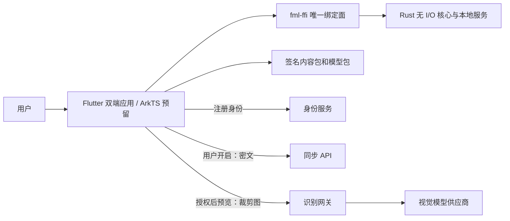
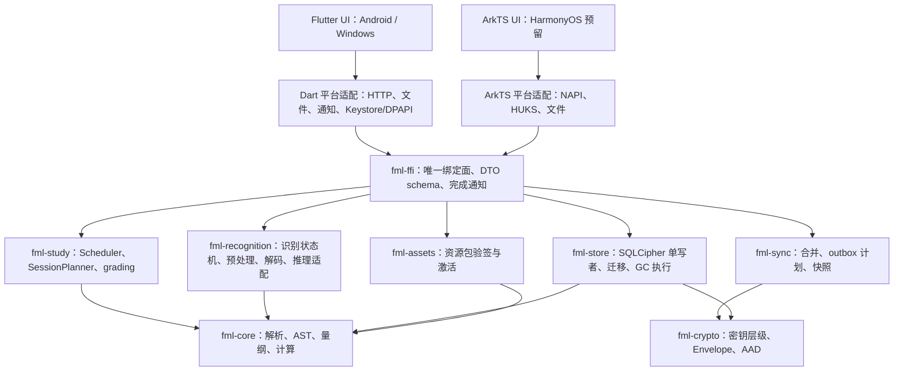
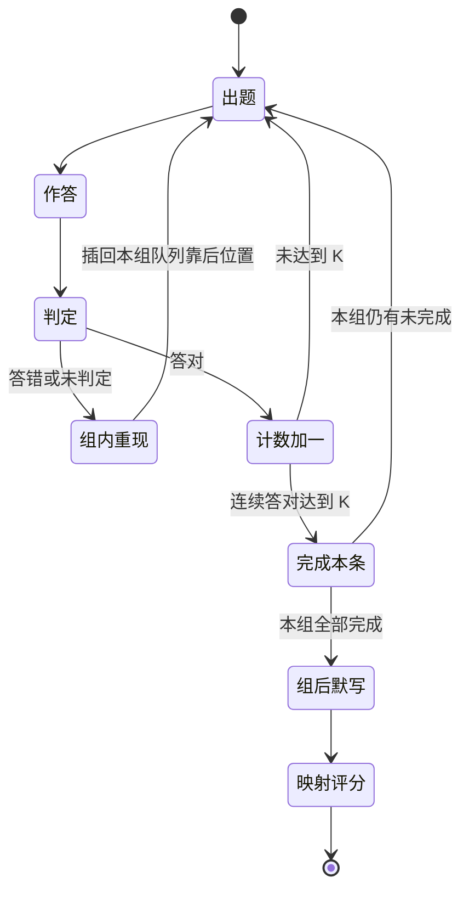

# 10 软件架构设计 v4.0

_BubeiGongshi · 2026-10-18 · Windows / Android 主线，HarmonyOS 经 M0 验证后选路；Rust 无 I/O 核心承载全部确定性逻辑_

---

## 🎯 目标、范围与质量属性

本系统帮助用户记住、理解和使用公式。学习范式以不背单词为原型、只求功能近似（不使用其代码、素材、商标或私有接口，见 00 §历史记录与范围解释、09 ADR-008）：按“公式书”和每日计划组织内容，以**客观作答**为主完成学习与复习，错题在组内重现直到答对，连续答对达到门槛才算学完，组后默写检验，复习优先于新学，作答结果自动映射为 FSRS 评分。

核心闭环：选公式书与计划 → 录入或识别公式 → 绑定符号/单位 → 量纲校验 → 入库 → 组学习（客观作答、组内重现）→ 组后默写 → 按 FSRS 复习 → 统计与提醒。公式详情可赋值计算、组成计算链，并通过显式代入形成可追溯推导。首次启动必须创建本地游客账户或登录注册账户。

Windows 与 Android 使用同一 Rust 核心和资源包。游客内容不上传，基础功能离线可用。用户注册后主动开启加密同步；云识别按功能授权并在每次发送前预览。HarmonyOS 复用同一 Rust 核心与绑定契约，UI 路线（Flutter OHOS 移植或 ArkTS 原生 UI）在 M0 验证后决定（见 00 D-04、09 ADR-013），不承诺当前 Flutter 项目可直接发布鸿蒙版本。范围来源与待决事项见 [00](00-需求基线与文档效力-v4.md)。

| 优先级 | 属性 | 设计响应 |
| --- | --- | --- |
| P0 | 公式可信 | AST、单位、量纲（含量纲多态）、定义域由同一 Rust 核心处理；Unknown 不是通过，也不等于多态 |
| P0 | 判分忠实 | 作答模式逐字转写、禁用自动纠错；三层数学等价判分；识别成功或量纲通过都不等于答对 |
| P0 | 数据隔离 | 本地账户独立加密库；游客上传在用例层与网关两处禁止 |
| P0 | 可维护 | crate 职责单一、单一绑定面、版本化契约、错误码单一来源、可重放用例 |
| P1 | 学习有效 | 组学习、复习优先、掌握判据、FSRS 校准与个性化门槛、学习统计 |
| P1 | 轻量 | 模块化单体、SQLite、按需模型、后台单任务图像管线；无常驻学习服务、无周期性网络轮询 |
| P1 | 可恢复 | 单写者事务、持久化 outbox、清理队列、原子资源激活、迁移备份、会话游标续学 |
| P1 | 可用性 | 源码/模板编辑与结构化键盘、人工校正、离线内容、本地复习；不强迫每次联网认证 |

性能、识别与判分的数值目标只在 [13](13-需求追踪与验收-v4.md) 定义；本文只写口径与机制。未测得的数据一律是预算，不是实测结果。

## 🏗️ 系统结构与依赖

### 系统运行视图



此图描述运行调用和数据流。网络请求由平台层执行，Rust 核心只产出“要发什么”的命令并消费响应，不直接持有套接字。

### 分层与职责归属

采用无 I/O 状态机核心（sans-I/O，见 09 ADR-009）：Rust 实现确定性状态转移“输入事件 + 当前状态 → 新状态 + 待执行的 I/O 命令”，Dart/ArkTS 只执行 I/O（HTTP、文件选择、通知、平台密钥、相机）并呈现结果，再把 I/O 结果作为事件送回核心。同步合并与信封编解码、升级日志、GC 计划、识别状态机、学习会话编排与判分全部在 Rust 中只实现一次，鸿蒙不需要重写安全与一致性逻辑。加密原语使用经审计的现成实现，不自行设计算法。



| crate | 职责 | I/O 规则 |
| --- | --- | --- |
| fml-core | 词法/LaTeX 解析、AST、规范化、TypeExpr 与量纲合一、单位、记号方案、常数集、数值计算、代入与计算链 | 纯函数，禁止 HTTP、SQLite、文件、Flutter、JNI、NAPI 依赖 |
| fml-study | Scheduler（FSRS 封装，确定性重放）、SessionPlanner（选题、分组、组内重现、组后默写、上限、埋藏、积压削峰）、grading（三层判分、FSRS 评分映射）、统计派生 | 纯函数；时间、随机种子、参数版本显式传入 |
| fml-sync | 事件合并与排序、outbox 推拉计划、快照与游标语义、游客升级日志状态机 | 无 I/O；输出“待发请求/待写事务”命令 |
| fml-crypto | 密钥层级、Envelope 编解码、AAD 规范字节、恢复码 | 无 I/O；平台密钥包装经端口回调，原语用审计实现 |
| fml-recognition | 识别会话状态机、图像头校验与内存安全解码、预处理、候选校验、本地推理运行时适配（feature 隔离） | 状态机与预处理纯逻辑；推理适配仅读取已安装模型文件 |
| fml-store | SQLCipher 连接、单写者 actor、迁移与备份、仓储、outbox 表、GC 两阶段清理执行 | 唯一持有数据库与私有资产目录写权限的模块 |
| fml-assets | 资源包清单、验签、校验、安装与原子激活 | 只写资源目录；先验证后解包 |
| fml-ffi | 版本化 DTO、命令分发、句柄、缓冲区、同步快路径与完成通知 | 不含业务规则 |

依赖规则：箭头只能自上而下；fml-core 不依赖任何其他 fml crate；fml-study、fml-sync、fml-crypto 不依赖 fml-store；UI 不直接操作数据库或 HTTP。依赖注入集中在启动组合处。CI 用依赖图检查越界（见 §安全、诊断与维护）。

### 推荐技术栈与初始模块

Flutter 官方支持 Android 和 Windows，具体范围以锁定 SDK 的支持矩阵为准（来源登记见 [12](12-资源包内容与开源资源调查-v4.md)）。Rust 承载领域核心与本地服务，SQLite/SQLCipher 用于本地事务与加密，FSRS 使用 crates.io 上的 fsrs crate 并固定版本（核实时为 6.6.2，BSD-3-Clause），不自己设计记忆算法或密码算法。

```text
apps/flutter/lib/
  presentation/      # 页面、ViewModel、输入、结构化键盘与无障碍
  platform_io/       # 执行核心下发的 I/O 命令：HTTP、文件、通知、平台密钥
  binding/           # fml-ffi 绑定（M0 选定 FRB 或 C ABI 之一）
  composition/       # 配置、依赖装配、账户作用域
apps/ohos/           # 预留：ArkTS UI 与 NAPI 适配（M0 验证后决定是否启用）
crates/
  fml-core/  fml-study/  fml-sync/  fml-crypto/
  fml-recognition/  fml-store/  fml-assets/  fml-ffi/
contracts/           # DTO schema、错误码注册表、AAD 测试向量（单一来源，生成各端代码）
server/              # 模块化单体：账户绑定、同步、识别、配额、资源包托管与审计
tools/content/       # 离线内容摄入、来源、许可与打包
SADD/                # 本设计；目录树其他路径均为未来实现规划
```

### 端口契约

| 端口 | 归属 | 输入/输出 | 失败与约束 |
| --- | --- | --- | --- |
| FormulaEngine | fml-core | 源码+记号方案+符号表 → AST/诊断；AST+赋值+常数集 → 值/单位 | 有预算、无 I/O；返回明确 unsupported |
| Scheduler | fml-study | 固定参数版本+ReviewEvent 序列 → 卡片状态与下次到期 | 确定性重放，时间参数显式传入 |
| SessionPlanner | fml-study | StudyPlan+到期队列+新卡池+学习日 → Session 计划；Attempt → 下一题/组状态 | 无 I/O；上限、埋藏、组内重现与完成判据可配置 |
| Grader | fml-study | 题目+标准答案+可接受形式+作答（AST/选项/数值）→ 判定与依据 | 三层判定；无法判定时返回 Undetermined，不猜测 |
| FormulaStore | fml-store | 用例级命令（一命令一事务）→ 结果 | 单写者；不由 UI 拼 SQL |
| FormulaView | Flutter / ArkTS | 规范 LaTeX+语义串 → 渲染与无障碍 | 渲染失败不删除原输入，不决定数学正确性 |
| FormulaRecognizer | fml-recognition 状态机 + 后端适配 | 受限图像/墨迹+模式（查找/作答）+后端 → 实际候选 | capabilities、取消、超时、版本、预算；置信度可为空 |
| FormulaDetector | 可插拔后端 | 整页图像 → 公式区域框 | 可选能力；不可用时只提供手动框选 |
| PackStore | fml-assets | 签名包 → 验证结果/已激活版本 | 先验证后解包，失败保持旧包 |
| ImageImport | 平台层 | 用户选中的 URI/文件 → 私有输入资产 | 有效期、大小限制、只读原文件、取消清理 |
| SecureStore | 平台层（Keystore/DPAPI/HUKS） | 账户作用域的密钥包装/解锁 | 不把原始密钥串返回 UI，不记录敏感值 |
| Auth / Sync 传输 | 平台层执行，fml-sync 编排 | 身份凭证 / 密文事件 | 游客不进入上传端口；不共享第三方供应商密钥 |

### 单一绑定面与线程

fml-ffi 是 Rust 核心对外的唯一绑定面（见 09 ADR-010）：命令集与 DTO schema 只在 contracts/ 定义一次，生成 Rust、Dart（以及预留的 ArkTS）代码。Dart 侧绑定方式在 M0 二选一：flutter_rust_bridge 生成，或 C ABI + dart:ffi 薄层。若鸿蒙路线需要 NAPI，则 C ABI 是必需的，此时 Dart 也走 C ABI，不同时维护两套绑定。DTO 采用带 schema 的版本化二进制编码（候选在 M0 定），不把 Rust String、Vec、引用或异常跨边界传递。

导出语义：abi_version、capabilities、call（同步快路径）、submit（长任务）、cancel、register_completion、free_buffer、close_handle；名称和最终头文件在 M0 冻结。

- **同步快路径**：解析+量纲（预算见 13 §可复现性能预算）、判分、调度计算、SessionPlanner 单步等预算内的纯计算，直接同步调用；在后台 isolate 或 worker 线程执行，不阻塞 UI 线程，不使用提交—轮询。
- **长任务与完成通知**：解码、推理、迁移、同步批量合并、GC 执行使用 submit，完成后由 Rust 主动通知（Dart 用 NativeCallable.listener 或原生端口，NAPI 用线程安全函数）；不提供也不使用 poll_job 轮询。cancel 后须等待任务确认释放再销毁句柄。

缓冲由分配方释放且只释放一次；句柄带 generation 防止过期重用。每个请求携带 schema 版本、request ID、资源预算，未知主要版本拒绝执行。Rust panic 在边界转换为内部错误，不跨语言 unwind；进程级致命故障通过平台崩溃机制恢复，不伪装成功。回调不持锁、不回入 UI。

## 🧮 公式、量纲和计算模型

### 单一语义源

FormulaRevision 保存原始输入、规范 LaTeX、版本化 AST、符号定义、单位/类型、适用条件、来源、记号方案和校验状态。源码是用户可恢复材料，AST 是已验证语义的权威表示；渲染树不是权威数据。

| 实体 | 关键字段 |
| --- | --- |
| FormulaItem | 随机 ID（资源包派生条目用确定性 ID，见 11）、owner、标题、学科、标签、来源、当前修订头、trashed_at |
| FormulaRevision | revision ID、parent IDs、schema、source、AST、符号环境、notation_profile_id、条件、状态、derived_from、detached |
| Symbol | SymbolId、显示名、数学类型、量纲（可含量纲变量）、QuantityKind、定义域、角色 |
| NotationProfile | ID、课程/教材、版本、字形 → SymbolId 映射规则、函数记号（log 底数约定、tg/tan）、分布参数化约定 |
| SymbolAlias | SymbolId、NotationProfile、显示字形、LaTeX、朗读串 |
| ConstantSet | 种类（exact/textbook/given）、版本、常数 → 值/单位/精度/来源 |
| Derivation | 来源修订、替换目标 node ID、变量映射、条件、分支选择、情境断言（对象、参考系、时间、条件、断言人、时间戳） |
| CalculationPlan | 有序步骤（公式修订、输入绑定、输出 → 下游输入映射）、单位换算、所用常数集 |
| UnitDefinition | 命名空间、七维指数、scale、offset、角度/温差语义、版本 |
| Diagnostic | code、severity（Error/Warning/Info）、source range、revision ID、node ID、解释与修复建议、是否需确认 |

绑定变量用 SymbolId 而不是显示名称。NodeId 只在一份修订内稳定；跨修订需重新映射。被引用修订按引用计数保留，不删除母式后悄悄改变推导含义。

### 输入与解析

使用 UTF-8、保留原文及源码位置，支持中文输入法组合态，合成期间不阻塞用户输入。Unicode 符号通过显式词法别名表映射；不全局应用会混淆数学符号的兼容归一化。对等价写法只承诺“AST 语义往返”，不承诺 Unicode 和 LaTeX 文本双射。

LaTeX 是数学输入子集，拒绝 \input、\include、\write、外部 URL、宏定义、文件和 shell 能力。冻结的语法清单覆盖分数、上下标、根式、三角/指数/对数、关系、向量/矩阵、微分、偏导、积分、多重积分、曲线/曲面积分、极限、求和、分段与常用概率统计记号。遇到暂不支持结构保留草稿并定位原因，不静默删命令。

ISO 字符支持以 ISO 80000-2 符号表为基准，每个符号标注“可输入、可渲染、可计算”三级，清单随资源包版本化；验收见 13 的 T-EDIT。

初始硬上限：输入 64 KiB、AST 4096 节点、深度 64、矩阵不超过 64×64 且元素总数不超过 1024（与节点预算一致）、规范化 100000 步、单任务 100 ms 可取消检查点。后台超限返回错误；不依靠 UI 超时停止仍在执行的计算。

### 类型与校验状态

```text
TypeExpr = {
  dimension: DimExpr | Unknown,
  math_kind: MathKind,
  quantity_kind: known semantic role | Unspecified,
  assumptions: domain, coordinate system, commutativity, conditions
}
DimExpr   = Π base_i^(q_i) · Π D_j^(r_j)    -- base_i 为 SI 七维，q_i、r_j 为约分有理数，D_j 为量纲变量
SI 维度顺序 = [L, M, T, I, Θ, N, J]
Scheme    = ∀ D_1..D_k . TypeExpr            -- 公式级量纲多态
MathKind  = Scalar | Complex | Vector(n) | Matrix(r, c) | ScalarField | VectorField
          | Function(signature) | Sequence | Series | Operator | Distribution | Density | Unknown
Validation = Draft | Unresolved | Invalid | Verified | VerifiedPolymorphic
```

有理指数采用约分整数对并限制分子分母范围。无量纲是七个零且无量纲变量，不能用 Unknown 代替。**Unknown 只表示“尚未标注”，与多态不同**：多态量纲是已声明的量纲变量，参与合一；Unknown 不参与合一，使公式停在 Unresolved。

量纲多态（见 09 ADR-011）参照阿贝尔群上的单位合一算法：导数定义、牛顿–莱布尼茨公式、中值定理、泰勒公式等通用定理以 ∀D_f, D_x 声明，例如 dim(df/dx)=D_f·D_x⁻¹、dim(∫f dx)=D_f·D_x；exp、ln、三角函数的参数约束为无量纲。这类公式校验通过后状态为 VerifiedPolymorphic；代入或计算时实例化量纲变量并合一，冲突报 TYPE_DIM_CONFLICT 并定位到具体子式。

数学域约束：

- **∫dx/x = ln|x| + C**：若 x 带量纲 D_x 且 D_x ≠ 1，ln 的参数违反无量纲约束，报 TYPE_LOG_DIMENSIONED；修复方式为声明 x 无量纲，或改写为 ln|x/x₀| 并附换元说明。
- **det、伴随等依赖阶数的量纲**：Matrix(n, n) 的元素量纲为 D 时，dim(det A)=Dⁿ、dim(A*)=Dⁿ⁻¹ 的指数来自 math_kind 的尺寸参数 n，而不是写死在七维数组里。n 为具体值时直接化简；n 为符号时以“尺寸相关量纲”保留，只在 D=1 或实例化出具体 n 后参与合一。det(AB)=det A·det B、AA*=|A|E 由此可校验。
- **概率与统计**：随机变量可带量纲 D_X，密度量纲为 D_X⁻¹，切比雪夫不等式等以多态声明，不一律强制无量纲。无量纲数学量（P(A)、相关系数 ρ）带 QuantityKind（Probability、Correlation 等），避免成为任意无量纲位置的代入候选。

V1 可计算的 math_kind 子集为 Scalar、Complex（显示与基本运算）、Vector(n)、Matrix(r, c)；其余类型支持编辑与校验，不支持数值求值，界面明确标出。

Diagnostic 与校验状态的映射：存在 Error → Invalid；无 Error 但有未绑定符号、Unknown 量纲或未确认的 Warning → Unresolved；全部通过且 Warning 已确认 → Verified（含量纲变量时为 VerifiedPolymorphic）；Info 不影响状态；Draft 只表示用户尚未提交校验。编辑器可以保存任意草稿；只有 Verified 或 VerifiedPolymorphic 修订可用于计算、代入、出卡和教学推荐（未通过的公式能否出卡见 00 D-16，默认仅已校验）。

| 运算 | 量纲与语义规则 |
| --- | --- |
| 加减、等式 | 两侧量纲合一，形状兼容；不能靠改显示单位消除冲突 |
| 乘除 | 指数相加减（含量纲变量）；检查向量/矩阵乘法含义，禁止隐式点乘/叉乘 |
| 幂/根 | 数值常量指数允许有理量纲；变量指数要求底数无量纲；负值实数根按定义域报错 |
| 导数 | D_f·D_x⁻ᵏ（k 为阶数），绑定自变量 |
| 积分 | D_f·D_x；上下限与积分变量合一，线/面积元携带维度和方向 |
| 行列式/伴随/迹 | 由 Matrix 尺寸参数推导指数；迹与元素同量纲 |
| 极限/级数 | 自变量、上下界和收敛条件显式记录，不以量纲证明收敛 |
| 梯度/散度/旋度 | 用坐标维度及场类型推断，不把所有 ∇ 当作无量纲函数 |
| sin/cos | 接受角度或明确的无量纲弧度值，统一换算后求值 |
| exp/log | 参数约束为无量纲；log 需正值或显式复数模式；无底 log 见 §记号方案与常数集 |
| 概率/密度 | 概率无量纲；密度对带量纲变量具有其逆量纲，不能混为概率 |
| 经验公式 | 系数携带所需单位；标为 Empirical 后系统按两侧量纲给出系数单位建议，用户确认前保持 Unresolved |

Angle 和 Count 是语义标签，不额外扩展 SI 基本量纲。角度、循环频率和角频率不能仅按相同指数静默代换；ω=2πf 是显式公式关系。

温度输入区分绝对温度和温差：20 °C → 293.15 K，Δ20 °C → 20 K。摄氏 offset 不能直接乘除或约分；绝对温度先转 Kelvin，允许在 pV=νRT 中按 AbsoluteTemperature 角色参与乘法。温度点相减得温差、点加温差得点，点加点默认拒绝。单位系数可用有理数与受限符号常数 π，非精确换算记录精度。

自定义单位用用户命名空间，不覆盖内置 SI；定义必须闭合且无循环。自定义量纲标签可作为 QuantityKind；若确需非 SI 独立维度，使用版本化扩展命名空间并标记与 SI 不可自动转换。

**量纲的录入与后期修改**：录入后为每个未绑定符号给出候选（来自资源包常用符号表并结合所选课程与记号方案），用户可直接修改量纲或单位。后期修改生成新修订；依赖它的派生公式标为“待重校”并重新校验；卡片由用户选择保留进度或重建（见 §学习域模型）。

QuantityKind 是量纲之外的第二道筛选，数学结构和硬性角色约束优先。代入候选按 QuantityKind 一致、量纲合一、学科、符号名的顺序排序；跨 QuantityKind（如能量与力矩）不自动代入，用户显式确认后才继续并留确认记录，不能绕过向量/标量、仿射单位等硬错误。

### 记号方案与常数集

语义只认 SymbolId；显示名按所选课程与教材的 NotationProfile 经 SymbolAlias 切换。规则：

- 同一公式内，同一字形在同一记号方案下只能对应一个 SymbolId；冲突报 NOTATION_AMBIGUOUS。
- 国内大学物理默认方案中 ν 为物质的量、n 为分子数密度、k 为玻尔兹曼常量、V 为体积；导入规范化不得改成非通行记号。
- 不带底数的 log 解析为 Unresolved（NOTATION_LOG_BASE），要求指定 lg、ln 或底数；方案可声明默认底数，但必须显式选择后才生效。
- A* 在线性代数默认方案中表示伴随矩阵，在 ISO 方案中表示共轭转置，由方案决定 SymbolId；内积 [x,y]、(a,b)、a·b 同理。
- 概率分布的参数化是显式字段（率、尺度、方差或标准差），泊松分布 P(λ)/π(λ)、指数分布率参数/均值参数不靠字形猜测。

ConstantSet 分三套并带版本：exact（2019 SI 精确定义值与 CODATA 推荐值）、textbook（所选教材约定值，如 R=8.31 J/(mol·K)、g=9.8 m/s²）、given（题目给定值）。计算器与判分的取值优先级为 given → textbook → exact，界面显示所用值与来源。数值规范随课程版本化：显示值默认按输入中最少的有效数字修约，可切换全精度或固定 3–10 位，中间结果不修约；数值判分容差按题目所给有效数字确定；复数、dB 等对数单位、角度制与弧度制的输入与显示纳入同一规范。不确定度传播不属于 V1。记号方案与常数集分别由 T-NOTATION、T-CONST 验收。

### 计算器与代入

**计算器交互**：在公式详情页点“计算”后，每个变量占一行（数值 + 单位下拉，单位须与绑定量纲相容）。默认求声明的输出变量；点任一变量可改为求它，仅在能单值反解、或用户给出区间做数值求根时可用。物理常量按常数集优先级自动填入，可覆盖并显示来源与版本。输入停顿约 200 ms 后重算；结果单位可切换；不可计算的公式显示原因（如“含积分，V1 不计算”）。

V1 计算能力：标量/向量/小矩阵基础运算、白名单初等函数、单位换算、按已声明输出变量求值。缺少边界条件的积分、无穷级数、场方程和任意符号积分标记“支持编辑/校验，暂不支持此求值”。课程覆盖和计算能力是两份清单。受限反解只处理已证明单值的运算链；多值关系让用户选分支并继承条件。数值求根要求区间、连续性条件、端点判断、迭代上限与残差，失败返回无解/不收敛。内部双精度结果附误差说明。

**计算链**（数值联动，见 00 D-05）：公式 A 的输出在量纲合一且 QuantityKind 匹配时，可作为公式 B 的输入变量，自动单位换算，不生成新公式修订；整条链可保存为 CalculationPlan 并重放。计算链与计算器共用同一状态模型。若甲方确认“代入”指数值联动，V1 先交付计算链，符号代入可后置。

**符号代入**：选定 A 的子式 → 查看其类型 → 找到 B 中显式定义的目标输出 → 变量映射、量纲实例化与单位转换 → 检查使用条件 → 记录情境断言 → alpha-renaming 避免捕获积分/求和绑定变量 → 生成新修订并完整复验。**量纲相同只是候选筛选条件**；不允许把任意同量纲的数或等式当作数学等价替换。

系统无法证明两处 v 指同一物体、同一参考系、同一时刻，这一步是用户或课程的断言：Derivation 记录断言内容（对象、参考系、时间、条件）、断言人和时间，界面显示为“假设”；教学模式解释为何可以代入。例：F=ma 中将 a 替换为同一运动情境的 dv/dt 合法；不能仅因同量纲就认定两者在该情境相等。

每次代入保存来源修订、槽位、变量映射、分支条件与断言；推导深度 8、总节点不超过 4096，依赖图必须无环。派生修订只读；用户编辑时生成独立修订，保留 derived_from 历史并标“已脱离”。

## 🖥️ 编辑器、公式库和学习流程

### 渲染与编辑取舍

通过 FormulaView 端口封装成熟数学渲染库；初选 flutter_math_fork 0.7.4。该包自 2025-05-21 起无新发布，按维护停滞风险处理：封装在端口后，不让其类型泄露到业务层；预留 fork 维护预算（字体、Flutter 大版本适配、安全修复）；以冻结语法清单的金样截图测试锁定渲染输出，替换实现时用同一套金样回归。Rust 输出规范 LaTeX、语义和诊断，不在 V1 自研字形排版引擎。

LaTeX 源编辑、Unicode 符号面板、结构模板插入、撤销/重做、复制粘贴、源码错误高亮是必需能力。移动端不能只靠源码输入：提供公式模板键盘（分数、上下标、根式、积分、矩阵、常用希腊字母与算符）。math_keyboard 0.4.0（2026-09-19 发布）可作候选，但其许可尚未核实且同样依赖 flutter_math_fork；M0 评估后决定采用、fork 或自建模板键盘，未核实许可前不进入依赖锁。易用性以 T-USABILITY 验收：新用户 3 分钟内录入 10 条给定公式（通过标准见 13）。

代入可通过 AST 子式列表选择；不把渲染器没有提供的字形命中测试宣称为精确所见即所得。渲染适配器可以有自己的解析树，但不得决定校验或计算语义。渲染失败显示源码及诊断。

公式库支持名称、课程、标签、来源、量纲/物理角色、掌握状态筛选；预置条目只读，编辑生成用户修订，不改签名包。修订历史提供列表、两版差异（源码与 AST 结构差异）和恢复为新修订（见 00 D-12）。删除先进入回收站（trashed_at），30 天后由 GC 物理删除并同步 tombstone，期间可恢复。UI 虚拟列表、按页检索、缓存按字节 LRU；只缓存渲染结果，不缓存跨账户明文。

主题使用语义色彩令牌，支持浅色、深色与跟随系统；公式渲染颜色、诊断高亮和图表随令牌切换，深色模式下对比度满足无障碍要求。无障碍由 AST 生成中文数学语义串；大字体、键盘访问、高对比、错误定位、中文 IME、分屏进入双端测试，不以渲染截图代替语义无障碍。

### 学习域模型

| 实体 | 关键字段与规则 |
| --- | --- |
| Book（公式书） | 课程、模块、章节树、版本、条目清单（Formula 引用 + 大纲要求层级：了解/理解/掌握/会用）、来源；用户可自建 |
| StudyPlan | Book、每日新学上限（默认 10）、每日复习上限、组大小（默认 10）、完成门槛 K（默认 3）、目标保留率、启用题型、学习日切换时刻（默认 04:00）与时区、目标日期 |
| Card | 从固定 FormulaRevision 派生，一条公式按启用题型派生多张同胞卡；状态 New/Learning/Review/Relearning/Suspended/Buried |
| Session | 一次学习会话：类型（新学/复习/默写/错题/突击）、组序列、当前游标、开始/结束时间、设备 ID；可暂停续学 |
| Attempt | 一次作答：card ID、card revision、题型、answer_mode（选择/输入/手写/自评）、作答原文与规范结果、判定（Correct/Incorrect/Undetermined）、是否用了提示、耗时、时间戳、device sequence；追加写，可同步 |
| ReviewEvent | 由组学习结果映射出的 FSRS 评分事件：event ID、card ID、评分、算法与参数版本、reset epoch、来源 Attempt；追加写，可同步 |
| Mastery | 每条公式的掌握状态（未学/学习中/已掌握/待巩固），由 Attempt 与 FSRS 状态派生，不同步 |
| ConfusableGroup | 易混公式组（如等温/绝热过程功、动量定理/动能定理），来源与审校人；用于易混辨析题和干扰项 |

调度规则（全部在 fml-study 中实现，确定性可重放）：

- **复习优先**：每日先排到期复习，再排新学；默认新学量不超过当日复习量，复习积压时自动降低新学量直至暂停新学。
- **积压削峰**：长期未学造成大量到期时，按逾期程度与可提取性排序，把超出每日复习上限的部分分摊到后续数日，不一次性压给用户。
- **同胞埋藏**：同一公式的同胞卡当天只出现一张，其余顺延到次日。
- **学习日**：以 StudyPlan 的切换时刻与时区划分学习日；跨时区旅行时以计划时区为准，系统时钟异常只做提示和排序标记，不改写已发生的 Attempt。
- **多设备同组冲突**：两台设备同时学习同一组时，各自 Attempt 都保留；合并后按 device sequence 和时间排序重放，同一卡同一学习日产生多个 ReviewEvent 时只取先完成的一次作为调度依据，其余标记为重复并保留审计。
- **卡片随公式更新**：公式修订（含量纲修改）后，用户选择保持进度或重建卡片；未选择前卡片暂停出题。

Attempt 与 ReviewEvent 进入同步；Mastery、统计报表、调度缓存都是派生数据，可从事件重建，不同步。

### 背诵闭环

学习按“组”进行，流程功能近似不背单词（见 09 ADR-008）：



1. **组学习**：SessionPlanner 从到期复习和新卡池中取一组（默认 10 条，复习优先）。新卡先展示公式、符号含义、量纲与适用条件，再进入作答。
2. **客观作答**：以选择、填空、输入或手写给出答案，由 Grader 判定（§题型与判分）；识别成功或量纲通过都不等于答对。
3. **错则组内重现**：答错或无法判定的条目插回本组队列靠后位置，在本组内再次出现直到答对，连续计数清零。
4. **连续答对 K 次完成**：同一条目连续答对 K 次（默认 3，可设 1–5）视为本组完成；复习卡默认 K=1，首轮答错转入重现后按新卡门槛处理。
5. **组后默写**：全组完成后进入默写，按名称写出完整公式（输入或手写）；可选“只默写错题”。默写错误的条目记为本组未通过，进入次日错题复习。
6. **结果映射 FSRS 评分**：不要求用户做主观四级自评。默认映射：首次作答即正确且未用提示 → Good，用时显著短于本人该题型中位数 → Easy；用了提示或经过组内重现后才答对 → Hard；默写错误或放弃 → Again。映射表是版本化的配置，阈值由 T-SESSION 校准。
7. **“记错了”纠正**：用户可对单次判定申诉改判（如等价写法被误判、手滑选错），生成新的纠正事件引用原 Attempt，原记录不删除，改判与理由留痕；推导、证明、长公式等难以客观判定的题型保留自评作为辅助方式。

会话控制：每张卡可“跳过”（当次不计入）、“暂停”（挂起该卡直到手动恢复），用户可按计划关闭任一题型。退出时保存会话游标，24 小时内可从原位置续学，超时后未完成部分回到队列。FSRS 参数、算法版本、目标保留率与复习事件都有版本标识；同步后去重并按确定顺序重放；重置是新的 epoch，不物理覆盖历史。

### 题型与判分

| 题型 | 作答方式 | 判定 |
| --- | --- | --- |
| 看名称写公式 | 输入或手写整条公式 | 三层等价判分 |
| 看公式选名称 | 单选 | 精确匹配 |
| 符号挖空 | 填写被挖去的子式或符号 | 三层等价判分（子式级） |
| 条件回忆 | 选择或填写适用条件、符号含义、单位 | 选项精确匹配；单位按量纲等价 |
| 易混辨析 | 在 ConfusableGroup 中选出正确公式或区分条件 | 精确匹配 |
| 推导排序 | 拖动推导步骤排序 | 序列匹配（允许声明的等价顺序） |
| 手写默写 | 墨迹板手写，忠实转写后判分 | 三层等价判分；转写需用户确认 |
| 情境选式 | 给出物理/数学情境，选择适用公式 | 精确匹配 |

**按大纲要求出卡**：条目的要求层级为“掌握/会用”时出默写与应用类题型（看名称写公式、符号挖空、手写默写、情境选式）；“了解/理解”时只出辨识类（看公式选名称、条件回忆、易混辨析）。用户可在计划中覆盖。

**干扰项**：由错误变体生成（漏系数、正负号、指数错位、分子分母颠倒、量纲不一致的变体），并从 ConfusableGroup 取近似公式；生成的干扰项经人工审校后随内容包发布，量纲不一致的干扰项只用于辨识类题目，不当作“合理答案”展示。

**三层数学等价判分**（Grader，见 T-GRADE）：

1. **规范化 AST 比较**：交换律/结合律排序、常数折叠、等式两侧移项、符号别名按 NotationProfile 归一后比较结构；命中即判对。
2. **数值抽样等价**：在变量定义域内随机抽样（固定种子，至少若干组点，避开奇点），以相对容差比较两式取值；等式比较残差 lhs−rhs，若作答残差与标准残差在全部抽样点上为非零常数倍，视为等价改写（如两边同乘常数）。抽样全部一致才判对；任一点超差判错；定义域或求值不支持时转第 3 层。
3. **人工/自评兜底**：前两层无法判定时返回 Undetermined，显示标准答案与作答并由用户自评，结果标记“自评”，不计入客观正确率统计。

每道题可声明可接受形式集合与必须形式（如要求“写成 v² = v₀² + 2ax 而非解出 v”），必须形式检查在等价判定之后进行。判分永不使用识别置信度作为正确依据。

### 学习统计与 FSRS 个性化

统计全部由 Attempt 与 ReviewEvent 派生：每日学习/复习数、连续学习天数、正确率（只计客观判定）、平均用时、各题型与各章节掌握分布、到期预测、易错公式榜。界面展示学习日历、遗忘曲线预测与公式书进度（见 T-STATS）。

**掌握判据**：一条公式在不少于两个学习日、间隔 ≥1 天的复习中连续 N 次（默认 3）被客观判对，且最近一次默写正确，才标“已掌握”；之后任一次判错降为“待巩固”。自评结果不能单独使公式进入“已掌握”。

**FSRS 个性化门槛**：

- 账户累计有效复习少于 400 次时使用默认参数，不做个性化。
- 达到门槛后在本机按时间切分留出最近一段数据，个性化参数在留出集上的 log-loss 优于默认参数时才启用；否则保持默认。
- 每月最多重新优化一次；用户可一键回退到默认或上一版参数，参数版本进入 ReviewEvent。
- 目标保留率允许 0.80–0.95，默认 0.90。
- 突击（考前集中刷题）、跳过、自评兜底产生的事件不进入参数优化，也不改变正常调度。
- 校准报告显示预测保留率与实际回忆率的对比，偏差持续超出 13 规定范围时提示回退。

M3 之前完成小规模学习效果试点，记录 7 天与 30 天保留率，用于校准组大小、K 值与评分映射（试点设计与阈值见 13 T-STATS）。

## 📷 手写、照片和识别管线

### 输入与图像预算

两端均提供墨迹板和系统文件管理器选图。Android 以 Photo Picker 选相册、SAF ACTION_OPEN_DOCUMENT 选文件；URI 只在会话内读取，通过 ContentResolver 复制受限私有副本，完成后释放 URI 权限。拍照结果只写入应用私有目录，不写入 MediaStore、DCIM 或 Download（T-PRIVACY 扫描公共目录验证）。某些 provider 可能从云盘下载原文件，选择时说明这是用户指定的外部来源访问，不是应用上传游客内容。Windows 使用 IFileOpenDialog，可选拖拽和剪贴板；拒绝把路径拼进 shell。

格式与解码（全部在 fml-recognition 中以内存安全 Rust 实现）：PNG 用 image crate 的 png 解码，JPEG 用 zune-jpeg，WebP 仅静态单帧并用 image-webp（纯 Rust，不链接 libwebp，规避 CVE-2023-4863 一类 C 解码器漏洞）。不接受 SVG、PDF 和网页作为图像。HEIC 只经系统解码器（Android API 28+ ImageDecoder；Windows 需已安装 HEIF 与 HEVC 扩展），应用不捆绑 HEVC 解码器；系统不支持时提示用户转换。先读实际头部（magic）判定格式，文件 ≤20 MiB，解码前按头部尺寸检查像素 ≤4000 万，超出时提示裁剪或转换；不在 UI 构造完整大位图。解码器纳入模糊测试（cargo-fuzz）。

一次导入最多 10 张，按张确认，单个活动解码/推理任务，等待队列有上限。

**多公式与分割**：整页照片默认由用户手动框选一个或多个公式区域；FormulaDetector 是可插拔的可选能力，可提供候选框供用户调整，不可用时仍可手动框选。一张图片或一块墨迹画布形成一个识别会话，其中所有框选区域都属于该会话；批量导入 10 张图片即 10 个识别会话。会话数超过保留上限 N 时，导入前提示“将挤出最早的历史”，用户确认后继续。计数口径与 11 §会话和计数口径一致。


纠正 EXIF 方向后移除元数据，工作图长边初始 ≤2048 px；模型输入按模型卡另缩放。**质量提示**：拉普拉斯方差判断模糊、直方图判断过暗/过曝、倾斜超过 15°、公式区域过小时给出重拍或裁剪提示；提示不阻断提交，阈值在 M0 用 T-OCR 语料标定。增强包括轻度去噪、背景光照估计、局部对比增强、倾斜/透视校正和可选自适应二值化；不强制连续锐化和二值化（小数点、负号、分数线与细笔画易被破坏）。保留灰度/增强对照，用户切换后重新生成 image hash 和授权。OpenCV 等大依赖只有基准证明必要时启用受限构建。

### 识别后端

capabilities 至少说明 input kinds、支持语法/语言、模型与词表版本、推荐像素、内存预算、是否联网、是否支持忠实转写。墨迹可提供归一化笔画；只支持图像的后端使用本地规范渲染图。

本地公式识别应是二维公式编码器 + 结构/序列解码器等 HMER 模型；模型架构、训练代码、权重、数据和导出运行时许可分别登记，训练数据授权在 M0 建立登记表（见 12 §模型、许可与供应链门禁）。ONNX Runtime Mobile 或 MNN 二选一原型，不在安装包中携带两个重型运行时。主包不带权重，提供离线模型包导入与主动下载；未安装模型时游客识别入口明示不可用，只能编辑/手输，不制造识别结果。本地模型按原文为预留能力（见 00 D-13），不阻塞云识别交付。

云识别按 H02 首版实现，使用自有网关转发到支持视觉的模型。其授权、幂等、UNKNOWN 状态、成本和清理边界见 [11](11-数据安全同步与识别生命周期-v4.md)。本地低置信度/OOM 不自动切云；本地模式不得意外初始化远程 SDK 或上传遥测。

YOLO 类检测不输出完整数学结构，其实验在独立分支进行，不进入主线里程碑与主包依赖。

### 查找模式与作答模式

识别会话带模式字段，二者共用管线但约束不同：

| 模式 | 用途 | 约束 |
| --- | --- | --- |
| 查找模式 | 录入公式、按图搜索公式库 | 允许候选重排、上下文量纲提示、Top-k 检索结果；修正建议需用户确认 |
| 作答模式（忠实转写） | 手写默写与输入题判分 | 逐字转写用户实际所写，禁止量纲重排、自动纠错、补全缺失项和“最可能公式”替换；云端提示词同样要求逐字转写；只展示转写结果供用户确认笔迹是否被正确读取，不提示是否答对 |

作答模式下用户只能修正“识别错了”的字符，不能借确认步骤修改答案内容；修正量计入识别纠错成本指标。忠实度由 T-FIDELITY 验收：故意写错的公式不得被转写为正确形式。

### 候选、入库和历史

最多展示三条真实候选；无置信度返回 null，无对齐不伪造框选。所有模型输出视为不可信数据，经过长度预算、白名单解析、符号绑定、类型校验和人工确认；查找模式下上下文量纲只用于提示/重排，不能把未声明变量一律当无量纲以提高通过率。

识别失败也产生有序终态会话并记录错误类型；取消作为 cancelled 终态，但未提交输入的空导入取消不算一次识别。作答模式的识别同样计入会话。keep_last=N 对所有终态统一生效，N=0 在结果确认/关闭后不写持久历史；公式正文只有明确入库才独立保存。完整状态机、删除队列与并发约束见 11 §识别生命周期与严格 N 保留。

### 识别质量口径

本节只定义口径，指标数值与语料规模在 13 §识别、图片与 GC 验收。

- **表达式级**：ExpRate（整式完全正确率），以及 ≤1 处错误、≤2 处错误的累计正确率；“处”按规范化 LaTeX 记号序列的编辑距离计。
- **符号级**：符号识别准确率，单列易混符号（ν/v、1/l、×/x、负号/分数线）。
- **分层报告**：按来源（墨迹/拍照/截图）、书写人、公式长度、结构类型（分式、积分、矩阵、上下标嵌套）、光照与模糊等级分层，不只报总平均。
- **查找模式**：Top-k 检索命中率（正确公式出现在前 k 条）。
- **作答模式**：忠实度（错误写法被原样保留的比例）与误纠正率。
- **纠错成本**：从识别完成到确认入库的平均编辑次数与耗时。

评测语料与训练数据隔离，书写人不重叠；语料版本冻结后才可比较。

## 💾 数据、资源与服务端

### 本地数据模型

账户级独立数据库和私有资产目录；本地库由 fml-store 唯一负责。使用 SQLCipher，随机库密钥由平台密钥包装，WAL 与临时配置见 11 §本地加密。UI 索引展示按页加载，避免全库扫描。

**单写者**：fml-store 内一个 DB actor 独占写连接，所有写命令按顺序进入其队列，一个用例命令对应一个事务（业务修改与 outbox 事件同事务）；读使用只读连接池并在 WAL 快照上执行。长任务（迁移、GC 执行、同步批量合并）分批提交，每批之间让出队列，避免学习作答被阻塞。多窗口或多 isolate 只能经 actor 写库。

| 表/集合 | 规则 |
| --- | --- |
| formula_item / formula_revision | 修订不可变，父修订和 owner 受外键约束，校验状态版本化；trashed_at 支持回收站 |
| symbol_binding / user_unit / notation_profile / constant_set | 单位、记号方案、常数集版本进入公式修订，避免改定义后改变旧值的解释 |
| calculation_plan / derivation | 计算链与代入记录，引用的修订按引用计数保留 |
| book / study_plan | 公式书条目与要求层级、计划参数版本 |
| study_card / study_session / attempt / review_event | 唯一卡片标识；Attempt 与 ReviewEvent 追加写，event ID 唯一；纠正事件引用原记录 |
| confusable_group | 易混组与审校信息，多数随内容包只读 |
| mastery_cache / stats_cache | 派生缓存，可删除重建，不同步 |
| recognition_session / asset | 账户内序列单调，模式、状态、输入 hash、结果、错误、加密资产引用 |
| cleanup_job | 资产删除任务独立于被删会话存在，直到清理确认 |
| sync_outbox / sync_cursor / tombstone | 业务修改与出站事件同事务；ACK 前不丢事件 |
| installed_pack / schema_migration | 包验证结果、已激活路径、迁移与兼容标记 |

recognition_session、派生缓存、运行诊断、本机密钥和本机路径不进入同步 outbox。用户公式对资源条目的引用使用 pack ID + 内容 hash + 修订，需长期保留的文本复制进用户修订，包更新/卸载不使学习卡片失去答案。

迁移前验证空间并生成平台密钥保护的本地备份，在完整事务内升级 schema。失败打开旧库或只读恢复，不尝试不受控的逆向迁移。应用二进制回滚不等于数据库可降级；破坏性 schema 只采用显式备份恢复或前向修复，并说明恢复可能丢失的修改。数据库检查在迁移、异常与用户诊断时触发，不在每次启动全量扫描或定期全库 VACUUM。

### 静态资源

通用资源包包含数学符号/字体、单位/常数集、记号方案、课程内容（公式书、题目、干扰项、易混组）、题型模板和本地化。安装包内置最小 bootstrap，逻辑上仍由统一包加载器验证；运行时代码不散落硬编码课程公式。模型权重为独立模型包，native 推理运行时属于各平台二进制，不把平台 DLL/so 当作通用内容。

服务端托管资源包与 TUF 风格元数据（root/targets/snapshot/timestamp），可直接放在静态文件服务或 CDN；timestamp 元数据有效期不超过 7 天，客户端拒绝过期或回滚的元数据。签名、更新、资源许可与开源试摄入见 [12](12-资源包内容与开源资源调查-v4.md)。公开资源没有机密性要求，不为其增加密钥层次。渲染依赖的内置字体纳入 bootstrap 资产目录和许可证清单，由构建产物审计确认不存在不可追踪的重复资源。

### 服务端最小部署

一个模块化单体 API（账户绑定、同步、识别配额/审计、资源包元数据），一个可限制并发的识别 worker，PostgreSQL，以及受控对象存储/静态文件服务。数据库持久化作业状态和幂等键即可起步，不先引入微服务网格或消息集群。worker 由同一代码库以独立进程运行，避免视觉请求阻塞同步服务。

采用成熟 OIDC 身份服务或成熟身份框架（见 00 D-14）；原生客户端授权码 + PKCE，短期 access token 和可轮换 refresh token。网关验证 issuer/audience/expiry/账户状态，每次数据访问由服务端从 token 得到 owner，忽略客户端提供的 owner。传输层要求 TLS 1.2 及以上（优先 1.3）；服务端签名与令牌密钥至多 90 天轮换。参数化查询、每账户容量/速率/成本配额、审计和依赖扫描是基本门槛。E2EE 仍会泄露条目数、大小和时间，不宣称服务器完全看不到行为元数据。

**API 版本**：路径带主版本（/v1/），兼容变更只增字段；客户端请求携带应用版本与 API 版本，低于服务端最低支持版本时返回 HTTP 426 与升级说明，客户端停止同步写入但本地功能照常可用。

**监控与告警**（只采集运行指标，不含公式、图片或用户内容）：

| 指标 | 告警条件 |
| --- | --- |
| 识别请求率、供应商错误率、超时率 | 错误率持续异常（阈值见 13） |
| UNKNOWN 终态占比 | 1 小时内超过 2% |
| 单账户与全局识别成本 | 达到预算 80% |
| 识别队列长度与等待时间 | 超过 worker 并发上限的持续积压 |
| 同步 4xx/5xx 比例、冲突率 | 5xx 持续出现或 4xx 突增 |

备份/恢复目标暂定：服务端同步元数据 RPO ≤24 h、RTO ≤8 h；数据库加密备份每日一次，每季度恢复演练。同步不是备份，用户可导出独立加密包。实例数量和地域只在用户量及供应商政策确定后调整。

## 📱 平台实现与生命周期

| 项目 | Android | Windows |
| --- | --- | --- |
| 主支持基线 | Android 8/API 26+；target SDK 按渠道现行要求验证 | Windows 11 x64；Win10 22H2 在适用维护条件下另测兼容 |
| CPU 架构 | arm64-v8a 主线；armeabi-v7a 与 x86_64 按 M0 设备调研决定是否出包 | x64 主线；ARM64 原生包在 M0 评估（Rust 与推理运行时均需 ARM64 构建） |
| 图片入口 | SAF 文件管理器必须；Photo Picker；相机按需权限 | IFileOpenDialog 必须；拖拽/剪贴板可选；触控笔墨迹 |
| 权限 | 只申请 CAMERA、POST_NOTIFICATIONS、INTERNET；构建时审计合并后的 manifest，第三方库引入的多余权限移除 | 不要求管理员权限，每用户安装 |
| 隐私存储 | noBackupFilesDir；显式系统备份和迁移排除规则；照片只写私有目录 | LocalAppData 用户账户目录与 ACL；密钥使用 DPAPI 用户作用域 |
| 密钥 | Android Keystore，记录硬件安全等级，不假定所有设备有 StrongBox | DPAPI；可选本机解锁；不将 DPAPI 等同 Windows Hello |
| 生命周期 | 后台释放相机；任务持久化后允许进程被杀；无常驻服务 | 单实例写库，额外窗口通过进程内通信；退出等待取消/提交 |
| 输入 | 中文 IME、软键盘、公式模板键盘、触控笔、文件 URI | 中文 IME、快捷键、100/150/200% DPI、多屏 |
| 提醒 | 每日一次本地提醒，时间由用户设定，仅在有到期卡时发送，正文只显示待复习数量；通知权限拒绝不阻断学习 | 同左；安装器注册稳定的 AUMID，保证通知归属与点击激活 |
| 分发 | 签名 APK/AAB、符号归档、native 库按渠道页大小要求检查 | 每用户签名安装器，DLL 绝对路径安全加载，拒绝从图片目录搜库 |

Flutter 支持范围不等于操作系统仍在安全维护；锁 SDK 时同时核对 OS/渠道规则。native 库页面对齐、NDK 与 SQLCipher/推理库兼容列为发布检查，不从最低 Android 版本推导所有新设备都可运行。

**能耗**：无常驻学习服务，不做周期性网络轮询；同步在前台、用户操作或应用恢复时触发，长任务完成用通知回调而非轮询。Android 用 Battery Historian、Windows 用 powercfg /energy 在 M2 和 M5 测量典型学习与识别场景。

草稿防抖保存（初始 500 ms），Attempt 与评分事件立即事务落库。进程恢复先重建账户作用域、清理未完成导入和 GC，再查询已提交云任务，不重新付费提交。注册账户退出后销毁内存解锁状态并显示账户入口，创建游客不会打开此前注册库。完整规则以 11 为准。

### 设备覆盖与输入体验

设备矩阵覆盖：低内存 Android 手机（≤4 GB）、主流中端机、Android 平板（横屏与分屏）、无 GMS 的国内机型与学习机、Windows x64 笔记本、二合一触屏设备；Windows ARM64 与 Android 32 位按 M0 调研结果决定是否进入正式矩阵。手写输入验证触控笔压感（无压感设备退化为等宽笔画）与手掌误触抑制（笔输入期间忽略大面积触点），墨迹采样率与延迟纳入 T-PERF。无 GMS 设备上不依赖 Google 推送、Play Integrity 或 Google 登录，提醒只用本地通知。

### 鸿蒙验证路线

HarmonyOS NEXT 不运行 APK，鸿蒙版须单独构建。两条路线都复用同一 Rust 核心与 fml-ffi 契约（见 09 ADR-013）：

1. **Flutter 鸿蒙移植**：使用社区维护的 Flutter OHOS 分支，复用现有 Dart UI；风险在 SDK 版本滞后与插件（文件选择、通知、密钥）覆盖。
2. **ArkTS 原生 UI**：ArkTS 界面经 NAPI 调用 fml-ffi 的 C ABI；平台密钥用 HUKS；UI 需重写，但核心逻辑零重写。

M0 验证内容：Rust crate 交叉编译到 OpenHarmony 目标；两条路线各跑通“解析 + 量纲 + 渲染 + 一次组学习作答”纵切；记录包体、启动时间与绑定往返开销（T-OHOS）。选路结论写入 09 与 00 D-04，未选的路线停止投入。鸿蒙正式发布不在 M0–M5 主线承诺内，需单独范围变更。

## 🛡️ 安全、诊断与维护

威胁边界包括不可信图片/LaTeX/模型/资源包、恶意同步事件、越权账户、供应商响应和丢失设备。受信任基础是平台密钥存储、签名应用、经审核的密码与解析依赖。已被攻破且处于解锁状态的终端、用户主动导出的明文及原始相册文件不在“应用可保证擦除”的范围。密钥层级、Envelope 与 AAD、设备配对与恢复码由 fml-crypto 实现，规则见 11 §密钥、恢复与本地加密。

日志采用错误码、request ID、模块/版本、耗时、预算超限信息，默认不记录公式、图片、源路径、token、密钥、恢复码。游客无上传遥测；注册用户诊断上报默认关闭。复现包由用户选择生成，先预览脱敏清单、可替换合成表达式，再决定导出。

### 错误码与可维护性度量

错误码在 contracts/ 的注册表中单一来源定义（代码、命名空间、严重级别、用户提示文案键、是否可重试），由代码生成产出 Rust 枚举、Dart/ArkTS 常量与文档表；CI 重新生成并比对，出现漂移即失败。命名空间：PARSE_*、TYPE_*、NOTATION_*、EVAL_*、GRADE_*、STUDY_*、IMG_*、RECOG_*、PACK_*、AUTH_*、SYNC_*、CRYPTO_*、STORE_*、FFI_*。

| 度量/约定 | 规则 |
| --- | --- |
| 文档覆盖 | Rust 公共 crate 开启 #![deny(missing_docs)]；Dart 启用 public_member_api_docs lint；公开 API 注释说明前置条件、单位/误差、线程、所有权、取消和失败 |
| 依赖方向 | CI 检查 crate 依赖图与 Dart 包导入，违反 §分层与职责归属 的依赖即失败 |
| 契约同步 | 修改 DTO、错误码、AST/DB schema 的 PR 必须同步示例、迁移、13 追踪项与 ADR |
| ADR | 新决策用统一模板（背景、选项、决定、代价、重新评估触发条件、状态），登记在 09 |
| 归属 | CODEOWNERS 按 crate 与目录指定审查人；fml-crypto、fml-sync、contracts/ 需双人审查 |
| 提交与标签 | Conventional Commits；发布标签签名 |
| 大文件 | 模型权重与大型语料不进 Git 历史，经发布产物或 Git LFS 分发并登记 hash |
| 复杂度 | 圈复杂度、函数长度、unsafe 块数量与 FFI 面大小纳入 T-MAINT 报告，只报告趋势，阈值见 13 |

### 依赖风险

| 依赖 | 风险 | 处置 |
| --- | --- | --- |
| flutter_math_fork 0.7.4 | 自 2025-05-21 无新发布 | FormulaView 端口隔离；fork 预算；金样截图回归 |
| math_keyboard 0.4.0 | 许可未核实；依赖 flutter_math_fork | 核实许可前不锁定；M0 决定采用、fork 或自建 |
| fsrs 6.6.2 | BSD-3-Clause；可能引入 rayon 等并行依赖 | 固定版本；评估关闭不需要的 feature 与二进制体积；确定性重放测试 |
| SQLCipher | 平台构建与页大小要求 | 每平台构建矩阵与迁移测试 |
| 推理运行时（ONNX Runtime Mobile 或 MNN） | 包体与 ABI 覆盖 | 二选一；按需模型包；ARM64/x86_64 构建核验 |
| 图像解码 crate | 解码器漏洞 | 纯 Rust 解码、头部预检、模糊测试、依赖漏洞扫描 |

所有依赖锁版本，CI 运行许可证与漏洞扫描（cargo-deny/cargo-audit 及 Dart 对应工具），新依赖须登记许可与维护状态。

## 🚀 版本、里程碑与交付

版本用应用 SemVer + 各契约版本：绑定面 ABI major、DTO schema、AST schema、DB schema、服务端 API 主版本、包 format/security epoch、模型/词表、FSRS 参数与评分映射版本。兼容读取范围写进发布矩阵，不以应用版本一个数字代替所有兼容检查。

主干保持可构建；短期功能分支经审查合入。标签 vX.Y.Z、锁文件、可复现工具链、发布哈希、SBOM 和许可证归档。实验分支按阶段同步主线，共享分支不强推；YOLO 实验不进入 main 的依赖和安装产物。无应用源码时只运行文档检查，不伪造 cargo/Flutter 通过记录。

### 发布、自更新与最低版本

- **Windows**：签名安装器（代码签名证书，处理 SmartScreen 信誉积累）。应用内更新读取签名清单：版本、最低系统版本、下载 URL、Ed25519 签名、SHA-256。下载支持断点续传；安装前备份账户数据库与资源包 active.json；安装失败自动回滚；不强制重启，由用户选择时机；保留前两个版本的安装包以便回滚。
- **Android**：通过应用市场分发；国内市场准备软件著作权、隐私合规检测与 App 备案（合规门禁见 13 T-COMPLY）；无 GMS 渠道不依赖 Google 服务。
- **最低客户端版本**：服务端配置最低支持版本，低于时返回 HTTP 426；客户端提示升级，本地学习不受影响。
- **资源包与模型包**：独立于应用版本更新，见 §静态资源。

| 阶段 | 输出 | 出口条件 |
| --- | --- | --- |
| M0 架构原型 | 绑定面二选一（FRB 或 C ABI）与完成通知；解析/量纲/渲染原型；量纲多态原型（T-POLY 正反例）；三层判分原型（T-GRADE 样例）；鸿蒙双路线纵切（T-OHOS）；HMER 训练与评测数据授权登记表；本地模型、账户密钥与包加载原型；依赖许可核实（含 math_keyboard） | 高风险路径有真机证据；绑定面、鸿蒙路线、依赖与模型锁定；验收语料冻结 |
| M1 本地闭环 | 两端编辑、公式库、修订历史、计算器与计算链、符号代入、组学习与组后默写、题型与判分、学习统计、bootstrap、游客账户 | 离线完整可用、跨端核心结果一致；出口为“可日常自用” |
| M2 识别闭环 | 墨迹/照片、内存安全解码、质量提示、手动框选、查找/作答模式、云识别最小链路（含注册认证最小链路）、GC；本地模型包并行推进 | T-OCR/T-FIDELITY/T-GC/T-PERF 通过；云识别不因本地模型未达标而延后（见 00 D-13） |
| M3 账户与服务 | 注册升级、设备配对与恢复码、E2EE 同步、云识别完整配额与审计；学习效果试点完成 | 失败恢复、越权、冲突、删除、幂等真实联调通过；试点 7/30 天保留率已记录 |
| M4 内容 | 大学四模块与高中数学/物理（H01）；先以 50 条样本试产计时校准排期 | 章节/范围矩阵、逐式校验、双人审校、许可审查完成 |
| M5 发布 | 双端签名、自更新与回滚、最低版本与 API 版本、监控告警、迁移、依赖/隐私/性能验证、合规门禁 | 13 发布门槛全部通过（含 T-RELEASE、T-COMPLY），待决事项有明确结论 |

不在缺少团队容量的情况下给出虚构工期。新增社区、鸿蒙正式客户端或复杂 CAS 必须经过单独范围变更，不挤占甲方主线验收。

## 🔁 v4 修订记录

| 审查条目 | 本文落点 |
| --- | --- |
| V1.1、V1.2 | 10 §背诵闭环（组学习、客观作答、组内重现、K 次完成、组后默写、复习优先、自动映射 FSRS、记错了纠正）；10 §目标、范围与质量属性 |
| V2.1 | 10 §学习域模型 |
| V2.2 | 10 §题型与判分（三层等价判分） |
| V2.3 | 10 §题型与判分（题型表、按大纲出卡、干扰项）；10 §背诵闭环（跳过/暂停/题型开关） |
| V2.4、V2.5 | 10 §学习统计与 FSRS 个性化 |
| V3.1 | 10 §类型与校验状态（量纲变量、合一、ln 无量纲、det/伴随指数由 math_kind 推导） |
| V3.2、V3.3 | 10 §计算器与代入（情境断言、计算链，见 00 D-05） |
| V3.4、V3.5 | 10 §记号方案与常数集 |
| V4.2 | 10 §查找模式与作答模式 |
| V4.3 | 10 §识别质量口径（数值在 13） |
| V4.4、C22 | 10 §输入与图像预算（手动框选、可插拔检测、识别会话计数、超 N 提示；与 11 §会话和计数口径一致） |
| V4.5 | 10 §输入与图像预算（纯 Rust 解码、HEIC 仅系统解码器） |
| V5.1、C15 | 10 §分层与职责归属（crate 模块图与职责表） |
| V5.2 | 10 §单一绑定面与线程 |
| V5.3 | 10 §本地数据模型（单写者 DB actor） |
| V5.4 | 10 §鸿蒙验证路线 |
| V5.5、G06 | 10 §发布、自更新与最低版本；10 §服务端最小部署（API 版本、HTTP 426） |
| V5.6 | 10 §渲染与编辑取舍；10 §依赖风险 |
| V5.7 | 10 §设备覆盖与输入体验；10 §平台实现与生命周期 |
| V9.1 | 10 §错误码与可维护性度量 |
| C13 | 10 §类型与校验状态（严重级别与状态映射） |
| C14 | 10 §输入与解析（矩阵上限） |
| C16 | 10 §静态资源（资源包与 TUF 元数据托管） |
| C17 | 10 §版本、里程碑与交付（M1 含代入与计算链；YOLO 不入主线） |
| G05 | 10 §服务端最小部署（监控与告警） |
| G07、Q05 | 10 §渲染与编辑取舍（回收站、修订历史） |
| G08 | 10 §记号方案与常数集（有效数字修约） |
| G09 | 10 §类型与校验状态（经验公式系数单位建议） |
| G10 | 10 §计算器与代入（派生修订只读与脱离） |
| G11 | 10 §类型与校验状态（MathKind 枚举） |
| G12 | 10 §输入与图像预算（质量提示） |
| G13 | 10 §输入与图像预算（照片仅私有目录） |
| G14 | 10 §平台实现与生命周期（权限清单） |
| G17 | 10 §背诵闭环（会话游标 24 小时续学） |
| G19 | 10 §渲染与编辑取舍（深色模式令牌） |
| G21 | 10 §服务端最小部署（TLS 与密钥轮换） |
| G23 | 10 §平台实现与生命周期（提醒与 AUMID） |
| Q01 | 10 §计算器与代入（计算器交互） |
| Q02 | 10 §类型与校验状态（量纲录入与后期修改） |
| Q09 | 10 §类型与校验状态（仅已校验修订出卡，见 00 D-16） |
| Q10 | 10 §输入与解析（ISO 80000-2 三级标注） |
| Q12 | 10 §平台实现与生命周期（能耗） |
| 附录 D | 10 §版本、里程碑与交付（M0 增绑定面、鸿蒙、HMER 数据授权、量纲多态与判分原型；M1 出口“可日常自用”；M2 云识别不受本地模型阻塞；M4 高中数学/物理；M5 更新与监控） |
