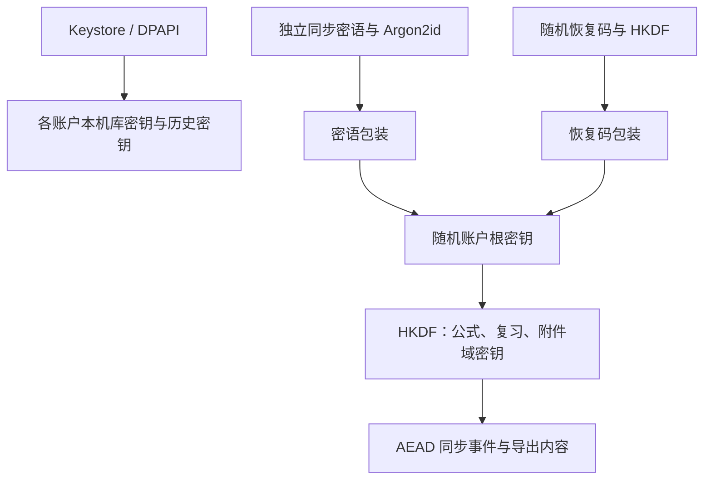
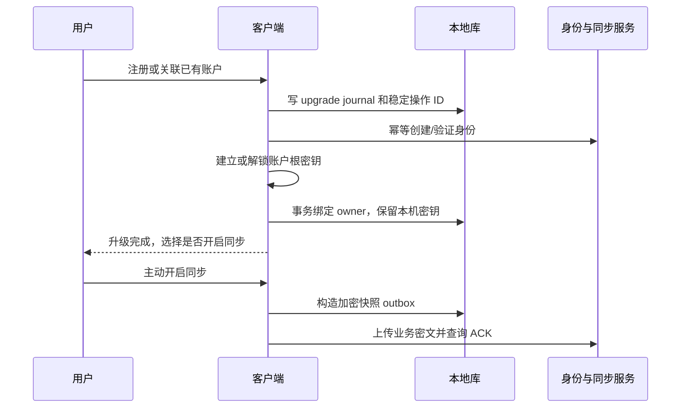

# 11 数据安全、同步与识别生命周期 v3.0

_BubeiGongshi · 2026-10-18 · 对 v2 账户、密钥、同步和 GC 契约的替代_

---

## 🛡️ 保证范围与数据分类

本设计保护游客不上传内容、本机静态存储、注册用户私有同步内容机密性、传输与资源完整性，并限制不可信解析和服务滥用。E2EE 指私有学习数据在客户端加密后同步，不能延伸解释为云识别供应商看不到授权图像。设计仍需要实现审查、渗透测试与恢复演练。

| 数据 | 本机 | 服务端 | 生命周期 |
| --- | --- | --- | --- |
| 游客公式/学习记录 | 账户独立加密库 | 不上传 | 用户明确清除、升级或卸载 |
| 注册用户私有公式/日志 | 账户独立加密库 | 用户开启同步后只有业务密文及必要元数据 | 用户删除与账户删除流程 |
| 识别图片/结果/临时草稿 | 历史与工作区独立加密 | 不进入私有同步；云识别有独立临时通道 | 严格 N、工作区 TTL、清理日志 |
| 用户主动另存的公式/图片附件 | 公式域 | 默认仅正文同步；附件另行主动开启 | 在 UI 明示已经脱离识别历史生命周期 |
| OIDC token | 平台安全存储 | 身份服务与验证方 | 短期 access、轮换 refresh、退出撤销 |
| 平台/库/会话密钥 | 平台包装或加密库内的密钥包装记录 | 本机库/历史密钥永不上云 | 分账户轮换和清除 |
| 公开内容/模型包 | 签名包，不额外加密 | 内容分发 | 安装/升级/卸载 |
| 诊断 | 默认本机轮转且脱敏 | 仅明确授权的诊断导出/上报 | 无正文，按大小/期限清理 |

无法保证删除用户选择的相册原件、文件管理器源文件、系统/第三方备份、供应商既有保留副本，或已被解锁恶意进程读走的内容。闪存磨损均衡、旧 WAL 与备份也限制了单项物理擦除能力。

## 👤 账户与本地访问状态

| 状态 | 可用操作 | 网络边界 |
| --- | --- | --- |
| Uninitialized | 创建游客、注册/登录、隐私说明 | 无学习内容访问 |
| GuestUnlocked | 编辑、计算、复习、本地识别、清理/导出 | 仅用户主动下载公开签名包；禁止账户数据、图片、偏好、诊断上传 |
| RegisteredUnlocked | 本地功能；单独开启同步或按次云识别 | token 校验且功能授权后才上传 |
| RegisteredLocked | 登录/本机解锁、账户切换、删除本机副本 | 不打开历史注册库，不用过期 token 上传 |
| UpgradingGuest | 进度与恢复界面，暂停对同一库并发写 | 创建身份不等于允许上传学习内容 |

“不登录不能用”解释为必须选择一种账户身份；本地游客身份就是有效会话。注册用户的离线本机解锁不等于向云服务发起一次新认证。退出注册账户后锁库并释放内存密钥；重新进入需本机解锁或有效登录。若用户选择游客，创建/打开独立游客库，不能继续浏览退出账户的数据。

注册成功后仍单独询问是否启用同步；用户可只注册而不上传。游客主动发起注册时身份信息按明确注册流程提交；注册未成功之前不上传其学习内容。公开包下载不附带学习记录或账号内偏好，服务器仍可能看到 IP/普通访问元数据，应在隐私说明中如实表达“无内容上传”，不声称“绝不联网”。

## 🔐 密钥、恢复与本地加密

### 密钥层次



`AccountRootKey` 由客户端 CSPRNG 生成 256 bit，**不是登录密码派生结果**。登录使用成熟 OIDC/身份服务；不自研 PAKE 或将服务端知道的登录密码直接作为 E2EE 密钥。用户另设独立同步密语，用 Argon2id 派生包装密钥；随机 256 bit 恢复码经 HKDF 生成另一包装密钥。两份包装分别能解锁同一个根密钥，不要求同时持有两者。

密语 KDF 采用 Argon2id，初始参数参考 RFC 9106 的低内存选项（64 MiB、3 passes、4 lanes，128 bit 随机 salt），在低配 Android 后台校准并记录版本与参数 [S05](12-资源包内容与开源资源调查-v3.md)。UI 说明延迟和密语强度；服务端限流不能防止泄露包装记录后的离线猜测，恢复安全依赖足够强的独立密语/随机恢复码。

使用成熟库的 XChaCha20-Poly1305，随机 192 bit nonce，不复用同 key+nonce；或经独立 ADR 选择其他标准 AEAD。AAD 绑定 account ID、key version、entity type/ID、revision/op ID、schema 与 purpose，防止跨账户/用途替换。KDF、AEAD、RNG、HKDF 必须用审核维护中的实现和已知测试向量，不自写算法。AEAD 保证单个记录完整性，不自动证明服务端没有回放整套旧密文。

同步只上传包装后的账户根密钥及必要参数。本机库密钥、历史主密钥、历史会话密钥不得包装进云端账户根密钥再上传。注册新设备后本机重新生成独立库密钥，解密同步内容后写入新库；不跨设备复制 SQLCipher 数据库。

### 密钥保存与恢复

本机 SQLCipher 随机库密钥和本地缓存的账户根密钥由平台保护；平台密钥不能脱离设备迁移。Android 不假定所有设备具备 StrongBox，记录实际安全等级；Windows 使用 DPAPI 用户作用域与私有 ACL。已包装的会话密钥可以存在加密库中，“不在普通明文表保存原始密钥”不等于禁止任何包装元数据入库。

恢复码只在客户端展示、校验一次并提供用户选择的安全保存方式，服务端不保存原码。输入恢复码后可解密根密钥并重新设置同步密语；重新生成恢复码需上传新包装并吊销旧包装版本。仅修改登录密码不改变 E2EE；修改同步密语只重新包装根密钥，不重加密全部公式。根密钥疑似泄露时必须轮换内容密钥、重加密及撤销设备，旧下载副本无法远程收回。

没有解锁设备、密语或恢复码时，服务端重置登录密码也不能恢复私有内容。UI 必须在启用同步前解释，避免虚假“忘记密码必能找回”。新设备无法仅凭服务端数据完全排除历史合法密文的全局回放；v1 提供已见版本单调检查、设备变更审计和数据导出，不承诺抗恶意服务端的完整全局回滚检测。若需要这一保证，另行引入可信设备签名/透明日志评审。

### 本地加密与备份

SQLCipher 默认页加密覆盖 WAL 页数据，但临时配置和元数据仍需检查 [S04]：启用内存 temp store，关闭敏感 SQL 调试，验证 journal/WAL 不含公式正文；不能把 SQLCipher 等同于路径/文件大小也保密。识别图片采用每会话随机数据密钥加密，历史主密钥只负责包装。内存敏感缓冲尽力清零；Flutter/系统图像副本无法保证逐字节即时擦除，缩短持有时间且不做明文落盘。

Android 同时设置自动备份、device-to-device 迁移和敏感目录排除规则。Windows 不将本地历史写进用户可漫游目录。用户导出默认只含公式/复习/单位，采用独立密码加密格式，包含 manifest/版本/校验；恢复必须先验证再导入，历史和工作区不加入默认导出。普通系统备份由用户控制，不能声称应用能删除其中所有旧副本。

## 🔄 游客升级与多端同步

### 游客升级事务



本机库无需因游客转注册而更换/上传库密钥，避免复制全库和泄露历史密钥。升级 journal 状态为 `PREPARED → IDENTITY_READY → KEY_READY → LOCAL_COMMITTED → DONE`；每步可幂等重试，完成前暂停该库写入。身份已建、本地未提交时继续升级或保留游客库；本地提交后不自动降回游客并重复建云账户。首次同步失败保留本地和 outbox，重新登录/重试即可。

关联已有注册账户时必须先解锁该账户根密钥，明确“合并游客数据”的范围，以新的不可变修订/复习事件合并。随机 ID 冲突重新映射引用；不能把新游客根密钥覆盖已有账户根密钥。升级回滚不得删除原库或原平台包装记录，直到本机提交和验证结束。

### 同步协议

```text
Envelope v1:
  account_id (由认证上下文确定), account_epoch, op_id,
  device_id, device_seq, key_version, entity_id, schema_version,
  nonce, ciphertext, ciphertext_hash
Push:  op_id[] -> ACK(op_id, server_seq)
Pull:  after=opaque_cursor, limit<=200 -> events[], next_cursor, has_more
```

业务修改与 outbox 写入同一 SQL 事务。客户端按批推送，服务端在事务内以 `(account_epoch, op_id)` 唯一去重，先持久化再 ACK。客户端收到 ACK 才标记已发送；丢失 ACK 后重发返回同一个 server_seq。拉取事件在本地验证、解密、写入 inbox/业务表与 cursor 同一事务完成；中断重拉不丢数据、不重复评分。

server_seq 仅用于传输顺序，不替代领域事件时间。服务端限制单事件 ≤256 KiB、每批 ≤1 MiB/200 条并作配额；客户端解密后还要验证 schema、AST 预算和父修订完整性，恶意密文/未知版本进入隔离诊断，不推进到假成功。key_version 不可解锁时暂停该批并引导恢复，不永久循环下载坏事件。

| 实体 | 合并规则 |
| --- | --- |
| 公式 | 不可变修订 DAG；同父并发修订保留两头，用户选/合并生成新修订 |
| 用户单位/符号 | 版本化定义；冲突不覆盖已引用旧定义，需明确映射 |
| 复习事件 | 依据 event ID 去重；同卡按 reset epoch、UTC 时间、device ID、device sequence、event ID 确定排序 |
| 复习状态 | 从完整有效事件及固定 FSRS 参数重算；未来时钟异常事件先标记/校正，不改原始事件 |
| 用户设置 | 少量标量按逻辑版本+device ID 解决并发；识别 N、缓存、平台提醒属本机设置 |
| 删除 | 墓碑保留，不简单删除同步记录；旧设备更新不得使被删对象自动复活 |

V1 不做自动历史压缩：墓碑和事件标识随账户保留，达到容量上限提示导出/扩容，不静默丢日志。需要压缩时另做版本化快照和 `min_accepted_epoch` 协议；落后设备只能下载完整快照，不能提交旧 epoch 的陈旧事件。服务端账户注销/重建使用新 epoch，旧 token/设备和旧请求全部拒绝。

### 删除账户与备份

删除需要近期身份验证与明确确认，先撤销会话、停止上传并阻止离线 outbox 恢复旧账户，再删除生产数据和包装记录。目标：生产对象/记录 24 h 内删除，备份 30 天自然过期；这是待落实政策，不是供应商已提供保证。恢复生产备份后必须重放删除清单，避免账户复活；识别临时图像根本不进入这些备份。

其他离线设备上已解密的本地数据无法由服务端强制即时销毁，下次联网时锁定/提示用户清除。删除本机数据与删除云账户是不同操作。保留必要审计信息的字段、期限及法律依据要在正式隐私政策中列明，不无限保留正文。

## 📷 识别生命周期与严格 N 保留

### 会话和计数口径

```text
IMPORTED → PREVIEW → AUTHORIZED(仅云) → RUNNING
RUNNING → SUCCEEDED | FAILED | CANCELLED | UNKNOWN_REMOTE
UNKNOWN_REMOTE → SUCCEEDED | FAILED | CANCELLED | EXPIRED_UNKNOWN
终态 → RETAINED 或 DELETING → PURGED
```

在用户点击“开始识别”时分配账户本机单调 `recognition_seq`，重试同一次逻辑识别复用会话，主动再次识别才新建。计数包含 SUCCEEDED、FAILED、CANCELLED、EXPIRED_UNKNOWN；未开始识别就关闭的导入预览不算。按开始序号而不是异步完成时间确定“最近”，防止慢旧任务结束后挤掉较新记录。

`keep_last` 必须是整数 0–100，默认 5；UI、接口和数据库 CHECK 三处约束。所有终态进入统一集合，保留序号最大的 N 条，无 Pin/Adopted 豁免。进行中最多一个活动任务，未决云任务只保留最小状态并有独立 TTL，不让“处理中”无限规避配额。

N=0 时不持久化终态历史。当前结果可仅在内存确认页展示，关闭/切换或进程退出后消失；用户主动保存公式则正文进入公式域，不自动保存图片。待识别工作图仍需在执行期间存在受控加密 staging，不能承诺计算时完全没有任何临时内容。设置减少 N、终态提交、启动恢复和账户清除都触发裁剪。

### 保留的内容

每条历史保留用户确认的实际输入图、实际提交云端的图（若编码/缩放不同可用内容 hash 去重）、候选与校正结果、诊断/错误、模型与预处理版本、时间和序号。墨迹保留规范渲染图；是否额外保存笔画须单独选项。全分辨率原始导入副本在工作完成后删除；UI 说明历史图片是确认后的裁剪/规范图，不把缩略图冒称原文件。

“保存到公式库”仅保存正文和来源标识；历史过期后来源显示“识别图片已清理”。用户主动“另存为公式附件”时，创建新的附件资产与独立密钥，展示“不会随识别历史清空而删除”；默认不同步附件。历史 GC 仍删除原会话和其图片。N=0 仍能保留已明确保存的公式/附件，这不是历史固定项豁免。

### 文件与数据库不能伪装成一个事务

1. 同一账户所有会话完成/设置更新/GC 经串行调度器执行；事务内读取最新 N，选出淘汰项，标记 DELETING、删除历史会话包装密钥并插入独立 `cleanup_job`，提交后 UI 立即不可见。
2. 后台幂等删除资产密文、缩略图、推理缓存、临时导入副本，通知 UI/渲染缓存释放；完成后标记 PURGED 并删除不再引用的元数据。
3. 删除失败时保留 cleanup_job，指数退避；启动扫描重试，并按受控目录/文件 ID 对账清理孤儿。不得扫描或删除用户源文件目录，不跟随符号链接/重解析点逃出应用目录。
4. staging 记录包含创建时间和租约，任务正常释放后删除；崩溃未完成项启动即清理，运行中后台兜底初始 TTL≤1 h。恢复云任务只使用 job ID 查询，不因保留 staging 自动再次上传。
5. 清空历史涵盖整个历史域，不含公式域附件；账户本地清除才同时删除两者。释放文件句柄后执行密钥轮换/删除主密钥，不能在文件仍被 decoder 占用时声称完成。

图片历史初始独立磁盘配额 512 MiB，每会话历史资产≤4 MiB，最多 100 条；工作区另有 32 MiB 上限。超额先清工作区和可再生缓存，不悄悄少留用户设置的最近 N 次。单条过大时在预览前压缩/缩放到限额并再次确认；仍不足则提示存储不足，允许选择主动清理或本次不留历史，不能无提示丢图片只留结果。

删除包装会话密钥能减少普通恢复机会，但旧 SQLCipher 页、WAL、主密钥和设备备份可能含历史包装。因此单条 GC 只承诺逻辑不可访问与受控副本尽力清理，不能宣称绝对加密擦除。可在用户清空全历史时轮换历史主密钥、清理 WAL 和旧文件以加强保护；仍需披露闪存和外部副本限制。

## ☁️ 云识别授权、任务与费用

### 授权和 API

每次确认展示实际提交图、供应商/模型、用途、预计费用/配额、供应商保留及训练政策。`consent_receipt` 绑定 account、session、image_hash、provider/model、policy_version 和短有效期；重换图片/供应商需重新确认。收据可审计但不能当成防恶意客户端的密码学认证，真正权限由 token、账户状态与服务端配额保证。

```text
POST /v1/recognition/jobs
  Authorization: Bearer <短期账户 token>
  Idempotency-Key: <本次会话唯一键>
  body: image + image_hash + consent_receipt + backend_id
  返回 202: job_id, state, quota_reservation
GET /v1/recognition/jobs/{job_id}     # 必须检查 owner
POST /v1/recognition/jobs/{job_id}/cancel
```

初始上传上限 4 MiB、解码上限 400 万像素，只接受内联受限图片；不接客户端任意 URL，不由模型输出 URL 驱动下载。供应商端点固定白名单，API Key 只在服务端密钥管理中。网关只接注册用户，不提供客户端可伪装游客调用的匿名接口。

### 任务幂等和不确定状态

服务端先事务持久化唯一 `(account_id, idempotency_key)`、输入 hash 和配额预留，再交给 worker。相同键不同图返回 409；相同键同图返回既有任务。状态为 `QUEUED → SUBMITTING → RUNNING → SUCCEEDED/FAILED`，并有 `CANCEL_REQUESTED/CANCELLED/UNKNOWN/EXPIRED_UNKNOWN`。

如果供应商不支持幂等/任务查询，worker 可能在请求已提交而本机未记成功时崩溃，这种情况标记 UNKNOWN，**不得自动再次付费调用**。没有端到端 exactly-once 保证；用户可查状态或明确选择新一次付费识别。取消仅表示尽力停止，不能承诺未计费或供应商未保留。配额先预留、结果后结算，UNKNOWN 独立记账和人工对账，不能无界扣费或把不确定请求一律免费重试。

初始连接超时 5 s、供应商处理上限 30 s、队列等待上限 30 s。客户端等待可更早取消，仍保留 job ID 查询。重启只查询既有任务，不从旧授权自动重传。供应商返回全部按不可信 JSON/LaTeX 处理，响应≤256 KiB，拒绝工具调用、可执行脚本、外部取数和诱导提示注入；模型只能给公式候选。

### 临时副本和观测

网关工作图片使用受限加密临时存储，完成/失败/取消后的目标清理≤60 s，崩溃残留 lifecycle TTL≤1 h；容器日志、反向代理、APM、异常采样与备份都禁止记录请求图/正文。结果和幂等状态保留≤24 h 供查询；超过后只保留最小费用/状态 tombstone（初始30天），图片/结果删除且旧幂等键不重新提交。明确未决结果到期后显示“状态已过期，可能已计费”。

供应商保留时间、训练开关和零保留适用资格必须逐项核实，不由客户端 N 或网关删除决定。供应商不满足产品所公布政策时禁用该适配器，用户仍可本地识别和手输。任何云端保留政策修改均需更新 policy_version 及授权文案。

## 🧪 安全验证和故障演练

| 威胁/故障 | 验证措施 | 发布失败条件 |
| --- | --- | --- |
| 跨账户越权 | 替换 account/job/entity ID，检查每条 API 与本机账户作用域 | 读取或删除另一用户内容 |
| 游客上传 | 抓包、禁网运行、模拟远端 SDK 初始化 | 出现图片/公式/学习偏好/诊断上传 |
| 密钥恢复失效 | 新设备仅密语恢复、仅恢复码恢复、丢失全部凭据 | 文档承诺与实际不同、原账户被覆盖 |
| 记录篡改 | 修改 nonce/AAD/key version/密文/owner，测试向量 | 静默解密、跨用途接受 |
| 同步丢失/复活 | ACK 丢失、断电、乱序、重复、旧 epoch、并发删除 | 丢复习事件或对象静默复活 |
| GC 泄露/竞态 | N=0/1/5/100、设置竞态、占用文件、磁盘满、各步崩溃 | 历史超 N、明文落盘、删源文件、不可恢复清理队列 |
| 云重复费用 | worker 提交前后崩溃、未知上游状态、取消重启 | 未确认就重复付费提交 |
| 恶意导入 | 巨图、截断图片、畸形 LaTeX/模型、资源包归档 | 无限执行、OOM、任意文件覆盖/执行 |

实测记录至少含版本、设备、输入、步骤、期望/实际、日志脱敏结果与负责人。未执行测试不得标记“通过”。整体矩阵见 [13](13-需求追踪与验收-v3.md)。
