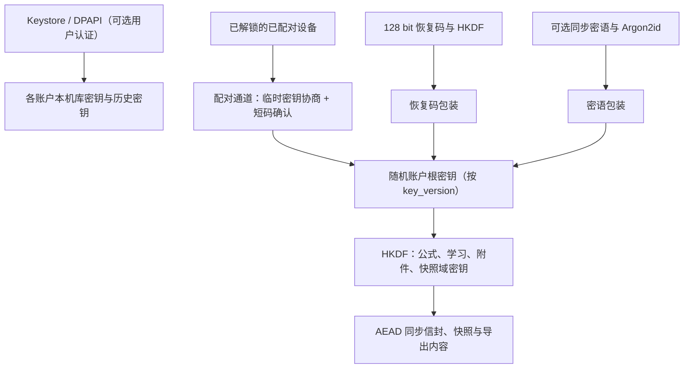
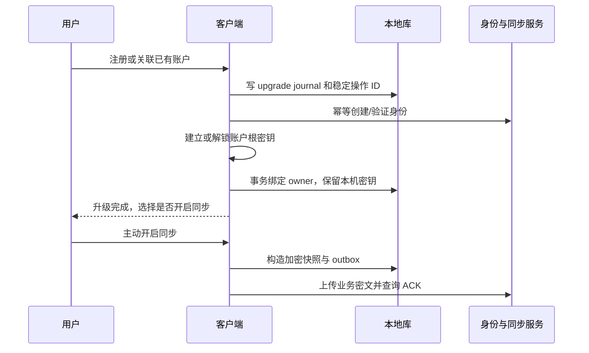

# 11 数据安全、同步与识别生命周期 v4.0

_BubeiGongshi · 2026-10-18 · 账户、密钥、同步、识别历史与合规的专项契约（替代 v3.0）_

---

## 🛡️ 保证范围与数据分类

本设计保护游客不上传内容、本机静态存储、注册用户私有同步内容机密性、传输与资源完整性，并限制不可信解析和服务滥用。E2EE 指私有学习数据在客户端加密后同步，不能延伸解释为云识别供应商看不到授权图像。设计仍需要实现审查、渗透测试与恢复演练。

本文件中的状态机与协议由 Rust 无 I/O 核心实现（ADR-009）：fml-crypto 负责密钥层次、包装、AAD 与信封；fml-sync 负责 outbox/inbox、合并、快照与游标语义；fml-recognition 负责识别会话状态机；fml-store 负责单写者事务、GC 调度与 cleanup_job。Dart/ArkTS 只做网络传输、平台安全存储与文件选择等端口适配，见 [10](10-软件架构设计-v4.md) §系统结构与依赖。

| 数据 | 本机 | 服务端 | 生命周期 |
| --- | --- | --- | --- |
| 游客公式/学习记录 | 账户独立加密库 | 不上传 | 用户明确清除、升级或卸载 |
| 注册用户私有公式/学习日志 | 账户独立加密库 | 用户开启同步后只有业务密文及必要元数据 | 用户删除与账户删除流程 |
| 识别图片/结果/临时草稿 | 历史与工作区独立加密 | 不进入私有同步；云识别有独立临时通道 | 严格 N、工作区 TTL、清理日志 |
| 用户主动另存的公式/图片附件 | 公式域 | 默认仅正文同步；附件另行主动开启 | 在 UI 明示已经脱离识别历史生命周期 |
| OIDC token | 平台安全存储 | 身份服务与验证方 | 短期 access、轮换 refresh、退出撤销 |
| 平台/库/会话密钥 | 平台包装或加密库内的密钥包装记录 | 本机库/历史密钥永不上云 | 分账户轮换和清除 |
| 设备注册表与本机设置 | 设备级小库（不含学习正文） | 不上传 | 卸载或清除本机账户时删除对应行 |
| 公开内容/模型包 | 签名包，不额外加密 | 内容分发 | 安装/升级/卸载 |
| 诊断 | 默认本机轮转且脱敏 | 仅明确授权的诊断导出/上报 | 无正文，按大小/期限清理 |

### 服务端可见的元数据

开启同步后，服务端能看到：账户 ID、account_epoch、设备 ID 与设备序号、op_id、key_version、entity_type、随机 entity_id、密文大小、提交时间、IP 与普通访问日志、配额与费用记录。服务端看不到公式正文、单位定义、复习评分、卡片内容、学习计划与统计。entity_type 会暴露“这是一条复习事件还是公式修订”及其频率，这一点写入隐私政策，不宣称“服务端对学习行为一无所知”。

无法保证删除用户选择的相册原件、文件管理器源文件、系统/第三方备份、供应商既有保留副本，或已被解锁恶意进程读走的内容。闪存磨损均衡、旧 WAL 与备份也限制了单项物理擦除能力。

## 👤 账户与本地访问状态

| 状态 | 可用操作 | 网络边界 |
| --- | --- | --- |
| Uninitialized | 创建游客、注册/登录、阅读隐私政策 | 无学习内容访问 |
| GuestUnlocked | 编辑、计算、复习、本地识别、清理/导出 | 仅用户主动下载公开签名包；禁止账户数据、图片、偏好、诊断上传 |
| RegisteredUnlocked | 本地功能；单独开启同步或云识别 | token 校验且功能授权后才上传 |
| RegisteredLocked | 解锁、账户切换、删除本机副本 | 不打开该注册库，不用过期 token 上传 |
| UpgradingGuest | 进度与恢复界面，暂停对同一库并发写 | 创建身份不等于允许上传学习内容 |

“不登录不能用”解释为必须选择一种账户身份；本地游客身份就是有效会话。注册用户的离线本机解锁不等于向云服务发起一次新认证。退出注册账户后锁库并释放内存密钥。若用户选择游客，创建/打开独立游客库，不能继续浏览退出账户的数据。

注册成功后仍单独询问是否启用同步；用户可只注册而不上传。游客主动发起注册时身份信息按明确注册流程提交；注册未成功之前不上传其学习内容。公开包下载不附带学习记录或账号内偏好，服务器仍可能看到 IP/普通访问元数据，应在隐私说明中如实表达“无内容上传”，不声称“绝不联网”。

### 本机解锁因素

“锁定”必须对应真实的密钥门槛，否则只是界面状态。V1 定义两档（默认见 [00](00-需求基线与文档效力-v4.md) D-09）：

| 档位 | 解锁凭据 | 保护对象 | 不保护 |
| --- | --- | --- | --- |
| 系统级（默认） | 操作系统账户登录 / 设备锁屏凭据；库密钥由 Keystore（TEE）或 DPAPI 当前用户作用域包装 | 设备丢失、其他系统账户、离线拷盘 | 同一系统账户下的其他人；此档的 RegisteredLocked 只阻止误操作和后台上传，UI 必须如实说明 |
| 应用锁（可选） | 应用 PIN 或生物识别：Android 使用要求用户认证的 Keystore 密钥（BIOMETRIC_STRONG 或 DEVICE_CREDENTIAL）；Windows 使用 Windows Hello 密钥凭据 | 额外防护家庭共用电脑、同系统账户的他人 | 已解锁期间的恶意进程 |

- 应用 PIN 不得作为唯一的低熵密钥：PIN 只用于触发平台认证或配合平台密钥，并有失败次数限制与退避。
- 生物识别变更或设备凭据重置会使认证绑定密钥失效。恢复路径：重新登录后用已配对设备或恢复码解锁账户根密钥，再在本机生成新的库密钥包装；未开启同步的注册账户在应用锁失效时只能依赖导出包恢复，开启应用锁前须提示。
- 共用电脑的威胁模型写入隐私说明：建议每人使用独立的系统账户；需要在同一系统账户内隔离时开启应用锁。
- 游客档案：V1 每个系统账户每台设备最多一个游客档案；需要多人隔离时使用不同系统账户或注册账户。档案列表来自设备注册表。

### 设备注册表

设备级小库 `device_registry` 记录本机出现过的账户与游客档案：本地档案 ID、账户 ID（游客为空）、库文件位置、平台包装引用、解锁档位、最后使用时间。本机设置 `local_setting` 以（设备，账户）为键，保存识别保留数 keep_last、缓存上限、平台提醒等不随同步传播的设置，并带 CHECK 约束。该库不存学习正文，便于在打开任一账户库之前列出档案和执行全局清理。

## 🔐 密钥、恢复与本地加密

### 密钥层次



`AccountRootKey` 由客户端 CSPRNG 生成 256 bit，**不是登录密码派生结果**。登录使用成熟 OIDC/身份服务（方式与提供方见 00 D-14）；不自研 PAKE，也不把服务端可见的登录密码直接作为 E2EE 密钥。

按 ADR-012（修订 ADR-004），注册用户默认只需保管一项额外秘密——恢复码：

1. **设备配对（默认的新设备路径）**：新设备登录后显示二维码与 6 位确认码，内含一次性 X25519 公钥；已解锁的旧设备扫码并让用户核对双方显示的设备名与确认码，然后用 HPKE（RFC 9180）把根密钥加密给新设备。服务端只转发密文，配对会话 5 分钟过期、单次使用。
2. **恢复码（兜底，必须生成）**：128 bit 随机数，编码为 26 个 Crockford Base32 字符，按 4–5 位分组并带校验位，便于学生抄写和检错。恢复码熵足够高，经 HKDF 派生包装密钥，无需慢 KDF。客户端只展示并校验一次，服务端不保存原码。
3. **同步密语（可选）**：给愿意记密语、需要在无旧设备时自助恢复的用户。最少 12 个字符，并以常见弱密语表拒绝；Argon2id 参数随包装记录保存，下限 64 MiB、3 passes、4 lanes、128 bit 随机 salt，内存上限 128 MiB，保证低配设备也能解开高配设备创建的包装；基线 Android 设备解锁 P95 ≤ 2 s，纳入 13 的 T-UNLOCK（参数依据见 [12](12-资源包内容与开源资源调查-v4.md) §核实来源与访问记录 S05）。

注册引导必须明确写出：同时失去全部已配对设备、恢复码和（若设置的）同步密语时，同步内容无法恢复，服务端重置登录密码也无济于事。

使用成熟库的 XChaCha20-Poly1305，随机 192 bit nonce，不复用同 key+nonce；或经独立 ADR 选择其他标准 AEAD。KDF、AEAD、RNG、HKDF、HPKE 必须用审核维护中的实现和已知测试向量，不自写算法。AEAD 保证单个记录完整性，不自动证明服务端没有回放整套旧密文。

同步只上传包装后的账户根密钥及必要参数。本机库密钥、历史主密钥、历史会话密钥不得包装进账户根密钥后上传。新设备本机重新生成独立库密钥，解密同步内容后写入新库；不跨设备复制 SQLCipher 数据库。

### 密钥轮换、设备吊销与恢复

- **修改同步密语或重新生成恢复码**：只重新包装当前根密钥并吊销旧包装版本，不重加密全部内容。
- **吊销设备或怀疑根密钥泄露**：生成新的根密钥并递增 key_version；在线的可信设备用新域密钥重加密并上传当前快照，此后服务端拒绝旧 key_version 的新写入。被吊销设备读不到新数据，但已下载的旧副本无法远程收回。
- **仅修改登录密码**：不影响 E2EE。
- 输入恢复码后可解锁根密钥，并可重新配对设备或重新设置同步密语。

新设备无法仅凭服务端数据完全排除历史合法密文的全局回放；V1 提供已见版本单调检查、设备变更审计和数据导出，不承诺抗恶意服务端的完整全局回滚检测。若需要这一保证，另行引入可信设备签名或透明日志评审。

### 本地加密

本机 SQLCipher 库密钥是随机 256 bit，以原始密钥模式提供（跳过口令 PBKDF2 派生，避免冷启动额外耗时）；加密后端（OpenSSL、BoringSSL 或 SQLite3MultipleCiphers 方案）在 M0 按安装包预算与维护状况选定，见 10 §平台实现与生命周期。启用内存 temp store，关闭敏感 SQL 调试，验证 journal/WAL 不含公式正文；不能把 SQLCipher 等同于路径/文件大小也保密。

Android 不假定所有设备具备 StrongBox，库密钥包装使用 TEE Keystore 并记录实际安全等级；Windows 使用 DPAPI 当前用户作用域与私有 ACL。已包装的会话密钥可以存在加密库中。识别图片采用每会话随机数据密钥加密，历史主密钥只负责包装。内存敏感缓冲尽力清零；Flutter/系统图像副本无法保证逐字节即时擦除，缩短持有时间且不做明文落盘。

### 导出、恢复与系统备份

Android 设置自动备份、设备间迁移和敏感目录排除规则；Windows 不将本地历史写进可漫游目录。普通系统备份由用户控制，不能声称应用能删除其中所有旧副本。

用户导出默认只含公式、学习记录、单位与学习计划，历史和工作区不加入默认导出。导出包为单文件容器：manifest（schema 版本、应用版本、创建时间、范围）、加密内容（用户设置的导出密码经 Argon2id 派生，或用恢复码派生）、整体 AEAD 认证与校验和；导出前确认范围，导出后自检可解密。

恢复流程：

1. 校验格式版本与完整性（认证失败直接拒绝）。
2. 解密 manifest。
3. 校验 schema 兼容，必要时准备迁移。
4. 恢复到临时数据库。
5. 运行迁移和完整性检查（AST 预算、父修订、卡片引用）。
6. 让用户选择“合并到当前账户”（按 §游客并入已有账户 的去重规则生成新修订与事件）或“替换当前本机库”（仅限未开启同步或已确认云端同步数据另行处理），确认后原子切换。
7. 任一步失败保留原库与导出包不变。

## 🔄 游客升级与多端同步

### 游客升级事务



本机库无需因游客转注册而更换/上传库密钥。升级 journal 状态为 `PREPARED → IDENTITY_READY → KEY_READY → LOCAL_COMMITTED → DONE`；每步可幂等重试，完成前暂停该库写入。身份已建、本地未提交时继续升级或保留游客库；本地提交后不自动降回游客并重复建云账户。首次同步失败保留本地和 outbox，重新登录/重试即可。升级回滚不得删除原库或原平台包装记录，直到本机提交和验证结束。

### 游客并入已有账户

关联已有注册账户时必须先解锁该账户根密钥，明确“合并游客数据”的范围，以新的不可变修订/学习事件合并，不能用游客根密钥覆盖已有账户根密钥。

- 资源包派生的实体（公式条目、卡片、书中位置）使用确定性 ID：UUIDv5（固定命名空间，`pack_id + item_id + template_id`）。两边从同一资源包派生的卡片自然对齐，不产生两套卡片。
- 同一卡片的学习事件取并集，按 §同步协议 的排序规则重放排程；完全相同的 event_id 去重。
- 用户自建公式按规范 AST 哈希检测疑似重复，提示用户选择合并或保留两条，不自动删除。
- 随机 ID 冲突（极少）重新映射引用。
- 由 T-GUESTMERGE 验收：两边各学过同一书的部分卡片后合并，卡片数不重复、复习历史完整、排程与单设备重放结果一致。

### 同步协议

```text
Envelope v2:
  envelope_version = 2, kind = event | snapshot_chunk,
  account_id (由认证上下文确定), account_epoch, op_id,
  device_id, device_seq, key_version,
  entity_type, entity_id, revision_id, schema_version,
  purpose, aad_version,
  nonce, ciphertext, ciphertext_hash = SHA-256(ciphertext)
Push:  envelope[] -> ACK(op_id, server_seq) | CONFLICT(op_id)
Pull:  after=opaque_cursor, limit<=200, max_bytes<=1048576
       -> events[], next_cursor, has_more
Snapshot: GET latest snapshot manifest -> snapshot_id, covers_through, chunks[]
```

**AAD 绑定**：AAD 绑定 account_id、account_epoch、key_version、entity_type、entity_id、revision_id、op_id、schema_version 与 purpose，防止跨账户、跨实体和跨用途替换。AAD 的字节布局按 aad_version 定义为确定性 CBOR（RFC 8949 的确定性编码规则）的固定字段映射；fml-crypto 发布规范与测试向量，任何其他语言实现必须通过同一组向量（T-AAD）。明文内部头重复全部绑定字段，解密后逐项核对，不一致即隔离。

**幂等**：业务修改与 outbox 写入同一 SQL 事务。服务端在事务内以 `(account_epoch, op_id)` 唯一去重，先持久化再 ACK；重发同一 op_id 且 ciphertext_hash 相同返回原 server_seq，哈希不同返回 CONFLICT 并在双方隔离诊断。客户端收到 ACK 才标记已发送。拉取事件在本地验证、解密、写入 inbox/业务表与 cursor 同一事务完成；中断重拉不丢数据、不重复评分。

**大小**：服务端限制单事件 ≤256 KiB、每批推送 ≤1 MiB/200 条，拉取同时受 200 条与 1 MiB 约束，并作配额。公式修订事件只携带源码与规范化元数据，不携带 AST，接收端重新解析并验证预算；T-SYNC 包含“最大合法修订可同步”用例。恶意密文/未知版本进入隔离诊断，不推进到假成功。key_version 不可解锁时暂停该批并引导恢复，不循环下载坏事件。

**快照**：V1 协议即包含 snapshot_chunk 类型与“快照 + 之后增量”的游标语义（covers_through 为快照覆盖到的 server_seq）。新设备先下载最新快照，再拉取 covers_through 之后的事件；快照由在线可信设备生成并加密，服务端只存密文。估算：每天 100 次复习两年约 73,000 条事件，无快照需至少 365 次分页拉取和逐条重放。快照的生成调度可在 M5 实现，但字段、服务端存储与客户端读取路径在 M3 即需就绪，由 T-SNAPSHOT 验收。

server_seq 仅用于传输顺序，不替代领域事件时间。

| 实体 | 合并规则 |
| --- | --- |
| 公式 | 不可变修订 DAG；同父并发修订保留两头，生成一条同步的“待选择”记录（ID 由父修订与两头确定性派生），在任一设备处理一次即同步结果，用户选择或合并生成新修订 |
| 卡片 | 绑定（FormulaItem, revision）；出现并发头时卡片保持原绑定，待选择记录处理后由用户决定“保持进度”或“重建卡片”，该决定同样只处理一次 |
| 用户单位/符号 | 版本化定义；冲突不覆盖已引用旧定义，需明确映射 |
| 学习事件 | 含 device_id、device_seq、card_reset_epoch；依据 event_id 去重；同卡按 card_reset_epoch、UTC 时间、device_id、device_seq、event_id 确定排序 |
| 卡片重置 | 重置递增 card_reset_epoch；只有最新 card_reset_epoch 的事件参与排程重算，旧 epoch 事件归档保留并在界面提示“该设备离线期间的旧记录未计入” |
| 复习状态 | 从有效事件及固定版本的排程参数重算；未来时钟异常事件先标记/校正，不改原始事件 |
| 公式元数据 | 标签为增删集合（并发增删以操作集合合并）；收藏、备注等标量按逻辑时钟 + device_id 字段级解决 |
| 学习计划/书架 | 计划参数按字段级逻辑时钟合并；书的加入/移除为增删集合 |
| 用户设置 | 少量标量按逻辑版本 + device_id 解决；识别 N、缓存、平台提醒属（设备，账户）本机设置，不同步 |
| 删除 | 墓碑保留，不简单删除同步记录；旧设备更新不得使被删对象自动复活 |

三类 epoch 含义不同、不得混用：`account_epoch` 表示账户注销重建；`card_reset_epoch` 表示单卡重置；快照协议的 `min_accepted_epoch` 表示服务端不再接受早于某账户纪元的陈旧写入。服务端账户注销/重建使用新 account_epoch，旧 token/设备和旧请求全部拒绝。

### 删除账户与备份

删除需要 300 秒内的重新认证与明确确认，先撤销会话、停止上传并阻止离线 outbox 恢复旧账户，再删除生产数据和包装记录。目标：生产对象/记录 24 h 内删除，备份 30 天自然过期；这是待落实政策，不是供应商已提供保证。恢复生产备份后必须重放删除清单，避免账户复活；识别临时图像根本不进入这些备份。

删除例外清单（写入隐私政策，期限与法律依据由法务确认）：

| 保留项 | 内容 | 不含 | 期限 |
| --- | --- | --- | --- |
| 云识别费用 tombstone | job_id 哈希、计费状态、时间 | 图片、识别结果 | 初始 30 天 |
| 网络与安全日志 | 访问时间、IP、接口、结果码 | 学习内容、图片 | 按《网络安全法》要求不少于六个月 |
| 删除清单 | 已删账户 ID 哈希与删除时间 | 任何业务数据 | 至最后一份备份过期 |

其他离线设备上已解密的本地数据无法由服务端强制即时销毁，下次联网时锁定/提示用户清除。删除本机数据与删除云账户是不同操作。

## 📷 识别生命周期与严格 N 保留

### 会话和计数口径

**计数单位是“识别会话”**：一张图片或一块墨迹画布算 1 个识别会话，其中全部框选区域及其候选与结果都属于这一个会话；一张照片中识别出多条公式仍算一次。批量导入 10 张图片即 10 个会话，会话数超过 N 时在导入前提示将挤出最早的历史。同一会话的重试复用会话；主动“再次识别”新建会话。默写作答模式（忠实转写，见 10 §查找模式与作答模式）的识别同样计入；未提交任何输入就取消的空导入不计。用户“保留的是确认后的裁剪/规范图，失败与取消也计入”这一解释待甲方确认，见 00 D-15。

```text
IMPORTED → PREVIEW → AUTHORIZED(仅云) → RUNNING
RUNNING → SUCCEEDED | FAILED | CANCELLED | UNKNOWN_REMOTE
UNKNOWN_REMOTE → SUCCEEDED | FAILED | CANCELLED | EXPIRED_UNKNOWN
终态 → RETAINED 或 DELETING → PURGED
```

客户端会话状态与服务端任务状态的映射：

| 服务端任务状态 | 客户端会话状态 | 说明 |
| --- | --- | --- |
| QUEUED、SUBMITTING、RUNNING、CANCEL_REQUESTED | RUNNING | 客户端只显示“处理中”，可请求取消 |
| SUCCEEDED | SUCCEEDED | 结果拉取后进入确认页 |
| FAILED | FAILED | 保留错误码 |
| CANCELLED | CANCELLED | 取消不保证未计费 |
| UNKNOWN（供应商结果不确定） | UNKNOWN_REMOTE | 不自动重提，用户可查询或另起付费识别 |
| 查询不到且超过未决 TTL | EXPIRED_UNKNOWN | 显示“状态已过期，可能已计费” |
| 客户端网络断开、查询失败 | 保持原状态 | 不推断为失败 |

在用户点击“开始识别”时分配（设备，账户）级单调 `recognition_seq`，取自独立的 `recognition_counter` 表，该表不受 N 约束。计数包含 SUCCEEDED、FAILED、CANCELLED、EXPIRED_UNKNOWN；未开始识别就关闭的导入预览不算。按开始序号而不是异步完成时间确定“最近”，防止慢旧任务结束后挤掉较新记录。

`keep_last` 必须是整数 0–100，默认 5；UI、接口和 local_setting 表的 CHECK 三处约束。所有终态会话进入统一集合，保留序号最大的 N 条，无 Pin/Adopted 豁免。同时最多一个活动任务。已提交的云任务另记最小状态表 `pending_cloud_job`（job_id、会话 ID、image_hash、提交时间），不受 N 约束，未决 TTL 为 24 h，与服务端结果保留期一致。

N=0 时不持久化终态历史。当前结果仅在内存确认页展示，关闭/切换或进程退出后消失；用户主动保存公式则正文进入公式域，不自动保存图片。待识别工作图在执行期间存在受控加密 staging，不能承诺计算时完全没有临时内容。N=0 时进程重启仍可凭 pending_cloud_job 查询已提交任务，结果只在内存展示。设置减少 N、终态提交、启动恢复和账户清除都触发裁剪。

### 保留的内容

每条历史保留用户确认的实际输入图、实际提交云端的图（两者相同或内容 hash 相同时只存一份）、候选与校正结果、诊断/错误、模型与预处理版本、时间和序号。墨迹保留规范渲染图；是否额外保存笔画须单独选项。全分辨率原始导入副本在工作完成后删除；UI 说明历史图片是确认后的裁剪/规范图，不把缩略图冒称原文件。

“保存到公式库”仅保存正文和来源标识；历史过期后来源显示“识别图片已清理”。用户主动“另存为公式附件”时，创建新的附件资产与独立密钥，展示“不会随识别历史清空而删除”；默认不同步附件。N=0 仍能保留已明确保存的公式/附件，这不是历史固定项豁免。

### 文件与数据库不能伪装成一个事务

1. 同一账户所有会话完成、设置更新与 GC 经 fml-store 单写者调度执行；事务内读取最新 N，选出淘汰项，标记 DELETING、删除历史会话包装密钥并插入独立 `cleanup_job`，提交后 UI 立即不可见。
2. 后台幂等删除资产密文、缩略图、推理缓存、临时导入副本，通知 UI/渲染缓存释放；完成后标记 PURGED 并删除不再引用的元数据。
3. 删除失败时保留 cleanup_job，指数退避；启动扫描重试，并按受控目录/文件 ID 对账清理孤儿。不得扫描或删除用户源文件目录，不跟随符号链接/重解析点逃出应用目录。
4. staging 记录包含创建时间、租约和是否已提交云端。未提交的 staging 在崩溃后启动即清理；**已提交云端的会话保留其提交图直到任务终态或 24 h**，以满足“保留上传的图片”；若图片因故丢失，会话标记 image_lost 并在历史中显示。运行中后台兜底 TTL ≤1 h 只适用于未提交项。恢复云任务只使用 job ID 查询，不因保留 staging 自动再次上传。
5. 清空历史涵盖整个历史域，不含公式域附件；账户本地清除才同时删除两者。释放文件句柄后执行密钥轮换/删除主密钥，不能在文件仍被 decoder 占用时声称完成。

图片历史初始独立磁盘配额 512 MiB，每会话历史资产 ≤8 MiB（输入图、提交图、缩略图合计），最多 100 条；工作区另有 32 MiB 上限。超额先清工作区和可再生缓存，不悄悄少留用户设置的最近 N 次。单条过大时在预览前压缩/缩放到限额并再次确认；仍不足则提示存储不足，允许选择主动清理或本次不留历史，不能无提示丢图片只留结果。

删除包装会话密钥能减少普通恢复机会，但旧 SQLCipher 页、WAL、主密钥和设备备份可能含历史包装。因此单条 GC 只承诺逻辑不可访问与受控副本尽力清理，不能宣称绝对加密擦除。用户清空全历史时轮换历史主密钥、清理 WAL 和旧文件以加强保护；仍需披露闪存和外部副本限制。

## ☁️ 云识别授权、任务与费用

### 授权和 API

云识别只对注册用户开放。授权分两层（供应商默认策略见 00 D-10）：

1. **功能授权（一次性、单独同意）**：首次使用某供应商前，展示供应商名称、模型、处理目的、数据范围、保留期限、是否用于训练、是否出境及费用规则，用户单独同意；绑定（provider、policy_version），任一变化须重新同意。不满 14 周岁的用户须先取得监护人同意，否则不开放云识别。若供应商自行使用数据或数据出境，须按 §合规要求与发布门禁 的出境与单独同意规则另行处理；不满足产品公布政策的供应商禁用该适配器。
2. **每次发送前预览**：展示即将提交的实际图片（已裁剪到公式区域、去除 EXIF）和预计配额消耗，用户确认后发送。这是用户控制，不是重复同意。

确认后客户端生成 `consent_receipt`，绑定 account、session、image_hash、provider/model、policy_version 和短有效期，换图或换供应商需重新预览。收据用于审计，不能当作防恶意客户端的密码学认证，真正权限由 token、账户状态与服务端配额保证。

**尺寸先于哈希**：工作图（长边 ≤2048 px，见 10 §手写、照片和识别管线）在预览前按 `s = min(1, √(4×10⁶ ÷ (w·h)))` 缩放并重新编码到 ≤4 MiB，再计算 image_hash 并展示预览。服务端超过 4 MiB 或 400 万像素直接拒绝，不做隐式缩放，避免授权的图与实际处理的图不一致。

```text
POST /v1/recognition/jobs
  Authorization: Bearer <短期账户 token>
  Idempotency-Key: <本次会话唯一键>
  body: image + image_hash + consent_receipt + backend_id
  返回 202: job_id, state, quota_reservation
GET /v1/recognition/jobs/{job_id}     # 必须检查 owner
POST /v1/recognition/jobs/{job_id}/cancel
```

只接受内联受限图片；不接客户端任意 URL，不由模型输出 URL 驱动下载。供应商端点固定白名单，API Key 只在服务端密钥管理中。网关不提供客户端可伪装游客调用的匿名接口。

### 成本与滥用控制

- 按账户、设备、IP 设日配额，超额返回 429 并在客户端提示改用本地识别或手输。
- 全局日预算熔断：达到阈值后暂停新任务、保持已提交任务的查询。
- 注册环节的摩擦（如手机号验证）随登录方式在 00 D-14 决定，用于抑制批量注册刷量。
- 服务端监控单账户异常速率，人工复核后可冻结云识别能力而不影响本地功能。

### 任务幂等和不确定状态

服务端先事务持久化唯一 `(account_id, idempotency_key)`、输入 hash 和配额预留，再交给 worker。相同键不同图返回 409；相同键同图返回既有任务。状态为 `QUEUED → SUBMITTING → RUNNING → SUCCEEDED/FAILED`，并有 `CANCEL_REQUESTED/CANCELLED/UNKNOWN/EXPIRED_UNKNOWN`，与客户端的映射见 §会话和计数口径。

如果供应商不支持幂等/任务查询，worker 可能在请求已提交而本机未记成功时崩溃，这种情况标记 UNKNOWN，**不得自动再次付费调用**。没有端到端 exactly-once 保证；用户可查状态或明确选择新一次付费识别。取消仅表示尽力停止，不能承诺未计费或供应商未保留。配额先预留、结果后结算，UNKNOWN 独立记账和人工对账。

初始连接超时 5 s、供应商处理上限 30 s、队列等待上限 30 s。客户端等待可更早取消，仍保留 job ID 查询。重启只查询既有任务，不从旧授权自动重传。供应商返回全部按不可信 JSON/LaTeX 处理，响应 ≤256 KiB，拒绝工具调用、可执行脚本、外部取数和诱导提示注入；模型只能给公式候选。默写场景的忠实转写要求见 10 §手写、照片和识别管线。

### 临时副本和观测

网关工作图片使用受限加密临时存储，完成/失败/取消后的目标清理 ≤60 s，崩溃残留 lifecycle TTL ≤1 h；容器日志、反向代理、APM、异常采样与备份都禁止记录请求图/正文。结果和幂等状态保留 ≤24 h 供查询；超过后只保留最小费用/状态 tombstone（初始 30 天），图片/结果删除且旧幂等键不重新提交。

供应商保留时间、训练开关和零保留适用资格必须逐项核实，不由客户端 N 或网关删除决定。任何云端保留政策修改均需更新 policy_version 及授权文案。

## ⚖️ 合规要求与发布门禁

目标用户包含高中生等未成年人（00 D-06），产品在境内发行并处理账户、学习记录与图片，因此下列事项是发布门禁，而不是上线后补做。表中法规的具体适用性与义务范围由法务确认，并在 T-COMPLY 中逐项留证。

| 要求 | 触发条件 | 产品措施 | 时点 |
| --- | --- | --- | --- |
| 《个人信息保护法》：告知同意、最小必要、个人权利 | 注册账户、同步、云识别 | 首次启动先展示隐私政策再收集；个人信息收集清单与第三方共享清单；导出、更正、删除、注销入口 | M1 |
| 不满 14 周岁未成年人个人信息属于敏感个人信息，需监护人同意 | 用户含未成年人 | 注册时年龄声明；不满 14 周岁走监护人同意流程；单独的未成年人个人信息处理规则 | M1 |
| 《未成年人网络保护条例》（2024-01-01 施行） | 面向含未成年人的用户 | 未成年人默认隐私设置：云识别、诊断上报默认关闭，不做组队社交与营销推送；开展个人信息保护影响评估 | M1 |
| 第三方 SDK 与网络域名清单 | 任何第三方 SDK 或服务端点 | 公开 SDK 清单（名称、目的、收集字段）与客户端访问域名清单；游客模式抓包核对 | M4 |
| 委托处理与保留期限 | 云识别供应商、托管身份服务、云主机 | 与供应商签订数据处理协议，约定目的、保留期限与不用于训练；在隐私政策中写明各方与期限 | M2 |
| 数据出境 | 选用境外供应商或境外服务器 | 默认不出境（00 D-10）；如确需出境，单独同意并按出境安全评估、标准合同或认证路径办理 | M2 |
| 《生成式人工智能服务管理暂行办法》（2023-08-15 施行）与《人工智能生成合成内容标识办法》（2025-09-01 施行） | 首版云端大模型识别（H02） | 仅选用已完成备案的模型服务；评估本应用是否需要登记；评估识别结果展示的标识义务 | M2 |
| App 备案与 ICP 备案 | 境内分发 App；服务端使用境内域名 | 列入发布时间表，备案号在应用与官网展示 | M4 |
| 网络安全等级保护 | 服务端存储个人信息 | 定级备案（预计二级）与测评 | M4 |
| 网络日志留存 | 服务端运行 | 网络与安全日志留存不少于六个月，日志不含学习内容与图片 | M2 |
| 账户注销 | 注册账户 | 应用内可完成注销，按 §删除账户与备份 执行并在隐私政策写明处理时限与例外 | M1 |
| 应用市场审核 | 国内安卓商店、Microsoft Store | 软件著作权或电子版权证明、隐私合规检测、权限申请说明、敏感权限按需申请 | M5 |

发布门禁规则：上表中对应里程碑的事项未完成或未留证，T-COMPLY 不得标记通过，相应功能不得对外开放；云识别相关项未完成时，产品仍可只提供本地识别与手输。教材、真题与开源内容的版权边界见 12。

## 🧪 安全验证和故障演练

| 威胁/故障 | 验证措施 | 发布失败条件 |
| --- | --- | --- |
| 跨账户越权 | 替换 account/job/entity ID，检查每条 API 与本机账户作用域；服务端行级隔离作为第二道防线 | 读取或删除另一用户内容 |
| 游客上传 | 抓包、禁网运行、模拟远端 SDK 初始化 | 出现图片/公式/学习偏好/诊断上传 |
| 本机锁定 | 两档解锁下的同系统账户访问、生物识别变更、PIN 爆破退避（T-UNLOCK） | 应用锁开启时无认证可读库；文档承诺与实际不符 |
| 密钥恢复失效 | 新设备仅配对、仅恢复码、仅密语、丢失全部凭据；低配设备解开高配设备创建的包装 | 文档承诺与实际不同、原账户被覆盖 |
| 记录篡改 | 修改 nonce、AAD 任一字段、key_version、密文、owner；跨语言 AAD 向量（T-AAD） | 静默解密、跨用途接受 |
| 同步丢失/复活 | ACK 丢失、断电、乱序、重复、同 op_id 不同密文、旧 epoch、并发删除 | 丢学习事件或对象静默复活 |
| 新设备恢复 | 快照 + 增量与纯事件重放结果比对（T-SNAPSHOT） | 状态不一致或重复评分 |
| 游客合并 | 同书部分卡片合并、自建重复公式（T-GUESTMERGE） | 重复卡片、历史丢失 |
| 导出包 | 篡改、截断、版本不兼容、合并与替换两种恢复 | 静默导入坏数据或原库被破坏 |
| GC 泄露/竞态 | N=0/1/5/100、设置竞态、占用文件、磁盘满、各步崩溃、已提交云任务崩溃恢复 | 历史超 N、明文落盘、删源文件、不可恢复清理队列、上传图片未标记即丢失 |
| 云重复费用与滥用 | worker 提交前后崩溃、未知上游状态、取消重启、超配额与批量注册 | 未确认就重复付费提交；无熔断 |
| 恶意导入 | 巨图、截断图片、畸形 LaTeX/模型、资源包归档 | 无限执行、OOM、任意文件覆盖/执行 |
| 合规留证 | 隐私政策、SDK 与域名清单、监护人同意、注销流程（T-COMPLY） | 门禁项缺证据仍发布 |

实测记录至少含版本、设备、输入、步骤、期望/实际、日志脱敏结果与负责人。未执行测试不得标记“通过”。整体矩阵见 [13](13-需求追踪与验收-v4.md)，架构决策见 [09](09-架构决策与评审记录-v4.md)。

## 🔁 v4 修订记录

| 变更 | 依据 |
| --- | --- |
| 状态机与协议归属 Rust 无 I/O 核心（fml-crypto、fml-sync、fml-recognition、fml-store） | ADR-009；v3 校核 V5.1 |
| 定义本机解锁两档、生物识别失效恢复、游客档案数量、设备注册表与（设备，账户）本机设置 | V6.1；C06；D-09 |
| 默认设备配对 + 128 bit 恢复码，同步密语可选并规定强度；Argon2id 参数随包装保存并设上限 | ADR-012；V6.3；V6.7；C11；G26；D-08 |
| 密钥轮换与设备吊销；SQLCipher 原始密钥模式与后端选型 | V6.7；V6.8 |
| 导出包格式与七步恢复流程，区分合并与替换 | G18 |
| Envelope v2：补齐 entity_type、revision_id、purpose、aad_version；确定性 AAD 编码与测试向量；ciphertext_hash 冲突语义；服务端可见元数据 | V6.2 |
| 拉取增加 1 MiB 字节上限；事件不携带 AST；协议预留快照 | C07；C08；V6.6 |
| 游客并入已有账户：确定性 ID、事件并集重放、AST 哈希提示 | V6.4 |
| 卡片绑定修订、并发头一次性待选择记录；card_reset_epoch 与其他 epoch 区分；学习事件含 device_id；元数据字段级合并 | V6.5；C09；C10；G24 |
| 删除：300 s 重新认证、例外清单 | C12 |
| 识别计数单位为识别会话；客户端与服务端状态映射；recognition_counter 与 pending_cloud_job；未决 TTL 24 h | V4.4；C03；C05；Q07/D-15 |
| 已提交云任务的图片保留到终态或 24 h，丢失标记 image_lost；输入图与提交图去重，单会话上限 8 MiB | C04；C02 |
| 云识别改为一次性单独同意 + 每次预览；尺寸缩放先于哈希；成本与滥用控制 | V4.6；C01；D-10 |
| 新增 §合规要求与发布门禁 | V7.1；G02；D-06；D-14 |
