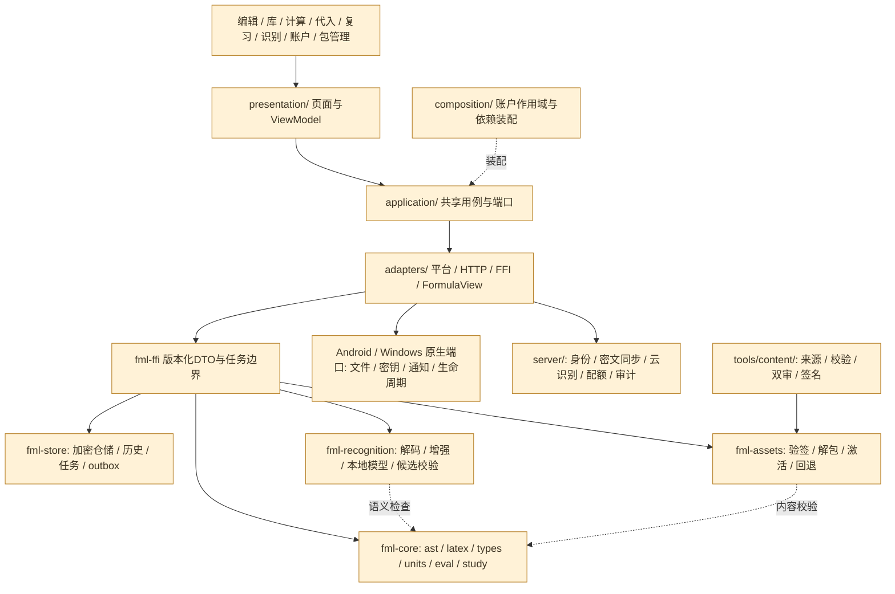
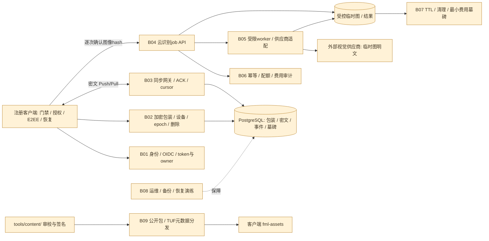

# 预计功能与代码模块映射（v3）

_审计日期：2026-10-18 · main 基线：d1a80e94b90a · 文档映射，不是实现交付_

## 1. 结论与阅读方式

**当前仓库没有 Flutter 应用、Rust 核心或服务端源码。下列所有产品模块都是规划，不能描述成“已有后端、只缺前端”。** 现有应用外代码是文档一致性检查；公式 JSON 是三条研究输入，而非可运行的生产课程库。

效力依据：[文档状态说明](<README.md#L9-L11>)、[v3 文档效力](<00-需求基线与文档效力-v3.md#L9-L13>)、[未来目录说明](<10-软件架构设计-v3.md#L66-L83>)。

覆盖现行矩阵 **R01–R31、H01–H02、A01–A04，共 37 项**；另拆出 **14 项平台/客户端细化职责**和 **9 组后台及后台配套职责**。D/B 编号仅为本报告导航，不新增需求，不等于物理目录。这里的 A 编号不是 09 复审缺陷编号。

完整离线可筛选图表：[打开 HTML 图表](<功能代码映射图.html>)；结构化源：[JSON 映射数据](<resources/feature-code-map.json>)；可复现生成器：[图表生成器](<../tools/generate-feature-map.py>)。

## 2. 功能—模块总览图

[矢量总览图](<diagrams/feature-module-map.svg>)。每行是职责对应关系，不表示每个功能必须联网。

### 2.1 分层调用关系（全部待实现）

页面不得绕过应用层直接访问数据库/HTTP；**仅 fml-core 绝对无 I/O**，其他基础设施按职责执行 I/O。成熟 FormulaView 渲染库接在适配器一侧，不由 Rust 自研排版。

## 3. 预计代码模块目录与职责

前 11 个目录由 v3 主设计明确提出；**这些目录当前均不存在**。平台、工程和实验 3 项只列逻辑职责，不编造 *.dart / *.rs / server 子目录。纯核心内部子模块名称不表示已拆成独立 crate。

| 标记 | 模块 | 预计目录（非现存） | 对应职责 | 当前状态 |
| --- | --- | --- | --- | --- |
| UI | Flutter 页面与 ViewModel | `apps/flutter/lib/presentation/` | 编辑器、公式库、计算/代入、复习、识别、历史、账户、包管理与设置页面 | 规划未落地 |
| APP | 共享用例与端口 | `apps/flutter/lib/application/` | Import/Edit/Review/Sync 编排；FormulaEngine/StudyEngine/FormulaStore/FormulaView/FormulaRecognizer/PackStore/ImageImport/SecureStore/Auth/Sync | 规划未落地 |
| ADAPTER | FFI/HTTP/模型/平台适配 | `apps/flutter/lib/adapters/` | 实现端口；本地/云识别适配、平台文件与密钥、身份和同步 HTTP | 规划未落地 |
| COMPOSE | 配置与账户作用域装配 | `apps/flutter/lib/composition/` | 启动依赖注入、账户切换、后台任务生命周期；不允许业务内全局找服务 | 规划未落地 |
| CORE | 纯领域核心 | `crates/fml-core/` | ast / latex / types / units / eval / study；派生关系检查与中文数学语义；无 HTTP/SQLite/文件/Flutter/JNI | 规划未落地 |
| STORE | 加密本地存储与恢复 | `crates/fml-store/` | SQLCipher、迁移、仓储、修订/复习、outbox/cursor/tombstone、历史/资产/cleanup_job | 规划未落地 |
| ASSETS | 统一资源包加载 | `crates/fml-assets/` | 清单、签名/hash、兼容/信任根、防攻击解包、原子激活、回退 | 规划未落地 |
| RECOG | 图像与识别本地服务 | `crates/fml-recognition/` | 受限解码/预处理、真实候选校验、本地 HMER 可选运行时适配；模型不随主包 | 规划未落地 |
| FFI | 跨语言 ABI 边界 | `crates/fml-ffi/` | DTO/schema、句柄/generation、缓冲所有权、submit/poll/cancel 任务边界、C ABI | 规划未落地 |
| SERVER | 模块化单体与识别 worker | `server/` | 账户绑定、同步、识别、配额、审计；PostgreSQL＋受控对象存储；托管 OIDC/身份框架 | 规划未落地 |
| CONTENT | 离线内容工具链 | `tools/content/` | 来源/许可、数据提取、规范化/去重、AST/量纲验证、双人审校、签名打包与清单 | 规划未落地 |
| PLATFORM | 双端/鸿蒙平台端口 | 未冻结物理目录／逻辑职责 | Android Keystore/SAF/Photo Picker/通知/生命周期；Windows DPAPI/ACL/IFileOpenDialog/DPI/单实例；鸿蒙仅预留 | 规划未落地 |
| QUALITY | 工程/性能/发布与运维 | 未冻结物理目录／逻辑职责 | 错误码/诊断/fixtures、故障注入、真机性能、CI、SemVer/锁工具链/SBOM/签名/恢复演练；具体目录未定 | 规划未落地 |
| EXP | YOLO 独立实验范围 | 未冻结物理目录／逻辑职责 | codex/exp-yolo-recognizer 分支；新增实现、权重与运行时依赖不得进入 main，非已交付识别能力 | 规划未落地 |

端口 / ABI 契约来源：[10:85–105](<10-软件架构设计-v3.md#L85-L105>)。submit/poll/cancel、句柄 generation、缓冲所有权、线程模型需先过 M0 原型；鸿蒙只预留 C ABI，不等于已适配完整客户端。

## 4. 全量需求—模块—验收追踪

状态里的“规范已有 / 样例已有 / 预案分支已有”只表示文档或研究工件存在，**没有任何一项可据此记为产品实现通过**。模块标记见上一节。里程碑是建议主要落点，不是已排工期或已完成阶段。

| 编号 / 预计功能 | 模块映射 | 接口面 / 里程碑 | 状态 | 实现边界 / 待做内容 | 验收引用 / 来源 |
| --- | --- | --- | --- | --- | --- |
| R01 Windows + Android | PLATFORM / UI / APP / ADAPTER / FFI / CORE | 双端客户端 / M0/M1/M5 | 未实现 | Windows 11 x64、Android API26+ arm64；相同核心与资源包。 | T-PLATFORM / T-FFI · [13:17–17](<13-需求追踪与验收-v3.md#L17>) |
| R02 鸿蒙接口预留 | FFI / CORE / PLATFORM | 接口预留 / M0 | 仅预留，未实现 | 只冻结平台无关 C ABI 与端口；HarmonyOS NAPI/HUKS 正式适配不在本期交付。 | T-HARMONY · [13:18–18](<13-需求追踪与验收-v3.md#L18>) |
| R03 轻量、低性能开销 | APP / CORE / RECOG / STORE / ASSETS / PLATFORM | 横切性能 / M0/M5 | 目标未实测 | 单活动图像任务、分页/LRU、按需模型；体积、P95、内存均是验收预算。 | T-PERF · [13:19–19](<13-需求追踪与验收-v3.md#L19>) |
| R04 强化背诵、参考不背单词流程 | UI / APP / CORE / STORE | 双端学习 / M1 | 未实现 | 回忆→揭示→四级评分→FSRS 排程；固定修订卡片、评分幂等、确定性重放。 | T-STUDY · [13:20–20](<13-需求追踪与验收-v3.md#L20>) |
| R05 手写公式识别 | UI / APP / RECOG / CORE / STORE | 端侧识别 / M2 | 未实现 | 墨迹板→本地 HMER 实际候选→人工校正；至少一个可用本地模型才算游客识别完成。 | T-OCR · [13:21–21](<13-需求追踪与验收-v3.md#L21>) |
| R06 预留轻量模型/LLM 识别 | APP / ADAPTER / RECOG / ASSETS / SERVER | 端侧＋服务端 / M0/M2/M3 | 未实现 | FormulaRecognizer capabilities/取消/版本；本地运行时二选一；云端逐次授权、不自动降级上传。 | T-PLUGIN / T-OCR / T-CLOUD · [13:22–22](<13-需求追踪与验收-v3.md#L22>) |
| R07 公式编辑器、ISO 字符和 LaTeX | UI / APP / ADAPTER / CORE / ASSETS | 双端编辑 / M0/M1 | 未实现 | Unicode/LaTeX 子集、模板、撤销重做、错误定位、FormulaView 与语义朗读；不承诺文本双射或任意 WYSIWYG。 | T-EDIT · [13:23–23](<13-需求追踪与验收-v3.md#L23>) |
| R08 公式库查看检索 | UI / APP / CORE / STORE / ASSETS | 双端公式库 / M1 | 未实现 | 名称/课程/标签/来源/量纲筛选；预置只读、用户修订、分页和跨账户缓存隔离。 | T-LIB · [13:24–24](<13-需求追踪与验收-v3.md#L24>) |
| R09 查看时变量赋值计算 | UI / APP / CORE / STORE | 端侧计算 / M1 | 未实现 | 详情赋值、单位换算、基础向量/函数求值；复杂 CAS/任意符号积分不在 V1。 | T-CALC · [13:25–25](<13-需求追踪与验收-v3.md#L25>) |
| R10 每式严格匹配量纲 | UI / APP / CORE / STORE | 端侧语义校验 / M0/M1 | 未实现 | SI 七维有理指数＋数学形状＋QuantityKind＋条件；Draft/Unresolved/Invalid/Verified 明确分离。 | T-DIM · [13:26–26](<13-需求追踪与验收-v3.md#L26>) |
| R11 录入时调整、后期自定义量纲 | UI / APP / CORE / STORE | 端侧单位管理 / M1 | 未实现 | 录入及后续编辑；命名空间/版本化、循环检查、温度点与温差、受影响修订重新校验。 | T-DIM / T-UNIT · [13:27–27](<13-需求追踪与验收-v3.md#L27>) |
| R12 同量纲部分作为变量代入 | UI / APP / CORE / STORE | 端侧推导 / M1 | 未实现 | 按 AST 子式选择与显式输出绑定；变量映射、alpha-renaming、条件/分支继承、无环与预算检查。 | T-SUB · [13:28–28](<13-需求追踪与验收-v3.md#L28>) |
| R13 同济高数到考研数学全部范围 | UI / APP / ASSETS / CORE / CONTENT | 内容工程＋客户端 / M4 | 未实现 | 高数＋线性代数＋概率统计；数一/数二/数三并集，教材版本和考试年份待冻结。 | T-CONTENT · [13:29–29](<13-需求追踪与验收-v3.md#L29>) |
| R14 大学物理 | UI / APP / ASSETS / CORE / CONTENT | 内容工程＋客户端 / M4 | 未实现 | 大学物理课程、适用条件、SI/符号约定；三条研究样例不构成课程库。 | T-CONTENT · [13:30–30](<13-需求追踪与验收-v3.md#L30>) |
| R15 高维护性、易读易排错、可靠注释 | APP / CORE / STORE / SERVER / FFI / QUALITY | 横切工程 / M0–M5 | 规范已有，应用待实现 | 统一错误码、公开契约注释、ADR、脱敏复现；已有文档检查不等于应用质量测试。 | T-MAINT · [13:31–31](<13-需求追踪与验收-v3.md#L31>) |
| R16 搜寻开源公式库并尝试获取 | CONTENT / ASSETS / CORE | 内容工程 / M4 | 研究样例已有，工具链未实现 | 已取得三条 Open_Physics 样例＋来源快照＋许可；摄入自动化、AST 编译、双审与生产打包未完成。 | T-SOURCE · [13:32–32](<13-需求追踪与验收-v3.md#L32>) |
| R17 YOLO 预案不写主分支 | EXP / RECOG / QUALITY | 独立实验分支 / 独立实验 | 预案分支已有，模型未实现 | codex/exp-yolo-recognizer 分支存在；本次未检出/审计其详细内容；main 无新增 YOLO 实现/权重/依赖。 | T-EXP · [13:33–33](<13-需求追踪与验收-v3.md#L33>) |
| R18 简洁可靠版本控制 | QUALITY / FFI / ASSETS / STORE / CONTENT | 横切发布 / M0/M5 | 规范已有，应用待实现 | SemVer/ABI/AST/DB/包/模型版本矩阵、tag、锁工具链、SBOM、签名与迁移恢复；无应用 CI。 | T-RELEASE · [13:34–34](<13-需求追踪与验收-v3.md#L34>) |
| R19 不登录不能用 | UI / APP / COMPOSE / ADAPTER / STORE / SERVER | 客户端＋身份服务 / M1/M3 | 未实现 | 无身份不进核心；游客身份有效；注册退出锁库，离线解锁与云认证分开。 | T-ACCOUNT · [13:35–35](<13-需求追踪与验收-v3.md#L35>) |
| R20 未注册可游客、临时本地账户 | UI / APP / COMPOSE / STORE / ADAPTER | 客户端本地账户 / M1 | 未实现 | 游客数据持续本地保留，退出不自动清除；与注册账户独立加密库/目录。 | T-ACCOUNT · [13:36–36](<13-需求追踪与验收-v3.md#L36>) |
| R21 游客不向云端提交内容 | APP / ADAPTER / COMPOSE / STORE / SERVER | 客户端＋网关门禁 / M1/M3 | 未实现 | 游客禁止上传公式/图片/偏好/诊断；主动下载公开包不附带学习数据；云识别网关拒绝游客。 | T-PRIVACY · [13:37–37](<13-需求追踪与验收-v3.md#L37>) |
| R22 本地保存、转注册后可同步 | UI / APP / ADAPTER / COMPOSE / STORE / SERVER | 端侧＋服务端 / M3 | 未实现 | upgrade journal 幂等升级/关联已有账户；独立同步授权、客户端 E2EE、outbox/ACK/游标原子提交。 | T-UPGRADE / T-KEY / T-SYNC · [13:38–38](<13-需求追踪与验收-v3.md#L38>) |
| R23 静态资源剥离、通用资源包加载 | APP / ADAPTER / ASSETS / STORE / CONTENT | 端侧＋资源发布 / M0/M1/M4 | 未实现 | bootstrap/课程/字体/模型通用包；验签后解包、TUF 元数据、防降级、原子激活与良好版本回退。 | T-PACK · [13:39–39](<13-需求追踪与验收-v3.md#L39>) |
| R24 照片手写公式识别并入统一识别 | UI / APP / ADAPTER / PLATFORM / RECOG / CORE / STORE | 双端照片识别 / M2 | 未实现 | 照片与墨迹共用输入资产/预览/识别/候选校验/入库管线，不仅接受笔画。 | T-OCR / T-IMAGE · [13:40–40](<13-需求追踪与验收-v3.md#L40>) |
| R25 去噪与图像增强 | UI / APP / RECOG | 端侧图像处理 / M2 | 未实现 | EXIF/降采样/裁剪、去噪、光照归一、透视校正、可选二值化；灰度/增强对照。 | T-IMAGE · [13:41–41](<13-需求追踪与验收-v3.md#L41>) |
| R26 识别后保留最近记录 | UI / APP / STORE / RECOG / ADAPTER | 本机后台清理 / M2 | 未实现 | 按开始序号统一终态历史；事务标记 DELETING＋独立 cleanup_job，幂等文件回收与启动对账。 | T-GC · [13:42–42](<13-需求追踪与验收-v3.md#L42>) |
| R27 保留范围 0–100、默认 5 | UI / APP / STORE | 本机设置/存储 / M2 | 未实现 | keep_last 整数 0–100、默认 5；UI/用例/数据库约束，无 Pin/Adopted 豁免。 | T-GC · [13:43–43](<13-需求追踪与验收-v3.md#L43>) |
| R28 历史含输入图片与结果 | UI / APP / STORE / RECOG | 本机历史资产 / M2 | 未实现 | 保存确认输入图、实际云提交图、候选/校正/诊断/版本；不进入私有同步，另存附件生命周期独立。 | T-GC / T-IMAGE · [13:44–44](<13-需求追踪与验收-v3.md#L44>) |
| R29 桌面文件管理器选照片 | UI / APP / ADAPTER / PLATFORM / RECOG | Windows 平台 / M2/M5 | 未实现 | IFileOpenDialog 必需；原文件只读、路径不拼 shell；拖拽/剪贴板为可选入口。 | T-PLATFORM · [13:45–45](<13-需求追踪与验收-v3.md#L45>) |
| R30 安卓文件管理器选照片 | UI / APP / ADAPTER / PLATFORM / RECOG | Android 平台 / M2/M5 | 未实现 | SAF ACTION_OPEN_DOCUMENT 必需，Photo Picker 可用；ContentResolver 复制受限私有副本并释放 URI 权限。 | T-PLATFORM · [13:46–46](<13-需求追踪与验收-v3.md#L46>) |
| R31 成熟可靠、无重大安全问题 | APP / CORE / STORE / RECOG / ASSETS / ADAPTER / SERVER / QUALITY | 全链路安全 / M0–M5 | 未实现，未安全验收 | 不可信输入、跨账户越权、AEAD/KDF、包安全、供应链、隐私/恢复演练；不宣称无漏洞。 | T-SECURITY / T-KEY / T-PACK · [13:47–47](<13-需求追踪与验收-v3.md#L47>) |
| H01 仓库记录的高中数学/物理内容 | UI / APP / ASSETS / CORE / CONTENT | 历史内容扩展 / M4 | 未实现 | 高中数学/物理独立分包；依据仓库历史记录，不冒充本次原文且不替代大学课程。 | T-CONTENT · [13:48–48](<13-需求追踪与验收-v3.md#L48>) |
| H02 仓库记录的首版云端 API LLM | UI / APP / ADAPTER / RECOG / CORE / STORE / SERVER | 端侧＋云后端 / M3 | 未实现 | 首版云端视觉模型经自有网关；逐次授权、作业幂等、UNKNOWN 不自动重复付费、临时图清理。 | T-CLOUD · [13:49–49](<13-需求追踪与验收-v3.md#L49>) |
| A01 未知量纲不冒充校验通过 | UI / APP / CORE / STORE | 必要架构约束 / M0/M1 | 未实现 | 未知量纲不能标 Verified；不能通过显示单位或经验标签绕过语义错误。 | T-DIM · [13:50–50](<13-需求追踪与验收-v3.md#L50>) |
| A02 不承诺闪存单项绝对擦除 | UI / APP / STORE / RECOG / ADAPTER / SERVER | 必要架构约束 / M2/M3 | 未实现 | GC 只承诺逻辑不可访问和受控副本尽力清理；不承诺闪存/备份/供应商副本绝对擦除。 | T-GC / T-PRIVACY · [13:51–51](<13-需求追踪与验收-v3.md#L51>) |
| A03 新设备可恢复且本机密钥不上云 | UI / APP / ADAPTER / STORE / SERVER | 必要架构约束 / M0/M3 | 未实现 | 本机库/历史密钥不上云；独立同步密语或恢复码均可解锁账户根密钥，新设备生成独立库密钥。 | T-KEY · [13:52–52](<13-需求追踪与验收-v3.md#L52>) |
| A04 实现前验证渲染/模型/密钥等风险 | UI / APP / FFI / CORE / RECOG / ASSETS / ADAPTER / QUALITY | 工程原型门槛 / M0 | 待原型验证 | 绑定/渲染/模型/密钥/GC/包攻击等先做真实原型；当前没有 Rust/Flutter/真机测试证据。 | T-PLUGIN / T-FFI / T-KEY · [13:53–53](<13-需求追踪与验收-v3.md#L53>) |

验收 ID 的详细场景与指标统一见 [现行需求追踪与验收](<13-需求追踪与验收-v3.md>)；T-* 为未来验收项，不是当前自动测试结果。

## 5. 平台与客户端细化映射（补齐不显眼的功能）

以下仍全部待实现。v3 来源为当前约束；列出的 v2 平台章节仅补充未冲突细节，不能将旧候选方案、可选功能或目标参数升级为冻结必需能力。

| 编号 / 子功能 | 关联需求 / 预计模块 | 待实现职责 | 当前边界 / 来源 |
| --- | --- | --- | --- |
| D01 Android 相册与文件管理器 | R24 / R30 UI / APP / ADAPTER / PLATFORM / RECOG | SAF ACTION_OPEN_DOCUMENT 必需；Photo Picker 可用。ContentResolver 有界流式复制到私有工作区，不在 Dart 解码全图；源文件只读。 | v3 必需入口；云盘来源访问不等于向应用云端上传。 [10:199–213](<10-软件架构设计-v3.md#L199-L213>) / [03:88–117](<03-Android端实现规范-v2.md#L88-L117>) |
| D02 Android 拍照与质量提示 | R24 / R25 UI / APP / ADAPTER / PLATFORM / RECOG | 拍照进入统一导入/裁剪/增强/确认流程；按需 CAMERA 权限、后台释放相机、拒绝可走 SAF；模糊/阴影/曝光提示。 | 平台细化参考；CameraX 或系统 Intent 待实现选型，不是冻结依赖。 [10:199–218](<10-软件架构设计-v3.md#L199-L218>) / [03:119–142](<03-Android端实现规范-v2.md#L119-L142>) / [03:71–86](<03-Android端实现规范-v2.md#L71-L86>) |
| D03 Windows 文件选择与可选入口 | R24 / R29 UI / APP / ADAPTER / PLATFORM / RECOG | IFileOpenDialog 为必需；有界读取、预览裁剪、临时文件清理且不删原图。拖拽、显式剪贴板、扫描增强单列可选，不常驻监视剪贴板。 | v3 降低了 v2 对拖拽/剪贴板的强制程度。 [10:201–213](<10-软件架构设计-v3.md#L201-L213>) / [04:72–119](<04-Windows桌面端实现规范-v2.md#L72-L119>) |
| D04 双端墨迹板、触控笔与规范图 | R05 / R24 UI / APP / ADAPTER / PLATFORM / RECOG / STORE | 两端均提供墨迹板；归一化笔画或受限本地位图进入同一 FormulaRecognizer。平台采样、重采样、压力/防误触与草稿恢复需实现。 | v3 明确双端墨迹；旧采样率参数是参考目标，不是已实测。 [10:199–228](<10-软件架构设计-v3.md#L199-L228>) / [03:186–204](<03-Android端实现规范-v2.md#L186-L204>) |
| D05 编辑、渲染、快捷键与无障碍 | R07 / R08 UI / APP / ADAPTER / CORE / ASSETS / PLATFORM | Unicode/LaTeX 源码、模板、符号面板、撤销重做、IME、错误定位；FormulaView 成熟库渲染；AST 中文语义朗读与可访问标签。 | 不自研字形布局，不承诺任意 WYSIWYG 或精确 DisplayList 命中。桌面快捷键/DPI 与触屏布局需落地。 [10:181–195](<10-软件架构设计-v3.md#L181-L195>) / [03:206–216](<03-Android端实现规范-v2.md#L206-L216>) / [04:161–207](<04-Windows桌面端实现规范-v2.md#L161-L207>) |
| D06 草稿、复习、任务与进程恢复 | R01 / R04 / R05 / R15 / H02 APP / COMPOSE / STORE / FFI / ADAPTER / PLATFORM | 编辑草稿 500ms 防抖、评分立即事务；导入队列/墨迹与 job_id 可恢复；重启先账户作用域和 GC，再查询云任务，不自动重新付费；无常驻服务。 | worker 执行解码/推理/迁移；取消确认并释放后才销毁句柄。Windows 单实例写库。 [10:278–285](<10-软件架构设计-v3.md#L278-L285>) / [10:99–105](<10-软件架构设计-v3.md#L99-L105>) / [03:173–184](<03-Android端实现规范-v2.md#L173-L184>) |
| D07 本地提醒与权限自检 | R01 / R04 UI / APP / ADAPTER / PLATFORM / STORE | 本地学习提醒不泄露公式；通知拒绝不阻断学习。平台通知调度与设置自检待实现，不以精确闹钟或后台常驻为前提。 | v3 当前最低约束；v2 自启/厂商表/Toast 为参考增强，不自动视为首版必须。 [10:278–280](<10-软件架构设计-v3.md#L278-L280>) / [04:209–219](<04-Windows桌面端实现规范-v2.md#L209-L219>) / [03:218–232](<03-Android端实现规范-v2.md#L218-L232>) |
| D08 私有存储、系统密钥和备份排除 | R19–R22 / R31 / A03 APP / COMPOSE / STORE / ADAPTER / PLATFORM | 每账户加密库、目录与私有 ACL；Android Keystore/noBackup，并排除敏感系统备份及 D2D；Windows 使用当前用户 DPAPI，历史不放漫游目录，不能保证排除用户控制的系统/第三方备份；DPAPI 不等于 Hello。 | 本机生物解锁不替代账户恢复，本机库/历史密钥不上传。 [10:276–277](<10-软件架构设计-v3.md#L276-L277>) / [04:121–159](<04-Windows桌面端实现规范-v2.md#L121-L159>) / [11:55–75](<11-数据安全同步与识别生命周期-v3.md#L55-L75>) / [03:144–171](<03-Android端实现规范-v2.md#L144-L171>) |
| D09 游客升级、恢复、导出及删除 | R20 / R22 / A03 / R31 UI / APP / COMPOSE / STORE / ADAPTER / SERVER | 升级 journal 可重入、已有账户根密钥不覆盖；另行授权开启同步。密语/恢复码并列包装；新设备生成独立本机库密钥。默认加密导出仅公式/复习/单位，不带识别历史和工作图。 | 登录密码不等于同步密语；没有恢复凭据无法恢复。账户删除期限为设计目标，离线设备副本不能远程抹除。 [11:55–102](<11-数据安全同步与识别生命周期-v3.md#L55-L102>) / [11:130–134](<11-数据安全同步与识别生命周期-v3.md#L130-L134>) |
| D10 Android 原生构建和渠道分发 | R01 / R03 / R18 / R31 UI / FFI / ADAPTER / PLATFORM / QUALITY | Android API26+ arm64；AAB/APK 原生库、NDK/页大小、R8 后 FFI、SQLCipher/推理库兼容需渠道验收；模型通过包安装，不塞主包。 | Gradle/Cargo 接法、库名及签名发布 CI 都未落地，编译成功不是完整验收。 [10:272–283](<10-软件架构设计-v3.md#L272-L283>) / [03:50–69](<03-Android端实现规范-v2.md#L50-L69>) |
| D11 Windows 安装、应用升级和卸载 | R01 / R18 / R31 APP / STORE / ASSETS / ADAPTER / PLATFORM / QUALITY | Win11 x64 主基线；每用户签名安装器、DLL 绝对安全加载、不覆盖已加载 DLL。升级前备份并迁移、失败可恢复，卸载提供保留/导出/删除选择。 | Win10 22H2 仅在适用维护条件下另测；安装器工具候选和可选自启/MSIX 尚未冻结。 [10:274–285](<10-软件架构设计-v3.md#L274-L285>) / [04:221–232](<04-Windows桌面端实现规范-v2.md#L221-L232>) / [04:47–70](<04-Windows桌面端实现规范-v2.md#L47-L70>) |
| D12 资源在线/离线安装和回滚 | R13 / R14 / R16 / R23 / H01 UI / APP / ADAPTER / ASSETS / STORE / CONTENT / QUALITY | bootstrap 离线启动；课程/模型/字体统一清单、签名/hash/兼容/来源；先验签后解包，版本只读目录和 active.json 原子激活，Windows 占用延后清理。 | TUF 角色、信任根轮换和 security epoch 受控回退均待实现；包通用不等于 native 二进制通用。 [12:9–67](<12-资源包内容与开源资源调查-v3.md#L9-L67>) / [03:257–261](<03-Android端实现规范-v2.md#L257-L261>) |
| D13 云识别预览、授权和恢复 | R06 / R21 / H02 / R31 UI / APP / ADAPTER / STORE / RECOG / CORE / SERVER | 逐次确认实际 image hash/模型/供应商/政策版本；游客禁用；供应商 key 不落端。持久化 job_id，启动先查询，UNKNOWN 不自动重付费；云推理明文不属于同步 E2EE。 | 网关与受限 worker 详见 B04–B07；客户端仍需解析/量纲校验与人工确认。 [11:173–201](<11-数据安全同步与识别生命周期-v3.md#L173-L201>) / [03:234–255](<03-Android端实现规范-v2.md#L234-L255>) |
| D14 识别历史、保留设置和独立附件 | R26–R28 / A02 UI / APP / STORE / RECOG / ADAPTER / PLATFORM | 按识别开始序号保留最近 N 次全部终态，N=0–100 默认5，无固定项豁免。DB 标记 DELETING/cleanup_job 后异步幂等删受控文件，重启对账；显式附件生命周期独立。 | N=0 终态只内存展示但在途需要 staging；不删用户原图，不宣称闪存绝对擦除，不把本机 N 当云 TTL。 [11:136–169](<11-数据安全同步与识别生命周期-v3.md#L136-L169>) / [04:264–270](<04-Windows桌面端实现规范-v2.md#L264-L270>) |

## 6. 后台专属与后台配套映射（全部未实现）

这部分即使没有独立页面，也不能从功能映射中漏掉。B01–B08 位于预计 server/ 的逻辑模块及其运维支撑；B09 是离线发布工具链和公开分发配套，并不表示要再建一个私有微服务。

[后台矢量图](<diagrams/backend-module-map.svg>)

| 职责编号 / 能力 | 关联需求 / 模块 | 数据流 | 必须实现的契约 | 验收 / 来源 |
| --- | --- | --- | --- | --- |
| B01 身份验证与账户绑定 | R19–R22 / R31 SERVER / ADAPTER / APP | 客户端 Auth → 单体身份/绑定模块 → OIDC | 成熟 OIDC/身份框架；原生授权码＋PKCE；issuer/audience/expiry/账户状态；owner 来自 token | T-ACCOUNT / T-UPGRADE / T-SECURITY · [10:262–266](<10-软件架构设计-v3.md#L262-L266>) |
| B02 密钥包装、设备与账户删除 | R22 / R31 / A03 SERVER / APP / STORE | 客户端密钥恢复/删除用例 → 单体账户模块 → PostgreSQL | 服务端仅保存账户根密钥包装/参数；版本撤销、新 epoch、生产删除与备份删除清单；原始恢复码和本机密钥不上云 | T-KEY / T-SYNC / T-PRIVACY · [11:55–75](<11-数据安全同步与识别生命周期-v3.md#L55-L75>) / [11:119–134](<11-数据安全同步与识别生命周期-v3.md#L119-L134>) |
| B03 E2EE 同步网关 | R22 / R31 SERVER / STORE / APP / ADAPTER | 客户端加密 outbox ⇄ 单体同步模块 ⇄ PostgreSQL 密文事件 | Push/Pull 契约（HTTP 路由未冻结）；(account_epoch,op_id) 去重、server_seq、opaque cursor、ACK、墓碑与旧 epoch 拒绝；内容不解密 | T-SYNC / T-KEY / T-PRIVACY · [11:104–134](<11-数据安全同步与识别生命周期-v3.md#L104-L134>) |
| B04 云识别任务 API | H02 / R06 / R21 / R31 SERVER / ADAPTER / APP | 注册且逐次授权 → 识别网关 → 持久化任务 | POST /v1/recognition/jobs；GET /v1/recognition/jobs/{job_id}；POST /v1/recognition/jobs/{job_id}/cancel；校验 owner/授权/图像预算 | T-CLOUD / T-SECURITY / T-PRIVACY · [11:173–187](<11-数据安全同步与识别生命周期-v3.md#L173-L187>) |
| B05 识别 worker 与供应商适配 | H02 / R06 / R31 SERVER / RECOG / CORE / UI / APP | 持久化任务 → worker → 视觉供应商 → 候选结果 | 受限并发独立 worker；端点白名单、仅服务端供应商密钥、响应/候选结构预算；SUBMITTING/RUNNING/UNKNOWN。端侧 RECOG/CORE 做语义和量纲校验，UI/APP 编排人工校正与确认。 | T-CLOUD / T-PLUGIN / T-SECURITY · [11:187–195](<11-数据安全同步与识别生命周期-v3.md#L187-L195>) / [10:60–83](<10-软件架构设计-v3.md#L60-L83>) / [10:230–234](<10-软件架构设计-v3.md#L230-L234>) |
| B06 幂等、配额、计费与审计 | H02 / R31 SERVER | 网关事务 → 任务＋配额 → worker 结算/对账 | (account_id,idempotency_key) 唯一；同键换图409，同键同图既有任务；预留/结算/UNKNOWN 对账；禁止不确定状态自动再次付费 | T-CLOUD / T-SECURITY · [11:189–199](<11-数据安全同步与识别生命周期-v3.md#L189-L199>) |
| B07 服务端临时图与结果 GC | H02 / R28 / R31 / A02 SERVER / QUALITY | 受控对象存储 → TTL 清理/结果过期 → 最小状态墓碑 | 完成/失败/取消目标≤60s清图；崩溃 TTL≤1h；结果/幂等状态≤24h；最小费用 tombstone 初始30天；日志/APM/备份禁正文 | T-CLOUD / T-PRIVACY / T-SECURITY · [11:197–201](<11-数据安全同步与识别生命周期-v3.md#L197-L201>) |
| B08 服务运维、安全与备份恢复 | R03 / R15 / R18 / R31 SERVER / QUALITY | 单体 API＋worker → PostgreSQL/对象存储 → 加密备份与恢复演练 | TLS、参数化查询、限流/容量/成本配额、依赖扫描；备份恢复目标及删除清单重放；不增加微服务网格 | T-SECURITY / T-RELEASE / T-PERF · [10:262–268](<10-软件架构设计-v3.md#L262-L268>) |
| B09 公开资源签名发布与分发 | R13 / R14 / R16 / R23 / H01 CONTENT / ASSETS / QUALITY | tools/content/ → 审校/签名发布 → 公开包分发 → fml-assets | 离线内容工具生成 provenance/许可清单和签名包；在线 TUF root/targets/snapshot/timestamp；公开内容/模型分发不等于用户同步 | T-PACK / T-SOURCE / T-CONTENT · [12:24–67](<12-资源包内容与开源资源调查-v3.md#L24-L67>) |

### 6.1 已设计但尚未实现的云识别路由

| 方法 | 路由 | 职责 |
| --- | --- | --- |
| POST | `/v1/recognition/jobs` | 创建作业；校验账户/按次授权/image hash/幂等与配额 |
| GET | `/v1/recognition/jobs/{job_id}` | 查询既有作业；重启先查询，不自动重复提交 |
| POST | `/v1/recognition/jobs/{job_id}/cancel` | 取消请求；不保证供应商未执行/未计费 |

同步仅冻结 Push/Pull 语义，未冻结 HTTP URI；本报告不发明同步、登录、包发布或账户删除的路由。云识别图像会发给供应商：**同步 E2EE 不覆盖云推理明文**。

### 6.2 不能混淆的三个数据生命周期

| 边界 | 设计保留策略 | 不代表什么 |
| --- | --- | --- |
| 本机识别历史 | keep_last 整数 0–100，默认5；按开始序号留全部终态；N=0 终态只在内存展示 | 不等于服务端或供应商立即删除 |
| 自有云识别网关 | 终态清图目标≤60s、崩溃TTL≤1h、结果≤24h；最小费用墓碑初始30天 | 均为待验收目标；不是绝对擦除 |
| 外部供应商 | 政策与保留期限待核实、在按次授权中披露 | 不能由本机N或自有网关TTL代替上游保证 |

## 7. 现有工件与实现缺口

| 现存文件 | 已经有什么 | 还不是什么 |
| --- | --- | --- |
| [文档一致性检查脚本](<../tools/verify-sadd.mjs>) | 现存文档工具 | 可执行现有工具；校验链接/围栏/标题/Mermaid无障碍字段/来源许可/需求测试引用；不是应用后端。 |
| [三条物理公式研究样例](<resources/open-physics-samples.json>) | 现存研究／来源工件 | 仅研究输入，尚未 AST 编译/双人审校/发布课程包；不是完整公式库。 |
| [固定来源快照与 hash](<resources/source-capture.json>) | 现存研究／来源工件 | 来源 revision、文件行、hash 与样例对应；不是资源下载/更新运行时。 |
| [Open_Physics 原始许可](<licenses/Open_Physics-BSD-3-Clause.txt>) | 现存研究／来源工件 | 所选来源的版权与许可；不代表本项目或其他模型/字体已获同一许可。 |

新增本报告、HTML、SVG/PNG、JSON 和生成器只完成**文档可视化与追踪交付**，不改变应用/服务端“未实现”的状态。没有新增 Flutter/Rust/服务 API、模型权重、数据库或生产资源包。

## 8. 历史设计冲突与范围边界

| 主题 | 历史 v2 输入 | 本图采用的 v3 方案 | 来源 |
| --- | --- | --- | --- |
| 代码目录与 I/O | v2 多个 fml-* crate 与 platform/* 树 | v3 先按五个 Rust crate＋四个 Flutter 层规划；仅 fml-core 绝对无 I/O。 | [10:66–105](<10-软件架构设计-v3.md#L66-L105>) |
| 公式渲染 | 自研 typeset/DisplayList/精确命中 | FormulaView＋成熟渲染库；文本和模板编辑为首版边界。 | [10:181–189](<10-软件架构设计-v3.md#L181-L189>) |
| 历史回收 | Pinned/Adopted 免计数、只清 Normal | 全部终态严格最近 N；附件另存；数据库与文件使用可恢复两阶段清理。 | [11:136–169](<11-数据安全同步与识别生命周期-v3.md#L136-L169>) |
| 量纲和代入 | Unknown 用于约束求解，未明确持久校验状态；跨 QuantityKind 为软警告＋用户确认，缺显式关系及条件验证 | Unknown 不可 Verified；数学类型/语义角色/条件和显式变量绑定必须同时检查。 | [10:132–177](<10-软件架构设计-v3.md#L132-L177>) / [02:219–240](<02-软件架构设计-v2.md#L219-L240>) / [02:306–324](<02-软件架构设计-v2.md#L306-L324>) / [06:60–69](<06-测试与验收标准-v2.md#L60-L69>) |
| 账户密钥和升级 | 登录凭据派生、包装本机库密钥上传、默认全量同步 | 随机账户根密钥；独立密语/恢复码包装；本机密钥不上云；升级后再询问同步。 | [11:24–102](<11-数据安全同步与识别生命周期-v3.md#L24-L102>) |
| 识别与云作业 | 本地纯可选、简化四态和删除保证 | 游客识别验收必须有可用本地 HMER；云 UNKNOWN/幂等/费用/TTL 独立契约。 | [10:220–234](<10-软件架构设计-v3.md#L220-L234>) / [11:171–201](<11-数据安全同步与识别生命周期-v3.md#L171-L201>) |
| 平台与可选入口 | Win10 1809+、拖拽/剪贴板强制 | Win11 主基线、Win10 22H2 条件测试；文件对话框必需，拖拽/剪贴板可选。 | [10:201–203](<10-软件架构设计-v3.md#L201-L203>) / [10:270–285](<10-软件架构设计-v3.md#L270-L285>) |
| 需求、预案和里程碑 | 历史 R01–R41、M0–M7、YOLO 简版分支名 | 以 v3 的 37 条需求和 M0–M5 为准；YOLO 新详细预案仅 codex/exp-yolo-recognizer，未审计分支内容。 | [13:13–53](<13-需求追踪与验收-v3.md#L13-L53>) / [10:295–310](<10-软件架构设计-v3.md#L295-L310>) |

- 全部产品应用模块尚未落地；不能标记为‘已实现仅缺前端’。原有脚本用于文档检查，本次新增生成器也仅用于文档图表。
- 本文 A01–A04 专指 13 的需求架构约束，不等于 09 复审缺陷的 A01–A17。
- 文档明确的未来目录按原名保留；后端 B01–B09 为职责映射编号，不是新增需求 ID 或既存物理目录。
- v3 优先于历史 v2：不采用 v2 自研排版前置、Pin/Adopted 免计数、上传本机库密钥及默认全量同步等旧设计。v3 另明确 Unknown 不可 Verified，并强化显式关系/条件验证。供应商密钥始终仅服务端保存，不是 v2 新旧差异。
- 本地识别模型/权重/数据许可与质量待选型；云供应商/保留政策待核实，游客不自动切云。
- 复杂 CAS、任意符号积分、完整鸿蒙客户端、社区功能均不默认为 V1 交付；YOLO 仅实验预案。

## 9. 预计落地顺序（非完成状态）

| 阶段 | 主要目标 | 实现内容 | 重点需求 |
| --- | --- | --- | --- |
| M0 | 风险原型 | FFI/解析/量纲/渲染、本地模型、密钥与资源包；先冻结依赖与验收语料 | A04 / R02 / R03 / R06 / R07 / R10 / R23 / A03 |
| M1 | 本地业务闭环 | 双端编辑、库、计算、代入、复习、bootstrap、游客账户；全离线可用 | R01 / R04 / R07–R12 / R19–R21 |
| M2 | 识别与回收闭环 | 墨迹/照片、真实本地模型、增强、候选校正、严格 N 与崩溃恢复 | R05 / R24–R30 / A02 |
| M3 | 账户与云服务 | 游客升级/密钥恢复、E2EE 同步、云识别及后台安全/幂等/费用/清理 | R22 / R31 / H02 / A03 |
| M4 | 内容与签名发布 | 大学四模块＋历史高中、许可/来源/章节冻结、逐式校验、双审 | R13 / R14 / R16 / R23 / H01 |
| M5 | 双端发布验收 | 性能/隐私/安全/签名/依赖/迁移/恢复；未执行项不得标通过 | R01 / R03 / R15 / R18 / R31 |

本地识别引擎、权重/训练数据许可、渲染依赖、Argon2id/SQLCipher 集成、课程教材版本/考试年份和云供应商政策仍需按设计冻结；没有实测不填性能/质量“通过”。里程碑依据 [10:295–310](<10-软件架构设计-v3.md#L295-L310>)。

## 10. 检查范围与复现

生成器检查：37 项需求 ID 与现行矩阵一一对应、模块引用合法、12 组总览覆盖全部需求、文档来源存在及行范围有效、未来模块目录未落地；同时检查 SVG XML、PNG 结构与显式文本单元格溢出。

运行 `python tools/generate-feature-map.py` 重建文档图表，运行 `node tools/verify-sadd.mjs` 做既有文档一致性检查。需 Python＋Pillow＋Microsoft YaHei 字体；不下载库或联网。

这些检查不验证应用行为、数学推导、安全保证、性能、模型效果或所有浏览器渲染。本次另对生成的 PNG 进行视觉查看；不声称已渲染 Mermaid 或已验证在线 GUI 浏览器。

内容来源以工作区 v3 文档为主，历史平台文件作补充。仅确认 YOLO 预案分支存在；未切换、未审计该分支详细内容。
