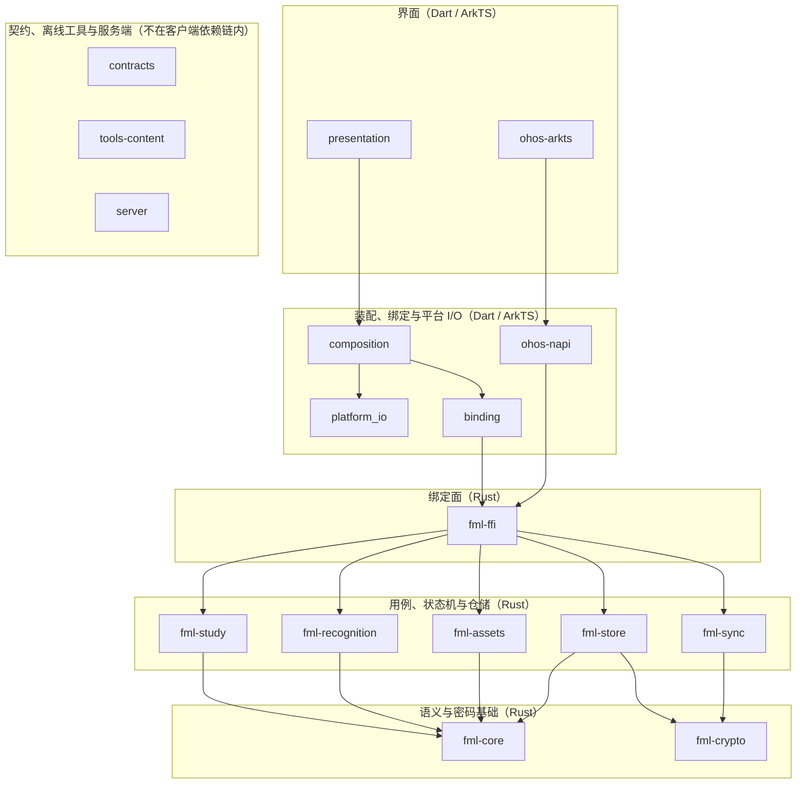
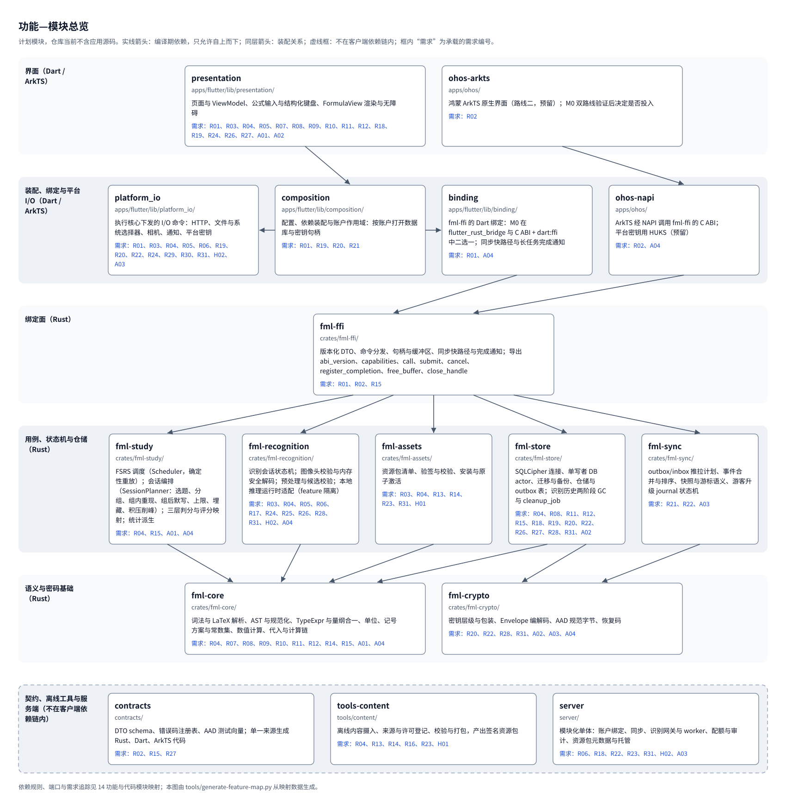
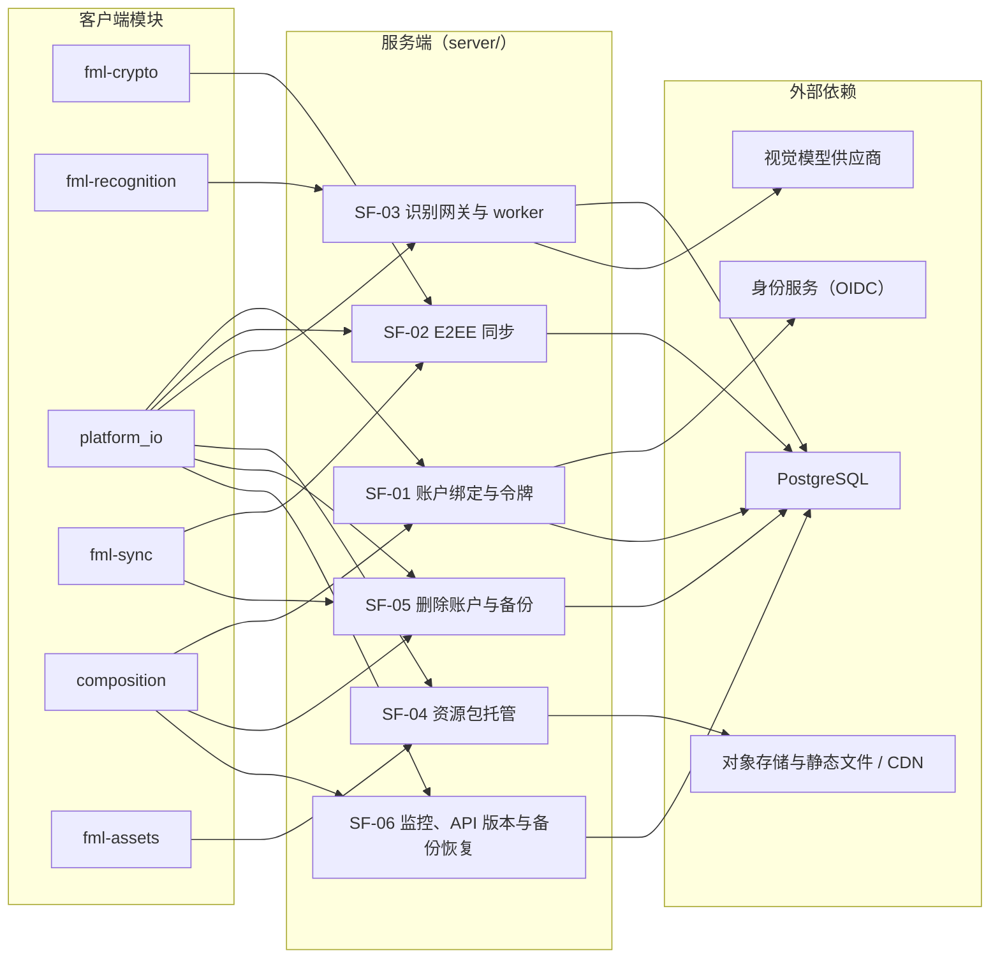
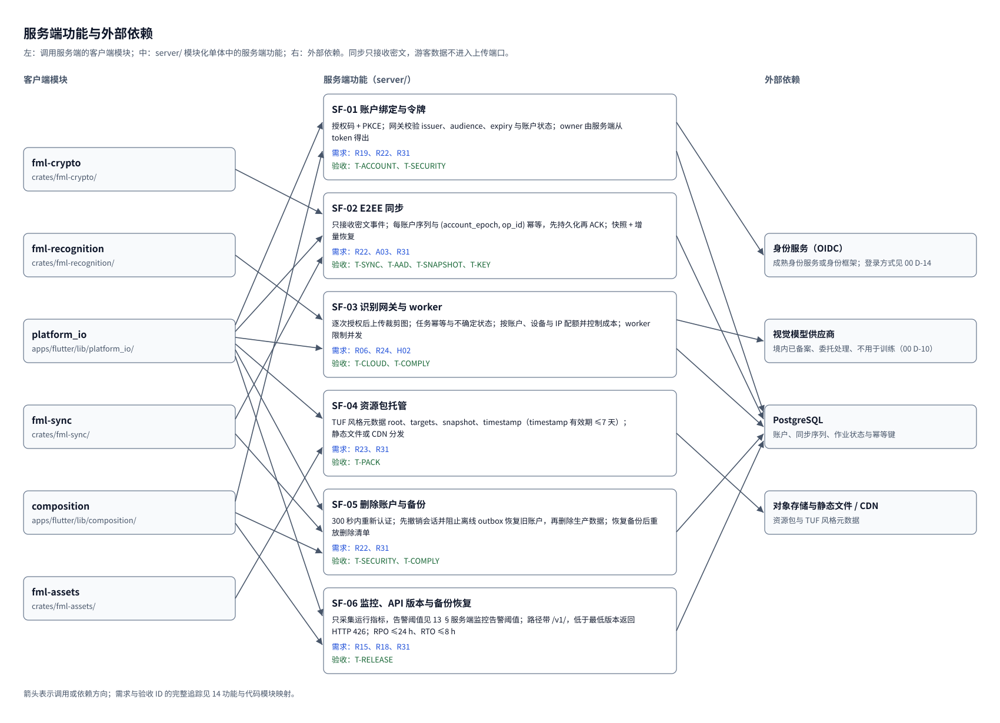

# 14 功能与代码模块映射 v4.0

_BubeiGongshi · 2026-10-18 · 需求到计划代码模块、端口、实体与验收 ID 的映射，由 13、10 与映射数据生成_

---

## 📋 用途与生成方式

- 本文说明每条需求由哪些计划模块、端口和实体承载、以哪些验收 ID 证明，并给出客户端功能面、服务端功能与里程碑落地顺序。
- 需求原文、设计定位与验收 ID 取自 13 §原始需求追踪、§R04 功能近似子项 与 §验收 ID 总表与里程碑；模块划分、依赖方向与端口以 10 §分层与职责归属、§推荐技术栈与初始模块、§端口契约 为准。本文与 13、10 不一致时以 13、10 为准，修改映射数据后重新生成。
- 目录树中的路径都是未来实现规划；仓库当前只有架构文档与工具，不含应用源码。
- 本文、[功能代码映射图.html](功能代码映射图.html)、[diagrams/feature-module-map.svg](diagrams/feature-module-map.svg)、[diagrams/backend-module-map.svg](diagrams/backend-module-map.svg) 以及 [resources/feature-code-map.json](resources/feature-code-map.json) 的 derived 部分由 `tools/generate-feature-map.py` 生成，不要手改；映射关系只在该 JSON 的 mapping 部分维护。
- 编号：R01–R31、H01–H02、A01–A04 与 R04.a–R04.j 同 13，其中 A 编号是验收约束，与 09 的复审缺陷编号 RV-01–RV-17 无关；CF-01–CF-13 是客户端功能面，SF-01–SF-06 是服务端功能，只在本文与映射图中使用；D 编号是 00 §待决事项与默认策略 中的待决事项，ADR 编号是 09 §架构决策（ADR） 中的决策。

| 文档 | 本文使用的内容 |
| --- | --- |
| [00 需求基线与文档效力 v4.0](00-需求基线与文档效力-v4.md) | 功能近似条款（R04 子项）、待决事项与默认策略（D 编号） |
| [09 架构决策与评审记录 v4.0](09-架构决策与评审记录-v4.md) | 架构决策（ADR 编号）；复审缺陷 RV 编号与本文的 A 编号无关 |
| [10 软件架构设计 v4.0](10-软件架构设计-v4.md) | 模块与目录、依赖规则、端口、实体、平台差异、服务端部署与里程碑 |
| [11 数据安全、同步与识别生命周期 v4.0](11-数据安全同步与识别生命周期-v4.md) | 账户与密钥、同步合并规则、识别历史保留与云识别 |
| [12 资源包、课程内容与开源资源调查 v4.0](12-资源包内容与开源资源调查-v4.md) | 资源包格式、签名与激活、课程内容生产 |
| [13 需求追踪、验证与交付门槛 v4.0](13-需求追踪与验收-v4.md) | 需求、R04 子项、验收 ID 与最早门槛（本文唯一的需求来源） |

## 🗺️ 功能—模块总览

计划模块分为 6 层。实线箭头是编译期依赖，只允许自上而下；同层箭头是同一层内的装配关系；虚线框中的模块不在客户端依赖链内。框内“需求”由需求映射反查得到。

## 🧱 代码模块与职责

目录与职责同 10 §推荐技术栈与初始模块、§分层与职责归属。Rust crate 不直接做 I/O：网络、文件选择、通知与平台密钥由 platform_io 执行核心下发的命令（09 ADR-009）。“承载需求”由需求映射反查得到。

| 模块 | 层 | 计划路径 | 职责 | I/O 规则 | 直接依赖 | 承载需求 | 设计定位 |
| --- | --- | --- | --- | --- | --- | --- | --- |
| presentation | 界面 | `apps/flutter/lib/presentation/` | 页面与 ViewModel、公式输入与结构化键盘、FormulaView 渲染与无障碍 | 不直接访问数据库或 HTTP，只调用装配好的用例接口 | composition | R01、R03、R04、R05、R07、R08、R09、R10、R11、R12、R18、R19、R24、R26、R27、A01、A02 | 10 §推荐技术栈与初始模块、§渲染与编辑取舍；09 ADR-002 |
| ohos-arkts | 界面 | `apps/ohos/` | 鸿蒙 ArkTS 原生界面（路线二，预留）；M0 双路线验证后决定是否投入 | 约束同 presentation | ohos-napi | R02 | 10 §鸿蒙验证路线；09 ADR-013；00 D-04 |
| platform_io | 装配与平台 | `apps/flutter/lib/platform_io/` | 执行核心下发的 I/O 命令：HTTP、文件与系统选择器、相机、通知、平台密钥 | 不含业务规则；结果经绑定回传核心 | — | R01、R03、R04、R05、R06、R19、R20、R22、R24、R29、R30、R31、H02、A03 | 10 §推荐技术栈与初始模块、§端口契约、§平台实现与生命周期 |
| composition | 装配与平台 | `apps/flutter/lib/composition/` | 配置、依赖装配与账户作用域：按账户打开数据库与密钥句柄 | 不含业务规则 | platform_io、binding | R01、R19、R20、R21 | 10 §推荐技术栈与初始模块；11 §账户与本地访问状态 |
| binding | 装配与平台 | `apps/flutter/lib/binding/` | fml-ffi 的 Dart 绑定：M0 在 flutter_rust_bridge 与 C ABI + dart:ffi 中二选一；同步快路径与长任务完成通知 | 只做编解码与回调分发 | fml-ffi | R01、A04 | 10 §单一绑定面与线程；09 ADR-010 |
| ohos-napi | 装配与平台 | `apps/ohos/` | ArkTS 经 NAPI 调用 fml-ffi 的 C ABI；平台密钥用 HUKS（预留） | 只做编解码与回调分发 | fml-ffi | R02、A04 | 10 §鸿蒙验证路线；09 ADR-013 |
| fml-ffi | 绑定面 | `crates/fml-ffi/` | 版本化 DTO、命令分发、句柄与缓冲区、同步快路径与完成通知；导出 abi_version、capabilities、call、submit、cancel、register_completion、free_buffer、close_handle | 不含业务规则 | fml-study、fml-recognition、fml-assets、fml-store、fml-sync | R01、R02、R15 | 10 §分层与职责归属、§单一绑定面与线程 |
| fml-study | 用例与仓储 | `crates/fml-study/` | FSRS 调度（Scheduler，确定性重放）；会话编排（SessionPlanner：选题、分组、组内重现、组后默写、上限、埋藏、积压削峰）；三层判分与评分映射；统计派生 | 纯函数；时间、随机种子与参数版本显式传入 | fml-core | R04、R15、A01、A04 | 10 §分层与职责归属、§学习域模型；09 ADR-008 |
| fml-recognition | 用例与仓储 | `crates/fml-recognition/` | 识别会话状态机；图像头校验与内存安全解码；预处理与候选校验；本地推理运行时适配（feature 隔离） | 推理适配只读已安装的模型文件 | fml-core | R03、R04、R05、R06、R17、R24、R25、R26、R28、R31、H02、A04 | 10 §分层与职责归属、§识别后端；09 ADR-007 |
| fml-assets | 用例与仓储 | `crates/fml-assets/` | 资源包清单、验签与校验、安装与原子激活 | 只写资源目录；先验证后解包 | fml-core | R03、R04、R13、R14、R23、R31、H01 | 10 §分层与职责归属、§静态资源；12 §清单、签名与激活 |
| fml-store | 用例与仓储 | `crates/fml-store/` | SQLCipher 连接、单写者 DB actor、迁移与备份、仓储与 outbox 表；识别历史两阶段 GC 与 cleanup_job | 唯一持有数据库与私有资产目录写权限 | fml-core、fml-crypto | R04、R08、R11、R12、R15、R18、R19、R20、R22、R26、R27、R28、R31、A02 | 10 §分层与职责归属、§本地数据模型；11 §文件与数据库不能伪装成一个事务 |
| fml-sync | 用例与仓储 | `crates/fml-sync/` | outbox/inbox 推拉计划、事件合并与排序、快照与游标语义、游客升级 journal 状态机 | 无 I/O，输出待发请求与待写事务命令 | fml-crypto | R21、R22、A03 | 10 §分层与职责归属；11 §同步协议、§游客升级事务 |
| fml-core | 基础 | `crates/fml-core/` | 词法与 LaTeX 解析、AST 与规范化、TypeExpr 与量纲合一、单位、记号方案与常数集、数值计算、代入与计算链 | 纯函数；不依赖 HTTP、SQLite、文件、Flutter、JNI、NAPI | — | R04、R07、R08、R09、R10、R11、R12、R14、R15、A01、A04 | 10 §分层与职责归属、§公式、量纲和计算模型；09 ADR-011 |
| fml-crypto | 基础 | `crates/fml-crypto/` | 密钥层级与包装、Envelope 编解码、AAD 规范字节、恢复码 | 无 I/O；平台密钥包装经端口回调，原语使用经过审计的实现 | — | R20、R22、R28、R31、A02、A03、A04 | 10 §分层与职责归属；11 §密钥层次；09 ADR-012 |
| contracts | 链外 | `contracts/` | DTO schema、错误码注册表、AAD 测试向量；单一来源生成 Rust、Dart、ArkTS 代码 | 只含契约与测试向量 | — | R02、R15、R27 | 10 §推荐技术栈与初始模块、§错误码与可维护性度量 |
| tools-content | 链外 | `tools/content/` | 离线内容摄入、来源与许可登记、校验与打包，产出签名资源包 | 离线运行，不随应用发布 | — | R04、R13、R14、R16、R23、H01 | 10 §推荐技术栈与初始模块；12 §摄入与审校 |
| server | 链外 | `server/` | 模块化单体：账户绑定、同步、识别网关与 worker、配额与审计、资源包元数据与托管 | 由 token 得到 owner；同步只接收密文 | — | R06、R18、R22、R23、R31、H02、A03 | 10 §服务端最小部署；09 ADR-003 |

### 依赖约束

- fml-core 不依赖任何其他模块（含传递依赖）。
- fml-study、fml-sync、fml-crypto 不依赖 fml-store（含传递依赖）。
- Rust 核心 crate 不依赖绑定面以及 Dart、ArkTS 代码（含传递依赖）。
- 界面不直接访问数据库或 HTTP，只经装配好的用例接口（只限直接依赖）。
- 生成器按以上规则检查映射数据中的 depends_on，并拒绝循环依赖；实现阶段由 CI 检查 crate 依赖图与 Dart 包导入（10 §分层与职责归属、§错误码与可维护性度量）。

## 🔌 端口与归属

端口名与归属同 10 §端口契约，契约摘要只列输入与输出，失败语义以 10 为准；“用到的需求”与“用到的 R04 子项”由映射反查得到。

| 端口 | 归属模块 | 契约摘要 | 用到的需求 | 用到的 R04 子项 |
| --- | --- | --- | --- | --- |
| FormulaEngine | fml-core | 源码 + 记号方案 + 符号表 → AST 与诊断；AST + 赋值 + 常数集 → 值与单位；有预算、无 I/O | R04、R07、R09、R10、R11、R12、A01 | R04.g |
| Scheduler | fml-study | 固定参数版本 + ReviewEvent 序列 → 卡片状态与下次到期；确定性重放 | R04 | R04.h |
| SessionPlanner | fml-study | StudyPlan + 到期队列 + 新卡池 + 学习日 → Session 计划；Attempt → 下一题与组状态 | R04 | R04.a、R04.b、R04.d |
| Grader | fml-study | 题目 + 标准答案 + 可接受形式 + 作答 → 判定与依据；无法判定时返回 Undetermined | R04 | R04.c、R04.e |
| FormulaStore | fml-store | 用例级命令（一命令一事务）→ 结果；单写者，不由界面拼 SQL | R04、R08、R11、R12、R18、R22、R26、R27、R28、A02 | R04.j |
| FormulaView | presentation、ohos-arkts | 规范 LaTeX + 语义串 → 渲染与无障碍；渲染失败不删除原输入，不决定数学正确性 | R01、R07 | — |
| FormulaRecognizer | fml-recognition | 受限图像或墨迹 + 模式（查找/作答）+ 后端 → 候选；能力声明、取消、超时、版本与预算 | R04、R05、R06、R24、R25、R26、H02 | R04.e |
| FormulaDetector | fml-recognition | 整页图像 → 公式区域框；可插拔的可选能力，不可用时只提供手动框选 | R06、R17 | — |
| PackStore | fml-assets | 签名包 → 验证结果与已激活版本；先验证后解包，失败保持旧包 | R03、R04、R13、R14、R23、R31、H01 | R04.f |
| ImageImport | platform_io | 用户选中的 URI 或文件 → 私有输入资产；大小限制、只读原文件、取消清理 | R04、R24、R29、R30 | R04.j |
| SecureStore | platform_io、ohos-napi | 账户作用域的密钥包装与解锁（Keystore / DPAPI / HUKS）；原始密钥不返回界面 | R02、R20、R22、R31、A03 | — |
| Auth / Sync 传输 | platform_io、fml-sync | 身份凭证与密文事件；平台层执行、fml-sync 编排，游客不进入上传端口 | R19、R21、R22、A03 | — |

## 🧠 学习域与公式语义实体

实体名同 10 §单一语义源、§学习域模型，不使用别名；存储表同 10 §本地数据模型，合并规则同 11 §同步协议；“R04 子项”由子项映射反查得到。

| 实体 | 计算与规则 | 本地存储 | 同步 | 模块 | 需求 | R04 子项 | 设计定位 |
| --- | --- | --- | --- | --- | --- | --- | --- |
| FormulaItem / FormulaRevision | fml-core：AST、TypeExpr 与校验状态 | formula_item / formula_revision（修订不可变） | 同步：不可变修订 DAG，同父并发修订生成待选择记录 | fml-core、fml-store | R08、R10、R18 | — | 10 §单一语义源、§本地数据模型；11 §同步协议 |
| Symbol | fml-core：SymbolId、数学类型、量纲（可含量纲变量）、QuantityKind 与定义域；绑定变量用 SymbolId 而不是显示名 | symbol_binding | 用户单位/符号：版本化定义，冲突不覆盖已引用的旧定义，需明确映射 | fml-core、fml-store | R07、R10、R12 | — | 10 §单一语义源、§本地数据模型；11 §同步协议 |
| NotationProfile | fml-core：字形 → SymbolId 规则、函数记号与分布参数化约定 | notation_profile；包内 notation/ 条目 | 所用方案版本进入公式修订 | fml-core、fml-assets | R07、R14 | — | 10 §记号方案与常数集；12 §包内的记号方案、常数集与符号清单 |
| SymbolAlias | fml-core：SymbolId 的显示字形、LaTeX 与朗读串，按 NotationProfile 切换 | 随 NotationProfile 条目携带 | 随所属方案版本 | fml-core、fml-assets | R07、R14 | — | 10 §记号方案与常数集；12 §包内的记号方案、常数集与符号清单 |
| ConstantSet | fml-core：exact、textbook、given 三类，取值优先级 given → textbook → exact | constant_set；包内 constants/ 只含 exact 与 textbook，given 随题目条目 | 常数集版本进入公式修订 | fml-core、fml-assets | R09、R14 | — | 10 §记号方案与常数集；12 §包内的记号方案、常数集与符号清单 |
| UnitDefinition | fml-core：命名空间、七维指数、scale、offset 与角度/温差语义 | user_unit（版本化，改定义不改变旧修订的解释） | 用户单位/符号：版本化定义，冲突不覆盖已引用的旧定义，需明确映射 | fml-core、fml-store | R10、R11 | — | 10 §单一语义源、§本地数据模型；11 §同步协议 |
| Derivation | fml-core：来源修订、替换目标节点、变量映射、条件与分支选择；派生修订只读 | derivation（被引用修订按引用计数保留） | 派生修订按公式修订 DAG 同步；derivation 记录未在 11 §同步协议 中单列 | fml-core、fml-store | R12 | — | 10 §单一语义源、§计算器与代入、§本地数据模型 |
| CalculationPlan | fml-core：有序步骤、输入绑定、输出到下游输入的映射、单位换算与所用常数集 | calculation_plan | 未在 11 §同步协议 中单列 | fml-core、fml-store | R09、R12 | — | 10 §单一语义源、§计算器与代入、§本地数据模型 |
| Book | fml-study 按书、章节与要求层级选题；内置书随课程包 | book | 书架的加入与移除按增删集合合并 | fml-study、fml-assets、fml-store | R04、R13、R14 | R04.a、R04.f、R04.j | 10 §学习域模型；11 §同步协议 |
| StudyPlan | SessionPlanner 的输入：每日新学与复习上限、组大小、完成门槛 K、学习日切换时刻与时区 | study_plan | 计划参数按字段级逻辑时钟合并 | fml-study、fml-store | R04 | R04.a、R04.b | 10 §学习域模型；11 §同步协议 |
| Card | 由固定 FormulaRevision 按题型派生同胞卡 | study_card | 绑定（FormulaItem, revision）；重置递增 card_reset_epoch | fml-study、fml-store | R04、R08 | — | 10 §学习域模型；11 §同步协议 |
| Session | SessionPlanner 生成组序列与游标，可暂停续学 | study_session | 不在 11 §同步协议 的实体表中；跨设备以 Attempt 与 ReviewEvent 为准 | fml-study、fml-store | R04 | R04.b | 10 §学习域模型、§本地数据模型 |
| Attempt | Grader 的判定与作答原文，追加写 | attempt | 同步：按 event_id 去重，按 card_reset_epoch、时间、device_id、device_seq 排序 | fml-study、fml-store | R04 | R04.c、R04.d、R04.e、R04.h、R04.i | 10 §学习域模型；11 §同步协议 |
| ReviewEvent | 由组学习结果映射的 FSRS 评分事件，Scheduler 重放 | review_event | 同步：学习事件规则同 Attempt | fml-study、fml-store | R04 | R04.h | 10 §学习域模型；11 §同步协议 |
| Mastery | 由 Attempt 与 FSRS 状态派生的掌握状态 | mastery_cache（可删除重建） | 不同步 | fml-study、fml-store | R04 | R04.d、R04.i | 10 §学习域模型、§本地数据模型 |
| ConfusableGroup | 易混辨析题与干扰项 | confusable_group（多数随内容包只读） | 随内容包分发 | fml-study、fml-assets | R04 | R04.c、R04.g | 10 §学习域模型、§本地数据模型 |

## 🎯 需求—模块—验收追踪

需求、设计定位与验收 ID 原样取自 13 §原始需求追踪，13 中以“本文”指代自身的章节引用在此写作以 13 开头；模块、端口、落地里程碑与说明来自映射数据。落地里程碑指主要功能首次交付的阶段，各验收 ID 的最早门槛见 §验收 ID 反查。

| ID | 需求 | 设计定位 | 模块 | 端口 | 落地里程碑 | 验收 ID | 说明 |
| --- | --- | --- | --- | --- | --- | --- | --- |
| R01 | Windows 与 Android 双平台 | 10 §推荐技术栈与初始模块、§单一绑定面与线程、§设备覆盖与输入体验 | presentation、composition、binding、platform_io、fml-ffi | FormulaView | M1 | T-PLATFORM、T-FFI | Flutter 双端界面 + Rust 核心（09 ADR-001）；M0 锁定单一绑定面（09 ADR-010） |
| R02 | 预留鸿蒙接口 | 10 §鸿蒙验证路线；09 ADR-013 | ohos-arkts、ohos-napi、fml-ffi、contracts | SecureStore | M0 | T-HARMONY、T-OHOS | C ABI 头文件与平台无关核心预留给 NAPI；M0 双路线纵切后定路线（00 D-04） |
| R03 | 软件轻量 | 10 §目标、范围与质量属性；13 §可复现性能预算 | presentation、platform_io、fml-assets、fml-recognition | PackStore | M0 | T-PERF | 无常驻服务、按需安装内容包与模型包；预算见 13 §可复现性能预算，M0 登记基线、M5 全量复测 |
| R04 | 以不背单词为原型，功能近似（子项见下表） | 00 §功能近似条款（R04 子项）；10 §学习域模型、§背诵闭环、§题型与判分、§学习统计与 FSRS 个性化 | presentation、platform_io、fml-study、fml-recognition、fml-assets、fml-store、fml-core、tools-content | Scheduler、SessionPlanner、Grader、FormulaEngine、FormulaRecognizer、PackStore、FormulaStore、ImageImport | M1 | T-STUDY、T-SESSION、T-GRADE、T-STATS | 子项落点见下表；调度、会话编排与判分都在 fml-study，确定性可重放（09 ADR-008） |
| R05 | 手写公式识别 | 10 §输入与图像预算、§识别后端、§查找模式与作答模式、§识别质量口径 | presentation、fml-recognition、platform_io | FormulaRecognizer | M2 | T-OCR、T-FIDELITY | 墨迹输入；查找模式与作答模式，作答模式强制忠实转写 |
| R06 | 预留轻量模型与 LLM 识别接入 | 10 §端口契约、§识别后端；00 D-13 | fml-recognition、platform_io、server | FormulaRecognizer、FormulaDetector | M2 | T-PLUGIN、T-OCR、T-CLOUD | 识别后端可插拔（09 ADR-007）：云识别与本地模型分别验收；本地模型按原文预留（00 D-13） |
| R07 | 公式编辑器支持 ISO 规范与 LaTeX | 10 §输入与解析、§渲染与编辑取舍、§记号方案与常数集 | presentation、fml-core | FormulaEngine、FormulaView | M1 | T-EDIT、T-NOTATION、T-USABILITY | 源码/模板编辑 + FormulaView（09 ADR-002）；ISO 80000-2 符号与 LaTeX 往返；记号方案切换 |
| R08 | 公式库 | 10 §编辑器、公式库和学习流程 | presentation、fml-store、fml-core | FormulaStore | M1 | T-LIB | formula_item / formula_revision；修订不可变，含回收站与导入 |
| R09 | 变量赋值计算 | 10 §计算器与代入、§记号方案与常数集 | presentation、fml-core | FormulaEngine | M1 | T-CALC、T-CONST | 数值计算与计算链；常数取值优先级 given → textbook → exact |
| R10 | 每个公式严格匹配量纲 | 10 §类型与校验状态 | fml-core、presentation | FormulaEngine | M1 | T-DIM、T-POLY | TypeExpr 量纲合一与量纲变量（09 ADR-011）；M0 先做量纲多态原型 |
| R11 | 录入时可调整量纲，后期可自定义 | 10 §类型与校验状态 | fml-core、fml-store、presentation | FormulaEngine、FormulaStore | M1 | T-DIM、T-UNIT | 录入时调整量纲；user_unit 版本化，改定义不改变旧修订的解释 |
| R12 | 同量纲部分可代入其他公式作为变量 | 10 §计算器与代入 | fml-core、fml-store、presentation | FormulaEngine、FormulaStore | M1 | T-SUB、T-POLY | 符号代入生成派生修订，calculation_plan / derivation 记录计算链（00 D-05） |
| R13 | 高等数学：同济课本范围到考研数学全部范围 | 12 §课程基线与覆盖矩阵、附录 A | tools-content、fml-assets | PackStore | M4 | T-CONTENT | 课程包与公式书；内容基线版本按 00 D-17 冻结 |
| R14 | 大学物理 | 12 §大学物理分解；10 §记号方案与常数集 | tools-content、fml-assets、fml-core | PackStore | M4 | T-CONTENT、T-NOTATION、T-CONST | 大学物理课程包，配套 NotationProfile 与 textbook 常数集 |
| R15 | 可维护 | 10 §错误码与可维护性度量、§依赖风险 | contracts、fml-ffi、fml-core、fml-study、fml-store | — | M0 | T-MAINT | 错误码注册表、依赖图检查与可维护性度量，每个里程碑出报告 |
| R16 | 搜寻开源公式库并尝试获取资源 | 12 §实际开源公式资源调查；09 ADR-014 | tools-content | — | M4 | T-SOURCE | 已完成三条样例试摄入（12 §本次获取的样例）；内容自编为主，开源只作校验（09 ADR-014） |
| R17 | YOLO 方案不进主分支 | 12 §模型、许可与供应链门禁；实验分支文档 | fml-recognition | FormulaDetector | M0 | T-EXP | 主线只保留可插拔的 FormulaDetector 端口；YOLO 预案留在实验分支，每次合入 main 按 T-EXP 检查 |
| R18 | 版本控制 | 10 §发布、自更新与最低版本；用户公式修订历史（00 D-12） | fml-store、presentation、server | FormulaStore | M1 | T-RELEASE、T-LIB | 用户公式修订可查看、对比与恢复（00 D-12）；工程侧 SemVer、签名标签与最低版本在 M5 |
| R19 | 不登录不能使用 | 11 §账户与本地访问状态 | composition、presentation、platform_io、fml-store | Auth / Sync 传输 | M1 | T-ACCOUNT | 无身份不进入核心功能；设备注册表先于任何账户库打开 |
| R20 | 游客为临时本地账户 | 11 §账户与本地访问状态、§本机解锁因素、§设备注册表 | composition、fml-store、fml-crypto、platform_io | SecureStore | M1 | T-ACCOUNT、T-UNLOCK | 游客即本地账户，独立库与密钥；本机解锁默认系统级（00 D-09） |
| R21 | 游客数据不上云 | 11 §保证范围与数据分类 | fml-sync、composition | Auth / Sync 传输 | M1 | T-PRIVACY | 游客不进入上传端口；按 T-PRIVACY 抓包验证 |
| R22 | 本地保存，转注册后同步 | 11 §游客升级事务、§游客并入已有账户、§密钥层次、§同步协议 | fml-store、fml-sync、fml-crypto、platform_io、server | FormulaStore、Auth / Sync 传输、SecureStore | M3 | T-UPGRADE、T-GUESTMERGE、T-KEY、T-AAD、T-SYNC、T-SNAPSHOT | 升级 journal、E2EE outbox/inbox 与快照；设备配对 + 恢复码（09 ADR-012） |
| R23 | 资源包与程序剥离 | 12 §通用资源包的边界、§清单、签名与激活；10 §静态资源 | fml-assets、tools-content、server | PackStore | M1 | T-PACK | 签名资源包与 TUF 风格元数据；先验证后解包，失败保持旧包（09 ADR-005） |
| R24 | 照片识别 | 10 §输入与图像预算、§识别后端 | platform_io、fml-recognition、presentation | ImageImport、FormulaRecognizer | M2 | T-OCR、T-IMAGE | 相机与系统选择器导入、内存安全解码、手动框选 |
| R25 | 图像去噪与增强 | 10 §输入与图像预算 | fml-recognition | FormulaRecognizer | M2 | T-IMAGE、T-OCR | 预处理与质量提示在核心内完成，不改用户原图 |
| R26 | 保留最近的识别记录 | 11 §识别生命周期与严格 N 保留 | fml-recognition、fml-store、presentation | FormulaRecognizer、FormulaStore | M2 | T-GC | 识别会话状态机 + 两阶段 GC；cleanup_job 独立于被删会话存在，直到清理确认 |
| R27 | 保留数 0–100，默认 5 | 11 §会话和计数口径 | presentation、fml-store、contracts | FormulaStore | M2 | T-GC | keep_last 为整数 0–100、默认 5，界面、接口与 local_setting CHECK 三处约束 |
| R28 | 记录包含图片与识别结果 | 11 §保留的内容 | fml-store、fml-crypto、fml-recognition | FormulaStore | M2 | T-GC、T-IMAGE | 历史含确认后的规范图与识别结果，独立加密；保留口径见 00 D-15 |
| R29 | 桌面端调用系统文件管理器 | 10 §平台实现与生命周期 | platform_io | ImageImport | M1 | T-PLATFORM | Windows 使用 IFileOpenDialog；拖拽与剪贴板为可选入口 |
| R30 | 安卓端调用系统文件管理器 | 10 §平台实现与生命周期 | platform_io | ImageImport | M1 | T-PLATFORM | Android 使用 SAF；Photo Picker 与相机按需权限 |
| R31 | 无重大安全问题 | 11 全文；10 §安全、诊断与维护；12 §清单、签名与激活 | fml-crypto、fml-store、fml-assets、fml-recognition、platform_io、server | SecureStore、PackStore | M5 | T-SECURITY、T-KEY、T-AAD、T-PACK、T-COMPLY | 密钥与 AAD、签名资源包、内存安全解码与服务端越权防护；M5 做安全复核 |
| H01 | 高中数学、物理（历史扩展） | 00 §历史记录与范围解释；12 §高中分包（H01） | tools-content、fml-assets | PackStore | M4 | T-CONTENT | 高中数学、物理分包，见 12 §高中分包（H01） |
| H02 | 首版接入云端 LLM 识别（历史扩展） | 00 D-10、D-13；11 §云识别授权、任务与费用 | server、fml-recognition、platform_io | FormulaRecognizer | M2 | T-CLOUD、T-COMPLY | 云识别最小链路在 M2，完整配额与审计在 M3；供应商口径见 00 D-10 |
| A01 | 未知量纲不得冒充已校验 | 10 §类型与校验状态 | fml-core、fml-study、presentation | FormulaEngine | M1 | T-DIM、T-POLY | 校验状态区分 Unknown 与 Verified；只有 Verified 修订可出卡（00 D-16） |
| A02 | 不承诺闪存上的绝对擦除 | 11 §保留的内容、§文件与数据库不能伪装成一个事务 | fml-store、fml-crypto、presentation | FormulaStore | M2 | T-GC、T-PRIVACY | 删除历史会话的包装密钥并清理文件；界面不承诺闪存上的绝对擦除 |
| A03 | 新设备可恢复，本机密钥不上云 | 11 §密钥层次、§密钥轮换、设备吊销与恢复 | fml-crypto、fml-sync、platform_io、server | SecureStore、Auth / Sync 传输 | M3 | T-KEY、T-SNAPSHOT | 账户根密钥经设备配对或恢复码解锁；本机库密钥不上云 |
| A04 | 高风险路径在实现前验证 | 09 §必须先完成的工程验证（M0） | binding、ohos-napi、fml-core、fml-study、fml-recognition、fml-crypto | — | M0 | T-PLUGIN、T-FFI、T-KEY、T-OHOS、T-POLY、T-GRADE | M0 实测绑定面、鸿蒙双路线、量纲多态、判分、识别后端与密钥方案 |

### R04 功能近似子项落点

子项内容、设计定位与验收 ID 取自 13 §R04 功能近似子项，条款原文见 00 §功能近似条款（R04 子项）；实体、模块、端口与说明来自映射数据。

| 子项 | 内容 | 设计定位 | 实体 | 模块 | 端口 | 验收 ID | 说明 |
| --- | --- | --- | --- | --- | --- | --- | --- |
| R04.a | 书与计划：按教材章节、考试大纲（数一/数二/数三）、大学物理基本要求或自建组织公式书；每日新学与复习目标、考试日期 | 10 §学习域模型；12 §课程基线与覆盖矩阵 | Book、StudyPlan | fml-study、fml-assets、fml-store、presentation | SessionPlanner | T-SESSION、T-CONTENT | 内置书随课程包、自建书入 book 表；计划默认每日新学 10、组大小 10 |
| R04.b | 分组学习：一组若干公式，组内多轮 | 10 §背诵闭环 | Session、StudyPlan | fml-study、presentation | SessionPlanner | T-SESSION、T-STUDY | 按组学习，组大小默认 10；会话可暂停续学 |
| R04.c | 客观辨识：看名称或情境选公式、看公式选名称；干扰项取自易错变体并经人工审校 | 10 §题型与判分 | ConfusableGroup、Attempt | fml-study、fml-assets、presentation | Grader | T-GRADE、T-STUDY | 选择与辨析题客观判定；干扰项来自易混组与课程包 |
| R04.d | 错题重现与掌握判据：答错组内重现，达到判据才完成新学进入复习 | 10 §背诵闭环、§学习统计与 FSRS 个性化 | Attempt、Mastery | fml-study | SessionPlanner | T-SESSION、T-STATS | 答错插回本组靠后，连续答对 K（默认 3）次才算完成 |
| R04.e | 组后默写：模板编辑器或手写，按数学等价判分，可只默写错题 | 10 §题型与判分、§查找模式与作答模式 | Attempt | fml-study、fml-recognition、presentation | Grader、FormulaRecognizer | T-GRADE、T-FIDELITY | 输入或手写默写，三层判分；手写走作答模式忠实转写 |
| R04.f | 考试语境：大纲要求层级、考频、数一二三差异、例题与真题情境（只存出处与自编改写） | 12 §知识点与范围标签、§条目字段、§版权边界 | Book | fml-assets、tools-content、presentation | PackStore | T-CONTENT | 大纲要求层级、考频与考点随课程包提供 |
| R04.g | 关联记忆：派生树（一般式→特例→推论）与易混公式组辨析 | 10 §学习域模型、§题型与判分 | ConfusableGroup | fml-core、fml-assets、fml-study | FormulaEngine | T-STUDY、T-CONTENT | 派生关系与公式族、易混组 |
| R04.h | 复习排程与改判：FSRS，复习优先于新学；客观结果自动映射评分，“记错了”与申诉改判留痕 | 10 §背诵闭环、§学习统计与 FSRS 个性化 | ReviewEvent、Attempt | fml-study、fml-store | Scheduler | T-STUDY、T-SESSION | FSRS 排程；“记错了”与申诉改判以追加的纠正事件留痕 |
| R04.i | 统计与坚持：日/周/月学习量与时长、章节完成率、掌握度、复习积压、连续天数、本地提醒（组队打卡不做） | 10 §学习统计与 FSRS 个性化 | Mastery、Attempt | fml-study、presentation、platform_io | — | T-STATS | 统计由 Attempt 与 ReviewEvent 派生；每日一次本地提醒 |
| R04.j | 自建与导入：自建公式书，LaTeX/CSV 批量导入并给出校验报告 | 10 §学习域模型 | Book | presentation、fml-store、fml-core、platform_io | FormulaStore、ImageImport | T-LIB | 自建公式书与导入，导入经系统选择器 |

### 验收 ID 反查

验收对象、所在章节与最早门槛取自 13 §验收 ID 总表与里程碑，子编号是 13 中定义的细分用例；需求、R04 子项、客户端功能面与服务端功能由映射反查得到。

| 验收 ID | 子编号 | 验收对象 | 所在章节 | 最早门槛 | 需求 | R04 子项 | 客户端功能面 | 服务端功能 |
| --- | --- | --- | --- | --- | --- | --- | --- | --- |
| T-EDIT | — | 编辑器、冻结语法与 ISO 80000-2 符号三级 | 13 §正确性验收 | M0 原型，M1 通过 | R07 | — | CF-01 | — |
| T-NOTATION | — | 记号方案切换与记号歧义诊断 | 13 §正确性验收 | M1 | R07、R14 | — | CF-01 | — |
| T-DIM | — | 量纲检查与诊断 | 13 §正确性验收 | M1 | R10、R11、A01 | — | CF-01 | — |
| T-POLY | — | 量纲多态实例化与约束冲突 | 13 §正确性验收 | M0 原型，M1 通过 | R10、R12、A01、A04 | — | — | — |
| T-UNIT | — | 单位、温度与角度 | 13 §正确性验收 | M1 | R11 | — | — | — |
| T-SUB | — | 同量纲代入与派生修订 | 13 §正确性验收 | M1 | R12 | — | CF-03 | — |
| T-CALC | — | 计算器与计算链 | 13 §正确性验收 | M1 | R09 | — | CF-03 | — |
| T-CONST | — | 常数集与有效数字 | 13 §正确性验收 | M1 | R09、R14 | — | CF-03 | — |
| T-LIB | — | 公式库、修订历史、回收站与导入 | 13 §正确性验收 | M1 | R08、R18 | R04.j | CF-02 | — |
| T-STUDY | — | 学习闭环与 FSRS 个性化 | 13 §学习流程、判分与内容验收 | M1 | R04 | R04.b、R04.c、R04.g、R04.h | CF-04 | — |
| T-SESSION | — | 组学习、上限、埋藏、积压与评分映射 | 13 §学习流程、判分与内容验收 | M1 | R04 | R04.a、R04.b、R04.d、R04.h | CF-04 | — |
| T-GRADE | — | 数学等价判分 | 13 §学习流程、判分与内容验收 | M0 样例，M1 通过 | R04、A04 | R04.c、R04.e | CF-04 | — |
| T-STATS | — | 统计口径一致性与学习效果试点 | 13 §学习流程、判分与内容验收 | M1 统计，M3 试点 | R04 | R04.d、R04.i | CF-05 | — |
| T-CONTENT | — | 课程覆盖与内容质量 | 13 §学习流程、判分与内容验收 | M4 | R13、R14、H01 | R04.a、R04.f、R04.g | — | — |
| T-USABILITY | — | 公式输入可用性、渲染覆盖与数学朗读 | 13 §学习流程、判分与内容验收 | M0 原型，M1 通过 | R07 | — | CF-01 | — |
| T-PLUGIN | — | 识别后端可插拔 | 13 §识别、图片与 GC 验收 | M0 原型，M2 通过 | R06、A04 | — | — | — |
| T-OCR | — | 识别质量 | 13 §识别、图片与 GC 验收 | M0 基线，M2 通过 | R05、R06、R24、R25 | — | CF-06 | — |
| T-FIDELITY | — | 作答模式忠实转写 | 13 §识别、图片与 GC 验收 | M2 | R05 | R04.e | CF-06 | — |
| T-IMAGE | — | 图像导入、解码与预处理 | 13 §识别、图片与 GC 验收 | M2 | R24、R25、R28 | — | CF-06 | — |
| T-GC | T-GC-01、T-GC-02、T-GC-03 | 识别历史保留、清理与外流检查（T-GC-01–T-GC-03） | 13 §识别、图片与 GC 验收 | M2 | R26、R27、R28、A02 | — | CF-07 | — |
| T-CLOUD | T-CLOUD-01、T-CLOUD-02、T-CLOUD-03 | 云识别授权、幂等与留存（T-CLOUD-01–T-CLOUD-03） | 13 §识别、图片与 GC 验收 | M2 最小链路，M3 完整 | R06、H02 | — | CF-06 | SF-03 |
| T-ACCOUNT | — | 账户、游客与账户隔离 | 13 §账户、同步与安全验收 | M1 | R19、R20 | — | CF-09 | SF-01 |
| T-UNLOCK | — | 本机解锁两档与恢复 | 13 §账户、同步与安全验收 | M1 默认档，M3 应用锁 | R20 | — | CF-09 | — |
| T-UPGRADE | — | 游客升级事务 | 13 §账户、同步与安全验收 | M3 | R22 | — | CF-10 | — |
| T-GUESTMERGE | — | 游客并入已有账户 | 13 §账户、同步与安全验收 | M3 | R22 | — | CF-10 | — |
| T-KEY | T-KEY-01、T-KEY-02、T-KEY-03 | 设备配对、恢复码、密语与导出包（T-KEY-01–T-KEY-03） | 13 §账户、同步与安全验收 | M0 原型，M3 通过 | R22、R31、A03、A04 | — | CF-10 | SF-02 |
| T-AAD | — | 同步信封与 AAD | 13 §账户、同步与安全验收 | M3 | R22、R31 | — | CF-10 | SF-02 |
| T-SYNC | T-SYNC-01、T-SYNC-02 | 同步合并与协议边界（T-SYNC-01、T-SYNC-02） | 13 §账户、同步与安全验收 | M3 | R22 | — | CF-10 | SF-02 |
| T-SNAPSHOT | — | 快照 + 增量恢复 | 13 §账户、同步与安全验收 | M3 | R22、A03 | — | CF-10 | SF-02 |
| T-PRIVACY | — | 隐私与数据外流 | 13 §账户、同步与安全验收 | M1 游客，M3 同步，M5 复测 | R21、A02 | — | CF-07、CF-09 | — |
| T-PACK | T-PACK-01、T-PACK-02、T-PACK-03 | 资源包签名、解包与跨端一致（T-PACK-01–T-PACK-03） | 13 §账户、同步与安全验收 | M1 | R23、R31 | — | CF-11 | SF-04 |
| T-SECURITY | — | 安全复核与故障演练 | 13 §账户、同步与安全验收 | M5 | R31 | — | — | SF-01、SF-05 |
| T-COMPLY | — | 合规门禁 | 13 §账户、同步与安全验收 | 对应功能开放前；M5 全部 | R31、H02 | — | — | SF-03、SF-05 |
| T-PERF | — | 性能、体积与能耗预算 | 13 §可复现性能预算 | M0 基线，M2 识别项，M5 全量 | R03 | — | CF-12 | — |
| T-PLATFORM | — | 平台适配、文件管理器与权限 | 13 §平台、工程与发布门槛 | M1，M5 发布包复测 | R01、R29、R30 | — | CF-05、CF-08、CF-12 | — |
| T-FFI | — | 绑定契约 | 13 §平台、工程与发布门槛 | M0 原型，M1 通过 | R01、A04 | — | CF-12 | — |
| T-HARMONY | — | 鸿蒙接口预留 | 13 §平台、工程与发布门槛 | M1 | R02 | — | CF-13 | — |
| T-OHOS | — | 鸿蒙路线技术验证 | 13 §平台、工程与发布门槛 | M0 | R02、A04 | — | CF-13 | — |
| T-MAINT | — | 可维护性度量 | 13 §平台、工程与发布门槛 | 每个里程碑 | R15 | — | — | — |
| T-SOURCE | — | 开源资源与条目来源可追溯 | 13 §平台、工程与发布门槛 | M4 | R16 | — | — | — |
| T-EXP | — | 实验分支隔离 | 13 §平台、工程与发布门槛 | 每次合入 main | R17 | — | — | — |
| T-RELEASE | — | 版本控制、发布与更新 | 13 §平台、工程与发布门槛 | M5 | R18 | — | CF-12 | SF-06 |

## 📱 客户端功能面与平台差异

Android 与 Windows 共用 Flutter 界面与 Rust 核心，平台差异集中在 platform_io 与安装分发（10 §平台实现与生命周期）；鸿蒙为预留路线，M0 纵切后定路线（00 D-04）。功能面的验收 ID 只取所映射需求在 13 中的验收 ID。

| 编号 | 功能面 | 需求 | 模块 | Android | Windows | 鸿蒙（预留） | 验收 ID | 设计定位 |
| --- | --- | --- | --- | --- | --- | --- | --- | --- |
| CF-01 | 公式编辑与渲染 | R07、R10、R11、A01 | presentation、fml-core、binding | 中文 IME、软键盘、公式模板键盘、触控笔 | 中文 IME、快捷键、100/150/200% DPI、多屏 | ArkTS 路线需重写编辑界面，核心复用 | T-EDIT、T-NOTATION、T-DIM、T-USABILITY | 10 §渲染与编辑取舍、§设备覆盖与输入体验 |
| CF-02 | 公式库与修订历史 | R08、R18 | presentation、fml-store | 列表按页加载 | 同 Android | — | T-LIB | 10 §本地数据模型 |
| CF-03 | 计算器与代入 | R09、R12 | presentation、fml-core、fml-store | 两端行为一致 | 两端行为一致 | — | T-CALC、T-SUB、T-CONST | 10 §计算器与代入 |
| CF-04 | 组学习、默写与复习 | R04 | presentation、fml-study、fml-store | 进程被杀后恢复到当前组与当前题 | 单实例写库，额外窗口经进程内通信 | — | T-STUDY、T-SESSION、T-GRADE | 10 §背诵闭环、§题型与判分、§平台实现与生命周期 |
| CF-05 | 学习统计与提醒 | R04、R01 | presentation、fml-study、platform_io | 每日一次本地提醒，需 POST_NOTIFICATIONS，拒绝不阻断学习；无 GMS 设备只用本地通知 | 安装器注册稳定的 AUMID，保证通知归属与点击激活 | — | T-STATS、T-PLATFORM | 10 §学习统计与 FSRS 个性化、§平台实现与生命周期 |
| CF-06 | 手写与照片识别 | R05、R24、R25、H02 | presentation、platform_io、fml-recognition | 相机按需权限与 Photo Picker；后台释放相机 | 触控笔墨迹；拖拽与剪贴板为可选入口 | — | T-OCR、T-IMAGE、T-FIDELITY、T-CLOUD | 10 §输入与图像预算、§查找模式与作答模式 |
| CF-07 | 识别历史与严格 N | R26、R27、R28、A02 | presentation、fml-store、fml-recognition | 私有目录 noBackupFilesDir，显式排除系统备份 | LocalAppData 用户账户目录与 ACL | — | T-GC、T-PRIVACY | 11 §识别生命周期与严格 N 保留 |
| CF-08 | 系统文件管理器导入导出 | R29、R30 | platform_io | SAF 必须；拒绝权限后仍可经系统选择器导入 | IFileOpenDialog 必须 | — | T-PLATFORM | 10 §平台实现与生命周期 |
| CF-09 | 账户、游客与本机解锁 | R19、R20、R21 | presentation、composition、platform_io、fml-store、fml-crypto | Android Keystore，记录硬件安全等级 | DPAPI 用户作用域，不等同 Windows Hello | HUKS（预留） | T-ACCOUNT、T-UNLOCK、T-PRIVACY | 11 §账户与本地访问状态、§本机解锁因素 |
| CF-10 | 注册升级、设备配对与同步 | R22、A03 | presentation、fml-sync、fml-crypto、fml-store、platform_io | 同步只在前台、用户操作或应用恢复时触发，不做周期轮询 | 同 Android | — | T-UPGRADE、T-GUESTMERGE、T-KEY、T-AAD、T-SYNC、T-SNAPSHOT | 11 §游客升级与多端同步；10 §平台实现与生命周期 |
| CF-11 | 资源包安装与更新 | R23 | fml-assets、platform_io、presentation | 与 Windows 加载同一资源包 | 与 Android 加载同一资源包 | — | T-PACK | 10 §静态资源；12 §清单、签名与激活 |
| CF-12 | 安装、分发与生命周期 | R01、R03、R18 | platform_io、composition、binding | 签名 APK/AAB；只申请 CAMERA、POST_NOTIFICATIONS、INTERNET；API 26+ | 每用户签名安装器，无需管理员权限；DLL 绝对路径安全加载 | — | T-PLATFORM、T-PERF、T-RELEASE、T-FFI | 10 §平台实现与生命周期、§发布、自更新与最低版本 |
| CF-13 | 鸿蒙预留 | R02 | ohos-arkts、ohos-napi、fml-ffi | — | — | Flutter OHOS 移植或 ArkTS + NAPI；M0 纵切后定路线（00 D-04） | T-HARMONY、T-OHOS | 10 §鸿蒙验证路线；09 ADR-013 |

## ☁️ 服务端功能与外部依赖

server/ 是模块化单体（09 ADR-003），同步只接收密文（09 ADR-004），游客数据不进入任何上传端口。下图左列是调用服务端的客户端模块，右列是外部依赖。

| 编号 | 服务端功能 | 契约 | 客户端模块 | 外部依赖 | 需求 | 验收 ID | 设计定位 |
| --- | --- | --- | --- | --- | --- | --- | --- |
| SF-01 | 账户绑定与令牌 | 授权码 + PKCE；网关校验 issuer、audience、expiry 与账户状态；owner 由服务端从 token 得出 | platform_io、composition | 身份服务（OIDC）、PostgreSQL | R19、R22、R31 | T-ACCOUNT、T-SECURITY | 10 §服务端最小部署；09 ADR-003 |
| SF-02 | E2EE 同步 | 只接收密文事件；每账户序列与 (account_epoch, op_id) 幂等，先持久化再 ACK；快照 + 增量恢复 | platform_io、fml-sync、fml-crypto | PostgreSQL | R22、A03、R31 | T-SYNC、T-AAD、T-SNAPSHOT、T-KEY | 11 §同步协议；09 ADR-012 |
| SF-03 | 识别网关与 worker | 逐次授权后上传裁剪图；任务幂等与不确定状态；按账户、设备与 IP 配额并控制成本；worker 限制并发 | platform_io、fml-recognition | PostgreSQL、视觉模型供应商 | R06、R24、H02 | T-CLOUD、T-COMPLY | 11 §云识别授权、任务与费用 |
| SF-04 | 资源包托管 | TUF 风格元数据 root、targets、snapshot、timestamp（timestamp 有效期 ≤7 天）；静态文件或 CDN 分发 | platform_io、fml-assets | 对象存储与静态文件 / CDN | R23、R31 | T-PACK | 10 §静态资源；12 §信任根、防降级和回退 |
| SF-05 | 删除账户与备份 | 300 秒内重新认证；先撤销会话并阻止离线 outbox 恢复旧账户，再删除生产数据；恢复备份后重放删除清单 | platform_io、composition、fml-sync | PostgreSQL | R22、R31 | T-SECURITY、T-COMPLY | 11 §删除账户与备份 |
| SF-06 | 监控、API 版本与备份恢复 | 只采集运行指标，告警阈值见 13 §服务端监控告警阈值；路径带 /v1/，低于最低版本返回 HTTP 426；RPO ≤24 h、RTO ≤8 h | platform_io、composition | PostgreSQL | R15、R18、R31 | T-RELEASE | 10 §服务端最小部署、§发布、自更新与最低版本 |

### 外部依赖

| 外部依赖 | 说明 | 使用方 |
| --- | --- | --- |
| 身份服务（OIDC） | 成熟身份服务或身份框架；登录方式见 00 D-14 | SF-01 |
| PostgreSQL | 账户、同步序列、作业状态与幂等键 | SF-01、SF-02、SF-03、SF-05、SF-06 |
| 对象存储与静态文件 / CDN | 资源包与 TUF 风格元数据 | SF-04 |
| 视觉模型供应商 | 境内已备案、委托处理、不用于训练（00 D-10） | SF-03 |

## 🛤️ 里程碑落地顺序

阶段名同 10 §版本、里程碑与交付；“落地的需求”按映射中的落地里程碑归类，“首次提交证据的验收 ID”按 13 最早门槛中的第一个阶段归类。

| 里程碑 | 落地的需求 | 首次提交证据的验收 ID |
| --- | --- | --- |
| M0 架构原型 | R02、R03、R15、R17、A04 | T-EDIT、T-POLY、T-GRADE、T-USABILITY、T-PLUGIN、T-OCR、T-KEY、T-PERF、T-FFI、T-OHOS |
| M1 本地闭环 | R01、R04、R07、R08、R09、R10、R11、R12、R18、R19、R20、R21、R23、R29、R30、A01 | T-NOTATION、T-DIM、T-UNIT、T-SUB、T-CALC、T-CONST、T-LIB、T-STUDY、T-SESSION、T-STATS、T-ACCOUNT、T-UNLOCK、T-PRIVACY、T-PACK、T-PLATFORM、T-HARMONY |
| M2 识别闭环 | R05、R06、R24、R25、R26、R27、R28、H02、A02 | T-FIDELITY、T-IMAGE、T-GC、T-CLOUD |
| M3 账户与服务 | R22、A03 | T-UPGRADE、T-GUESTMERGE、T-AAD、T-SYNC、T-SNAPSHOT |
| M4 内容 | R13、R14、R16、H01 | T-CONTENT、T-SOURCE |
| M5 发布 | R31 | T-SECURITY、T-RELEASE |

不按单一阶段归类的验收 ID：T-COMPLY（对应功能开放前；M5 全部）；T-MAINT（每个里程碑）；T-EXP（每次合入 main）。

## 🔍 生成、校验与复现

- 运行 `python tools/generate-feature-map.py` 写出有变化的文件；运行 `python tools/generate-feature-map.py --check` 只在内存中生成并逐字节比对，不写盘。退出码：0 表示一致；1 表示存在漂移，或 diagrams/ 中有非生成文件；2 表示输入无效或校验失败，此时不写任何文件。修改 10–13 或映射数据后先重新生成，再运行 `node tools/verify-sadd.mjs`。
- 输入：映射数据（JSON 的 mapping 部分），以及 00、09、10、11、12、13 的标题与表格。需求、R04 子项与验收 ID 总表来自 13；目录树、端口表、实体表与里程碑表来自 10，并与映射数据逐项比对。
- 生成时校验，任一失败即退出码 2：
  - 需求与 R04 子项的集合与 13 一致；引用的验收 ID 都在 13 的验收 ID 总表中，子编号所属的验收 ID 也在其中；
  - 计划路径与 10 的目录树一致，端口与 10 的端口表一致，实体名都出现在 10 的实体表中；
  - 每个端口至少有一个归属模块属于引用它的需求或子项；R04 子项的模块与端口包含在 R04 的映射中；每个模块、端口和外部依赖都至少被引用一次；
  - 客户端功能面与服务端功能的验收 ID 只取所映射需求在 13 中的验收 ID；
  - 依赖无环并满足 §代码模块与职责 中的依赖约束；总览图只连接相邻层或同层相邻模块；
  - 交叉引用写成文档号加章节名（如 10 §端口契约），逐条对照目标文档的标题；13 中省略文档号的章节引用补为以 13 开头；T、D、ADR 编号都在 13、00、09 中有定义。
- 输出约定：UTF-8、LF、文件以换行结尾；不含控制字符、行号锚点、行号引用与外部请求；HTML 带内容安全策略（default-src 'none'，样式与脚本按哈希放行），筛选按编号精确匹配、其他文字按包含匹配，表格区域可用键盘聚焦并滚动。
- SVG 不读取字体文件：字体依次回退 Microsoft YaHei、Noto Sans CJK SC、系统无衬线字体；换行按固定字宽表估算，字宽取常见中文字体的上界，同一输入在任何平台生成相同字节。
- 规模：37 条需求、10 个 R04 子项、42 个验收 ID（另有 14 个子编号）、17 个计划模块、12 个端口、16 个实体、13 个客户端功能面、6 个服务端功能、4 个外部依赖。
- 环境：Python 3.9 及以上，只用标准库。

## 🔁 v4 修订记录

| 采纳的审查编号 | 本文落点 |
| --- | --- |
| V5.1（00 D-03） | §代码模块与职责（八个 crate 承载 Rust 无 I/O 核心，09 ADR-009） |
| V1.1、V2.2（00 D-02） | §学习域与公式语义实体、§需求—模块—验收追踪（R04 子项落点，09 ADR-008） |
| V5.4（00 D-04） | §客户端功能面与平台差异（CF-13 鸿蒙双路线，09 ADR-013） |
| TA-05 | §生成、校验与复现（以 LF 写出，.gitattributes 覆盖全部生成物） |
| TA-06 | §生成、校验与复现（不读取字体文件，SVG 使用字体回退栈） |
| TA-07 | §生成、校验与复现（显式校验代替 assert，--check 不写盘，原子替换写入） |
| TA-08 | §服务端功能与外部依赖（服务端图与表由 JSON 生成） |
| TA-09、TA-10 | §生成、校验与复现（计数由数据计算；输出禁止控制字符、行号引用与外部请求） |
| TA-11、TA-12、TA-13 | 全文：交叉引用改为文档号加章节名（如 10 §端口契约），不再使用行号锚点 |
| TA-14 | §需求—模块—验收追踪（13 设计定位中的章节名在生成时校验） |
| TA-15 | §用途与生成方式（A 编号与 RV 编号说明） |
| TA-16、TA-17 | §客户端功能面与平台差异、§服务端功能与外部依赖（验收 ID 必须取自所映射需求在 13 中的验收 ID） |
| TA-18、TA-19、TA-20 | §生成、校验与复现（HTML 按编号精确筛选、表格区域可键盘聚焦、CSP） |
| TA-21 | §功能—模块总览（图由 JSON 布局生成，只连接相邻层或同层相邻模块） |
