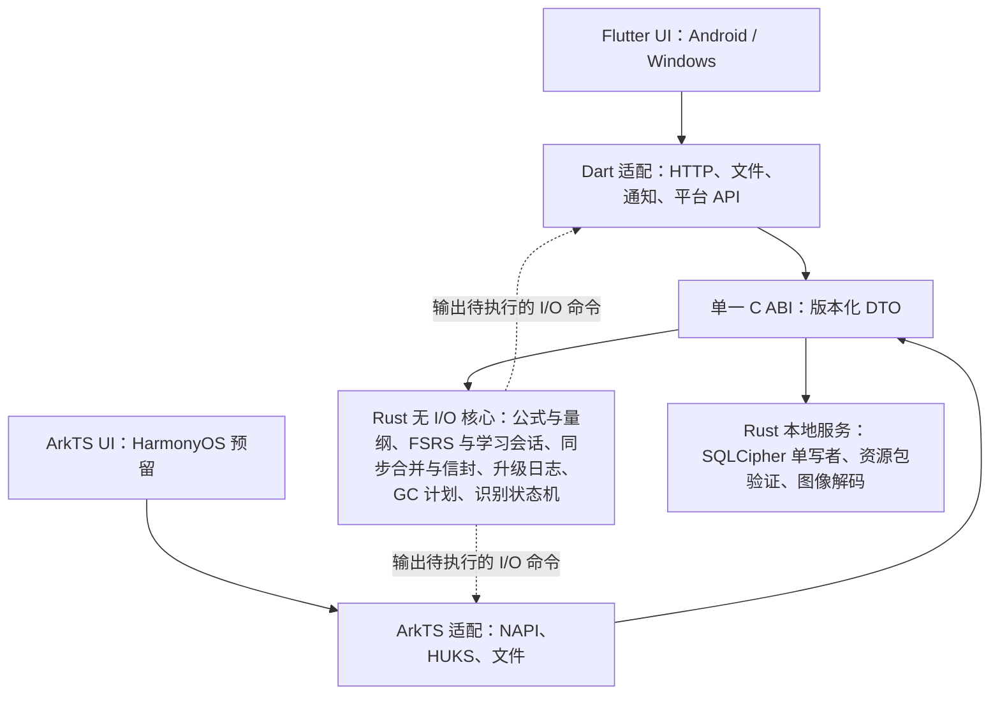

# 15 校核意见与查漏补缺 v3（评审输入）

_BubeiGongshi · 2026-10-18 · 软件工程与教辅双视角校核 · 未经采纳不改变 00、09–14 的效力_

---

## 📋 评审定位与阅读方式

- **性质**：对 v3 方案（[00](00-需求基线与文档效力-v3.md)、[09](09-架构复审报告-v3.md)、[10](10-软件架构设计-v3.md)、[11](11-数据安全同步与识别生命周期-v3.md)、[12](12-资源包内容与开源资源调查-v3.md)、[13](13-需求追踪与验收-v3.md)、[14](14-功能与代码模块映射-v3.md) 及 resources、tools）的独立校核意见。按 00 的效力顺序，本文件只是评审输入；被采纳的条目应按既有维护规则回写：需求变化→00+13，架构决策→09，契约→10/11/12。
- **甲方澄清**：甲方于 2026-10-18 澄清：以不背单词为原型，不需要使用其代码和直接素材，只需要功能近似。本文按此理解需求。
- **基线**：main `d1a80e9` 加工作区未提交改动：SADD/README.md 新增了 14 的链接；14、`SADD/功能代码映射图.html`、`SADD/diagrams/` 下的 4 个图、`SADD/resources/feature-code-map.json` 和 `tools/generate-feature-map.py` 尚未纳入版本控制。
- **引用格式**：`文档号:行号（§章节）`。行号对应上述快照，章节名用于行号漂移后重新定位；本文件刻意不使用行锚点链接（原因见 V10.1）。
- **级别**：P0＝M0 结束前必须决策或修订，否则导致架构返工、安全/合规事故或教学结论错误；P1＝对应里程碑开工前补齐；P2＝改进项。
- **附录**：A 考研数学科目矩阵（工作底稿）、B 高中分包建议、C v2 需求对照、D 里程碑差集。
- **证据边界**：仓库没有应用源码，结论只针对文档契约；法律条目是风险提示，不构成法律意见；外部事实注明来源（§📚，访问日期 2026-10-18）。

## 📌 结论摘要

**应当保留的优点**

- 需求原文、解释与待决项分离，文档效力顺序清楚（00 §本次甲方原需求记录、§历史记录与范围解释、§待决事项与默认策略）。
- 量纲与代入采取保守语义：“量纲相同只是候选筛选条件”（10:175），无量纲不能用 Unknown 代替（10:145），温度、角度、能量/力矩等易错点已显式处理（10 §类型与校验状态）。
- 预算和上限可验证：AST 节点/深度/步数/时长（10 §输入与解析）、同步批量（11:117）、存储配额（11 §识别生命周期与严格 N 保留）。
- 同步具备事务内 outbox、先持久化再 ACK、幂等重发（11:115）；N 保留采用两阶段清理，承认文件与数据库不能构成一个事务（11 §文件与数据库不能伪装成一个事务）。
- 资源包“先验证后解包、失败保持旧包”，有防降级与信任根设计（12 §清单、签名与激活）；YOLO 预案隔离在分支并有脚本检查。
- “设计覆盖”与“实现验收通过”严格区分（13:9–11）。

**主要问题（按影响排序）**

1. **背诵闭环与原型不近似**：甲方要求以不背单词为原型、功能近似，而 v3 的背诵闭环是“看答案后四级自评 + FSRS”的 Anki 式流程，缺少学习阶段的客观检验、组后默写、考试语境、书与计划和学习数据（V1.1、V1.2、V2.1）。
2. **默写判分与识别忠实性没有设计**：公式默写需要“数学等价”判分；量纲重排和云端大模型会把学生写错的公式“纠正”成标准式，掩盖记忆错误（V2.2、V4.2）。
3. **量纲类型系统缺少多态**：导数定义、牛顿–莱布尼茨、泰勒等通用定理在现行 TypeExpr 下只能声明无量纲或停留在 Unresolved，与“严格量纲 + 高数公式 + 同量纲代入”三项需求冲突（V3.1）。
4. **课程内容无法验收**：考研范围没有可冻结的官方来源，覆盖矩阵分不清数一、数二、数三，T-CONTENT 没有可度量的口径（V8.1–V8.3）。
5. **关键状态机没有模块归属**：同步合并、信封加解密、升级日志、GC、识别状态机全部落在“共享 Dart 应用层”，鸿蒙预留将被迫重写最易出错的安全逻辑（V5.1）。
6. **安全契约自相矛盾或缺位**：AAD 要求绑定的字段不在 Envelope 中；RegisteredLocked 的“本机解锁”因素未定义（V6.1、V6.2）。
7. **合规与授权缺口**：面向学生（含未成年人）在境内发行所需的个人信息保护、App 备案、生成式 AI、商标与命名、教材与数据集授权均未形成方案；12 列为候选的 OpenStax 实为非商业许可（V1.3、V4.1、V7.1、V7.2、V8.6）。
8. **识别目标不现实**：13:84 要求清晰墨迹 Top-1≥85%、拍照≥75%，而 2024 年公开 SOTA 在 CROHME 上整式识别率约 61%–65%，在拍照数据集 HME100K 上约 70%（V4.3）。

**统计**：编号意见 54 条（P0 13 条、P1 35 条、P2 6 条）；§11 另列 v2 遗漏 27 项、内部矛盾 22 项、原文覆盖问题 9 项；待决策 17 项。

## 1 🎯 需求理解：以“不背单词”为原型（功能近似）

### V1.1（P0）原型要求“功能近似”，v3 的背诵流程却是 Anki 式自评

- **证据**：00:19 原文为“软件的目标是强化背诵能力，以不背单词这款app为原型”。甲方在本次校核中澄清：以不背单词为原型，不需要使用其代码和直接素材，只需要功能近似。00:48 的边界（“只借鉴学习流程，不复制其界面素材、商标、受限内容或私有接口”）与澄清一致，但没有把“功能近似”写成可验收的目标。10:193 规定流程为“先回忆/手写 → 主动揭示答案 → 查看解释 → 忘记/困难/良好/容易评分 → 排程”，并且“自动比对只能提示，用户决定评分”；13:20 把 R04 写成“参考不背单词流程”，只映射到 T-STUDY。
- **对标事实**：公开资料显示，不背单词以客观检验为主、自评为辅。新词以“英选中”选择题学习，选错的词会再次出现直到选对，一个词要多次答对才算学会并进入复习（两篇评测分别记为 3 次和 4 次，可能随版本或设置而异）；学习以十个为一组，复习每组可设 10 或 20 个，学完或复习完一组后进入拼写，并可“只拼错词”；系统记录每个词“认识”“不认识”“记错了”的次数，据此安排复习；此外有考义、考点、考频、考题，词根词缀与派生树，200 多种词书与教材词表同步，学习计划，按日、周、月统计的学习数据，以及签到和组队打卡（E1–E3、E12）。
- **差距**：v3 只保留了“看答案后自评”这一环，与不背单词的“认识/不认识”相近，却缺少学习阶段的客观检验（选择题、答错重学、多次答对才进入复习）、组后默写、考试语境、书与计划和学习数据。照 v3 实现得到的是“公式版 Anki”，与原型在功能上并不近似；R04 现有的验收也无法证明“功能近似”。
- **建议**：
  1. 00 §历史记录与范围解释 写入甲方澄清，并把 R04 拆成可验收的功能子项：分组学习、客观判对、组后默写、考试语境、书与计划、复习排程、统计与坚持；13:20 的“参考”改为“原型（功能近似）”。“功能近似”按 V1.2 的对标表逐项验收，只要求功能等价，不要求界面相似。
  2. 09 新增 ADR“评分范式”：客观判定为主（选择题和默写的结果自动映射为 FSRS 评分，用户可申诉改判并留痕），自评为辅（推导、证明、长公式）。保留 10:193“不把识别成功或量纲通过当作答案正确”的原则。
  3. 13 为 R04 增加 T-GRADE、T-SESSION、T-STATS（见 §9）。

### V1.2（P0）缺少“不背单词机制 → 公式场景”的对标设计

下表同时作为“功能近似”的验收清单：每一行在 13 中至少对应一个用例，或在 00 中写明不做的理由。机制描述来自商店页面与评测（E1–E4、E12），以功能为准，不以具体次数为准。

| # | 不背单词机制（公开资料） | 公式场景映射 | v3 现状 | 补充建议 |
| --- | --- | --- | --- | --- |
| 1 | 词书：200+ 词汇书与教材词表，配合纸质书同步 | “公式书”：教材章节（如同济《高等数学》）、考试大纲（数一/二/三）、大学物理教学基本要求章节；支持自建 | 12 覆盖矩阵有 textbook_id/edition/chapter/exam_scope 字段，但无书、计划、进度实体 | 增 Book、StudyPlan、Progress；书与资源包解耦 |
| 2 | 学习十个一组；选错再现直到选对，多次答对（评测记为 3 或 4 次）才进入复习 | 每组 N 个公式（默认 5–8，可调），组内多轮直到达到掌握判据 | 无会话与学习步，新卡直接交给 FSRS | SessionPlanner + 学习步，掌握判据可配置 |
| 3 | 客观判对：英选中选择题 | 辨识题：给名称或情境选正确公式；干扰项取自易错变体（漏系数、符号反、指数错、缺条件、量纲不符） | 只有自评 | 干扰项生成（可复用量纲引擎生成“量纲不符”项）+ 人工审校 |
| 4 | 拼写测试：学完一组拼一拼；可“只拼错词” | 组后默写：模板编辑器或手写输入，按数学等价判分 | 有“先回忆/手写”，无判分 | 见 V2.2 |
| 5 | 真实语境：原声例句、真题例句 | 典型例题与真题情境：什么题型、什么条件下用 | 无 | 例题/情境卡；版权边界见 V7.2 |
| 6 | 考义、考点、考频、考题 | 大纲要求层级（了解/理解/掌握/会用）、真题考频、数一二三差异 | 12 仅有 exam_scope | 增 requirement_level、exam_frequency 及数据来源与审校 |
| 7 | 词根词缀、派生树“以熟词记生词” | 公式派生树：一般式→特例→推论（泰勒→麦克劳林→常用展开） | 10 的 Derivation 实体可复用，但未用于学习 | 派生关系浏览、“由母式推子式”卡 |
| 8 | 近义、反义、变形关联；易混词笔记互相可见（“关联笔记”） | 易混公式组：电阻与电容串并联、转动惯量族、三角恒等式族 | 无 | ConfusableGroup + 辨析卡 + 同组埋藏 |
| 9 | 随身听 | 公式朗读：复用 10:189 已有的“AST→中文数学语义串”接系统 TTS | 语义串只用于无障碍 | 低成本增值（P2） |
| 10 | 签到、组队打卡 | 连续天数、每日目标、提醒；组队涉及社交与未成年人合规 | 仅本机提醒 | 先做本地激励，组队列 P2 并评估合规 |
| 11 | “我的数据”：按日、周、月统计学习量与时长 | 今日新学/复习、章节完成率、掌握度、遗忘预测、复习积压 | v3 全部缺失（v2 曾有，见 §11） | 恢复统计，由事件派生 |
| 12 | 智能规划复习；学习计划 | FSRS（v3 已选） | 有 | 增考试日期冲刺、复习积压削峰 |
| 13 | 自制词书、筛选学习范围 | 自建公式书、批量导入 | 编辑器支持单条录入 | LaTeX/CSV 批量导入 + 校验报告 |

### V1.3（P1）产品命名与商标风险

- **证据**：README.md:2 的产品名为“不背公式（背背你的）”，仓库名为 BubeiGongshi。不背单词是 Beijing Is-Cool Technology Co., Ltd 发行的闭源商业应用（E1）。甲方已澄清只要求功能近似，不复用其代码与素材，因此 ADR-001（Flutter + Rust）、ADR-003（托管身份）不受影响。
- **风险**：“不背公式”与“不背单词”只有后两字不同，又同属学习类应用，可能构成商标近似，或与《反不正当竞争法》所说的“有一定影响的商品名称”相混淆。本次没有做商标检索，不作结论。风险集中在名称和外观：界面、图标、配色、文案、音效越相似，混淆风险越高。
- **建议**：列入待决 D-01；首个对外版本前完成商标检索并取得法律意见，准备备用名称；商店名称、域名和应用包名在定名后再申请；界面、图标、配色、文案、音效独立设计。

## 2 📚 背诵闭环与教辅设计

### V2.1（P0）学习域模型缺位

- **证据**：10:113–120 的实体只有 FormulaItem、FormulaRevision、Symbol、Derivation、UnitDefinition、Diagnostic；10:87–97 端口中与学习相关的只有 StudyEngine（“固定参数版本+日志 → 下一次调度”）；10:193–195 只描述卡片与 FSRS 事件；11 §同步协议 的合并规则只覆盖公式与复习记录。
- **缺失**：Book（书/范围）、StudyPlan（每日新学与复习上限、考试日期、目标保留率、学习步）、Session/Group、CardTemplate 版本、Attempt（输入原文、识别结果引用、判定、耗时、提示使用、改判）、Mastery、ConfusableGroup、错题集、统计。规则也缺：新卡每日上限、同源卡同日埋藏、复习积压削峰（评测称不背单词复习量常大于新学量）、两台设备同时学习同一组的冲突、“学习日”切换时刻与时区。
- **建议**：StudyEngine 拆为 Scheduler（纯 FSRS，确定性重放）与 SessionPlanner（选题、分组、学习步、上限、埋藏）；Attempt 作为只追加的同步实体并补合并规则；统计由事件派生，不单独同步。
- **验收**：T-STUDY 扩充分组、学习步、上限、埋藏、积压削峰、冲刺模式用例；新增 T-SESSION。

### V2.2（P0）默写判分缺少“数学等价”引擎

- **问题**：单词拼写可以逐字母比对，公式不行。同一公式有大量合法写法（交换律、移项、分式形式、符号别名、等价恒等变形），也存在“差一个系数或符号”的真错误。10:193 用“用户决定评分”回避了判分，要与原型的“组后拼写”功能近似，默写就必须能客观判分。
- **建议**：三层判定——
  1. AST 规范化（交换/结合排序、常数折叠、符号别名映射到 SymbolId）后结构比对；
  2. 数值随机点检验：在声明的定义域内随机取多组值比较，带相对容差，适用于表达式与恒等式等价；方程类先按卡片的目标变量整理成显式式再比对，隐式方程比较残差（允许非零常数倍）；
  3. 前两层都无法判定时回退用户自评。
  每条公式可声明“可接受形式”和“考纲要求的特定形式”。判定映射 FSRS：首次正确→Good、提示后正确→Hard、错误→Again；用户可申诉改判，留痕进入 Attempt。
- **验收**：新增 T-GRADE，例如等价变体接受率≥99%、常见错误变体拒绝率≥99%，“无法判定”比例单列，样本数在 13 中写明。

### V2.3（P1）卡片题型与公式知识结构不足

- **现状**：10:193 题型为名称回忆公式、符号挖空、变量含义、单位量纲、数值应用。
- **补充题型**：适用条件回忆（洛必达法则条件、高斯定理所需对称性、理想气体条件）、推导步骤排序、易混辨析、情境选式（给题干判断用哪个公式）、几何/物理意义、反例识别（“可导⇒连续，反之不成立”）、定理结论填空。
- **补充内容字段**：适用条件与范围、推导要点、记忆口诀、易错点、易混组、前置知识、大纲要求层级、真题考频、符号约定（字段清单见 V8.5）。
- **补回 v2 的设计**：看公式选名称、跳过与暂停、按题型开关、分层交付（v2 02:552–565，见 V11.2 的 N02）。
- **按大纲要求层级出卡**：要求“掌握”“会”的知识点优先生成默写卡和应用卡，要求“了解”的以辨识卡和概念卡为主。

### V2.4（P1）学习效果没有可度量目标

- **问题**：“强化背诵”没有定义掌握与保留率；T-STUDY 只能证明流程正确，不能证明学得更好。
- **建议**：定义掌握判据（如连续 N 次客观判对且间隔≥1 天）；以 FSRS 预测保留率与实际复习结果做校准；M3 前安排目标用户小规模试点，记录 7 天/30 天保留率、日均学习时长与流失点，作为产品验收的补充证据。

### V2.5（P1）FSRS 个性化与冲刺复习缺少边界

- **现状**：10:195 已为 FSRS 参数、算法版本、目标保留率和复习事件加了版本标识，但没有规定何时用个人记录优化参数、目标保留率允许的范围，以及考前冲刺如何与正常排程共存。
- **参考**：Anki 手册以 90% 为默认目标保留率，建议低于 97%，并说明参数每月优化一次即可、复习记录只有几百条时 FSRS 可能拟合不好；Anki 曾要求至少 1000 条复习记录才允许优化，2024 年讨论把门槛降到 400 甚至更低（E23）。
- **建议**：复习记录不足 400 条（可配置）时使用默认参数；个人参数只有在留出数据上的 log-loss 优于默认参数时才启用，并可一键回退；目标保留率限定在 0.80–0.95；考前冲刺（V1.2 第 12 行）的作答标记为 cram，不参与参数优化，也不改写正常排程。
- **验收**：T-STUDY 增加优化门槛、优化结果劣于默认时回退、冲刺作答不进入优化集三类用例。

## 3 🧮 数学、量纲与计算

### V3.1（P0）缺少量纲多态，高数公式无法“严格量纲”又可代入

- **证据**：10:136 的 dimension 只有“七维有理指数”或 Unknown；10:145 规定纯数学变量只能由课程或用户显式声明无量纲，缺少声明进入 Unresolved，且“只有 Verified 修订可作为已校验公式用于计算、代入和教学推荐”。
- **反例**：导数定义、牛顿–莱布尼茨公式、拉格朗日中值定理、泰勒公式对任意量纲的 f 与 x 都成立。声明为无量纲后，就不能把位移 x(t) 或功 ∫F dx 代入；保留 Unknown 则永远不是 Verified。00 同时要求“每个公式严格量纲”“覆盖高数”“量纲匹配时可代入”，在现行类型系统下三者不能同时成立。
- **数学课程中的反例**：∫dx/x＝ln|x|＋C 在 x 有量纲时违反 10:157“exp/log 自变量无量纲”，需要写成 ln|x/x₀| 或声明 x 无量纲；det(AB)＝det A·det B、AA*＝|A|E 两侧量纲的指数取决于矩阵阶数 n，[Rational;7] 无法表达；正态密度、切比雪夫不等式在随机变量有量纲时含义确定，一律声明无量纲会放过真实错误。反过来，把数学量全部声明为无量纲，P(A)、ρ 这类量会成为任何无量纲位置的代入候选，候选数量失控。
- **建议**：引入量纲变量与约束（参照 F# units of measure 及 Kennedy 的阿贝尔群合一算法，E10）：dim(df/dx)=D_f·D_x⁻¹，dim(∫f dx)=D_f·D_x；exp、ln、三角函数的参数约束为无量纲。新增“多态已校验”状态，代入时实例化并合一；Unknown 只表示“尚未标注”。
- **验收**：T-DIM（13:60）增加多态实例化、约束冲突报错、ln 作用于有量纲量时拒绝等用例；T-SUB（13:62）为上述反例补充正例与反例，并检查候选数量不失控。

### V3.2（P1）代入的“情境等同”只能由人断言，但没有记录

- **证据**：10:175 要求“检查 B 右式和目标子式的关系与使用条件”，10:177 以 F=ma 中 a→dv/dt 为例。
- **问题**：系统无法证明两处 v 指同一物体、同一参考系、同一时刻；这一步本质上是用户或课程的断言。
- **建议**：Derivation 记录断言内容（对象、参考系、时间、条件）、断言人和时间，界面明确显示为“假设”；QuantityKind 作为量纲之外的第二道筛选（10 已为能量/力矩区分 QuantityKind）；教学模式下解释“为什么可以代入”。

### V3.3（P1）“代入”可能指数值联动（计算链），需向甲方确认

- **证据**：00 原文“量纲匹配时可以把公式代入别的公式同量纲部分作为变量”；v3 只设计了生成新修订并完整复验的符号代入（10:175–177）。
- **建议**：增加轻量“计算链/工作表”：A 的输出在量纲与 QuantityKind 匹配时作为 B 的输入变量，自动单位换算，不生成新公式修订，可保存为“计算方案”。列入待决 D-05；若甲方指的是数值联动，V1 可先交付计算链，符号代入后置。

### V3.4（P1）符号体系与国内教材冲突（样例已出现）

- **证据**：`SADD/resources/open-physics-samples.json` 把 pV=νRT 规范化为“p V = n_{mol} R T”；国内《大学物理》通常用 ν 表示物质的量、n 表示分子数密度（p=nkT），k 表示玻尔兹曼常量；样例以 V_x 表示速度分量，而国内 V 通常表示体积。
- **更多差异**（内容审校发现，标准条文待按原文复核）：GB 3102.11 允许 tg、arctg 等写法，ISO 80000-2 不用；A* 在国标与 ISO 中表示共轭（埃尔米特）转置，国内线性代数教材多用它表示伴随矩阵；同济《线性代数》把内积记作 [x,y]，国标写作 a·b 或 (a,b)；不带底数的 log 在不同教材中可能指 lg、ln 或任意底；泊松分布记作 P(λ) 或 π(λ)，指数分布按率参数 λ 还是均值 θ 参数化，各书不同（E19）。
- **建议**：引入记号方案（NotationProfile）与显示别名（SymbolAlias）。语义只认 SymbolId，显示名按所选课程与教材切换；同一公式内，同一字形在同一记号方案下只能对应一个 SymbolId；不带底数的 log 解析为 Unresolved，要求指定底数；概率分布的参数化写成显式字段（率、尺度、方差或标准差）；导入规范化不得改成非通行记号；审校清单加入“符号与所选教材一致”。
- **验收**：新增 T-NOTATION（见 §9）。

### V3.5（P1）常数与数值规范

- **问题**：常数取值与数值判定没有规范。CODATA 2022 是现行推荐值，2019 年 SI 修订后 k、N_A、h、e 为精确定义值（E20）；国内教材和习题却常用 R＝8.31 J/(mol·K)、k＝1.38×10⁻²³ J/K，g 可能取 9.8、9.80665 或 10。同一道题换一套常数，结果就可能被判错。
- **建议**：常数分三套并带版本：精确值或 CODATA 值、教材约定值、题目给定值；计算器与判分优先用题目给定值，其次用所选教材的约定值。数值判分按题目所给有效数字确定容差。复数（交流电路、量子）、对数单位（dB）、角度制与弧度制的显示和输入，纳入同一份随课程版本化的“数值规范”。
- **验收**：新增 T-CONST（见 §9）。

## 4 📷 手写与照片识别

### V4.1（P0）训练数据与预训练权重的授权

- **证据**：12 §模型、许可与供应链门禁 只要求模型许可与 SBOM，未建立训练数据授权登记。
- **事实**：MathWriting 数据集为 CC BY-NC-SA 4.0（非商业、相同方式共享，E6）；HME100K 需向发布方申请获取（条款本次未核实）；CROHME 各届数据许可需逐届核实。用这些数据训练的权重会继承限制。
- **建议**：建立“数据集与权重许可登记表”（来源、许可、是否允许商用、是否允许再分发、派生义务）；自建数据采集规范：书写者同意（未成年人需监护人同意）、去标识、标注规范与 LaTeX 规范化规则；用 LaTeX 渲染加手写字体/笔迹合成扩充训练数据；评测集与训练集严格隔离。

### V4.2（P0）默写模式必须忠实转写，禁止自动纠错

- **证据**：10:232 “上下文量纲用于提示/重排”；H02 首版采用云端大模型识别。13:84 只规定“不能借量纲强制修正答案后算命中”。
- **问题**：学生写错 E=mc³，大模型的先验或量纲重排会把它“纠正”为 mc²，判分随之通过，记忆错误被掩盖——这是教辅场景最严重的失效模式。
- **建议**：识别分两种模式：
  1. “查找/录入模式”：允许量纲重排与公式库约束检索；
  2. “作答/默写模式”：关闭重排与库约束，大模型提示词要求逐字转写、不纠错，返回原始结果；判分前先让用户确认转写结果。
- **验收**：新增 T-FIDELITY：故意写错的样本（≥300 条，覆盖系数、符号、指数、上下限错误）被“纠正”为标准式的比例≤1%。

### V4.3（P1）准确率目标与指标体系

- **证据**：13:84 要求清晰墨迹/规范图 Top-1≥85%，真实拍照 Top-1≥75%。
- **对照**：PosFormer（ECCV 2024，E5）在 CROHME 2014/2016/2019 上整式识别率（ExpRate）为 62.68%/61.03%/64.97%（含尺度增强），在拍照手写数据集 HME100K 上为 69.51%，允许≤2 处错误时约 85%–91%；这些是服务端规模模型，移动端轻量模型通常更低。
- **建议**：按任务分开定指标——
  1. 自由识别：ExpRate、≤1/≤2 处错误率、符号级准确率，按复杂度分层（单行、分式、上下限、矩阵、多行）；
  2. 库内检索（拍照找库内公式）：Top-k 命中率，可利用约束检索；
  3. 默写转写：忠实度与自动纠错率（V4.2）；
  4. 修正成本：用户把结果改对所需的平均编辑次数/时间。
  数值目标在 M0 用自有评测集跑出基线后再定，13 先写明测量方法。

### V4.4（P1）多公式照片与 N 计数口径

- **问题**：整页拍照含多个公式与文字时，需要先检测和分割公式区域（YOLO 预案正是用于此类检测），主分支没有“框选区域”交互；一张照片识别出多条公式时，11:149 的 keep_last N 计数单位不清楚。
- **建议**：V1 提供手动框选/裁剪，自动检测作为可插拔后端；明确 N 的计数单位为“识别会话（一次导入的图片及其全部结果）”，并在 13 的 T-GC 中验证。

### V4.5（P1）图像解码安全与 HEIC

- **问题**：10:203 支持 JPEG/PNG/静态 WebP/HEIC，但未规定解码器。C 解码库是常见攻击面，例如 libwebp 的 CVE-2023-4863 曾被在野利用（E9）。Android 平台从 9（API 28）起才提供 HEIF 解码，而最低版本为 API 26；Windows 解码 HEIC 依赖 HEIF/HEVC 扩展，不一定预装；自带 HEVC 解码器有专利许可风险。
- **建议**：优先采用内存安全的 Rust 解码器（image 生态的 png、zune-jpeg、image-webp），解码前先读头部尺寸执行 40 MP 上限；HEIC 只走系统解码，不可用时提示用户转成 JPEG；对解码器做模糊测试。

### V4.6（P1）云识别：授权方式、数据最小化与成本滥用

- **问题**：11:175 每次识别生成 consent_receipt，交互负担重；同时没有防批量注册刷量的成本控制。
- **建议**：
  1. 选择境内、已完成备案、签订委托处理合同并承诺不用于训练的供应商，此时可按功能一次性授权 + 每次发送前预览（预览是用户控制，不是重复同意）；若供应商自行使用数据或数据出境，则需单独同意及出境合规（见 V7.1）。
  2. 上传前裁剪到公式区域、去除 EXIF（10:218 已有 EXIF 处理），降低个人信息暴露。
  3. 按账户、设备、IP 设日配额，设置全局预算熔断，注册环节增加手机号验证等摩擦。

## 5 🏗️ 架构与平台

### V5.1（P0）关键状态机没有归属，编排放在 Dart 使鸿蒙预留落空

- **证据**：10:60 “共享 Dart 应用层编排状态与 I/O；Rust 只提供纯计算和明确的本地服务”；10:87–97 端口表中，同步合并（11:119–126）、信封加解密（11:59）、升级日志（11 §游客升级事务）、GC 两阶段清理（11 §文件与数据库不能伪装成一个事务）、识别状态机（11 §会话和计数口径）、学习会话（V2.1）都没有明确的所属模块。
- **影响**：00 要求“预留鸿蒙”。HarmonyOS NEXT 不运行 APK，若不采用 Flutter 的鸿蒙移植，所有 Dart 编排必须用 ArkTS 重写，最容易出错、又最需要一致性的安全逻辑会出现两份实现；跨语言实现 AAD 编码、合并顺序等也容易出现细微差异（见 V6.2）。
- **建议**：采用“无 I/O 状态机”核心——Rust 实现确定性状态转移（输入事件 → 新状态 + 需执行的 I/O 命令），Dart/ArkTS 只执行 I/O 和呈现。同步合并与信封编解码、升级日志、GC 计划、识别状态机、SessionPlanner 下沉到 Rust（加密原语使用经审计的现成实现，11:59 原则不变）。在 09 新增 ADR 记录取舍。

### V5.2（P1）FRB 与 C ABI 双契约、轮询式任务

- **证据**：10:83 “FFI 绑定可采用 flutter_rust_bridge……公共核心契约仍独立保留 C ABI”；10 §C ABI 与线程 定义 submit_job/poll_job/cancel_job。
- **问题**：两套绑定面意味着两套类型映射、错误映射与测试；DTO 编码格式未定；13 §可复现性能预算 要求解析+量纲≤30 ms（Android），对这类短操作采用提交–轮询会增加延迟与复杂度。
- **建议**：以 C ABI 为唯一契约，DTO 采用带 schema 的二进制编码并版本化；预算内的纯计算提供同步快路径（在后台 isolate 调用）；长任务用完成回调（Dart NativeCallable/原生端口、NAPI 线程安全函数）代替轮询。FRB 若保留，只作为由同一契约生成的便利层。

### V5.3（P1）存储单写者与事务边界

- **问题**：数据库位于 Rust（fml-store），而编排在 Dart；11:115 要求“业务修改与 outbox 写入同一 SQL 事务”，若每个用例跨 FFI 分步开启/提交事务，接口会很碎且难以保证原子性；多 isolate 并发访问 SQLCipher 的规则也未写明。
- **建议**：Rust 侧单写者 actor 持有连接，对外提供“用例级命令”（一个命令一个事务，包括 outbox）；读走只读连接或快照；在 10 写明并发模型。

### V5.4（P1）鸿蒙路线未经验证

- **证据**：10 §C ABI 与线程 只提到 NAPI 与 HUKS。
- **建议**：M0 做两条路线的技术验证：A）社区维护的 Flutter 鸿蒙移植（复用 UI，需核实维护状态与插件可用性）；B）ArkTS 原生 UI + Rust 核心（Rust 已提供 OpenHarmony 目标，层级需核实）。验证项：fml-core 交叉编译、NAPI 调用、HUKS 包装密钥、文件选择器。结果写入 09。

### V5.5（P1）发布、更新与应用市场门槛

- **问题**：未规定 Windows 安装包形态与代码签名（影响 SmartScreen 信誉）、自动更新、最低客户端版本强制（服务端返回 426）与 API 版本策略；国内安卓应用市场通常要求软件著作权或电子版权认证、隐私合规检测和 App 备案，无 GMS 时也没有推送与完整性校验服务。
- **建议**：在 10 §版本、里程碑与交付 补“发布与更新”小节；在 13 §平台、工程与发布门槛 增加对应检查。

### V5.6（P1）关键依赖健康度与移动端输入体验

- **事实**：flutter_math_fork 最新为 0.7.4，发布于 2025-05-21（E7），至今约 17 个月无新版本；math_keyboard 0.4.0 发布于 2026-09-19，基于 flutter_math_fork（许可需核实）；fsrs 6.6.2 发布于 2026-08-29，BSD-3-Clause，常规依赖为 ndarray、rayon 等，burn 仅为开发依赖（E8）。
- **问题**：ADR-002 以源码/模板编辑为主，学生在手机上输入公式主要依赖结构化数学键盘；渲染库长期不更新会在 Flutter 升级时成为阻塞点。
- **建议**：预留渲染库的 fork 维护预算并建立渲染金样（golden）回归；评估 math_keyboard 或自研结构化键盘；增加可用性验收（如目标用户 3 分钟内正确输入 10 个典型公式）；固定 fsrs 版本，评估 rayon 线程池与二进制体积对移动端的影响。

### V5.7（P2）平台与设备形态覆盖

明确 Windows ARM64、Android 32 位与 x86_64、平板与学习机（多无 GMS、可能限制安装）是否在范围内；平板与 Windows 触控笔书写是手写识别的重要场景，墨迹采集应考虑压感、防误触与大屏布局。

## 6 🔐 账户、密钥与同步

### V6.1（P0）RegisteredLocked 的“本机解锁”因素未定义

- **证据**：11:31 “登录/本机解锁”，11:34 “重新进入需本机解锁或有效登录”，但没有定义本机解锁凭什么。
- **问题**：若库密钥只由 DPAPI/Keystore 保护而不要求用户认证，“锁定”只是界面状态，同一系统账户下任何人都能打开；学生常用家庭共用电脑，这一点必须明确。生物识别变更导致密钥失效后的恢复路径、同一设备多个游客档案也未定义。
- **建议**：默认依赖系统级保护，另提供可选应用锁（PIN 或生物识别，Keystore 用户认证绑定密钥 / Windows Hello）；写明威胁模型（共用电脑、同系统账户）；定义生物识别失效后的恢复（登录 + 同步密语或恢复码）；明确游客档案数量与切换方式。新增 T-UNLOCK。

### V6.2（P0）Envelope 字段与 AAD 绑定要求不一致

- **证据**：11:59 要求 “AAD 绑定 account ID、key version、entity type/ID、revision/op ID、schema 与 purpose”；11:107–110 的 Envelope v1 只有 account_id（来自认证上下文）、account_epoch、op_id、device_id、device_seq、key_version、entity_id、schema_version、nonce、ciphertext、ciphertext_hash，没有 entity type、revision、purpose。
- **问题**：接收方无法重建缺失字段的 AAD，要么这些字段实际放在密文内部（需写明并在解密后校验），要么根本没有绑定；AAD 的规范字节编码未定义，Dart/Rust/ArkTS 多实现时极易不一致；ciphertext_hash 的用途未说明；哪些元数据对服务端可见也没有结论。
- **建议**：Envelope 增加 entity_type、purpose、aad_version；明文内部头重复全部绑定字段并在解密后核对；发布 AAD 规范字节布局与跨语言测试向量；ciphertext_hash 用于幂等校验——同一 (account_epoch, op_id) 若哈希不同返回冲突并隔离；在威胁表中写明服务端可见的元数据。新增 T-AAD。

### V6.3（P1）E2EE 的相称性与用户负担

- **问题**：注册用户需要登录密码、独立同步密语、恢复码三种秘密（11:55）；对学生（含未成年人）而言，遗忘密语与恢复码即永久丢失同步数据，而公式与复习记录的敏感度相对较低。
- **建议**：09 重新评估 ADR-004，比较：A）默认服务端加密、E2EE 可选；B）新设备通过已登录设备扫码配对转移根密钥，恢复码兜底，同步密语可选；C）维持现状。建议采用 B，并把“遗忘全部秘密时的后果”写进注册引导。

### V6.4（P1）游客并入已有账户时的重复数据

- **证据**：11 §游客升级事务 关联已有账户时只处理随机 ID 冲突的重映射。
- **问题**：游客与注册账户都从同一资源包派生公式与卡片时会出现两套重复卡片与两份复习历史。
- **建议**：资源包派生实体使用确定性 ID（如由 pack_id、item_id、模板 ID 生成的 UUIDv5），合并时自然去重；复习事件取并集后按时间重放 FSRS；用户自建的重复公式按 AST 哈希提示用户合并。新增 T-GUESTMERGE。

### V6.5（P1）并发公式头、卡片绑定与 reset epoch

- **问题**：11 §同步协议 允许公式 DAG 出现两个头，但卡片跟随哪个头未定义；10:195 “卡片更新公式时明确选择保持进度或重建卡片”在两台设备各自编辑时可能弹出重复或冲突的选择。长期离线设备在重置之后上传旧 epoch 的复习事件，处理方式也未定义。
- **建议**：卡片绑定 (FormulaItem, revision)，冲突生成一条同步的“待选择”记录只处理一次；旧 epoch 事件只归档不参与当前排程，并在界面提示。

### V6.6（P1）无快照导致新设备全量重放

- **证据**：11 §同步协议 规定 V1 不做压缩。
- **估算**：每天 100 次复习、持续 2 年约 73,000 条复习事件，按每页 200 条至少 365 次拉取，还要逐条解密与重放；服务端存储也只增不减。
- **建议**：V1 协议先预留加密快照类型与“快照 + 之后增量”的游标语义，即使实现后置，也避免以后升级协议。新增 T-SNAPSHOT。

### V6.7（P2）密钥轮换、设备吊销与恢复码可用性

单一 AccountRootKey 未定义轮换与设备吊销（吊销后应生成新 key_version 并重新包装，旧设备读不到新数据）。256 bit 恢复码按 Base32 约 52 个字符，对学生抄写负担过重；恢复码本身是高熵随机数，128 bit（约 26 字符，分组并加校验位）已足够。

### V6.8（P1）SQLCipher 集成细节

库密钥是随机 256 bit，应使用原始密钥模式跳过 PBKDF2，避免冷启动额外耗时；明确加密后端（OpenSSL/BoringSSL 等）与其对 APK≤70 MiB 预算的影响，可评估 SQLite3MultipleCiphers 作为替代；Android StrongBox 操作较慢，库密钥包装宜用 TEE Keystore；Windows DPAPI 使用当前用户作用域。

### V6.9（P2）服务端纵深防御与登录方式

PostgreSQL 行级安全作为账户隔离的第二道防线；TUF 客户端可选成熟实现；国内用户习惯手机号验证码登录，第三方登录（如微信）需要企业资质，10:266 的 OIDC 方案需明确身份服务选型（自建或云服务）及短信服务合规。

## 7 ⚖️ 合规与知识产权

### V7.1（P0）缺少中国境内发行的合规方案

| 要求 | 触发条件 | v3 现状 | 建议 |
| --- | --- | --- | --- |
| 《个人信息保护法》：隐私政策、最小必要；不满 14 周岁未成年人信息属敏感个人信息，需监护人同意；向第三方提供或出境需单独同意 | 收集账户、学习记录、图片；云识别 | 11 有数据分类与授权回执，无隐私政策、个人信息清单、第三方 SDK 清单 | 首次启动先展示隐私政策；编制个人信息与 SDK 清单；监护人同意流程 |
| 《未成年人网络保护条例》（2024-01-01 施行） | 用户含中学生（H01 涉及高中内容） | 未涉及 | 明确目标年龄段；开展个人信息保护影响评估 |
| App 备案与 ICP 备案 | 境内分发 App；服务端使用境内域名 | 未涉及 | 列入发布门槛与时间表 |
| 《生成式人工智能服务管理暂行办法》（2023-08-15 施行）、《人工智能生成合成内容标识办法》（2025-09-01 施行） | 首版云端大模型识别（H02） | 未涉及 | 选用已备案模型；评估本应用是否需登记；评估识别结果展示是否涉及标识义务 |
| 网络安全等级保护 | 服务端存储个人信息 | 未涉及 | 定级备案（通常二级） |
| 应用市场审核 | 国内安卓商店 | 未涉及 | 软著/电子版权、隐私检测（见 V5.5） |

建议在 11 增加“合规”章节，13 增加 T-COMPLY 作为发布门槛；具体适用性由法务确认。

### V7.2（P1）教材、真题与讲解内容的版权边界

- **问题**：公式本身属于事实与思想，一般不受著作权保护，但教材的具体表述、章节编排、例题、讲解属于作品；真题文本的使用需单独评估；源自 CC BY-SA 资料（如维基百科）的讲解会带来相同方式共享义务；flutter_math_fork 内置的 KaTeX 字体为 SIL OFL，分发时需附许可。
- **建议**：内容以自编为主，教材只引用书名、版次、章节号作为对齐索引；真题以年份、题号和考点统计形式引用，例题自编；12 的来源登记增加“表述来源与许可”字段。

## 8 📦 资源包与课程内容

### V8.1（P0）考研范围没有可冻结的来源

- **证据**：00:43 把考研范围解释为数一、数二、数三的并集，但 12 §课程范围与质量管线 没有规定以哪一版大纲、通过什么途径冻结。教育部教育考试院（NEEA）网站的“考试大纲”栏目最新只到 2022 年数学大纲，且正文为空；此后大纲只以纸本发行（据栏目停更推断，E13）。第三方转录互相矛盾且有错：有媒体称 2027 年数三“新增边际与弹性”，而 2025 年大纲原文已有“经济意义（含边际与弹性的概念）”；另有网站把“一阶常系数线性微分方程组”列入数一，而数一原文没有这一项（E14）。
- **建议**：12 写明考试范围唯一的冻结来源是当年《全国硕士研究生招生考试数学考试大纲》纸本，登记 ISBN、印次和取得日期；两人独立逐条转录为 syllabus_item，差异清零后冻结并记录哈希；网络转录只作线索。2027 年版纸本取得前，所有条目保持 `scope_review_pending`，以附录 A 为工作底稿。基线版本列入待决 D-17。

### V8.2（P0）T-CONTENT 无法度量

- **证据**：13:66 的通过标准是“每项必选知识点都有条目/引用或明确缺项；正式条目100%类型/来源检查与双人审校；未审条目不计覆盖”。“必选知识点”没有定义；只要求并集，没有按科目统计；没有抽检比例和错误率阈值；大纲的“了解、理解、掌握、会”层级没有用上。
- **建议**（替换 13:66 的通过标准）：
  1. 知识点＝冻结大纲“考试要求”中最小的可判定子句，带 ID、适用科目集合（数一、数二、数三）、要求层级和来源页码；大学物理用《基本要求》的条目号（V8.4），高中用课标条目号。
  2. 覆盖率按科目分别计算：已有 Verified 条目、或显式标为“无公式概念”并配概念卡的知识点数，除以该科目的知识点总数。发布门槛为数一、数二、数三各自 100%，并集不能替代单科。
  3. 每个模块随机抽取 max(50 条, 10%) 的正式条目，由作者和审校者之外的第三人复核：严重错误（系数、符号、指数、上下限、成立条件、适用范围、量纲）为 0，一般错误（措辞、排版、缺别名）不超过 2%；不达标则该模块全量复审。
  4. 作者与审校者不得为同一人，记录双方、时间和版本；13 的验收记录模板增列审校分歧率。

### V8.3（P1）覆盖矩阵分不清数一、数二、数三

- **证据**：12:77–81 的行粒度区分不了科目。按 2025 年大纲原文转录（E15）：数二不考概率统计、无穷级数、空间解析几何、方向导数与梯度、三重积分和曲线曲面积分，常微分方程不含伯努利方程、全微分方程和欧拉方程；数三不考参数方程求导、弧微分与曲率、傅里叶级数，定积分应用只有面积、旋转体体积、平均值和经济应用，概率只考点估计（不考评选标准、区间估计和假设检验），并独有“边际与弹性”“差分方程”“无界区域上简单的反常二重积分”；只有数一考向量空间、基变换与过渡矩阵。12:80 写的“线性空间”与考纲不符：考研只考 Rⁿ 向量空间，同济《线性代数》中的抽象线性空间与线性变换不在考纲内。
- **建议**：用附录 A（高数 41 行、线代 8 行、概率统计 10 行）替换 12:77–81；12:80 改为“行列式、矩阵、向量组、线性方程组、特征值与相似对角化、二次型；向量空间（仅数一）”。`exam_scope` 下沉到知识点级，因为同一公式可能只部分适用于某一科目，例如定积分应用，数三只考面积、体积、平均值和经济应用。

### V8.4（P1）教材、物理与高中课程缺少基线版本

- **同济《高等数学》**：v2 写的是第七版（v2 02:573），v3 没写版次。建议定为第八版（高等教育出版社 2023 年；上册 ISBN 978-7-04-058981-8，下册 978-7-04-058868-2，E16），`textbook_id` 记为 TJ-GS-8。带星号不等于不考：伯努利方程、欧拉方程、混合积、二元函数二阶泰勒公式、通量与散度、环流量与旋度都带星号，但数一要考；方程的近似解、积分表、微分与定积分的近似计算、幂级数的应用不带星号，却不在考纲内。同济有而考纲没有的节标 textbook_only（可学，不计考研覆盖）；考纲有而同济高数没有的内容（数三的经济意义与经济应用、差分方程、无界区域反常二重积分，以及线代、概率统计全部）标 syllabus_only。线代与概率统计的教材另定，待甲方确认。
- **大学物理**：12:82 只有一行，没有基线版本和分层。2023 年版《理工科类大学物理课程教学基本要求》已发布：条目总数由 127 条变为 124～132 条，建议学时由 126 提高到 136～144，量子物理条目由 14 条增至 19 条；几何光学因与中学重叠而调整，超导体的电磁性质移入固体物理模块（E17）。建议以 2023 年版为基线，条目带 phys_req_id 与层级（A 类、B 类、扩展、中学衔接）；V1 只承诺 A 类 100%，B 类与扩展按实际条目计数，不宣称全覆盖。符号与常数以甲方选定教材的记号方案为准，候选有马文蔚《物理学》、程守洙《普通物理学》、张三慧《大学物理学》。
- **高中（H01）**：00:38 没有指定课标版本，而教育部已于 2025 年 10 月印发普通高中课程标准的日常修订版，即“2017 年版 2025 年修订”（E18）。建议 `syllabus_id` 用 CN-HS-MATH-2017R2025、CN-HS-PHYS-2017R2025，按附录 B 拆成必修与选择性必修四个包，选修不计覆盖。

### V8.5（P1）条目缺少教学所需字段

- **证据**：12:85 的条目字段只有 `textbook_id/edition/chapter`、`syllabus_id/year`、`exam_scope`、`education_level` 等对齐信息；10:193 的流程有“查看解释”，条目却没有解释、符号说明和单位建议（v2 02:575–577 曾有，见 V11.2 的 G03）。
- **建议**：增加 `requirement_level`（了解、理解、掌握、会）、`kp_ids`（知识点）、`scope_note`（适用科目或范围说明）、`equivalent_forms`（可接受的等价形式，供 V2.2 判分）、`derivation_ref`（推导依据）、`confusable_group_id`（易混组）、`prerequisites`（前置知识）、`pitfalls`（易错点）、`example_refs`（只登记例题出处，不复制原文）、`exam_frequency`（写明统计口径与年份范围）、`constant_values`（V3.5 的常数取值）、`notation_profile_ids`（V3.4 的记号方案）。

### V8.6（P1）开源来源的许可结论需要更正

- **OpenStax**：12:112 记为“license 页为动态应用，未获得足够条款正文”。现已核实：University Physics 与 Calculus Volume 1 的前言写明采用 CC BY-NC-SA 4.0，非商业条款使其不能用作商业产品的内容来源；前言还声明，未经 OpenStax 书面许可，内容不得用于训练大模型或纳入生成式 AI 产品（E21）。12 应改为“仅供人工参考，不摄入”。
- **Wikidata**：12:111 记为访问超时、条款未核实。其结构化数据以 CC0 发布（E22）；但内容审校于 2026-10-18 用 SPARQL 查得：带 P2534（数学公式）的条目 112,720 个，其中有中文标签的 3,669 个，“物理定律”类仅 95 个。数量与中文覆盖都不足以作为主来源，只适合做 Q-ID 对齐与交叉核对。
- **结论**：主路径为自编内容；Wikidata 只做对齐与核对；Pint、SymPy 只用于量纲与数值校验。纳入待决 D-11。

### V8.7（P1）内容规模与人力没有估算

- **问题**：12 只有覆盖矩阵，没有条目数量与人力估算；10:307 的 M4 只写“章节/范围矩阵、逐式校验、许可审查完成”，缺少排期依据。
- **估算**（推测，需试产校准）：核心条目约 800–1300 条，卡片约 3000–6000 张，编写与双人审校约 400–1000 人时。
- **建议**：M4 前用 50 条样本试产并计时，按实测速度校准排期与人力；内容生产与软件里程碑分开跟踪；10:307 的“历史高中扩展”改为“高中数学与物理（H01）”，以免被读成低优先级（附录 D）。

### V8.8（P2）样例的适用条件措辞

`SADD/resources/open-physics-samples.json:30` 把理想气体状态方程的适用条件写作“理想气体近平衡状态”。国内教材的规范表述是“平衡态”（如马文蔚《物理学》），建议改为“理想气体，平衡态”。

## 9 🧪 测试与验收

### V9.1（P1）可维护性与“版本控制简洁可靠”不可度量

- **证据**：13 §平台、工程与发布门槛 的 T-MAINT 只写“新人复现 3 类故障”。
- **建议**：可度量门槛——Rust missing_docs 与 Dart public_member_api_docs lint；错误码单一来源（10 §安全、诊断与维护 的 PARSE_/TYPE_/… 命名空间）生成各端代码并在 CI 检查漂移；每个架构决策有 ADR；CODEOWNERS；约定式提交与签名标签；模型权重等大文件放发布产物或 Git LFS，不进普通提交。

### V9.2（P1）建议新增的验收 ID

新 ID 需满足 tools/verify-sadd.mjs 的 T-[A-Z]+ 规则（不能含数字或第二个连字符）。

| ID | 验证内容 | 关联条目 |
| --- | --- | --- |
| T-GRADE | 等价判分的接受率、拒绝率、无法判定比例 | V2.2 |
| T-SESSION | 分组、学习步、上限、埋藏、积压削峰、冲刺 | V2.1 |
| T-STATS | 统计口径与事件派生一致性 | V1.2、§11 |
| T-POLY | 量纲多态实例化与约束冲突 | V3.1 |
| T-FIDELITY | 默写模式自动纠错率 | V4.2 |
| T-AAD | AAD 跨语言测试向量、篡改与替换拒绝 | V6.2 |
| T-UNLOCK | 应用锁、生物识别失效恢复、共用电脑 | V6.1 |
| T-GUESTMERGE | 游客并入已有账户的去重与重放 | V6.4 |
| T-SNAPSHOT | 快照 + 增量恢复 | V6.6 |
| T-OHOS | 鸿蒙路线技术验证 | V5.4 |
| T-COMPLY | 隐私政策、监护人同意、备案材料齐备 | V7.1 |
| T-USABILITY | 移动端公式输入可用性 | V5.6 |
| T-NOTATION | 切换记号方案后显示正确、语义不变；不带底数的 log 报 Unresolved | V3.4 |
| T-CONST | 常数集切换、题目给定值优先、按有效数字判分 | V3.5 |

**现有验收 ID 的修订**：T-CONTENT 按 V8.2 改写通过标准；T-DIM、T-SUB 补 V3.1 的正反例；T-STUDY 补 V2.5 的用例；T-PACK 补 G16 的双端一致性；T-PERF 补 Q12 的能耗与后台指标；T-OCR 补 Q11 的增强效果对比；同号多行的 T-GC、T-CLOUD、T-KEY、T-SYNC、T-PACK 改为子编号（V10.3）。

## 10 🛠️ 文档与工具链

本节合并文档工具链专项审计。审计在私有副本中复跑生成器与检查脚本，工作区未被改动。

**已核实正常**：审计时 `node tools/verify-sadd.mjs` 通过（17 个 md、12 个 Mermaid、37 条需求、28 个验收 ID、3 个样例）；生成器在副本复跑，7 个产物与工作区逐字节一致，没有时间戳；14、HTML、JSON 的 103/98/98 个行范围均未越界；JSON 的 37 项需求与 13:17–53 逐项一致；3 条样例方程两侧量纲自洽；HTML 没有外部资源和网络请求；YOLO 分支 `4630dc6` 只比 main 多 1 个提交，只新增 `SADD/experimental/YOLO-详细预研方案-v3.md`，main 未违规。

### V10.1（P1）行号锚点会静默漂移

- **现状**：14、`SADD/功能代码映射图.html` 与 `SADD/resources/feature-code-map.json` 用 `#Lx-Ly` 指向 00–13。在私有副本的 10:50 之后插入 2 行，生成器和 verify 仍全部通过，而 14、HTML、JSON 中指向 10 的 25/22/22 个锚点全部错位。GitHub 渲染的 Markdown 视图不能按 `#L` 定位，需要加 `?plain=1`（E11），HTML 里“GitHub 可定位行号”的说法不准确。
- **已有偏差**：13 的“设计定位”有 5 处不是真实标题（13:22 R06、13:27 R11、13:31 R15、13:47 R31、13:51 A02；A02 对应的实际标题是 11 §文件与数据库不能伪装成一个事务），R16、R17 缺文档号。若干范围切断代码块或缺表头：path_origin 的 10:66–80 漏掉 10:81 的代码块结束行；D01/D03 截断了 10:205–216 的 Mermaid；D06/D07/D08/D11 缺 10:272 的平台表头；历史项 06:60–69 漏掉 06:57–59。
- **建议**：短期在 JSON 的每个范围上记录 `first_line` 与 `sha256_12` 指纹，由 verify 比对；链接改为提交固定链接或加 `?plain=1`。中期在 00–13 的条款前加稳定锚点（如 `<a id="sadd10-type-expr">`），13、14 按条款 ID 引用，行号只作辅助。本文件因此只用“文档号:行号（§章节）”的纯文本引用。

### V10.2（P1）换行符不受控，生成物哈希因机器而异

- **现状**（本次逐字节复核）：工作区里生成的 HTML（CR 1556 个、LF 1556 个）、14（268/268）和两张 SVG 都是 CRLF，而 JSON 与生成器源码是 LF。`.gitattributes` 只覆盖 `*.md`、`*.json`、`*.mjs` 和 `SADD/licenses/*.txt`；生成器调用 `write_text` 时没有指定 `newline`（`tools/generate-feature-map.py:96`、`:372`、`:376`）。本机 `core.autocrlf=input`，换一台配置不同的机器提交，HTML/SVG 的 blob 哈希就会不同。根目录 README.md 也混有一处 CRLF。
- **建议**：写文件时指定 `newline='\n'`；`.gitattributes` 增加 `*.py`、`*.html`、`*.svg`、`*.css`、`*.js` 的 `text eol=lf` 和 `*.png binary`；首次提交 14 和生成物之前执行一次 `git add --renormalize .`；verify 拒绝含 `\r`、BOM 或缺结尾换行的文本文件。
- **级别说明**：工具审计原评 P0。本报告的 P0 只用于影响产品方向、安全或合规的事项，因此列为 P1，但应在首次提交 14 之前完成。

### V10.3（P1）verify 的覆盖盲区与可绕过的 YOLO 守卫

- **YOLO 守卫**：`tools/verify-sadd.mjs:81–84` 只在当前分支名为 main 时检查一个固定文件名。私有副本实测：给详案改名后通过；以分离 HEAD 检出 `4630dc6` 也通过。CI 常以分离 HEAD 检出（推测），届时守卫会静默失效。
- **扫描范围**：`tools/verify-sadd.mjs:14` 只扫 SADD 顶层的 `.md`；链接检查丢弃 `#` 片段，并统一相对 SADD/ 解析；HTML 与 `SADD/experimental/` 都不检查（破坏详案中的 Mermaid 仍然通过）。
- **矩阵与数据**：只断言 R01–R31；T-GC（13:77–79）、T-CLOUD（13:80–82）、T-KEY（13:94–95）、T-SYNC（13:96–97）、T-PACK（13:99–100）同号多行，被合并计成“28 个验收 ID”；JSON 不与 13 比对（目前恰好一致）；B02/B03 带有 T-PRIVACY，而 13 只把它分配给 R21 和 A02；D01–D14 没有测试与状态字段。样例数写死为 3，也不检查方程两侧量纲；现有数据没错，但以后改错不会报警。
- **建议**：分离 HEAD 按 main 处理（失败即关闭）；按内容而不是文件名，禁止实验目录、名称含 yolo 的文档（07 除外）和模型文件进入主线；同号多行的验收 ID 改为子编号（如 T-GC-01，需同步放宽 verify 中 `T-[A-Z]+` 的 ID 规则）；增加下表的检查项。

| 编号 | 检查 | 失败条件 |
| --- | --- | --- |
| V-01 | 扫描范围 | 根 README、`SADD/**/*.md`、`SADD/*.html` 未全部纳入 |
| V-02 | 相对链接 | 按源文件目录解析后不存在，或大小写不符 |
| V-03 | 行锚点 | `#La-Lb` 越界，或 a 大于 b |
| V-04 | 行范围指纹 | `first_line` 或 `sha256_12` 与当前文本不符 |
| V-05 | 条款锚点 | `#` 片段在目标文件中没有对应的标题或 `<a id>` |
| V-06 | 矩阵 ID | 13 的 ID 集合不等于 {R01–R31, H01–H02, A01–A04} |
| V-07 | 验收 ID | 重复定义、定义了没人引用、引用了没定义 |
| V-08 | JSON 与 13 | 标题、设计定位、测试、来源行不一致 |
| V-09 | B/D 测试 | 测试不是关联需求测试的子集；D 项缺测试或状态 |
| V-10 | 生成物新鲜度 | `generate-feature-map.py --check` 发现产物过期；PNG 按像素比较 |
| V-11 | 换行与编码 | 文本含 `\r`、BOM 或缺结尾换行；出现未被 `.gitattributes` 覆盖的文本扩展名 |
| V-12 | YOLO 主线守卫 | 非实验分支（含分离 HEAD）出现实验目录、yolo 命名文档（07 除外）或模型文件 |
| V-13 | 样例量纲 | 方程两侧量纲与 `expected_equation_dimension` 不符；样例 ID 重复 |
| V-14 | HTML 离线与 CSP | 出现外部 `src`、`href`、`@import`、`url(` 或 `fetch`；缺 CSP |
| V-15 | 错误定位 | 错误输出不是“文件:行号: 规则: 说明”的格式 |

### V10.4（P1）生成器的可复现性与数据来源

- **平台绑定**：字体写死为 `C:/Windows/Fonts/msyh*.ttc`（`tools/generate-feature-map.py:25–28`），非 Windows 直接退出；Pillow 没有锁定版本，PNG 字节依赖 Pillow、FreeType 与 zlib 的版本；14:264 的复现说明不够。
- **校验失效**：校验依赖 `assert`。实测 `python -O` 下把 R01 的结束行写成 99999、引用不存在的 T-NOPE，仍然退出 0 并写进 14；生成器只能原地覆盖 SADD/。
- **数据不一致**：后台图在 `tools/generate-feature-map.py:136–176` 整幅写死，不读 JSON 的 backend 数组，9 个 B 标题与 14:181–189 全部不同；“37”“14”“9”“十二组”“九组”“/ 37”等数量文案写死；源码 `:292` 含不可见控制字符 U+0003、U+0004。
- **建议**：增加 `--font-regular`、`--font-bold` 参数并记录字体 sha256；新增 `tools/requirements-docs.txt` 锁定 Pillow 版本；校验改为显式抛出异常；增加 `--check` 与 `--out-dir`，校验通过后再原子写入；后台图和所有计数都由 JSON 生成（JSON 增加 `short_title`）。

### V10.5（P2）HTML 可用性与 README 维护规则

- **筛选**：按子串匹配（`tools/generate-feature-map.py:325`），搜 R20 或 R21 找不到写作“R19–R22”的 B01、D08，搜 R27 找不到 D14；计数只统计需求表。建议用 `data-ids` 精确匹配并分表计数。
- **无障碍与安全**：输入框边框 `#aabbd3` 对白底的对比度只有 1.95:1（要求至少 3:1）；7 个 `.table-scroll` 容器不能用键盘聚焦；表格没有 caption 和行表头；后台图的连线横穿标题，末行出现孤字。页面没有 CSP；脚本只用 `textContent`，目前没有注入面，仍建议加带脚本哈希的 CSP。
- **README**：SADD/README.md 的阅读顺序和维护规则没有覆盖 14 与生成物；HTML 在 GitHub 上只显示源码，应说明需在本地打开。

### V10.6（P2）编号冲突与基线声明

- 09 的 A01–A17（复审缺陷）与 13 的 A01–A04（约束需求）同号异义，只有 14:14 等少数位置有说明。建议 09 改用 RV-01 到 RV-17，或在 09 §主要缺陷与修订、13 §原始需求追踪的开头各加一句作用域说明。
- 14:4 写的基线是 `d1a80e9`，但 14 及其资源没有纳入版本控制，SADD/README.md 的改动也未提交，09 §修订文件的清单里没有 14；14:100 和 HTML 说“未审计 YOLO 分支”，现已核实（见本节开头）。建议页首写明“基线加未提交变更”；从 v2 升格而来的细节按 V11.3 的 C19 处理。

## 11 🔁 v2→v3 回归与遗漏

本节合并 v2→v3 回归与 v3 内部一致性专项审查：逐条比对 v2 的 01–08 与 v3 的 00、09–14。引用 v2 文件时加“v2”前缀，如“v2 05:315–320”。与前文重复的条目只写去向，内容以前文为准。

**关于“不背单词”的几条发现**：回归审查指出，00:19 写“原型”，00:48 写“只借鉴学习流程”，13:20 写“参考不背单词流程”，三处用语不一致，00 也没有对应的待决项（原评 P0）。甲方已于 2026-10-18 澄清：以不背单词为原型，只需功能近似，不使用其代码和直接素材。因此 00:48 划定的边界是对的，剩下的工作降为 P1：把澄清写入 00 §历史记录与范围解释，并把 13:20 改回“原型（功能近似）”。“复用对方代码、账号或品牌”这一选项已被排除，ADR-001、ADR-003 不必为此重开。命名与商标风险仍在，见 V1.3。

### V11.1（P1）v2 与 v3 的需求编号同号异义

v2 的 R01–R41 与 v3 的 R01–R31 编号含义不同。例如 v2 R17 是“避免同量纲、不同物理量的误代”，v3 R17 却是 YOLO 预案；14 的历史冲突表（14:235）没有对照。建议把附录 C 并入 13，今后引用 v2 编号一律写成“v2:R17”。

### V11.2 v2 有、v3 既未保留也未声明废弃

| 编号 | 级别 | v2 内容与出处 | 建议或去向 |
| --- | --- | --- | --- |
| G02 | P0 | 合规要求：隐私政策写明数据范围；注销、导出、删除；未成年人默认隐私设置；公开第三方 SDK 与网络域名清单；服务端数据处理协议与保留期限（v2 05:315–320）。v3 只剩 11:36、11:134 两句 | 并入 V7.1 |
| N02 | P1 | 学习统计与学习进度、看公式选名称、跳过与暂停、题型开关、分层交付（v2 02:18、02:552–565、02:816、08:18） | 并入 V1.1、V2.3、V2.4；13 补 R04 子项，或在 00 写明删减理由 |
| G03 | P1 | 条目的解释、符号说明、单位建议（v2 02:575–577）。10:193 的流程有“查看解释”，12 的条目却没有这些字段 | 并入 V8.5 |
| G04 | P1 | 同量纲代入按 QuantityKind 排序；跨 QuantityKind 必须显式确认并留记录（v2 02:221–224、06:64、06:90） | 并入 V3.2 |
| G05 | P1 | 服务端监控、告警与成本异常检测（v2 02:630、02:752、v2 的 M7） | 10 §服务端最小部署补指标和阈值，例如 UNKNOWN 每小时占比超过 2%、单账户或全局成本达到预算的 80% 时告警；11:193 的对账依赖这些指标 |
| G06 | P1 | Windows 更新：清单含版本、最低系统、URL、签名与 SHA256；断点续传；安装前备份数据库与资源包索引；失败回滚；保留最近两个正式版本的回退（v2 04:223–232、02:806） | 并入 V5.5 |
| G07 | P2 | 回收站，30 天内可恢复（v2 05:208、05:290）；v3 只有墓碑（11:126） | formula_item 增加 trashed_at，30 天内可恢复 |
| G08 | P2 | 有效数字修约（v2 02:294–295、06:83） | 并入 V3.5 |
| G09 | P2 | 经验公式的系数量纲由系统推断、用户确认（v2 02:252–257） | 10:159 增加：按等式两侧量纲给出系数单位建议，确认前保持 Unresolved |
| G10 | P2 | 派生公式编辑前须先“脱离溯源”（v2 02:321–322） | 10:177 增加：派生修订只读，编辑时生成独立修订，保留 derived_from 历史并标“已脱离”；13:62 加用例 |
| G11 | P2 | math_kind 的完整枚举（v2 02:228–238）。10:135 用省略号代替，而 13:60 要测场和概率密度 | 冻结枚举，至少含 Complex、ScalarField、VectorField、Sequence、Series、Operator、Distribution/Density、Unknown，并写明 V1 可计算的子集 |
| G12 | P2 | 图像质量评分与重拍提示（v2 02:458、03:121–130） | 10:218 增加只提示、不阻断的质量提示（清晰度、过暗或过曝、倾斜、公式区域过小），阈值在 M0 用 T-OCR 数据标定 |
| G13 | P2 | 拍照只写应用私有目录（v2 02:467、03:146–160） | 10:275 写明不写 MediaStore、DCIM 或 Download，并纳入 T-PRIVACY 的文件扫描 |
| G14 | P2 | Android 权限白名单与发布审查（v2 03:73–86） | 只申请 CAMERA（拍照时）、POST_NOTIFICATIONS（开启提醒时）和 INTERNET；发布门槛加 manifest 权限审计 |
| G15 | P2 | CI 门禁：依赖图越界、ABI 与绑定产物 diff、公共 API 文档覆盖率（v2 02:129、02:646、06:33–34） | 补入 13:138，与 V9.1 合并 |
| G16 | P2 | 同一资源包在两端加载结果一致（v2 06:174、v2:R30） | T-PACK 增加两端条目数、逻辑 ID、规范化 AST 哈希与诊断一致；包内禁止 .so、.dll、.exe 和可执行脚本 |
| G17 | P2 | 冷启动时询问“继续上次复习？”（v2 03:177–184） | 持久化复习队列游标，24 h 内可继续 |
| G18 | P2 | 导出包恢复的 7 步流程与“新设备恢复”测试（v2 05:223–239、06:190） | 11:75 补全流程，写明是合并到当前账户还是替换；13 增加恢复与篡改检测用例 |
| G19 | P2 | 深色模式（v2 03:208–216） | 写入 10 的界面要求，或声明 V1 不做 |
| G20 | P2 | V1 界面语言（v2 02:513） | 12:20 写明 V1 只提供简体中文，或另作规定 |
| G21 | P2 | TLS 1.2 及以上、凭据轮换（v2 02:633、05:277） | 10:266 补齐 |
| G22 | P2 | 性能预算：安装包上限由 45/70 MiB 放宽到 70/90 MiB，没有给出理由；单式排版 <30 ms、搜索首屏 <100 ms、后台耗电三项被删（v2 02:725–735、03:273–281） | 13 写明放宽理由并补回指标；能耗见 V11.4 的 Q12 |
| G23 | P2 | Windows 计划通知需要稳定的 AUMID（v2 04:63） | 10:280 写明由安装器注册 AUMID |
| G24 | P2 | 公式元数据（标签、收藏等）的并发合并（v2 05:193） | 11:121 补充字段级合并规则 |
| G25 | P2 | 身份提供方与登录方式（v2 05:14）不在 00 的待决项中 | 并入 V6.9，列入待决 D-14 |
| G26 | P2 | 同步密语强度要求（v2 05:118） | 并入 V6.3：规定最小长度，并用弱密语表拒绝 |
| G27 | P2 | Windows 端可借系统解码器导入 HEIC（v2 04:74–94） | 并入 V4.5 |

### V11.3 v3 内部矛盾与 14 的转述失真

| 编号 | 级别 | 矛盾 | 建议 |
| --- | --- | --- | --- |
| C01 | P1 | 10:218 规定工作图长边 ≤2048 px，方图即 2048²＝4,194,304 像素，超过 11:187 的 400 万像素解码上限；11:175 的授权回执又绑定了 image_hash | 授权前按 s＝min(1, √(4×10⁶ ÷ (w·h))) 缩放并重新编码到 ≤4 MiB，再计算哈希、展示授权；服务端超限直接拒绝，不做隐式缩放 |
| C02 | P1 | 11:155 要同时保留输入图和提交图，11:167 每会话 ≤4 MiB，而按 11:187 单张提交图就可能达到 4 MiB | 两图相同时只存一份；单图上限定为 3.5 MiB，或相应提高会话上限 |
| C03 | P1 | 11:151 规定 N＝0 时不持久化终态历史，但 10:285 要求重启后按 job ID 查询云任务，11:147 要求 recognition_seq 单调 | 新增不受 N 约束的 recognition_counter 与 pending_cloud_job（TTL 24 h）两张最小状态表 |
| C04 | P1 | 11:164 规定崩溃后未完成的 staging 启动即清理，而云结果 24 h 内仍可能返回（11:199），会违反 11:155 与 00:44 的“保留上传的图片” | 已提交任务的图片保留到任务终态或 24 h；否则在历史中标记 image_lost，并加测试 |
| C05 | P1 | 客户端的 UNKNOWN_REMOTE（11:140–145）与服务端的 UNKNOWN（11:191）没有映射，10:226、13:81、14:143 混用；11:149 的未决 TTL 没有数值 | 11 增加状态映射表；未决 TTL 定为 24 h |
| C06 | P1 | 11:125 称 keep_last 是本机设置，11:149 却要求数据库 CHECK，而数据库按账户划分（10:240）；缺少设备级账户注册表（v2 02:598 有） | keep_last 存为（设备, 账户）级的 local_setting；新增 device_registry |
| C07 | P1 | 11:112 的 Pull 只有 limit≤200，而 11:117 允许单事件 256 KiB、每批 ≤1 MiB，200 条最多可达 50 MiB | Pull 增加 max_bytes≤1048576 |
| C08 | P2 | 单事件上限 256 KiB，而单个修订允许 64 KiB 源码和 4096 个 AST 节点；事件若携带 JSON 格式的 AST 可能超限（推测） | 事件只携带源码和规范化元数据，由接收端重新解析；T-SYNC 增加“最大合法修订可同步”用例 |
| C09 | P1 | 10:195 的复习事件没有 device_id，11:123 却按设备 ID 排序 | 并入 V2.1 |
| C10 | P1 | 三种 epoch 同名，reset 的并发语义未定义 | 改名为 card_reset_epoch，只有最新 epoch 的事件参与重算排程；并入 V6.5 |
| C11 | P1 | 11:57 按设备校准 Argon2id，11:61 的包装记录却跨设备共享：高配设备校准的参数，低配设备可能解不开；13 也没有解锁耗时预算 | 参数随包装记录保存，下限 64 MiB、3 次迭代、4 并行，内存上限 128 MiB；基线设备解锁 P95≤2 s；并入 V6.1 |
| C12 | P1 | 11:132 承诺 24 h 内删除，但 11:199 的 30 天费用墓碑和 11:134 的审计保留都没有写成例外；“近期验证”也没有时限 | 补删除例外清单并写入隐私政策；重新认证窗口定为 300 s |
| C13 | P2 | 10:120 的 severity 没有取值，也没有与 10:139 的四种校验状态对应 | 补取值和映射 |
| C14 | P2 | 10:130 的矩阵名义上限 100×100（1 万个元素）在 4096 节点的预算下不可达 | 改成与节点预算一致的上限，例如 ≤64×64 且元素 ≤1024 |
| C15 | P1 | 10:66–83 的模块树和 14 的 STORE 都没有客户端密码学与同步引擎的归属 | 并入 V5.1 |
| C16 | P2 | 10:264 的服务端没有资源包与 TUF 元数据的托管（12:63 需要） | 补托管组件与发布流程 |
| C17 | P2 | 10:304 的 M1 不含“代入”，14:251 却把 R12 放在 M1；R17 不进主线里程碑也没有写明 | 统一里程碑表 |
| C18 | P1 | 14:136（D06）写“导入队列可恢复”，与 10:285“清理未完成导入”和 11:164 冲突 | 按 10、11 修改 14 |
| C19 | P2 | 14:141（D11）的卸载三选项、14:132（D02）的质量提示都是 v2 细节被升格，违反 14:127 的派生规则 | 标注“v2 参考”，或先回写 10 再引用 |
| C20、C21 | P2 | 基线与未提交状态；A 编号冲突 | 并入 V10.6 |
| C22 | P2 | 一次最多导入 10 张（10:203），多于默认 N＝5，同一批次会挤掉自己的记录 | 导入时提示超过保留数，或允许本批临时超额并说明 |

### V11.4 甲方原文逐句覆盖

| 甲方原文（00:19–32） | v3 定位 | 结论 |
| --- | --- | --- |
| Windows 与安卓，预留鸿蒙接口 | 13:17–18；10:101–105 | 已覆盖；鸿蒙路线见 V5.4 |
| 强化背诵，以不背单词为原型 | 10:193–195 | 功能并不近似，见 V1.1、V1.2 |
| 手写识别，预留轻量模型或 LLM | 00:55；10:224；13:84 | 范围被提高，见 Q08 |
| 编辑器支持 ISO 字符和 LaTeX | 00:42；10:185；13:59 | 支持清单缺验收口径，见 Q10 |
| 公式库可查看已录入的公式 | 10:187；13:64 | 基本覆盖；性能指标见 G22 |
| 查看公式时输入变量即可当计算器用 | 10:171–173；13:63 | 交互未定义，见 Q01、V3.3 |
| 每个公式严格匹配量纲 | 10:145 | 高数公式缺多态（V3.1）；未验证公式的去向待确认（Q09） |
| 录入时可调整量纲，也可后期自定义 | 10:165；10:187；10:245 | 缺绑定交互与级联规则，见 Q02 |
| 量纲匹配时可代入别的公式中同量纲的部分 | 10:175–177 | 比原文更严且未经确认，见 V3.2、V3.3 |
| 高数（同济到考研全部）、大学物理 | 00:43；00:65；12:73–85 | 有范围，但粒度和基线不足，见 §8 |
| 可维护、易重读、易排错，注释完整可靠 | 10:291–293；13:132 | 缺可验收口径，见 V9.1 |
| 开源公式库 | 12:105–153 | 已调查；许可结论需更正，见 V8.6 |
| YOLO 预案不写入主分支 | 00:46；SADD/README.md:31 | 已遵守（已核对分支）；守卫可绕过，见 V10.3 |
| 版本控制简洁可靠 | 10:297–299 | 含义有歧义，见 Q05 |
| 不登录不能用；游客数据只存本地；转注册后同步 | 00:41；00:56；11:26–36；11:100 | 已覆盖；解锁与合并细节见 V6.1、V6.4 |
| 静态资源剥离，端侧只加载通用资源包 | 12:9；12:22 | 缺测试，见 G16 |
| 照片手写识别，带去噪增强 | 10:218；13:75–76 | 增强效果无验收，见 Q11 |
| 识别后保留最近 0–100 次（默认 5），含上传的图片和结果 | 00:44–45；11:147–167 | 解释待确认，限额互相冲突，见 Q07、C01–C04 |
| 桌面和安卓都用文件管理器选照片 | 10:201；13:45–46 | 已覆盖；HEIC 见 V4.5 |
| 成熟完整可靠，无重大安全问题，性能开销低 | 13:107–123；13:162 | 缺能耗指标，见 Q12；安全见 §6 |

- **Q01（P1）计算器交互未定义**（10:171–173、13:63）：每个变量一行“数值 + 单位下拉”，可切换求解变量，物理常量自动填入并标明取值版本，输入停顿约 200 ms 后重算；与 V3.3 的计算链共用状态模型。
- **Q02（P2）量纲的录入与后期修改**（10:165、10:187、10:245）：录入后为每个未绑定的符号给出候选（来自资源包的常用符号表并结合课程），用户可直接修改量纲或单位。后期修改生成新修订，依赖它的派生式标为“待重校”并重新校验，卡片按 10:195 由用户选择保留进度或重建；T-DIM 增加对应用例。
- **Q05（P1）“版本控制简洁可靠”有两种含义**：v3 只解释为 Git 流程（10:297–299），用户公式的修订历史、对比与恢复没有交互和验收。列入待决 D-12；T-LIB 增加用例。
- **Q07（P1）识别历史的两项解释需甲方确认**（00:44–45）：保留的是确认后的裁剪图或规范图，而不是原文件；失败和取消也计入 N。列入待决 D-15。
- **Q08（P1）本地模型从“预留”变成发布门槛**：甲方原文是“预留轻量模型或 LLM”，而 00:55、13:162 把本地模型列为发布门槛，13:84 的阈值又偏高（V4.3），10:305 的 M2 还会阻塞 M3 的云识别。列入待决 D-13；云识别与本地模型分别验收、并行推进。
- **Q09（P2）未通过量纲校验的公式能否出卡**：10:145 允许 Draft、Unresolved 状态入库，但 10:193 没有说生成卡片是否要求 Verified。建议只有 Verified 的修订（或通过类型检查的纯数学式）才能出卡，未验证的公式在库中显著标记；列入待决 D-16。
- **Q10（P2）ISO 字符支持清单没有口径**（00:42、13:59）：以 ISO 80000-2 的符号表为基准，每个符号标注“可输入、可渲染、可计算”三级；T-EDIT 增加清单内每个符号的 Unicode↔LaTeX 往返与渲染用例。
- **Q11（P2）去噪增强没有效果验收**（10:218、13:75–76）：T-OCR 对实拍子集分别报告原图、灰度、增强三组结果；增强在阴影、弱光子集上不差于灰度，总体指标下降不超过 1 个百分点。
- **Q12（P2）“性能开销低”缺能耗与后台指标**（13:107–123）：T-PERF 增加“后台无常驻服务、无周期性网络轮询”；单次本地识别的能耗用 Battery Historian（Android）和 `powercfg /energy`（Windows）记录，并设回归阈值；空闲期间除提醒外没有定时唤醒。

## ⚖️ 待决策清单

| ID | 决策 | 选项 | 本评审建议 | 回写文档 | 截止 |
| --- | --- | --- | --- | --- | --- |
| D-01 | 产品命名与商标（V1.3） | 沿用“不背公式” / 更名 | 商标检索与法律意见后定名；商店名称、域名、包名在定名后申请 | 00 | 首个对外版本前 |
| D-02 | 评分范式（V1.1、V2.2） | 自评 / 客观 / 混合 | 混合，客观为主 | 00、09、10、13 | M0 |
| D-03 | 编排与状态机归属（V5.1） | Dart 编排 / Rust 无 I/O 核心 | Rust 无 I/O 核心 | 09、10 | M0 |
| D-04 | 鸿蒙路线（V5.4） | Flutter 鸿蒙移植 / ArkTS 原生 UI | M0 做双路线验证后定 | 09、10 | M0 |
| D-05 | “代入”的含义（V3.3） | 符号代入 / 数值计算链 / 两者 | 两者；V1 先交付计算链 | 00、10 | M0 |
| D-06 | 目标用户与年龄段（V7.1） | 仅大学 / 含中学 | 明确；含未成年人即启动合规 | 00 | M0 |
| D-07 | 识别指标体系（V4.3） | 现行 Top-1 / 分任务指标 | 分任务指标，M0 基线后定值 | 13 | M0 |
| D-08 | E2EE 默认策略（V6.3） | 默认 E2EE / 可选 / 设备配对 | 设备配对 + 恢复码，密语可选 | 09、11 | M1 |
| D-09 | 本机解锁因素（V6.1） | 无 / 系统级 / 应用锁 | 系统级默认 + 可选应用锁 | 11 | M1 |
| D-10 | 云识别供应商（V4.6、V7.1） | 境内 / 境外 | 境内已备案、委托处理、不训练 | 09、11 | M2 |
| D-11 | 内容来源与授权（V8.6、V7.2） | 自编 / 采购 / 开源 | 自编为主，开源许可登记（V8.6） | 12 | M1 |
| D-12 | “版本控制简洁可靠”的含义（Q05） | 仅指工程 Git 流程 / 另含用户公式的修订历史 | 两者都做；公式修订可查看、对比、恢复 | 00、10、13 | M0 |
| D-13 | 本地识别模型是否为首版必交（Q08） | 必交 / 按原文“预留” | 按原文预留：首版交付可插拔接口与至少一种识别后端，本地模型达标后再作默认 | 00、13 | M0 |
| D-14 | 登录方式与身份提供方（V6.9、G25） | 手机号 / 邮箱 / 第三方账号；自建 / 托管 | M1 前与合规评估（V7.1）一并决定 | 00、09、11 | M1 |
| D-15 | 识别历史的保留口径（Q07） | 原图或确认后的规范图；失败、取消是否计入 N | 沿用 v3 解释（规范图；失败、取消计入），请甲方确认 | 00、11 | M0 |
| D-16 | 未通过量纲校验的公式能否出卡（Q09） | 允许 / 仅 Verified | 仅 Verified，或通过类型检查的纯数学式 | 10、13 | M1 |
| D-17 | 内容基线版本（V8.1、V8.4） | 大纲、教材、物理基本要求、高中课标的具体版本 | 按 V8.1、V8.4 | 00、12 | M1 |

## 🗺️ 采纳落点

| 文档 | 建议修改 | 关联条目 |
| --- | --- | --- |
| 00 | 写入甲方关于“原型、功能近似”的澄清并拆分 R04；新增待决 D-01～D-17；明确目标用户与年龄段；为 v2 删减项写明理由 | V1.1–V1.3、V3.3、V7.1、§11 |
| 09 | 新增 ADR：评分范式、无 I/O 核心、绑定契约、量纲多态、E2EE 相称性、鸿蒙路线；复审缺陷改用 RV 编号 | V1.1、V5.1、V5.2、V3.1、V6.3、V5.4、V10.6 |
| 10 | 学习域实体与 SessionPlanner；TypeExpr 多态；判分引擎；记号方案与常数集；识别双模式；端口归属；单写者；发布与更新；V11.3 中属于 10 的矛盾 | V2.1–V2.5、V3.1–V3.5、V4.2、V5.1–V5.6、V11.3 |
| 11 | 解锁因素；Envelope 与 AAD；快照；确定性 ID；密钥轮换；授权模型；合规章节；C01–C12 | V6.1–V6.9、V4.6、V7.1、V11.3 |
| 12 | 考纲冻结流程与科目矩阵；教材、物理、课标基线；内容字段；开源许可更正；数据集与权重许可登记；规模估算 | V8.1–V8.8、V4.1、V3.4、V7.2 |
| 13 | 新验收 ID；改写 T-CONTENT；识别指标改为分任务；量化 T-MAINT；并入附录 C 的 v2 对照 | V9.1、V9.2、V8.2、V4.3、V11.1 |
| 14 | 行锚点改为条款锚点或加指纹；与新 ID 同步；更正 C18、C19 的转述 | V10.1、V11.3 |
| tools | verify 增加 V-01～V-15；生成器参数化并支持 --check；补全 .gitattributes | V10.2–V10.4 |

**建议修改顺序**：

1. 先改 00 和 13，与 SADD/README.md:36“需求变更先更新 00 和 13”的规则一致。
2. 再改 09 的 ADR，以及 10、11、12 的契约。
3. 最后同步 14、HTML、JSON 与工具链；提交前运行 `node tools/verify-sadd.mjs`，并把 14 及其生成物一起纳入版本控制。

## 📚 外部核验来源

| 编号 | 来源 | 用途 |
| --- | --- | --- |
| E1 | [App Store：不背单词](https://apps.apple.com/cn/app/id698570469) | 功能描述、开发者 |
| E2 | [Microsoft Store：不背单词](https://apps.microsoft.com/detail/xpdnhn2q35g07w) | Windows 版功能描述 |
| E3 | [少数派评测（2024-03-27）](https://sspai.com/post/87587) | 学习流程细节 |
| E4 | [伴鱼：背单词软件对比](https://www.banyu.com/blog/word/148945/) | 拼写测试与语境定位 |
| E5 | [PosFormer，arXiv 2407.07764](https://arxiv.org/abs/2407.07764) | HMER 公开指标 |
| E6 | [MathWriting 数据集说明](https://github.com/google-research/google-research/tree/master/mathwriting) | 数据许可 CC BY-NC-SA 4.0 |
| E7 | [pub.dev：flutter_math_fork](https://pub.dev/packages/flutter_math_fork)、[math_keyboard](https://pub.dev/packages/math_keyboard) | 版本与发布时间 |
| E8 | [crates.io：fsrs](https://crates.io/crates/fsrs) | 版本、许可、依赖 |
| E9 | [NVD：CVE-2023-4863](https://nvd.nist.gov/vuln/detail/CVE-2023-4863) | 图像解码器风险实例 |
| E10 | [F# 度量单位](https://learn.microsoft.com/dotnet/fsharp/language-reference/units-of-measure) | 量纲多态的工程先例 |
| E11 | [GitHub Changelog：?plain=1（2021-06-30）](https://github.blog/changelog/2021-06-30-parameter-to-disable-markdown-rendering/) | Markdown 文件的行号定位方式 |
| E12 | [少数派评测（2023）](https://sspai.com/post/76700) | “认识/不认识/记错了”记录、答对 4 次进入复习、组后拼写、学习数据 |
| E13 | [NEEA 研考“考试大纲”栏目](https://yankao.neea.edu.cn/html1/category/1509/6235-1.htm) | 官方网站大纲停更情况 |
| E14 | [中国教育在线 2026-10-16](https://www.eol.cn/kaoshi/ky/zx/202610/t20261016_2783361.shtml)、[2025 年数三大纲转录](https://m.kyzs.com/article/29302.html)、[jingweimath 考纲页](https://jingweimath.com/syllabus.html) | 第三方转录差错示例 |
| E15 | [2025 年数一大纲转录（高数）](https://m.kyzs.com/article/29297.html)，同站 29298–29304 为数一线代与概率、数二、数三 | 附录 A 的底稿（第三方转录） |
| E16 | [高教社：同济《高等数学》第八版](https://xuanshu.hep.com.cn/front/h5Mobile/bookDetails?bookId=62cdab46938b7cc2960eedb1) | 版次与 ISBN |
| E17 | [《物理与工程》2024，DOI 10.26599/PHYS.2024.9320112](https://www.sciopen.com/article/10.26599/PHYS.2024.9320112) | 2023 年版大学物理基本要求的变化 |
| E18 | [新华网 2026-01-05](https://education.news.cn/20260105/3c15162da8544fe18af6ed391852378a/c.html) | 高中课标 2025 年日常修订 |
| E19 | [GB 3102.11（维基文库）](https://zh.wikisource.org/wiki/GB_3102.11) | 记号差异（待按标准原文复核） |
| E20 | [NIST 物理常数](https://physics.nist.gov/cuu/Constants/index.html)、[Pint constants_en.txt](https://raw.githubusercontent.com/hgrecco/pint/master/pint/constants_en.txt) | CODATA 取值与精确定义值 |
| E21 | [OpenStax University Physics 前言](https://openstax.org/books/university-physics-volume-1/pages/preface)、[Calculus Volume 1 前言](https://openstax.org/books/calculus-volume-1/pages/preface) | CC BY-NC-SA 4.0 与生成式 AI 限制 |
| E22 | [Wikidata:Licensing](https://www.wikidata.org/wiki/Wikidata:Licensing) | 结构化数据 CC0 |
| E23 | [Anki 手册：Deck Options](https://docs.ankiweb.net/deck-options.html)、[anki#3094](https://github.com/ankitects/anki/issues/3094) | 目标保留率、参数优化门槛 |

## 🔍 未核验事项与局限

- 未做商标检索与法律意见；合规条目适用性需法务确认。
- HME100K、CROHME 的具体许可条款，math_keyboard 的许可，Flutter 鸿蒙移植的维护状态，Rust OpenHarmony 目标层级，本次未核实。
- 识别指标引用的是论文报告值，不代表移动端轻量模型在本项目数据上的表现。
- 2027 年考研数学大纲纸本未取得；附录 A 依据 2025 年大纲的第三方转录，概率统计部分的分布记号与分位数措辞未能用原文复核。
- 2010 年版大学物理基本要求的 B 类条目数、同济《线性代数》与浙大《概率论与数理统计》的版次和记号页码、高中数学 2025 年修订的细节、GB 3102.11 与 ISO 80000-2 的条文，均未核实。
- 内容规模与人力（V8.7）为估算，需试产校准。
- 工具链：GitHub 是否保留相对链接中的 ?plain=1、CI 是否以分离 HEAD 检出、PNG 在其他平台上的字节一致性、HTML 中外部链接的可达性、读屏软件的实际表现，均未核实。
- 不背单词的功能描述来自商店页面与第三方评测，不同版本之间有差异（例如答对几次算学会），对标以功能为准，不以具体次数为准。
- YOLO 分支只核对了提交范围与主线隔离，未评审详案内容。

## 附录 A 考研数学 数一、数二、数三 × 章节矩阵（工作底稿）

依据 2025 年大纲的第三方原文转录整理（E15）；2027 年版纸本尚未取得，冻结前须按 V8.1 的流程逐条核对。试卷满分 150 分、考试 180 分钟；选择题 10 题、每题 5 分，填空题 6 题、每题 5 分，解答题 6 题、共 70 分。内容占比：数一高数约 60%、线代与概率各约 20%；数二高数约 80%、线代约 20%；数三微积分约 60%、线代与概率各约 20%。图例：✓ 考；✗ 未列；◐ 原文未单列，需人工判定。“同济8版”列中，上、下指上、下册，＊表示带星号的节或说明。

| ID | 知识单元 | 数一 | 数二 | 数三 | 同济8版 | 备注 |
| --- | --- | --- | --- | --- | --- | --- |
| 高01 | 函数、极限、连续 | ✓ | ✓ | ✓ | 上一 | ＊一致连续性未列 |
| 高02 | 导数与微分：定义、几何意义、求导法则、高阶导数、微分 | ✓ | ✓ | ✓ | 上二 | 2.5 微分近似计算未列 |
| 高03 | 参数方程所确定函数的导数 | ✓ | ✓ | ✗ | 上2.4 | 数三只列复合/反函数/隐函数 |
| 高04 | 导数的经济意义（边际、弹性） | ✗ | ✗ | ✓ | 无 | 同济不含 |
| 高05 | 罗尔/拉格朗日/柯西/泰勒、洛必达 | ✓ | ✓ | ✓ | 上3.1–3.3 | |
| 高06 | 单调、极值、最值、凹凸、拐点、渐近线、作图 | ✓ | ✓ | ✓ | 上3.4–3.6 | |
| 高07 | 弧微分、曲率、曲率圆与曲率半径 | ✓ | ✓ | ✗ | 上3.7 | ＊曲率中心、渐屈线未列 |
| 高08 | 方程的近似解 | ✗ | ✗ | ✗ | 上3.8 | 同济独有 |
| 高09 | 不定积分：基本公式、换元、分部 | ✓ | ✓ | ✓ | 上4.1–4.3 | |
| 高10 | 有理函数、三角有理式、简单无理函数积分 | ✓ | ✓ | ◐ | 上4.4 | 数三原文未单列 |
| 高11 | 积分表的使用 | ✗ | ✗ | ✗ | 上4.5、附录IV | |
| 高12 | 定积分：概念性质、中值定理、变上限积分、N-L、换元分部 | ✓ | ✓ | ✓ | 上5.1–5.3 | 定积分近似计算未列 |
| 高13 | 反常积分：概念、比较判别法、计算 | ✓ | ✓ | ✓ | 上5.4、＊5.5 | Γ函数未列 |
| 高14 | 面积、旋转体体积、函数平均值 | ✓ | ✓ | ✓ | 上六 | |
| 高15 | 弧长、旋转体侧面积、平行截面面积已知的立体体积 | ✓ | ✓ | ✗ | 上六 | |
| 高16 | 功、引力、压力、质心、形心 | ✓ | ✓ | ✗ | 上6.3 | |
| 高17 | 定积分的经济应用 | ✗ | ✗ | ✓ | 无 | |
| 高18 | 向量代数与空间解析几何（含混合积、二次曲面、投影） | ✓ | ✗ | ✗ | 下八 | ＊混合积是数一考点 |
| 高19 | 多元：极限连续、偏导、全微分、复合/隐函数求导、二阶偏导 | ✓ | ✓ | ✓ | 下9.1–9.5 | ＊全微分近似计算未列 |
| 高20 | 多元极值、条件极值、拉格朗日乘数法 | ✓ | ✓ | ✓ | 下9.8 | |
| 高21 | 方向导数与梯度、空间曲线切线与法平面、切平面与法线 | ✓ | ✗ | ✗ | 下9.6–9.7 | |
| 高22 | 二元函数二阶泰勒公式 | ✓ | ✗ | ✗ | 下＊9.9 | 带星号但考 |
| 高23 | 最小二乘法 | ✗ | ✗ | ✗ | 下＊9.10 | |
| 高24 | 二重积分（直角/极坐标） | ✓ | ✓ | ✓ | 下10.1–10.2 | |
| 高25 | 无界区域上简单的反常二重积分 | ✗ | ✗ | ✓ | 同济有无独立节（待核） | |
| 高26 | 三重积分；重积分应用（曲面面积、质心、转动惯量、引力） | ✓ | ✗ | ✗ | 下10.3–10.4 | |
| 高27 | 含参变量的积分 | ✗ | ✗ | ✗ | 下＊10.5 | |
| 高28 | 两类曲线积分、格林公式、路径无关 | ✓ | ✗ | ✗ | 下11.1–11.3 | |
| 高29 | 两类曲面积分、高斯、斯托克斯、散度、旋度 | ✓ | ✗ | ✗ | 下11.4–11.7 | |
| 高30 | 常数项级数 | ✓ | ✗ | ✓ | 下12.1–12.2 | ＊柯西审敛原理未列 |
| 高31 | 幂级数：收敛域、和函数、展开 | ✓ | ✗ | ✓ | 下12.3–12.4 | |
| 高32 | 幂级数应用（近似计算、幂级数解微分方程） | ✗ | ✗ | ✗ | 下12.5 | |
| 高33 | 一致收敛 | ✗ | ✗ | ✗ | 下＊12.6 | |
| 高34 | 傅里叶级数（收敛定理、正弦/余弦级数） | ✓ | ✗ | ✗ | 下12.7–12.8 | ＊复数形式未列 |
| 高35 | ODE：可分离变量、齐次、一阶线性 | ✓ | ✓ | ✓ | 上7.1–7.4 | |
| 高36 | 伯努利方程、全微分方程、简单变量代换 | ✓ | ✗ | ✗ | 上＊7.4 等（全微分方程所在节待核） | |
| 高37 | 可降阶的高阶方程 | ✓ | ✓ | ✗ | 上7.5 | |
| 高38 | 线性方程解的结构、二阶常系数（齐次/非齐次）、高于二阶常系数齐次 | ✓ | ✓ | ✓ | 上7.6–7.8 | |
| 高39 | 欧拉方程 | ✓ | ✗ | ✗ | 上＊7.9 | |
| 高40 | 常系数线性微分方程组 | ✗ | ✗ | ✗ | 上＊7.10 | 第三方误列为数一 |
| 高41 | 差分方程（一阶常系数线性）及经济应用 | ✗ | ✗ | ✓ | 无 | |

| ID | 线性代数 | 数一 | 数二 | 数三 |
| --- | --- | --- | --- | --- |
| 线01 | 行列式（概念、性质、展开定理） | ✓ | ✓ | ✓ |
| 线02 | 矩阵：运算、逆、伴随、初等变换与初等矩阵、秩、等价、分块 | ✓ | ✓ | ✓ |
| 线03 | 向量组：线性相关、极大无关组、秩、向量组等价、内积、施密特正交化、正交矩阵 | ✓ | ✓ | ✓ |
| 线04 | 向量空间、子空间、基、维数、坐标、基变换与坐标变换、过渡矩阵、规范正交基 | ✓ | ✗ | ✗ |
| 线05 | 线性方程组：克拉默法则、齐次/非齐次解的结构、基础解系、通解 | ✓ | ✓ | ✓ |
| 线06 | 特征值与特征向量、相似对角化、实对称矩阵 | ✓ | ✓ | ✓ |
| 线07 | 二次型：标准形/规范形、合同、惯性定理、正定 | ✓ | ✓ | ✓ |
| 线08 | 抽象线性空间、线性变换（同济线代内容） | ✗ | ✗ | ✗ |

| ID | 概率论与数理统计（数二全部 ✗） | 数一 | 数三 |
| --- | --- | --- | --- |
| 概01 | 随机事件与概率：古典/几何型、条件概率、全概率、贝叶斯、独立性 | ✓ | ✓ |
| 概02 | 随机变量及其分布：分布函数、离散/连续、常见分布、函数的分布 | ✓ | ✓ |
| 概03 | 多维随机变量：联合/边缘/条件分布、独立性、函数的分布 | ✓ | ✓ |
| 概04 | 数字特征：期望、方差、矩、协方差、相关系数（数三本章含切比雪夫不等式） | ✓ | ✓ |
| 概05 | 大数定律（切比雪夫/伯努利/辛钦）、中心极限定理（棣莫弗-拉普拉斯、列维-林德伯格） | ✓ | ✓ |
| 概06 | 数理统计基本概念与抽样分布（χ²/t/F 与分位数措辞因转录截断待核） | ✓ | ✓ |
| 概07 | 点估计：矩估计、最大似然估计 | ✓ | ✓ |
| 概08 | 估计量评选标准：无偏性、有效性、一致性 | ✓ | ✗ |
| 概09 | 区间估计（单/双正态总体） | ✓ | ✗ |
| 概10 | 假设检验：显著性检验、两类错误、正态总体均值与方差检验 | ✓ | ✗ |

## 附录 B H01 高中分包建议

- 数学（依据 2017 年版 2020 年修订文本，2025 年修订的变化待核）：
  - hs-math-required（必修，8 学分、144 课时）：预备知识（集合、常用逻辑用语、相等关系与不等关系、从函数观点看一元二次方程和不等式）；函数（概念与性质，幂函数、指数函数、对数函数，三角函数，函数应用）；几何与代数（平面向量及其应用、复数、立体几何初步）；概率与统计；数学建模与数学探究。
  - hs-math-elective-required（选择性必修，6 学分、108 课时）：函数（数列、一元函数导数及其应用）；几何与代数（空间向量与立体几何、平面解析几何）；概率与统计（计数原理、概率、统计）；数学建模与数学探究。
  - 选修：不计覆盖。
- 物理（2017 年版 2025 年修订，每个模块 2 学分）：
  - hs-physics-required（必修 1–3）：必修 1 机械运动与物理模型、相互作用与运动定律；必修 2 机械能及其守恒定律、曲线运动与万有引力定律、牛顿力学的局限性与相对论初步；必修 3 静电场、电路及其应用、电磁场与电磁波初步、能源与可持续发展。
  - hs-physics-elective-required（选择性必修 1–3）：选择性必修 1 动量与动量守恒定律、机械振动与机械波、光及其应用；选择性必修 2 磁场、电磁感应及其应用、电磁振荡与电磁波、传感器；选择性必修 3 固体液体和气体、热力学定律、原子与原子核、波粒二象性。
  - 选修 1–3：不计覆盖。

## 附录 C v2 R01–R41 → v3 对照（建议并入 13）

| v2 | v2 需求 | v3 去向 | 丢失的验收或细节 |
| --- | --- | --- | --- |
| R01 | 双平台 | R01 | — |
| R02 | 鸿蒙预留 | R02 | 鸿蒙 CI 编译冒烟改为“不声称”（10:105，已声明） |
| R03 | 轻量 | R03 | 能耗规则（Q12） |
| R04 | 以不背单词为原型 | R04（改写为“参考”） | 功能近似的验收与学习统计（V1.1、V11.2 的 N02） |
| R05 | 高中与大学内容 | R13、R14、H01 | 教学内容字段（G03） |
| R06 | 手写识别 | R05 | — |
| R07 | 可插拔识别 + 云 LLM | R06、H02 | — |
| R08–R10 | 编辑器、ISO 字符、LaTeX | R07（合并） | ISO 支持清单的验收（Q10） |
| R11 | 公式库 | R08 | 修订历史交互（Q05）、搜索耗时（G22） |
| R12 | 计算 | R09 | 有效数字（G08）、交互设计（Q01） |
| R13 | 严格量纲 | R10 | 诊断分级（C13） |
| R14、R15 | 录入时调整量纲、后期自定义 | R11 | 绑定交互与级联规则（Q02）、经验系数推断（G09） |
| R16 | 同量纲代入 | R12 | 派生公式的编辑（G10） |
| R17 | 避免同量纲、不同物理量的误代 | 无独立 ID（10:167、13:62 部分覆盖） | 候选排序与确认记录（G04） |
| R18–R20 | 可维护、易排错、注释完整 | R15（合并） | 调试面板、文档覆盖率门禁（G15、V9.1） |
| R21 | 开源公式库 | R16 | — |
| R22 | YOLO 预案 | R17 | — |
| R23 | 版本控制 | R18 | “用户公式版本”这层含义（Q05） |
| R24–R28 | 账户、游客、不上云、本地存储、转注册同步 | R19–R22 | 登录方式（G25） |
| R29、R30 | 资源剥离、通用资源包 | R23（合并） | 双端加载一致性测试（G16） |
| R31、R32 | 照片识别、去噪增强 | R24、R25 | 质量提示（G12）、增强效果（Q11）、HEIC（G27） |
| R33–R36 | 保留最近识别、0–100、默认 5、含图片和结果 | R26–R28 | 解释需确认（Q07） |
| R37、R38 | 桌面/安卓用文件管理器 | R29、R30 | 拖拽和剪贴板降为可选（10:201，已声明） |
| R39 | 高中内容 | H01 | — |
| R40 | 云 LLM | H02 | — |
| R41 | 独立平台规范 | 00:40 声明改由 10 的平台章节替代 | 部分 v2 平台细节丢失（G13、G14、G19、G23） |
| — | （v3 新增） | R31、A01–A04 | — |

## 附录 D 里程碑差集（v2 M0–M7 → v3 M0–M5）

| v2 | 内容 | v3 | 差异 |
| --- | --- | --- | --- |
| M0 契约冻结 / M0.5 单端验证 | 冻结核心契约，单端验证 | M0 架构原型（10:303） | DisplayList 契约随 ADR-002 取消，合理 |
| M1 核心引擎 | 解析、量纲、排版、计算、本地库 | M1 本地闭环（10:304） | 10 未列“代入”，14 列了（C17） |
| M2 学习闭环 | 公式库、卡片、FSRS、复习统计；出口“可日常自用” | M1 | 复习统计和“可日常自用”出口丢失（N02） |
| M3 双端 | 两端实现 | M1 中的“两端” | 合并合理 |
| M4 图像与云识别 | 含 GC 和注册认证最小链路 | M2 本地识别 + M3 云识别 | 云识别后移，且受本地模型阻塞（Q08） |
| M5 账户同步 | 账户与同步 | M3 | 合理 |
| M6 内容规模化 | 四类内容包 | M4 | 10:307 的“历史高中扩展”易被读成低优先级，建议改为“高中数学/物理（H01）” |
| M7 发布 | 打包、签名、更新、监控 | M5 | 更新机制（G06）和监控（G05）丢失 |
