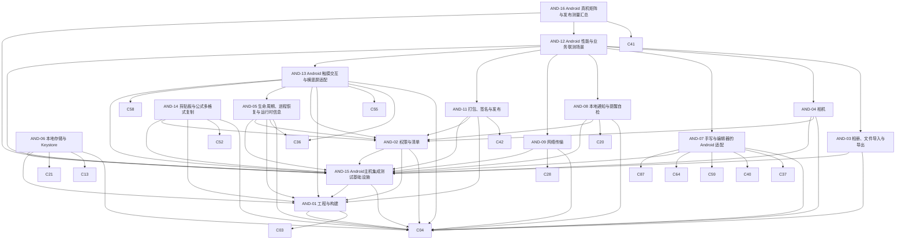

# 02 Android 端 v5.3.4

> 版本：v5.3.4 ｜ 修订日期：2026-10-20 ｜ 适用范围：Android 手机与平板（minSdk 26，即 Android 8.0 及以上）。
> 关联文档：[README](../README.md)（需求基线与追踪总表）、[01 公共核心](../core/00-总览.md)、[03 Windows 端](../win/00-总览.md)、[附录 A 架构决策与评审记录](../附录A-架构决策与评审记录.md)。
> 契约归属：本文只定义 Android 专属模块。公共契约（端口接口、FFI、DTO、错误码、表结构、服务端 API）只在 01 中定义；本文引用时写“CORE-xx §章节”，并内联实现时要调用的关键签名，不重新定义。

## 0. 使用方法

每次会话的完整材料以 [README §8.1](../README.md#81-每次会话的材料) 为准，不使用简化清单；字段与 01 相同，验收中的 [Rxx] 指向 README §5。

拆分布局：本文件只保留卡片以外的内容；卡片原位置的 `<!-- sadd:card 卡号 -->` 标记指向 `S0/` 或 `and/` 中的卡片文件（命名 `S编号_卡号_分组.md`，见 [README §7](../README.md#7-文档地图)）。“本文”指本文件与这些卡片的合集。

Android 端的职责边界：

- 只实现 CORE-04 §4 定义的平台端口、共享卡预留的平台接缝（CORE-37、CORE-40、CORE-55 等，经 `platformInstallers` 登记），以及工程、清单、打包、生命周期、触摸交互与屏幕适配等 Android 专属事务。
- 不得在 Kotlin/Java 或 Android 专属 Dart 代码中实现公式解析、量纲与单位、排版、判分、FSRS、同步合并、资源包验签或识别后处理；这些只调用 Rust 核心（经 CORE-03 §4 的 `CoreBinding`）。
- Android 专属 Dart 代码放在 `app/lib/platform/android/`，原生代码放在 `app/android/`；共享界面 `app/lib/ui/` 中不得出现 `Platform.isAndroid` 分支，差异通过端口或 `RuntimeInfo` 注入。

## 1. 模块依赖图

箭头从模块指向它的前置模块；省略每张卡都有的 CORE-01、CORE-02 依赖。

## 2. 建议实施顺序

与 [01 §2](../core/00-总览.md) 的阶段对齐；每张卡的前置卡都在同一阶段或更早阶段完成。

| 阶段 | 模块 | 出口 |
| --- | --- | --- |
| S0 骨架 | AND-01 | 空壳应用在真机启动，经 C ABI 显示 `fml_abi_version` |
| S2 本地库与账户入口 | AND-02、AND-05、AND-06、AND-09、AND-13、AND-15 | 清单权限最小化；加密库落盘、平台密钥包装可用；进程被杀后恢复到原页面；注册与登录走真实网络传输；手机与平板横竖屏跟随系统旋转，旋转与分屏不丢状态，触感、系统栏与动画缩放跟随设置 |
| S3 公式库与复制 | AND-14 | 公式多格式写入器可用，未安装时共享复制仅LaTeX |
| S4 内容与学习 | AND-08 | 每日复习提醒与提醒自检可用 |
| S5 识别与云识别 | AND-03、AND-04、AND-07 | 相册/文件/相机导入、手写与编辑器适配（云识别与资源包下载由 CORE-34、CORE-51 经 AND-09 传输完成） |
| S7 发布 | AND-11、AND-12、AND-16 | AAB 与 APK 签名发布；真机性能与能耗矩阵达标 |

## 3. 模块索引

| 编号 | 名称 | 代码位置 | 直接依赖 | 预估规模 |
| --- | --- | --- | --- | --- |
| AND-01 | 工程与构建 | `app/android/`、`app/lib/main_android.dart`、`app/lib/composition/ports_android.dart` | CORE-01、CORE-02、CORE-03、CORE-04 | 240 |
| AND-02 | 权限与清单 | `tools/ci/check_android_manifest.py` | CORE-01、CORE-02、CORE-04、AND-01、AND-15 | 300 |
| AND-03 | 相册、文件导入与导出 | `app/lib/platform/android/picker/`、`app/android/.../ImportBridge.kt`、`tools/ci/check_android_manifest.py` | CORE-01、CORE-02、CORE-04、AND-15 | 570 |
| AND-04 | 相机 | `app/lib/platform/android/camera/`、`app/android/.../CameraBridge.kt`、`app/android/.../CameraActivity.kt` | CORE-01、CORE-02、CORE-04、AND-02、AND-15 | 690 |
| AND-05 | 生命周期、进程恢复与运行时信息 | `app/lib/platform/android/lifecycle/` | CORE-01、CORE-02、CORE-04、CORE-36、AND-01、AND-02、AND-15 | 190 |
| AND-06 | 本地存储与 Keystore | `app/lib/platform/android/storage/`、`app/android/.../KeystoreBridge.kt` | CORE-01、CORE-02、CORE-04、CORE-13、CORE-21、AND-01、AND-15 | 355 |
| AND-07 | 手写与编辑器的 Android 适配 | `app/lib/platform/android/editing/` | CORE-01、CORE-02、CORE-04、CORE-37、CORE-40、CORE-59、CORE-64、AND-15、CORE-87 | 130 |
| AND-08 | 本地通知与提醒自检 | `app/lib/platform/android/notify/`、`app/android/.../` | CORE-01、CORE-02、CORE-04、CORE-20、AND-02、AND-15 | 550 |
| AND-09 | 网络传输 | `app/lib/platform/android/net/`、`app/android/.../NetBridge.kt` | CORE-01、CORE-02、CORE-04、CORE-28、AND-15 | 350 |
| AND-11 | 打包、签名与发布 | `tools/release/android/`、`app/android/app/build.gradle.kts` | CORE-01、CORE-02、CORE-42、AND-01、AND-02、AND-15 | 325 |
| AND-12 | Android 性能与业务联测场景 | `app/integration_test/android/` | CORE-01、CORE-02、AND-03、AND-04、AND-07、AND-08、AND-09、AND-11、AND-13、AND-15 | 560 |
| AND-13 | Android 触摸交互与横竖屏适配 | `app/lib/platform/android/interaction/`、`app/android/.../InteractionHandler.kt`、`app/android/app/src/main/res/values*/styles.xml`、`app/integration_test/android/interaction_test.dart` | CORE-01、CORE-02、CORE-04、CORE-36、CORE-55、AND-01、AND-02、AND-05、CORE-58、AND-15 | 405 |
| AND-14 | 剪贴板与公式多格式复制 | `app/lib/platform/android/clipboard/` | CORE-01、CORE-02、CORE-04、CORE-52、AND-01、AND-02、AND-15 | 305 |
| AND-15 | Android主机集成测试基础设施 | `tools/android/host_tests/run.py`、`tools/android/host_tests/build_fixture.py`、`app/lib/main.dart`、`app/outputs/flutter-apk/app-debug.apk`、`tools/android/host_tests/` | CORE-01、CORE-02、CORE-04、AND-01 | 655 |
| AND-16 | Android 真机矩阵与发布测量汇总 | `tools/perf/android/` | CORE-01、CORE-02、CORE-41、AND-12、AND-15 | 270 |

> AND-10（资源包获取与识别历史平台存储）已在 v5.1 撤销：资源包下载与管理并入 CORE-51，存储紧张时的识别历史清理并入 CORE-50（两端共用同一 Dart 实现）。编号不复用；理由见附录 D。

## 4. 端口实现映射

CORE-04 §4 的每个端口（共 11 个）在 Android 上由下表的卡实现；`composition/ports_android.dart`（AND-01）负责组装，实现卡只替换该端口对应的一行。

| 端口（CORE-04 §4） | Android 实现 | 卡片 |
| --- | --- | --- |
| `SecureKeyValueStore` | Android Keystore（优先 StrongBox，降级 TEE，再降级软件密钥并提示） | AND-06 |
| `LocalFileStore` | `noBackupFilesDir` 下按 `StoreArea` 分目录 | AND-06 |
| `ImagePicker` | Photo Picker、ACTION_PICK、SAF `ACTION_OPEN_DOCUMENT` | AND-03 |
| `ClipboardAdapter` | ClipboardManager（文本；图片 URI 只读一次）；复制公式写 text/plain、text/html 与 image/png（经 FileProvider） | AND-14 |
| `FileExporter` | SAF `ACTION_CREATE_DOCUMENT` | AND-03 |
| `DocumentPicker` | SAF `ACTION_OPEN_DOCUMENT`（按扩展名映射 MIME 过滤） | AND-03 |
| `CameraController` | CameraX | AND-04 |
| `AppLifecycle`、`RuntimeInfo` | Flutter 生命周期 + `onTrimMemory` + ActivityManager | AND-05 |
| `NotificationScheduler` | AlarmManager（非精确） + NotificationManager | AND-08 |
| `HttpTransport` | `dart:io` `HttpClient`（系统 CA、系统代理），由 CORE-28 `NetworkGuard` 包裹 | AND-09 |

CORE-55 的界面接缝（不属于 CORE-04 端口，经 `platformInstallers` 登记；契约见 CORE-55 §接口契约）在 Android 上的实现：

| 接缝（CORE-55） | Android 实现 | 卡片 |
| --- | --- | --- |
| `InputModalitySource` | 恒为 `touch`（外接鼠标与触控笔由共享根部 `Listener` 切换） | AND-13 |
| `UiFeedbackSink` | `View.performHapticFeedback`（应用内开关与系统“触摸振动”设置同时为开才触发） | AND-13 |
| `MotionScaleSource` | `Settings.Global.ANIMATOR_DURATION_SCALE` 及其变化 | AND-13 |
| `DevicePrefStore` | 不登记，使用 CORE-55 默认 `FileDevicePrefStore`（位于 AND-06 `noBackupFilesDir`，排除备份） | — |
| `AppearanceController.resolvedChanges`（订阅方） | 系统栏图标明暗与 edge-to-edge（`AndroidSystemBars`） | AND-13 |

---

## 5. 工程与系统集成

<!-- sadd:card AND-01 -->
<!-- sadd:card AND-02 -->
<!-- sadd:card AND-05 -->
<!-- sadd:card AND-06 -->
## 6. 输入与识别

<!-- sadd:card AND-03 -->
<!-- sadd:card AND-04 -->
<!-- sadd:card AND-07 -->
<!-- sadd:card AND-09 -->
## 7. 学习提醒

<!-- sadd:card AND-08 -->
## 8. 打包与质量

<!-- sadd:card AND-11 -->
<!-- sadd:card AND-12 -->
<!-- sadd:card AND-16 -->
## 9. 触摸交互与屏幕适配

<!-- sadd:card AND-13 -->
<!-- sadd:card AND-14 -->
<!-- sadd:card AND-15 -->
