# 01 公共核心 v5.3.4

> 版本：v5.3.4 ｜ 修订日期：2026-10-20 ｜ 适用范围：Android 与 Windows 两端共用的 Rust 核心、契约、服务端与共享 Flutter UI；HarmonyOS 只做接口预留。
> 关联文档：[README](../README.md)（需求基线与追踪总表）、[02 Android 端](../and/00-总览.md)、[03 Windows 端](../win/00-总览.md)、[附录 A 架构决策与评审记录](../附录A-架构决策与评审记录.md)、[附录 C 资源包内容与开源资源调查](../附录C-资源包内容与开源资源调查.md)。
> 契约归属：本文是全部公共契约（函数签名、DTO、错误码、表结构、文件格式、服务端 API）的唯一定义处。平台文档只引用“CORE-xx §接口契约”，不得重新定义。

## 0. 使用方法

每个模块一张卡，字段固定为：目标、范围、依赖、接口契约、实现约束、验收标准、规模。材料必须按 [README §8.1](../README.md#81-每次会话的材料) 组装，包含需求、Q 行、ADR 与正文相关契约；本文不另列简化清单。

验收标准中的 [Rxx] 指向 [README](../README.md) §5 需求追踪总表。卡片编号全局唯一，此后不重排；新增模块续取最大编号之后的下一个号；撤销卡删除正文并在所在文档 §3 下注明去向，编号不复用。

拆分布局：本文件只保留卡片以外的内容；卡片原位置的 `<!-- sadd:card 卡号 -->` 标记指向 `S0/` 或 `core/` 中的卡片文件（命名 `S编号_卡号_分组.md`，见 [README §7](../README.md#7-文档地图)）。“本文”指本文件与这些卡片的合集。

## 1. 模块依赖图

依赖图无环，且每张卡的依赖所在阶段不晚于它自己（§2）。编号按新增先后分配，不表示依赖次序：原有卡片的依赖都指向编号更小的卡；后增卡片中，CORE-45、CORE-46 以依赖倒置保持这一点（由更早的卡定义接口，后增卡实现），CORE-55 作为界面基础被 CORE-36～40、CORE-47～54 直接依赖，编号大于依赖它的卡，在 §2 中排在 CORE-36 之前。图中箭头从模块指向它的前置模块；为便于阅读，省略每张卡都有的 CORE-01、CORE-02 依赖，并省略可由其他路径推出的间接依赖边（完整直接依赖见 §3 与各卡“依赖”字段）。

```mermaid
graph TD
  C01["CORE-01 仓库骨架与工程约定"]
  C02["CORE-02 错误码注册表与诊断模型"]
  C03["CORE-03 C ABI 与 Dart 绑定"]
  C67["CORE-67 DTO schema 编译与漂移检查"]
  C04["CORE-04 平台端口契约"]
  C56["CORE-56 内置引擎数据与上下文编排"]
  C05["CORE-05 公式 AST 与修订模型"]
  C06["CORE-06 LaTeX 子集解析与导出"]
  C07["CORE-07 符号表、记号方案与常数集"]
  C08["CORE-08 量纲与单位"]
  C09["CORE-09 类型推断与量纲校验"]
  C10["CORE-10 计算器与数值求解"]
  C12["CORE-12 排版 DisplayList"]
  C11["CORE-11 公式间代入、推导链与计算链"]
  C13["CORE-13 本地库 Schema、单写者与迁移"]
  C14["CORE-14 公式库仓储"]
  C15["CORE-15 资源包格式、验签与安装"]
  C16["CORE-16 内容管线与课程内容包"]
  C17["CORE-17 卡片生成与 FSRS 排程"]
  C18["CORE-18 三层判分器"]
  C19["CORE-19 学习会话与组学习循环"]
  C20["CORE-20 学习统计、掌握度与本地提醒"]
  C21["CORE-21 密钥体系与加密原语"]
  C22["CORE-22 服务端骨架与身份认证"]
  C45["CORE-45 邮箱验证码与发信"]
  C23["CORE-23 账户状态、登录边界与本机解锁"]
  C28["CORE-28 隐私守卫、日志与复现包"]
  C24["CORE-24 游客转注册与游客并入"]
  C25["CORE-25 服务端同步存储与账户删除"]
  C68["CORE-68 同步 Envelope 共享线类型"]
  C26["CORE-26 同步引擎（加密、合并与隔离）"]
  C46["CORE-46 同步与升级协调器"]
  C36["CORE-36 应用壳、组装层、账户入口与导航"]
  C62["CORE-62 客户端 API 与令牌刷新适配"]
  C66["CORE-66 同步快照与密钥轮换编排"]
  C27["CORE-27 备份导出与恢复"]
  C29["CORE-29 识别契约与后端注册"]
  C30["CORE-30 图片解码与预处理"]
  C31["CORE-31 识别候选后处理与忠实转写"]
  C32["CORE-32 识别会话状态机与历史 GC"]
  C33["CORE-33 服务端云识别网关与 worker"]
  C34["CORE-34 云识别客户端与授权回执"]
  C35["CORE-35 本地识别模型后端"]
  C55["CORE-55 界面设计系统与主题"]
  C65["CORE-65 账户客户端控制器与安全令牌存取"]
  C58["CORE-58 设计组件、命令与外观入口"]
  C37["CORE-37 公式渲染组件与编辑器"]
  C73["CORE-73 引擎代数查询与缓存失效通知"]
  C38["CORE-38 公式库界面"]
  C59["CORE-59 公式编辑控制器与输入组件"]
  C61["CORE-61 公式草稿仓储"]
  C39["CORE-39 学习会话界面"]
  C40["CORE-40 识别流程编排、手写画布与图片预处理界面"]
  C64["CORE-64 墨迹控制器与手写画布"]
  C47["CORE-47 设置页与账户安全界面"]
  C48["CORE-48 计算器、代入与计算链界面"]
  C49["CORE-49 学习统计、提醒设置与自建书界面"]
  C50["CORE-50 识别结果、云端确认与识别历史界面"]
  C51["CORE-51 资源包下载、导入与管理界面"]
  C52["CORE-52 公式复制格式与富格式导出"]
  C53["CORE-53 LaTeX 命令补全"]
  C54["CORE-54 公式库批量选择与批量操作"]
  C41["CORE-41 CI 门禁与可维护性度量"]
  C69["CORE-69 源文件词法与依赖隐私门禁"]
  C70["CORE-70 SADD结构与验收索引门禁"]
  C71["CORE-71 可维护性度量与阈值报告"]
  C74["CORE-74 unsafe、ABI与错误注册表门禁"]
  C57["CORE-57 会话材料生成与文档统计工具"]
  C75["CORE-75 共享写入点预分配门禁"]
  C76["CORE-76 现行评级统计与就绪证据核对"]
  C77["CORE-77 量纲变量与合一"]
  C78["CORE-78 同步推送批次持久化"]
  C42["CORE-42 发布流水线、版本矩阵与回滚"]
  C43["CORE-43 服务端部署、资源分发与监控"]
  C72["CORE-72 云识别运维与熔断解除"]
  C44["CORE-44 鸿蒙预留与 C 头文件消费者验证"]
  C60["CORE-60 公式导入与用户单位管理界面"]
  C63["CORE-63 账户入口、注册登录与隐私页面"]
  C03 --> C67
  C04 --> C03
  C56 --> C03
  C56 --> C05
  C56 --> C06
  C56 --> C07
  C56 --> C08
  C56 --> C09
  C56 --> C10
  C56 --> C12
  C05 --> C03
  C06 --> C05
  C07 --> C05
  C07 --> C06
  C08 --> C05
  C09 --> C05
  C09 --> C06
  C09 --> C07
  C09 --> C08
  C09 --> C77
  C77 --> C05
  C77 --> C08
  C10 --> C05
  C10 --> C07
  C10 --> C08
  C10 --> C09
  C11 --> C05
  C11 --> C09
  C11 --> C10
  C11 --> C77
  C11 --> C56
  C12 --> C05
  C12 --> C06
  C13 --> C03
  C13 --> C04
  C13 --> C05
  C14 --> C05
  C14 --> C09
  C14 --> C11
  C14 --> C13
  C14 --> C56
  C15 --> C03
  C15 --> C13
  C15 --> C14
  C15 --> C56
  C16 --> C05
  C16 --> C06
  C16 --> C07
  C16 --> C08
  C16 --> C09
  C16 --> C15
  C17 --> C05
  C17 --> C09
  C17 --> C13
  C17 --> C14
  C18 --> C05
  C18 --> C06
  C18 --> C07
  C18 --> C09
  C18 --> C10
  C19 --> C13
  C19 --> C14
  C19 --> C17
  C19 --> C18
  C19 --> C16
  C20 --> C04
  C20 --> C13
  C20 --> C17
  C20 --> C19
  C21 --> C04
  C22 --> C04
  C45 --> C22
  C23 --> C04
  C23 --> C13
  C23 --> C21
  C23 --> C22
  C23 --> C28
  C24 --> C13
  C24 --> C21
  C24 --> C22
  C24 --> C23
  C25 --> C22
  C25 --> C21
  C25 --> C68
  C26 --> C13
  C26 --> C14
  C26 --> C17
  C26 --> C19
  C26 --> C21
  C26 --> C24
  C26 --> C25
  C26 --> C78
  C78 --> C13
  C46 --> C04
  C46 --> C22
  C46 --> C23
  C46 --> C24
  C46 --> C25
  C46 --> C26
  C46 --> C36
  C46 --> C62
  C46 --> C66
  C27 --> C04
  C27 --> C13
  C27 --> C17
  C27 --> C21
  C27 --> C23
  C28 --> C03
  C28 --> C04
  C28 --> C06
  C28 --> C12
  C28 --> C56
  C29 --> C03
  C29 --> C05
  C30 --> C03
  C30 --> C05
  C31 --> C05
  C31 --> C06
  C31 --> C07
  C31 --> C08
  C31 --> C09
  C31 --> C29
  C31 --> C56
  C32 --> C04
  C32 --> C13
  C32 --> C21
  C32 --> C23
  C32 --> C29
  C32 --> C30
  C32 --> C31
  C33 --> C22
  C34 --> C04
  C34 --> C22
  C34 --> C23
  C34 --> C28
  C34 --> C30
  C34 --> C32
  C34 --> C33
  C34 --> C62
  C35 --> C15
  C35 --> C29
  C36 --> C03
  C36 --> C04
  C36 --> C22
  C36 --> C23
  C36 --> C55
  C36 --> C28
  C36 --> C56
  C36 --> C62
  C36 --> C65
  C36 --> C58
  C37 --> C03
  C37 --> C04
  C37 --> C08
  C37 --> C09
  C37 --> C12
  C37 --> C55
  C37 --> C56
  C37 --> C58
  C37 --> C73
  C38 --> C03
  C38 --> C04
  C38 --> C08
  C38 --> C09
  C38 --> C13
  C38 --> C14
  C38 --> C36
  C38 --> C37
  C38 --> C55
  C38 --> C59
  C38 --> C61
  C38 --> C58
  C39 --> C03
  C39 --> C04
  C39 --> C19
  C39 --> C36
  C39 --> C37
  C39 --> C55
  C39 --> C58
  C39 --> C59
  C39 --> C28
  C40 --> C03
  C40 --> C04
  C40 --> C29
  C40 --> C30
  C40 --> C31
  C40 --> C32
  C40 --> C34
  C40 --> C35
  C40 --> C37
  C40 --> C39
  C40 --> C55
  C40 --> C64
  C40 --> C58
  C47 --> C03
  C47 --> C04
  C47 --> C23
  C47 --> C27
  C47 --> C32
  C47 --> C36
  C47 --> C55
  C47 --> C58
  C47 --> C62
  C47 --> C65
  C48 --> C03
  C48 --> C04
  C48 --> C09
  C48 --> C10
  C48 --> C11
  C48 --> C13
  C48 --> C14
  C48 --> C36
  C48 --> C37
  C48 --> C55
  C48 --> C58
  C49 --> C03
  C49 --> C04
  C49 --> C14
  C49 --> C19
  C49 --> C20
  C49 --> C23
  C49 --> C36
  C49 --> C37
  C49 --> C39
  C49 --> C55
  C49 --> C58
  C49 --> C28
  C50 --> C03
  C50 --> C04
  C50 --> C31
  C50 --> C32
  C50 --> C34
  C50 --> C36
  C50 --> C37
  C50 --> C38
  C50 --> C40
  C50 --> C55
  C50 --> C59
  C50 --> C58
  C51 --> C03
  C51 --> C04
  C51 --> C15
  C51 --> C36
  C51 --> C55
  C51 --> C28
  C51 --> C58
  C52 --> C03
  C52 --> C04
  C52 --> C05
  C52 --> C06
  C52 --> C07
  C52 --> C12
  C52 --> C37
  C52 --> C55
  C52 --> C59
  C52 --> C58
  C52 --> C73
  C53 --> C03
  C53 --> C04
  C53 --> C06
  C53 --> C37
  C53 --> C55
  C53 --> C59
  C53 --> C58
  C53 --> C28
  C54 --> C03
  C54 --> C04
  C54 --> C13
  C54 --> C14
  C54 --> C36
  C54 --> C38
  C54 --> C55
  C54 --> C58
  C55 --> C04
  C55 --> C28
  C41 --> C03
  C41 --> C69
  C41 --> C70
  C41 --> C71
  C41 --> C74
  C41 --> C57
  C41 --> C75
  C41 --> C76
  C42 --> C13
  C42 --> C41
  C43 --> C22
  C43 --> C25
  C43 --> C33
  C43 --> C72
  C44 --> C03
  C44 --> C04
  C58 --> C04
  C58 --> C28
  C58 --> C55
  C59 --> C03
  C59 --> C04
  C59 --> C08
  C59 --> C09
  C59 --> C12
  C59 --> C37
  C59 --> C55
  C59 --> C58
  C60 --> C03
  C60 --> C04
  C60 --> C08
  C60 --> C14
  C60 --> C36
  C60 --> C55
  C60 --> C58
  C61 --> C03
  C61 --> C05
  C61 --> C13
  C61 --> C14
  C62 --> C04
  C62 --> C22
  C63 --> C04
  C63 --> C36
  C63 --> C55
  C63 --> C58
  C63 --> C65
  C64 --> C04
  C64 --> C29
  C64 --> C55
  C64 --> C58
  C65 --> C03
  C65 --> C04
  C65 --> C22
  C65 --> C23
  C65 --> C45
  C65 --> C62
  C66 --> C03
  C66 --> C05
  C66 --> C13
  C66 --> C21
  C66 --> C24
  C66 --> C25
  C66 --> C26
  C66 --> C78
  C68 --> C05
  C68 --> C21
  C69 --> C03
  C70 --> C57
  C70 --> C67
  C70 --> C76
  C71 --> C69
  C72 --> C22
  C72 --> C33
  C73 --> C03
  C73 --> C56
  C74 --> C03
  C74 --> C69
  C76 --> C57
```

## 2. 建议实施顺序

原则：先搭最小可运行骨架，再逐个增加功能模块；每个阶段结束时两端都能编译运行，并且阶段内每张卡的前置卡都已在本阶段或更早阶段完成。同一阶段内互不依赖的卡可并行。

| 阶段 | 模块 | 出口（可运行的最小形态） |
| --- | --- | --- |
| S0 骨架 | CORE-01、CORE-02、CORE-03、CORE-04、CORE-41、AND-01、WIN-01、CORE-57、CORE-67、CORE-69、CORE-70、CORE-71、CORE-74、CORE-75、CORE-76 | 两端空壳应用启动，经 C ABI 调用 `fml_abi_version` 并显示版本号；CI 跑通格式、静态检查与 ABI 头文件比对 |
| S1 公式引擎 | CORE-05、CORE-06、CORE-07、CORE-08、CORE-77、CORE-09、CORE-10、CORE-11、CORE-12、CORE-56、CORE-73 | 核心 crate 测试全绿；经 `fml_call` 完成“LaTeX → 解析 → 量纲校验 → 计算 → DisplayList”往返 |
| S2 本地库、账户入口与编辑器 | CORE-13、CORE-21、CORE-22、CORE-45、CORE-28、CORE-23、CORE-55、CORE-36、CORE-37、AND-02、AND-05、AND-06、AND-09、AND-13、WIN-06、WIN-07、WIN-10、WIN-15、CORE-58、CORE-59、CORE-62、CORE-65、CORE-63 、AND-15、WIN-17 | 首次启动只能选游客或注册/登录；游客可输入公式、看到排版与错误高亮；数据加密落盘；进程被杀后可恢复 |
| S3 公式库与计算 | CORE-14、CORE-38、CORE-48、CORE-52、CORE-53、CORE-54、CORE-60、CORE-61、AND-14 | 公式保存、修订历史、搜索、计算器与公式间代入可用；Android写入器AND-14在S3完成，Windows写入器WIN-05在S5完成；各自写入器未登记前只写LaTeX文本 |
| S4 内容与学习 | CORE-15、CORE-16、CORE-17、CORE-18、CORE-19、CORE-20、CORE-39、CORE-49、CORE-51、AND-08、WIN-09 | bootstrap 包与至少一个课程包可安装；选书 → 组学习 → 默写 → 复习的闭环可日常自用；每日提醒 |
| S5 识别与云识别 | CORE-29、CORE-30、CORE-31、CORE-32、CORE-33、CORE-34、CORE-35、CORE-40、CORE-50、AND-03、AND-04、AND-07、WIN-04、WIN-05、WIN-08、WIN-14、CORE-64、CORE-72 | 手写与照片导入、预处理、候选校正、历史 GC；注册用户逐次授权云识别；游客只有本地/手动路径 |
| S6 同步与备份 | CORE-24、CORE-25、CORE-78、CORE-26、CORE-46、CORE-27、CORE-47、CORE-66、CORE-68 | 游客转注册、端到端加密同步、导出与恢复 |
| S7 发布 | CORE-42、CORE-43、CORE-44、AND-11、AND-12、WIN-16、WIN-02、WIN-03、WIN-12、WIN-13 | 门禁全绿、签名发布、安装与更新演练、监控演练、鸿蒙头文件冒烟通过 |

CORE-41 在 S0 建立，之后每个阶段为新模块启用对应门禁。

## 3. 模块索引

| 编号 | 名称 | 代码位置 | 直接依赖 | 预估规模 |
| --- | --- | --- | --- | --- |
| CORE-01 | 仓库骨架与工程约定 | 仓库根 | — | 300 |
| CORE-02 | 错误码注册表与诊断模型 | `contracts/errors/`、`crates/fml-error/`、`tools/ci/gen_errors.py` | 01 | 370 |
| CORE-03 | C ABI 与 Dart 绑定 | `crates/fml-ffi/`、`app/lib/binding/` | 01、02、67 | 490 |
| CORE-04 | 平台端口契约 | `app/lib/ports/`、`app/lib/composition/`、`app/test/fakes/` | 01、02、03 | 480 |
| CORE-05 | 公式 AST 与修订模型 | `crates/fml-ast/` | 01、02、03 | 450 |
| CORE-06 | LaTeX 子集解析与导出 | `crates/fml-latex/` | 01、02、05 | 500 |
| CORE-07 | 符号表、记号方案与常数集 | `crates/fml-notation/` | 01、02、05、06 | 400 |
| CORE-08 | 量纲与单位 | `crates/fml-units/` | 01、02、05 | 500 |
| CORE-09 | 类型推断与量纲校验 | `crates/fml-type/src/{rules,infer}.rs` | 01、02、05、06、07、08、77 | 480 |
| CORE-10 | 计算器与数值求解 | `crates/fml-eval/` | 01、02、05、07、08、09 | 500 |
| CORE-11 | 公式间代入、推导链与计算链 | `crates/fml-derive/` | 01、02、05、09、10、56、77 | 480 |
| CORE-12 | 排版 DisplayList | `crates/fml-typeset/` | 01、02、05、06 | 500 |
| CORE-13 | 本地库 Schema、单写者与迁移 | `crates/fml-store/` | 01、02、03、04、05 | 450 |
| CORE-14 | 公式库仓储 | `crates/fml-store/src/library/`（附属 `crates/fml-ffi/src/ops/units_user.rs`） | 01、02、05、09、11、13、56 | 500 |
| CORE-15 | 资源包格式、验签与安装 | `crates/fml-pack/`（附属 `crates/fml-ffi/src/ops/pack.rs`） | 01、02、03、13、14、56 | 500 |
| CORE-16 | 内容管线与课程内容包 | `tools/content/` | 01、02、05、06、07、08、09、15 | 500 |
| CORE-17 | 卡片生成与 FSRS 排程 | `crates/fml-srs/`、`crates/fml-store/src/study/cards.rs` | 01、02、05、09、13、14 | 500 |
| CORE-18 | 三层判分器 | `crates/fml-grade/` | 01、02、05、06、07、09、10 | 500 |
| CORE-19 | 学习会话与组学习循环 | `crates/fml-study/`、`crates/fml-store/src/study/sessions.rs` | 01、02、13、14、17、18、16 | 500 |
| CORE-20 | 学习统计、掌握度与本地提醒 | `crates/fml-study/src/stats/`、`app/lib/study/reminder_service.dart` | 01、02、04、13、17、19 | 450 |
| CORE-21 | 密钥体系与加密原语 | `crates/fml-crypto/` | 01、02、04 | 420 |
| CORE-22 | 服务端骨架与身份认证 | `server/src/{main.rs,config.rs,auth/,devices/,meta/}`、`server/migrations/0022_auth.sql` | 01、02、04 | 460 |
| CORE-23 | 账户状态、登录边界与本机解锁 | `crates/fml-store/src/account/`、`crates/fml-store/migrations/registry/` | 01、02、04、13、21、22、28 | 485 |
| CORE-24 | 游客转注册与游客并入 | `crates/fml-store/src/sync/upgrade.rs` | 01、02、13、21、22、23 | 450 |
| CORE-25 | 服务端同步存储与账户删除 | `server/src/sync/`、`server/src/account/` | 01、02、22、21、68 | 500 |
| CORE-26 | 同步引擎（加密、合并与隔离） | `crates/fml-store/src/sync/` | 01、02、13、14、17、19、21、24、25、78 | 440 |
| CORE-27 | 备份导出与恢复 | `crates/fml-store/src/backup/` | 01、02、04、13、17、21、23 | 490 |
| CORE-28 | 隐私守卫、日志与复现包 | `app/lib/privacy/`（附属 `crates/fml-error/src/log.rs`） | 01、02、03、04、06、12、56 | 480 |
| CORE-29 | 识别契约与后端注册 | `crates/fml-recognize/src/{lib.rs, registry.rs, ink.rs}` | 01、02、03、05 | 320 |
| CORE-30 | 图片解码与预处理 | `crates/fml-imgproc/` | 01、02、03、05 | 500 |
| CORE-31 | 识别候选后处理与忠实转写 | `crates/fml-recognize/src/post.rs` | 01、02、05、06、07、08、09、29、56 | 380 |
| CORE-32 | 识别会话状态机与历史 GC | `crates/fml-recognize/src/session.rs`、`crates/fml-store/src/recognition/`、`app/lib/recognition/history_key.dart` | 01、02、04、13、21、23、29、30、31 | 500 |
| CORE-33 | 服务端云识别网关与 worker | `server/src/recognition/` | 01、02、22 | 480 |
| CORE-34 | 云识别客户端与授权回执 | `app/lib/recognition/cloud/` | 01、02、04、22、23、28、30、32、33、62 | 450 |
| CORE-35 | 本地识别模型后端 | `crates/fml-recognize-local/` | 01、02、15、29 | 420 |
| CORE-36 | 应用壳、组装层、账户入口与导航 | `app/lib/composition/`、`app/lib/ui/shell/`、`app/lib/main_common.dart` | 01、02、03、04、22、23、55、28、56、62、65、58 | 380 |
| CORE-37 | 公式渲染组件与编辑器 | `app/lib/editor/editor_worker.dart`、`app/lib/ui/editor/{formula_view,math_text}.dart`、`app/lib/render/` | 01、02、03、04、08、09、12、55、56、58、73 | 300 |
| CORE-38 | 公式库界面 | `app/lib/library/`、`app/lib/ui/library/`（不含import/、units/） | 01、02、03、04、08、09、13、14、36、37、55、59、61、58 | 420 |
| CORE-39 | 学习会话界面 | `app/lib/study/`、`app/lib/ui/study/` | 01、02、03、04、19、36、37、55、58、59、28 | 480 |
| CORE-40 | 识别流程编排、手写画布与图片预处理界面 | `app/lib/recognition/flow/`、`app/lib/recognition/{answer_input,install}.dart`、`app/lib/ui/recognition/crop/` | 01、02、03、04、29、30、31、32、34、35、37、39、55、64、58 | 370 |
| CORE-47 | 设置页与账户安全界面 | `app/lib/settings/`、`app/lib/ui/settings/` | 01、02、03、04、23、27、32、36、55、58、62、65 | 480 |
| CORE-48 | 计算器、代入与计算链界面 | `app/lib/calc/`、`app/lib/ui/calc/`（附属 `crates/fml-store/src/library/plan.rs`） | 01、02、03、04、09、10、11、13、14、36、37、55、58 | 480 |
| CORE-49 | 学习统计、提醒设置与自建书界面 | `app/lib/study_stats/`、`app/lib/ui/study_stats/`、`app/lib/ui/books/` | 01、02、03、04、14、19、20、23、36、37、39、55、58、28 | 450 |
| CORE-50 | 识别结果、云端确认与识别历史界面 | `app/lib/recognition/pages/`、`app/lib/ui/recognition/pages/` | 01、02、03、04、31、32、34、36、37、38、40、55、59、58 | 480 |
| CORE-51 | 资源包下载、导入与管理界面 | `app/lib/packs/`、`app/lib/ui/packs/` | 01、02、03、04、15、36、55、28、58 | 420 |
| CORE-52 | 公式复制格式与富格式导出 | `crates/fml-export/`（附属 `crates/fml-ffi/src/ops/export.rs`）、`app/lib/export/` | 01、02、03、04、05、06、07、12、37、55、59、58、73 | 450 |
| CORE-53 | LaTeX 命令补全 | `app/lib/editor/completion/`、`app/lib/ui/editor/completion/` | 01、02、03、04、06、37、55、59、58、28 | 300 |
| CORE-54 | 公式库批量选择与批量操作 | `app/lib/library/batch/`、`app/lib/ui/library/batch/`、`crates/fml-store/src/library/batch.rs` | 01、02、03、04、13、14、36、38、55、58 | 460 |
| CORE-55 | 界面设计系统与主题 | `app/lib/design/`、`app/lib/ui/design/` | 01、02、04、28 | 360 |
| CORE-41 | CI 门禁与可维护性度量 | `.github/workflows/`、`tools/ci/` | 01、02、03、69、70、71、74、57、75、76 | 300 |
| CORE-42 | 发布流水线、版本矩阵与回滚 | `tools/release/` | 01、02、13、41 | 420 |
| CORE-43 | 服务端部署、资源分发与监控 | `server/deploy/`、`server/src/ops/` | 01、02、22、25、33、72 | 420 |
| CORE-44 | 鸿蒙预留与 C 头文件消费者验证 | `tools/ohos-smoke/` | 01、02、03、04 | 180 |
| CORE-45 | 邮箱验证码与发信 | `server/src/email/` | 01、02、22 | 380 |
| CORE-46 | 同步与升级协调器 | `app/lib/sync/` | 01、02、04、22、23、24、25、26、36、62、66 | 450 |
| CORE-56 | 内置引擎数据与上下文编排 | `crates/fml-ffi/` | 01、02、03、05、06、07、08、09、10、12 | 500 |
| CORE-57 | 会话材料生成与文档统计工具 | `tools/sadd/` | 01、02 | 380 |
| CORE-58 | 设计组件、命令与外观入口 | `app/lib/ui/design/components/`、`app/lib/ui/design/warmup.dart`、`app/lib/design/{commands,routes}.dart` | 01、02、04、28、55 | 430 |
| CORE-59 | 公式编辑控制器与输入组件 | `app/lib/editor/`、`app/lib/ui/editor/`（controller、templates、palette、declaration、formula_editor、copy） | 01、02、03、04、08、09、12、37、55、58 | 440 |
| CORE-60 | 公式导入与用户单位管理界面 | `app/lib/library/import/`、`app/lib/library/units/`、`app/lib/ui/library/import/`、`app/lib/ui/library/units/` | 01、02、03、04、08、14、36、55、58 | 320 |
| CORE-61 | 公式草稿仓储 | `crates/fml-store/src/library/draft.rs`、`crates/fml-store/migrations/0061_formula_draft.sql` | 01、02、03、05、13、14 | 160 |
| CORE-62 | 客户端 API 与令牌刷新适配 | `app/lib/net/` | 01、02、04、22 | 220 |
| CORE-63 | 账户入口、注册登录与隐私页面 | `app/lib/account/pages/`、`app/lib/ui/account/` | 01、02、04、36、55、58、65 | 300 |
| CORE-64 | 墨迹控制器与手写画布 | `app/lib/recognition/ink/`、`app/lib/ui/recognition/ink/` | 01、02、04、29、55、58 | 320 |
| CORE-65 | 账户客户端控制器与安全令牌存取 | `app/lib/account/` | 01、02、03、04、22、23、45、62 | 460 |
| CORE-66 | 同步快照与密钥轮换编排 | `crates/fml-store/src/sync/` | 01、02、03、05、13、21、24、25、26、78 | 400 |
| CORE-67 | DTO schema 编译与漂移检查 | `tools/ci/gen_dto.py`、`contracts/dto/` | 01、02 | 480 |
| CORE-68 | 同步 Envelope 共享线类型 | `crates/fml-sync-proto/` | 01、02、05、21 | 120 |
| CORE-69 | 源文件词法与依赖隐私门禁 | `tools/ci/{common,source_scan,check_deps,check_privacy}.py` | 01、02、03 | 430 |
| CORE-70 | SADD结构与验收索引门禁 | `tools/sadd/structure.mjs` | 01、02、57、67、76 | 440 |
| CORE-71 | 可维护性度量与阈值报告 | `tools/ci/maint_report.py` | 01、02、69 | 460 |
| CORE-72 | 云识别运维与熔断解除 | `server/ops/` | 01、02、22、33 | 220 |
| CORE-73 | 引擎代数查询与缓存失效通知 | `crates/fml-ffi/src/ops/generation.rs` | 01、02、03、56 | 320 |
| CORE-74 | unsafe、ABI与错误注册表门禁 | `tools/ci/{check_unsafe,check_abi,check_errors}.py` | 01、02、03、69 | 400 |
| CORE-75 | 共享写入点预分配门禁 | `tools/sadd/reservations.mjs` | 01、02 | 220 |
| CORE-76 | 现行评级统计与就绪证据核对 | `tools/sadd/{current,stats,audit}.mjs` | 01、02、57 | 380 |
| CORE-77 | 量纲变量与合一 | `crates/fml-type/src/dim.rs` | 01、02、05、08 | 400 |
| CORE-78 | 同步推送批次持久化 | `crates/fml-store/src/sync/batch.rs` | 01、02、13 | 210 |

“直接依赖”列只写编号尾数，如“05”即 CORE-05。

## 4. 骨架与基础契约

<!-- sadd:card CORE-01 -->
<!-- sadd:card CORE-02 -->
<!-- sadd:card CORE-03 -->
<!-- sadd:card CORE-04 -->
<!-- sadd:card CORE-56 -->
## 5. 公式引擎

<!-- sadd:card CORE-05 -->
<!-- sadd:card CORE-06 -->
<!-- sadd:card CORE-07 -->
<!-- sadd:card CORE-08 -->
<!-- sadd:card CORE-09 -->
<!-- sadd:card CORE-10 -->
<!-- sadd:card CORE-11 -->
<!-- sadd:card CORE-12 -->
## 6. 本地数据、公式库与资源包

<!-- sadd:card CORE-13 -->
<!-- sadd:card CORE-14 -->
<!-- sadd:card CORE-15 -->
<!-- sadd:card CORE-16 -->
## 7. 学习

<!-- sadd:card CORE-17 -->
<!-- sadd:card CORE-18 -->
<!-- sadd:card CORE-19 -->
<!-- sadd:card CORE-20 -->
## 8. 账户、加密与同步

<!-- sadd:card CORE-21 -->
<!-- sadd:card CORE-22 -->
<!-- sadd:card CORE-45 -->
<!-- sadd:card CORE-23 -->
<!-- sadd:card CORE-24 -->
<!-- sadd:card CORE-25 -->
<!-- sadd:card CORE-26 -->
<!-- sadd:card CORE-46 -->
<!-- sadd:card CORE-27 -->
<!-- sadd:card CORE-28 -->
## 9. 识别管线与云端 LLM 网关

<!-- sadd:card CORE-29 -->
<!-- sadd:card CORE-30 -->
<!-- sadd:card CORE-31 -->
<!-- sadd:card CORE-32 -->
<!-- sadd:card CORE-33 -->
<!-- sadd:card CORE-34 -->
<!-- sadd:card CORE-35 -->
## 10. 共享 Flutter UI

> 本章各卡只依赖 Dart 侧的 `CoreBinding`（CORE-03）与平台端口（CORE-04），两端共用同一份代码；平台差异只通过端口和 `RuntimeInfo` 表达，不写 `Platform.isAndroid` 分支（CI 检查 `app/lib/ui/` 下禁止出现该调用）。

<!-- sadd:card CORE-36 -->
<!-- sadd:card CORE-37 -->
<!-- sadd:card CORE-38 -->
<!-- sadd:card CORE-39 -->
<!-- sadd:card CORE-40 -->
<!-- sadd:card CORE-47 -->
<!-- sadd:card CORE-48 -->
<!-- sadd:card CORE-49 -->
<!-- sadd:card CORE-50 -->
<!-- sadd:card CORE-51 -->
<!-- sadd:card CORE-52 -->
<!-- sadd:card CORE-53 -->
<!-- sadd:card CORE-54 -->
<!-- sadd:card CORE-55 -->
## 11. 工程门禁、发布与预留

<!-- sadd:card CORE-41 -->
<!-- sadd:card CORE-42 -->
<!-- sadd:card CORE-43 -->
<!-- sadd:card CORE-44 -->
<!-- sadd:card CORE-57 -->
<!-- sadd:card CORE-58 -->
<!-- sadd:card CORE-59 -->
<!-- sadd:card CORE-60 -->
<!-- sadd:card CORE-61 -->
<!-- sadd:card CORE-62 -->
<!-- sadd:card CORE-63 -->
<!-- sadd:card CORE-64 -->
<!-- sadd:card CORE-65 -->
<!-- sadd:card CORE-66 -->
<!-- sadd:card CORE-67 -->
<!-- sadd:card CORE-68 -->
<!-- sadd:card CORE-69 -->
<!-- sadd:card CORE-70 -->
<!-- sadd:card CORE-71 -->
<!-- sadd:card CORE-72 -->
<!-- sadd:card CORE-73 -->
<!-- sadd:card CORE-74 -->
<!-- sadd:card CORE-75 -->
<!-- sadd:card CORE-76 -->
<!-- sadd:card CORE-77 -->
<!-- sadd:card CORE-78 -->
