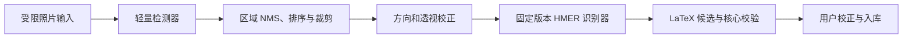

# YOLO 与轻量公式区域检测详细预研方案 v3.0

_BubeiGongshi · 2026-10-18 · 仅实验分支，未实现、未选定权重、无主线合入承诺_

---

## 🎯 预研问题与隔离

本文件只存放于 `codex/exp-yolo-recognizer`，不合入 `main`。主线的识别端口、隐私与历史契约以 [总体架构](../10-软件架构设计-v3.md)、[生命周期](../11-数据安全同步与识别生命周期-v3.md) 为准。既有主线 `07` 简版是历史材料，本文件给出重新审议后的具体研究边界。

研究问题：在多公式、复杂背景、倾斜/阴影照片上，增加轻量公式区域检测是否比“用户裁剪 + 传统增强 + 同一公式识别器”显著减少用户校正成本，并保持端侧预算？

YOLO 只承担区域检测/排序，不承担完整二维公式到 LaTeX 的转换；后续仍需 HMER 编码/结构解码器。不能用检测框准确率代替公式识别准确率。

实验代码未来放 `experiments/yolo/`，不加入主线 workspace、应用构建与安装包。训练数据、用户照片、大权重均不提交 Git；版本/哈希/许可清单随实验记录保存。实验分支按阶段合并主线变化，不对共享分支强推重写历史。

## 🏗️ 管线与接口

检测器独立接口：`detect(image, limits, cancellation) → Region[]`。每个 Region 含归一化 box/polygon、可选置信度、方向、阅读顺序、模型版本与诊断。限制最多10个公式区域；超过则引导裁剪，不能无界逐区推理。输入hash、裁剪映射与原图坐标关系保留，以便展示用户实际提交的区域。

主线统一 `FormulaRecognizer` 输出仍是公式候选，检测框不伪装成符号级对齐。区域检测失败回退用户裁剪；不得自动上传云端。多区域分别确认；一次原始照片识别会话的分区结果归于同一 history session，避免按区域绕开主线N计数。

## 🔍 候选与许可

| 候选 | 定位 | 决策前必须核实 |
| --- | --- | --- |
| 传统连通域/投影/形态学 | 无模型基线，低依赖 | 细笔画/复杂背景的召回，真实端到端收益 |
| YOLOX-Tiny 等轻量检测器 | 宽松代码许可方向的候选 | 已读取上游 Apache-2.0 LICENSE；权重/训练数据逐项核查，不能以代码许可替代 |
| Ultralytics nano 系列 | 工具链成熟的候选 | 上游 AGPL/Enterprise 指引已核实，具体代码/模型/产品分发方式需评估，未满足许可不得集成 |
| 其他轻量检测器 | 条件备选 | 是否维护、导出算子、CPU性能、许可和训练数据；不为“选最新版本”牺牲可复现 |

核实入口见 [资源调查 S07/S08](../12-资源包内容与开源资源调查-v3.md)。模型版本与权重尚未选定，以上不表示准确率、商业使用权限或设备支持已通过。

优先比较同一CPU运行时，不把多个native推理框架一起打包。ONNX Runtime Mobile 与 MNN 原型二选一，记录完整版本、算子白名单、量化校准数据、导出日志及误差。GPU/NPU只作增强，CPU必须可用；不能承诺所有Android设备都有同一加速delegate。

## 📚 数据与评估协议

建立≥1000张有代表性的照片检测集，覆盖单公式/多公式、印刷/手写混合、纸张/白板、阴影/倾斜、细笔画、分数/矩阵。训练/验证/测试按作者、原始页面和表达式模板隔离，裁剪、增强或连拍版本不得跨集合泄漏。

标注包含公式区域、阅读顺序、对应LaTeX与困难标签；抽样双人复核。只用许可明确的数据或获得授权的独立采集数据；不自动使用生产用户图片训练。公开数据不等于允许任意训练/商业再分发，保留数据条款与来源版本。

固定三组对照：A 用户裁剪+原图，B 用户裁剪+传统增强，C 检测+同等增强；三组使用相同HMER、词表、后处理和测试集。分别测纯检测收益和全自动区域切分收益，不能把更换识别器的提升归因于YOLO。

| 指标 | 报告口径 | 初始评审门槛（未实测） |
| --- | --- | --- |
| 区域召回 | IoU≥0.5，按手写/多公式/困难场景分组 | 总体≥95%，高危漏检类别单列 |
| 检测精度 | mAP@0.5 与 mAP@0.5:0.95，各类误检/漏检 | 先报告实测，不用mAP代替识别质量 |
| 端到端 | AST结构Top-1/Top-3、精确分区与阅读顺序 | 相对最佳传统基线Top-1提升≥5个百分点，或校正操作中位数降低≥20% |
| 用户成本 | 漏区补选、重裁剪、符号修改、总完成时间 | 无关键困难组明显退化，报告区间与样本数 |
| 稳定性 | 无效图、取消、内存压力、反复加载 | 无崩溃/泄漏；失败可恢复人工裁剪 |

以上门槛是研究的继续/停止条件，不能作为已经达到的宣传指标。报告置信区间和分组样本量，避免只展示最好的照片。

## ⚡ 性能与资源预算

| 指标 | 初始预算 | 测量要求 |
| --- | --- | --- |
| 检测权重 | INT8≤15MiB | 原始与量化精度同时评估 |
| 检测输入 | 640或960px等固定规格 | 每个规格独立记录，不混平均值 |
| CPU检测P95 | 中端4GB Android≤200ms | 不含解码/模型加载，分别报告 |
| 额外峰值PSS | ≤80MiB | 扣除相同基线，含tensor和运行时 |
| 完整识别峰值 | 遵守主线≤320MiB候选预算 | 并行加载检测/HMER超预算时串行或释放 |
| 释放 | 任务结束60s内回到主线回落范围 | 进程/allocator驻留实测，不声称卸载就零RSS |

每种设备预热5次、测量≥100次，并记录模型首次加载和冷路径。连续20张12MP图、后台切换、取消和OOM降级单独压力测试。若降低分辨率导致小符号区域漏检，应保留人工裁剪入口，不盲目缩小输入以凑时延。

## 🛡️ 包安全、隐私与垃圾回收

实验使用主线相同的20MiB/4000万像素输入限制、受控native解码与2048px工作图预算；不在UI解码全图。模型仅数据和白名单算子，不通过包携带任意可执行custom op。启用发布实验也必须模型签名/hash/许可通过，下载配置不能加载任意URL或动态库。

游客只在本机运行。裁剪区、热图、debug叠图、检测中间张量、缩略图和模型请求缓存纳入同一会话清理，不能在实验目录额外留下明文照片。N=0、默认5和100仍遵守主线严格计数；实验结果不得默认进入训练集或远端遥测。

## 🚀 实验阶段、交付与退出

1. P0：冻结基线、标注集、来源许可、运行时与硬件；不训练前先测传统方案。
2. P1：检测器离线验证、导出与量化；记录精度、结构和各输入规格结果。
3. P2：临时端侧适配与真实校正任务评估；只在实验构建启用。
4. P3：整理复现脚本、模型/数据卡、许可证、基准与隐私/GC结果，由评审决定停止或继续。

交付实验报告、版本锁定、数据/权重许可、导出和校准记录、真机P50/P95/峰值、原始匿名测量汇总、失效案例与决策；没有实现的项目标记not_run。该文档当前只交付预研设计，没有训练/推理结果。

若传统预处理收益已经足够、许可无法闭合、漏检/校正无改善、CPU/内存预算失败，停止投入。即使通过技术门槛，也须甲方明确批准新的生产范围后，才能把独立复核后的适配器纳入可选能力；本实验分支不直接整体合并主线。
