# 03 Windows 端 v5.3.4

> 版本：v5.3.4 ｜ 修订日期：2026-10-20 ｜ 适用范围：Windows 10 1809（build 17763）及以上 x64 桌面，Windows 11 为主测环境（甲方确认，见 README §6 Q5）。
> 关联文档：[README](../README.md)（需求基线与追踪总表）、[01 公共核心](../core/00-总览.md)、[02 Android 端](../and/00-总览.md)、[附录 A 架构决策与评审记录](../附录A-架构决策与评审记录.md)。
> 契约归属：本文只定义 Windows 专属模块。公共契约（端口接口、FFI、DTO、错误码、表结构、服务端 API）只在 01 中定义；本文引用时写“CORE-xx §章节”，并内联实现时要调用的关键签名，不重新定义。

## 0. 使用方法

每次会话的完整材料以 [README §8.1](../README.md#81-每次会话的材料) 为准，不使用简化清单；字段与 01 相同，验收中的 [Rxx] 指向 README §5。

拆分布局：本文件只保留卡片以外的内容；卡片原位置的 `<!-- sadd:card 卡号 -->` 标记指向 `S0/` 或 `win/` 中的卡片文件（命名 `S编号_卡号_分组.md`，见 [README §7](../README.md#7-文档地图)）。“本文”指本文件与这些卡片的合集。

Windows 端的职责边界：

- 只实现 CORE-04 §4 定义的平台端口，以及工程、安装、更新、窗口、键盘效率等 Windows 专属事务。
- 不得在 C++/C# 或 Windows 专属 Dart 代码中实现公式解析、量纲与单位、排版、判分、FSRS、同步合并、资源包验签或识别后处理；这些只调用 Rust 核心（经 CORE-03 §4 的 `CoreBinding`）。
- Windows 专属 Dart 代码放在 `app/lib/platform/windows/`，原生代码放在 `app/windows/`；共享界面 `app/lib/ui/` 中不得出现 `Platform.isWindows` 分支。
- 桌面端的输入优先级与 Android 不同：LaTeX 源码 > 结构化模板 > 图片/手写导入（默认模式由 CORE-59 `defaultEditorMode` 按 `RuntimeInfo` 决定）。
- 平台专属界面行为只经接缝接入：`PlatformPorts.platformInstallers`（CORE-04）登记 `EditorPlatformBindings`（CORE-59）、`InkInputPolicy`（CORE-64）、`ShellKeyHandler`、`SettingsSections`、`AppNavigator`（CORE-36）、`FormulaClipboardWriter`（CORE-52）、`ImageDropSource`（CORE-50）、`InputModalitySource` / `MotionScaleSource` / `DevicePrefStore` / `ShortcutLabelSource`（CORE-55）；不修改共享界面文件。
- 桌面交互（WIN-15）：键鼠优先，学习流程可全程用键盘完成；全应用只有 WIN-15 的 `WindowsKeyRouter` 登记为 `ShellKeyHandler`，WIN-08 的全局快捷键挂入其中；最小窗口 600 × 500 逻辑像素；视觉与交互遵守 CORE-55，Windows 不登记 `UiFeedbackSink`。

## 1. 模块依赖图

箭头从模块指向它的前置模块；省略每张卡都有的 CORE-01、CORE-02 依赖。

```mermaid
graph TD
  W01["WIN-01 工程与构建"]
  C03["CORE-03 C ABI 与 Dart 绑定"]
  C04["CORE-04 平台端口契约"]
  W02["WIN-02 安装器与卸载"]
  C42["CORE-42 发布流水线、版本矩阵与回滚"]
  W16["WIN-16 启动器与更新恢复"]
  W17["WIN-17 Windows主机集成测试基础设施"]
  W03["WIN-03 自更新客户端"]
  C23["CORE-23 账户状态、登录边界与本机解锁"]
  C36["CORE-36 应用壳、组装层、账户入口与导航"]
  C43["CORE-43 服务端部署、资源分发与监控"]
  C65["CORE-65 账户客户端控制器与安全令牌存取"]
  C28["CORE-28 隐私守卫、日志与复现包"]
  W06["WIN-06 窗口、DPI、生命周期与单实例"]
  W07["WIN-07 本地存储与 DPAPI"]
  C13["CORE-13 本地库 Schema、单写者与迁移"]
  C21["CORE-21 密钥体系与加密原语"]
  W04["WIN-04 文件导入、拖拽与导出"]
  C50["CORE-50 识别结果、云端确认与识别历史界面"]
  W05["WIN-05 剪贴板与多格式复制"]
  C52["CORE-52 公式复制格式与富格式导出"]
  W08["WIN-08 编辑器快捷键、输入法与笔输入"]
  C37["CORE-37 公式渲染组件与编辑器"]
  C40["CORE-40 识别流程编排、手写画布与图片预处理界面"]
  W15["WIN-15 Windows 桌面交互与窗口适配"]
  C59["CORE-59 公式编辑控制器与输入组件"]
  C64["CORE-64 墨迹控制器与手写画布"]
  W14["WIN-14 快捷键自定义"]
  C55["CORE-55 界面设计系统与主题"]
  C58["CORE-58 设计组件、命令与外观入口"]
  W10["WIN-10 网络传输"]
  W09["WIN-09 应用内提醒、托盘与开机自启"]
  C20["CORE-20 学习统计、掌握度与本地提醒"]
  W12["WIN-12 代码签名与发布检查"]
  W13["WIN-13 性能与环境矩阵"]
  W01 --> C03
  W01 --> C04
  W02 --> C42
  W02 --> W01
  W02 --> W16
  W02 --> W17
  W03 --> C04
  W03 --> C23
  W03 --> C36
  W03 --> C43
  W03 --> W02
  W03 --> W16
  W03 --> C65
  W03 --> C28
  W03 --> W17
  W06 --> C04
  W06 --> C36
  W06 --> W01
  W06 --> W17
  W07 --> C04
  W07 --> C13
  W07 --> C21
  W07 --> C36
  W07 --> W01
  W07 --> W17
  W04 --> C04
  W04 --> C50
  W04 --> W01
  W04 --> W17
  W05 --> C04
  W05 --> C52
  W05 --> W04
  W05 --> W17
  W08 --> C04
  W08 --> C36
  W08 --> C37
  W08 --> C40
  W08 --> W15
  W08 --> C59
  W08 --> C64
  W08 --> C28
  W08 --> W17
  W14 --> C04
  W14 --> C36
  W14 --> W06
  W14 --> W08
  W14 --> W15
  W14 --> C28
  W14 --> W17
  W15 --> C04
  W15 --> C36
  W15 --> C55
  W15 --> W01
  W15 --> W06
  W15 --> C58
  W15 --> C28
  W15 --> W17
  W10 --> C04
  W10 --> W01
  W10 --> W17
  W09 --> C04
  W09 --> C20
  W09 --> C36
  W09 --> W06
  W09 --> W17
  W12 --> C42
  W12 --> W02
  W12 --> W03
  W12 --> W17
  W13 --> W04
  W13 --> W05
  W13 --> W08
  W13 --> W09
  W13 --> W10
  W13 --> W12
  W13 --> W15
  W13 --> W14
  W13 --> W17
  W16 --> W01
  W16 --> W06
  W16 --> W07
  W16 --> W17
  W17 --> C04
  W17 --> W01
```

## 2. 建议实施顺序

与 [01 §2](../core/00-总览.md) 的阶段对齐；每张卡的前置卡都在同一阶段或更早阶段完成。

| 阶段 | 模块 | 出口 |
| --- | --- | --- |
| S0 骨架 | WIN-01 | Release 构建在 Windows 10/11 启动并显示 CORE-04 冒烟页（ABI 版本；运行时快照端口未实现时显示固定的“未实现”提示） |
| S2 本地库与账户入口 | WIN-06、WIN-07、WIN-10、WIN-15、WIN-17 | 单实例、高 DPI 窗口与位置恢复；最小窗口、标题栏深浅色、输入方式与学习键盘命令；加密库落盘、DPAPI 包装可用；HTTPS 传输契约套件通过 |
| S4 内容与学习 | WIN-09 | 托盘、应用内提醒与开机自启 |
| S5 识别与云识别 | WIN-04、WIN-05、WIN-08、WIN-14 | 文件、拖放、剪贴板导入；多格式复制；快捷键（含自定义）与笔输入 |
| S7 发布 | WIN-16、WIN-02、WIN-03、WIN-12、WIN-13 | 签名安装器、卸载、自更新与回滚演练；环境矩阵达标 |

## 3. 模块索引

| 编号 | 名称 | 代码位置 | 直接依赖 | 预估规模 |
| --- | --- | --- | --- | --- |
| WIN-01 | 工程与构建 | `app/windows/`、`app/lib/main_windows.dart`、`app/lib/composition/ports_windows.dart` | CORE-01、CORE-02、CORE-03、CORE-04 | 380 |
| WIN-02 | 安装器与卸载 | `installer/windows/` | CORE-01、CORE-02、CORE-42、WIN-01、WIN-16、WIN-17 | 300 |
| WIN-03 | 自更新客户端 | `app/lib/platform/windows/update/`、`app/windows/runner/update_channel.cpp` | CORE-01、CORE-02、CORE-04、CORE-23、CORE-36、CORE-43、WIN-02、WIN-16、CORE-65、CORE-28、WIN-17 | 360 |
| WIN-04 | 文件导入、拖拽与导出 | `app/lib/platform/windows/picker/`、`app/windows/runner/file_dialog.cpp` | CORE-01、CORE-02、CORE-04、CORE-50、WIN-01、WIN-17 | 450 |
| WIN-05 | 剪贴板与多格式复制 | `app/lib/platform/windows/clipboard/`、`app/windows/runner/clipboard_channel.cpp` | CORE-01、CORE-02、CORE-04、CORE-52、WIN-04、WIN-17 | 320 |
| WIN-06 | 窗口、DPI、生命周期与单实例 | `app/lib/platform/windows/window/`、`app/windows/runner/` | CORE-01、CORE-02、CORE-04、CORE-36、WIN-01、WIN-17 | 420 |
| WIN-07 | 本地存储与 DPAPI | `app/lib/platform/windows/storage/`、`app/windows/runner/keystore_channel.cpp` | CORE-01、CORE-02、CORE-04、CORE-13、CORE-21、CORE-36、WIN-01、WIN-17 | 450 |
| WIN-08 | 编辑器快捷键、输入法与笔输入 | `app/lib/platform/windows/editing/`、`app/windows/runner/pen_channel.cpp` | CORE-01、CORE-02、CORE-04、CORE-36、CORE-37、CORE-40、WIN-15、CORE-59、CORE-64、CORE-28、WIN-17 | 460 |
| WIN-09 | 应用内提醒、托盘与开机自启 | `app/lib/platform/windows/notify/`、`app/windows/runner/tray_channel.cpp` | CORE-01、CORE-02、CORE-04、CORE-20、CORE-36、WIN-06、WIN-17 | 380 |
| WIN-10 | 网络传输 | `app/lib/platform/windows/net/`、`app/windows/runner/net_channel.cpp` | CORE-01、CORE-02、CORE-04、WIN-01、WIN-17 | 240 |
| WIN-12 | 代码签名与发布检查 | `tools/release/windows/` | CORE-01、CORE-02、CORE-42、WIN-02、WIN-03、WIN-17 | 250 |
| WIN-13 | 性能与环境矩阵 | `app/integration_test/windows/`（附属 `tools/perf/windows/`） | CORE-01、CORE-02、WIN-04、WIN-05、WIN-08、WIN-09、WIN-10、WIN-12、WIN-15、WIN-14、WIN-17 | 430 |
| WIN-14 | 快捷键自定义 | `app/lib/platform/windows/keymap/` | CORE-01、CORE-02、CORE-04、CORE-36、WIN-06、WIN-08、WIN-15、CORE-28、WIN-17 | 340 |
| WIN-15 | Windows 桌面交互与窗口适配 | `app/lib/platform/windows/interaction/`、`app/windows/runner/interaction_channel.cpp`、`app/integration_test/windows/interaction_test.dart` | CORE-01、CORE-02、CORE-04、CORE-36、CORE-55、WIN-01、WIN-06、CORE-58、CORE-28、WIN-17 | 380 |
| WIN-16 | 启动器与更新恢复 | `installer/windows/launcher/` | CORE-01、CORE-02、WIN-01、WIN-06、WIN-07、WIN-17 | 420 |
| WIN-17 | Windows主机集成测试基础设施 | `tools/windows/host_tests/` | CORE-01、CORE-02、CORE-04、WIN-01 | 360 |

> WIN-11（资源包获取与识别历史平台存储）已在 v5.1 撤销：资源包下载、续传与管理并入 CORE-51，存储空间检查与历史清理并入 CORE-50 与 CORE-32，两端共用同一 Dart 实现；编号不复用，理由见附录 D。

## 4. 端口实现映射

| 端口（CORE-04） | Windows 实现 | 卡片 |
| --- | --- | --- |
| `SecureKeyValueStore` | DPAPI（`CryptProtectData`，当前用户范围） | WIN-07 |
| `LocalFileStore` | `%LOCALAPPDATA%\BubeiGongshi\` 下按 `StoreArea` 分目录，受保护 DACL | WIN-07 |
| `ImagePicker` | `IFileOpenDialog` 多选 | WIN-04 |
| `DocumentPicker` | `IFileOpenDialog` 按扩展名过滤 | WIN-04 |
| `FileExporter` | `IFileSaveDialog`，默认“文档” | WIN-04 |
| `CameraController` | 不实现，抛 `PLATFORM_UNSUPPORTED`（桌面端用文件、拖放、剪贴板导入） | WIN-04 |
| `ClipboardAdapter` | 文本经 Flutter `Clipboard`；图片读取 PNG / CF_DIBV5 / CF_DIB；复制公式写 MathML、HTML、SVG、PNG、CF_DIB、Unicode 文本与 text/x-latex | WIN-05 |
| `AppLifecycle`、`RuntimeInfo` | 窗口消息、低内存通知；`RtlGetVersion`、DXGI | WIN-06 |
| `NotificationScheduler` | 应用内定时 + 托盘通知（`NIF_INFO`）+ 任务栏闪烁 | WIN-09 |
| `HttpTransport` | `dart:io` `HttpClient`（系统 CA、系统静态代理），由 CORE-28 `NetworkGuard` 包裹 | WIN-10 |

共 11 个端口（`AppLifecycle` 与 `RuntimeInfo` 合为一行）。接缝实现：`ImageDropSource`（WIN-04）、`FormulaClipboardWriter`（WIN-05）、`EditorPlatformBindings` / `InkInputPolicy`（WIN-08）、`ShellKeyHandler`（WIN-15 `WindowsKeyRouter`，WIN-08 的 `WindowsShellKeys` 挂入）、`InputModalitySource` / `MotionScaleSource` / `DevicePrefStore` / `ShortcutLabelSource`（WIN-15；不登记 `UiFeedbackSink`）、`TrayPresence`（WIN-09）；`SettingsSections` 项由 WIN-03（90）、WIN-06（80）、WIN-09（75）、WIN-07（70）、WIN-08（65，笔与数位板）、WIN-14（60，快捷键）加入。

---

## 5. 工程、安装与更新

<!-- sadd:card WIN-01 -->
<!-- sadd:card WIN-02 -->
<!-- sadd:card WIN-03 -->
<!-- sadd:card WIN-06 -->
<!-- sadd:card WIN-07 -->
## 6. 输入、识别与网络

<!-- sadd:card WIN-04 -->
<!-- sadd:card WIN-05 -->
<!-- sadd:card WIN-08 -->
<!-- sadd:card WIN-14 -->
<!-- sadd:card WIN-15 -->
<!-- sadd:card WIN-10 -->
## 7. 学习提醒与托盘

<!-- sadd:card WIN-09 -->
## 8. 签名与质量

<!-- sadd:card WIN-12 -->
<!-- sadd:card WIN-13 -->
## 9. 独立启动器

<!-- sadd:card WIN-16 -->
<!-- sadd:card WIN-17 -->
