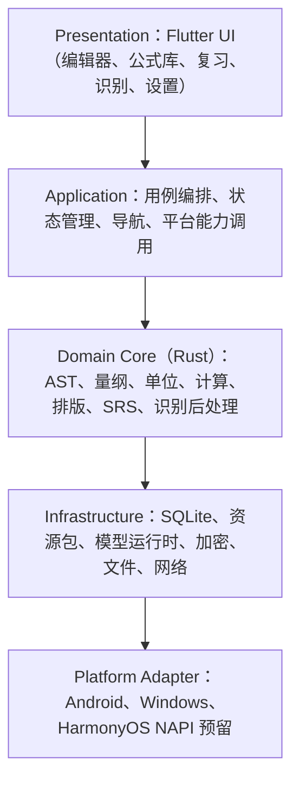
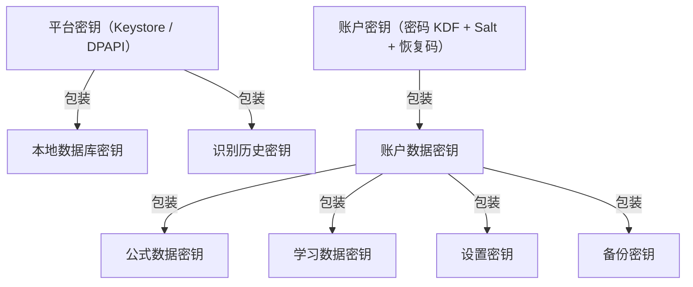
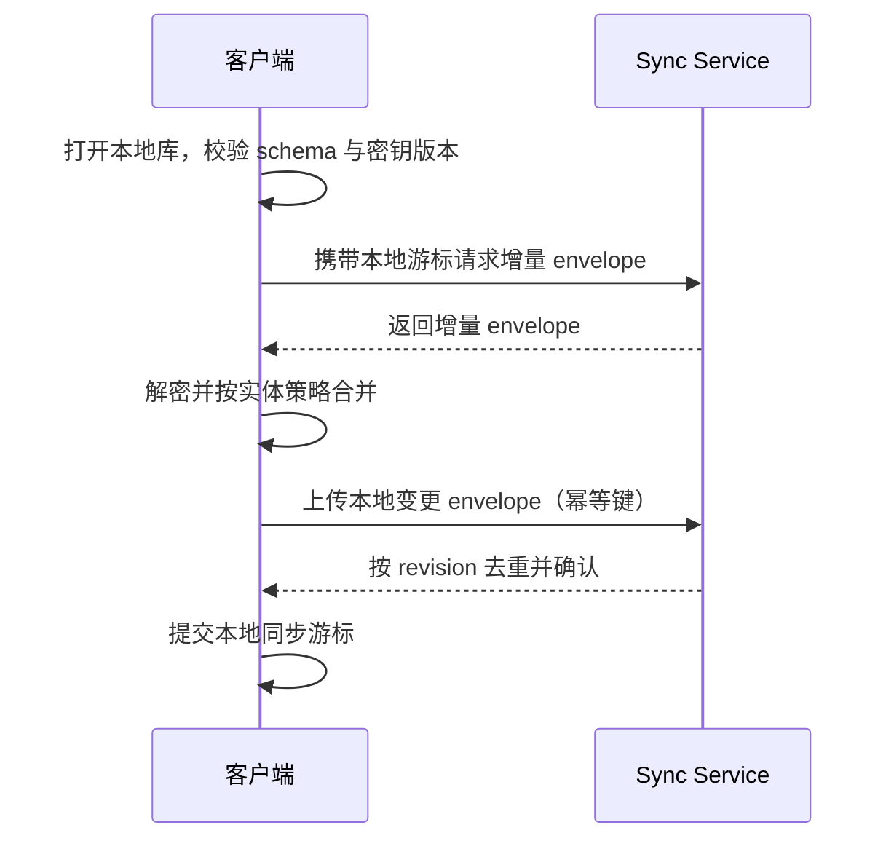
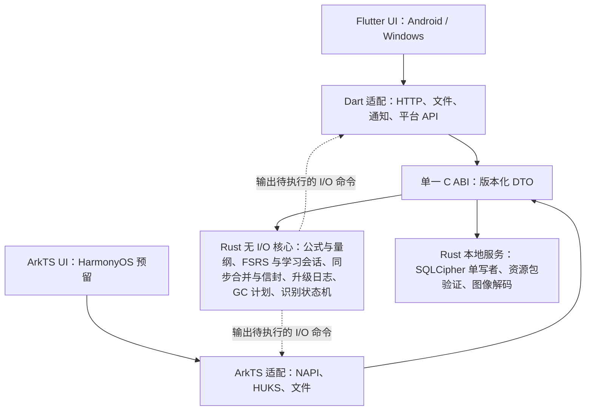

# 历史归档：v2 文档与 v3 校核意见

_BubeiGongshi · 2026-10-18 · 只读追溯材料，不具备需求或设计效力_

---

## 📦 归档说明

本文件合并了 v2.2 的 01–08 文档、v2.2 索引，以及 2026-10-18 的 v3 校核意见（原 SADD/15）。合并目的是减少对最终功能无直接作用的独立文件；原文按顺序收录，仅作以下机械调整：标题整体下调一级、各篇原 H1 改为本文的二级标题并加前缀、文内指向已合并文件的本地链接改为纯文本、删除各篇顶部的“历史版本提示”。原始独立文件可在 Git 历史（main 分支提交 d1a80e9 及之前）中查阅。

当前生效的需求、设计与验收以 [SADD 入口](README.md) 列出的 v4 文档为准。文中“00:19”“10:193”之类的行号引用指 v3 文件的行号，v4 不再使用行号引用。v2 的需求编号与 v4 同号异义，引用时写成“v2:R17”。

| 篇目 | 原文件 | 性质 |
| --- | --- | --- |
| v2.2 索引 | 历史-v2.2-索引.md | v2.2 历史文档，已被 v3/v4 取代 |
| v2-01 | 01-架构评审报告.md | v2.2 历史文档，已被 v3/v4 取代 |
| v2-02 | 02-软件架构设计-v2.md | v2.2 历史文档，已被 v3/v4 取代 |
| v2-03 | 03-Android端实现规范-v2.md | v2.2 历史文档，已被 v3/v4 取代 |
| v2-04 | 04-Windows桌面端实现规范-v2.md | v2.2 历史文档，已被 v3/v4 取代 |
| v2-05 | 05-数据安全与同步设计-v2.md | v2.2 历史文档，已被 v3/v4 取代 |
| v2-06 | 06-测试与验收标准-v2.md | v2.2 历史文档，已被 v3/v4 取代 |
| v2-07 | 07-YOLO识别预备方案.md | v2.2 历史文档，已被 v3/v4 取代 |
| v2-08 | 08-需求追踪矩阵.md | v2.2 历史文档，已被 v3/v4 取代 |
| v3 校核意见 | SADD/15-校核意见与查漏补缺-v3.md（未提交，评审输入） | v3 校核意见，已由 v4 采纳或在各文修订记录中说明 |

## v2.2 索引：SADD：公式记忆 App 软件架构设计文档（v2.2）


> 评审基线：《公式记忆App-架构设计方案 v1.4》《Android端实现方案 v1.0》《Windows桌面端实现方案 v1.0》
>
> 修订日期：2026-10-12
>
> 修订原则：以甲方原始需求及后续明确确认为需求基线；技术文档中的既有决策作为评审输入。甲方于 2026-10-10 确认高中内容和使用云端 API 的 LLM 识别均为现有需求。

本目录保存复审、修订后的架构设计。文档按“一份总览 + 若干专项设计”组织，避免单份超长文档难以维护。

### 1. 修订结论

原方案的分层方向正确：Rust 承载公式、量纲、排版、计算等高一致性领域，Flutter 承载双端 UI，资源包独立版本化，这些判断值得保留。

主要问题是范围和技术路线铺得过宽，部分设计与“轻量化、低开销、无重大安全问题”冲突。v2.1 在此前评审的基础上，纠正需求范围并拆分平台规范：

1. **确认 V1 范围**：高中数学、高中物理、高等数学、大学物理及云端 API 的 LLM 识别均为首版交付要求；社区公式库和完整鸿蒙实现保留演进路径。
2. **本地优先**：游客可用、游客数据不上云；核心学习、公式库、计算、复习在离线状态可用。
3. **识别能力可插拔**：手写/拍照识别统一接口、图像处理、候选校正和量纲重排；云端 LLM API 后端在首版实现，注册用户按次授权使用；本地轻量模型作为可下载增强包。
4. **修正量纲模型**：增加 `QuantityKind`、`MathKind`、温差/角度/经验系数处理，避免“同量纲但物理意义错误”的代入。
5. **统一排版路线**：从 M0 起由 Rust 输出稳定 `DisplayList`，Flutter 使用同一套嵌入字体光栅化，避免中途换引擎造成 UI 大返工。
6. **资源包安全启动**：安装包内置经过签名校验的 bootstrap 资源包，避免首次启动强制联网；其他内容包按需下载。
7. **明确账户与同步安全**：游客数据使用设备密钥加密；注册升级时将数据密钥包装为账户密钥，私有同步数据端到端加密。用户主动授权的云识别图像由网关与模型供应商处理，按独立授权和保留政策管理。
8. **明确识别历史 GC**：保留次数 0–100、默认 5，覆盖缩略图、缓存、临时文件和数据库记录，采用加密后删除密钥的安全删除策略。
9. **YOLO 只做预研**：实现代码和模型依赖仅存在于 `exp/yolo-recognizer` 实验分支，主分支不依赖；本目录只保存预研方案与合入门槛。
10. **平台规范独立维护**：Android 和 Windows 分别说明构建、输入、存储、生命周期、云 API 调用、历史回收和验收；鸿蒙接口预留继续在总架构中说明。

### 2. V1 范围

#### 必须

- Android 与 Windows 桌面端。
- 强制账户：未注册可使用本地游客账户；游客数据仅存本机，不上传。
- 注册账户：本地数据可升级接管，并支持加密同步。
- 公式编辑器：支持 ISO/Unicode 数学字符与 LaTeX 输入、结构化编辑、错误定位。
- 公式库：查看、检索、版本化修订、变量赋值计算、单位换算。
- 量纲系统：SI 与常用导出量纲、用户自定义单位和量纲标签、严格校验、同量纲代入。
- 高中数学、高中物理、高等数学、大学公共物理内容包：均纳入 V1 内容范围，按学科范围标签分阶段交付。
- 手写墨迹识别与照片手写公式识别：统一候选、校正、入库流程。
- 云端 API 的 LLM 识别：首版必须实现，支持墨迹渲染图和照片裁剪图；注册用户逐次授权，游客不上传。
- 文件管理器/相册选图、裁剪预览、图像增强。
- 识别历史保留与垃圾回收：次数 0–100，默认 5。
- 静态资源包：程序与资源解耦，签名校验、版本校验、原子更新。
- 可维护性：注释、ADR、错误码、追踪、复现包、CI 门禁。
- 简洁可靠的版本控制：Trunk-based、SemVer、ABI/数据/资源包版本校验。

#### 暂缓

- HarmonyOS NEXT 实现：只保留 C ABI 与 NAPI 适配边界，不排期开发。
- 社区公式库与 UGC：先完成内容治理、审核、版权、举报和滥用防护设计，不阻塞 V1。
- 端侧大参数多模态模型：与轻量化目标冲突，不规划。

### 3. 文档地图

| 文件 | 作用 |
| --- | --- |
| 01-架构评审报告.md | 原方案不足、阻断风险、修订决策和需求追踪。 |
| 02-软件架构设计-v2.md | 修订后的总体架构，是主设计文档。 |
| 03-Android端实现规范-v2.md | Android 构建、权限、导入、生命周期、云 API 识别与验收。 |
| 04-Windows桌面端实现规范-v2.md | Windows 构建、分发、文件导入、剪贴板、DPI、云 API 识别与验收。 |
| 05-数据安全与同步设计-v2.md | 账户、游客、加密、同步、云识别授权、数据生命周期设计。 |
| 06-测试与验收标准-v2.md | 测试策略、CI 门禁、性能与功能验收。 |
| 07-YOLO识别预备方案.md | 实验分支预研方案，不进入主分支实现。 |
| 08-需求追踪矩阵.md | 甲方需求到设计、验收的映射。 |

### 4. 阅读顺序

1. 架构评审报告：了解为什么改。
2. 软件架构设计：了解系统如何构建。
3. 数据安全与同步设计：确认游客、注册、隐私和 GC 细节。
4. 按目标平台阅读 Android 或 Windows 独立规范，再阅读测试验收标准。
5. YOLO 预备方案：仅预研负责人阅读，不影响主线排期。

### 5. 维护规则

- 修改架构时必须同步更新对应文档和 `08-需求追踪矩阵.md`。
- 每个不可逆技术选择新增 ADR，说明背景、候选、结论、代价和重新评估条件。
- 文档与代码同仓库，版本随 Git 提交管理，不做独立文档平台。
- 文档中的代码片段是契约示例，不是可直接复制的实现；实现前必须补单元测试和错误路径。

### 6. 版本记录

| 版本 | 日期 | 变更 |
| --- | --- | --- |
| v2.0 | 2026-10-10 | 首次架构评审与修订，建立 SADD 文档集 |
| v2.1 | 2026-10-10 | 确认高中内容与云端 API 的 LLM 识别为现有需求；Android / Windows 规范拆分为独立文档 |
| v2.2 | 2026-10-12 | 资深校核修订：统一标题层级与引用块格式；修正 `fsrs` crate 名称与伪量纲表述；补充服务端最小架构（总架构 §9.3）；ASCII 图替换为 Mermaid；移除资源包缓存密钥的过度设计；补充云端识别端到端时延目标与网关滥用威胁项 |

## v2-01：架构评审报告 v2.2


评审对象：
- `公式记忆App-架构设计方案.md` v1.4
- `Android端实现方案.md` v1.0
- `Windows桌面端实现方案.md` v1.0

评审基线：甲方原始需求及 2026-10-10 的补充确认。高中数学、高中物理和使用云端 API 的 LLM 识别属于现有需求，纳入 V1 交付。v2.1 纠正此前把这些需求列入暂缓的判断。

### 1. 总体判断

原方案的技术骨架是专业的：

- Rust 核心承载公式 AST、量纲、单位、计算、排版等必须跨端一致的领域，方向正确。
- Flutter 承载 Android 与 Windows UI，能减少双端重复开发。
- C ABI 让鸿蒙未来可以通过 NAPI 复用核心，预留成本较低。
- 静态资源包、版本化、签名校验、识别历史 GC 等设计已经考虑到发布与隐私风险。
- 对不可信 LaTeX、图片、模型包的输入限制意识较强。

主要问题不在“分层错了”，而在“同时做太多”和“关键契约不够硬”：

1. 社区公式库引入额外审核、版权和运维工作，需要独立排期。云同步、高中与大学内容、云端 LLM API 识别属于现有需求，不能作为范围膨胀项削减。
2. 端侧大模型及 YOLO 实验不能挤占现有云 API 识别的交付；识别后端应共享一套解析、校正和校验流程。
3. 部分资源包设计将必需资源完全外置，首次启动可能强制联网，削弱游客离线可用性。
4. 账户升级与端到端加密的密钥流转没有形成可实施的数据安全闭环。
5. 量纲、数学类型、物理语义和排版契约仍有会导致后期返工的缺口。

### 2. 阻断级问题

#### A1. 需求范围与交付优先级不清

账户同步、高中与大学内容以及云端 API 的 LLM 识别均为既有需求。轻量化应通过资源包、后端适配和端侧按需加载实现，不能通过删减已确认需求实现。社区公式库与完整鸿蒙实现仍按后续能力排期。

**修订**：V1 实现云端 API 的 LLM 识别，并交付高中与大学内容包；分包和分阶段验收不改变需求的必交付属性。Android 与 Windows 各有独立实现规范。社区后续扩展，鸿蒙仅预留接口。

#### A2. 识别技术路线与内存、隐私、账户约束冲突

3B 级端侧多模态模型与 Android 常驻内存预算冲突；云端 LLM 作为默认链路又与游客不上云冲突。识别路线如果并行推进三条，工程资源无法收敛。

**修订**：

- M0 先交付稳定 `FormulaRecognizer` 接口、图像预处理、候选解析、量纲重排和人工校正。
- 本地轻量模型作为可选 `model-pack`，默认不随核心包安装。
- 云端 LLM API 是 V1 必交付后端；仅注册用户在单次识别时显式授权后使用，避免与游客不上云的要求冲突。
- 第三方 API Key 保存在识别网关的服务端凭据库，客户端仅持有短期账户令牌；补齐限额、超时、取消、幂等和候选校验。
- YOLO 只在实验分支预研，主分支零依赖。
- 不规划端侧大参数 VLM。

#### A3. 静态资源包缺少离线 bootstrap 策略

若 `core-pack` 缺失导致应用不可用，而安装包又不内置基础包，首次启动就变成强制联网。这会影响游客离线使用和网络异常场景。

**修订**：安装包内置签名校验后的 `bootstrap-pack`，包含最小字体、符号表、单位库和基础学科内容；扩展内容包按需下载。资源包仍然是独立逻辑单元和独立版本，不等于必须远程下载。

#### A4. 量纲相同不等于物理量相同

仅按 `Dimension` 检索和代入会把力矩代入能量槽位，或混淆频率与角频率、比热容与比熵。这对“严格匹配量纲”的产品会造成可信度风险。

**修订**：类型系统采用三层：

```text
TypeExpr = { Dimension, QuantityKind, MathKind }
```

- `Dimension` 决定合法性。
- `QuantityKind` 决定物理语义与推荐排序。
- `MathKind` 决定标量、向量、矩阵、场、序列、算子等结构约束。

跨 `QuantityKind` 的同量纲代入必须显式警告，不能默认推荐。

#### A5. 数学与单位规则不完整

高等数学需要微分、积分、极限、∇ 族算子、级数、序列、场和函数类型；大学物理需要温差、角度、经验系数和带隐含单位的常数。原方案虽已补充部分规则，但缺少统一判例库和“误报治理”机制。

**修订**：建立 `dimension-testcase.yaml`，每个规则至少包含正例、反例和教学解释；经验公式允许显式 `Empirical` 标记并自动推断系数量纲。

#### A6. 排版引擎迁移风险

先用 Dart/KaTeX 移植库实现，再切换 Rust 排版，会改变渲染树、字体度量、hit-test 和快照测试，无法做到“UI 零改动”。

**修订**：M0 起采用单一排版契约：

- Rust 计算布局并输出稳定 `DisplayList` 与 `NodePath`。
- Flutter 使用嵌入字体光栅化。
- 布局、hit-test、错误定位、朗读串均来自同一份核心输出。
- 不在主线保留第二套公式排版实现。

#### A7. 游客与注册账户的数据安全闭环不足

游客不上云不等于安全；注册同步也不等于服务端可以读取用户私有公式、笔记和复习记录。原方案对密钥包装、恢复、冲突、备份、删除账户的流程仍不够具体。

**修订**：

- 游客使用设备密钥加密本地库。
- 升级注册时生成账户数据密钥，并把游客数据密钥包装到账户密钥下。
- 用户私有同步数据端到端加密，同步服务只见密文和元数据；授权云识别的图片需要由网关与供应商处理明文，须单独说明该隐私边界。
- 提供恢复码、导出、备份、账户删除和本地数据清除。
- 游客默认关闭诊断上报和云端功能。

#### A8. 同步冲突策略对复习日志不友好

简单“最后写入胜出”会覆盖复习历史，导致记忆算法状态错误。公式修订、复习日志、用户笔记的冲突性质完全不同，不能使用同一策略。

**修订**：按实体策略合并：

- 公式：不可变修订，冲突时产生两个候选修订并提示用户选择。
- 复习日志：追加式，不覆盖。
- 学习状态：由 FSRS 从完整日志重算。
- 设置：设备级配置不跨设备合并，仅用户显式选择同步。
- 识别历史：默认不同步。

#### A9. 识别历史 GC 有“假删除”风险

仅删除原图或数据库记录不够，缩略图、内存缓存、临时文件、云端请求缓存、崩溃日志中的路径都可能残留。

**修订**：GC 事务化清理图片、缩略图、缓存、数据库记录和临时目录；图片加密存储，删除时销毁对应密钥；测试必须验证磁盘和缓存均无残留。保留次数 0–100，默认 5。

### 3. 重要非阻断问题

| 编号 | 问题 | 修订 |
| --- | --- | --- |
| S1 | 代码示例存在语法不完整或契约歧义 | 文档中的 Rust 片段改为契约示意；实现必须通过编译与测试 |
| S2 | 开源内容引入缺少许可证门禁 | 建立来源登记、许可审查、许可清单和机器可读 provenance |
| S3 | 云识别与图片隐私缺少最小化原则 | 默认上传裁剪后的增强图，不上传原图；逐次授权；游客禁用 |
| S4 | 无障碍缺失 | DisplayList 同步输出朗读串和语义树，支持缩放与高对比度 |
| S5 | 术语与符号映射不统一 | 建立 Unicode、LaTeX、MathML、朗读名、中文名的映射表 |
| S6 | 性能目标缺少自动门禁 | CI 增加基准、内存、启动和渲染回归测试 |
| S7 | 依赖供应链风险 | 锁定依赖、生成 SBOM、cargo audit/deny、签名发布产物 |
| S8 | 迁移与降级未覆盖资源包 | 数据库、ABI、资源包分别迁移和校验，支持回滚到最近两个正式版本 |
| S9 | 大图片处理容易 OOM | Android/Windows 均流式读取并降采样，Rust 处理灰度/缩放 |
| S10 | 日志可能泄露学习内容 | 默认结构化日志不含公式正文和图片，脱敏后才能导出 |

### 4. 保留的合理设计

- Rust + Flutter + C ABI 分层。
- SQLite 作为本地单文件数据库，配合加密和显式迁移。
- 资源包签名、版本、原子替换。
- FSRS 记忆算法使用成熟 Rust 实现，不自研调度器。
- 公式不可变修订与来源追踪。
- 手写候选先解析为 AST，再用量纲上下文重排。
- Android 使用 Photo Picker/SAF，避免申请宽泛存储权限。

### 5. 修订决策摘要

| 决策 | v1.4 原方向 | v2.2 修订 |
| --- | --- | --- |
| V1 云服务 | 云同步、社区、云端识别进入主线 | 账户/同步及云端 API 的 LLM 识别为 V1；社区后续扩展 |
| 内容范围 | 高中与大学内容 | 高中数学、高中物理、高等数学、大学物理全部保留，内容包分阶段验收 |
| 平台规范 | Windows/Android 的独立输入与生命周期要求 | 两份独立实现规范，共用领域契约与验收标准 |
| 端侧识别 | 本地模型、云端 LLM、YOLO 多线并行 | 一条可插拔契约，本地轻量模型可选，云端显式授权，YOLO 实验分支 |
| 静态资源 | 全部外置，缺核心包则应用不可用 | 安装包内置 bootstrap-pack，扩展包按需下载 |
| 量纲 | 以 Dimension 为核心 | Dimension + QuantityKind + MathKind |
| 排版 | 存在迁移路线 | 单一 Rust 布局契约，无中途替换 |
| 游客 | 本地临时账户 | 设备密钥加密、禁云、可升级接管、支持清除 |
| 同步 | 冲突策略不完整 | 按实体类型分策略，复习日志不可覆盖 |
| 鸿蒙 | 预留接口 | 保持 C ABI/NAPI 预留，不进入 V1 排期 |

### 6. 复审结论

修订后的架构覆盖原始需求与后续确认的需求，并保留扩展能力。进入开发前必须完成以下冻结：

1. 冻结 `FormulaAST`、`TypeExpr`、`DisplayList`、`FormulaRecognizer` 四个核心契约。
2. 冻结本地数据库 schema v1 和迁移策略。
3. 冻结资源包 manifest 与签名公钥分发方式。
4. 冻结游客升级注册的密钥包装流程。
5. 冻结 V1 性能与隐私验收指标。
6. 冻结云识别网关和供应商适配契约，以及高中/大学四类内容包的范围清单。

未冻结前不得开始大规模 UI 或内容录入，否则后期返工成本会远高于当前文档修订成本。

## v2-02：软件架构设计 v2.2


> 适用范围：公式记忆 App 的 Android 与 Windows V1，HarmonyOS 仅做接口预留。
>
> 关联文档：架构评审报告、Android 端实现规范、Windows 桌面端实现规范、数据安全与同步设计、测试与验收标准。
>
> 需求确认：高中内容与使用云端 API 的 LLM 识别均为现有需求，纳入 V1 首版交付。

### 1. 架构目标

#### 1.1 产品目标

以“不背单词”的学习流程为原型，面向高中与大学公共课公式记忆与理解，提供：

1. 间隔重复复习与学习进度管理。
2. 公式库、公式编辑器、公式计算器。
3. 严格量纲校验、单位换算、公式间同量纲代入。
4. 手写墨迹识别与照片手写公式识别。
5. Windows 与 Android 双端体验一致，核心计算结果一致。
6. 游客可用、数据本机私有；注册后可同步。
7. 轻量、低内存、低耗电、安全，不依赖常驻后台服务。
8. 高中数学、高中物理、高等数学和大学物理内容包，按教育阶段和考试范围筛选。
9. 使用云端 API 的 LLM 识别墨迹渲染图与照片裁剪图，注册用户逐次授权使用。

#### 1.2 质量属性优先级

| 优先级 | 质量属性 | 目标 |
| --- | --- | --- |
| P0 | 正确性 | 公式、量纲、计算、复习状态跨端一致 |
| P0 | 隐私与安全 | 游客不上云；用户私有数据端到端加密；资源包签名 |
| P0 | 可维护性 | 契约清晰、错误可定位、注释与测试强制 |
| P1 | 性能 | 核心操作本地完成，公式编辑与浏览流畅 |
| P1 | 可扩展性 | 识别后端、资源包、平台适配可插拔 |
| P2 | 可演进性 | HarmonyOS、社区库及识别供应商可独立扩展；已有云 API 识别属于 V1 |

#### 1.3 非目标

以下内容不属于 V1 主线，只保留接口或预研：

- HarmonyOS 应用开发。
- 社区公式库、UGC 审核和 Fork。
- 端侧大参数多模态模型。
- 常驻后台服务。
- 将云端 LLM 作为唯一识别路径。
- 自研间隔重复算法。

### 2. 总体架构

#### 2.1 架构风格

采用“分层 + 核心域下沉 + 平台适配隔离”的架构：



核心原则：

1. **单一事实源**：公式解析、量纲校验、计算、排版布局、复习调度都由 Rust 核心完成，平台层不得重新实现。
2. **契约先行**：跨语言边界只通过稳定 C ABI 和生成绑定通信。
3. **领域无 IO**：核心域 crate 不访问网络、文件、平台 API 和 UI。
4. **平台薄适配**：平台代码只处理生命周期、权限、文件选择、通知、加密存储等系统能力。
5. **资源即包**：学科内容、扩展字体、模型与程序版本解耦，统一签名和版本校验。

#### 2.2 推荐技术栈

| 层 | 技术 | 理由 |
| --- | --- | --- |
| UI | Flutter | Android/Windows 双端复用；公式自绘可控；后续可替换鸿蒙 UI 或 ArkTS |
| 核心引擎 | Rust | 无 GC、内存安全、C ABI 良好、可交叉编译到鸿蒙目标 |
| 本地存储 | SQLite + SQLCipher/平台加密 | 单文件、事务、迁移成熟，便于测试和备份 |
| 绑定 | flutter_rust_bridge / C ABI | 减少手写 FFI 错误，契约可生成 |
| 排版 | Rust 布局 + 自带数学字体 | 三端布局一致，hit-test 与错误定位一致 |
| SRS | `fsrs` crate（open-spaced-repetition/fsrs-rs） | 使用成熟实现，避免自研记忆算法缺陷 |
| 本地识别 | ONNX Runtime/MNN 可选 | 通过 `FormulaRecognizer` 插件接入 |
| 云识别 | 识别网关 + 支持视觉输入的 LLM/VLM API（V1） | 注册用户按次授权；供应商凭据集中保管 |
| 构建 | Cargo + Flutter + GitHub Actions | 支持矩阵测试、静态检查、产物签名 |

> 技术栈必须通过 ADR 记录。替换 UI 或识别运行时不得影响核心域契约。

### 3. 模块划分

#### 3.1 Rust Crate 结构

```text
crates/
  fml-ast          # 公式 AST、NodePath、不可变修订
  fml-latex        # LaTeX/Unicode 数学输入解析与导出
  fml-type         # Dimension、QuantityKind、MathKind、TypeExpr
  fml-units        # SI、导出单位、用户单位、常数
  fml-eval         # 安全 AST 解释器与数值求解
  fml-typeset      # 公式布局与 DisplayList 生成
  fml-srs          # FSRS 适配与卡片调度
  fml-recognize    # 识别契约、候选解析、量纲重排
  fml-imgproc      # 图片解码/降采样/增强/裁剪/去噪
  fml-pack         # 资源包 manifest、签名、校验、原子加载
  fml-store        # SQLite 迁移、仓储、事务
  fml-core-pure    # 对外可复用的纯核心子集，零平台依赖
  fml-ffi          # C ABI 边界，只做序列化与错误转换
platform/
  flutter/         # Dart 应用与平台通道
  android/         # Android 工程与 NDK 配置
  windows/         # Windows 打包、签名、更新
exp/yolo-recognizer/  # 实验分支，不进 main
```

#### 3.2 Crate 依赖规则

- `fml-ast` 不依赖解析器、存储、UI。
- `fml-type` 只依赖 `fml-ast`。
- `fml-eval` 只依赖 `fml-ast`、`fml-type`、`fml-units`。
- `fml-typeset` 不直接访问字体文件，字体资源由 `fml-pack` 注入。
- `fml-store` 可以依赖核心域，但核心域不得依赖存储。
- `fml-ffi` 是唯一允许暴露 `extern "C"` 的 crate。
- `crates/` 下禁止 Flutter、Dart、JNI、HTTP 客户端依赖。
- CI 用依赖图检查循环依赖和越界依赖。

### 4. 核心领域设计

#### 4.1 公式 AST

公式内部统一使用不可变 AST，不保存渲染树作为权威数据。

##### 4.1.1 核心概念

| 概念 | 说明 |
| --- | --- |
| `FormulaItem` | 用户或预置库中的一条公式，含名称、学科、来源、标签 |
| `FormulaRevision` | 一次不可变内容修订，保存 LaTeX、AST、类型标注、校验结果 |
| `Symbol` | 公式中的变量、常数、函数或单位符号 |
| `NodePath` | AST 节点稳定路径，用于错误定位和 hit-test |
| `Derivation` | 派生公式的来源链，记录母公式与代入槽位 |
| `Provenance` | 数据来源：用户输入、拍照识别、资源包、导入 |

##### 4.1.2 AST 节点示意

```rust
pub enum FormulaNode {
    Symbol(SymbolId),
    Number(NumberLiteral),
    Unit(UnitId),
    Binary { op: BinaryOp, left: Box<Node>, right: Box<Node> },
    Unary { op: UnaryOp, operand: Box<Node> },
    Function { id: FunctionId, args: Vec<Node> },
    Derivative { target: Box<Node>, order: u8 },
    Integral { kind: IntegralKind, integrand: Box<Node>, differential: SymbolId },
    SumOrLimit { kind: LimitKind, lower: Box<Node>, upper: Box<Node>, body: Box<Node> },
    Vector { items: Vec<Node> },
    Matrix { rows: Vec<Vec<Node>> },
}
```

> 以上为契约示意。实现时必须区分普通符号、单位符号和函数符号，禁止把单位当作普通变量。

#### 4.2 输入语言

公式编辑器接受两类输入并统一转换为 AST：

1. **LaTeX 子集**：覆盖同济高数与考研数学常用结构，包括分数、上下标、根式、导数、偏导、积分、重积分、曲线/曲面积分、求和、极限、矩阵、向量、`\nabla`、`\dot`、`\ddot`。
2. **Unicode/ISO 数学符号输入**：通过符号面板或系统输入法输入，进入 Unicode → LaTeX → AST 双射表。

##### 4.2.1 解析安全

- 解析器只接受白名单命令和结构。
- 输入设长度、深度、节点数、时间四重预算。
- 所有解析错误包含行列、片段、NodePath 和修复建议。
- Unicode 与 LaTeX 必须能互相导出，无法无损导出的符号在编辑器中显式提示。
- 禁止宏展开、Shell、正则拼接或动态代码执行。

#### 4.3 类型系统

##### 4.3.1 三层类型

```text
TypeExpr {
    dimension: Dimension,
    quantity_kind: QuantityKind,
    math_kind: MathKind,
}
```

##### 4.3.2 `Dimension`

- 采用七个 SI 基本量纲：长度、质量、时间、电流、热力学温度、物质的量、发光强度。
- 每个指数用有理数表示。
- 角度单独建模为伪量纲 `Angle`，由库级别固定策略处理，不做用户级开关：SI 中弧度是无量纲导出单位，`rad` / `°` / `grad` 的换算由单位系统负责，三角函数输入按库策略归一到弧度。
- 计数类无量纲量使用 `Count` 标记，与真正的无量纲比值区分，避免计数参与物理量纲运算时被静默放过。
- `root()` 的失败条件是数值溢出或超出策略限制，不是“非整除”。
- 单位换算使用精确有理数系数，输出阶段才转浮点。

##### 4.3.3 `QuantityKind`

用于区分同量纲但物理意义不同的量：

| 示例 | 量纲 | QuantityKind |
| --- | --- | --- |
| 功、能量、热量 | M L² T⁻² | Energy / Heat 可显式兼容 |
| 力矩 | M L² T⁻² | Torque，不可默认代入 Energy |
| 频率 | T⁻¹ | Frequency |
| 角频率 | T⁻¹ | AngularFrequency，与 Frequency 换算含 2π |
| 温度 | Θ | Temperature |
| 温差 | Θ | TemperatureDifference |
| 比热容 | L² T⁻² Θ⁻¹ | SpecificHeat |
| 比熵 | L² T⁻² Θ⁻¹ | SpecificEntropy |

规则：

1. 量纲冲突是硬错误。
2. `QuantityKind` 不匹配但量纲匹配是软警告。
3. 推荐排序优先 `QuantityKind`，其次量纲，再其次学科和符号名。
4. 用户显式确认后可跨 `QuantityKind` 代入，并保留确认记录。

##### 4.3.4 `MathKind`

| 类型 | 用途 |
| --- | --- |
| `Scalar` | 普通数值 |
| `Vector(n)` | 向量与力学量 |
| `Matrix(r,c)` | 张量、转动惯量 |
| `Function(arity)` | 一元/多元函数 |
| `ScalarField` / `VectorField` | 多元微积分与场论 |
| `Sequence` / `Series` | 数列与级数 |
| `Operator` | ∇、散度、旋度等算子 |
| `Complex` | 量子物理与交流场景 |
| `Unknown` | 未知，参与约束求解 |

数学结构不匹配必须报错，例如向量点积不能输出向量，叉积维度必须为 3。

##### 4.3.5 仿射单位

- 摄氏温度是仿射单位，不能直接参与乘除、指数和单位约分。
- `20 ℃` 存储为 293.15 K 的温度点。
- `ΔT = 20 ℃` 存储为 20 K 的温度差。
- 热力学循环计算必须显式选择温度点或温差，UI 提供独立输入组件。
- 角度在三角函数内按库策略转换为弧度，外部显示保留用户单位。

##### 4.3.6 经验公式

经验公式必须显式标记 `Empirical`：

1. 常数允许携带隐含单位。
2. 系统推导“要使等式量纲配平，系数 k 的量纲必须是什么”。
3. 用户可接受系统推断，也可以手工指定。
4. 未标记的经验公式不允许跳过量纲校验。

#### 4.4 量纲校验流程

```text
LaTeX / Unicode 输入
  → FormulaParser 生成 FormulaAST
  → SymbolTable 绑定符号
  → TypeInference 推导 Dimension / QuantityKind / MathKind
  → DimensionUnification 校验等式与代入约束
  → 生成 Diagnostic + TypedAST
  → Typeset 生成 DisplayList
```

诊断分级：

| 级别 | 例子 | UI 行为 |
| --- | --- | --- |
| Error | 量纲不匹配、向量结构错误、非法单位乘除 | 阻止保存，高亮节点 |
| Warning | 同量纲不同 QuantityKind、经验公式未设系数 | 允许保存，必须确认 |
| Info | 建议单位、有效数字、可简化表达式 | 提示，不阻断 |

#### 4.5 公式计算器

##### 4.5.1 计算模式

1. **直接求值**：目标公式所有变量已赋值，输出带单位的量。
2. **符号反解**：对可逆运算链解出指定变量。
3. **数值求根**：符号反解失败时使用 Brent 法。
4. **公式代入**：将一个公式的解代入另一个公式的槽位。

##### 4.5.2 计算约束

- 不使用 `eval`、动态语言执行或反射。
- 函数白名单固定。
- 最大节点数、递归深度、计算步数均有限制。
- 除零、NaN、Inf、溢出、不可收敛均返回结构化错误。
- 输出按最少有效数字规则修约，并展示单位。
- 带不确定度的输入按误差传播显示区间；暂不支持复杂统计推断。

##### 4.5.3 数值求根 UI

1. 用户选择未知量。
2. 系统尝试符号反解。
3. 失败后要求用户输入物理合理区间。
4. 用户未输入时自动 bracket。
5. 自动失败则返回明确错误，不静默给可疑数值。
6. 结果标注“数值解”，并显示区间与残差。

#### 4.6 公式间代入

##### 4.6.1 流程

1. 用户在公式 A 的排版结果上选择子表达式槽位。
2. 系统计算槽位 `TypeExpr`。
3. 检索公式 B 中可解出同类型符号的候选。
4. 对 B 进行符号反解。
5. 统一量纲、数学结构和 `QuantityKind`。
6. 生成新的 `FormulaRevision` 和 `Derivation`。
7. 保留推导链，可展开、折叠、溯源。

##### 4.6.2 约束

- 推导深度上限 8。
- 派生公式默认不可直接编辑。
- 编辑前必须显式“脱离溯源”。
- 循环推导检测必须失败。
- 被引用的母公式修订删除时，派生公式转独立修订并记录提示。

### 5. 排版与交互

#### 5.1 DisplayList 契约

`fml-typeset` 输出稳定 `DisplayList`：

| 字段 | 作用 |
| --- | --- |
| `layout_version` | 布局格式版本 |
| `nodes` | 字形、线、分数线、括号、矩阵行列等绘制指令 |
| `bounds` | 节点和整体边界 |
| `baselines` | 公式排版基线 |
| `node_path` | 与 AST 节点对应 |
| `semantic_text` | 无障碍朗读串 |
| `hit_regions` | 点击、选区和错误高亮区域 |

Flutter 只负责光栅化和交互，不做公式布局。这样可以保证：

1. 双端渲染一致。
2. 点击公式可定位 AST 节点。
3. 快照测试不依赖平台字体。
4. 未来鸿蒙 UI 可复用同一 DisplayList。

#### 5.2 公式编辑器

提供三种输入模式：

| 模式 | Android | Windows |
| --- | --- | --- |
| 结构化编辑 | 主模式 | 辅助 |
| LaTeX 源码 | 辅助 | 主模式 |
| 手写/照片 | 主打差异化 | 可选导入 |

编辑器要求：

- 光标、选区、撤销/重做、复制/粘贴。
- 输入错误下划线与节点高亮。
- 符号面板按学科和常用度分组。
- 模板插入：分数、根式、上下标、积分、矩阵、向量、微分。
- Windows 快捷键完整；Android 支持软键盘与手写板切换。
- 草稿自动保存，恢复时提示。

### 6. 手写与照片识别

#### 6.1 识别抽象

所有识别后端实现统一接口：

```text
RecognizerInput = Ink | Image
RecognitionContext = SymbolHints | Subject | ExpectedType | UserCorrection
Output = Candidate[] + Align + Confidence + Diagnostics
```

后端类型：

| 后端 | V1 状态 | 条件 |
| --- | --- | --- |
| `LocalLightModel` | 可选模型包 | 用户下载；通过体积、时延、内存测试 |
| `RemoteLlm` | V1 必交付后端 | 注册用户、单次显式授权、裁剪或墨迹渲染图上传 |
| `YoloExperiment` | 实验分支 | 不进 main，不影响主包 |

游客只能使用本地可选模型或人工输入，不调用云端识别。云识别的“用户选择使用”不等于“需求可暂缓”：两端首版都必须实现完整 API 调用和结果确认流程。

##### 6.1.1 云端 API 调用契约


- 客户端访问自有识别网关；供应商 API Key 仅存服务端凭据库，不嵌入 APK、EXE、DLL 或资源包。
- 供应商适配器统一图片输入、请求上限、模型版本、返回结构和错误分类；纯文本 API 不能承担照片识别。
- 请求包含 `request_id`、幂等键、有效账户令牌、授权记录与最少上下文，不包含原始文件路径或完整公式库。
- 网关验证账户、上传大小/像素数、速率与费用配额，固定供应商端点，防止任意地址转发。
- 连接和总请求有超时上限，支持取消；任务状态区分进行中、成功、失败、取消，重启后先查询状态，不重新上传。
- 超时表示客户端停止等待，供应商可能已执行并计费；仅在可确认幂等或未提交的情况下重试，不能自动重复付费调用。
- 返回的 LaTeX 和结构化字段均是不可信输入，执行统一解析预算；无可靠置信度时返回空值并提示用户确认。
- 私有同步数据的端到端加密不覆盖主动提交给模型的识别图片。网关和供应商处理授权图像明文，保留与训练政策须明确。
- 完成、取消或超时后清理网关临时图像；供应商保留行为按已核实的接口/合同处理，不承诺无法验证的即时删除。

云 API 失败时保留本机校正页面，允许用户手工输入或主动选择已有本地模型。不能因本地识别失败自动上传图片。

#### 6.2 统一后处理

无论识别来源是墨迹、照片还是云端，都必须执行：

1. 候选 LaTeX 解析。
2. AST 构造。
3. 符号表绑定。
4. 类型与量纲推导。
5. `RecognitionContext` 重排。
6. Top-3 候选展示。
7. 人工逐符号校正。
8. 保存前完整校验。

识别器输出的字符串永远是不可信输入。

#### 6.3 照片输入与图像增强

输入来源：

- Android：相机、Photo Picker、SAF 文件管理器。
- Windows：文件选择对话框、拖拽、剪贴板粘贴、扫描仪导入。

处理流程：

```text
原始图片
  → 权限与格式检查
  → 流式解码与 EXIF 方向修正
  → 用户裁剪公式区域
  → 长边限制到 1600–2200 px
  → 灰度化与光照归一
  → 去噪与锐化
  → 自适应二值化
  → 质量评分
  → 用户预览增强结果
  → 识别
  → 候选确认
```

质量评分包括清晰度、亮度分布、阴影、倾斜、公式区域占比。低质量图片先提示重拍或调整，不直接识别。

#### 6.4 图片处理约束

- 不在 Dart/Java/C# 侧解码全尺寸位图。
- Android 使用流式读取和 YUV 或降采样路径。
- Windows 使用流式解码和渐进缩放。
- 中间文件放临时目录，会话结束立即清理。
- 处理过程中断时可恢复或回滚，不留下半成品状态。
- 图片不写入系统相册或公共下载目录。

#### 6.5 识别历史与 GC

| 配置 | 默认 | 范围 |
| --- | --- | --- |
| 保留最近识别次数 | 5 | 0–100 |
| 最大磁盘占用 | 200 MB | 用户可调整 |
| 保存原图 | 关 | 开/关 |
| 手动 Pin | 支持 | 不受次数 GC |
| 一键清空 | 支持 | 全部历史 |

保留内容：

- 识别结果 LaTeX 与 AST。
- 用户校正结果。
- 降采样图片或可选原图。
- 识别来源、质量分、时间、模型版本。
- 与已入库公式的溯源关联。

GC 事务化流程：

1. 识别完成后触发。
2. 启动、设置变更、存储紧张时兜底触发。
3. 排除 `Pinned` 与 `Adopted` 会话。
4. 从最旧 `Normal` 会话开始删除。
5. 删除图片、缩略图、内存缓存、数据库记录、临时文件。
6. 加密图片销毁对应数据密钥。
7. 如有公式溯源引用，按用户选择提升为公式附件或记录“原图已清理”。
8. GC 失败记录结构化日志，下次重试，不影响主流程。

`keep_last = 0` 表示识别完成后立即清空未采纳历史；已入库的公式结果不受影响。

### 7. 静态资源包

#### 7.1 包类型

| 包 | 是否内置 | 内容 |
| --- | --- | --- |
| `bootstrap-pack` | 必须内置 | 最小数学字体、基础符号映射、SI 单位、常数、少量示例 |
| `content-high-school-math` | 可下载 | 高中数学公式库 |
| `content-high-school-physics` | 可下载 | 高中物理公式库 |
| `content-university-math` | 可下载 | 高等数学公式库 |
| `content-university-physics` | 可下载 | 大学物理公式库 |
| `model-recognition` | 可下载 | 本地轻量识别模型 |
| `font-extension` | 可下载 | 扩展字形 |
| `i18n-pack` | 可内置 | 语言与朗读资源 |

#### 7.2 Manifest 必填字段

```json
{
  "pack_id": "content-university-physics",
  "pack_version": "1.0.0",
  "format_version": 1,
  "min_app_version": "1.0.0",
  "min_core_version": 1,
  "subject": "physics",
  "education_level": "university",
  "entries": [],
  "dependencies": [],
  "source_licenses": [],
  "provenance": []
}
```

#### 7.3 安全契约

- Ed25519 签名覆盖 manifest 与数据。
- 公钥内置在程序中，不随资源包下发。
- 每个条目使用 BLAKE3 校验。
- 校验 `format_version`、`pack_version`、`min_app_version`、`min_core_version`。
- 版本只升不降，防回滚。
- 更新写入临时文件，校验通过后原子 rename。
- 失败时保留旧包并回滚。
- 所有开源内容必须登记来源、许可和适用范围。

### 8. 学习与内容系统

#### 8.1 FSRS 调度

- 使用 `fsrs` crate（open-spaced-repetition 维护的 Rust 实现），不自研算法；卡片参数与算法版本显式记录，跨版本迁移走显式转换。
- 卡片状态由复习日志重算，避免多端覆盖。
- 学习参数有版本号，升级时显式迁移。
- 复习日志为追加式不可变记录。
- 支持暂停、重置、跳过和手动调整难度。

#### 8.2 卡片生成

从公式条目自动生成：

- 看名称写公式。
- 看公式选名称。
- 符号挖空。
- 变量含义题。
- 单位与量纲题。
- 简单数值计算题。

题型生成由内容包声明，用户可禁用某类题型。

#### 8.3 内容范围

V1 覆盖高中与大学公共课内容。架构和内容 schema 不得排除任何一个学科，交付可以分批：

- 高中数学：函数、三角、数列、立体几何、解析几何、概率统计、导数与应用；积分内容按指定教材/课程范围标记，不默认作为所有高中课程的必修内容。
- 高中物理：力学、电磁学、热学、光学、近代物理基础。
- 高等数学：同济七版范围 + 考研数学数一/数二/数三并集，用 `scope` 标签区分，不物理删除。
- 大学物理：国内公共课主流板块。
- 内容分批交付，先核心公式，再推导、易错点、例题。

每条公式必须包含：LaTeX、AST、类型标注、符号说明、单位建议、来源、许可、scope 标签。增加 `education_level`、教材/版本和考试年份标签，分开标记高中课程与考研数一/数二/数三范围。

四类内容均须有范围清单、来源许可、样例和内容测试。按需下载控制安装体积，不改变首版必交付属性；不能仅预留空包或用大学内容替代高中内容。

### 9. 数据架构

#### 9.1 本地库

使用 SQLite：

- 单用户单库。
- 打开时校验 schema version 和密钥。
- WAL 模式。
- 事务写入。
- 定期执行 integrity check 和 VACUUM。
- 迁移脚本链式执行，禁止破坏性迁移。

核心表：

| 表 | 用途 |
| --- | --- |
| `accounts` | 本地账户状态与密钥元数据 |
| `formula_item` | 公式元数据 |
| `formula_revision` | 不可变公式修订 |
| `symbol` | 符号定义 |
| `unit` | 单位与换算 |
| `study_card` | 卡片 |
| `review_log` | 追加式复习日志 |
| `recognition_session` | 识别历史元数据 |
| `recognition_asset` | 加密图片 |
| `resource_pack` | 已安装资源包 |
| `migration_log` | 迁移记录 |

#### 9.2 数据版本

| 版本 | 位置 | 校验 |
| --- | --- | --- |
| App | 发布信息 | SemVer |
| ABI | Rust 常量 | 启动时必须一致 |
| DB schema | `PRAGMA user_version` | 迁移链 |
| Resource pack | manifest | 签名与版本 |
| Formula revision | 内容条目 | 不可变修订号 |

#### 9.3 服务端最小架构（V1）

V1 需要服务端承担四类职责：账户认证、加密同步存储、识别网关、资源包分发。保持单体起步、模块边界清晰：

| 组件 | 职责 | 关键约束 |
| --- | --- | --- |
| Auth Service | 注册/登录、短期 access token + refresh token、账户状态、恢复码凭证 | 不存账户数据密钥明文；令牌可吊销 |
| Sync Service | `EncryptedEnvelope` 存储、增量拉取、revision 幂等去重、墓碑 | 只见密文与最小元数据；不提供内容检索 |
| Recognition Gateway | 供应商适配、API Key 保管（KMS）、速率与费用配额、job 状态查询、临时图片清理 | 客户端永不接触供应商凭据；固定供应商端点 |
| Pack Distribution | 资源包/模型包签名分发（对象存储或 CDN） | 只读公开内容；清单签名与端侧校验对应 |
| 可观测性 | 结构化日志、审计事件、告警 | 日志不含公式正文、图片与密钥 |

- 部署形态：单体服务起步，按上表模块边界预留拆分；数据库与对象存储分离。
- 所有外部接口 TLS 1.2+；内部凭据轮换流程书面化。
- 数据备份：同步 envelope 与账户元数据每日加密备份，恢复演练纳入发布前清单。
- 里程碑依赖：M4 交付 Auth 最小链路 + Recognition Gateway；M5 在 Sync Service 上完成加密同步。

### 10. FFI 与鸿蒙预留

#### 10.1 C ABI 原则

- 所有跨语言调用使用稳定结构体、错误码和版本号。
- 不暴露 Rust 泛型、trait 对象或复杂生命周期。
- 传入缓冲区长度必填，返回值带实际长度。
- 所有句柄由核心分配和释放。
- 错误码统一，字符串消息一次性拷贝。
- 生成绑定并纳入版本控制，CI 做 ABI 漂移检查。

#### 10.2 鸿蒙预留

V1 不开发鸿蒙端，但必须满足：

1. Rust 核心 crate 无平台依赖。
2. 只暴露 C ABI，未来可通过 NAPI 封装。
3. 平台能力通过注入接口，不写入核心域。
4. CI 增加目标编译冒烟。
5. UI 层保持业务逻辑与 Widget 分离，未来可替换 ArkTS UI。

#### 10.3 双端行为一致性

| 行为 | 一致性要求 |
| --- | --- |
| 公式解析结果 | 完全一致 |
| 量纲错误 | 错误码与 NodePath 一致 |
| 计算结果 | 数值和单位一致 |
| DisplayList | 布局一致，允许光栅化差异 |
| GC 语义 | 保留次数和删除范围一致 |
| 游客数据 | 均本机私有，不上云 |
| 文件选图 | Android 与 Windows 均支持文件管理器 |
| 云功能 | 均需注册与显式授权 |

平台实现可不同，但结果契约必须相同。每项行为必须有跨平台测试，禁止只靠人工验收。

### 11. 可维护性设计

#### 11.1 注释规范

- 每个 crate 提供 `README.md` 说明边界、线程模型和错误语义。
- 公共 API 使用文档注释并包含示例和错误条件。
- 复杂算法必须解释输入假设、单位、精度和失败条件。
- 不要求逐行注释；禁止无信息量的注释。
- 注释覆盖率纳入 CI，公共 API 缺文档不允许合并。

#### 11.2 错误模型

统一错误树：

```text
Error {
    code,
    domain,
    message,
    node_path,
    input_range,
    recovery,
    trace_id
}
```

UI 显示用户可理解的信息；日志记录结构化错误；调试包包含 AST、输入片段、版本和脱敏 trace。

#### 11.3 排错与复现

- 每次请求生成 `trace_id`。
- 公式校验错误定位到 AST NodePath。
- 一键导出脱敏复现包：输入、AST JSON、DisplayList、版本、错误树、平台信息。
- 属性测试失败样本自动保存为回归用例。
- 开发包提供 AST、类型、排版和缓存命中率调试面板。

#### 11.4 ADR

所有不可逆决策必须记录：

- 背景与约束。
- 候选方案。
- 结论。
- 被放弃方案的代价。
- 重新评估条件。

初始 ADR 至少包含：Rust 核心、Flutter UI、SQLite、FSRS、Rust 排版、资源包格式、端到端同步、识别后端隔离、YOLO 实验分支。

### 12. 性能设计

#### 12.1 目标

| 指标 | Android 中端 | Windows |
| --- | --- | --- |
| 冷启动 | < 2 s | < 1.5 s |
| 公式列表滚动 | 60 FPS，掉帧 < 1% | 60 FPS |
| 公式解析 | 常规 < 20 ms | < 10 ms |
| 量纲校验 | < 10 ms | < 5 ms |
| 排版 | < 30 ms | < 20 ms |
| 图片预处理 | < 500 ms | < 300 ms |
| 云端识别端到端 | < 5 s（网络正常，排队另计） | < 5 s（网络正常，排队另计） |
| 常驻内存 | < 150 MB | < 250 MB |
| 安装包 | < 45 MB，不含可选模型 | < 70 MB |

#### 12.2 关键手段

- DisplayList 缓存与 LRU。
- AST 和类型推断结果持久化。
- SQLite 索引覆盖列表与检索。
- 大图流式处理与降采样。
- 模型懒加载、按需下载、识别结束释放。
- 图片解码和排版放在后台线程。
- 启动只加载 bootstrap-pack。
- 定期用基准测试防止性能退化。

### 13. 安全设计

#### 13.1 威胁模型

| 威胁 | 对策 |
| --- | --- |
| 恶意 LaTeX 或资源包 | 输入预算、白名单、签名、版本校验 |
| 模型包投毒 | 签名、哈希、来源登记、最小权限 |
| 本地数据窃取 | 平台密钥加密、私有目录、不参与自动备份 |
| 云端误上传 | 游客禁云；云识别单次授权；上传裁剪图 |
| 日志泄露 | 结构化日志不含公式正文和图片；导出脱敏 |
| 供应链攻击 | 依赖锁定、SBOM、audit/deny、发布签名 |
| 同步篡改 | TLS、服务端认证、端到端数据密钥、版本冲突 |
| 识别网关滥用（刷量/盗刷） | 账户认证、速率与费用配额、幂等键、告警 |
| 假删除 | GC 清理所有副本和密钥 |

#### 13.2 红线

1. 游客不向云端提交公式、笔记、图片、复习记录或识别数据。
2. 未经显式授权不上传图片。
3. 照片识别上传裁剪后的增强图，墨迹识别上传仅含公式的规范化位图，不上传原始照片及无关元数据。
4. 同步服务不能解密私有同步数据；授权云识别图像的处理范围另行说明，不能宣称模型推理时图像仍对处理方不可见。
5. 资源包签名公钥不随包下发。
6. 不申请与功能无关的 Android 权限。
7. 核心库不执行动态代码。
8. 删除识别历史必须清理图片、缓存、临时文件与密钥。
9. 诊断上报默认关闭。
10. 供应商 API Key 不出现在客户端产物、资源包、日志或复现包中。

### 14. 工程与版本控制

#### 14.1 Git 策略

- Trunk-based：`main` 始终可发布。
- 特性分支生命周期不超过 3 天。
- 实验能力使用 `exp/*` 长期分支，每周 rebase。
- `exp/yolo-recognizer` 不得被 `main` 依赖。
- 提交使用 Conventional Commits。
- 发布使用 tag 和自动 changelog。

#### 14.2 CI 门禁

- `cargo fmt --check`
- `cargo clippy --all-targets -- -D warnings`
- `cargo test`
- `cargo audit` / `cargo deny`
- Rust/Flutter 编译矩阵
- ABI 与生成绑定 diff
- DB 全链迁移
- 资源包签名与校验
- 快照、性能、内存、隐私删除测试
- 文档链接和需求追踪矩阵检查

#### 14.3 发布

- Android 使用签名 AAB/APK。
- Windows 使用安装器与代码签名。
- 发布产物附哈希和 SBOM。
- 保留最近两个正式版本的回退支持。
- 事故必须写 postmortem 并转化为测试或门禁。

### 15. 里程碑

| 阶段 | 目标 | 出口条件 |
| --- | --- | --- |
| M0 契约冻结 | AST、TypeExpr、DisplayList、Recognizer、DB schema、资源包格式 | 契约测试通过 |
| M0.5 单端验证 | Windows 或 Android 核心闭环 | 录入公式、校验、复习、计算可跑 |
| M1 核心引擎 | 解析、量纲、排版、计算、本地库 | 全量单元与快照测试 |
| M2 学习闭环 | 公式库、卡片、FSRS、复习统计 | 可日常自用 |
| M3 双端 | Windows/Android 同一核心 | 双端契约测试一致 |
| M4 图像与云 API 识别 | 墨迹/照片导入、增强、注册认证最小链路、LLM API 网关、候选校正、GC | 双端云识别及游客禁上传、凭据和异常测试通过 |
| M5 账户同步 | 在 M4 认证链路基础上完善游客升级、密钥包装和加密同步 | 安全验收通过 |
| M6 内容规模化 | 高中数学、高中物理、高等数学、大学物理内容包 | 内容审查与测试通过 |
| M7 发布 | 打包、签名、更新、监控 | 发布清单完成 |

### 16. 主要风险

| 风险 | 应对 |
| --- | --- |
| 内容规模超预期 | 分批交付，先公式后例题；scope 标签 |
| 识别准确率不足 | 先保证人工校正和入库体验，不承诺全自动 |
| 排版工作量超预期 | V1 覆盖白名单结构，扩展结构显式报“暂不支持” |
| 双端体验不一致 | 核心契约测试和 UI 验收矩阵 |
| 数据迁移错误 | 迁移链、备份、回滚、CI 全链测试 |
| 端侧模型内存超限 | 可选包、设备分级、自动禁用 |
| 云 API 成本与隐私 | 网关配额、幂等、供应商保留政策与按次授权；离线时保留编辑和复习 |
| 开源许可风险 | 来源登记与许可门禁 |

### 17. 架构验收

满足以下条件才可进入开发：

1. 四个核心契约冻结并有测试。
2. Schema v1 冻结。
3. 资源包签名方案确定。
4. 游客/注册密钥流程确定。
5. 双端性能预算确定。
6. 隐私红线进入 CI 与代码评审清单。
7. 内容管线与许可审查流程确定。
8. 云识别 API 的供应商适配、凭据管理、授权边界、异常和费用控制契约确定；高中/大学四类内容范围清单确定。

## v2-03：Android 端实现规范 v2.2


> 范围：Android 平台的构建、权限、输入、存储、生命周期、通知、云 API 识别、历史回收和验收。
>
> 共享设计：总架构、数据安全与同步、测试与验收。Windows 规范见独立的 桌面端文档。
>
> 高中数学、高中物理、高等数学、大学物理和云端 API 的 LLM 识别均为 V1 必交付需求。

### 1. 平台定位

Android 端承担三个主要角色：

1. **碎片时间学习**：复习提醒、卡片式背诵、离线可用。
2. **移动采集入口**：手写墨迹、相机拍照、相册选图、文件管理器选图。
3. **跨端一致体验**：与 Windows 共享 Rust 核心计算与公式排版结果。

Android 端不是桌面端的缩小版。它的输入以手写、触控、符号面板优先，LaTeX 源码输入是辅助能力。

首版支持四类高中/大学内容包，以及墨迹渲染图和照片裁剪图的云 API 识别。云识别由注册用户按次授权；游客不上云。没有本地识别模型或网络时，编辑、查阅、计算和复习仍可用。

### 2. 平台契约边界

Android 平台层只实现以下适配接口：

| 接口 | 职责 |
| --- | --- |
| `SecureKeyValueStore` | Android Keystore 密钥保护 |
| `LocalFileStore` | 私有数据库、资源包、识别历史目录 |
| `ImagePicker` | Photo Picker、SAF 文件管理器选图 |
| `CameraController` | 拍照、取景质量提示、相机生命周期 |
| `NotificationScheduler` | 本地复习提醒 |
| `BiometricPrompt` | 可选生物识别解锁 |
| `ClipboardAdapter` | 文本与图片剪贴板 |
| `RuntimeInfo` | 系统版本、屏幕、可用内存、语言 |

禁止在 Android 层实现：

- 公式解析。
- 量纲和单位换算。
- 公式排版布局。
- FSRS 调度。
- 同步冲突合并。
- 资源包签名验签。

这些能力必须通过 Rust 核心完成，Android 层只负责调用和展示结果。

### 3. 构建与产物

| 项 | 要求 |
| --- | --- |
| 最低支持 | Android 8.0 / API 26 |
| 目标版本 | 按 Google Play 与国内渠道要求同步 |
| ABI | `arm64-v8a` 必须提供；`armeabi-v7a` 依据用户数据决定 |
| 核心库 | Rust 编译为 `libfmlcore.so` |
| UI | Flutter Android |
| 产物 | AAB 用于商店，APK 用于官网与测试分发 |
| 体积 | 核心安装包不包含可选识别模型和扩展内容包 |
| 构建 | Gradle + Cargo + flutter_rust_bridge，CI 固定工具链版本 |

发布前必须验证：

- arm64 真机冷启动。
- R8/ProGuard 后 FFI 绑定可用。
- AAB 与 APK 行为一致。
- 符号表与混淆映射归档。
- 安装包哈希与签名记录归档。

### 4. 权限设计

| 权限 | 策略 |
| --- | --- |
| `CAMERA` | 仅用户进入拍照识别时申请；拒绝后仍可用相册和文件管理器 |
| `POST_NOTIFICATIONS` | 用户开启复习提醒时申请；拒绝不影响学习 |
| `INTERNET` | 普通权限，用于资源包下载、注册认证/同步、显式授权云识别；业务层禁止游客内容上传 |
| 存储 | 不申请 `READ_EXTERNAL_STORAGE`、`WRITE_EXTERNAL_STORAGE`、`READ_MEDIA_IMAGES` |
| 位置、通讯录、电话 | 禁止申请 |

原则：

1. 能用 Photo Picker 和 SAF 就不申请存储权限。
2. 权限请求必须伴随功能上下文，不做启动时集中索取。
3. 用户拒绝权限后提供替代路径。
4. 权限清单进入发布审查。

### 5. 图片与文件导入

#### 5.1 系统相册

- 优先 Photo Picker（Android 13+ 系统内置；低版本经 Google Play services 回退，`androidx.activity` 1.7+ 自动处理回退）。
- Photo Picker 不可用时回退 SAF（`ACTION_OPEN_DOCUMENT`），与文件管理器路径共用同一处理管线。
- 支持多选，但一次批量不超过 10 张，避免内存与队列失控。
- 相册选择结果不长期保存 URI 权限。

#### 5.2 文件管理器

必须支持从系统文件管理器选择图片，包括自定义目录、云盘同步目录、聊天工具下载目录。

实现：

```text
Intent.ACTION_OPEN_DOCUMENT
CATEGORY_OPENABLE
type = image/*
EXTRA_ALLOW_MULTIPLE = true
```

处理规则：

1. URI 仅在导入会话内有效，不作为长期资产引用。
2. 通过 `ContentResolver.openInputStream` 流式读取。
3. 立即复制到私有临时目录，后续只处理自有副本。
4. 不在 Dart 层解码全尺寸 Bitmap。
5. 处理完成立即删除临时副本。
6. 读取失败必须给出可理解错误和替代入口。

#### 5.3 相机

- CameraX 或系统相机 Intent 均可，产品默认建议 CameraX 以获得取景质量反馈。
- 优先 YUV/流式路径，避免 YUV → RGB → Bitmap 多次全尺寸转换。
- 取景阶段实时提示：
  - 清晰度不足。
  - 过暗或过曝。
  - 大面积阴影。
  - 明显倾斜。
  - 公式区域占比过小。
- 相机进入后台立即释放。
- 拍照得到的图片写入私有目录，不写入系统相册。

#### 5.4 图片处理

- 1200 万像素照片不得在 UI 层生成完整 Bitmap。
- 先读取元数据和 EXIF 方向。
- 再降采样到 1600–2200 px。
- 灰度、增强、二值化和质量评分交给 Rust `fml-imgproc`。
- 处理过程在后台线程执行。
- 临时文件放 `cacheDir/tmp-import`，会话结束删除。
- 用户必须先预览裁剪与增强结果，再确认识别。
- 上传前去除 EXIF 等无关元数据；增强损伤细笔画时允许切换灰度版本。
- 原始用户文件不归应用所有，历史 GC 只删除应用导入副本。

### 6. 存储设计

| 数据 | 路径 | 说明 |
| --- | --- | --- |
| 本地数据库 | `noBackupFilesDir/database` | 不参与系统自动备份 |
| 资源包 | `noBackupFilesDir/packs` | 私有目录，只读打开 |
| 识别历史 | `noBackupFilesDir/recognition` | 加密存储，系统不自动备份 |
| 墨迹草稿 | `noBackupFilesDir/drafts` | 防进程被杀后丢失 |
| 临时文件 | `cacheDir/tmp-import` | 会话结束或启动兜底清理 |
| 用户导出 | SAF 用户选择目录 | 仅用户主动操作 |

要求：

- 不把用户图片写入 `MediaStore`。
- 不把数据库或密钥放外部存储。
- 数据库使用 WAL 时，必须确认 WAL 文件也在私有目录。
- 磁盘空间不足时先清理临时文件，再提示用户。

### 7. 密钥与加密

- 使用 Android Keystore 生成平台保护密钥，优先 StrongBox，失败降级 TEE，再降级软件密钥。
- 数据库主密钥与识别历史密钥由 Keystore 密钥包装；资源包为签名公开内容，完整性由签名保证，不做机密性加密。
- 降级时必须向用户提示当前安全等级，不能静默宣称硬件隔离。
- `FLAG_SECURE` 提供可选开关，默认关闭，避免影响正常截图分享。
- 生物识别只解锁本机，不替代账户密码或恢复码。
- 换机、恢复出厂、清除应用数据会导致本地密钥不可恢复，必须引导注册同步或导出加密备份。
- 卸载同样可能移除本地数据与密钥；备份规则和设备迁移测试必须覆盖敏感目录。
- 每个识别会话的数据密钥由历史密钥包装，不为每次识别创建长期 Keystore alias。

### 8. 进程生命周期

Android 进程可能随时被系统杀死，因此：

- 编辑器草稿防抖 500 ms 写入本地。
- 未提交墨迹立即保存笔画草稿。
- 复习会话记录当前卡片、进度、评分状态。
- 冷启动检测到未完成会话时询问“继续上次复习？”。
- 图片导入任务持久化为可恢复队列，重启后询问继续或放弃。
- `onTrimMemory` 主要释放内存缓存；磁盘配额回收在识别完成、启动恢复、设置变更或磁盘空间不足时触发，不在主线程执行。
- 云任务持久化 `request_id`、`job_id` 和状态，进程恢复后先查询状态；未上传任务重新发送前确认授权，避免重复上传和计费。
- 不依赖常驻后台服务保证功能可用。

### 9. 手写输入

| 项 | 要求 |
| --- | --- |
| 采样 | 使用 `MotionEvent.getHistoricalX/Y` 批量读取历史点，避免丢点 |
| 频率 | 采样上限 120 Hz，墨迹等距重采样后写入 |
| 压感 | 读取 `getPressure()`；无压感设备使用常量 0.5 |
| 触控笔 | `TOOL_TYPE_STYLUS` 可启用“仅笔书写”模式 |
| 手掌误触 | 大面积接触且非触控笔时丢弃，并提供开关 |
| IME | 进入手写板时收起软键盘 |
| 方向 | 手写区域支持临时横屏，不改变全局方向设置 |
| 笔迹 | 坐标归一化存储，与屏幕 DPI 解耦 |

墨迹上传云端识别前必须：

1. 显示将提交的笔画。
2. 说明用途和保留策略。
3. 获得单次授权。
4. 游客模式下禁止上传。

### 10. 编辑器与 UI

- Android 输入优先级：符号面板 / 结构化编辑 > 手写 > LaTeX 源码。
- 符号面板按学科、常用度、结构分组。
- 软键盘弹起时保证编辑区和候选结果可见。
- 折叠屏和平板使用列表 + 详情双栏布局。
- 返回手势逐层退出面板，不直接退出应用。
- 深色模式跟随系统。
- 支持系统字体缩放与高对比度。
- 公式渲染使用核心 DisplayList，不使用平台原生 WebView。
- 提供公式朗读串给屏幕阅读器。

### 11. 通知与复习提醒

- 使用本地 AlarmManager 或 WorkManager，不接入厂商推送。
- 默认采用普通学习提醒，不以精确闹钟权限作为核心功能前提。
- 提醒内容默认只显示课程与卡片数量，不展示用户公式正文。
- 通知动作支持“记得 / 忘了”轻量回顾。
- 提供提醒自检：
  - 通知权限。
  - 系统任务调度状态；只有显式提供精确提醒时才检查相应权限。
  - 电池优化。
  - 厂商自启动。
  - 应用后台限制。
- 按 `Build.MANUFACTURER` 维护国内 ROM 适配表。
- 每个厂商项给出跳转设置页和用户可操作说明。
- 用户修复后自检结果必须持久保存，用于后续诊断。

### 12. 云端 API 的 LLM 识别

#### 12.1 调用流程

注册身份检查 → 用户预览裁剪图或墨迹渲染图 → 单次授权 → 自有识别网关 → 支持图片输入的 LLM/VLM API → 候选 LaTeX → Rust 解析、量纲重排 → 人工校正和入库。

云 API 后端必须在首版完成双端联调，不能只交付一个空接口。本地轻量模型是可下载后端，不能代替已确认的云 API 需求。

#### 12.2 请求与凭据

- 供应商 API Key 只存网关的服务端密钥管理中，不能写入 APK、Dart、so、资源包或日志。
- 客户端使用短期账户令牌；网关验证账户、上传范围、速率和费用配额。
- 请求使用 `request_id` 和幂等键；等待超时不意味着供应商未处理，不能自动重复付费调用。
- 设置连接与总请求时限，支持取消、断网和应用后台状态；重启后查询已有任务，不自动重传。
- 返回 LaTeX 按不可信输入处理，限长度、深度、节点数和解析时间；无可靠置信分时提示用户确认。
- 本地模型 OOM、低置信度或失败不会触发静默上传；改用云端须重新选择并授权。

#### 12.3 隐私边界

端到端加密保护私有同步数据。主动云识别时网关与供应商处理授权图片的明文，上传确认须说明目的、供应商与保留政策。

只上传公式区域和最少上下文，默认不用于训练。网关在完成、取消和超时后清理临时副本；供应商保留/删除能力按已核实的接口或合同披露。

### 13. 内容包与识别历史

四类通用内容包为 `content-high-school-math`、`content-high-school-physics`、`content-university-math`、`content-university-physics`。界面按教育阶段、学科、教材版本和考试范围筛选；按需下载不改变必交付要求。

内置 `bootstrap-pack` 支持离线启动。下载及离线导入都验签、校验哈希/版本/依赖，并保留失败回滚路径。

识别历史保留次数 0–100、默认 5，保存实际输入副本、候选和校正结果；另设字节配额。规则如下：

- 完成、取消和失败均释放相机、解码器、推理会话和临时缓冲。
- 正常识别完成后执行历史 GC；启动恢复、保留次数减少和磁盘紧张时兜底执行。
- `keep_last=0` 不保留未采纳历史，已入库公式正文继续存在；Pin 与已采纳附件按总架构独立管理。
- 删除图片、缩略图、数据库记录、会话包装密钥、内存缓存和临时副本；保留可恢复清理任务处理崩溃。
- 一键清空前显示删除范围；不得删除用户相册或文件管理器里的原始文件。

### 14. 性能预算

| 指标 | 目标 |
| --- | --- |
| 冷启动 | < 2 s |
| 列表滚动 | 60 FPS，掉帧 < 1% |
| 常驻内存 | < 150 MB |
| 公式解析 + 校验 | < 30 ms |
| 图片预处理 | < 500 ms |
| 连续 20 张大图 | 不 OOM |
| 后台耗电 | 无常驻服务、无周期性网络轮询 |

性能测试设备至少包含：

- 4 GB RAM 中端机。
- 8 GB RAM 主流机。
- 国产 ROM 机型。
- Android 8 / 13 / 当前主流版本。
- 平板或折叠屏。

### 15. Android 验收清单

- [ ] 无网络首次启动可用游客账户。
- [ ] 未注册时无用户内容网络请求。
- [ ] 高中数学、高中物理、高等数学和大学物理内容包均可加载、检索和筛选。
- [ ] 注册用户的墨迹图与照片图均完成云 API 调用、候选校正和入库。
- [ ] APK、so、资源包和日志没有供应商 API Key。
- [ ] 超时、取消、断网、配额不足、重复请求和进程恢复不重复上传或静默计费。
- [ ] 不申请宽泛存储权限。
- [ ] Photo Picker 可选图。
- [ ] 文件管理器 SAF 可选图。
- [ ] 相机权限拒绝后仍可导入。
- [ ] 1200 万像素图片流式处理，不 OOM。
- [ ] 相机进入后台释放。
- [ ] 临时图片处理完成删除。
- [ ] 进程被杀后草稿恢复。
- [ ] 手写笔画不丢点。
- [ ] 手掌误触被过滤。
- [ ] 复习提醒自检可用。
- [ ] GC 后私有目录无未加密图片与缩略图。
- [ ] 默认 5、0、100、降低保留次数、一键清空与崩溃恢复的 GC 验收通过，原始用户文件不受影响。
- [ ] 中端机性能预算达标。
- [ ] AAB 与 APK 行为一致。
- [ ] 同一公式与 Windows 的 AST、诊断、NodePath 一致。

## v2-04：Windows 桌面端实现规范 v2.2


> 范围：Windows 桌面平台的构建、分发、输入、窗口、存储、更新、云 API 识别、历史回收和验收。
>
> 共享设计：总架构、数据安全与同步、测试与验收。Android 规范见独立的 移动端文档。
>
> 高中数学、高中物理、高等数学、大学物理和云端 API 的 LLM 识别均为 V1 必交付需求。

### 1. 平台定位

Windows 端承担三个主要角色：

1. **重度录入**：键盘输入 LaTeX、批量整理公式库、快速修订。
2. **大屏学习与检索**：公式库筛选、推导链查看、多窗口对照。
3. **离线与本地资产复用**：大屏阅读、扫描件导入、本地资源包导入。

Windows 端手写和拍照识别是导入能力，不是主要输入方式。键盘与 LaTeX 源码输入必须做到高效顺手。

首版支持四类高中/大学内容包，以及墨迹渲染图和照片裁剪图的云 API 识别。注册用户可按次授权，游客不上云；离线时保留编辑、查阅、计算和复习。

### 2. 平台契约边界

Windows 平台层只实现以下适配接口：

| 接口 | 职责 |
| --- | --- |
| `SecureKeyValueStore` | DPAPI / Windows Hello 密钥保护 |
| `LocalFileStore` | 私有数据库、资源包、识别历史目录 |
| `ImagePicker` | 文件选择、拖拽、剪贴板、扫描导入 |
| `NotificationScheduler` | 应用内提醒、托盘提示 |
| `BiometricPrompt` | 可选 Windows Hello |
| `ClipboardAdapter` | LaTeX、Unicode、图片剪贴板 |
| `RuntimeInfo` | 系统版本、DPI、内存、语言、显卡能力 |

禁止在 Windows 层实现：

- 公式解析。
- 量纲和单位换算。
- 公式排版布局。
- FSRS 调度。
- 同步冲突合并。
- 资源包签名验签。

### 3. 构建与产物

| 项 | 要求 |
| --- | --- |
| 目标系统 | Windows 10 1809+ x64 |
| UI | Flutter Windows |
| 核心库 | `x86_64-pc-windows-msvc` 编译为 `fmlcore.dll` |
| 分发 | 官网安装器为主，MSIX 可选 |
| 安装器 | Inno Setup 或 WiX |
| 代码签名 | 必须签名；提前积累 SmartScreen 声誉 |
| 体积 | 安装器 ≤ 70 MB，不含可选识别模型 |
| 权限 | 默认 per-user 安装，不要求管理员权限 |

安装器要求：

- 安装到用户目录。
- 创建开始菜单快捷方式，为 Toast 和卸载提供稳定 AppUserModelId。
- 卸载默认保留用户数据。
- 卸载界面必须提供“导出备份”和“删除本机数据”两个明确选项。
- 升级前检查磁盘空间和数据库完整性。
- 更新失败自动回滚。
- 发布产物生成 SHA256 与 SBOM。
- 核心 DLL 从已知应用目录按绝对路径加载，不从用户图片目录或当前工作目录搜索。
- 代码签名不保证立即获得 SmartScreen 声誉，不能承诺 EV 证书一定消除拦截。

### 4. 文件管理器与图片导入

必须支持以下入口：

1. 文件选择对话框。
2. 拖拽文件到窗口。
3. 剪贴板粘贴图片。
4. 扫描仪或扫描文件夹导入可作为增强。
5. 离线导入资源包。

实现要求：

- 文件选择使用 `FileOpenPicker` 或 Win32 `IFileOpenDialog`。
- 多选一次不超过 10 张。
- 使用流式解码，不在 UI 线程生成全尺寸位图。
- 支持 PNG、JPEG、WebP；HEIC 仅在系统解码器可用时支持。
- 超大图先读取元数据，再降采样。
- 处理前展示预览、裁剪框和质量评分。
- 用户确认裁剪区域后才进入识别。
- 导入过程在后台线程执行。
- 临时文件处理完成后立即删除。
- 处理前限制文件大小、解码像素数和内存；上传前移除 EXIF 等无关元数据。
- 用户选中的原文件只作为输入来源，GC 不删除或修改原文件。

拖拽规则：

- 支持单文件与多文件。
- 非图片文件给出明确错误。
- 拖入文件夹时可选择递归扫描，但必须先显示数量和预估大小。
- 拖拽会话取消后不残留临时文件。

### 5. 剪贴板设计

Windows 桌面端剪贴板是高频能力，必须支持：

| 方向 | 格式 |
| --- | --- |
| 粘贴输入 | 图片、LaTeX 文本、Unicode 数学文本 |
| 复制输出 | LaTeX、Unicode、公式渲染图片 |

要求：

- 图片粘贴后先进入裁剪预览，不直接识别。
- LaTeX 粘贴必须走同一解析器与安全预算。
- 复制公式时保留来源公式 ID，便于内部引用。
- 可选“复制后 N 秒自动清空剪贴板”。
- 剪贴板内容不写入日志。
- 仅在用户显式粘贴时读取图片，不后台监视其他应用的剪贴板。

### 6. 存储设计

| 数据 | 路径 |
| --- | --- |
| 本地数据库 | `%LOCALAPPDATA%\BubeiGongshi\database` |
| 资源包 | `%LOCALAPPDATA%\BubeiGongshi\packs` |
| 识别历史 | `%LOCALAPPDATA%\BubeiGongshi\recognition` |
| 临时文件 | `%LOCALAPPDATA%\BubeiGongshi\cache` |
| 崩溃与日志 | `%LOCALAPPDATA%\BubeiGongshi\logs` |

禁止：

- 写入 `C:\Program Files`。
- 默认写入桌面、下载目录、公共文档目录。
- 将用户数据放在安装目录，避免升级丢失。
- 将密钥写入普通 JSON 或 SQLite 明文字段。

导出文件由用户通过文件保存对话框选择路径，默认建议 `Documents`，但必须由用户确认。

### 7. 密钥与加密

- 首选 DPAPI 绑定当前 Windows 用户。
- 可选 Windows Hello / Credential Vault。
- 数据库主密钥和识别历史密钥由平台密钥包装。
- 必须在设置页说明限制：

1. 更换 Windows 用户账户后密钥可能不可恢复。
2. 同机管理员攻击不在 DPAPI 的防御边界内。
3. 卸载、重装、系统重置前应导出备份或完成注册同步。
4. 域账户与漫游配置文件场景需要实测。

同一 Windows 用户重新安装时，如果数据和包装密钥保留，可以尝试恢复；卸载本身不等于 DPAPI 密钥必然失效。应用导出受控备份，不能保证所有第三方 Windows 备份软件排除识别历史。

建议提供：

- 设置页密钥健康检查。
- 备份提醒。
- 导出加密备份。
- 注册同步引导。

### 8. 窗口、DPI 与多显示器

- 启用 per-monitor DPI awareness。
- 100%、150%、200% 缩放下公式与 UI 不模糊。
- 记住窗口大小和位置。
- 多显示器切换后窗口不能留在不可见区域。
- 支持最小化到托盘。
- 托盘图标提供复习提醒和快速入口。
- 退出托盘前确认，避免误退出丢失学习状态。
- 大屏提供双栏与三栏布局。
- 支持深色模式、高对比度、系统字体缩放。
- 屏幕阅读器可读取公式朗读串。

### 9. 编辑器与键盘效率

Windows 端编辑器输入优先级：**LaTeX 源码 > 结构化模板 > 图片/手写导入**。

必须支持：

- 完整键盘导航。
- 光标、选区、括号匹配。
- 多级撤销 / 重做。
- 快速插入模板。
- 学科符号快捷输入。
- 自动补全命令。
- 错误定位到行列和公式节点。
- 复制、剪切、粘贴。
- 全局搜索公式库。
- 批量选择、批量改标签。

建议快捷键：

| 操作 | 快捷键 |
| --- | --- |
| 保存 | `Ctrl+S` |
| 搜索 | `Ctrl+F` |
| 公式库全局搜索 | `Ctrl+Shift+F` |
| 撤销 / 重做 | `Ctrl+Z` / `Ctrl+Y` |
| 插入分数 | `Ctrl+/` |
| 插入上标 | `Ctrl+.` |
| 插入下标 | `Ctrl+,` |
| 插入根式 | `Ctrl+R` |
| 切换 LaTeX / 结构化 | `Ctrl+E` |
| 打开识别导入 | `Ctrl+I` |
| 开始复习 | `Ctrl+D` |

快捷键允许用户自定义，但默认布局必须稳定并写入帮助文档。

### 10. 通知与提醒

- 主方案：应用内提醒 + 托盘气泡 + 任务栏闪烁。
- 可选开机自启，默认关闭。
- Toast 作为增强，不做 V1 主依赖。
- 若实现 Toast：
  - 必须创建开始菜单快捷方式。
  - 注册稳定 AppUserModelId。
  - 处理免打扰模式。
  - 卸载时清理注册项。
- 提醒内容不包含用户公式正文，默认显示课程和卡片数量。

### 11. 更新机制

- 更新清单包含版本、最低系统版本、下载地址、签名、SHA256。
- 下载支持断点续传。
- 下载完成后校验签名与哈希。
- 安装前备份数据库和资源包索引。
- 校验磁盘空间与当前 schema。
- 安装失败自动回滚。
- 用户可选择手动更新或延迟更新。
- 支持离线导入资源包。
- 不使用静默强制重启。
- 使用独立版本目录或签名安装器更新，不能在进程运行时直接覆盖已加载的 DLL。

### 12. 云端 API 的 LLM 识别

#### 12.1 调用流程

注册身份检查 → 用户预览裁剪图或墨迹渲染图 → 单次授权 → 自有识别网关 → 支持图片输入的 LLM/VLM API → 候选 LaTeX → Rust 解析、量纲重排 → 人工校正和入库。

首版必须实现完整 API 调用、候选校正和异常处理。可下载本地模型继续用于离线识别，云 API 不依赖本地模型存在。

#### 12.2 凭据与可靠性

- 供应商 API Key 仅保存在服务端密钥管理中，不写入 EXE、DLL、Dart、安装器、资源包或日志。
- 客户端向自有网关提交短期认证令牌；网关验证注册身份、图片范围、速率和费用配额。
- 请求使用 `request_id` 和幂等键；超时可能仍已计费，只对可确认幂等或未提交的调用重试。
- 超时、取消、断网和配额不足应给出明确状态，保留本机校正页面，不无界重试。
- 应用崩溃或重启后先查询已有 `job_id`，不自动重新上传；上传授权必须覆盖当前图片。
- 供应商返回内容按不可信输入处理；无可靠置信度时不构造评分。
- 本地模型失败不会静默切换为云上传，用户必须选择和授权。

#### 12.3 隐私边界

私有同步数据端到端加密；云 API 识别需要网关和供应商处理已授权图片明文。这一界限须在上传确认中说明。

只上传公式区域和最少上下文，不上传原图、源路径、完整公式库或无关 EXIF。网关临时副本在完成、取消或超时后清理，供应商的保留与训练政策须核实并披露。

### 13. 内容包与识别历史

与 Android 共用 `content-high-school-math`、`content-high-school-physics`、`content-university-math`、`content-university-physics`，按教育阶段、学科、教材和考试范围筛选。四类内容为首版要求，不能用可下载空包替代交付。

内置 `bootstrap-pack` 支持离线启动。在线下载和离线导入均验证签名、哈希、依赖与版本；新包验证后切换活动版本，不覆盖仍被读取的旧文件。

识别历史保留次数 0–100、默认 5，保存输入副本、候选和校正结果；另设字节配额。规则如下：

- 识别完成、启动恢复、保留次数减少和磁盘不足时执行 GC，取消和失败也释放临时资源。
- 删除图片、缩略图、数据库记录、会话包装密钥、内存缓存和临时文件。
- Windows 句柄占用导致删除失败时，先关闭解码/映射句柄，再删除；失败加入可恢复任务，并显示清理未完成。
- `keep_last=0` 不保留未采纳历史，已经入库的公式正文继续存在；Pin 与已采纳附件按总架构单独管理。
- 一键清空前说明范围，GC 不删除用户在资源管理器中选中的原始图片。

### 14. 性能预算

| 指标 | 目标 |
| --- | --- |
| 冷启动 | < 1.5 s |
| 列表滚动 | 60 FPS |
| 常驻内存 | < 250 MB |
| 公式解析 + 校验 | < 15 ms |
| 排版 | < 20 ms |
| 图片预处理 | < 300 ms |
| 大屏公式库搜索 | 首屏 < 100 ms |

测试环境至少覆盖：

- Windows 10 1809。
- Windows 11。
- 100% / 150% / 200% DPI。
- 双显示器迁移。
- 无独显或禁用硬件加速环境。
- 机械硬盘与 SSD。

### 15. Windows 验收清单

- [ ] 安装器签名有效。
- [ ] 默认 per-user 安装，不需要管理员权限。
- [ ] 无网络时游客可编辑、查阅、计算和复习。
- [ ] 高中数学、高中物理、高等数学和大学物理内容包均可加载、检索和筛选。
- [ ] 注册用户的墨迹图与照片图均完成云 API 调用、候选校正和入库。
- [ ] 游客和未授权场景没有公式、图片或诊断上传。
- [ ] 安装器、EXE、DLL、资源包和日志没有供应商 API Key。
- [ ] 超时、取消、断网、配额不足和重启不触发重复上传/计费。
- [ ] 高 DPI 下公式与 UI 不模糊。
- [ ] 双显示器切换窗口位置正确。
- [ ] 文件管理器可选图。
- [ ] 拖拽导入可用。
- [ ] 剪贴板粘贴图片可用。
- [ ] 超大图片流式处理，不冻结 UI。
- [ ] 临时文件处理完成删除。
- [ ] 键盘快捷键完整可用。
- [ ] LaTeX 输入错误定位准确。
- [ ] 更新失败自动回滚。
- [ ] 卸载保留数据并提示导出。
- [ ] GC 后 `%LOCALAPPDATA%` 无未清理图片和缩略图。
- [ ] 默认 5、0、100、降低保留次数、一键清空、句柄占用和崩溃恢复通过，原始用户文件不受影响。
- [ ] 性能预算达标。
- [ ] 同一公式与 Android 的 AST、诊断、NodePath 一致。

## v2-05：数据安全与同步设计 v2.2


> 目标：满足“未登录不可使用；未注册可使用游客账户；游客不向云端提交内容；注册后可同步”的原始需求，同时保证轻量化、可恢复和可审计。

> 需求确认：使用云端 API 的 LLM 识别为 V1 必交付能力。注册用户单次授权后的识别上传，与端到端加密的私有同步分别管理。

### 1. 数据分类

| 数据 | 示例 | 敏感级别 | 默认位置 |
| --- | --- | --- | --- |
| 账户身份 | 邮箱/手机号、认证 token | 高 | 服务端 + 本机安全存储 |
| 用户私有数据 | 公式、笔记、标签、复习记录、设置 | 高 | 本机加密库，注册后端到端同步 |
| 识别历史 | 图片、候选、校正结果 | 高 | 本机加密存储，默认不同步 |
| 预置内容包 | 高中/大学学科公式、单位、常数 | 低 | 签名资源包 |
| 诊断日志 | 崩溃栈、性能、错误码 | 中 | 默认本机，用户显式导出/上报 |
| 云识别请求 | 裁剪后增强图 | 高 | 仅注册用户单次授权 |

### 2. 账户模型

#### 2.1 账户状态

```text
GuestAccount
  ├─ account_id: local UUID
  ├─ state: guest
  ├─ created_at
  └─ local_data_key_id

RegisteredAccount
  ├─ account_id: server account UUID
  ├─ state: registered
  ├─ auth: refresh/access token
  ├─ account_key: derived from password + KDF + recovery key
  └─ wrapped_local_keys
```

#### 2.2 强制登录边界

- 应用首次启动必须选择“游客模式”或“注册/登录”。
- 没有账户状态时不能进入核心功能。
- 游客是本地一等账户，不是未登录匿名状态。
- 游客不向云端提交公式、图片、笔记、复习日志、识别结果、内容偏好或诊断数据。
- 注册用户可离线编辑、查阅、计算和复习；云 API 识别与同步需要网络，离线识别需要已安装的本地模型。
- 退出登录不清空本地数据，必须由用户显式选择删除。

#### 2.3 游客转注册

流程：

1. 用户发起注册。
2. 服务端创建账户并返回账户 ID。
3. 客户端基于用户密码和恢复码派生账户密钥。
4. 生成账户数据密钥 `AccountDataKey`。
5. 使用 `AccountDataKey` 包装当前游客 `LocalDataKey`。
6. 将被包装的密钥和加密后的同步元数据上传。
7. 本机事务提交账户状态变更。
8. 首次同步执行全量加密上传。

约束：

- 升级过程失败时游客数据必须保持可用。
- 服务端永远拿不到明文 `AccountDataKey`。
- 升级成功前不得删除原始游客密钥。
- 升级后保留一次本地回滚窗口，直到用户确认同步成功。

### 3. 密钥体系

#### 3.1 密钥层次



> 资源包与模型包是签名公开内容：完整性由 Ed25519 签名保证，不需要机密性加密，缓存目录由平台文件权限保护即可。因此密钥层次中不设置“资源包缓存密钥”。

#### 3.2 密钥规则

- 平台密钥只保护本机数据，不用于云端同步。
- 账户密钥由密码 KDF 派生，不能由服务端存储。
- 每类数据可用独立密钥，便于单独删除识别历史。
- 密钥轮换必须生成新包装记录，旧包装在确认后过期。
- 所有包装记录含 key version 和创建时间。
- 密钥材料不得写入普通 SQLite 表。
- 崩溃日志和复现包不得包含密钥。
- 云识别供应商 API Key 由网关的服务端密钥管理保护，与用户数据密钥分开；客户端仅持有账户令牌，不接触供应商凭据。

#### 3.3 恢复码

注册时生成一次性显示的恢复码：

- 用于密码丢失时解密账户数据密钥。
- 客户端生成，服务端只保存哈希或包装凭证。
- 显示时强制用户确认已保存。
- 支持重新生成，但必须重新包装密钥并上传。
- 恢复码错误次数限制和冷却时间必须存在。

### 4. 本地加密

#### 4.1 数据库

- SQLite 数据库使用 SQLCipher 或平台层加密卷。
- 数据库文件、WAL 文件和临时文件均受保护。
- 打开数据库时校验 schema version 和密钥版本。
- 备份导出为用户选择路径下的加密包。

#### 4.2 识别图片

- 每个识别会话使用独立随机会话密钥。
- 会话密钥由 `RecognitionHistoryKey` 包装。
- 图片先降采样，再加密存储。
- 元数据与密文分开存储。
- 删除会话时删除密文、缩略图、缓存、数据库记录和被包装会话密钥。

#### 4.3 平台实现

| 平台 | 本机密钥 |
| --- | --- |
| Android | Keystore，优先 StrongBox，失败降级 TEE，再降级软件密钥并提示 |
| Windows | DPAPI，可选 Windows Hello |
| 鸿蒙预留 | 未来 HUKS |

降级必须显式提示安全等级，不能静默宣称强隔离。

### 5. 同步模型

#### 5.1 同步对象

| 对象 | 同步策略 |
| --- | --- |
| 公式条目与修订 | 端到端加密，不可变修订 |
| 符号/单位自定义 | 端到端加密 |
| 卡片与复习日志 | 端到端加密，日志追加 |
| 用户设置 | 可选择同步，设备特定设置不同步 |
| 识别历史 | 默认不同步 |
| 资源包 | 不走用户同步通道，走签名分发 |
| 账户元数据 | 服务端可见，最小化 |

#### 5.2 同步协议



要求：

- 所有私有同步上传对象为 `EncryptedEnvelope`；主动授权的云识别请求走独立协议，不能误用对推理方不可解密的同步密文作为图片输入。
- envelope 只包含账户 ID、对象 ID、revision、大小、算法、时间。
- 服务端不提供内容搜索，只按对象 ID 同步。
- 每次同步限制对象数量和字节数。
- 网络失败必须可重试且幂等。
- 同步在应用前台或用户手动触发，不做常驻后台同步。

#### 5.3 冲突策略

| 实体 | 策略 |
| --- | --- |
| `FormulaItem` | 元数据字段按字段合并；冲突字段提示用户选择 |
| `FormulaRevision` | 不可变，双方保留，父条目指向新默认修订 |
| `ReviewLog` | 追加合并，按 `(device_id, local_seq)` 去重 |
| 学习状态 | 从合并后的完整日志重算，不直接合并状态 |
| 自定义单位 | 命名冲突提示改名，不静默覆盖 |
| 设置 | 用户显式选择来源设备 |
| 识别历史 | 不参与同步 |

禁止对所有数据使用“最后写入胜出”。

#### 5.4 删除与墓碑

- 删除对象生成加密墓碑。
- 墓碑保留时间默认 180 天。
- 墓碑包含对象 ID、版本和删除时间，不包含正文。
- 同步删除后回收站保留 30 天，可恢复。
- 账户删除时按法规要求处理服务端数据和本机数据。

### 6. 备份与恢复

#### 6.1 备份类型

| 类型 | 内容 | 密钥 |
| --- | --- | --- |
| 本机自动快照 | 数据库快照、schema、版本 | 平台密钥 |
| 用户导出包 | 全部用户数据 + 包装密钥 | 账户密码/恢复码 |
| 注册同步备份 | 云端加密 envelope | 账户密钥 |

#### 6.2 导出包要求

- 单文件 ZIP 或自定义容器。
- 包含 manifest、schema version、app version、创建时间。
- 全部用户内容加密。
- 校验和与防篡改。
- 导出前用户确认范围。
- 导出后可验证完整性。
- 支持离线导入到新设备。

#### 6.3 恢复流程

1. 校验导出包签名/哈希和版本。
2. 解密元数据。
3. 校验 schema 兼容。
4. 恢复到临时数据库。
5. 运行迁移和完整性测试。
6. 用户确认后原子替换当前库。
7. 失败保留原库。

### 7. 隐私与云端能力

#### 7.1 游客红线

游客模式下禁止：

- 云同步。
- 云识别。
- 云内容推荐。
- 用户内容诊断上报。
- 崩溃报告自动上传。
- 将本地 ID 发送给第三方。

允许：

- 应用更新检查（用户触发或系统商店机制）。
- 显式资源包下载，且不携带用户内容。
- 用户主动导出本地文件。

#### 7.2 云端 API 的 LLM 识别授权

云识别为首版交付需求，支持墨迹渲染图和照片裁剪图。仅注册用户可用，且每次识别显式授权：

1. 用户选择照片并裁剪，或把墨迹渲染为只含公式的规范化图像。
2. 预览将要上传的增强图。
3. 显示处理目的、网关/模型供应商、已核实的保留和训练政策、删除方式。
4. 上传裁剪图与最小上下文。
5. 移除 EXIF，不上传原图、相册、源路径、位置、完整笔记或无关设备标识。
6. 完成、取消或超时后清理网关临时图片；供应商删除能力按核实的接口/合同处理，不声称未验证的即时删除。
7. 识别结果进入本机历史，默认不上传为训练数据。

私有同步的端到端加密保证同步服务不能解密学习内容。云识别过程中网关和供应商必须处理所授权图片的明文，不能承诺推理方不可见；这次授权不授予读取完整公式库、笔记或同步密钥的权限。

#### 7.3 API 凭据、费用和异常处理

- 服务端限定供应商端点、模型与请求尺寸，执行账户认证、速率和费用配额。
- 供应商 API Key 不进入客户端发布产物、资源包、日志或复现包，支持服务端轮换。
- 请求以 `request_id`、幂等键和 `job_id` 跟踪，客户端恢复后先查询状态，避免重复提交。
- 超时或取消后供应商可能已经执行并计费；客户端不能假设请求未发生，只有确认幂等或未提交才重试。
- 云任务临时数据设存活上限；常规完成清理与超时清扫均覆盖图片、临时副本和可识别的请求内容。
- 网关和供应商不按请求文本执行工具、访问任意 URL 或运行返回代码；客户端仍对白名单 LaTeX 执行解析预算。

### 8. 数据生命周期

```text
创建 → 本机加密 → 可选同步 → 使用 → GC / 回收站 → 硬删除
```

- 识别历史按保留次数和字节配额 GC。
- 公式删除进回收站。
- 账户删除提供本机和服务端两阶段流程。
- 所有删除操作写入审计事件，不记录内容正文。

### 9. 安全测试

必须测试：

- 数据库文件离线读取失败。
- WAL/临时文件不泄露明文。
- 游客模式网络请求白名单为空或仅资源下载。
- 云识别无原图上传。
- APK、EXE、DLL、资源包和日志无供应商 API Key。
- 游客、未授权、令牌过期和配额不足不能向供应商发起识别请求。
- 超时、取消、重复点击和进程重启不导致自动重复付费调用；已发生费用状态可解释。
- 网关临时图像在完成/取消/超时后清理，供应商保留政策有可验证的发布配置。
- 恢复码错误锁定。
- 密钥轮换后旧备份可恢复。
- 同步冲突不覆盖复习日志。
- 删除识别历史后磁盘和缓存无残留。
- 导出包篡改检测。
- 崩溃日志无公式正文、图片和密钥。

### 10. 合规要求

- 隐私政策明确本地存储、云同步、云识别、诊断上报的数据范围。
- 提供账户注销、数据导出、数据删除。
- 未成年人使用场景需评估默认隐私设置。
- 开源内容来源和许可写入资源包 manifest。
- 第三方 SDK 与网络域名清单公开。
- 服务端数据处理协议与保留期限明确。

## v2-06：测试与验收标准 v2.2


> 原则：先冻结契约，再写实现。测试是架构的一部分，不是开发完成后的补丁。

> V1 验收包含高中/大学四类内容包和云端 API 的 LLM 识别。Android 与 Windows 分别按各自实现规范验收，不能以接口预留代替已有需求的实现。

### 1. 测试层次

| 层 | 测试类型 | 工具/方法 |
| --- | --- | --- |
| Rust 核心域 | 单元、属性、快照、错误路径 | `cargo test`、`proptest`、`insta` |
| FFI | 契约、ABI、内存安全 | 绑定生成、AFL/模糊测试、泄漏测试 |
| 数据层 | 迁移、事务、备份恢复 | SQL 测试库、固定基准库 |
| Flutter | Widget、状态、平台通道 | `flutter test`、集成测试 |
| 平台 | Android/Windows 真机 | 手动矩阵 + 自动化脚本 |
| 性能 | 启动、滚动、排版、内存 | 基准测试、真机性能门禁 |
| 隐私 | 网络白名单、磁盘残留、日志脱敏 | 静态扫描、动态抓包、文件扫描 |
| 内容 | 量纲、LaTeX、许可、来源 | 语料测试、CI 内容审查 |

### 2. CI 门禁

所有 Pull Request 必须通过：

1. `cargo fmt --check`
2. `cargo clippy --all-targets -- -D warnings`
3. `cargo test --all-features`
4. `cargo audit` 与 `cargo deny`
5. Rust 编译矩阵：Android、Windows、HarmonyOS 编译冒烟
6. Flutter analyze/test
7. FFI 生成产物 diff 检查
8. ABI 版本一致
9. SQL 迁移全链测试
10. DisplayList 快照测试
11. 量纲规则测试全通过
12. 资源包签名和防降级测试
13. 文档链接和需求追踪矩阵检查
14. 公共 API 文档覆盖率检查
15. 服务端 API 契约测试（识别网关与同步接口的 schema 校验）

性能门禁可在 nightly 或 release candidate 分支执行，但发布前必须通过。

### 3. 公式与量纲测试

#### 3.1 测试语料

建立 `tests/fixtures/formulas/`：

- 每条公式包含：LaTeX、Unicode、AST JSON、期望 TypeExpr、期望诊断、来源。
- 学科覆盖：高中数学、高中物理、高等数学、大学物理。
- 难点覆盖：积分限、重积分、曲线积分、∇、级数、向量、矩阵、温度差、经验系数。

#### 3.2 必测规则

| 规则 | 正例 | 反例 |
| --- | --- | --- |
| 基本量纲 | `F = ma` | `F = m + a` |
| 积分 | ∫ f(x) dx | ∫ f(x) dy 未绑定 |
| 导数 | 对时间求导降一次 T | 结构错误 |
| 向量点积 | 结果为标量 | 输出向量 |
| 叉积 | 三维向量 | 二维向量 |
| 能量/力矩 | 同量纲但不同 QuantityKind | 默认代入 |
| 频率/角频率 | 显式 2π 换算 | 混用 |
| 摄氏乘除 | 温度差允许 | 温度点参与乘除 |
| 经验公式 | 推断系数量纲 | 无标记跳过校验 |
| 自定义单位 | 等价换算 | 循环定义 |
| 公式代入 | 类型匹配 | 只看量纲 |

#### 3.3 属性测试

- 随机生成 AST，解析/导出/再解析应稳定。
- 单位换算满足结合性和单位一致性。
- 类型推断对等价表达式应产生相同量纲。
- 错误路径不 panic、不越界、不无限递归。
- DisplayList 的 NodePath 与 AST 唯一对应。

### 4. 计算器验收

| 用例 | 预期 |
| --- | --- |
| 全变量赋值 | 输出值、单位、有效数字 |
| 反解未知量 | 输出表达式 |
| 数值求根 | 标注数值解、区间、残差 |
| 除零/NaN/Inf | 结构化错误，不崩溃 |
| 超时/深度超限 | 返回可理解错误 |
| 单位换算 | 精确或明确误差 |
| 公式代入 | 生成推导链 |
| 同量纲不同 QuantityKind | 警告并需确认 |

### 5. 排版验收

- 双端同一公式 DisplayList 快照一致。
- 光栅化允许像素级差异，但布局尺寸和 NodePath 一致。
- 超长公式支持换行或滚动，不越界。
- 深嵌套结构有最大布局深度。
- 缺字形必须显式报错，不得静默显示方框。
- 点击错误区域能定位 AST 节点。
- 高对比度、字体缩放、朗读串可用。

### 6. 识别与图片验收

#### 6.1 输入来源

| 平台 | 必测 |
| --- | --- |
| Android | 相机、Photo Picker、文件管理器 SAF |
| Windows | 文件选择、拖拽、剪贴板 |
| 双端 | 大图、倾斜、阴影、低光、白板、屏幕翻拍 |

#### 6.2 图片处理

- 1200 万像素图片不产生全尺寸内存位图。
- 连续处理 20 张不 OOM。
- EXIF 方向修正。
- 裁剪生效。
- 临时文件处理完删除。
- 预处理耗时不超预算。

#### 6.3 识别流程

- 识别器返回坏 LaTeX 时进入错误路径，不崩溃。
- 候选 Top-3 可切换。
- 人工校正后保存前重新校验。
- 保存到公式库后可溯源。
- 用户不确认不静默入库。
- 云识别未授权时网络请求不发出。

#### 6.4 云端 API 的 LLM 识别

| 场景 | 预期 |
| --- | --- |
| 双端墨迹/照片 | Android 和 Windows 均完成注册认证、授权、API 调用、候选校正和入库 |
| 游客/未授权 | 不向网关或供应商提交公式或图像 |
| 原图最小化 | 请求只含裁剪增强图或墨迹规范图，无 EXIF、源路径和完整笔记 |
| 凭据 | APK、EXE、DLL、安装器、资源包与日志不存在供应商 API Key |
| API 错误 | 无网络、超时、限流、令牌过期、配额不足均显示可操作状态 |
| 重试/取消/恢复 | 幂等键与任务查询生效；不能因重复点击或重启自动重复付费调用 |
| 供应商已经处理 | 客户端超时/取消不错误显示“未计费”，只在确认未提交或幂等时重试 |
| 不可信结果 | 畸形 JSON、坏 LaTeX、超长响应和缺失置信度进入安全校正路径 |
| 候选数量 | 显示至多三条实际候选；不足三条不虚构候选或评分 |
| 临时数据 | 网关完成、取消或超时后清理图片，供应商保留行为按核实配置验证 |

主线 CI 使用模拟 API 验证契约、权限和错误路径；发布前用真实视觉 API 和脱敏样本联调，记录供应商、模型版本、网络环境、费用和识别效果。

### 7. 识别历史 GC 验收

| 用例 | 预期 |
| --- | --- |
| `keep_last = 0` | 识别完成立即清空未采纳历史 |
| 默认 5 | 连续 6 次后只剩最近 5 次 |
| 设置 20 → 3 | 立即删除旧 17 次 |
| Pin 一条 | 不受次数 GC |
| 采纳结果 | 图片转为公式附件或保留 adopted 状态 |
| 字节超限 | 只按策略清理普通历史 |
| 一键清空 | 图片、缩略图、缓存、记录全删除 |
| 磁盘扫描 | 无未加密图片、无缩略图、无孤儿记录 |
| 数据库一致性 | 无外键孤儿 |
| 崩溃后重启 | 兜底 GC 执行成功 |

### 8. 资源包验收

- bootstrap-pack 离线可用。
- 签名错误拒绝加载。
- 公钥被替换时拒绝加载。
- 条目哈希错误拒绝加载。
- 版本低于当前拒绝加载。
- 依赖缺失给出明确提示。
- 下载中断后旧包可用。
- 原子替换不产生半截包。
- 卸载/升级后缓存路径正确。
- 高中数学、高中物理、高等数学、大学物理四类内容包均非空，清单、许可、公式类型及抽样校验通过。
- 教育阶段、教材版本和考试范围标签可检索，同一包在 Android/Windows 加载结果一致。
- 分阶段交付有范围清单和验收记录，不用空包或大学内容替代高中内容。

### 9. 账户与同步验收

- 首次启动无账户不能进入主功能。
- 游客可离线完整使用核心功能。
- 游客模式无用户内容网络请求。
- 注册升级后游客数据完整接管。
- 升级失败回滚后游客数据可用。
- 密码丢失可用恢复码恢复。
- 私有同步数据服务端不可解密；主动云识别图像的明文处理边界与用户授权相符。
- 多设备同步公式修订。
- 复习日志冲突不丢失。
- 学习状态从日志重算一致。
- 删除账户后服务端数据按政策清除。
- 导出包可在新设备恢复。

### 10. 性能验收

#### Android

| 指标 | 目标 |
| --- | --- |
| 冷启动 | < 2 s |
| 列表滚动 | 60 FPS，掉帧 < 1% |
| 常驻内存 | < 150 MB |
| 公式解析 + 校验 | < 30 ms |
| 图片预处理 | < 500 ms |
| 连续 20 张大图 | 无 OOM |

#### Windows

| 指标 | 目标 |
| --- | --- |
| 冷启动 | < 1.5 s |
| 常驻内存 | < 250 MB |
| 公式解析 + 校验 | < 15 ms |
| 图片预处理 | < 300 ms |
| 高 DPI 渲染 | 无模糊 |

> 云端 API 识别端到端目标：< 5 s（网络正常，排队与供应商处理时间单独记录），超时与取消行为按总架构 §6.1.1 验收。

### 11. 真机矩阵

Android 至少覆盖：

- 4 GB RAM 中端机。
- 8 GB RAM 主流机。
- 国产 ROM 一台。
- Android 8/13/15 或当前主流版本。
- 平板或折叠屏。

Windows 至少覆盖：

- Windows 10 1809。
- Windows 11。
- 100%/150%/200% DPI。
- 双显示器迁移。
- 无显卡加速环境。

### 12. 发布前清单

- [ ] 所有 CI 门禁通过。
- [ ] 隐私红线测试通过。
- [ ] 离线游客流程通过。
- [ ] 资源包签名链验证通过。
- [ ] 数据迁移和回滚通过。
- [ ] 性能门禁通过。
- [ ] 双端契约测试通过。
- [ ] 两份平台规范的构建、权限、输入、生命周期和验收要求分别检查。
- [ ] 双端云 LLM API 的墨迹与照片真实联调、权限、凭据和异常测试通过。
- [ ] 高中/大学四类内容包范围清单与分阶段验收完成。
- [ ] 识别历史 GC 磁盘扫描通过。
- [ ] 账户删除与导出通过。
- [ ] 开源许可清单生成。
- [ ] 发布哈希与 SBOM 生成。
- [ ] 已知问题文档更新。

## v2-07：YOLO 识别预备方案 v2.2


> 状态：实验预研，不进入 `main` 分支。
> 分支：`exp/yolo-recognizer`
> 目的：为甲方要求的“可能接入 YOLO 等轻量化识别模型”保留工程预案，不影响主线交付。

### 1. 定位

YOLO 不能直接把手写图片转换为 LaTeX 公式。它适合承担：

1. 公式区域检测。
2. 多公式切分。
3. 行/块结构定位。
4. 墨迹与图像中的噪声区域排除。
5. 给后续序列识别器提供更干净的输入。

因此，YOLO 只是识别管线中的检测组件，不是完整手写公式识别器。

### 2. 实验分支结构

```text
exp/yolo-recognizer/
  docs/                 # 实验设计、数据许可、评测结果
  data-tools/           # 样本转换、脱敏、切分工具
  models/               # 训练配置与模型说明，不提交大模型文件
  crates-exp/yolo/      # 实验适配 crate
  benchmark/            # 时延、内存、准确率脚本
```

约束：

- `main` 分支不得依赖 `crates-exp/yolo`。
- 实验模型不进入正式安装包。
- 训练数据不提交到仓库。
- 大模型文件使用外部对象存储和签名下载。
- 每周 rebase `main`，防止分支腐烂。
- 实验代码允许不满足主线复杂度门禁，但必须通过安全扫描。

### 3. 技术方案

#### 3.1 管线

```text
输入图片
  → YOLO 公式区域检测
  → 区域透视/倾斜校正
  → 行与符号块切分
  → 轻量序列识别或规则后处理
  → LaTeX 候选
  → FormulaRecognizer 统一后处理
```

#### 3.2 模型选型

| 方案 | 优点 | 风险 | 结论 |
| --- | --- | --- | --- |
| YOLOv8/v11 nano | 体积小、检测快 | 授权和导出限制需核实 | 候选 |
| YOLOX-Tiny | 部署简单 | 精度有限 | 候选 |
| NanoDet-Plus | 边缘端友好 | 数学区域样本不足 | 备选 |
| 传统连通域 + 形态学 | 无模型、可控 | 手写复杂场景弱 | 基线 |

必须同时实现传统算法基线，用于衡量 YOLO 的净收益。

#### 3.3 运行时

- ONNX Runtime / MNN 导出。
- 输入图片固定到 640–960 px。
- CPU 与 NNAPI/GPU delegate 分别测试。
- 自动降级到 CPU。
- 识别结束释放运行时内存。

预算：

| 指标 | 门槛 |
| --- | --- |
| 模型体积 | < 15 MB INT8 |
| 检测时延 | < 200 ms（中端 Android） |
| 峰值内存 | < 80 MB |
| 常驻内存 | 0，按需加载 |
| 准确率 | 自有测试集 Top-3 ≥ 85% 后再讨论合入 |

### 4. 数据与隐私

- 只使用许可清晰的公开数据集与自采数据。
- 自采数据必须匿名化并获得书面授权。
- 不把用户图片自动作为训练数据。
- 训练集不提交仓库。
- 数据目录记录来源、许可、脱敏方法。
- 云端训练环境不得保存与用户身份关联的原始图片。

### 5. 合入 `main` 的门槛

同时满足才允许评估合入：

1. 与传统算法和现有轻量识别器对比，准确率、时延、内存至少一项显著提升且无明显退化。
2. 中端 Android 真机通过性能与耗电测试。
3. 模型包通过 Ed25519 签名和哈希校验。
4. 训练与评测可复现。
5. 许可清单完整。
6. 没有引入主分支运行时硬依赖。
7. 通过安全扫描和模糊测试。
8. 评审确认该能力解决实际用户问题，而不是技术炫技。

### 6. 实验退出条件

出现以下情况应停止投入：

- 数学区域检测收益低于图像预处理收益。
- 端侧时延或内存不达标。
- 训练数据授权无法闭环。
- 与统一 `FormulaRecognizer` 后处理无法兼容。
- 用户校正次数未下降。
- 维护成本超过识别准确率收益。

### 7. 交付物

实验阶段只交付：

- 评测报告。
- 数据许可清单。
- 模型导出说明。
- 性能/内存测试数据。
- 是否建议继续投入的决策记录。

不交付主线功能承诺。

## v2-08：需求追踪矩阵 v2.2


> R = Requirement，A = Architecture，T = Test。
> 状态：`覆盖` 表示设计已有明确方案与验收路径；`阶段` 表示 V1 分阶段交付；`预留` 表示仅做接口，不做 V1 实现。

> 2026-10-10 补充确认：高中内容和云端 API 的 LLM 识别均为现有需求。分阶段交付、按需下载和用户按次授权不表示需求可以暂缓。

### 1. 产品与平台

| ID | 甲方需求 | 架构方案 | 验收 | 状态 |
| --- | --- | --- | --- | --- |
| R01 | Windows 与 Android 双平台 | Flutter UI + Rust 核心 + 双平台工程 | 双端契约与真机矩阵 | 覆盖 |
| R02 | 预留鸿蒙接口 | C ABI + NAPI 预留，核心零平台依赖 | 鸿蒙 target 编译冒烟 | 预留 |
| R03 | 轻量化 | 安装包不含可选模型；核心本地执行 | 体积、内存、启动性能门禁 | 覆盖 |
| R04 | 以不背单词为原型 | FSRS、卡片、复习流程、学习统计 | 学习闭环验收 | 覆盖 |
| R05 | 高中与大学公共课内容 | 高中数学、高中物理、高等数学、大学物理内容包，scope 标签分阶段交付 | 内容审查与学科测试 | 阶段 |

### 2. 公式与量纲

| ID | 甲方需求 | 架构方案 | 验收 | 状态 |
| --- | --- | --- | --- | --- |
| R06 | 手写公式识别 | FormulaRecognizer 插件 + AST 后处理 + 人工校正 | 识别流程测试 | 覆盖 |
| R07 | 可插拔轻量模型与已有云 LLM API 识别 | 本地模型可选包；云端 API 后端首版实现、注册用户逐次授权 | 插件契约及双端真实 API 联调 | 覆盖 |
| R08 | 公式编辑器 | 结构化编辑 + LaTeX 源码 + 符号面板 | 编辑器用例 | 覆盖 |
| R09 | ISO 标准字符输入 | Unicode/ISO 映射表和字体子集 | Unicode 输入测试 | 覆盖 |
| R10 | LaTeX 输入 | LaTeX 白名单解析器和导出 | 解析/导出属性测试 | 覆盖 |
| R11 | 公式库查看 | FormulaItem/Revision、检索、详情 | 库功能测试 | 覆盖 |
| R12 | 查看公式时输入变量计算 | AST 求值器 + 变量绑定 + 单位换算 | 计算器验收 | 覆盖 |
| R13 | 每个公式严格匹配量纲 | TypeInference + DimensionUnification | 量纲规则测试 | 覆盖 |
| R14 | 录入时调整量纲 | 符号/单位编辑与类型标注 | 编辑校验用例 | 覆盖 |
| R15 | 后期自定义量纲/单位 | 用户命名空间，防循环和冲突 | 自定义单位测试 | 阶段 |
| R16 | 公式代入同量纲部分 | Slot + Derivation + TypeExpr 匹配 | 代入与推导测试 | 覆盖 |
| R17 | 避免同量纲不同物理量误代 | QuantityKind 警告和排序 | 能量/力矩用例 | 覆盖 |

### 3. 工程与维护

| ID | 甲方需求 | 架构方案 | 验收 | 状态 |
| --- | --- | --- | --- | --- |
| R18 | 强可维护性 | 模块边界、ADR、错误码、trace、复现包 | CI 和评审清单 | 覆盖 |
| R19 | 排错方便 | NodePath 错误定位、调试面板、脱敏复现包 | 排错演练 | 覆盖 |
| R20 | 注释完整可靠 | 文档注释门禁和 crate README | API 覆盖率检查 | 覆盖 |
| R21 | 搜寻开源公式库 | 资源摄入管线、许可审查、来源登记 | 许可清单与内容测试 | 阶段 |
| R22 | YOLO 预备方案不进主分支 | `exp/yolo-recognizer` 实验分支 | 依赖图证明 main 零依赖 | 覆盖 |
| R23 | 版本控制简洁可靠 | Trunk-based + SemVer + 四层版本校验 | CI 和发布流程 | 覆盖 |

### 4. 账户与资源

| ID | 甲方需求 | 架构方案 | 验收 | 状态 |
| --- | --- | --- | --- | --- |
| R24 | 不登录无法使用 | 首次启动必须选游客或注册 | 启动状态测试 | 覆盖 |
| R25 | 不注册可用游客账户 | 本地一等 GuestAccount | 游客完整流程测试 | 覆盖 |
| R26 | 游客不向云端提交内容 | 游客网络白名单与隐私红线 | 抓包和静态扫描 | 覆盖 |
| R27 | 本地存储用户数据 | 加密 SQLite + 私有目录 | 离线可用与文件扫描 | 覆盖 |
| R28 | 转注册后可同步 | 账户密钥包装 + E2EE 同步 | 升级与同步验收 | 覆盖 |
| R29 | 静态资源剥离 | 签名资源包 + bootstrap-pack | 资源包安全测试 | 覆盖 |
| R30 | 端侧只加载通用资源包 | 资源消费方为 Rust 核心，平台无关 | 双端资源包加载测试 | 覆盖 |

### 5. 拍照识别与 GC

| ID | 甲方需求 | 架构方案 | 验收 | 状态 |
| --- | --- | --- | --- | --- |
| R31 | 识别照片中的手写公式 | 图片导入 + 图像增强 + 识别管线 | 多来源识别测试 | 覆盖 |
| R32 | 去噪和图像增强 | fml-imgproc 流式管线 | 图像质量与性能测试 | 覆盖 |
| R33 | 最近识别保留 | RecognitionSession + GC 策略 | GC 验收 | 覆盖 |
| R34 | 保留次数 0–100 | keep_last 配置 | 边界测试 | 覆盖 |
| R35 | 默认保留 5 次 | 默认值 5 | 配置默认值测试 | 覆盖 |
| R36 | 保留上传图片和识别结果 | 加密图片 + 候选/校正结果 | 历史查看测试 | 覆盖 |
| R37 | 桌面端文件管理器选图 | Windows FileOpenPicker/拖拽/剪贴板 | Windows 验收 | 覆盖 |
| R38 | Android 文件管理器选图 | SAF `ACTION_OPEN_DOCUMENT` | Android 验收 | 覆盖 |

### 6. 本次补充确认的需求

| ID | 甲方需求 | 架构方案 | 验收 | 状态 |
| --- | --- | --- | --- | --- |
| R39 | 高中内容属于现有需求 | 高中数学/物理独立内容包，教育阶段与范围标签 | 范围清单、非空内容包、许可与学科校验 | 阶段 |
| R40 | 使用云端 API 的 LLM 识别属于现有需求 | 总架构 §6.1.1，识别网关、供应商适配、认证授权、候选校正 | 测试标准 §6.4；双端墨迹/照片 API 联调与异常验收 | 覆盖 |
| R41 | Android 与 Windows 规范独立说明 | Android 规范与 Windows 规范 | 两端分别有构建、输入、存储、云识别、GC 与验收要求，引用有效 | 覆盖 |

### 7. 非目标声明

| 项目 | 原因 | 处理 |
| --- | --- | --- |
| 鸿蒙 V1 实现 | 原始需求仅要求预留接口 | 只保留 C ABI/NAPI |
| 社区公式库 | 原始需求未要求，UGC 合规成本高 | 后续专项设计 |
| 游客云识别和未经授权的自动上传 | 与游客不上云和逐次授权冲突 | 云 API 功能在首版交付，使用限定为注册用户主动授权 |
| 端侧大参数 VLM | 与轻量化和内存目标冲突 | 不规划 |

## v3 校核意见：校核意见与查漏补缺 v3（评审输入）

_BubeiGongshi · 2026-10-18 · 软件工程与教辅双视角校核 · 未经采纳不改变 00、09–14 的效力_

---

### 📋 评审定位与阅读方式

- **性质**：对 v3 方案（00、09、10、11、12、13、14 及 resources、tools）的独立校核意见。按 00 的效力顺序，本文件只是评审输入；被采纳的条目应按既有维护规则回写：需求变化→00+13，架构决策→09，契约→10/11/12。
- **甲方澄清**：甲方于 2026-10-18 澄清：以不背单词为原型，不需要使用其代码和直接素材，只需要功能近似。本文按此理解需求。
- **基线**：main `d1a80e9` 加工作区未提交改动：SADD/README.md 新增了 14 的链接；14、`SADD/功能代码映射图.html`、`SADD/diagrams/` 下的 4 个图、`SADD/resources/feature-code-map.json` 和 `tools/generate-feature-map.py` 尚未纳入版本控制。
- **引用格式**：`文档号:行号（§章节）`。行号对应上述快照，章节名用于行号漂移后重新定位；本文件刻意不使用行锚点链接（原因见 V10.1）。
- **级别**：P0＝M0 结束前必须决策或修订，否则导致架构返工、安全/合规事故或教学结论错误；P1＝对应里程碑开工前补齐；P2＝改进项。
- **附录**：A 考研数学科目矩阵（工作底稿）、B 高中分包建议、C v2 需求对照、D 里程碑差集。
- **证据边界**：仓库没有应用源码，结论只针对文档契约；法律条目是风险提示，不构成法律意见；外部事实注明来源（§📚，访问日期 2026-10-18）。

### 📌 结论摘要

**应当保留的优点**

- 需求原文、解释与待决项分离，文档效力顺序清楚（00 §本次甲方原需求记录、§历史记录与范围解释、§待决事项与默认策略）。
- 量纲与代入采取保守语义：“量纲相同只是候选筛选条件”（10:175），无量纲不能用 Unknown 代替（10:145），温度、角度、能量/力矩等易错点已显式处理（10 §类型与校验状态）。
- 预算和上限可验证：AST 节点/深度/步数/时长（10 §输入与解析）、同步批量（11:117）、存储配额（11 §识别生命周期与严格 N 保留）。
- 同步具备事务内 outbox、先持久化再 ACK、幂等重发（11:115）；N 保留采用两阶段清理，承认文件与数据库不能构成一个事务（11 §文件与数据库不能伪装成一个事务）。
- 资源包“先验证后解包、失败保持旧包”，有防降级与信任根设计（12 §清单、签名与激活）；YOLO 预案隔离在分支并有脚本检查。
- “设计覆盖”与“实现验收通过”严格区分（13:9–11）。

**主要问题（按影响排序）**

1. **背诵闭环与原型不近似**：甲方要求以不背单词为原型、功能近似，而 v3 的背诵闭环是“看答案后四级自评 + FSRS”的 Anki 式流程，缺少学习阶段的客观检验、组后默写、考试语境、书与计划和学习数据（V1.1、V1.2、V2.1）。
2. **默写判分与识别忠实性没有设计**：公式默写需要“数学等价”判分；量纲重排和云端大模型会把学生写错的公式“纠正”成标准式，掩盖记忆错误（V2.2、V4.2）。
3. **量纲类型系统缺少多态**：导数定义、牛顿–莱布尼茨、泰勒等通用定理在现行 TypeExpr 下只能声明无量纲或停留在 Unresolved，与“严格量纲 + 高数公式 + 同量纲代入”三项需求冲突（V3.1）。
4. **课程内容无法验收**：考研范围没有可冻结的官方来源，覆盖矩阵分不清数一、数二、数三，T-CONTENT 没有可度量的口径（V8.1–V8.3）。
5. **关键状态机没有模块归属**：同步合并、信封加解密、升级日志、GC、识别状态机全部落在“共享 Dart 应用层”，鸿蒙预留将被迫重写最易出错的安全逻辑（V5.1）。
6. **安全契约自相矛盾或缺位**：AAD 要求绑定的字段不在 Envelope 中；RegisteredLocked 的“本机解锁”因素未定义（V6.1、V6.2）。
7. **合规与授权缺口**：面向学生（含未成年人）在境内发行所需的个人信息保护、App 备案、生成式 AI、商标与命名、教材与数据集授权均未形成方案；12 列为候选的 OpenStax 实为非商业许可（V1.3、V4.1、V7.1、V7.2、V8.6）。
8. **识别目标不现实**：13:84 要求清晰墨迹 Top-1≥85%、拍照≥75%，而 2024 年公开 SOTA 在 CROHME 上整式识别率约 61%–65%，在拍照数据集 HME100K 上约 70%（V4.3）。

**统计**：编号意见 54 条（P0 13 条、P1 35 条、P2 6 条）；§11 另列 v2 遗漏 27 项、内部矛盾 22 项、原文覆盖问题 9 项；待决策 17 项。

### 1 🎯 需求理解：以“不背单词”为原型（功能近似）

#### V1.1（P0）原型要求“功能近似”，v3 的背诵流程却是 Anki 式自评

- **证据**：00:19 原文为“软件的目标是强化背诵能力，以不背单词这款app为原型”。甲方在本次校核中澄清：以不背单词为原型，不需要使用其代码和直接素材，只需要功能近似。00:48 的边界（“只借鉴学习流程，不复制其界面素材、商标、受限内容或私有接口”）与澄清一致，但没有把“功能近似”写成可验收的目标。10:193 规定流程为“先回忆/手写 → 主动揭示答案 → 查看解释 → 忘记/困难/良好/容易评分 → 排程”，并且“自动比对只能提示，用户决定评分”；13:20 把 R04 写成“参考不背单词流程”，只映射到 T-STUDY。
- **对标事实**：公开资料显示，不背单词以客观检验为主、自评为辅。新词以“英选中”选择题学习，选错的词会再次出现直到选对，一个词要多次答对才算学会并进入复习（两篇评测分别记为 3 次和 4 次，可能随版本或设置而异）；学习以十个为一组，复习每组可设 10 或 20 个，学完或复习完一组后进入拼写，并可“只拼错词”；系统记录每个词“认识”“不认识”“记错了”的次数，据此安排复习；此外有考义、考点、考频、考题，词根词缀与派生树，200 多种词书与教材词表同步，学习计划，按日、周、月统计的学习数据，以及签到和组队打卡（E1–E3、E12）。
- **差距**：v3 只保留了“看答案后自评”这一环，与不背单词的“认识/不认识”相近，却缺少学习阶段的客观检验（选择题、答错重学、多次答对才进入复习）、组后默写、考试语境、书与计划和学习数据。照 v3 实现得到的是“公式版 Anki”，与原型在功能上并不近似；R04 现有的验收也无法证明“功能近似”。
- **建议**：
  1. 00 §历史记录与范围解释 写入甲方澄清，并把 R04 拆成可验收的功能子项：分组学习、客观判对、组后默写、考试语境、书与计划、复习排程、统计与坚持；13:20 的“参考”改为“原型（功能近似）”。“功能近似”按 V1.2 的对标表逐项验收，只要求功能等价，不要求界面相似。
  2. 09 新增 ADR“评分范式”：客观判定为主（选择题和默写的结果自动映射为 FSRS 评分，用户可申诉改判并留痕），自评为辅（推导、证明、长公式）。保留 10:193“不把识别成功或量纲通过当作答案正确”的原则。
  3. 13 为 R04 增加 T-GRADE、T-SESSION、T-STATS（见 §9）。

#### V1.2（P0）缺少“不背单词机制 → 公式场景”的对标设计

下表同时作为“功能近似”的验收清单：每一行在 13 中至少对应一个用例，或在 00 中写明不做的理由。机制描述来自商店页面与评测（E1–E4、E12），以功能为准，不以具体次数为准。

| # | 不背单词机制（公开资料） | 公式场景映射 | v3 现状 | 补充建议 |
| --- | --- | --- | --- | --- |
| 1 | 词书：200+ 词汇书与教材词表，配合纸质书同步 | “公式书”：教材章节（如同济《高等数学》）、考试大纲（数一/二/三）、大学物理教学基本要求章节；支持自建 | 12 覆盖矩阵有 textbook_id/edition/chapter/exam_scope 字段，但无书、计划、进度实体 | 增 Book、StudyPlan、Progress；书与资源包解耦 |
| 2 | 学习十个一组；选错再现直到选对，多次答对（评测记为 3 或 4 次）才进入复习 | 每组 N 个公式（默认 5–8，可调），组内多轮直到达到掌握判据 | 无会话与学习步，新卡直接交给 FSRS | SessionPlanner + 学习步，掌握判据可配置 |
| 3 | 客观判对：英选中选择题 | 辨识题：给名称或情境选正确公式；干扰项取自易错变体（漏系数、符号反、指数错、缺条件、量纲不符） | 只有自评 | 干扰项生成（可复用量纲引擎生成“量纲不符”项）+ 人工审校 |
| 4 | 拼写测试：学完一组拼一拼；可“只拼错词” | 组后默写：模板编辑器或手写输入，按数学等价判分 | 有“先回忆/手写”，无判分 | 见 V2.2 |
| 5 | 真实语境：原声例句、真题例句 | 典型例题与真题情境：什么题型、什么条件下用 | 无 | 例题/情境卡；版权边界见 V7.2 |
| 6 | 考义、考点、考频、考题 | 大纲要求层级（了解/理解/掌握/会用）、真题考频、数一二三差异 | 12 仅有 exam_scope | 增 requirement_level、exam_frequency 及数据来源与审校 |
| 7 | 词根词缀、派生树“以熟词记生词” | 公式派生树：一般式→特例→推论（泰勒→麦克劳林→常用展开） | 10 的 Derivation 实体可复用，但未用于学习 | 派生关系浏览、“由母式推子式”卡 |
| 8 | 近义、反义、变形关联；易混词笔记互相可见（“关联笔记”） | 易混公式组：电阻与电容串并联、转动惯量族、三角恒等式族 | 无 | ConfusableGroup + 辨析卡 + 同组埋藏 |
| 9 | 随身听 | 公式朗读：复用 10:189 已有的“AST→中文数学语义串”接系统 TTS | 语义串只用于无障碍 | 低成本增值（P2） |
| 10 | 签到、组队打卡 | 连续天数、每日目标、提醒；组队涉及社交与未成年人合规 | 仅本机提醒 | 先做本地激励，组队列 P2 并评估合规 |
| 11 | “我的数据”：按日、周、月统计学习量与时长 | 今日新学/复习、章节完成率、掌握度、遗忘预测、复习积压 | v3 全部缺失（v2 曾有，见 §11） | 恢复统计，由事件派生 |
| 12 | 智能规划复习；学习计划 | FSRS（v3 已选） | 有 | 增考试日期冲刺、复习积压削峰 |
| 13 | 自制词书、筛选学习范围 | 自建公式书、批量导入 | 编辑器支持单条录入 | LaTeX/CSV 批量导入 + 校验报告 |

#### V1.3（P1）产品命名与商标风险

- **证据**：README.md:2 的产品名为“不背公式（背背你的）”，仓库名为 BubeiGongshi。不背单词是 Beijing Is-Cool Technology Co., Ltd 发行的闭源商业应用（E1）。甲方已澄清只要求功能近似，不复用其代码与素材，因此 ADR-001（Flutter + Rust）、ADR-003（托管身份）不受影响。
- **风险**：“不背公式”与“不背单词”只有后两字不同，又同属学习类应用，可能构成商标近似，或与《反不正当竞争法》所说的“有一定影响的商品名称”相混淆。本次没有做商标检索，不作结论。风险集中在名称和外观：界面、图标、配色、文案、音效越相似，混淆风险越高。
- **建议**：列入待决 D-01；首个对外版本前完成商标检索并取得法律意见，准备备用名称；商店名称、域名和应用包名在定名后再申请；界面、图标、配色、文案、音效独立设计。

### 2 📚 背诵闭环与教辅设计

#### V2.1（P0）学习域模型缺位

- **证据**：10:113–120 的实体只有 FormulaItem、FormulaRevision、Symbol、Derivation、UnitDefinition、Diagnostic；10:87–97 端口中与学习相关的只有 StudyEngine（“固定参数版本+日志 → 下一次调度”）；10:193–195 只描述卡片与 FSRS 事件；11 §同步协议 的合并规则只覆盖公式与复习记录。
- **缺失**：Book（书/范围）、StudyPlan（每日新学与复习上限、考试日期、目标保留率、学习步）、Session/Group、CardTemplate 版本、Attempt（输入原文、识别结果引用、判定、耗时、提示使用、改判）、Mastery、ConfusableGroup、错题集、统计。规则也缺：新卡每日上限、同源卡同日埋藏、复习积压削峰（评测称不背单词复习量常大于新学量）、两台设备同时学习同一组的冲突、“学习日”切换时刻与时区。
- **建议**：StudyEngine 拆为 Scheduler（纯 FSRS，确定性重放）与 SessionPlanner（选题、分组、学习步、上限、埋藏）；Attempt 作为只追加的同步实体并补合并规则；统计由事件派生，不单独同步。
- **验收**：T-STUDY 扩充分组、学习步、上限、埋藏、积压削峰、冲刺模式用例；新增 T-SESSION。

#### V2.2（P0）默写判分缺少“数学等价”引擎

- **问题**：单词拼写可以逐字母比对，公式不行。同一公式有大量合法写法（交换律、移项、分式形式、符号别名、等价恒等变形），也存在“差一个系数或符号”的真错误。10:193 用“用户决定评分”回避了判分，要与原型的“组后拼写”功能近似，默写就必须能客观判分。
- **建议**：三层判定——
  1. AST 规范化（交换/结合排序、常数折叠、符号别名映射到 SymbolId）后结构比对；
  2. 数值随机点检验：在声明的定义域内随机取多组值比较，带相对容差，适用于表达式与恒等式等价；方程类先按卡片的目标变量整理成显式式再比对，隐式方程比较残差（允许非零常数倍）；
  3. 前两层都无法判定时回退用户自评。
  每条公式可声明“可接受形式”和“考纲要求的特定形式”。判定映射 FSRS：首次正确→Good、提示后正确→Hard、错误→Again；用户可申诉改判，留痕进入 Attempt。
- **验收**：新增 T-GRADE，例如等价变体接受率≥99%、常见错误变体拒绝率≥99%，“无法判定”比例单列，样本数在 13 中写明。

#### V2.3（P1）卡片题型与公式知识结构不足

- **现状**：10:193 题型为名称回忆公式、符号挖空、变量含义、单位量纲、数值应用。
- **补充题型**：适用条件回忆（洛必达法则条件、高斯定理所需对称性、理想气体条件）、推导步骤排序、易混辨析、情境选式（给题干判断用哪个公式）、几何/物理意义、反例识别（“可导⇒连续，反之不成立”）、定理结论填空。
- **补充内容字段**：适用条件与范围、推导要点、记忆口诀、易错点、易混组、前置知识、大纲要求层级、真题考频、符号约定（字段清单见 V8.5）。
- **补回 v2 的设计**：看公式选名称、跳过与暂停、按题型开关、分层交付（v2 02:552–565，见 V11.2 的 N02）。
- **按大纲要求层级出卡**：要求“掌握”“会”的知识点优先生成默写卡和应用卡，要求“了解”的以辨识卡和概念卡为主。

#### V2.4（P1）学习效果没有可度量目标

- **问题**：“强化背诵”没有定义掌握与保留率；T-STUDY 只能证明流程正确，不能证明学得更好。
- **建议**：定义掌握判据（如连续 N 次客观判对且间隔≥1 天）；以 FSRS 预测保留率与实际复习结果做校准；M3 前安排目标用户小规模试点，记录 7 天/30 天保留率、日均学习时长与流失点，作为产品验收的补充证据。

#### V2.5（P1）FSRS 个性化与冲刺复习缺少边界

- **现状**：10:195 已为 FSRS 参数、算法版本、目标保留率和复习事件加了版本标识，但没有规定何时用个人记录优化参数、目标保留率允许的范围，以及考前冲刺如何与正常排程共存。
- **参考**：Anki 手册以 90% 为默认目标保留率，建议低于 97%，并说明参数每月优化一次即可、复习记录只有几百条时 FSRS 可能拟合不好；Anki 曾要求至少 1000 条复习记录才允许优化，2024 年讨论把门槛降到 400 甚至更低（E23）。
- **建议**：复习记录不足 400 条（可配置）时使用默认参数；个人参数只有在留出数据上的 log-loss 优于默认参数时才启用，并可一键回退；目标保留率限定在 0.80–0.95；考前冲刺（V1.2 第 12 行）的作答标记为 cram，不参与参数优化，也不改写正常排程。
- **验收**：T-STUDY 增加优化门槛、优化结果劣于默认时回退、冲刺作答不进入优化集三类用例。

### 3 🧮 数学、量纲与计算

#### V3.1（P0）缺少量纲多态，高数公式无法“严格量纲”又可代入

- **证据**：10:136 的 dimension 只有“七维有理指数”或 Unknown；10:145 规定纯数学变量只能由课程或用户显式声明无量纲，缺少声明进入 Unresolved，且“只有 Verified 修订可作为已校验公式用于计算、代入和教学推荐”。
- **反例**：导数定义、牛顿–莱布尼茨公式、拉格朗日中值定理、泰勒公式对任意量纲的 f 与 x 都成立。声明为无量纲后，就不能把位移 x(t) 或功 ∫F dx 代入；保留 Unknown 则永远不是 Verified。00 同时要求“每个公式严格量纲”“覆盖高数”“量纲匹配时可代入”，在现行类型系统下三者不能同时成立。
- **数学课程中的反例**：∫dx/x＝ln|x|＋C 在 x 有量纲时违反 10:157“exp/log 自变量无量纲”，需要写成 ln|x/x₀| 或声明 x 无量纲；det(AB)＝det A·det B、AA*＝|A|E 两侧量纲的指数取决于矩阵阶数 n，[Rational;7] 无法表达；正态密度、切比雪夫不等式在随机变量有量纲时含义确定，一律声明无量纲会放过真实错误。反过来，把数学量全部声明为无量纲，P(A)、ρ 这类量会成为任何无量纲位置的代入候选，候选数量失控。
- **建议**：引入量纲变量与约束（参照 F# units of measure 及 Kennedy 的阿贝尔群合一算法，E10）：dim(df/dx)=D_f·D_x⁻¹，dim(∫f dx)=D_f·D_x；exp、ln、三角函数的参数约束为无量纲。新增“多态已校验”状态，代入时实例化并合一；Unknown 只表示“尚未标注”。
- **验收**：T-DIM（13:60）增加多态实例化、约束冲突报错、ln 作用于有量纲量时拒绝等用例；T-SUB（13:62）为上述反例补充正例与反例，并检查候选数量不失控。

#### V3.2（P1）代入的“情境等同”只能由人断言，但没有记录

- **证据**：10:175 要求“检查 B 右式和目标子式的关系与使用条件”，10:177 以 F=ma 中 a→dv/dt 为例。
- **问题**：系统无法证明两处 v 指同一物体、同一参考系、同一时刻；这一步本质上是用户或课程的断言。
- **建议**：Derivation 记录断言内容（对象、参考系、时间、条件）、断言人和时间，界面明确显示为“假设”；QuantityKind 作为量纲之外的第二道筛选（10 已为能量/力矩区分 QuantityKind）；教学模式下解释“为什么可以代入”。

#### V3.3（P1）“代入”可能指数值联动（计算链），需向甲方确认

- **证据**：00 原文“量纲匹配时可以把公式代入别的公式同量纲部分作为变量”；v3 只设计了生成新修订并完整复验的符号代入（10:175–177）。
- **建议**：增加轻量“计算链/工作表”：A 的输出在量纲与 QuantityKind 匹配时作为 B 的输入变量，自动单位换算，不生成新公式修订，可保存为“计算方案”。列入待决 D-05；若甲方指的是数值联动，V1 可先交付计算链，符号代入后置。

#### V3.4（P1）符号体系与国内教材冲突（样例已出现）

- **证据**：`SADD/resources/open-physics-samples.json` 把 pV=νRT 规范化为“p V = n_{mol} R T”；国内《大学物理》通常用 ν 表示物质的量、n 表示分子数密度（p=nkT），k 表示玻尔兹曼常量；样例以 V_x 表示速度分量，而国内 V 通常表示体积。
- **更多差异**（内容审校发现，标准条文待按原文复核）：GB 3102.11 允许 tg、arctg 等写法，ISO 80000-2 不用；A* 在国标与 ISO 中表示共轭（埃尔米特）转置，国内线性代数教材多用它表示伴随矩阵；同济《线性代数》把内积记作 [x,y]，国标写作 a·b 或 (a,b)；不带底数的 log 在不同教材中可能指 lg、ln 或任意底；泊松分布记作 P(λ) 或 π(λ)，指数分布按率参数 λ 还是均值 θ 参数化，各书不同（E19）。
- **建议**：引入记号方案（NotationProfile）与显示别名（SymbolAlias）。语义只认 SymbolId，显示名按所选课程与教材切换；同一公式内，同一字形在同一记号方案下只能对应一个 SymbolId；不带底数的 log 解析为 Unresolved，要求指定底数；概率分布的参数化写成显式字段（率、尺度、方差或标准差）；导入规范化不得改成非通行记号；审校清单加入“符号与所选教材一致”。
- **验收**：新增 T-NOTATION（见 §9）。

#### V3.5（P1）常数与数值规范

- **问题**：常数取值与数值判定没有规范。CODATA 2022 是现行推荐值，2019 年 SI 修订后 k、N_A、h、e 为精确定义值（E20）；国内教材和习题却常用 R＝8.31 J/(mol·K)、k＝1.38×10⁻²³ J/K，g 可能取 9.8、9.80665 或 10。同一道题换一套常数，结果就可能被判错。
- **建议**：常数分三套并带版本：精确值或 CODATA 值、教材约定值、题目给定值；计算器与判分优先用题目给定值，其次用所选教材的约定值。数值判分按题目所给有效数字确定容差。复数（交流电路、量子）、对数单位（dB）、角度制与弧度制的显示和输入，纳入同一份随课程版本化的“数值规范”。
- **验收**：新增 T-CONST（见 §9）。

### 4 📷 手写与照片识别

#### V4.1（P0）训练数据与预训练权重的授权

- **证据**：12 §模型、许可与供应链门禁 只要求模型许可与 SBOM，未建立训练数据授权登记。
- **事实**：MathWriting 数据集为 CC BY-NC-SA 4.0（非商业、相同方式共享，E6）；HME100K 需向发布方申请获取（条款本次未核实）；CROHME 各届数据许可需逐届核实。用这些数据训练的权重会继承限制。
- **建议**：建立“数据集与权重许可登记表”（来源、许可、是否允许商用、是否允许再分发、派生义务）；自建数据采集规范：书写者同意（未成年人需监护人同意）、去标识、标注规范与 LaTeX 规范化规则；用 LaTeX 渲染加手写字体/笔迹合成扩充训练数据；评测集与训练集严格隔离。

#### V4.2（P0）默写模式必须忠实转写，禁止自动纠错

- **证据**：10:232 “上下文量纲用于提示/重排”；H02 首版采用云端大模型识别。13:84 只规定“不能借量纲强制修正答案后算命中”。
- **问题**：学生写错 E=mc³，大模型的先验或量纲重排会把它“纠正”为 mc²，判分随之通过，记忆错误被掩盖——这是教辅场景最严重的失效模式。
- **建议**：识别分两种模式：
  1. “查找/录入模式”：允许量纲重排与公式库约束检索；
  2. “作答/默写模式”：关闭重排与库约束，大模型提示词要求逐字转写、不纠错，返回原始结果；判分前先让用户确认转写结果。
- **验收**：新增 T-FIDELITY：故意写错的样本（≥300 条，覆盖系数、符号、指数、上下限错误）被“纠正”为标准式的比例≤1%。

#### V4.3（P1）准确率目标与指标体系

- **证据**：13:84 要求清晰墨迹/规范图 Top-1≥85%，真实拍照 Top-1≥75%。
- **对照**：PosFormer（ECCV 2024，E5）在 CROHME 2014/2016/2019 上整式识别率（ExpRate）为 62.68%/61.03%/64.97%（含尺度增强），在拍照手写数据集 HME100K 上为 69.51%，允许≤2 处错误时约 85%–91%；这些是服务端规模模型，移动端轻量模型通常更低。
- **建议**：按任务分开定指标——
  1. 自由识别：ExpRate、≤1/≤2 处错误率、符号级准确率，按复杂度分层（单行、分式、上下限、矩阵、多行）；
  2. 库内检索（拍照找库内公式）：Top-k 命中率，可利用约束检索；
  3. 默写转写：忠实度与自动纠错率（V4.2）；
  4. 修正成本：用户把结果改对所需的平均编辑次数/时间。
  数值目标在 M0 用自有评测集跑出基线后再定，13 先写明测量方法。

#### V4.4（P1）多公式照片与 N 计数口径

- **问题**：整页拍照含多个公式与文字时，需要先检测和分割公式区域（YOLO 预案正是用于此类检测），主分支没有“框选区域”交互；一张照片识别出多条公式时，11:149 的 keep_last N 计数单位不清楚。
- **建议**：V1 提供手动框选/裁剪，自动检测作为可插拔后端；明确 N 的计数单位为“识别会话（一次导入的图片及其全部结果）”，并在 13 的 T-GC 中验证。

#### V4.5（P1）图像解码安全与 HEIC

- **问题**：10:203 支持 JPEG/PNG/静态 WebP/HEIC，但未规定解码器。C 解码库是常见攻击面，例如 libwebp 的 CVE-2023-4863 曾被在野利用（E9）。Android 平台从 9（API 28）起才提供 HEIF 解码，而最低版本为 API 26；Windows 解码 HEIC 依赖 HEIF/HEVC 扩展，不一定预装；自带 HEVC 解码器有专利许可风险。
- **建议**：优先采用内存安全的 Rust 解码器（image 生态的 png、zune-jpeg、image-webp），解码前先读头部尺寸执行 40 MP 上限；HEIC 只走系统解码，不可用时提示用户转成 JPEG；对解码器做模糊测试。

#### V4.6（P1）云识别：授权方式、数据最小化与成本滥用

- **问题**：11:175 每次识别生成 consent_receipt，交互负担重；同时没有防批量注册刷量的成本控制。
- **建议**：
  1. 选择境内、已完成备案、签订委托处理合同并承诺不用于训练的供应商，此时可按功能一次性授权 + 每次发送前预览（预览是用户控制，不是重复同意）；若供应商自行使用数据或数据出境，则需单独同意及出境合规（见 V7.1）。
  2. 上传前裁剪到公式区域、去除 EXIF（10:218 已有 EXIF 处理），降低个人信息暴露。
  3. 按账户、设备、IP 设日配额，设置全局预算熔断，注册环节增加手机号验证等摩擦。

### 5 🏗️ 架构与平台

#### V5.1（P0）关键状态机没有归属，编排放在 Dart 使鸿蒙预留落空

- **证据**：10:60 “共享 Dart 应用层编排状态与 I/O；Rust 只提供纯计算和明确的本地服务”；10:87–97 端口表中，同步合并（11:119–126）、信封加解密（11:59）、升级日志（11 §游客升级事务）、GC 两阶段清理（11 §文件与数据库不能伪装成一个事务）、识别状态机（11 §会话和计数口径）、学习会话（V2.1）都没有明确的所属模块。
- **影响**：00 要求“预留鸿蒙”。HarmonyOS NEXT 不运行 APK，若不采用 Flutter 的鸿蒙移植，所有 Dart 编排必须用 ArkTS 重写，最容易出错、又最需要一致性的安全逻辑会出现两份实现；跨语言实现 AAD 编码、合并顺序等也容易出现细微差异（见 V6.2）。
- **建议**：采用“无 I/O 状态机”核心——Rust 实现确定性状态转移（输入事件 → 新状态 + 需执行的 I/O 命令），Dart/ArkTS 只执行 I/O 和呈现。同步合并与信封编解码、升级日志、GC 计划、识别状态机、SessionPlanner 下沉到 Rust（加密原语使用经审计的现成实现，11:59 原则不变）。在 09 新增 ADR 记录取舍。



#### V5.2（P1）FRB 与 C ABI 双契约、轮询式任务

- **证据**：10:83 “FFI 绑定可采用 flutter_rust_bridge……公共核心契约仍独立保留 C ABI”；10 §C ABI 与线程 定义 submit_job/poll_job/cancel_job。
- **问题**：两套绑定面意味着两套类型映射、错误映射与测试；DTO 编码格式未定；13 §可复现性能预算 要求解析+量纲≤30 ms（Android），对这类短操作采用提交–轮询会增加延迟与复杂度。
- **建议**：以 C ABI 为唯一契约，DTO 采用带 schema 的二进制编码并版本化；预算内的纯计算提供同步快路径（在后台 isolate 调用）；长任务用完成回调（Dart NativeCallable/原生端口、NAPI 线程安全函数）代替轮询。FRB 若保留，只作为由同一契约生成的便利层。

#### V5.3（P1）存储单写者与事务边界

- **问题**：数据库位于 Rust（fml-store），而编排在 Dart；11:115 要求“业务修改与 outbox 写入同一 SQL 事务”，若每个用例跨 FFI 分步开启/提交事务，接口会很碎且难以保证原子性；多 isolate 并发访问 SQLCipher 的规则也未写明。
- **建议**：Rust 侧单写者 actor 持有连接，对外提供“用例级命令”（一个命令一个事务，包括 outbox）；读走只读连接或快照；在 10 写明并发模型。

#### V5.4（P1）鸿蒙路线未经验证

- **证据**：10 §C ABI 与线程 只提到 NAPI 与 HUKS。
- **建议**：M0 做两条路线的技术验证：A）社区维护的 Flutter 鸿蒙移植（复用 UI，需核实维护状态与插件可用性）；B）ArkTS 原生 UI + Rust 核心（Rust 已提供 OpenHarmony 目标，层级需核实）。验证项：fml-core 交叉编译、NAPI 调用、HUKS 包装密钥、文件选择器。结果写入 09。

#### V5.5（P1）发布、更新与应用市场门槛

- **问题**：未规定 Windows 安装包形态与代码签名（影响 SmartScreen 信誉）、自动更新、最低客户端版本强制（服务端返回 426）与 API 版本策略；国内安卓应用市场通常要求软件著作权或电子版权认证、隐私合规检测和 App 备案，无 GMS 时也没有推送与完整性校验服务。
- **建议**：在 10 §版本、里程碑与交付 补“发布与更新”小节；在 13 §平台、工程与发布门槛 增加对应检查。

#### V5.6（P1）关键依赖健康度与移动端输入体验

- **事实**：flutter_math_fork 最新为 0.7.4，发布于 2025-05-21（E7），至今约 17 个月无新版本；math_keyboard 0.4.0 发布于 2026-09-19，基于 flutter_math_fork（许可需核实）；fsrs 6.6.2 发布于 2026-08-29，BSD-3-Clause，常规依赖为 ndarray、rayon 等，burn 仅为开发依赖（E8）。
- **问题**：ADR-002 以源码/模板编辑为主，学生在手机上输入公式主要依赖结构化数学键盘；渲染库长期不更新会在 Flutter 升级时成为阻塞点。
- **建议**：预留渲染库的 fork 维护预算并建立渲染金样（golden）回归；评估 math_keyboard 或自研结构化键盘；增加可用性验收（如目标用户 3 分钟内正确输入 10 个典型公式）；固定 fsrs 版本，评估 rayon 线程池与二进制体积对移动端的影响。

#### V5.7（P2）平台与设备形态覆盖

明确 Windows ARM64、Android 32 位与 x86_64、平板与学习机（多无 GMS、可能限制安装）是否在范围内；平板与 Windows 触控笔书写是手写识别的重要场景，墨迹采集应考虑压感、防误触与大屏布局。

### 6 🔐 账户、密钥与同步

#### V6.1（P0）RegisteredLocked 的“本机解锁”因素未定义

- **证据**：11:31 “登录/本机解锁”，11:34 “重新进入需本机解锁或有效登录”，但没有定义本机解锁凭什么。
- **问题**：若库密钥只由 DPAPI/Keystore 保护而不要求用户认证，“锁定”只是界面状态，同一系统账户下任何人都能打开；学生常用家庭共用电脑，这一点必须明确。生物识别变更导致密钥失效后的恢复路径、同一设备多个游客档案也未定义。
- **建议**：默认依赖系统级保护，另提供可选应用锁（PIN 或生物识别，Keystore 用户认证绑定密钥 / Windows Hello）；写明威胁模型（共用电脑、同系统账户）；定义生物识别失效后的恢复（登录 + 同步密语或恢复码）；明确游客档案数量与切换方式。新增 T-UNLOCK。

#### V6.2（P0）Envelope 字段与 AAD 绑定要求不一致

- **证据**：11:59 要求 “AAD 绑定 account ID、key version、entity type/ID、revision/op ID、schema 与 purpose”；11:107–110 的 Envelope v1 只有 account_id（来自认证上下文）、account_epoch、op_id、device_id、device_seq、key_version、entity_id、schema_version、nonce、ciphertext、ciphertext_hash，没有 entity type、revision、purpose。
- **问题**：接收方无法重建缺失字段的 AAD，要么这些字段实际放在密文内部（需写明并在解密后校验），要么根本没有绑定；AAD 的规范字节编码未定义，Dart/Rust/ArkTS 多实现时极易不一致；ciphertext_hash 的用途未说明；哪些元数据对服务端可见也没有结论。
- **建议**：Envelope 增加 entity_type、purpose、aad_version；明文内部头重复全部绑定字段并在解密后核对；发布 AAD 规范字节布局与跨语言测试向量；ciphertext_hash 用于幂等校验——同一 (account_epoch, op_id) 若哈希不同返回冲突并隔离；在威胁表中写明服务端可见的元数据。新增 T-AAD。

#### V6.3（P1）E2EE 的相称性与用户负担

- **问题**：注册用户需要登录密码、独立同步密语、恢复码三种秘密（11:55）；对学生（含未成年人）而言，遗忘密语与恢复码即永久丢失同步数据，而公式与复习记录的敏感度相对较低。
- **建议**：09 重新评估 ADR-004，比较：A）默认服务端加密、E2EE 可选；B）新设备通过已登录设备扫码配对转移根密钥，恢复码兜底，同步密语可选；C）维持现状。建议采用 B，并把“遗忘全部秘密时的后果”写进注册引导。

#### V6.4（P1）游客并入已有账户时的重复数据

- **证据**：11 §游客升级事务 关联已有账户时只处理随机 ID 冲突的重映射。
- **问题**：游客与注册账户都从同一资源包派生公式与卡片时会出现两套重复卡片与两份复习历史。
- **建议**：资源包派生实体使用确定性 ID（如由 pack_id、item_id、模板 ID 生成的 UUIDv5），合并时自然去重；复习事件取并集后按时间重放 FSRS；用户自建的重复公式按 AST 哈希提示用户合并。新增 T-GUESTMERGE。

#### V6.5（P1）并发公式头、卡片绑定与 reset epoch

- **问题**：11 §同步协议 允许公式 DAG 出现两个头，但卡片跟随哪个头未定义；10:195 “卡片更新公式时明确选择保持进度或重建卡片”在两台设备各自编辑时可能弹出重复或冲突的选择。长期离线设备在重置之后上传旧 epoch 的复习事件，处理方式也未定义。
- **建议**：卡片绑定 (FormulaItem, revision)，冲突生成一条同步的“待选择”记录只处理一次；旧 epoch 事件只归档不参与当前排程，并在界面提示。

#### V6.6（P1）无快照导致新设备全量重放

- **证据**：11 §同步协议 规定 V1 不做压缩。
- **估算**：每天 100 次复习、持续 2 年约 73,000 条复习事件，按每页 200 条至少 365 次拉取，还要逐条解密与重放；服务端存储也只增不减。
- **建议**：V1 协议先预留加密快照类型与“快照 + 之后增量”的游标语义，即使实现后置，也避免以后升级协议。新增 T-SNAPSHOT。

#### V6.7（P2）密钥轮换、设备吊销与恢复码可用性

单一 AccountRootKey 未定义轮换与设备吊销（吊销后应生成新 key_version 并重新包装，旧设备读不到新数据）。256 bit 恢复码按 Base32 约 52 个字符，对学生抄写负担过重；恢复码本身是高熵随机数，128 bit（约 26 字符，分组并加校验位）已足够。

#### V6.8（P1）SQLCipher 集成细节

库密钥是随机 256 bit，应使用原始密钥模式跳过 PBKDF2，避免冷启动额外耗时；明确加密后端（OpenSSL/BoringSSL 等）与其对 APK≤70 MiB 预算的影响，可评估 SQLite3MultipleCiphers 作为替代；Android StrongBox 操作较慢，库密钥包装宜用 TEE Keystore；Windows DPAPI 使用当前用户作用域。

#### V6.9（P2）服务端纵深防御与登录方式

PostgreSQL 行级安全作为账户隔离的第二道防线；TUF 客户端可选成熟实现；国内用户习惯手机号验证码登录，第三方登录（如微信）需要企业资质，10:266 的 OIDC 方案需明确身份服务选型（自建或云服务）及短信服务合规。

### 7 ⚖️ 合规与知识产权

#### V7.1（P0）缺少中国境内发行的合规方案

| 要求 | 触发条件 | v3 现状 | 建议 |
| --- | --- | --- | --- |
| 《个人信息保护法》：隐私政策、最小必要；不满 14 周岁未成年人信息属敏感个人信息，需监护人同意；向第三方提供或出境需单独同意 | 收集账户、学习记录、图片；云识别 | 11 有数据分类与授权回执，无隐私政策、个人信息清单、第三方 SDK 清单 | 首次启动先展示隐私政策；编制个人信息与 SDK 清单；监护人同意流程 |
| 《未成年人网络保护条例》（2024-01-01 施行） | 用户含中学生（H01 涉及高中内容） | 未涉及 | 明确目标年龄段；开展个人信息保护影响评估 |
| App 备案与 ICP 备案 | 境内分发 App；服务端使用境内域名 | 未涉及 | 列入发布门槛与时间表 |
| 《生成式人工智能服务管理暂行办法》（2023-08-15 施行）、《人工智能生成合成内容标识办法》（2025-09-01 施行） | 首版云端大模型识别（H02） | 未涉及 | 选用已备案模型；评估本应用是否需登记；评估识别结果展示是否涉及标识义务 |
| 网络安全等级保护 | 服务端存储个人信息 | 未涉及 | 定级备案（通常二级） |
| 应用市场审核 | 国内安卓商店 | 未涉及 | 软著/电子版权、隐私检测（见 V5.5） |

建议在 11 增加“合规”章节，13 增加 T-COMPLY 作为发布门槛；具体适用性由法务确认。

#### V7.2（P1）教材、真题与讲解内容的版权边界

- **问题**：公式本身属于事实与思想，一般不受著作权保护，但教材的具体表述、章节编排、例题、讲解属于作品；真题文本的使用需单独评估；源自 CC BY-SA 资料（如维基百科）的讲解会带来相同方式共享义务；flutter_math_fork 内置的 KaTeX 字体为 SIL OFL，分发时需附许可。
- **建议**：内容以自编为主，教材只引用书名、版次、章节号作为对齐索引；真题以年份、题号和考点统计形式引用，例题自编；12 的来源登记增加“表述来源与许可”字段。

### 8 📦 资源包与课程内容

#### V8.1（P0）考研范围没有可冻结的来源

- **证据**：00:43 把考研范围解释为数一、数二、数三的并集，但 12 §课程范围与质量管线 没有规定以哪一版大纲、通过什么途径冻结。教育部教育考试院（NEEA）网站的“考试大纲”栏目最新只到 2022 年数学大纲，且正文为空；此后大纲只以纸本发行（据栏目停更推断，E13）。第三方转录互相矛盾且有错：有媒体称 2027 年数三“新增边际与弹性”，而 2025 年大纲原文已有“经济意义（含边际与弹性的概念）”；另有网站把“一阶常系数线性微分方程组”列入数一，而数一原文没有这一项（E14）。
- **建议**：12 写明考试范围唯一的冻结来源是当年《全国硕士研究生招生考试数学考试大纲》纸本，登记 ISBN、印次和取得日期；两人独立逐条转录为 syllabus_item，差异清零后冻结并记录哈希；网络转录只作线索。2027 年版纸本取得前，所有条目保持 `scope_review_pending`，以附录 A 为工作底稿。基线版本列入待决 D-17。

#### V8.2（P0）T-CONTENT 无法度量

- **证据**：13:66 的通过标准是“每项必选知识点都有条目/引用或明确缺项；正式条目100%类型/来源检查与双人审校；未审条目不计覆盖”。“必选知识点”没有定义；只要求并集，没有按科目统计；没有抽检比例和错误率阈值；大纲的“了解、理解、掌握、会”层级没有用上。
- **建议**（替换 13:66 的通过标准）：
  1. 知识点＝冻结大纲“考试要求”中最小的可判定子句，带 ID、适用科目集合（数一、数二、数三）、要求层级和来源页码；大学物理用《基本要求》的条目号（V8.4），高中用课标条目号。
  2. 覆盖率按科目分别计算：已有 Verified 条目、或显式标为“无公式概念”并配概念卡的知识点数，除以该科目的知识点总数。发布门槛为数一、数二、数三各自 100%，并集不能替代单科。
  3. 每个模块随机抽取 max(50 条, 10%) 的正式条目，由作者和审校者之外的第三人复核：严重错误（系数、符号、指数、上下限、成立条件、适用范围、量纲）为 0，一般错误（措辞、排版、缺别名）不超过 2%；不达标则该模块全量复审。
  4. 作者与审校者不得为同一人，记录双方、时间和版本；13 的验收记录模板增列审校分歧率。

#### V8.3（P1）覆盖矩阵分不清数一、数二、数三

- **证据**：12:77–81 的行粒度区分不了科目。按 2025 年大纲原文转录（E15）：数二不考概率统计、无穷级数、空间解析几何、方向导数与梯度、三重积分和曲线曲面积分，常微分方程不含伯努利方程、全微分方程和欧拉方程；数三不考参数方程求导、弧微分与曲率、傅里叶级数，定积分应用只有面积、旋转体体积、平均值和经济应用，概率只考点估计（不考评选标准、区间估计和假设检验），并独有“边际与弹性”“差分方程”“无界区域上简单的反常二重积分”；只有数一考向量空间、基变换与过渡矩阵。12:80 写的“线性空间”与考纲不符：考研只考 Rⁿ 向量空间，同济《线性代数》中的抽象线性空间与线性变换不在考纲内。
- **建议**：用附录 A（高数 41 行、线代 8 行、概率统计 10 行）替换 12:77–81；12:80 改为“行列式、矩阵、向量组、线性方程组、特征值与相似对角化、二次型；向量空间（仅数一）”。`exam_scope` 下沉到知识点级，因为同一公式可能只部分适用于某一科目，例如定积分应用，数三只考面积、体积、平均值和经济应用。

#### V8.4（P1）教材、物理与高中课程缺少基线版本

- **同济《高等数学》**：v2 写的是第七版（v2 02:573），v3 没写版次。建议定为第八版（高等教育出版社 2023 年；上册 ISBN 978-7-04-058981-8，下册 978-7-04-058868-2，E16），`textbook_id` 记为 TJ-GS-8。带星号不等于不考：伯努利方程、欧拉方程、混合积、二元函数二阶泰勒公式、通量与散度、环流量与旋度都带星号，但数一要考；方程的近似解、积分表、微分与定积分的近似计算、幂级数的应用不带星号，却不在考纲内。同济有而考纲没有的节标 textbook_only（可学，不计考研覆盖）；考纲有而同济高数没有的内容（数三的经济意义与经济应用、差分方程、无界区域反常二重积分，以及线代、概率统计全部）标 syllabus_only。线代与概率统计的教材另定，待甲方确认。
- **大学物理**：12:82 只有一行，没有基线版本和分层。2023 年版《理工科类大学物理课程教学基本要求》已发布：条目总数由 127 条变为 124～132 条，建议学时由 126 提高到 136～144，量子物理条目由 14 条增至 19 条；几何光学因与中学重叠而调整，超导体的电磁性质移入固体物理模块（E17）。建议以 2023 年版为基线，条目带 phys_req_id 与层级（A 类、B 类、扩展、中学衔接）；V1 只承诺 A 类 100%，B 类与扩展按实际条目计数，不宣称全覆盖。符号与常数以甲方选定教材的记号方案为准，候选有马文蔚《物理学》、程守洙《普通物理学》、张三慧《大学物理学》。
- **高中（H01）**：00:38 没有指定课标版本，而教育部已于 2025 年 10 月印发普通高中课程标准的日常修订版，即“2017 年版 2025 年修订”（E18）。建议 `syllabus_id` 用 CN-HS-MATH-2017R2025、CN-HS-PHYS-2017R2025，按附录 B 拆成必修与选择性必修四个包，选修不计覆盖。

#### V8.5（P1）条目缺少教学所需字段

- **证据**：12:85 的条目字段只有 `textbook_id/edition/chapter`、`syllabus_id/year`、`exam_scope`、`education_level` 等对齐信息；10:193 的流程有“查看解释”，条目却没有解释、符号说明和单位建议（v2 02:575–577 曾有，见 V11.2 的 G03）。
- **建议**：增加 `requirement_level`（了解、理解、掌握、会）、`kp_ids`（知识点）、`scope_note`（适用科目或范围说明）、`equivalent_forms`（可接受的等价形式，供 V2.2 判分）、`derivation_ref`（推导依据）、`confusable_group_id`（易混组）、`prerequisites`（前置知识）、`pitfalls`（易错点）、`example_refs`（只登记例题出处，不复制原文）、`exam_frequency`（写明统计口径与年份范围）、`constant_values`（V3.5 的常数取值）、`notation_profile_ids`（V3.4 的记号方案）。

#### V8.6（P1）开源来源的许可结论需要更正

- **OpenStax**：12:112 记为“license 页为动态应用，未获得足够条款正文”。现已核实：University Physics 与 Calculus Volume 1 的前言写明采用 CC BY-NC-SA 4.0，非商业条款使其不能用作商业产品的内容来源；前言还声明，未经 OpenStax 书面许可，内容不得用于训练大模型或纳入生成式 AI 产品（E21）。12 应改为“仅供人工参考，不摄入”。
- **Wikidata**：12:111 记为访问超时、条款未核实。其结构化数据以 CC0 发布（E22）；但内容审校于 2026-10-18 用 SPARQL 查得：带 P2534（数学公式）的条目 112,720 个，其中有中文标签的 3,669 个，“物理定律”类仅 95 个。数量与中文覆盖都不足以作为主来源，只适合做 Q-ID 对齐与交叉核对。
- **结论**：主路径为自编内容；Wikidata 只做对齐与核对；Pint、SymPy 只用于量纲与数值校验。纳入待决 D-11。

#### V8.7（P1）内容规模与人力没有估算

- **问题**：12 只有覆盖矩阵，没有条目数量与人力估算；10:307 的 M4 只写“章节/范围矩阵、逐式校验、许可审查完成”，缺少排期依据。
- **估算**（推测，需试产校准）：核心条目约 800–1300 条，卡片约 3000–6000 张，编写与双人审校约 400–1000 人时。
- **建议**：M4 前用 50 条样本试产并计时，按实测速度校准排期与人力；内容生产与软件里程碑分开跟踪；10:307 的“历史高中扩展”改为“高中数学与物理（H01）”，以免被读成低优先级（附录 D）。

#### V8.8（P2）样例的适用条件措辞

`SADD/resources/open-physics-samples.json:30` 把理想气体状态方程的适用条件写作“理想气体近平衡状态”。国内教材的规范表述是“平衡态”（如马文蔚《物理学》），建议改为“理想气体，平衡态”。

### 9 🧪 测试与验收

#### V9.1（P1）可维护性与“版本控制简洁可靠”不可度量

- **证据**：13 §平台、工程与发布门槛 的 T-MAINT 只写“新人复现 3 类故障”。
- **建议**：可度量门槛——Rust missing_docs 与 Dart public_member_api_docs lint；错误码单一来源（10 §安全、诊断与维护 的 PARSE_/TYPE_/… 命名空间）生成各端代码并在 CI 检查漂移；每个架构决策有 ADR；CODEOWNERS；约定式提交与签名标签；模型权重等大文件放发布产物或 Git LFS，不进普通提交。

#### V9.2（P1）建议新增的验收 ID

新 ID 需满足 tools/verify-sadd.mjs 的 T-[A-Z]+ 规则（不能含数字或第二个连字符）。

| ID | 验证内容 | 关联条目 |
| --- | --- | --- |
| T-GRADE | 等价判分的接受率、拒绝率、无法判定比例 | V2.2 |
| T-SESSION | 分组、学习步、上限、埋藏、积压削峰、冲刺 | V2.1 |
| T-STATS | 统计口径与事件派生一致性 | V1.2、§11 |
| T-POLY | 量纲多态实例化与约束冲突 | V3.1 |
| T-FIDELITY | 默写模式自动纠错率 | V4.2 |
| T-AAD | AAD 跨语言测试向量、篡改与替换拒绝 | V6.2 |
| T-UNLOCK | 应用锁、生物识别失效恢复、共用电脑 | V6.1 |
| T-GUESTMERGE | 游客并入已有账户的去重与重放 | V6.4 |
| T-SNAPSHOT | 快照 + 增量恢复 | V6.6 |
| T-OHOS | 鸿蒙路线技术验证 | V5.4 |
| T-COMPLY | 隐私政策、监护人同意、备案材料齐备 | V7.1 |
| T-USABILITY | 移动端公式输入可用性 | V5.6 |
| T-NOTATION | 切换记号方案后显示正确、语义不变；不带底数的 log 报 Unresolved | V3.4 |
| T-CONST | 常数集切换、题目给定值优先、按有效数字判分 | V3.5 |

**现有验收 ID 的修订**：T-CONTENT 按 V8.2 改写通过标准；T-DIM、T-SUB 补 V3.1 的正反例；T-STUDY 补 V2.5 的用例；T-PACK 补 G16 的双端一致性；T-PERF 补 Q12 的能耗与后台指标；T-OCR 补 Q11 的增强效果对比；同号多行的 T-GC、T-CLOUD、T-KEY、T-SYNC、T-PACK 改为子编号（V10.3）。

### 10 🛠️ 文档与工具链

本节合并文档工具链专项审计。审计在私有副本中复跑生成器与检查脚本，工作区未被改动。

**已核实正常**：审计时 `node tools/verify-sadd.mjs` 通过（17 个 md、12 个 Mermaid、37 条需求、28 个验收 ID、3 个样例）；生成器在副本复跑，7 个产物与工作区逐字节一致，没有时间戳；14、HTML、JSON 的 103/98/98 个行范围均未越界；JSON 的 37 项需求与 13:17–53 逐项一致；3 条样例方程两侧量纲自洽；HTML 没有外部资源和网络请求；YOLO 分支 `4630dc6` 只比 main 多 1 个提交，只新增 `SADD/experimental/YOLO-详细预研方案-v3.md`，main 未违规。

#### V10.1（P1）行号锚点会静默漂移

- **现状**：14、`SADD/功能代码映射图.html` 与 `SADD/resources/feature-code-map.json` 用 `#Lx-Ly` 指向 00–13。在私有副本的 10:50 之后插入 2 行，生成器和 verify 仍全部通过，而 14、HTML、JSON 中指向 10 的 25/22/22 个锚点全部错位。GitHub 渲染的 Markdown 视图不能按 `#L` 定位，需要加 `?plain=1`（E11），HTML 里“GitHub 可定位行号”的说法不准确。
- **已有偏差**：13 的“设计定位”有 5 处不是真实标题（13:22 R06、13:27 R11、13:31 R15、13:47 R31、13:51 A02；A02 对应的实际标题是 11 §文件与数据库不能伪装成一个事务），R16、R17 缺文档号。若干范围切断代码块或缺表头：path_origin 的 10:66–80 漏掉 10:81 的代码块结束行；D01/D03 截断了 10:205–216 的 Mermaid；D06/D07/D08/D11 缺 10:272 的平台表头；历史项 06:60–69 漏掉 06:57–59。
- **建议**：短期在 JSON 的每个范围上记录 `first_line` 与 `sha256_12` 指纹，由 verify 比对；链接改为提交固定链接或加 `?plain=1`。中期在 00–13 的条款前加稳定锚点（如 `<a id="sadd10-type-expr">`），13、14 按条款 ID 引用，行号只作辅助。本文件因此只用“文档号:行号（§章节）”的纯文本引用。

#### V10.2（P1）换行符不受控，生成物哈希因机器而异

- **现状**（本次逐字节复核）：工作区里生成的 HTML（CR 1556 个、LF 1556 个）、14（268/268）和两张 SVG 都是 CRLF，而 JSON 与生成器源码是 LF。`.gitattributes` 只覆盖 `*.md`、`*.json`、`*.mjs` 和 `SADD/licenses/*.txt`；生成器调用 `write_text` 时没有指定 `newline`（`tools/generate-feature-map.py:96`、`:372`、`:376`）。本机 `core.autocrlf=input`，换一台配置不同的机器提交，HTML/SVG 的 blob 哈希就会不同。根目录 README.md 也混有一处 CRLF。
- **建议**：写文件时指定 `newline='\n'`；`.gitattributes` 增加 `*.py`、`*.html`、`*.svg`、`*.css`、`*.js` 的 `text eol=lf` 和 `*.png binary`；首次提交 14 和生成物之前执行一次 `git add --renormalize .`；verify 拒绝含 `\r`、BOM 或缺结尾换行的文本文件。
- **级别说明**：工具审计原评 P0。本报告的 P0 只用于影响产品方向、安全或合规的事项，因此列为 P1，但应在首次提交 14 之前完成。

#### V10.3（P1）verify 的覆盖盲区与可绕过的 YOLO 守卫

- **YOLO 守卫**：`tools/verify-sadd.mjs:81–84` 只在当前分支名为 main 时检查一个固定文件名。私有副本实测：给详案改名后通过；以分离 HEAD 检出 `4630dc6` 也通过。CI 常以分离 HEAD 检出（推测），届时守卫会静默失效。
- **扫描范围**：`tools/verify-sadd.mjs:14` 只扫 SADD 顶层的 `.md`；链接检查丢弃 `#` 片段，并统一相对 SADD/ 解析；HTML 与 `SADD/experimental/` 都不检查（破坏详案中的 Mermaid 仍然通过）。
- **矩阵与数据**：只断言 R01–R31；T-GC（13:77–79）、T-CLOUD（13:80–82）、T-KEY（13:94–95）、T-SYNC（13:96–97）、T-PACK（13:99–100）同号多行，被合并计成“28 个验收 ID”；JSON 不与 13 比对（目前恰好一致）；B02/B03 带有 T-PRIVACY，而 13 只把它分配给 R21 和 A02；D01–D14 没有测试与状态字段。样例数写死为 3，也不检查方程两侧量纲；现有数据没错，但以后改错不会报警。
- **建议**：分离 HEAD 按 main 处理（失败即关闭）；按内容而不是文件名，禁止实验目录、名称含 yolo 的文档（07 除外）和模型文件进入主线；同号多行的验收 ID 改为子编号（如 T-GC-01，需同步放宽 verify 中 `T-[A-Z]+` 的 ID 规则）；增加下表的检查项。

| 编号 | 检查 | 失败条件 |
| --- | --- | --- |
| V-01 | 扫描范围 | 根 README、`SADD/**/*.md`、`SADD/*.html` 未全部纳入 |
| V-02 | 相对链接 | 按源文件目录解析后不存在，或大小写不符 |
| V-03 | 行锚点 | `#La-Lb` 越界，或 a 大于 b |
| V-04 | 行范围指纹 | `first_line` 或 `sha256_12` 与当前文本不符 |
| V-05 | 条款锚点 | `#` 片段在目标文件中没有对应的标题或 `<a id>` |
| V-06 | 矩阵 ID | 13 的 ID 集合不等于 {R01–R31, H01–H02, A01–A04} |
| V-07 | 验收 ID | 重复定义、定义了没人引用、引用了没定义 |
| V-08 | JSON 与 13 | 标题、设计定位、测试、来源行不一致 |
| V-09 | B/D 测试 | 测试不是关联需求测试的子集；D 项缺测试或状态 |
| V-10 | 生成物新鲜度 | `generate-feature-map.py --check` 发现产物过期；PNG 按像素比较 |
| V-11 | 换行与编码 | 文本含 `\r`、BOM 或缺结尾换行；出现未被 `.gitattributes` 覆盖的文本扩展名 |
| V-12 | YOLO 主线守卫 | 非实验分支（含分离 HEAD）出现实验目录、yolo 命名文档（07 除外）或模型文件 |
| V-13 | 样例量纲 | 方程两侧量纲与 `expected_equation_dimension` 不符；样例 ID 重复 |
| V-14 | HTML 离线与 CSP | 出现外部 `src`、`href`、`@import`、`url(` 或 `fetch`；缺 CSP |
| V-15 | 错误定位 | 错误输出不是“文件:行号: 规则: 说明”的格式 |

#### V10.4（P1）生成器的可复现性与数据来源

- **平台绑定**：字体写死为 `C:/Windows/Fonts/msyh*.ttc`（`tools/generate-feature-map.py:25–28`），非 Windows 直接退出；Pillow 没有锁定版本，PNG 字节依赖 Pillow、FreeType 与 zlib 的版本；14:264 的复现说明不够。
- **校验失效**：校验依赖 `assert`。实测 `python -O` 下把 R01 的结束行写成 99999、引用不存在的 T-NOPE，仍然退出 0 并写进 14；生成器只能原地覆盖 SADD/。
- **数据不一致**：后台图在 `tools/generate-feature-map.py:136–176` 整幅写死，不读 JSON 的 backend 数组，9 个 B 标题与 14:181–189 全部不同；“37”“14”“9”“十二组”“九组”“/ 37”等数量文案写死；源码 `:292` 含不可见控制字符 U+0003、U+0004。
- **建议**：增加 `--font-regular`、`--font-bold` 参数并记录字体 sha256；新增 `tools/requirements-docs.txt` 锁定 Pillow 版本；校验改为显式抛出异常；增加 `--check` 与 `--out-dir`，校验通过后再原子写入；后台图和所有计数都由 JSON 生成（JSON 增加 `short_title`）。

#### V10.5（P2）HTML 可用性与 README 维护规则

- **筛选**：按子串匹配（`tools/generate-feature-map.py:325`），搜 R20 或 R21 找不到写作“R19–R22”的 B01、D08，搜 R27 找不到 D14；计数只统计需求表。建议用 `data-ids` 精确匹配并分表计数。
- **无障碍与安全**：输入框边框 `#aabbd3` 对白底的对比度只有 1.95:1（要求至少 3:1）；7 个 `.table-scroll` 容器不能用键盘聚焦；表格没有 caption 和行表头；后台图的连线横穿标题，末行出现孤字。页面没有 CSP；脚本只用 `textContent`，目前没有注入面，仍建议加带脚本哈希的 CSP。
- **README**：SADD/README.md 的阅读顺序和维护规则没有覆盖 14 与生成物；HTML 在 GitHub 上只显示源码，应说明需在本地打开。

#### V10.6（P2）编号冲突与基线声明

- 09 的 A01–A17（复审缺陷）与 13 的 A01–A04（约束需求）同号异义，只有 14:14 等少数位置有说明。建议 09 改用 RV-01 到 RV-17，或在 09 §主要缺陷与修订、13 §原始需求追踪的开头各加一句作用域说明。
- 14:4 写的基线是 `d1a80e9`，但 14 及其资源没有纳入版本控制，SADD/README.md 的改动也未提交，09 §修订文件的清单里没有 14；14:100 和 HTML 说“未审计 YOLO 分支”，现已核实（见本节开头）。建议页首写明“基线加未提交变更”；从 v2 升格而来的细节按 V11.3 的 C19 处理。

### 11 🔁 v2→v3 回归与遗漏

本节合并 v2→v3 回归与 v3 内部一致性专项审查：逐条比对 v2 的 01–08 与 v3 的 00、09–14。引用 v2 文件时加“v2”前缀，如“v2 05:315–320”。与前文重复的条目只写去向，内容以前文为准。

**关于“不背单词”的几条发现**：回归审查指出，00:19 写“原型”，00:48 写“只借鉴学习流程”，13:20 写“参考不背单词流程”，三处用语不一致，00 也没有对应的待决项（原评 P0）。甲方已于 2026-10-18 澄清：以不背单词为原型，只需功能近似，不使用其代码和直接素材。因此 00:48 划定的边界是对的，剩下的工作降为 P1：把澄清写入 00 §历史记录与范围解释，并把 13:20 改回“原型（功能近似）”。“复用对方代码、账号或品牌”这一选项已被排除，ADR-001、ADR-003 不必为此重开。命名与商标风险仍在，见 V1.3。

#### V11.1（P1）v2 与 v3 的需求编号同号异义

v2 的 R01–R41 与 v3 的 R01–R31 编号含义不同。例如 v2 R17 是“避免同量纲、不同物理量的误代”，v3 R17 却是 YOLO 预案；14 的历史冲突表（14:235）没有对照。建议把附录 C 并入 13，今后引用 v2 编号一律写成“v2:R17”。

#### V11.2 v2 有、v3 既未保留也未声明废弃

| 编号 | 级别 | v2 内容与出处 | 建议或去向 |
| --- | --- | --- | --- |
| G02 | P0 | 合规要求：隐私政策写明数据范围；注销、导出、删除；未成年人默认隐私设置；公开第三方 SDK 与网络域名清单；服务端数据处理协议与保留期限（v2 05:315–320）。v3 只剩 11:36、11:134 两句 | 并入 V7.1 |
| N02 | P1 | 学习统计与学习进度、看公式选名称、跳过与暂停、题型开关、分层交付（v2 02:18、02:552–565、02:816、08:18） | 并入 V1.1、V2.3、V2.4；13 补 R04 子项，或在 00 写明删减理由 |
| G03 | P1 | 条目的解释、符号说明、单位建议（v2 02:575–577）。10:193 的流程有“查看解释”，12 的条目却没有这些字段 | 并入 V8.5 |
| G04 | P1 | 同量纲代入按 QuantityKind 排序；跨 QuantityKind 必须显式确认并留记录（v2 02:221–224、06:64、06:90） | 并入 V3.2 |
| G05 | P1 | 服务端监控、告警与成本异常检测（v2 02:630、02:752、v2 的 M7） | 10 §服务端最小部署补指标和阈值，例如 UNKNOWN 每小时占比超过 2%、单账户或全局成本达到预算的 80% 时告警；11:193 的对账依赖这些指标 |
| G06 | P1 | Windows 更新：清单含版本、最低系统、URL、签名与 SHA256；断点续传；安装前备份数据库与资源包索引；失败回滚；保留最近两个正式版本的回退（v2 04:223–232、02:806） | 并入 V5.5 |
| G07 | P2 | 回收站，30 天内可恢复（v2 05:208、05:290）；v3 只有墓碑（11:126） | formula_item 增加 trashed_at，30 天内可恢复 |
| G08 | P2 | 有效数字修约（v2 02:294–295、06:83） | 并入 V3.5 |
| G09 | P2 | 经验公式的系数量纲由系统推断、用户确认（v2 02:252–257） | 10:159 增加：按等式两侧量纲给出系数单位建议，确认前保持 Unresolved |
| G10 | P2 | 派生公式编辑前须先“脱离溯源”（v2 02:321–322） | 10:177 增加：派生修订只读，编辑时生成独立修订，保留 derived_from 历史并标“已脱离”；13:62 加用例 |
| G11 | P2 | math_kind 的完整枚举（v2 02:228–238）。10:135 用省略号代替，而 13:60 要测场和概率密度 | 冻结枚举，至少含 Complex、ScalarField、VectorField、Sequence、Series、Operator、Distribution/Density、Unknown，并写明 V1 可计算的子集 |
| G12 | P2 | 图像质量评分与重拍提示（v2 02:458、03:121–130） | 10:218 增加只提示、不阻断的质量提示（清晰度、过暗或过曝、倾斜、公式区域过小），阈值在 M0 用 T-OCR 数据标定 |
| G13 | P2 | 拍照只写应用私有目录（v2 02:467、03:146–160） | 10:275 写明不写 MediaStore、DCIM 或 Download，并纳入 T-PRIVACY 的文件扫描 |
| G14 | P2 | Android 权限白名单与发布审查（v2 03:73–86） | 只申请 CAMERA（拍照时）、POST_NOTIFICATIONS（开启提醒时）和 INTERNET；发布门槛加 manifest 权限审计 |
| G15 | P2 | CI 门禁：依赖图越界、ABI 与绑定产物 diff、公共 API 文档覆盖率（v2 02:129、02:646、06:33–34） | 补入 13:138，与 V9.1 合并 |
| G16 | P2 | 同一资源包在两端加载结果一致（v2 06:174、v2:R30） | T-PACK 增加两端条目数、逻辑 ID、规范化 AST 哈希与诊断一致；包内禁止 .so、.dll、.exe 和可执行脚本 |
| G17 | P2 | 冷启动时询问“继续上次复习？”（v2 03:177–184） | 持久化复习队列游标，24 h 内可继续 |
| G18 | P2 | 导出包恢复的 7 步流程与“新设备恢复”测试（v2 05:223–239、06:190） | 11:75 补全流程，写明是合并到当前账户还是替换；13 增加恢复与篡改检测用例 |
| G19 | P2 | 深色模式（v2 03:208–216） | 写入 10 的界面要求，或声明 V1 不做 |
| G20 | P2 | V1 界面语言（v2 02:513） | 12:20 写明 V1 只提供简体中文，或另作规定 |
| G21 | P2 | TLS 1.2 及以上、凭据轮换（v2 02:633、05:277） | 10:266 补齐 |
| G22 | P2 | 性能预算：安装包上限由 45/70 MiB 放宽到 70/90 MiB，没有给出理由；单式排版 <30 ms、搜索首屏 <100 ms、后台耗电三项被删（v2 02:725–735、03:273–281） | 13 写明放宽理由并补回指标；能耗见 V11.4 的 Q12 |
| G23 | P2 | Windows 计划通知需要稳定的 AUMID（v2 04:63） | 10:280 写明由安装器注册 AUMID |
| G24 | P2 | 公式元数据（标签、收藏等）的并发合并（v2 05:193） | 11:121 补充字段级合并规则 |
| G25 | P2 | 身份提供方与登录方式（v2 05:14）不在 00 的待决项中 | 并入 V6.9，列入待决 D-14 |
| G26 | P2 | 同步密语强度要求（v2 05:118） | 并入 V6.3：规定最小长度，并用弱密语表拒绝 |
| G27 | P2 | Windows 端可借系统解码器导入 HEIC（v2 04:74–94） | 并入 V4.5 |

#### V11.3 v3 内部矛盾与 14 的转述失真

| 编号 | 级别 | 矛盾 | 建议 |
| --- | --- | --- | --- |
| C01 | P1 | 10:218 规定工作图长边 ≤2048 px，方图即 2048²＝4,194,304 像素，超过 11:187 的 400 万像素解码上限；11:175 的授权回执又绑定了 image_hash | 授权前按 s＝min(1, √(4×10⁶ ÷ (w·h))) 缩放并重新编码到 ≤4 MiB，再计算哈希、展示授权；服务端超限直接拒绝，不做隐式缩放 |
| C02 | P1 | 11:155 要同时保留输入图和提交图，11:167 每会话 ≤4 MiB，而按 11:187 单张提交图就可能达到 4 MiB | 两图相同时只存一份；单图上限定为 3.5 MiB，或相应提高会话上限 |
| C03 | P1 | 11:151 规定 N＝0 时不持久化终态历史，但 10:285 要求重启后按 job ID 查询云任务，11:147 要求 recognition_seq 单调 | 新增不受 N 约束的 recognition_counter 与 pending_cloud_job（TTL 24 h）两张最小状态表 |
| C04 | P1 | 11:164 规定崩溃后未完成的 staging 启动即清理，而云结果 24 h 内仍可能返回（11:199），会违反 11:155 与 00:44 的“保留上传的图片” | 已提交任务的图片保留到任务终态或 24 h；否则在历史中标记 image_lost，并加测试 |
| C05 | P1 | 客户端的 UNKNOWN_REMOTE（11:140–145）与服务端的 UNKNOWN（11:191）没有映射，10:226、13:81、14:143 混用；11:149 的未决 TTL 没有数值 | 11 增加状态映射表；未决 TTL 定为 24 h |
| C06 | P1 | 11:125 称 keep_last 是本机设置，11:149 却要求数据库 CHECK，而数据库按账户划分（10:240）；缺少设备级账户注册表（v2 02:598 有） | keep_last 存为（设备, 账户）级的 local_setting；新增 device_registry |
| C07 | P1 | 11:112 的 Pull 只有 limit≤200，而 11:117 允许单事件 256 KiB、每批 ≤1 MiB，200 条最多可达 50 MiB | Pull 增加 max_bytes≤1048576 |
| C08 | P2 | 单事件上限 256 KiB，而单个修订允许 64 KiB 源码和 4096 个 AST 节点；事件若携带 JSON 格式的 AST 可能超限（推测） | 事件只携带源码和规范化元数据，由接收端重新解析；T-SYNC 增加“最大合法修订可同步”用例 |
| C09 | P1 | 10:195 的复习事件没有 device_id，11:123 却按设备 ID 排序 | 并入 V2.1 |
| C10 | P1 | 三种 epoch 同名，reset 的并发语义未定义 | 改名为 card_reset_epoch，只有最新 epoch 的事件参与重算排程；并入 V6.5 |
| C11 | P1 | 11:57 按设备校准 Argon2id，11:61 的包装记录却跨设备共享：高配设备校准的参数，低配设备可能解不开；13 也没有解锁耗时预算 | 参数随包装记录保存，下限 64 MiB、3 次迭代、4 并行，内存上限 128 MiB；基线设备解锁 P95≤2 s；并入 V6.1 |
| C12 | P1 | 11:132 承诺 24 h 内删除，但 11:199 的 30 天费用墓碑和 11:134 的审计保留都没有写成例外；“近期验证”也没有时限 | 补删除例外清单并写入隐私政策；重新认证窗口定为 300 s |
| C13 | P2 | 10:120 的 severity 没有取值，也没有与 10:139 的四种校验状态对应 | 补取值和映射 |
| C14 | P2 | 10:130 的矩阵名义上限 100×100（1 万个元素）在 4096 节点的预算下不可达 | 改成与节点预算一致的上限，例如 ≤64×64 且元素 ≤1024 |
| C15 | P1 | 10:66–83 的模块树和 14 的 STORE 都没有客户端密码学与同步引擎的归属 | 并入 V5.1 |
| C16 | P2 | 10:264 的服务端没有资源包与 TUF 元数据的托管（12:63 需要） | 补托管组件与发布流程 |
| C17 | P2 | 10:304 的 M1 不含“代入”，14:251 却把 R12 放在 M1；R17 不进主线里程碑也没有写明 | 统一里程碑表 |
| C18 | P1 | 14:136（D06）写“导入队列可恢复”，与 10:285“清理未完成导入”和 11:164 冲突 | 按 10、11 修改 14 |
| C19 | P2 | 14:141（D11）的卸载三选项、14:132（D02）的质量提示都是 v2 细节被升格，违反 14:127 的派生规则 | 标注“v2 参考”，或先回写 10 再引用 |
| C20、C21 | P2 | 基线与未提交状态；A 编号冲突 | 并入 V10.6 |
| C22 | P2 | 一次最多导入 10 张（10:203），多于默认 N＝5，同一批次会挤掉自己的记录 | 导入时提示超过保留数，或允许本批临时超额并说明 |

#### V11.4 甲方原文逐句覆盖

| 甲方原文（00:19–32） | v3 定位 | 结论 |
| --- | --- | --- |
| Windows 与安卓，预留鸿蒙接口 | 13:17–18；10:101–105 | 已覆盖；鸿蒙路线见 V5.4 |
| 强化背诵，以不背单词为原型 | 10:193–195 | 功能并不近似，见 V1.1、V1.2 |
| 手写识别，预留轻量模型或 LLM | 00:55；10:224；13:84 | 范围被提高，见 Q08 |
| 编辑器支持 ISO 字符和 LaTeX | 00:42；10:185；13:59 | 支持清单缺验收口径，见 Q10 |
| 公式库可查看已录入的公式 | 10:187；13:64 | 基本覆盖；性能指标见 G22 |
| 查看公式时输入变量即可当计算器用 | 10:171–173；13:63 | 交互未定义，见 Q01、V3.3 |
| 每个公式严格匹配量纲 | 10:145 | 高数公式缺多态（V3.1）；未验证公式的去向待确认（Q09） |
| 录入时可调整量纲，也可后期自定义 | 10:165；10:187；10:245 | 缺绑定交互与级联规则，见 Q02 |
| 量纲匹配时可代入别的公式中同量纲的部分 | 10:175–177 | 比原文更严且未经确认，见 V3.2、V3.3 |
| 高数（同济到考研全部）、大学物理 | 00:43；00:65；12:73–85 | 有范围，但粒度和基线不足，见 §8 |
| 可维护、易重读、易排错，注释完整可靠 | 10:291–293；13:132 | 缺可验收口径，见 V9.1 |
| 开源公式库 | 12:105–153 | 已调查；许可结论需更正，见 V8.6 |
| YOLO 预案不写入主分支 | 00:46；SADD/README.md:31 | 已遵守（已核对分支）；守卫可绕过，见 V10.3 |
| 版本控制简洁可靠 | 10:297–299 | 含义有歧义，见 Q05 |
| 不登录不能用；游客数据只存本地；转注册后同步 | 00:41；00:56；11:26–36；11:100 | 已覆盖；解锁与合并细节见 V6.1、V6.4 |
| 静态资源剥离，端侧只加载通用资源包 | 12:9；12:22 | 缺测试，见 G16 |
| 照片手写识别，带去噪增强 | 10:218；13:75–76 | 增强效果无验收，见 Q11 |
| 识别后保留最近 0–100 次（默认 5），含上传的图片和结果 | 00:44–45；11:147–167 | 解释待确认，限额互相冲突，见 Q07、C01–C04 |
| 桌面和安卓都用文件管理器选照片 | 10:201；13:45–46 | 已覆盖；HEIC 见 V4.5 |
| 成熟完整可靠，无重大安全问题，性能开销低 | 13:107–123；13:162 | 缺能耗指标，见 Q12；安全见 §6 |

- **Q01（P1）计算器交互未定义**（10:171–173、13:63）：每个变量一行“数值 + 单位下拉”，可切换求解变量，物理常量自动填入并标明取值版本，输入停顿约 200 ms 后重算；与 V3.3 的计算链共用状态模型。
- **Q02（P2）量纲的录入与后期修改**（10:165、10:187、10:245）：录入后为每个未绑定的符号给出候选（来自资源包的常用符号表并结合课程），用户可直接修改量纲或单位。后期修改生成新修订，依赖它的派生式标为“待重校”并重新校验，卡片按 10:195 由用户选择保留进度或重建；T-DIM 增加对应用例。
- **Q05（P1）“版本控制简洁可靠”有两种含义**：v3 只解释为 Git 流程（10:297–299），用户公式的修订历史、对比与恢复没有交互和验收。列入待决 D-12；T-LIB 增加用例。
- **Q07（P1）识别历史的两项解释需甲方确认**（00:44–45）：保留的是确认后的裁剪图或规范图，而不是原文件；失败和取消也计入 N。列入待决 D-15。
- **Q08（P1）本地模型从“预留”变成发布门槛**：甲方原文是“预留轻量模型或 LLM”，而 00:55、13:162 把本地模型列为发布门槛，13:84 的阈值又偏高（V4.3），10:305 的 M2 还会阻塞 M3 的云识别。列入待决 D-13；云识别与本地模型分别验收、并行推进。
- **Q09（P2）未通过量纲校验的公式能否出卡**：10:145 允许 Draft、Unresolved 状态入库，但 10:193 没有说生成卡片是否要求 Verified。建议只有 Verified 的修订（或通过类型检查的纯数学式）才能出卡，未验证的公式在库中显著标记；列入待决 D-16。
- **Q10（P2）ISO 字符支持清单没有口径**（00:42、13:59）：以 ISO 80000-2 的符号表为基准，每个符号标注“可输入、可渲染、可计算”三级；T-EDIT 增加清单内每个符号的 Unicode↔LaTeX 往返与渲染用例。
- **Q11（P2）去噪增强没有效果验收**（10:218、13:75–76）：T-OCR 对实拍子集分别报告原图、灰度、增强三组结果；增强在阴影、弱光子集上不差于灰度，总体指标下降不超过 1 个百分点。
- **Q12（P2）“性能开销低”缺能耗与后台指标**（13:107–123）：T-PERF 增加“后台无常驻服务、无周期性网络轮询”；单次本地识别的能耗用 Battery Historian（Android）和 `powercfg /energy`（Windows）记录，并设回归阈值；空闲期间除提醒外没有定时唤醒。

### ⚖️ 待决策清单

| ID | 决策 | 选项 | 本评审建议 | 回写文档 | 截止 |
| --- | --- | --- | --- | --- | --- |
| D-01 | 产品命名与商标（V1.3） | 沿用“不背公式” / 更名 | 商标检索与法律意见后定名；商店名称、域名、包名在定名后申请 | 00 | 首个对外版本前 |
| D-02 | 评分范式（V1.1、V2.2） | 自评 / 客观 / 混合 | 混合，客观为主 | 00、09、10、13 | M0 |
| D-03 | 编排与状态机归属（V5.1） | Dart 编排 / Rust 无 I/O 核心 | Rust 无 I/O 核心 | 09、10 | M0 |
| D-04 | 鸿蒙路线（V5.4） | Flutter 鸿蒙移植 / ArkTS 原生 UI | M0 做双路线验证后定 | 09、10 | M0 |
| D-05 | “代入”的含义（V3.3） | 符号代入 / 数值计算链 / 两者 | 两者；V1 先交付计算链 | 00、10 | M0 |
| D-06 | 目标用户与年龄段（V7.1） | 仅大学 / 含中学 | 明确；含未成年人即启动合规 | 00 | M0 |
| D-07 | 识别指标体系（V4.3） | 现行 Top-1 / 分任务指标 | 分任务指标，M0 基线后定值 | 13 | M0 |
| D-08 | E2EE 默认策略（V6.3） | 默认 E2EE / 可选 / 设备配对 | 设备配对 + 恢复码，密语可选 | 09、11 | M1 |
| D-09 | 本机解锁因素（V6.1） | 无 / 系统级 / 应用锁 | 系统级默认 + 可选应用锁 | 11 | M1 |
| D-10 | 云识别供应商（V4.6、V7.1） | 境内 / 境外 | 境内已备案、委托处理、不训练 | 09、11 | M2 |
| D-11 | 内容来源与授权（V8.6、V7.2） | 自编 / 采购 / 开源 | 自编为主，开源许可登记（V8.6） | 12 | M1 |
| D-12 | “版本控制简洁可靠”的含义（Q05） | 仅指工程 Git 流程 / 另含用户公式的修订历史 | 两者都做；公式修订可查看、对比、恢复 | 00、10、13 | M0 |
| D-13 | 本地识别模型是否为首版必交（Q08） | 必交 / 按原文“预留” | 按原文预留：首版交付可插拔接口与至少一种识别后端，本地模型达标后再作默认 | 00、13 | M0 |
| D-14 | 登录方式与身份提供方（V6.9、G25） | 手机号 / 邮箱 / 第三方账号；自建 / 托管 | M1 前与合规评估（V7.1）一并决定 | 00、09、11 | M1 |
| D-15 | 识别历史的保留口径（Q07） | 原图或确认后的规范图；失败、取消是否计入 N | 沿用 v3 解释（规范图；失败、取消计入），请甲方确认 | 00、11 | M0 |
| D-16 | 未通过量纲校验的公式能否出卡（Q09） | 允许 / 仅 Verified | 仅 Verified，或通过类型检查的纯数学式 | 10、13 | M1 |
| D-17 | 内容基线版本（V8.1、V8.4） | 大纲、教材、物理基本要求、高中课标的具体版本 | 按 V8.1、V8.4 | 00、12 | M1 |

### 🗺️ 采纳落点

| 文档 | 建议修改 | 关联条目 |
| --- | --- | --- |
| 00 | 写入甲方关于“原型、功能近似”的澄清并拆分 R04；新增待决 D-01～D-17；明确目标用户与年龄段；为 v2 删减项写明理由 | V1.1–V1.3、V3.3、V7.1、§11 |
| 09 | 新增 ADR：评分范式、无 I/O 核心、绑定契约、量纲多态、E2EE 相称性、鸿蒙路线；复审缺陷改用 RV 编号 | V1.1、V5.1、V5.2、V3.1、V6.3、V5.4、V10.6 |
| 10 | 学习域实体与 SessionPlanner；TypeExpr 多态；判分引擎；记号方案与常数集；识别双模式；端口归属；单写者；发布与更新；V11.3 中属于 10 的矛盾 | V2.1–V2.5、V3.1–V3.5、V4.2、V5.1–V5.6、V11.3 |
| 11 | 解锁因素；Envelope 与 AAD；快照；确定性 ID；密钥轮换；授权模型；合规章节；C01–C12 | V6.1–V6.9、V4.6、V7.1、V11.3 |
| 12 | 考纲冻结流程与科目矩阵；教材、物理、课标基线；内容字段；开源许可更正；数据集与权重许可登记；规模估算 | V8.1–V8.8、V4.1、V3.4、V7.2 |
| 13 | 新验收 ID；改写 T-CONTENT；识别指标改为分任务；量化 T-MAINT；并入附录 C 的 v2 对照 | V9.1、V9.2、V8.2、V4.3、V11.1 |
| 14 | 行锚点改为条款锚点或加指纹；与新 ID 同步；更正 C18、C19 的转述 | V10.1、V11.3 |
| tools | verify 增加 V-01～V-15；生成器参数化并支持 --check；补全 .gitattributes | V10.2–V10.4 |

**建议修改顺序**：

1. 先改 00 和 13，与 SADD/README.md:36“需求变更先更新 00 和 13”的规则一致。
2. 再改 09 的 ADR，以及 10、11、12 的契约。
3. 最后同步 14、HTML、JSON 与工具链；提交前运行 `node tools/verify-sadd.mjs`，并把 14 及其生成物一起纳入版本控制。

### 📚 外部核验来源

| 编号 | 来源 | 用途 |
| --- | --- | --- |
| E1 | [App Store：不背单词](https://apps.apple.com/cn/app/id698570469) | 功能描述、开发者 |
| E2 | [Microsoft Store：不背单词](https://apps.microsoft.com/detail/xpdnhn2q35g07w) | Windows 版功能描述 |
| E3 | [少数派评测（2024-03-27）](https://sspai.com/post/87587) | 学习流程细节 |
| E4 | [伴鱼：背单词软件对比](https://www.banyu.com/blog/word/148945/) | 拼写测试与语境定位 |
| E5 | [PosFormer，arXiv 2407.07764](https://arxiv.org/abs/2407.07764) | HMER 公开指标 |
| E6 | [MathWriting 数据集说明](https://github.com/google-research/google-research/tree/master/mathwriting) | 数据许可 CC BY-NC-SA 4.0 |
| E7 | [pub.dev：flutter_math_fork](https://pub.dev/packages/flutter_math_fork)、[math_keyboard](https://pub.dev/packages/math_keyboard) | 版本与发布时间 |
| E8 | [crates.io：fsrs](https://crates.io/crates/fsrs) | 版本、许可、依赖 |
| E9 | [NVD：CVE-2023-4863](https://nvd.nist.gov/vuln/detail/CVE-2023-4863) | 图像解码器风险实例 |
| E10 | [F# 度量单位](https://learn.microsoft.com/dotnet/fsharp/language-reference/units-of-measure) | 量纲多态的工程先例 |
| E11 | [GitHub Changelog：?plain=1（2021-06-30）](https://github.blog/changelog/2021-06-30-parameter-to-disable-markdown-rendering/) | Markdown 文件的行号定位方式 |
| E12 | [少数派评测（2023）](https://sspai.com/post/76700) | “认识/不认识/记错了”记录、答对 4 次进入复习、组后拼写、学习数据 |
| E13 | [NEEA 研考“考试大纲”栏目](https://yankao.neea.edu.cn/html1/category/1509/6235-1.htm) | 官方网站大纲停更情况 |
| E14 | [中国教育在线 2026-10-16](https://www.eol.cn/kaoshi/ky/zx/202610/t20261016_2783361.shtml)、[2025 年数三大纲转录](https://m.kyzs.com/article/29302.html)、[jingweimath 考纲页](https://jingweimath.com/syllabus.html) | 第三方转录差错示例 |
| E15 | [2025 年数一大纲转录（高数）](https://m.kyzs.com/article/29297.html)，同站 29298–29304 为数一线代与概率、数二、数三 | 附录 A 的底稿（第三方转录） |
| E16 | [高教社：同济《高等数学》第八版](https://xuanshu.hep.com.cn/front/h5Mobile/bookDetails?bookId=62cdab46938b7cc2960eedb1) | 版次与 ISBN |
| E17 | [《物理与工程》2024，DOI 10.26599/PHYS.2024.9320112](https://www.sciopen.com/article/10.26599/PHYS.2024.9320112) | 2023 年版大学物理基本要求的变化 |
| E18 | [新华网 2026-01-05](https://education.news.cn/20260105/3c15162da8544fe18af6ed391852378a/c.html) | 高中课标 2025 年日常修订 |
| E19 | [GB 3102.11（维基文库）](https://zh.wikisource.org/wiki/GB_3102.11) | 记号差异（待按标准原文复核） |
| E20 | [NIST 物理常数](https://physics.nist.gov/cuu/Constants/index.html)、[Pint constants_en.txt](https://raw.githubusercontent.com/hgrecco/pint/master/pint/constants_en.txt) | CODATA 取值与精确定义值 |
| E21 | [OpenStax University Physics 前言](https://openstax.org/books/university-physics-volume-1/pages/preface)、[Calculus Volume 1 前言](https://openstax.org/books/calculus-volume-1/pages/preface) | CC BY-NC-SA 4.0 与生成式 AI 限制 |
| E22 | [Wikidata:Licensing](https://www.wikidata.org/wiki/Wikidata:Licensing) | 结构化数据 CC0 |
| E23 | [Anki 手册：Deck Options](https://docs.ankiweb.net/deck-options.html)、[anki#3094](https://github.com/ankitects/anki/issues/3094) | 目标保留率、参数优化门槛 |

### 🔍 未核验事项与局限

- 未做商标检索与法律意见；合规条目适用性需法务确认。
- HME100K、CROHME 的具体许可条款，math_keyboard 的许可，Flutter 鸿蒙移植的维护状态，Rust OpenHarmony 目标层级，本次未核实。
- 识别指标引用的是论文报告值，不代表移动端轻量模型在本项目数据上的表现。
- 2027 年考研数学大纲纸本未取得；附录 A 依据 2025 年大纲的第三方转录，概率统计部分的分布记号与分位数措辞未能用原文复核。
- 2010 年版大学物理基本要求的 B 类条目数、同济《线性代数》与浙大《概率论与数理统计》的版次和记号页码、高中数学 2025 年修订的细节、GB 3102.11 与 ISO 80000-2 的条文，均未核实。
- 内容规模与人力（V8.7）为估算，需试产校准。
- 工具链：GitHub 是否保留相对链接中的 ?plain=1、CI 是否以分离 HEAD 检出、PNG 在其他平台上的字节一致性、HTML 中外部链接的可达性、读屏软件的实际表现，均未核实。
- 不背单词的功能描述来自商店页面与第三方评测，不同版本之间有差异（例如答对几次算学会），对标以功能为准，不以具体次数为准。
- YOLO 分支只核对了提交范围与主线隔离，未评审详案内容。

### 附录 A 考研数学 数一、数二、数三 × 章节矩阵（工作底稿）

依据 2025 年大纲的第三方原文转录整理（E15）；2027 年版纸本尚未取得，冻结前须按 V8.1 的流程逐条核对。试卷满分 150 分、考试 180 分钟；选择题 10 题、每题 5 分，填空题 6 题、每题 5 分，解答题 6 题、共 70 分。内容占比：数一高数约 60%、线代与概率各约 20%；数二高数约 80%、线代约 20%；数三微积分约 60%、线代与概率各约 20%。图例：✓ 考；✗ 未列；◐ 原文未单列，需人工判定。“同济8版”列中，上、下指上、下册，＊表示带星号的节或说明。

| ID | 知识单元 | 数一 | 数二 | 数三 | 同济8版 | 备注 |
| --- | --- | --- | --- | --- | --- | --- |
| 高01 | 函数、极限、连续 | ✓ | ✓ | ✓ | 上一 | ＊一致连续性未列 |
| 高02 | 导数与微分：定义、几何意义、求导法则、高阶导数、微分 | ✓ | ✓ | ✓ | 上二 | 2.5 微分近似计算未列 |
| 高03 | 参数方程所确定函数的导数 | ✓ | ✓ | ✗ | 上2.4 | 数三只列复合/反函数/隐函数 |
| 高04 | 导数的经济意义（边际、弹性） | ✗ | ✗ | ✓ | 无 | 同济不含 |
| 高05 | 罗尔/拉格朗日/柯西/泰勒、洛必达 | ✓ | ✓ | ✓ | 上3.1–3.3 | |
| 高06 | 单调、极值、最值、凹凸、拐点、渐近线、作图 | ✓ | ✓ | ✓ | 上3.4–3.6 | |
| 高07 | 弧微分、曲率、曲率圆与曲率半径 | ✓ | ✓ | ✗ | 上3.7 | ＊曲率中心、渐屈线未列 |
| 高08 | 方程的近似解 | ✗ | ✗ | ✗ | 上3.8 | 同济独有 |
| 高09 | 不定积分：基本公式、换元、分部 | ✓ | ✓ | ✓ | 上4.1–4.3 | |
| 高10 | 有理函数、三角有理式、简单无理函数积分 | ✓ | ✓ | ◐ | 上4.4 | 数三原文未单列 |
| 高11 | 积分表的使用 | ✗ | ✗ | ✗ | 上4.5、附录IV | |
| 高12 | 定积分：概念性质、中值定理、变上限积分、N-L、换元分部 | ✓ | ✓ | ✓ | 上5.1–5.3 | 定积分近似计算未列 |
| 高13 | 反常积分：概念、比较判别法、计算 | ✓ | ✓ | ✓ | 上5.4、＊5.5 | Γ函数未列 |
| 高14 | 面积、旋转体体积、函数平均值 | ✓ | ✓ | ✓ | 上六 | |
| 高15 | 弧长、旋转体侧面积、平行截面面积已知的立体体积 | ✓ | ✓ | ✗ | 上六 | |
| 高16 | 功、引力、压力、质心、形心 | ✓ | ✓ | ✗ | 上6.3 | |
| 高17 | 定积分的经济应用 | ✗ | ✗ | ✓ | 无 | |
| 高18 | 向量代数与空间解析几何（含混合积、二次曲面、投影） | ✓ | ✗ | ✗ | 下八 | ＊混合积是数一考点 |
| 高19 | 多元：极限连续、偏导、全微分、复合/隐函数求导、二阶偏导 | ✓ | ✓ | ✓ | 下9.1–9.5 | ＊全微分近似计算未列 |
| 高20 | 多元极值、条件极值、拉格朗日乘数法 | ✓ | ✓ | ✓ | 下9.8 | |
| 高21 | 方向导数与梯度、空间曲线切线与法平面、切平面与法线 | ✓ | ✗ | ✗ | 下9.6–9.7 | |
| 高22 | 二元函数二阶泰勒公式 | ✓ | ✗ | ✗ | 下＊9.9 | 带星号但考 |
| 高23 | 最小二乘法 | ✗ | ✗ | ✗ | 下＊9.10 | |
| 高24 | 二重积分（直角/极坐标） | ✓ | ✓ | ✓ | 下10.1–10.2 | |
| 高25 | 无界区域上简单的反常二重积分 | ✗ | ✗ | ✓ | 同济有无独立节（待核） | |
| 高26 | 三重积分；重积分应用（曲面面积、质心、转动惯量、引力） | ✓ | ✗ | ✗ | 下10.3–10.4 | |
| 高27 | 含参变量的积分 | ✗ | ✗ | ✗ | 下＊10.5 | |
| 高28 | 两类曲线积分、格林公式、路径无关 | ✓ | ✗ | ✗ | 下11.1–11.3 | |
| 高29 | 两类曲面积分、高斯、斯托克斯、散度、旋度 | ✓ | ✗ | ✗ | 下11.4–11.7 | |
| 高30 | 常数项级数 | ✓ | ✗ | ✓ | 下12.1–12.2 | ＊柯西审敛原理未列 |
| 高31 | 幂级数：收敛域、和函数、展开 | ✓ | ✗ | ✓ | 下12.3–12.4 | |
| 高32 | 幂级数应用（近似计算、幂级数解微分方程） | ✗ | ✗ | ✗ | 下12.5 | |
| 高33 | 一致收敛 | ✗ | ✗ | ✗ | 下＊12.6 | |
| 高34 | 傅里叶级数（收敛定理、正弦/余弦级数） | ✓ | ✗ | ✗ | 下12.7–12.8 | ＊复数形式未列 |
| 高35 | ODE：可分离变量、齐次、一阶线性 | ✓ | ✓ | ✓ | 上7.1–7.4 | |
| 高36 | 伯努利方程、全微分方程、简单变量代换 | ✓ | ✗ | ✗ | 上＊7.4 等（全微分方程所在节待核） | |
| 高37 | 可降阶的高阶方程 | ✓ | ✓ | ✗ | 上7.5 | |
| 高38 | 线性方程解的结构、二阶常系数（齐次/非齐次）、高于二阶常系数齐次 | ✓ | ✓ | ✓ | 上7.6–7.8 | |
| 高39 | 欧拉方程 | ✓ | ✗ | ✗ | 上＊7.9 | |
| 高40 | 常系数线性微分方程组 | ✗ | ✗ | ✗ | 上＊7.10 | 第三方误列为数一 |
| 高41 | 差分方程（一阶常系数线性）及经济应用 | ✗ | ✗ | ✓ | 无 | |

| ID | 线性代数 | 数一 | 数二 | 数三 |
| --- | --- | --- | --- | --- |
| 线01 | 行列式（概念、性质、展开定理） | ✓ | ✓ | ✓ |
| 线02 | 矩阵：运算、逆、伴随、初等变换与初等矩阵、秩、等价、分块 | ✓ | ✓ | ✓ |
| 线03 | 向量组：线性相关、极大无关组、秩、向量组等价、内积、施密特正交化、正交矩阵 | ✓ | ✓ | ✓ |
| 线04 | 向量空间、子空间、基、维数、坐标、基变换与坐标变换、过渡矩阵、规范正交基 | ✓ | ✗ | ✗ |
| 线05 | 线性方程组：克拉默法则、齐次/非齐次解的结构、基础解系、通解 | ✓ | ✓ | ✓ |
| 线06 | 特征值与特征向量、相似对角化、实对称矩阵 | ✓ | ✓ | ✓ |
| 线07 | 二次型：标准形/规范形、合同、惯性定理、正定 | ✓ | ✓ | ✓ |
| 线08 | 抽象线性空间、线性变换（同济线代内容） | ✗ | ✗ | ✗ |

| ID | 概率论与数理统计（数二全部 ✗） | 数一 | 数三 |
| --- | --- | --- | --- |
| 概01 | 随机事件与概率：古典/几何型、条件概率、全概率、贝叶斯、独立性 | ✓ | ✓ |
| 概02 | 随机变量及其分布：分布函数、离散/连续、常见分布、函数的分布 | ✓ | ✓ |
| 概03 | 多维随机变量：联合/边缘/条件分布、独立性、函数的分布 | ✓ | ✓ |
| 概04 | 数字特征：期望、方差、矩、协方差、相关系数（数三本章含切比雪夫不等式） | ✓ | ✓ |
| 概05 | 大数定律（切比雪夫/伯努利/辛钦）、中心极限定理（棣莫弗-拉普拉斯、列维-林德伯格） | ✓ | ✓ |
| 概06 | 数理统计基本概念与抽样分布（χ²/t/F 与分位数措辞因转录截断待核） | ✓ | ✓ |
| 概07 | 点估计：矩估计、最大似然估计 | ✓ | ✓ |
| 概08 | 估计量评选标准：无偏性、有效性、一致性 | ✓ | ✗ |
| 概09 | 区间估计（单/双正态总体） | ✓ | ✗ |
| 概10 | 假设检验：显著性检验、两类错误、正态总体均值与方差检验 | ✓ | ✗ |

### 附录 B H01 高中分包建议

- 数学（依据 2017 年版 2020 年修订文本，2025 年修订的变化待核）：
  - hs-math-required（必修，8 学分、144 课时）：预备知识（集合、常用逻辑用语、相等关系与不等关系、从函数观点看一元二次方程和不等式）；函数（概念与性质，幂函数、指数函数、对数函数，三角函数，函数应用）；几何与代数（平面向量及其应用、复数、立体几何初步）；概率与统计；数学建模与数学探究。
  - hs-math-elective-required（选择性必修，6 学分、108 课时）：函数（数列、一元函数导数及其应用）；几何与代数（空间向量与立体几何、平面解析几何）；概率与统计（计数原理、概率、统计）；数学建模与数学探究。
  - 选修：不计覆盖。
- 物理（2017 年版 2025 年修订，每个模块 2 学分）：
  - hs-physics-required（必修 1–3）：必修 1 机械运动与物理模型、相互作用与运动定律；必修 2 机械能及其守恒定律、曲线运动与万有引力定律、牛顿力学的局限性与相对论初步；必修 3 静电场、电路及其应用、电磁场与电磁波初步、能源与可持续发展。
  - hs-physics-elective-required（选择性必修 1–3）：选择性必修 1 动量与动量守恒定律、机械振动与机械波、光及其应用；选择性必修 2 磁场、电磁感应及其应用、电磁振荡与电磁波、传感器；选择性必修 3 固体液体和气体、热力学定律、原子与原子核、波粒二象性。
  - 选修 1–3：不计覆盖。

### 附录 C v2 R01–R41 → v3 对照（建议并入 13）

| v2 | v2 需求 | v3 去向 | 丢失的验收或细节 |
| --- | --- | --- | --- |
| R01 | 双平台 | R01 | — |
| R02 | 鸿蒙预留 | R02 | 鸿蒙 CI 编译冒烟改为“不声称”（10:105，已声明） |
| R03 | 轻量 | R03 | 能耗规则（Q12） |
| R04 | 以不背单词为原型 | R04（改写为“参考”） | 功能近似的验收与学习统计（V1.1、V11.2 的 N02） |
| R05 | 高中与大学内容 | R13、R14、H01 | 教学内容字段（G03） |
| R06 | 手写识别 | R05 | — |
| R07 | 可插拔识别 + 云 LLM | R06、H02 | — |
| R08–R10 | 编辑器、ISO 字符、LaTeX | R07（合并） | ISO 支持清单的验收（Q10） |
| R11 | 公式库 | R08 | 修订历史交互（Q05）、搜索耗时（G22） |
| R12 | 计算 | R09 | 有效数字（G08）、交互设计（Q01） |
| R13 | 严格量纲 | R10 | 诊断分级（C13） |
| R14、R15 | 录入时调整量纲、后期自定义 | R11 | 绑定交互与级联规则（Q02）、经验系数推断（G09） |
| R16 | 同量纲代入 | R12 | 派生公式的编辑（G10） |
| R17 | 避免同量纲、不同物理量的误代 | 无独立 ID（10:167、13:62 部分覆盖） | 候选排序与确认记录（G04） |
| R18–R20 | 可维护、易排错、注释完整 | R15（合并） | 调试面板、文档覆盖率门禁（G15、V9.1） |
| R21 | 开源公式库 | R16 | — |
| R22 | YOLO 预案 | R17 | — |
| R23 | 版本控制 | R18 | “用户公式版本”这层含义（Q05） |
| R24–R28 | 账户、游客、不上云、本地存储、转注册同步 | R19–R22 | 登录方式（G25） |
| R29、R30 | 资源剥离、通用资源包 | R23（合并） | 双端加载一致性测试（G16） |
| R31、R32 | 照片识别、去噪增强 | R24、R25 | 质量提示（G12）、增强效果（Q11）、HEIC（G27） |
| R33–R36 | 保留最近识别、0–100、默认 5、含图片和结果 | R26–R28 | 解释需确认（Q07） |
| R37、R38 | 桌面/安卓用文件管理器 | R29、R30 | 拖拽和剪贴板降为可选（10:201，已声明） |
| R39 | 高中内容 | H01 | — |
| R40 | 云 LLM | H02 | — |
| R41 | 独立平台规范 | 00:40 声明改由 10 的平台章节替代 | 部分 v2 平台细节丢失（G13、G14、G19、G23） |
| — | （v3 新增） | R31、A01–A04 | — |

### 附录 D 里程碑差集（v2 M0–M7 → v3 M0–M5）

| v2 | 内容 | v3 | 差异 |
| --- | --- | --- | --- |
| M0 契约冻结 / M0.5 单端验证 | 冻结核心契约，单端验证 | M0 架构原型（10:303） | DisplayList 契约随 ADR-002 取消，合理 |
| M1 核心引擎 | 解析、量纲、排版、计算、本地库 | M1 本地闭环（10:304） | 10 未列“代入”，14 列了（C17） |
| M2 学习闭环 | 公式库、卡片、FSRS、复习统计；出口“可日常自用” | M1 | 复习统计和“可日常自用”出口丢失（N02） |
| M3 双端 | 两端实现 | M1 中的“两端” | 合并合理 |
| M4 图像与云识别 | 含 GC 和注册认证最小链路 | M2 本地识别 + M3 云识别 | 云识别后移，且受本地模型阻塞（Q08） |
| M5 账户同步 | 账户与同步 | M3 | 合理 |
| M6 内容规模化 | 四类内容包 | M4 | 10:307 的“历史高中扩展”易被读成低优先级，建议改为“高中数学/物理（H01）” |
| M7 发布 | 打包、签名、更新、监控 | M5 | 更新机制（G06）和监控（G05）丢失 |
